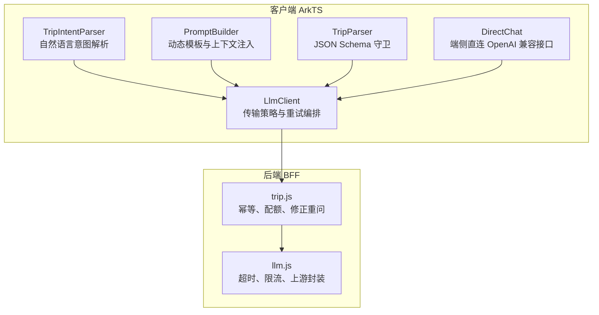
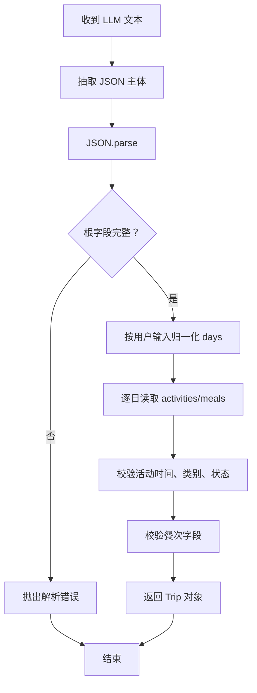
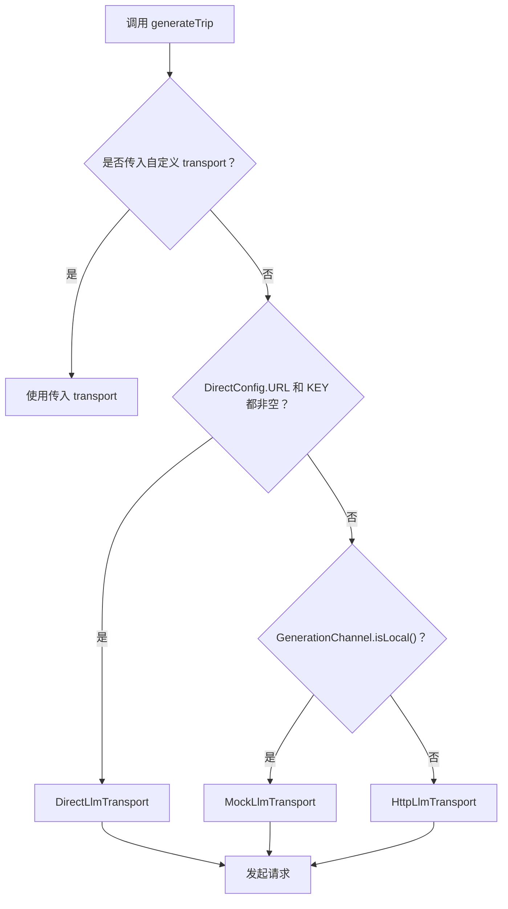
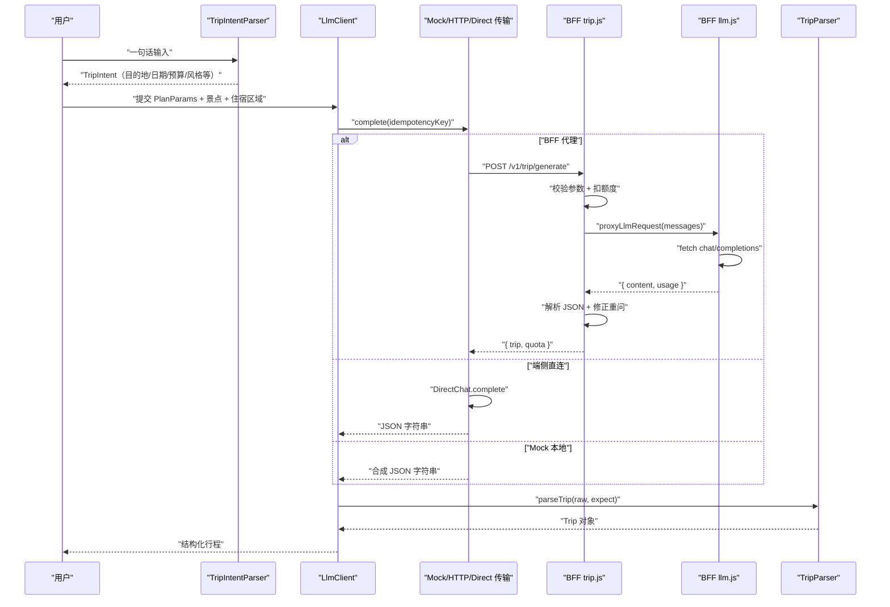
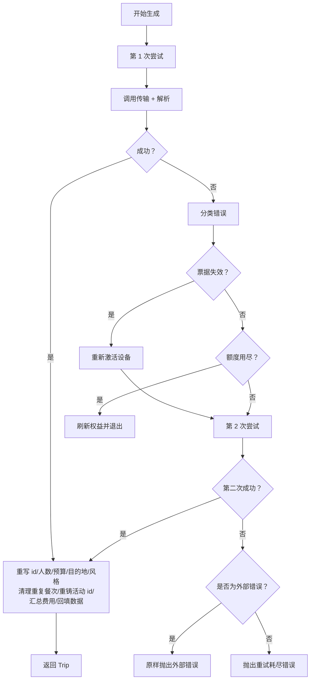
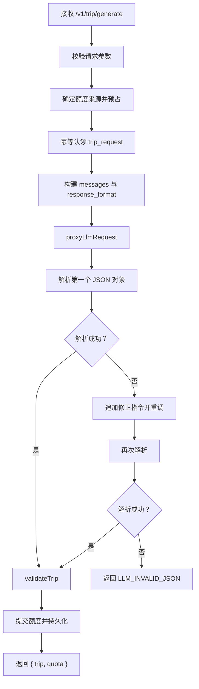
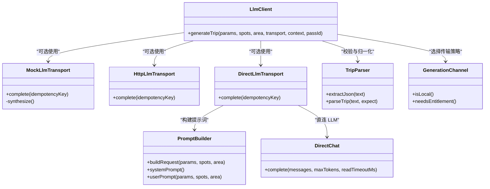

# AI 功能模块

<cite>
**本文引用的文件**   
- [LlmClient.ets](file://entry/src/main/ets/ai/LlmClient.ets)
- [PromptBuilder.ets](file://entry/src/main/ets/ai/PromptBuilder.ets)
- [TripParser.ets](file://entry/src/main/ets/ai/TripParser.ets)
- [TripIntentParser.ets](file://entry/src/main/ets/utils/TripIntentParser.ets)
- [DirectChat.ets](file://entry/src/main/ets/ai/DirectChat.ets)
- [TripRequestPayload.ets](file://entry/src/main/ets/ai/TripRequestPayload.ets)
- [GenerationChannel.ets](file://entry/src/main/ets/utils/GenerationChannel.ets)
- [ApiConfig.ets](file://entry/src/main/ets/common/config/ApiConfig.ets)
- [DirectConfig.ets](file://entry/src/main/ets/common/config/DirectConfig.ets)
- [MockConfig.ets](file://entry/src/main/ets/common/config/MockConfig.ets)
- [llm.js](file://bff/src/services/llm.js)
- [trip.js](file://bff/src/routes/trip.js)
</cite>

## 目录

1. [引言](#引言)
2. [项目结构](#项目结构)
3. [核心组件](#核心组件)
4. [架构总览](#架构总览)
5. [详细组件分析](#详细组件分析)
6. [依赖关系分析](#依赖关系分析)
7. [性能考虑](#性能考虑)
8. [故障排查指南](#故障排查指南)
9. [结论](#结论)

## 引言

本文件聚焦“有径”应用的大语言模型集成层，目标是把用户输入逐步转化为结构化行程数据。整体链路分为四层：

| 层次 | 职责 | 主要实现 |
|---|---|---|
| 意图识别 | 从自然语言提取目的地、日期、天数、人数、预算、风格、交通方式、节奏和兴趣标签 | `TripIntentParser` |
| 提示词构建 | 把计划参数、景点库、住宿区域、Schema 规则合并为系统提示与用户消息 | `PromptBuilder` |
| LLM 传输 | 在 Mock、BFF 代理、直连 LLM 三种策略间动态选择并发起请求 | `LlmClient` + `MockLlmTransport` / `HttpLlmTransport` / `DirectLlmTransport` |
| 行程解析 | 校验 JSON、归一化天数、枚举白名单、回填地址与预约信息 | `TripParser` + `LlmClient` 后处理 |

该设计强调“多道防线”：提示词约束、服务端 JSON 校验、端侧类型守卫、调用方业务归一化，共同降低大模型输出不稳定带来的风险。

**章节来源**
- [LlmClient.ets:1-60](file://entry/src/main/ets/ai/LlmClient.ets#L1-L60)
- [PromptBuilder.ets:1-30](file://entry/src/main/ets/ai/PromptBuilder.ets#L1-L30)
- [TripParser.ets:1-40](file://entry/src/main/ets/ai/TripParser.ets#L1-L40)
- [TripIntentParser.ets:1-35](file://entry/src/main/ets/utils/TripIntentParser.ets#L1-L35)

## 项目结构

AI 相关代码分布在客户端 ArkTS 层与 BFF Node.js 层：

**图表来源**
- [LlmClient.ets:1-60](file://entry/src/main/ets/ai/LlmClient.ets#L1-L60)
- [trip.js:1-40](file://bff/src/routes/trip.js#L1-L40)
- [llm.js:1-30](file://bff/src/services/llm.js#L1-L30)

**章节来源**
- [LlmClient.ets:1-60](file://entry/src/main/ets/ai/LlmClient.ets#L1-L60)
- [trip.js:1-40](file://bff/src/routes/trip.js#L1-L40)
- [llm.js:1-30](file://bff/src/services/llm.js#L1-L30)

## 核心组件

### 意图识别：`TripIntentParser`

`TripIntentParser.parse` 是一个纯函数，不访问网络，也不落盘原始句子。它从一句话中提取 App 能消费的字段，并把歧义写进 `notes`，交给确认面板解释给用户。

| 字段 | 含义 | 默认值 |
|---|---|---|
| `city` | 支持城市 | 空字符串 |
| `unsupportedCity` | MapKit 未内置城市 | 空字符串 |
| `startDate` | ISO 出发日 | 空字符串 |
| `dayCount` | 计划天数 | 0 |
| `people` | 人数 | 0 |
| `budgetAmount` | 原句预算数额 | 0 |
| `budgetIsPerPerson` | 是否人均预算 | false |
| `style` | 旅行风格码值 | 空字符串 |
| `stayTier` | 住宿档位码值 | 空字符串 |
| `transit` | 交通偏好码值 | 空字符串 |
| `pace` | 节奏码值 | 空字符串 |
| `tags` | 兴趣标签数组 | 空数组 |
| `notes` | 可解释说明 | 空数组 |

关键行为包括：

1. **目的地优先级**：先匹配“前往 / 飞往 / 抵达 / 去 / 到”后的地名；再扫描整句；最后匹配 MapKit 未内置城市。
2. **日期推断**：支持月日、今天、明天、后天、大后天、本周/下周星期几，并自动补年、跨年假设未来。
3. **天数边界**：天、晚、日游等表达统一映射为天数，上限 30，且跳过“第 X 天”这种序数误判。
4. **人数边界**：最多 20 人，“一家 N 口”“两口子”“N 个成人”均可识别。
5. **预算折算**：区分“人均/每人”，并按配置区间取整到步长。
6. **风格到节奏的默认**：如果只说了“暴走”或“休闲”，但没有显式节奏，则自动映射到紧凑或轻松。
7. **兴趣标签推导**：根据风格追加亲子、经典、必去等标签，用于后续选点加权。

**章节来源**
- [TripIntentParser.ets:1-120](file://entry/src/main/ets/utils/TripIntentParser.ets#L1-L120)
- [TripIntentParser.ets:200-360](file://entry/src/main/ets/utils/TripIntentParser.ets#L200-L360)
- [TripIntentParser.ets:360-603](file://entry/src/main/ets/utils/TripIntentParser.ets#L360-L603)

### 提示词构建：`PromptBuilder`

`PromptBuilder` 是提示词“单一事实来源”。它生成三类内容：

1. **行程生成提示**：系统指令内嵌完整 JSON Schema，用户消息携带计划参数、已选景点、住宿区域、坐标、预约信息和开放时间。
2. **AI 精选排序提示**：对 P1 精选候选进行排序与取舍，限定只能使用候选自带信息。
3. **请求对象**：返回包含系统消息、用户消息以及 `jsonSchemaStrict` 标志的结构体。

| 组成部分 | 作用 |
|---|---|
| `systemPrompt()` | 定义行程引擎角色、Schema 约束、时间窗口、餐次规则、地址回填策略、1 天行程特殊限制 |
| `userPrompt(params, spots, area)` | 注入目的地、日期、天数、人数、预算、风格、住宿区域通勤、每个景点的完整规划信息 |
| `pickSystemPrompt()` | 限定排序范围、理由长度、禁止编造候选不存在的事实 |
| `pickUserPrompt(input)` | 序列化城市、天数、节奏、兴趣和候选列表 |

提示词中的强约束包括：

- 每天必须同时存在 `dayIndex`、`date`、`theme`、`intensity`、`dailyCost`、`activities`、`meals`。
- 每餐只写入 `meals`，不在 `activities` 里重复出现“午餐 / 晚餐”。
- 1 天行程活动停留加通勤不超过 480 分钟，首站不早于 07:30，最后一站结束不超首站加 10 小时。
- 地址、经纬度由模型留空，App 按景点库回填。
- 字符串中禁止英文双引号和反斜杠，避免直接破坏 JSON。
- `accommodation` 只填区域名，不得编具体酒店。

**章节来源**
- [PromptBuilder.ets:1-187](file://entry/src/main/ets/ai/PromptBuilder.ets#L1-L187)

### 行程解析：`TripParser`

`TripParser` 是 LLM 响应进入 App 前的“第三道防线”。它不接受任何隐式断言，所有字段通过带路径的错误信息抛出。

解析流程要点：

1. **抽取 JSON**：从可能带有 Markdown 围栏或前后说明的文本中定位第一个 `{` 到最后一个 `}`。
2. **根对象校验**：要求 `id`、`destination`、`startDate`、`endDate`、`people`、`budget`、`style`、`overview`、`days`、`tips`。
3. **行程窗口归一化**：以用户输入的 `expect.days` 和 `expect.startDate` 为准；多余天数截掉，不足天数抛错；`dayIndex` 和 `date` 按数组位置重排。
4. **每日结构校验**：检查 `activities`、`meals`、`intensity`、`dailyCost` 等必填项。
5. **活动校验**：时间格式、结束时间必须晚于开始时间、类别和状态必须在白名单内。
6. **餐次校验**：类型、名称、地点、费用必填，时间可选。
7. **枚举白名单**：强度、状态、类别、餐型全部来自 Schema 常量。

**图表来源**
- [TripParser.ets:40-120](file://entry/src/main/ets/ai/TripParser.ets#L40-L120)
- [TripParser.ets:120-299](file://entry/src/main/ets/ai/TripParser.ets#L120-L299)

**章节来源**
- [TripParser.ets:1-120](file://entry/src/main/ets/ai/TripParser.ets#L1-L120)
- [TripParser.ets:120-299](file://entry/src/main/ets/ai/TripParser.ets#L120-L299)

### LLM 传输策略与动态切换

`LlmClient` 暴露统一的 `generateTrip` 入口，内部根据配置选择三种传输策略：

| 策略 | 触发条件 | 特点 |
|---|---|---|
| `MockLlmTransport` | 本地开发、BFF 未配置、或用户主动降级 | 离线合成合法 Trip JSON，不走网络 |
| `HttpLlmTransport` | 正常生产环境，BFF 已配置 | 端侧发送业务参数，BFF 负责提示词、鉴权、配额、LLM 调用 |
| `DirectLlmTransport` | `DirectConfig.URL` 与 `DirectConfig.KEY` 均非空 | 端侧直连 OpenAI 兼容接口，开发期兜底 |

动态切换逻辑如下：

**图表来源**
- [LlmClient.ets:300-360](file://entry/src/main/ets/ai/LlmClient.ets#L300-L360)
- [GenerationChannel.ets:1-44](file://entry/src/main/ets/utils/GenerationChannel.ets#L1-L44)
- [DirectConfig.ets:1-33](file://entry/src/main/ets/common/config/DirectConfig.ets#L1-L33)

#### Mock 策略

`MockLlmTransport` 根据计划参数、已选景点和住宿区域，按天切分活动，填充午餐、晚餐、住宿区域、主题、强度和估算费用。它模拟真实行程管线，但完全离线运行，适合开发和回归测试。

注意：地图来源城市的预约信息可能“未获取”，因此不会错误声称“无需预约”，而是保留“以官方为准”语义。

#### HTTP 策略

`HttpLlmTransport` 通过 `buildTripGeneratePayload` 构造端侧 SOT 请求体，字段与 `PromptBuilder.userPrompt` 一一对应。它发送 `PlanParams`、完整 `Spot[]`、完整 `Area`，而不是旧版稀疏字符串。

BFF 返回 `{ trip, quota }`，端侧再把 `trip` 转回字符串交给 `TripParser`，并把 `quota` 合并到 `EntitlementStore`。

#### 直连策略

`DirectLlmTransport` 使用 `PromptBuilder.buildRequest` 构造 system/user 消息，再由 `DirectChat.complete` 发起 OpenAI 兼容 `/chat/completions` 请求。Key 只存在于本机 `DirectConfig`，不上架发布包。

**章节来源**
- [LlmClient.ets:60-200](file://entry/src/main/ets/ai/LlmClient.ets#L60-L200)
- [LlmClient.ets:201-360](file://entry/src/main/ets/ai/LlmClient.ets#L201-L360)
- [TripRequestPayload.ets:1-75](file://entry/src/main/ets/ai/TripRequestPayload.ets#L1-L75)
- [DirectChat.ets:1-136](file://entry/src/main/ets/ai/DirectChat.ets#L1-L136)
- [GenerationChannel.ets:1-44](file://entry/src/main/ets/utils/GenerationChannel.ets#L1-L44)

## 架构总览

端到端从用户输入到结构化行程的调用序列如下：

**图表来源**
- [LlmClient.ets:300-482](file://entry/src/main/ets/ai/LlmClient.ets#L300-L482)
- [trip.js:60-234](file://bff/src/routes/trip.js#L60-L234)
- [llm.js:30-98](file://bff/src/services/llm.js#L30-L98)

**章节来源**
- [LlmClient.ets:300-482](file://entry/src/main/ets/ai/LlmClient.ets#L300-L482)
- [trip.js:60-234](file://bff/src/routes/trip.js#L60-L234)
- [llm.js:30-98](file://bff/src/services/llm.js#L30-L98)

## 详细组件分析

### LlmClient 重试与失败处理

`LlmClient.generateTrip` 的核心控制流是“最多两次尝试”：

1. 第一次尝试：调用传输策略，解析 Trip，重写 id、人数、预算、目的地、风格，清理重复餐次活动，重铸活动 id，汇总每日费用，回填地址/开放时段/预约信息。
2. 如果失败：记录原始输出前 240 字，判断错误类型。
3. 票据失效时：首次失败尝试重新激活设备，第二次重试将使用新 token。
4. 额度用尽时：立即停止重试，刷新权益缓存，避免用户反复撞 402。
5. 外部错误原样上抛：网络不可用、网络请求失败、超时、限流、额度耗尽、票据失效。
6. 其他内容类错误：包装为“两次生成均失败”，因为这类问题用户确实只能重试。

**图表来源**
- [LlmClient.ets:360-482](file://entry/src/main/ets/ai/LlmClient.ets#L360-L482)

**章节来源**
- [LlmClient.ets:300-482](file://entry/src/main/ets/ai/LlmClient.ets#L300-L482)

### BFF 行程路由与修正重问

BFF 的 `/v1/trip/generate` 承担以下职责：

| 阶段 | 行为 |
|---|---|
| 参数校验 | 目的地、起止日期、日期范围、天数、人数、预算 |
| 额度检查 | 根据实际扣费来源决定免费档或付费档 |
| 幂等保护 | 同一 `Idempotency-Key` 并发请求只能一个成功 |
| 提示词构建 | 复用 prompt 模块，区分免费档精简提示词 |
| LLM 调用 | 设置最大 token、禁用 thinking、选择 response_format |
| 初次解析 | 严格 JSON.parse，失败再提取第一个完整对象 |
| 修正重问 | 若仍失败，追加修正指令并重调一次 |
| 结构校验 | 验证最终 trip 是否符合天数与字段约束 |
| 事务结算 | 提交额度、更新幂等行、写回响应体 |

**图表来源**
- [trip.js:40-234](file://bff/src/routes/trip.js#L40-L234)

**章节来源**
- [trip.js:40-234](file://bff/src/routes/trip.js#L40-L234)
- [llm.js:30-98](file://bff/src/services/llm.js#L30-L98)

### API 调用示例

以下示例描述调用过程，不展示源码内容。

#### 示例一：本地 Mock 生成

场景：BFF 未配置或开发模式启用本地通道。

| 步骤 | 输入 | 输出 |
|---|---|---|
| 1 | 用户选择目的地、日期、人数、预算、风格、景点、住宿区域 | `PlanParams` + `Spot[]` + `Area` |
| 2 | `LlmClient.generateTrip` | 选择 `MockLlmTransport` |
| 3 | `MockLlmTransport.synthesize()` | 合成合法 Trip JSON 字符串 |
| 4 | `TripParser.parseTrip` | 结构化 `Trip` |
| 5 | 重写 id、人数、预算、目的地、风格 | 确保 UI 显示一致 |
| 6 | 回填地址、开放时段、预约信息 | 得到最终行程 |

#### 示例二：BFF 代理生成

场景：正式环境或联调环境。

| 步骤 | 客户端 | 服务器 |
|---|---|---|
| 1 | 构造 `TripGeneratePayload` | 接收 POST `/v1/trip/generate` |
| 2 | 携带 Authorization 与 Idempotency-Key | 校验参数、检查额度 |
| 3 | — | 构建 messages，调用 DeepSeek |
| 4 | — | 若 JSON 非法，发起修正重问 |
| 5 | 解析 `{ trip, quota }` | 返回结构化 trip 与权益快照 |
| 6 | 合并权益缓存 | 继续 UI 流程 |

#### 示例三：端侧直连生成

场景：开发期 AGC 云函数未开通时使用。

| 步骤 | 客户端 | 外部 LLM |
|---|---|---|
| 1 | `PromptBuilder.buildRequest` | — |
| 2 | `DirectLlmTransport.complete` | — |
| 3 | `DirectChat.complete` | 发送 OpenAI 兼容请求 |
| 4 | — | 返回 choices[0].message.content |
| 5 | 抽取 JSON 字符串 | — |
| 6 | `TripParser.parseTrip` | 结构化 Trip |

**章节来源**
- [LlmClient.ets:201-482](file://entry/src/main/ets/ai/LlmClient.ets#L201-L482)
- [TripRequestPayload.ets:1-75](file://entry/src/main/ets/ai/TripRequestPayload.ets#L1-L75)
- [DirectChat.ets:1-136](file://entry/src/main/ets/ai/DirectChat.ets#L1-L136)
- [trip.js:60-234](file://bff/src/routes/trip.js#L60-L234)

## 依赖关系分析

### 组件耦合图

**图表来源**
- [LlmClient.ets:1-60](file://entry/src/main/ets/ai/LlmClient.ets#L1-L60)
- [LlmClient.ets:201-482](file://entry/src/main/ets/ai/LlmClient.ets#L201-L482)
- [PromptBuilder.ets:1-187](file://entry/src/main/ets/ai/PromptBuilder.ets#L1-L187)
- [TripParser.ets:1-120](file://entry/src/main/ets/ai/TripParser.ets#L1-L120)
- [DirectChat.ets:1-136](file://entry/src/main/ets/ai/DirectChat.ets#L1-L136)
- [GenerationChannel.ets:1-44](file://entry/src/main/ets/utils/GenerationChannel.ets#L1-L44)

### 关键依赖说明

| 依赖 | 说明 |
|---|---|
| `ApiConfig` | 提供 BFF 地址、端点、连接超时、读超时、是否跳过 BFF 门禁 |
| `DirectConfig` | 提供直连 LLM 的 URL、KEY、模型名、最大 token |
| `MockConfig` | 控制是否强制本地数据路由 |
| `GenerationChannel` | 统一判定是否走本地合成 |
| `TripRequestPayload` | 端侧 SOT，保证与 BFF rich 分支字段同步 |
| `trip.js` | BFF 主路由，串联幂等、配额、提示词、LLM、校验 |
| `llm.js` | 封装上游超时、限流、response_format 和用量日志 |

**章节来源**
- [ApiConfig.ets:1-66](file://entry/src/main/ets/common/config/ApiConfig.ets#L1-L66)
- [DirectConfig.ets:1-33](file://entry/src/main/ets/common/config/DirectConfig.ets#L1-L33)
- [MockConfig.ets:1-15](file://entry/src/main/ets/common/config/MockConfig.ets#L1-L15)
- [TripRequestPayload.ets:1-75](file://entry/src/main/ets/ai/TripRequestPayload.ets#L1-L75)

## 性能考虑

当前仓库已实现部分优化，但仍可进一步改进：

| 方向 | 现状 | 建议 |
|---|---|---|
| 请求缓存 | 无显式请求级缓存；BFF 有幂等键防止重复计费 | 对相同 `PlanParams` + `spots` + `area` 做短期内存缓存，避免重复 LLM 调用 |
| 并发控制 | 端侧 `http.createHttp` 每次独立创建并销毁 | 可引入轻量队列限制并发生成请求，避免同时多次打 BFF |
| 重试机制 | 端侧最多两次；BFF 有一次修正重问 | 对 429 限流增加指数退避；对临时网络错误增加短间隔重试 |
| 提示词长度 | 免费档 8192 token，付费档 16384 token | 对超长行程拆分 day 分批生成，再合并 Trip |
| 增量重排 | 已有“修正重问” | 针对仅缺某个 day 的情况，优先补一天而非全量重排 |
| 结果缓存 | 无 | 对已落库的 Trip 做查询缓存，避免重复渲染 |
| 直连 Key 管理 | Key 放 `DirectConfig` | 开发期使用安全存储或环境变量注入，不要硬编码进发布包 |
| 日志采样 | 已记录用量和部分错误 | 对高频失败样本采样上报，减少日志体积 |

**章节来源**
- [llm.js:1-98](file://bff/src/services/llm.js#L1-L98)
- [trip.js:60-234](file://bff/src/routes/trip.js#L60-L234)
- [LlmClient.ets:300-482](file://entry/src/main/ets/ai/LlmClient.ets#L300-L482)

## 故障排查指南

### 常见错误分类

| 错误类型 | 表现 | 处理策略 |
|---|---|---|
| 网络异常 | DNS 失败、连接失败、平台返回 2300025 | 报告“网络请求失败”或“请求超时”，不包装成“模型没排通” |
| LLM 超时 | BFF 侧 `AbortSignal.timeout` 或端侧超时 | BFF 返回 504；端侧按超时文案引导 |
| 上游限流 | BFF 返回 429 | 端侧转换为限流错误码，给出等待提示 |
| 票据失效 | 401 或云端错误码 | 重新激活设备后重试一次 |
| 额度用尽 | 402 或云端额度耗尽 | 停止重试，刷新权益缓存，引导续费 |
| 模型输出非法 JSON | BFF 初次解析失败 | 发起修正重问，仍失败返回 502 |
| 行程结构非法 | BFF `validateTrip` 失败 | 返回结构化校验错误 |
| 端侧解析失败 | `TripParser` 抛出类型守卫或 Schema 错误 | 记录原始输出片段，便于调试 |

### 排查建议

1. **先看传输层**：确认走的是 Mock、HTTP 还是 Direct。
2. **再看 BFF 日志**：查看 prompt 模式、freeTier、response_format、模型名和 token 用量。
3. **检查幂等键**：同一 key 并发会返回 409，避免双扣费和双写。
4. **核对提示词约束**：特别是 1 天行程、餐次重复、地址回填、字符串内引号。
5. **核对端侧解析路径**：`TripParser` 会把错误路径精确到 `days[i].activities[j]`。
6. **区分外部错误和内容错误**：外部错误不应被包装成“重试耗尽”。

**章节来源**
- [LlmClient.ets:201-482](file://entry/src/main/ets/ai/LlmClient.ets#L201-L482)
- [trip.js:60-234](file://bff/src/routes/trip.js#L60-L234)
- [llm.js:30-98](file://bff/src/services/llm.js#L30-L98)
- [TripParser.ets:40-299](file://entry/src/main/ets/ai/TripParser.ets#L40-L299)

## 结论

“有径”的 AI 功能模块采用清晰的分层设计：意图识别只做轻量本地解析，提示词构建保持单一事实来源，LLM 传输抽象出三种策略，行程解析承担严格的类型与结构守卫。BFF 层则承担鉴权、配额、幂等、上游封装和二次修正。

这套设计的关键优势是容错性强：即使模型输出不稳定，也能通过提示词约束、服务端校验、端侧守卫和调用方后处理逐步收敛。未来的重点应放在请求缓存、并发控制、增量重排和更细粒度的重试策略上，从而在保持可靠性的同时降低延迟与成本。