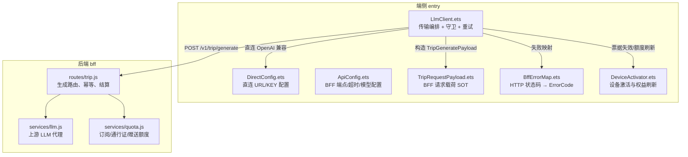
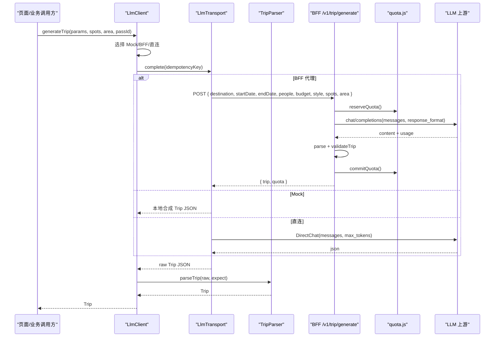
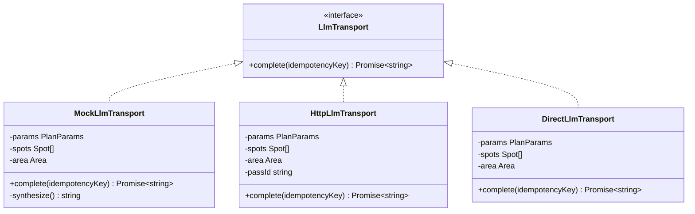
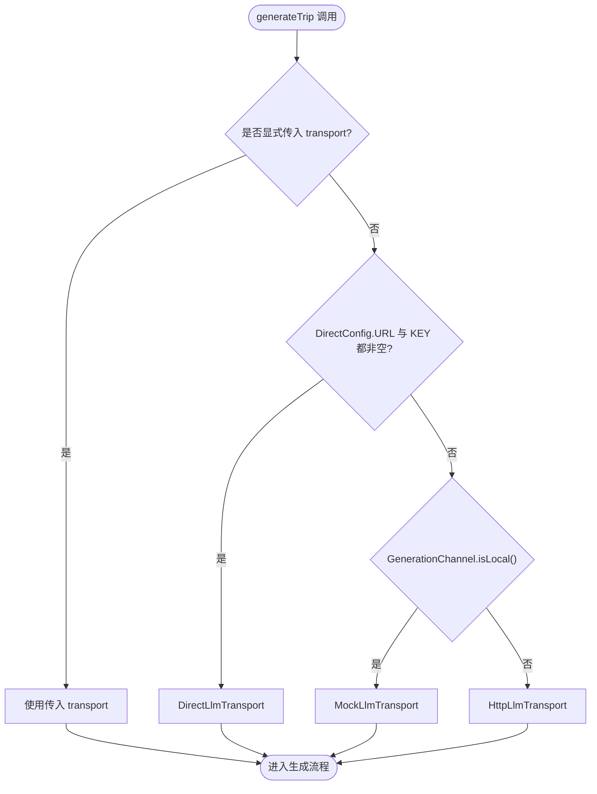
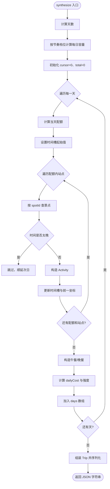
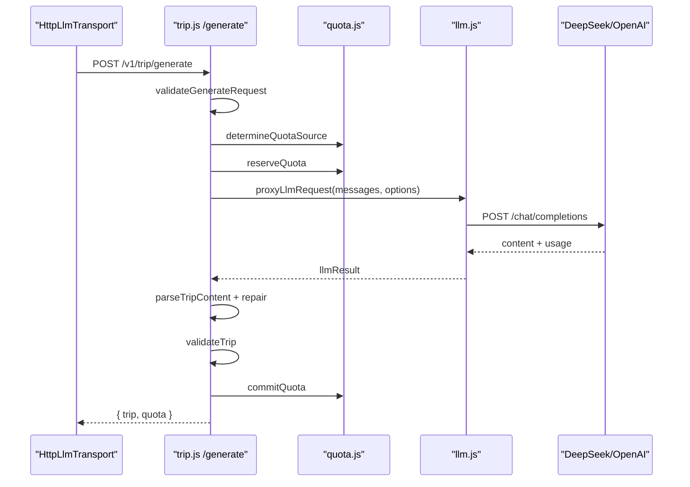
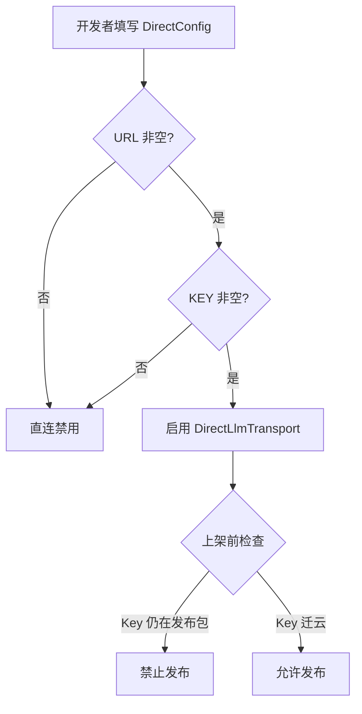
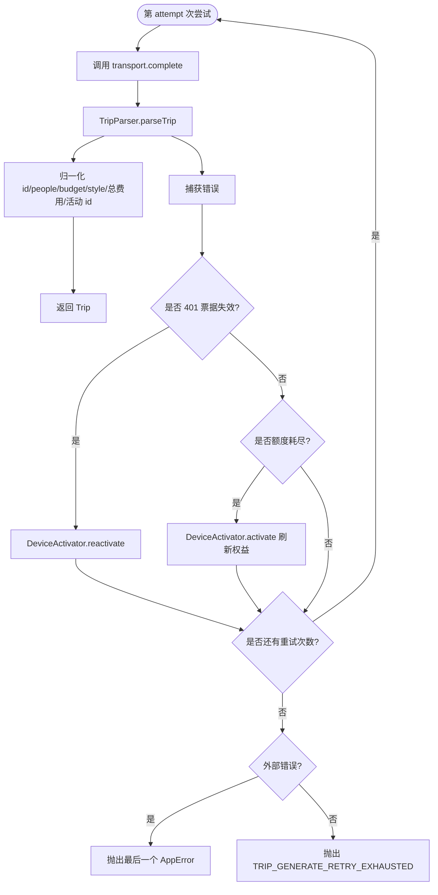
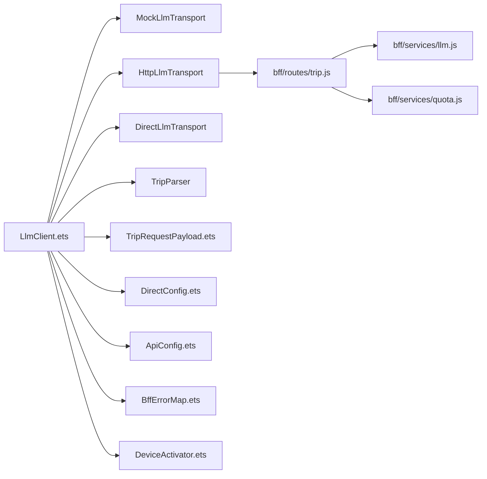

# LLM 传输策略

<cite>
**本文引用的文件**   
- [LlmClient.ets](file://entry/src/main/ets/ai/LlmClient.ets)
- [DirectConfig.ets](file://entry/src/main/ets/common/config/DirectConfig.ets)
- [ApiConfig.ets](file://entry/src/main/ets/common/config/ApiConfig.ets)
- [MockConfig.ets](file://entry/src/main/ets/common/config/MockConfig.ets)
- [TripRequestPayload.ets](file://entry/src/main/ets/ai/TripRequestPayload.ets)
- [BffErrorMap.ets](file://entry/src/main/ets/utils/BffErrorMap.ets)
- [DeviceActivator.ets](file://entry/src/main/ets/data/DeviceActivator.ets)
- [trip.js](file://bff/src/routes/trip.js)
- [llm.js](file://bff/src/services/llm.js)
- [quota.js](file://bff/src/services/quota.js)
- [LLM接入方案-2026-10-26.md](file://Docs/LLM接入方案-2026-10-26.md)
</cite>

## 目录
1. [引言](#引言)
2. [项目结构定位](#项目结构定位)
3. [核心组件](#核心组件)
4. [架构总览](#架构总览)
5. [三种传输实现详解](#三种传输实现详解)
6. [动态切换机制](#动态切换机制)
7. [Mock 确定性合成逻辑](#mock-确定性合成逻辑)
8. [BFF 代理模式](#bff-代理模式)
9. [直连模式的开发用途与安全限制](#直连模式的开发用途和安全限制)
10. [错误处理与重试策略](#错误处理与重试策略)
11. [依赖关系分析](#依赖关系分析)
12. [故障排查指南](#故障排查指南)
13. [结论](#结论)

## 引言
本文件围绕 LLM 生成行程的「传输层」展开，目标是让读者在不深入源码的情况下理解：
- `LlmClient` 抽象出的三种传输实现：离线 Mock、BFF 代理、端侧直连；
- 运行时如何根据配置与环境自动选择传输；
- Mock 如何从业务参数确定性合成合法 Trip JSON；
- BFF 如何构建提示词、注入密钥、扣减配额并转发 LLM；
- 直连模式为什么只用于开发调试，以及上架前必须迁云的原因；
- 网络异常、票据失效、额度耗尽等错误的处理路径。

## 项目结构定位
LLM 传输能力横跨端侧与后端两个仓库子模块：

**图表来源**
- [LlmClient.ets:201-482](file://entry/src/main/ets/ai/LlmClient.ets#L201-L482)
- [DirectConfig.ets:1-33](file://entry/src/main/ets/common/config/DirectConfig.ets#L1-L33)
- [ApiConfig.ets:1-66](file://entry/src/main/ets/common/config/ApiConfig.ets#L1-L66)
- [TripRequestPayload.ets:1-75](file://entry/src/main/ets/ai/TripRequestPayload.ets#L1-L75)
- [BffErrorMap.ets:1-41](file://entry/src/main/ets/utils/BffErrorMap.ets#L1-L41)
- [DeviceActivator.ets:1-159](file://entry/src/main/ets/data/DeviceActivator.ets#L1-L159)
- [trip.js:1-200](file://bff/src/routes/trip.js#L1-L200)
- [llm.js:1-98](file://bff/src/services/llm.js#L1-L98)
- [quota.js:1-113](file://bff/src/services/quota.js#L1-L113)

**章节来源**
- [LlmClient.ets:1-200](file://entry/src/main/ets/ai/LlmClient.ets#L1-L200)
- [LlmClient.ets:201-482](file://entry/src/main/ets/ai/LlmClient.ets#L201-L482)
- [trip.js:1-200](file://bff/src/routes/trip.js#L1-L200)
- [llm.js:1-98](file://bff/src/services/llm.js#L1-L98)
- [quota.js:1-113](file://bff/src/services/quota.js#L1-L113)

## 核心组件
| 组件 | 职责 | 关键行为 |
|---|---|---|
| `LlmTransport` 接口 | 定义传输抽象 | `complete(idempotencyKey?)` 返回原始 Trip JSON 字符串 |
| `MockLlmTransport` | 离线闭环 | 按 `PlanParams` 和预选景点确定性地合成合法 Trip JSON |
| `HttpLlmTransport` | BFF 代理 | 发送业务参数到 `/v1/trip/generate`，解析 `{ trip, quota }` |
| `DirectLlmTransport` | 端侧直连 | 使用 `PromptBuilder` + `DirectChat` 调用 OpenAI 兼容端点 |
| `LlmClient` | 编排器 | 选择传输、执行守卫、重试、回填、归一化 |
| BFF `/generate` 路由 | 服务端生成入口 | 校验、预留额度、构建提示词、调 LLM、校验、结算 |
| `llm.js` | LLM 上游代理 | 构造请求体、注入 Key、超时与 429/502 分类 |
| `quota.js` | 额度账本 | 订阅/通行证/赠送额度、预留/提交/释放 |

**章节来源**
- [LlmClient.ets:1-200](file://entry/src/main/ets/ai/LlmClient.ets#L1-L200)
- [LlmClient.ets:201-482](file://entry/src/main/ets/ai/LlmClient.ets#L201-L482)
- [trip.js:1-200](file://bff/src/routes/trip.js#L1-L200)
- [llm.js:1-98](file://bff/src/services/llm.js#L1-L98)
- [quota.js:1-113](file://bff/src/services/quota.js#L1-L113)

## 架构总览

**图表来源**
- [LlmClient.ets:201-482](file://entry/src/main/ets/ai/LlmClient.ets#L201-L482)
- [trip.js:1-200](file://bff/src/routes/trip.js#L1-L200)
- [llm.js:1-98](file://bff/src/services/llm.js#L1-L98)
- [quota.js:1-113](file://bff/src/services/quota.js#L1-L113)

## 三种传输实现详解

### MockLlmTransport（离线闭环）
- **工作原理**：不发起任何网络请求，直接根据 `PlanParams`、已选景点列表 `SelectedSpot[]` 和区域 `Area` 在内存中构造 `Trip`，再序列化为 JSON 字符串。
- **适用场景**：
  - 无后端环境下的端到端管线验证；
  - 用户拍板后默认走本地合成；
  - 需要确定性、可复现结果的回归测试。
- **配置方式**：
  - 由 `LlmClient.generateTrip` 判断 `GenerationChannel.isLocal()` 为真时创建 `MockLlmTransport`；
  - 若显式传入自定义 `transport`，则优先使用传入实例。
- **输出特征**：合成的 Trip 包含按天排布的活动、午餐/晚餐、每日预算、住宿名称和概览摘要，其中摘要会体现“离线合成”。

**章节来源**
- [LlmClient.ets:1-200](file://entry/src/main/ets/ai/LlmClient.ets#L1-L200)
- [LlmClient.ets:201-235](file://entry/src/main/ets/ai/LlmClient.ets#L201-L235)

### HttpLlmTransport（BFF 代理）
- **工作原理**：
  1. 校验 `ApiConfig.BFF_BASE_URL` 与 `ApiConfig.LLM_CHAT_ENDPOINT` 是否非空；
  2. 通过 `buildTripGeneratePayload` 把 `PlanParams`、完整 `Spot[]`、`Area`、可选 `passId` 打包成业务请求体；
  3. 附加 `Authorization`（来自 `DeviceTokenStore`）与可选 `Idempotency-Key`；
  4. 调用 BFF `/v1/trip/generate`；
  5. 将响应中的 `trip` 交给 `TripParser`，把 `quota` 合并进 `EntitlementStore`。
- **适用场景**：
  - 生产或联调环境；
  - 需要服务端鉴权、配额控制、提示词统一、模型计费统计；
  - 发布包不应携带 LLM Key。
- **配置方式**：
  - `ApiConfig.BFF_BASE_URL`：BFF 基础地址；
  - `ApiConfig.LLM_CHAT_ENDPOINT`：BFF 行程生成端点；
  - `ApiConfig.CONNECT_TIMEOUT_MS`、`ApiConfig.READ_TIMEOUT_MS`：连接与读取超时。
- **数据契约**：
  - 请求体见 `TripGeneratePayload`；
  - 响应体为 `{ trip, quota }`，其中 `quota` 字段名沿用历史语义（如 `usedToday` 实际表示本月用量）。

**图表来源**
- [LlmClient.ets:1-200](file://entry/src/main/ets/ai/LlmClient.ets#L1-L200)
- [LlmClient.ets:201-482](file://entry/src/main/ets/ai/LlmClient.ets#L201-L482)

**章节来源**
- [LlmClient.ets:201-335](file://entry/src/main/ets/ai/LlmClient.ets#L201-L335)
- [TripRequestPayload.ets:1-75](file://entry/src/main/ets/ai/TripRequestPayload.ets#L1-L75)
- [ApiConfig.ets:1-66](file://entry/src/main/ets/common/config/ApiConfig.ets#L1-L66)

### DirectLlmTransport（直连 LLM）
- **工作原理**：
  1. 使用 `PromptBuilder.buildRequest` 生成 system/user 两段提示词；
  2. 通过 `DirectChat.complete` 向 `DirectConfig.URL` 发起 OpenAI 兼容 `chat/completions`；
  3. 使用 `DirectConfig.MAX_TOKENS` 作为最大 token 上限；
  4. 直接返回模型输出的 JSON 字符串，交由 `LlmClient` 继续守卫与回填。
- **适用场景**：
  - 开发期兜底，AGC 云函数尚未开通时使用；
  - 快速对拍 PromptBuilder 与真实模型输出；
  - 精选调用也可复用同一直连收口。
- **配置方式**：
  - `DirectConfig.URL`：完整的 OpenAI 兼容端点；
  - `DirectConfig.KEY`：LLM API Key；
  - `DirectConfig.MODEL`：模型名；
  - `DirectConfig.MAX_TOKENS`：单次最大 token。
- **安全约束**：
  - URL 与 KEY 任一为空即禁用直连；
  - KEY 通过 `skip-worktree` 防误提交；
  - 上架前必须迁移至云端持有 Key。

**章节来源**
- [LlmClient.ets:335-482](file://entry/src/main/ets/ai/LlmClient.ets#L335-L482)
- [DirectConfig.ets:1-33](file://entry/src/main/ets/common/config/DirectConfig.ets#L1-L33)

## 动态切换机制
`LlmClient.generateTrip` 是传输选择的唯一决策点之一。其优先级如下：

1. **显式传入 transport**：优先使用调用方传入的实例，绕过自动选择。
2. **直连优先**：如果 `DirectConfig.URL` 与 `DirectConfig.KEY` 都非空，则使用 `DirectLlmTransport`。
3. **本地环境**：如果 `GenerationChannel.isLocal()` 为真，则使用 `MockLlmTransport`。
4. **BFF 代理**：否则使用 `HttpLlmTransport`。

**图表来源**
- [LlmClient.ets:335-482](file://entry/src/main/ets/ai/LlmClient.ets#L335-L482)
- [DirectConfig.ets:1-33](file://entry/src/main/ets/common/config/DirectConfig.ets#L1-L33)
- [ApiConfig.ets:1-66](file://entry/src/main/ets/common/config/ApiConfig.ets#L1-L66)

**章节来源**
- [LlmClient.ets:335-482](file://entry/src/main/ets/ai/LlmClient.ets#L335-L482)

## Mock 确定性合成逻辑
`MockLlmTransport.synthesize()` 的目标不是“像 AI 一样思考”，而是“用确定性规则生成一个结构合法、类型正确、便于下游守卫通过的 Trip”。

### 输入来源
- `PlanParams.basic`：目的地、开始日期、结束日期、人数、预算；
- `PlanParams.style`：旅行风格；
- `PlanParams.paces`：节奏档位集合；
- `PlanParams.selectedSpots`：用户预选景点；
- `spots`：完整景点库，用于按 id 查找坐标、时长、预约信息；
- `area`：区域信息，用于宿名、午餐/晚餐地点、主题文案。

### 天数与节奏分配
- 天数 = 结束日期与开始日期差值加 1，至少为 1；
- 节奏档位按轻松、标准、紧凑的顺序过滤，若无勾选则退化为标准；
- 多档多选时，按天数均匀切分档位数，保证第 1 天到最后一天的节奏单调递增，避免点击顺序影响结果。

### 景点分配算法
- 每天可容纳景点数受当日节奏上限限制；
- 为避免第一天贪心塞满导致后续天空白，采用剩余量摊薄：每天名额取 `max(1, min(perDay, ceil(剩余站点数 / 剩余天数))`；
- 时间槽从上午开始累加，每个活动占用建议时长，之后追加 15 分钟缓冲；
- 超过晚上 8 点后不再硬塞，溢出站点顺延到后续天；
- 通勤段使用 `Transit` 计算直线距离估计的交通方式、时长与详情，替代写死的步行/地铁/打车常量。

### 餐次与预算
- 每天固定午餐、晚餐两条餐次；
- 每日预算按 `300 + 活动数量 × 80` 估算；
- 行程总预算汇总各天 `dailyCost`，并在 `LlmClient` 中强制以合计值覆盖模型可能给错的 `overview.totalCost`。

### 其他结构化兜底
- 地图城市未获取预约信息时，笔记明确标注“预约信息未获取”；
- 活动 id 重铸为 `d{day}-a{index}`，避免模型在多天重复使用相同 id；
- 模型偶发把午/晚餐写成 food 活动时，会删除标题以餐次词结尾的重复项；
- 地址、坐标、开放时间、预约提前量由 `TripEnrich` 回填，减少模型幻觉。

**图表来源**
- [LlmClient.ets:1-200](file://entry/src/main/ets/ai/LlmClient.ets#L1-L200)
- [LlmClient.ets:201-235](file://entry/src/main/ets/ai/LlmClient.ets#L201-L235)

**章节来源**
- [LlmClient.ets:1-200](file://entry/src/main/ets/ai/LlmClient.ets#L1-L200)

## BFF 代理模式
BFF 端负责把端侧业务参数变成模型可理解的提示词，同时承担鉴权、配额、幂等与结算。

### 请求阶段
1. 校验目的地、日期范围、天数、人数、预算；
2. 根据账户身份决定额度来源：订阅、通行证、赠送或管理员；
3. 预留额度，写入幂等行；
4. 并发同键请求中只有一个能抢占 pending 状态，其余返回 409 冲突；
5. 根据免费档（赠送额度）与付费档设置不同 `maxTokens` 与精简程度；
6. 构建 messages 与 `response_format`；
7. 调用 `proxyLlmRequest` 转发到 LLM 上游。

### 响应阶段
1. 先尝试严格 JSON 解析；
2. 失败时提取第一个完整对象，作为修正机会；
3. 仍失败时构造修正消息，再次调用 LLM；
4. 对 Trip 做 schema 校验；
5. 提交额度、更新幂等行状态；
6. 返回 `{ trip, quota }`，其中 quota 包含来源、本月用量、赠送剩余、通行证、订阅信息与是否无限额度。

**图表来源**
- [trip.js:1-200](file://bff/src/routes/trip.js#L1-L200)
- [llm.js:1-98](file://bff/src/services/llm.js#L1-L98)
- [quota.js:1-113](file://bff/src/services/quota.js#L1-L113)

**章节来源**
- [trip.js:1-200](file://bff/src/routes/trip.js#L1-L200)
- [trip.js:201-234](file://bff/src/routes/trip.js#L201-L234)
- [llm.js:1-98](file://bff/src/services/llm.js#L1-L98)
- [quota.js:1-113](file://bff/src/services/quota.js#L1-L113)
- [TripRequestPayload.ets:1-75](file://entry/src/main/ets/ai/TripRequestPayload.ets#L1-L75)

## 直连模式的开发用途与安全限制
### 开发期用途
- 在没有 AGC 云函数或 BFF 可用时提供兜底通道；
- 与 BFF 共用 `PromptBuilder`，确保端侧直连与后端提示词同源；
- 支持快速验证真实模型输出质量，而不依赖完整后端链路；
- 精选调用也复用 `DirectChat`，形成统一的直连收口。

### 安全限制
- `DirectConfig.URL` 与 `DirectConfig.KEY` 任一为空即不启用直连；
- KEY 属于敏感凭据，通过 `skip-worktree` 防止误提交；
- 发布包不能携带 Key；上架前必须迁云，由云端持有 Key；
- 文档明确要求：上架前必须迁云，发布包不能带 Key。

**图表来源**
- [DirectConfig.ets:1-33](file://entry/src/main/ets/common/config/DirectConfig.ets#L1-L33)
- [LlmClient.ets:335-482](file://entry/src/main/ets/ai/LlmClient.ets#L335-L482)
- [LLM接入方案-2026-10-26.md:1-154](file://Docs/LLM接入方案-2026-10-26.md#L1-L154)

**章节来源**
- [DirectConfig.ets:1-33](file://entry/src/main/ets/common/config/DirectConfig.ets#L1-L33)
- [LlmClient.ets:335-482](file://entry/src/main/ets/ai/LlmClient.ets#L335-L482)
- [LLM接入方案-2026-10-26.md:1-154](file://Docs/LLM接入方案-2026-10-26.md#L1-L154)

## 错误处理与重试策略
### 端侧重试主循环
`LlmClient.generateTrip` 最多尝试两次：
1. 第一次调用 `transport.complete`；
2. 成功则解析 Trip，回填地址、开放时间、预约信息，重新生成行程主键和活动 id，汇总每日费用；
3. 失败则记录原始输出片段与错误信息；
4. 第二次尝试后仍失败，按错误类型决定是否上抛业务错误还是包装为“重试耗尽”。

**图表来源**
- [LlmClient.ets:335-482](file://entry/src/main/ets/ai/LlmClient.ets#L335-L482)

### 错误分类
| 错误来源 | 表现 | 处理方式 |
|---|---|---|
| 401 | 票据失效 | 清除旧 token 并重新激活设备，随后重试 |
| 402 | 额度耗尽 | 刷新权益缓存，停止重试，避免白打 |
| 429 | 限流 | 映射为 `CLOUD_RATE_LIMITED`，端侧给出等待文案 |
| 409 | 幂等冲突 | 同一 `Idempotency-Key` 正被另一请求占用 |
| 5xx 内容问题 | `LLM_INVALID_JSON` / `LLM_INVALID_TRIP` | 视为内容不合格，最终包装为重试耗尽 |
| 5xx 上游问题 | `LLM_UPSTREAM_ERROR` | 视为外部不可控错误，原样上抛 |
| 平台超时 | libcurl 2300025 | 映射为 `NETWORK_TIMEOUT` |
| 其他网络异常 | DNS/连接失败 | 映射为 `NETWORK_REQUEST_FAILED` |

### BFF 与上游的错误透传
- BFF 将 429 原样透出，使端侧能区分“等一分钟再试”和“连不上服务”；
- BFF 对 LLM 上游超时设置为 45 秒，保留修正重问余量；
- 解析失败后会发起一次修正调用，并把 prompt/completion token 累计；
- 最终仍无法得到合法 Trip 时，返回 502 并带上具体错误类型。

**章节来源**
- [LlmClient.ets:335-482](file://entry/src/main/ets/ai/LlmClient.ets#L335-L482)
- [BffErrorMap.ets:1-41](file://entry/src/main/ets/utils/BffErrorMap.ets#L1-L41)
- [DeviceActivator.ets:1-159](file://entry/src/main/ets/data/DeviceActivator.ets#L1-L159)
- [llm.js:1-98](file://bff/src/services/llm.js#L1-L98)
- [trip.js:1-200](file://bff/src/routes/trip.js#L1-L200)

## 依赖关系分析

**图表来源**
- [LlmClient.ets:1-482](file://entry/src/main/ets/ai/LlmClient.ets#L1-L482)
- [TripRequestPayload.ets:1-75](file://entry/src/main/ets/ai/TripRequestPayload.ets#L1-L75)
- [DirectConfig.ets:1-33](file://entry/src/main/ets/common/config/DirectConfig.ets#L1-L33)
- [ApiConfig.ets:1-66](file://entry/src/main/ets/common/config/ApiConfig.ets#L1-L66)
- [BffErrorMap.ets:1-41](file://entry/src/main/ets/utils/BffErrorMap.ets#L1-L41)
- [DeviceActivator.ets:1-159](file://entry/src/main/ets/data/DeviceActivator.ets#L1-L159)
- [trip.js:1-200](file://bff/src/routes/trip.js#L1-L200)
- [llm.js:1-98](file://bff/src/services/llm.js#L1-L98)
- [quota.js:1-113](file://bff/src/services/quota.js#L1-L113)

## 故障排查指南
| 现象 | 可能原因 | 排查步骤 |
|---|---|---|
| 生成直接报“BFF 端点未配置” | `ApiConfig.BFF_BASE_URL` 或 `LLM_CHAT_ENDPOINT` 为空 | 检查 ApiConfig；确认是否误用直连或 Mock 环境 |
| 一直 401 | 设备票据失效或过期 | 查看 `DeviceActivator.reactivate` 是否被触发；确认 BFF 是否部署 |
| 一直 402 | 额度耗尽 | 检查订阅有效期、赠送额度、通行证；确认 `EntitlementStore` 是否刷新 |
| 频繁 429 | LLM 上游限流 | 不要立即高频重试；等待一段时间后重试 |
| 报“两次都没排通” | 模型输出不是合法 Trip 且修正仍失败 | 检查 PromptBuilder 提示词、Schema、景点数据完整性 |
| 报“网络不通或超时” | 平台返回 libcurl 2300025 或读超时 | 检查 `READ_TIMEOUT_MS`、DNS、代理、后端健康状态 |
| 行程人数/预算不对 | 模型 echo 了错误用户输入 | 确认 `LlmClient` 已覆盖 `people/budget/destination/style` |
| 费用页总额与每日合计不一致 | 模型 totalCost 与 sum(dailyCost) 不一致 | 确认 `LlmClient` 已将总费用改为各天合计 |
| 直连有效但 BFF 无效 | 直连优先于 BFF | 清空 `DirectConfig.URL/KEY` 或显式传入 `HttpLlmTransport` |
| 直连 Key 被提交到仓库 | 违反安全要求 | 撤销该提交，改用 `skip-worktree`，迁云后清理发布包 |

**章节来源**
- [LlmClient.ets:201-482](file://entry/src/main/ets/ai/LlmClient.ets#L201-L482)
- [BffErrorMap.ets:1-41](file://entry/src/main/ets/utils/BffErrorMap.ets#L1-L41)
- [DeviceActivator.ets:1-159](file://entry/src/main/ets/data/DeviceActivator.ets#L1-L159)
- [ApiConfig.ets:1-66](file://entry/src/main/ets/common/config/ApiConfig.ets#L1-L66)
- [DirectConfig.ets:1-33](file://entry/src/main/ets/common/config/DirectConfig.ets#L1-L33)

## 结论
本项目通过 `LlmTransport` 接口把 LLM 访问方式解耦为三条清晰路径：

- **MockLlmTransport** 提供离线闭环，适合无后端验证、回归测试和用户拍板后的确定性合成；
- **HttpLlmTransport** 是生产推荐路径，把业务参数交给 BFF，由后端统一构建提示词、注入密钥、管理配额、统计用量；
- **DirectLlmTransport** 是开发期兜底，快速验证真实模型，但严禁携带 Key 上架。

动态切换机制以“直连优先、本地环境其次、BFF 兜底”为原则，配合幂等、重试、票据激活与额度刷新，构成一套可扩展的 LLM 传输策略。未来若接入 AGC 云函数或小艺开放平台，只需扩展传输选择逻辑或新增第三个传输实现，无需重写上层生成编排。