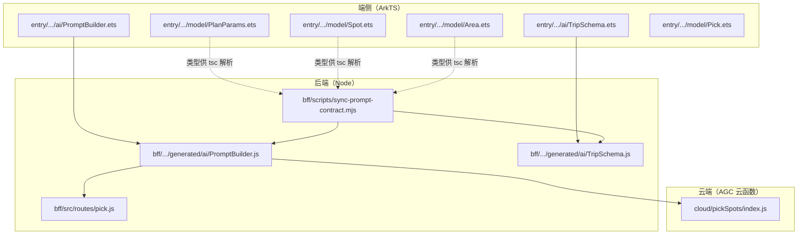
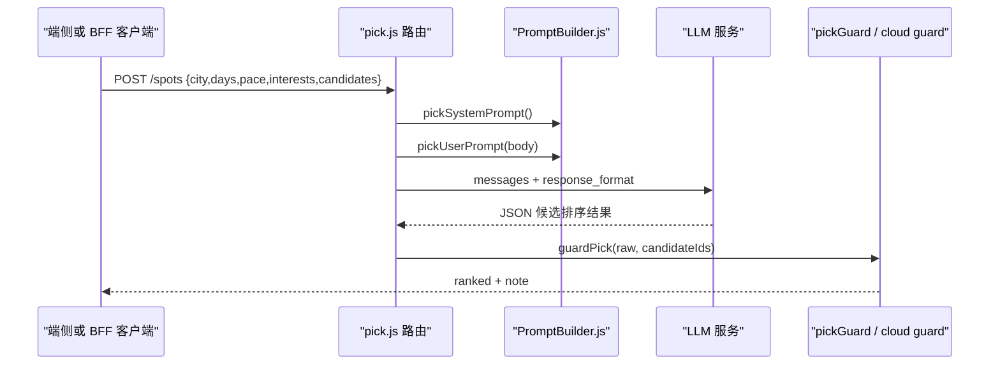
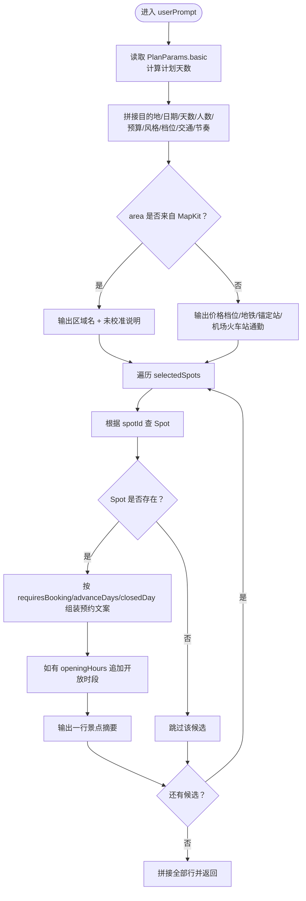
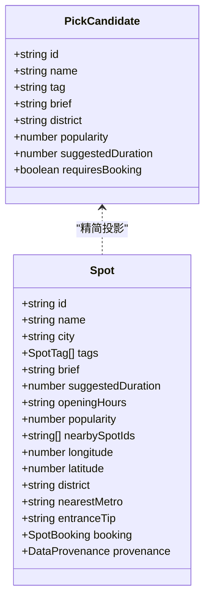
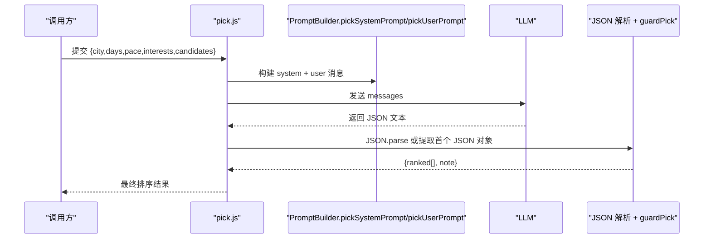
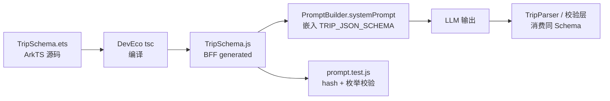
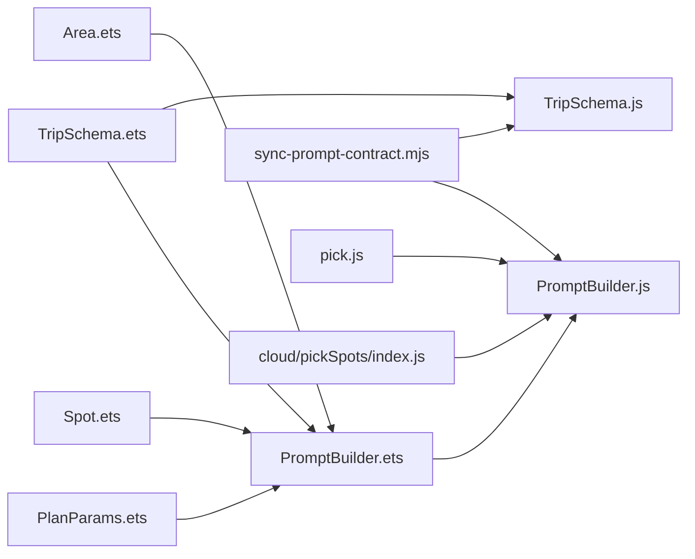

# Prompt 构建系统

<cite>
**本文引用的文件**   
- [PromptBuilder.ets](file://entry/src/main/ets/ai/PromptBuilder.ets)
- [TripSchema.ets](file://entry/src/main/ets/ai/TripSchema.ets)
- [PlanParams.ets](file://entry/src/main/ets/model/PlanParams.ets)
- [Spot.ets](file://entry/src/main/ets/model/Spot.ets)
- [Area.ets](file://entry/src/main/ets/model/Area.ets)
- [Pick.ets](file://entry/src/main/ets/model/Pick.ets)
- [PromptBuilder.js](file://bff/src/prompt/generated/ai/PromptBuilder.js)
- [TripSchema.js](file://bff/src/prompt/generated/ai/TripSchema.js)
- [sync-prompt-contract.mjs](file://bff/scripts/sync-prompt-contract.mjs)
- [prompt.test.js](file://bff/test/prompt.test.js)
- [pick.js](file://bff/src/routes/pick.js)
- [index.js](file://cloud/pickSpots/index.js)
</cite>

## 目录
1. [引言](#引言)
2. [项目结构](#项目结构)
3. [核心组件](#核心组件)
4. [架构总览](#架构总览)
5. [详细组件分析](#详细组件分析)
6. [依赖关系分析](#依赖关系分析)
7. [性能与成本优化](#性能与成本优化)
8. [故障排查指南](#故障排查指南)
9. [结论](#结论)

## 引言
本文件聚焦于“行程规划”和“AI 精选”两条路径中的 Prompt 构建系统，重点解释：
- `systemPrompt` 的 20 条规则如何覆盖行程天数、活动时间、预约信息、预算控制等关键约束；
- `userPrompt` 如何将 `PlanParams`、景点库、住宿区域数据整合为结构化提示词；
- `PickCandidate` 的精简设计为何能节省 token 并降低幻觉面；
- P1 AI 精选专用提示词 `pickSystemPrompt` / `pickUserPrompt` 的作用；
- JSON Schema 常量与解析器、校验器的同源关系；
- 不同输入下的提示词变化与可观测输出示例；
- token 成本控制与上下文压缩策略。

## 项目结构
Prompt 构建系统以端侧 ArkTS 实现为单一事实源（SOT），BFF 与云函数通过同步脚本生成 JS 产物后复用，避免多处维护导致漂移。

**图表来源**
- [PromptBuilder.ets:1-187](file://entry/src/main/ets/ai/PromptBuilder.ets#L1-L187)
- [TripSchema.ets:1-151](file://entry/src/main/ets/ai/TripSchema.ets#L1-L151)
- [sync-prompt-contract.mjs:1-175](file://bff/scripts/sync-prompt-contract.mjs#L1-L175)
- [pick.js:1-45](file://bff/src/routes/pick.js#L1-L45)
- [index.js:1-200](file://cloud/pickSpots/index.js#L1-L200)

**章节来源**
- [PromptBuilder.ets:1-187](file://entry/src/main/ets/ai/PromptBuilder.ets#L1-L187)
- [sync-prompt-contract.mjs:1-175](file://bff/scripts/sync-prompt-contract.mjs#L1-L175)

## 核心组件
- **`PromptBuilder`**：统一构造行程生成与 AI 精选两类 LLM 请求。包含：
  - `buildRequest(params, spots, area)`：返回系统消息、用户消息以及是否启用严格 JSON Schema。
  - `systemPrompt()`：嵌入 20 条业务规则与完整 Trip JSON Schema。
  - `userPrompt(params, spots, area)`：把用户参数、景点详情、住宿区域拼成结构化文本。
  - `pickSystemPrompt()` / `pickUserPrompt(input)`：P1 精选专用提示词。
- **`TripSchema`**：用 ArkTS 对象构造 JSON Schema 字符串，同时暴露枚举白名单供解析器和提示词共用。
- **模型层**：`PlanParams`、`Spot`、`Area`、`PickCandidate` 提供输入契约。

**章节来源**
- [PromptBuilder.ets:14-187](file://entry/src/main/ets/ai/PromptBuilder.ets#L14-L187)
- [TripSchema.ets:1-151](file://entry/src/main/ets/ai/TripSchema.ets#L1-L151)
- [PlanParams.ets:1-128](file://entry/src/main/ets/model/PlanParams.ets#L1-L128)
- [Spot.ets:1-69](file://entry/src/main/ets/model/Spot.ets#L1-L69)
- [Area.ets:1-51](file://entry/src/main/ets/model/Area.ets#L1-L51)
- [Pick.ets:1-25](file://entry/src/main/ets/model/Pick.ets#L1-L25)

## 架构总览
行程生成与 AI 精选共享同一份 Prompt SOT，但走两条调用链：

**图表来源**
- [pick.js:1-45](file://bff/src/routes/pick.js#L1-L45)
- [index.js:120-200](file://cloud/pickSpots/index.js#L120-L200)
- [PromptBuilder.js:1-158](file://bff/src/prompt/generated/ai/PromptBuilder.js#L1-L158)

## 详细组件分析

### systemPrompt：20 条规则的设计原理
`systemPrompt` 不是普通文案，而是“强约束指令 + 同源 JSON Schema”。其设计目标有三层：
1. **结构正确性**：强制 JSON Schema 输出，禁止 Markdown 围栏、注释、额外文字。
2. **业务一致性**：通过 20 条规则覆盖行程长度、时间窗口、活动分类、餐饮安排、地址回填、风险字段、预算汇总等易错点。
3. **反幻觉**：明确禁止编造开放时段、预约方式、酒店名、坐标、地址等硬信息，把不可信内容交给应用层回填。

#### 规则分组与意图

| 规则编号 | 主题 | 设计意图 |
|---|---|---|
| 1 | 行程天数与日期连续性 | 保证 `days` 数组长度等于用户计划天数，`dayIndex` 从 1 连续递增，日期逐日加一。 |
| 2 | 活动时间与通勤建模 | 相邻活动间通勤写入后一活动的 `transport`；`category=transport` 节点本身不重复填 `transport`。 |
| 3 | 状态与分类白名单 | `status` 与 `category` 只能取 Schema 中枚举值，避免自由文本污染下游解析。 |
| 4 | 必去优先与餐饮底线 | 必须覆盖 `must`，尽量覆盖 `want`，每天至少午餐、晚餐各一条。 |
| 5 | 预约信息落回 note/reason | 预约信息必须体现在对应活动中，并注明“以官方为准”。 |
| 6 | 紧凑安排的中文理由 | 对清晨/夜间等紧张安排要求一句中文解释。 |
| 7 | 金额整数与汇总一致 | 所有金额为整数元，`overview.totalCost` 约等于各天 `dailyCost` 之和。 |
| 8 | 用餐时刻区间 | 早餐、午餐、晚餐分别落在推荐时间窗内，便于屏端按时间并排展示。 |
| 9 | location 语义 | 填写入口别称而非标题或地址，避免 UI 重复。 |
| 10 | risk 字段克制 | 只有确有闭馆、雨季、抢票等风险才写，不凑字段。 |
| 11 | 禁止英文双引号与反斜杠 | 防止模型在中文强调中使用英文引号导致 JSON 非法。 |
| 12 | address/坐标留空 | 让应用层按景点库回填，避免重写错误地址与浪费 token。 |
| 13 | day 必填七键与 meals 非空 | 每个 day 必须有 `dayIndex/date/theme/intensity/dailyCost/activities/meals`，即使赶路也要给出两餐。 |
| 14 | 开放时间约束 | 若景点有开放时段，排期不得越界。 |
| 15 | 未获取预约不编造 | 不能编造预约方式和提前天数。 |
| 16 | 单日行程不拆成两天 | 计划天数为 1 时只输出一个 day。 |
| 17 | 单日 480 分钟停留上限 | 活动停留+通勤不超过 8 小时，首站不早于 07:30，末站相对首站不超过 10 小时。 |
| 18 | meals 与 activities 不重复 | 通用午餐/晚餐只写进 meals，不在 activities 再塞通用用餐条目。 |
| 19 | 任意一天均受当日容量限制 | 不只是 1 天行程，任何一天的活动数量与时长都要受节奏档约束。 |
| 20 | accommodation 只写区域 | 不编具体酒店名，保持整趟一致，不确定则省略。 |

这些规则来源于真实机测试失败案例的归纳，例如：
- 首日遗漏 `meals` 导致重试；
- 1 天行程被拆成两天；
- 旧约束“≤10 小时”和“不晚于 21:00”互相打架；
- activities 与 meals 出现两顿午饭；
- 多日行程没有当日容量约束；
- accommodation 被编造成具体酒店名。

**章节来源**
- [PromptBuilder.ets:29-118](file://entry/src/main/ets/ai/PromptBuilder.ets#L29-L118)
- [prompt.test.js:35-71](file://bff/test/prompt.test.js#L35-L71)

### userPrompt：PlanParams、Spot、Area 的结构化注入
`userPrompt` 负责把三类数据拼接成人类可读、机器可读性强的结构化段落：

1. **基础参数**：目的地、起止日期、计划天数、人数、预算、风格、住宿档位、交通偏好、节奏。
2. **住宿区域**：区分地图服务区县与普通区域库。MapKit 区县没有价格档位、通勤、地铁校准信息，因此如实说明“未获取”，不让模型推断。
3. **已选景点**：遍历 `params.selectedSpots`，查找对应 `Spot`，并按优先级、行政区、建议时长、坐标、预约信息、开放时段、周边景点和用户备注输出。

关键点：
- MapKit 来源的景点没有预约字段，因此提示词使用“预约信息未获取，以官方为准”，而不是误导性的“无需预约”。
- 景点地址由 Schema 第 12 条与 `address` 非必填共同约束，让模型不要重写地址。
- `area.source.indexOf('MapKit')` 分支确保不会向模型输出空的地铁线或 0 分钟通勤。

**图表来源**
- [PromptBuilder.ets:120-169](file://entry/src/main/ets/ai/PromptBuilder.ets#L120-L169)
- [PlanParams.ets:74-108](file://entry/src/main/ets/model/PlanParams.ets#L74-L108)
- [Spot.ets:34-69](file://entry/src/main/ets/model/Spot.ets#L34-L69)
- [Area.ets:25-51](file://entry/src/main/ets/model/Area.ets#L25-L51)

**章节来源**
- [PromptBuilder.ets:120-169](file://entry/src/main/ets/ai/PromptBuilder.ets#L120-L169)
- [prompt.test.js:73-102](file://bff/test/prompt.test.js#L73-L102)

### PickCandidate 的精简设计
`PickCandidate` 刻意只保留以下字段：
- `id`、`name`、`tag`、`brief`、`district`、`popularity`、`suggestedDuration`、`requiresBooking`。

相比完整 `Spot`，它省去了坐标、经纬度、周边景点、入口提示、完整 booking 子对象、provenance、城市、标签数组等大量字段。这样做的目的很明确：
- **节省 token**：AI 精选通常处理较多候选，每少一个字段都能显著降低 prompt 体积。
- **减少幻觉面**：不提供坐标、详细地址、复杂 booking 细节，模型就不容易编造距离、营业时间、门票等未给定的事实。
- **聚焦排序任务**：P1 精选只做“候选池内的排序与取舍”，不需要完整行程生成所需的地理与日历上下文。

端侧契约与后端校验保持一致：
- 端侧定义在 `Pick.ets`；
- 云函数 `index.js` 中对 `candidate` 做字段类型、唯一 id、长度上限校验；
- `guardPick` 要求 `ranked` 与输入候选集合完全一致且无重复。

**图表来源**
- [Pick.ets:6-20](file://entry/src/main/ets/model/Pick.ets#L6-L20)
- [Spot.ets:34-69](file://entry/src/main/ets/model/Spot.ets#L34-L69)
- [index.js:84-120](file://cloud/pickSpots/index.js#L84-L120)

**章节来源**
- [Pick.ets:1-25](file://entry/src/main/ets/model/Pick.ets#L1-L25)
- [PromptBuilder.ets:21-33](file://entry/src/main/ets/ai/PromptBuilder.ets#L21-L33)
- [index.js:84-120](file://cloud/pickSpots/index.js#L84-L120)

### pickSystemPrompt 与 pickUserPrompt：P1 AI 精选专用提示词
P1 精选不走行程生成流程，而是让模型在已有候选池中排序。

`pickSystemPrompt` 的核心约束：
- 只能在候选内排序与取舍，不得新增、遗漏或重复候选；
- 每条理由不超过 40 个汉字，只能引用候选自带的 `brief`、`tag`、预约信息；
- 排序依据包括兴趣匹配、天数与节奏容纳能力、同类景点去重；
- 总体建议 `note` 不超过 100 字；
- 只输出 JSON，禁止 Markdown 围栏。

`pickUserPrompt` 直接序列化输入对象：
- `city`、`days`、`pace`、`interests`、`candidates`；
- 因为 `candidates` 已经是精简后的 `PickCandidate`，所以整体 token 较低。

**图表来源**
- [pick.js:16-45](file://bff/src/routes/pick.js#L16-L45)
- [PromptBuilder.ets:171-187](file://entry/src/main/ets/ai/PromptBuilder.ets#L171-L187)
- [index.js:160-200](file://cloud/pickSpots/index.js#L160-L200)

**章节来源**
- [PromptBuilder.ets:171-187](file://entry/src/main/ets/ai/PromptBuilder.ets#L171-L187)
- [pick.js:1-45](file://bff/src/routes/pick.js#L1-L45)
- [index.js:120-200](file://cloud/pickSpots/index.js#L120-L200)

### 与 TripSchema 的同源关系
TripSchema 是“Schema、接口、守卫三者同源”的关键：

1. **ArkTS 源码**：`TripSchema.ets` 用对象方法构造 JSON Schema，并暴露 `TRIP_JSON_SCHEMA` 常量。
2. **提示词嵌入**：`systemPrompt` 末尾附加 `TripSchema.TRIP_JSON_SCHEMA`，使模型看到与解析器一致的契约。
3. **枚举白名单**：`ACTIVITY_STATUS`、`ACTIVITY_CATEGORY`、`INTENSITY`、`MEAL_TYPE` 同时用于提示词枚举约束和运行时校验。
4. **BFF 生成物**：`sync-prompt-contract.mjs` 将 ArkTS 转译为 CommonJS，产出 `bff/src/prompt/generated/ai/TripSchema.js`。
5. **测试守护**：`prompt.test.js` 校验生成物哈希，防止 BFF 侧手写 Schema 或提示词漂移。

**图表来源**
- [TripSchema.ets:1-151](file://entry/src/main/ets/ai/TripSchema.ets#L1-L151)
- [sync-prompt-contract.mjs:1-175](file://bff/scripts/sync-prompt-contract.mjs#L1-L175)
- [prompt.test.js:11-33](file://bff/test/prompt.test.js#L11-L33)

**章节来源**
- [TripSchema.ets:1-151](file://entry/src/main/ets/ai/TripSchema.ets#L1-L151)
- [sync-prompt-contract.mjs:1-175](file://bff/scripts/sync-prompt-contract.mjs#L1-L175)
- [prompt.test.js:11-33](file://bff/test/prompt.test.js#L11-L33)

### 实际 Prompt 输出示例
由于 Prompt 内容会随输入动态变化，文档不直接粘贴长文本，而是给出“在不同输入条件下，系统会生成哪些关键段落”的可观察示例。

#### 示例一：标准三日游
- **输入特征**：
  - `basic.destination` 为非空城市；
  - `startDate` 与 `endDate` 相差 2 天；
  - `people` 为正整数；
  - `budget` 大于 0；
  - `selectedSpots` 包含若干带 `must/want/optional` 的景点；
  - `area` 来自本地区域库，包含 `priceTier`、`metroLines`、`anchorStations`、通勤分钟数。
- **systemPrompt 输出特征**：
  - 包含完整的 20 条规则；
  - 末尾嵌入 `TRIP_JSON_SCHEMA`；
  - 明确要求 `days` 长度为 3，`dayIndex` 为 1、2、3。
- **userPrompt 输出特征**：
  - 第一行包含目的地、日期范围、计划天数 3、人数、人均预算；
  - 第二行包含风格、住宿档位、交通偏好、节奏；
  - 住宿区域行包含价格档位、地铁线路、锚定站、机场/火车站通勤；
  - 已选景点列表包含每个景点的优先级、名称、行政区、建议时长、坐标、预约信息与开放时段。

#### 示例二：单日游
- **输入特征**：
  - `startDate` 等于 `endDate`；
  - `selectedSpots` 可能较少；
  - 节奏可能是轻松、标准或紧凑。
- **systemPrompt 输出特征**：
  - 规则 16 强调只输出一个 day；
  - 规则 17 强调活动停留与通勤之和不超过 480 分钟，首站不早于 07:30，末站相对首站不超过 10 小时；
  - 规则 19 再次确认任意一天都受容量约束。
- **userPrompt 输出特征**：
  - 计划天数显示为 1；
  - 如果景点有 `openingHours`，会在景点行追加开放时段；
  - 如果景点来自 MapKit，预约信息为“未获取，以官方为准”。

#### 示例三：MapKit 来源景点
- **输入特征**：
  - `spot.provenance.source` 包含 `MapKit`；
  - 可能缺少 `booking`、`openingHours` 等富字段。
- **userPrompt 输出特征**：
  - 景点预约信息输出为“预约信息未获取，以官方为准”；
  - 如果 `openingHours` 存在则追加，否则不写开放信息；
  - 住宿区域行会说明“地图服务区县；住宿档、通勤与餐饮未校准，具体住宿以平台实时信息为准”。

#### 示例四：P1 AI 精选
- **输入特征**：
  - `city`、`days`、`pace`、`interests`、`candidates`；
  - `candidates` 为精简版 `PickCandidate`。
- **pickSystemPrompt 输出特征**：
  - 限定只能在候选内排序；
  - 限制 reason 长度与信息来源；
  - 指定 JSON 输出格式。
- **pickUserPrompt 输出特征**：
  - 直接序列化为 `{city,days,pace,interests,candidates}`；
  - 不包含完整 `Spot` 或 `Area` 数据。

**章节来源**
- [prompt.test.js:35-118](file://bff/test/prompt.test.js#L35-L118)
- [PromptBuilder.ets:29-187](file://entry/src/main/ets/ai/PromptBuilder.ets#L29-L187)

## 依赖关系分析

**图表来源**
- [PromptBuilder.ets:1-187](file://entry/src/main/ets/ai/PromptBuilder.ets#L1-L187)
- [sync-prompt-contract.mjs:1-175](file://bff/scripts/sync-prompt-contract.mjs#L1-L175)
- [pick.js:1-45](file://bff/src/routes/pick.js#L1-L45)
- [index.js:1-200](file://cloud/pickSpots/index.js#L1-L200)

耦合与内聚特点：
- `PromptBuilder` 高内聚：行程生成与精选提示词集中在一个类中，方便统一修改规则。
- `TripSchema` 作为独立常量模块，避免提示词与解析逻辑形成循环依赖。
- BFF 与云端不手写规则，仅 require 生成物，降低漂移风险。
- 测试通过哈希校验强制同步，属于“契约即代码”的工程保障。

潜在风险：
- 如果 ArkTS 源码改动后忘记运行同步脚本，BFF 测试会失败；
- 如果生成的 `generated/` 目录被手动修改，测试也会拦截；
- MapKit 与本地区域库的差异需要持续维护分支逻辑，否则可能误喂 0 分钟通勤或空地铁线。

**章节来源**
- [sync-prompt-contract.mjs:1-175](file://bff/scripts/sync-prompt-contract.mjs#L1-L175)
- [prompt.test.js:11-33](file://bff/test/prompt.test.js#L11-L33)

## 性能与成本优化

### Token 成本控制
1. **精简候选**：`PickCandidate` 只携带排序所需最小字段，避免搬运完整 `Spot` 或 `Area`。
2. **地址与坐标留空**：`systemPrompt` 第 12 条禁止模型重写 `address`、`longitude`、`latitude`，减少无效输出并避免幻觉。
3. **住宿区域不写酒店名**：规则 20 要求只写区域名，防止模型编造具体酒店导致导出日历时产生严重错误。
4. **MapKit 不伪造字段**：当预约或开放信息缺失时，提示词如实声明“未获取”，而不是编造“无需预约”或虚构时段。
5. **精选任务低温度**：云端调用设置 `temperature: 0.2`，降低随机性，提高排序稳定性。

### 上下文压缩策略
- 将行程生成与精选分离：行程生成需要完整景点与区域上下文，精选只传精简候选。
- 使用结构化分段：`userPrompt` 按“基础参数 → 住宿区域 → 已选景点”三段组织，既便于人类阅读，也利于模型定位关键信息。
- 枚举白名单前置：在 schema 与规则中反复强调合法取值，减少模型尝试非法值的无效推理。
- 使用 JSON Schema strict 模式：当 LLM 支持 `response_format: {type:'json_schema', strict:true}` 时，可进一步收敛输出空间。

### 可观测优化指标
- 单次 prompt 字节数；
- LLM 输入 token 与输出 token；
- 首次成功解析率；
- 重试次数；
- 精选候选数量与平均 reason 长度；
- MapKit 与本地区域库分支命中比例。

**章节来源**
- [PromptBuilder.ets:29-187](file://entry/src/main/ets/ai/PromptBuilder.ets#L29-L187)
- [Pick.ets:1-25](file://entry/src/main/ets/model/Pick.ets#L1-L25)
- [index.js:160-200](file://cloud/pickSpots/index.js#L160-L200)

## 故障排查指南

### 症状：模型输出包含英文双引号导致 JSON 解析失败
- **原因**：模型在中文中用英文双引号做强调，破坏 JSON 语法。
- **对应规则**：第 11 条禁止字符串中出现英文双引号与反斜杠。
- **排查建议**：检查 model 配置是否开启 thinking 或外部模板注入了多余引导语；确认系统指令未被截断。

**章节来源**
- [PromptBuilder.ets:63-73](file://entry/src/main/ets/ai/PromptBuilder.ets#L63-L73)

### 症状：首日遗漏 meals 导致解析失败并触发重试
- **原因**：模型可能在抵达日省略 `meals`。
- **对应规则**：第 13 条明确每个 day 必须包含 meals，即使赶路也要写出午餐和晚餐。
- **排查建议**：检查提示词是否被裁剪；确认 BFF 校验逻辑与 TripParser 接受条件一致。

**章节来源**
- [PromptBuilder.ets:74-93](file://entry/src/main/ets/ai/PromptBuilder.ets#L74-L93)

### 症状：1 天行程被拆成两天
- **原因**：模型把“同一天至同一天”理解成抵达日与游玩日。
- **对应规则**：第 16 条要求计划天数为 1 时只输出一个元素。
- **排查建议**：确认 `PlanParams.basic.startDate` 与 `endDate` 相同；检查提示词末尾 Schema 是否生效。

**章节来源**
- [PromptBuilder.ets:94-104](file://entry/src/main/ets/ai/PromptBuilder.ets#L94-L104)

### 症状：activities 与 meals 出现重复午餐或晚餐
- **原因**：模型把通用用餐同时写入 meals 与 activities。
- **对应规则**：第 18 条规定通用午餐/晚餐只写进 meals。
- **排查建议**：检查用户输入的景点是否自带餐饮属性；必要时在后端对 meals 与 activities 的时间段做去重校验。

**章节来源**
- [PromptBuilder.ets:105-114](file://entry/src/main/ets/ai/PromptBuilder.ets#L105-L114)

### 症状：accommodation 被写成具体酒店名
- **原因**：旧版本缺乏 accommodation 规则，模型凭空编造。
- **对应规则**：第 20 条只允许写区域名。
- **排查建议**：确认规则 20 是否被注入；检查导出 ICS 前是否二次填充住宿信息。

**章节来源**
- [PromptBuilder.ets:115-118](file://entry/src/main/ets/ai/PromptBuilder.ets#L115-L118)

### 症状：BFF 与端侧 Prompt 不一致
- **原因**：ArkTS SOT 修改后未运行同步脚本，或 generated 目录被手改。
- **保护机制**：`sync-prompt-contract.mjs` 生成 manifest，`prompt.test.js` 校验 source 与 output 哈希。
- **修复步骤**：
  1. 在 DevEco 环境运行同步命令；
  2. 重新运行测试；
  3. 不要直接编辑 `bff/src/prompt/generated/` 下的文件。

**章节来源**
- [sync-prompt-contract.mjs:1-175](file://bff/scripts/sync-prompt-contract.mjs#L1-L175)
- [prompt.test.js:11-33](file://bff/test/prompt.test.js#L11-L33)

## 结论
Prompt 构建系统通过“ArkTS 单一事实源 + 自动生成 + 哈希校验”的方式，把行程生成与 AI 精选两条路径统一到同一份规则与契约之下。`systemPrompt` 的 20 条规则覆盖了从行程长度、时间窗口、预约信息到预算汇总与住宿区域的端到端约束；`userPrompt` 则负责把 `PlanParams`、Spot、Area 安全地注入模型；`PickCandidate` 的精简设计在低成本前提下支撑了 P1 精选排序；`TripSchema` 的同源机制确保提示词、模型输出与后端解析保持一致。未来仍应继续收集真实模型失败样本，迭代规则措辞，并通过 token 用量、解析成功率、重试率等指标持续验证优化效果。