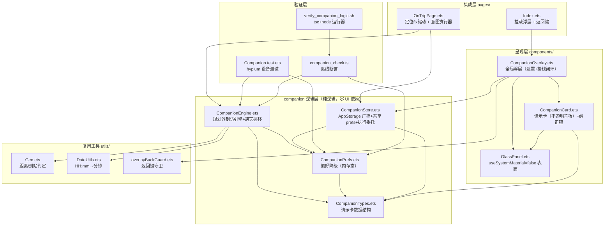
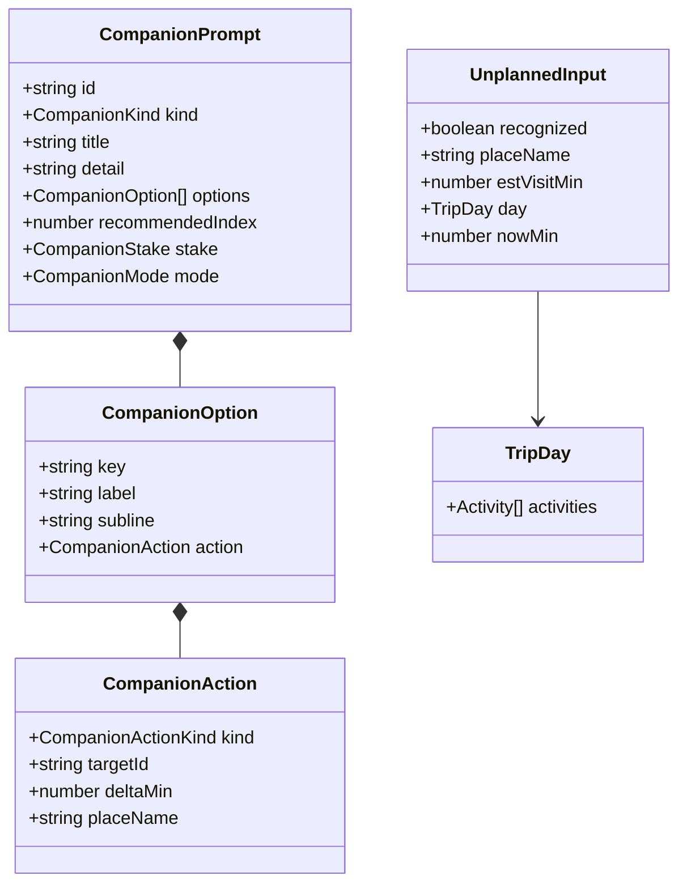
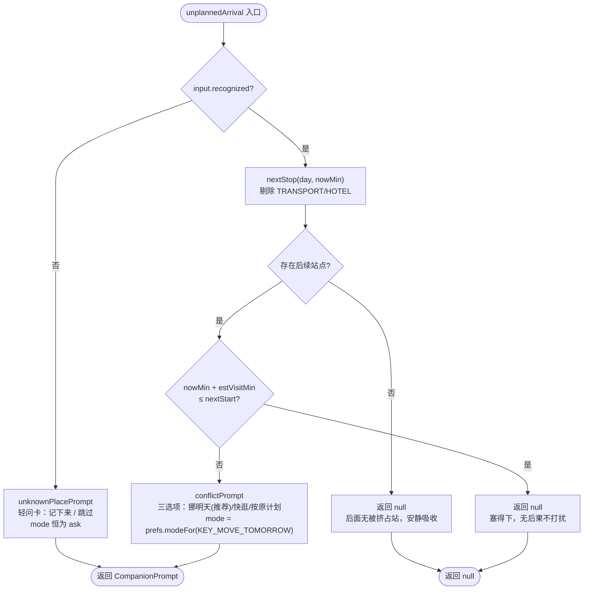
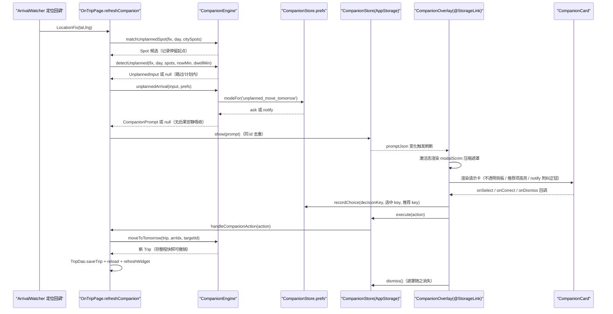
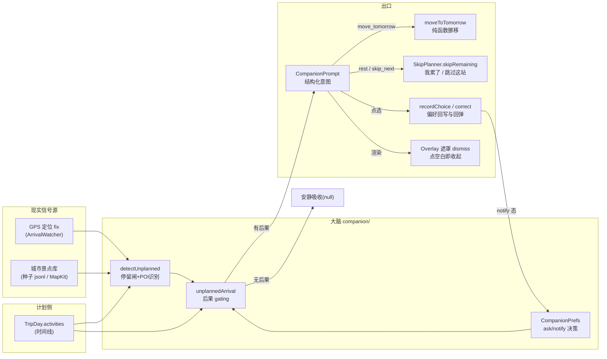
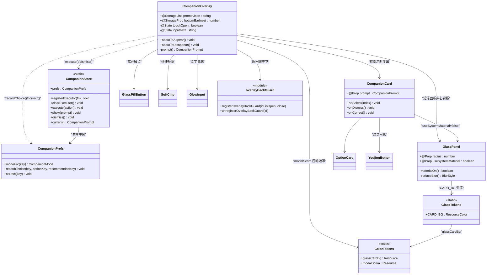
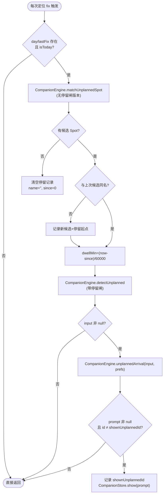
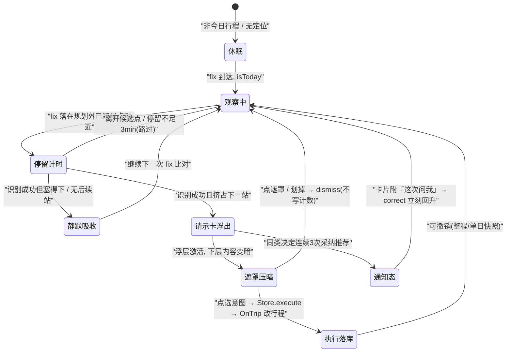
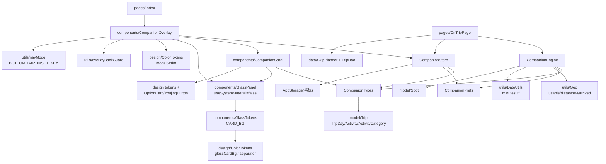

# 伴随式 AI 助手（Companion）

<cite>
**本文引用文件 **
- [CompanionTypes.ets](file://entry/src/main/ets/companion/CompanionTypes.ets)
- [CompanionEngine.ets](file://entry/src/main/ets/companion/CompanionEngine.ets)
- [CompanionPrefs.ets](file://entry/src/main/ets/companion/CompanionPrefs.ets)
- [CompanionStore.ets](file://entry/src/main/ets/companion/CompanionStore.ets)
- [CompanionCard.ets](file://entry/src/main/ets/components/CompanionCard.ets)
- [CompanionOverlay.ets](file://entry/src/main/ets/components/CompanionOverlay.ets)
- [GlassPanel.ets](file://entry/src/main/ets/components/GlassPanel.ets)
- [GlassTokens.ets](file://entry/src/main/ets/components/GlassTokens.ets)
- [ColorTokens.ets](file://entry/src/main/ets/design/ColorTokens.ets)
- [OnTripPage.ets](file://entry/src/main/ets/pages/OnTripPage.ets)
- [Index.ets](file://entry/src/main/ets/pages/Index.ets)
- [overlayBackGuard.ets](file://entry/src/main/ets/utils/overlayBackGuard.ets)
- [Geo.ets](file://entry/src/main/ets/utils/Geo.ets)
- [DateUtils.ets](file://entry/src/main/ets/utils/DateUtils.ets)
- [YoujingButton.ets](file://entry/src/main/ets/components/YoujingButton.ets)
- [color.json](file://entry/src/main/resources/base/element/color.json)
- [Companion.test.ets](file://entry/src/ohosTest/ets/test/Companion.test.ets)
- [companion_check.ts](file://tools/companion_check.ts)
- [verify_companion_logic.sh](file://tools/verify_companion_logic.sh)
- [2026-11-11-companion-ai-redesign.md](file://Docs/superpowers/plans/2026-11-11-companion-ai-redesign.md)
</cite>

## 更新摘要
**本次变更内容**
- 「呈现层：请示卡与全局浮层」章节修正：CompanionCard 的容器**不再走系统玻璃材质**——现为 `GlassPanel({ radius: hero, useSystemMaterial: false })`，即不透明 `glassCardBg`（`GlassTokens.CARD_BG`）兜底 + 描边 + 投影。原「玻璃面复用 GlassPanel（系统材质）」表述作废，并补充真机深色下系统材质渲染不出图、背景文字透出的原因说明。
- CompanionOverlay 部件表新增 **⓪ 压暗遮罩（modalScrim）** 一列：激活态（面板展开或有请示卡）时全屏压暗，点击遮罩即收起面板并 `CompanionStore.dismiss()`；同时明确快捷短语面板也改用 `useSystemMaterial: false` 的实心背板。
- 「依赖分析」「类图」同步补入 GlassPanel→GlassTokens/ColorTokens 的表面取值链路与 Overlay→modalScrim 依赖；故障排查表新增「卡片背景透出下层文字」「浮层与下层内容分离不开」两条定位路径。
- 其余章节（引擎、偏好降级、Store、集成层、附录路线图）内容不变；上一轮的执行闭环 / Phase 5 纠正回弹结论仍然成立。

## 目录
1. [引言](#引言)
2. [项目结构：companion 包在工程中的位置](#项目结构companion-包在工程中的位置)
3. [核心组件](#核心组件)
4. [架构总览](#架构总览)
5. [详细组件分析](#详细组件分析)
6. [依赖分析](#依赖分析)
7. [性能考量](#性能考量)
8. [故障排查指南](#故障排查指南)
9. [结论](#结论)
10. [附录：分阶段路线图与验证方法](#附录分阶段路线图与验证方法)

## 引言

本项目（有径·行程规划 HarmonyOS 应用）正在从「表单向导 + 一次性 AI 生成行程」演进为「伴随式 AI 助手」。为此新增的 `entry/src/main/ets/companion/` 包构成了一个完整的**端侧决策能力域**，包含三大职责：

- **请示卡数据结构**（`CompanionTypes.ets`）：定义大脑产出的纯数据契约——请示卡、选项、结构化意图、风险级与模式；
- **规划外到访引擎**（`CompanionEngine.ets`）：比对「计划 vs 现实」，仅在产生真实后果时产出带默认推荐的请示卡，无后果则安静吸收；
- **偏好降级**（`CompanionPrefs.ets`）：同一类低风险决定用户连续采纳推荐项达到阈值后，从「请示」降级为「通知」，且回升快（纠正一次立刻回请示）。

该能力域与既有的 LLM 传输层（`ai/LlmClient.ets`）、Prompt 构建（`ai/PromptBuilder.ets`）、解析器（`ai/TripParser.ets`、`ai/ReplanParser.ets`）**并列**，但定位截然不同：LLM 链路负责云端生成行程，而 companion 包是**纯端侧、零 @kit/UI 依赖、可离线断言**的规则引擎——不联网、不调用大模型，靠本地几何计算与时间比对做即时决策。设计立场是「助手站在现实这边」：开口即请示，端出算清后果的可点选选项，用户一键拍板。

本能力域还包含配套的状态广播与偏好单例（`CompanionStore.ets`，AppStorage 单点 + 共享 prefs + 执行委托）、呈现层（`CompanionCard.ets` 决策卡、`CompanionOverlay.ets` 全局浮层，含压暗遮罩与实心背板的可读性处置）、行中集成（`OnTripPage.ets` 的定位 fix 驱动 + 意图执行器）以及双层测试保障（hypium 设备测试 + Node 离线断言）。**Phase 1～5 五阶段已全部交付**：请示 → 点选 → 执行 → 偏好计数 → 降级为通知 → 通知态透明化并可「这次问我」纠正回弹的学习闭环已在真机跑通；唯一遗留是偏好计数仍为进程内内存态，重启即失忆（详见「偏好降级」小节）。

**章节来源**
- [2026-11-11-companion-ai-redesign.md:27-39](file://Docs/superpowers/plans/2026-11-11-companion-ai-redesign.md#L27-L39)

## 项目结构：companion 包在工程中的位置

companion 能力域横跨四个层面：**逻辑层（companion/ 包本体）、呈现层（components/）、集成层（pages/）、验证层（tools/ 与 ohosTest/）**。

**图示来源 **
- [CompanionEngine.ets:12-17](file://entry/src/main/ets/companion/CompanionEngine.ets#L12-L17)
- [CompanionStore.ets:11-32](file://entry/src/main/ets/companion/CompanionStore.ets#L11-L32)
- [CompanionOverlay.ets:19-29](file://entry/src/main/ets/components/CompanionOverlay.ets#L19-L29)
- [CompanionCard.ets:12-19](file://entry/src/main/ets/components/CompanionCard.ets#L12-L19)
- [OnTripPage.ets:29](file://entry/src/main/ets/pages/OnTripPage.ets#L29)
- [verify_companion_logic.sh:15-33](file://tools/verify_companion_logic.sh#L15-L33)

**章节来源**
- [CompanionTypes.ets:1-11](file://entry/src/main/ets/companion/CompanionTypes.ets#L1-L11)
- [CompanionStore.ets:12-32](file://entry/src/main/ets/companion/CompanionStore.ets#L12-L32)
- [OnTripPage.ets:264-270](file://entry/src/main/ets/pages/OnTripPage.ets#L264-L270)
- [Index.ets:51](file://entry/src/main/ets/pages/Index.ets#L51)
- [verify_companion_logic.sh:1-33](file://tools/verify_companion_logic.sh#L1-L33)

## 核心组件

### 请示卡数据结构（CompanionTypes）

`CompanionTypes.ets` 只定义大脑产出的数据结构，不含逻辑、不含 UI。其核心类型体系如下：

| 类型 | 种类 | 说明 |
|---|---|---|
| `CompanionStake` | `'low' \| 'high'` | 决定风险级：high（花钱/不可逆/大幅改行程）永远请示；low 才可降级 |
| `CompanionMode` | `'ask' \| 'notify'` | 请示或通知，由偏好降级决定（高风险恒 ask） |
| `CompanionKind` | `'unplanned_arrival' \| 'unknown_place'` | 提示种类，当前落地规划外到访两类，后续扩 behind/rain 等 |
| `CompanionActionKind` | `'move_tomorrow' \| 'quick_visit' \| 'keep_plan' \| 'record_place' \| 'none'` | 选项背后的结构化意图；浮层把它交给 `CompanionStore.execute`，由 OnTripPage 注册的执行器落地 |

核心接口关系：

**图示来源 **
- [CompanionTypes.ets:13-72](file://entry/src/main/ets/companion/CompanionTypes.ets#L13-L72)

设计要点：
- `id` 是去重键——同情境不重复浮卡（如 `unplanned-${地点}-${节点id}`）；
- `recommendedIndex` 体现「保姆级」理念：思考做完，用户多数只需确认；
- `CompanionOption.key` 是稳定意图键，跨文案变更不变，专供偏好计数使用——浮层正是拿它和推荐项的 key 比对来喂 `recordChoice`；
- `UnplannedInput` 强调 POI 识别由集成层完成（ArrivalWatcher + 种子/MapKit 数据），**引擎只吃识别结果，保证纯逻辑可测**。

**章节来源**
- [CompanionTypes.ets:1-72](file://entry/src/main/ets/companion/CompanionTypes.ets#L1-L72)
- [CompanionEngine.ets:195-222](file://entry/src/main/ets/companion/CompanionEngine.ets#L195-L222)

### 规划外到访引擎（CompanionEngine）

`CompanionEngine.ets` 是全静态方法的纯逻辑类（无实例状态、无 @kit/UI 依赖），内含两个关键常量：停留闸 `DWELL_MIN = 3`（分钟，停够才算「去了」，路过不算）与偏好降级键 `KEY_MOVE_TOMORROW = 'unplanned_move_tomorrow'`。公开入口四个：

| 方法 | 输入 | 输出 | 语义 |
|---|---|---|---|
| `unplannedArrival(input, prefs)` | 识别结果 + 偏好 | `CompanionPrompt \| null` | 后果评估与请示卡生成；null = 无后果安静吸收 |
| `detectUnplanned(fix, day, spots, nowMin, dwellMin)` | 定位点 + 当日计划 + 城市景点库 | `UnplannedInput \| null` | 停留闸 + POI 识别组装输入（纯函数可单测） |
| `matchUnplannedSpot(fix, day, spots)` | 同上（无停留参数） | `Spot \| null` | 无停留闸的版本，供集成层自行做停留追踪 |
| `moveToTomorrow(trip, dayIndex, activityId)` | 整程 + 当日下标 + 节点 id | `Trip \| null` | 把某节点挪到明天（返回新 Trip 不改原对象）；无明天/节点不存在返回 null |

私有辅助：`inPlan`（按名匹配判断景点是否已在当日计划）、`nextStop`（找 nowMin 之后第一个真实景点，剔除交通/住宿腿）、`unknownPlacePrompt`（未识别地点的轻问卡，恒 ask 不降级）、`conflictPrompt`（已识别且挤占下一站的三选项卡，模式由 prefs 决定）。

`unplannedArrival` 的决策流程：

**图示来源 **
- [CompanionEngine.ets:29-43](file://entry/src/main/ets/companion/CompanionEngine.ets#L29-L43)
- [CompanionEngine.ets:163-175](file://entry/src/main/ets/companion/CompanionEngine.ets#L163-L175)
- [CompanionEngine.ets:178-223](file://entry/src/main/ets/companion/CompanionEngine.ets#L178-L223)

`matchUnplannedSpot` 的匹配算法（复杂度 O(A + S)，A=当日活动数、S=城市景点数）：
1. **计划内优先排除**：遍历 `day.activities`，若 fix 落在任一坐标可用的计划站点附近（`Geo.arrived` 判定）→ 直接返回 null（那是计划内到站，不是规划外）；
2. **规划外最近景点择优**：遍历 `spots`，跳过坐标不可用与已在当日计划的（`inPlan` 按 title/location 名匹配），取满足 `Geo.arrived` 且距离最小者返回。

引擎**只产出结构化意图与纯函数式的行程变换**——`moveToTomorrow` 虽返回新 Trip，但落库与撤销仍由集成层完成，保持「大脑与手脚分离」。

**章节来源**
- [CompanionEngine.ets:1-223](file://entry/src/main/ets/companion/CompanionEngine.ets#L1-L223)
- [Geo.ets:12-91](file://entry/src/main/ets/utils/Geo.ets#L12-L91)
- [DateUtils.ets:60](file://entry/src/main/ets/utils/DateUtils.ets#L60)

### 偏好降级（CompanionPrefs）

`CompanionPrefs.ets` 实现「请示的最高境界是越来越不需要请示」的产品哲学。规则：**降得慢、回升快**——

- 内部维护两张表：`streak: Record<string, number>`（每键连续选推荐项次数）与 `notified: Record<string, boolean>`（已降级为通知的键集合）；
- `recordChoice(key, optionKey, recommendedKey)`：选推荐项则 streak+1，达到阈值 `DEGRADE_STREAK = 3` 时置 notify；选了别的则计数归零**并立即撤销降级**；
- `correct(key)`：用户纠正 → 计数清零、降级撤销，立刻回请示。该路径已由 Phase 5 的卡片「这次问我」按钮真正接通（此前只是逻辑层的孤立 API）；
- `modeFor(key)`：查 `notified` 表返回 `'notify'` 或 `'ask'`；
- 高风险决定永不降级——该护栏由引擎按 `stake` 控制（如 unknown_place 卡硬编码 `mode: 'ask'`），不经过本类；
- **仍是内存态**：类头注释明确「Phase 1 内存态，持久化留 Phase 5」，Phase 5 实际交付的是通知态透明化与纠正回弹 UI，`streak/notified` 两表的落盘持久化尚未实施，进程重启即失忆。

| 场景序列 | streak 变化 | notified | modeFor 结果 |
|---|---|---|---|
| 初始 | 0 | false | ask |
| 连续第 1、2 次选推荐 | 1→2 | false | ask |
| 连续第 3 次选推荐 | 3 | true | notify |
| 中途选非推荐项 | 归 0 | false | ask |
| notify 态下 correct()（卡片「这次问我」） | 归 0 | false | ask |

计数的回写不再需要集成层手工调用：浮层在用户点选时统一喂 `recordChoice`，因此**同一份 prefs 实例必须全局共享**——这一点由 `CompanionStore.prefs` 单例保证（OnTripPage 的 `companionPrefs` 字段直接引用它）。

**章节来源**
- [CompanionPrefs.ets:1-46](file://entry/src/main/ets/companion/CompanionPrefs.ets#L1-L46)
- [CompanionStore.ets:14-16](file://entry/src/main/ets/companion/CompanionStore.ets#L14-L16)
- [OnTripPage.ets:268](file://entry/src/main/ets/pages/OnTripPage.ets#L268)

### 全局状态广播与执行委托（CompanionStore）

`CompanionStore.ets` 是跨组件单点的状态桥。关键设计取舍：提示以 **JSON 字符串**存入 AppStorage 键 `companionPromptJson`（而非复杂嵌套对象），规避 ArkUI V1 中 `@StorageProp` 对深层嵌套对象刷新不可靠的问题；消费方按需 `JSON.parse`。

**更新** 除原有的 `show/dismiss/current` 三方法外，本类新增两项职责：

| 成员 | 形态 | 作用 |
|---|---|---|
| `static readonly prefs` | CompanionPrefs 单例 | 共享偏好实例——OnTrip 用它生成提示的模式、浮层用它记录点选，同一个实例降级闭环才成立 |
| `registerExecutor(fn)` / `clearExecutor()` | 静态方法 | 执行委托的注册与注销。浮层处于全局壳层，改行程的能力在 OnTripPage，由后者在 `aboutToAppear` 注册、`aboutToDisappear` 注销 |
| `execute(action)` | 静态方法 | 把 `CompanionAction` 转交已注册执行器；执行器为空时静默丢弃（不抛错） |

默认空串 = 休眠，不干扰任何现有 UI。浮层的压暗遮罩同样只在「有卡或面板开着」时出现，因此休眠态下层页面完全不受影响。

**章节来源**
- [CompanionStore.ets:1-57](file://entry/src/main/ets/companion/CompanionStore.ets#L1-L57)
- [OnTripPage.ets:230-245](file://entry/src/main/ets/pages/OnTripPage.ets#L230-L245)

## 架构总览

伴随助手采用「叠加层，不重组导航」的总体架构：大脑（companion 包）产出结构化请示，经 AppStorage 广播，由挂在 Index 顶层的全局浮层渲染（激活时先压暗下层内容），行中页 OnTripPage 作为传感集成层驱动引擎，并反向通过执行委托承接浮层的意图落地。

**图示来源 **
- [OnTripPage.ets:1258-1289](file://entry/src/main/ets/pages/OnTripPage.ets#L1258-L1289)
- [OnTripPage.ets:1291-1338](file://entry/src/main/ets/pages/OnTripPage.ets#L1291-L1338)
- [CompanionEngine.ets:29-43](file://entry/src/main/ets/companion/CompanionEngine.ets#L29-L43)
- [CompanionStore.ets:14-40](file://entry/src/main/ets/companion/CompanionStore.ets#L14-L40)
- [CompanionOverlay.ets:83-134](file://entry/src/main/ets/components/CompanionOverlay.ets#L83-L134)

数据流全景（计划与现实比对，执行侧已闭合）：

**图示来源 **
- [CompanionEngine.ets:29-96](file://entry/src/main/ets/companion/CompanionEngine.ets#L29-L96)
- [CompanionOverlay.ets:83-134](file://entry/src/main/ets/components/CompanionOverlay.ets#L83-L134)
- [OnTripPage.ets:1291-1360](file://entry/src/main/ets/pages/OnTripPage.ets#L1291-L1360)

## 详细组件分析

### 呈现层：请示卡与全局浮层

**CompanionCard**（决策卡）坚持「不造新视觉语言」：外层仍是 `GlassPanel` 组件、选项复用 OptionCard（选中态即品牌实心，与追问选项同源）、文字/间距/圆角全走 design token。一张卡 = 标题 + 后果说明 + 可点选选项列表，`recommendedIndex` 项高亮。组件持有 EMPTY_PROMPT 兜底常量以满足 @Prop 初始化，且自身不改行程，只把交互抛给集成层。

**更新（表面材质）** 原先文档所述「玻璃面复用 GlassPanel（系统材质）」已与代码不符。现在卡片以 `GlassPanel({ radius: RadiusTokens.hero, useSystemMaterial: false })` 装配，即**显式关闭系统材质**，走不透明兜底表面：

| GlassPanel 传参 | 生效分支 | 实际视觉 |
|---|---|---|
| `useSystemMaterial: false` | `materialOn()` 恒为 false | 自绘层不归零 |
| 背景色 | `GlassTokens.CARD_BG` = `ColorTokens.glassCardBg` | 浅色 `#FFF7F7F8` / 深色 `#FF1E1E1E`，**不透明** |
| 模糊 | `backgroundBlurStyle(GlassBlurStyle.Card)` | 卡片级自绘模糊，非系统材质 |
| 描边 / 投影 | `glassBorderWidth` + `ShadowTokens.cardAmbient` | 保留双边可读性边界 |

关闭理由记录在组件 build 上方注释：请示卡浮在任意内容之上，系统材质在该位置渲染不出图；若置 `true` 会把背景设成 `Transparent`，导致下层背景文字透出、卡片在真机深色下不可读。因此决策卡的可读性由**不透明 glassCardBg 兜底 + 描边 + 投影**三者共同保证，而不是玻璃透射。

**更新（回调与通知态区块）** 该类现在是三个回调而非两个，并保留通知态专属区块：

| 回调 | 触发点 | 语义 |
|---|---|---|
| `onSelect(index)` | 点某个 OptionCard | 交集成层做偏好计数 + 意图执行 |
| `onDismiss()` | 右上角 xmark（44×44 透明命中块） | 划掉——**沉默也是回答** |
| `onCorrect()` | 「这次问我」文本按钮 | 仅 notify 态可见；纠正这类决定的降级，下次同类回请示 |

当 `prompt.mode === 'notify'` 时，卡片在 detail 之下插入一行：左侧 muted caption「照你之前的习惯，先这么安排了，可随时撤销」，右侧 `YoujingButton`（`variant: TEXT`、`label: '这次问我'`、宽 88vp）绑定 `onCorrect`——把「替你决定了」这件事说透并给出即时反悔入口。选项 ForEach 的 key 生成为 `${prompt.id}-${opt.key}`，保证跨卡不串渲染。

**CompanionOverlay**（全局浮层）挂载于 Index build 中 Navigation 的同级 Stack 兄弟位置，因此能盖住二级页而不必重组五 tab 导航。整层容器 `hitTestBehavior(HitTestMode.None)` 让空白处触摸穿透至下层页面，仅交互件收命中——与 dock 覆盖层同形态。它由**五个部件**组成（原四个，新增 ⓪ 遮罩）：

| 部件 | 组件 | 行为 |
|---|---|---|
| ⓪ 压暗遮罩 | 全屏 `Column` + `ColorTokens.modalScrim` | **仅激活时出现**（`touchOpen \|\| prompt() !== null`）；铺满 100%×100%，把浮层与下层内容在视觉上分离，修「芯片/卡浮在内容上看不清、像组件重叠在页面上」；`onClick` 即 `touchOpen = false` + `CompanionStore.dismiss()`——**点遮罩就等于收起**；色值走既有契约 `modal_scrim`（浅深两套同为 `#5217171A`），不新增色值 |
| ① 常驻触点 | GlassPillButton「助手」（`useSystemMaterial: true`） | 右下角拇指区，padding 抬到 dock 净空之上（`bottomBarInset + floatingDockClearance + xs`，避免命中区压住 dock「我的」tab）；开面板先收卡（两层互斥） |
| ② 快捷短语面板 | SoftChip × 5（我累了/附近有啥吃的/跳过这站/换个地方/时间够吗） | 面板背板同样是 `GlassPanel({ …, useSystemMaterial: false })` 实心不透明底（保证 chip 可读）；「我累了」发 `{kind:'rest'}`、「跳过这站」发 `{kind:'skip_next'}` 直连执行器；其余三条待后续 |
| ③ 文字兜底 | GlowInput（fillWidth:false 防纵向撑爆） | 「或直接说/写你想怎样…」 |
| ④ 请示卡 | CompanionCard | `@StorageLink(COMPANION_PROMPT_KEY)` 驱动，parse 失败静默为 null；底部让出 `bottomBarInset + floatingDockClearance + 64` 高度 |

注意触点本身仍走系统材质（`useSystemMaterial: true`），因为它位于 dock 上方的固定条带、不叠在滚动内容上；只有**承载文字内容的两块面板**（请示卡、快捷短语面板）改为不透明兜底——这是「材质只在能渲染出图的位置用」这一取舍的具体落点。

**更新** 浮层已成为偏好学习闭环的接线点，`onSelect` 与 `onCorrect` 各自遵循同一条「派生 decisionKey → 操作共享 prefs → 执行 → 收起」流程：

- `decisionKey` 派生规则：`p.kind === 'unplanned_arrival' ? 'unplanned_move_tomorrow' : p.kind`——与引擎侧 `KEY_MOVE_TOMORROW` 严格对齐，使计数键稳定且不随文案漂移；
- `onSelect(idx)`：越界防御后调 `CompanionStore.prefs.recordChoice(decisionKey, 选中项 key, 推荐项 key)`，随后 `CompanionStore.execute(p.options[idx].action)`，最后 `dismiss()`；
- `onCorrect()`：调 `CompanionStore.prefs.correct(decisionKey)` 后立即 `dismiss()`，下一次同类决定重新回到请示态；
- `onDismiss()`：只 `dismiss()`，不写计数（沉默不计入偏好）；点遮罩收起与 `onDismiss` 效果等价（都不写计数）。

返回键处理：`aboutToAppear` 时以固定 id `companionOverlay` 向 overlayBackGuard 注册守卫——探针函数判断「有卡或面板开着」则拦截，关闭动作执行 `CompanionStore.dismiss()` + 收起面板（与点遮罩同一套收起语义，遮罩随激活条件自动消失）；`aboutToDisappear` 注销。Index.onBackPress 优先分发该 id，与 expenseTab/planTab 共用同一套返回键仲裁机制。

**图示来源 **
- [CompanionOverlay.ets:35-134](file://entry/src/main/ets/components/CompanionOverlay.ets#L35-L134)
- [CompanionOverlay.ets:137-196](file://entry/src/main/ets/components/CompanionOverlay.ets#L137-L196)
- [CompanionCard.ets:27-110](file://entry/src/main/ets/components/CompanionCard.ets#L27-L110)
- [GlassPanel.ets:19-53](file://entry/src/main/ets/components/GlassPanel.ets#L19-L53)
- [GlassTokens.ets:16-26](file://entry/src/main/ets/components/GlassTokens.ets#L16-L26)
- [ColorTokens.ets:66-96](file://entry/src/main/ets/design/ColorTokens.ets#L66-L96)
- [CompanionStore.ets:14-56](file://entry/src/main/ets/companion/CompanionStore.ets#L14-L56)
- [overlayBackGuard.ets:33-47](file://entry/src/main/ets/utils/overlayBackGuard.ets#L33-L47)

**章节来源**
- [CompanionCard.ets:1-110](file://entry/src/main/ets/components/CompanionCard.ets#L1-L110)
- [CompanionOverlay.ets:1-203](file://entry/src/main/ets/components/CompanionOverlay.ets#L1-L203)
- [GlassPanel.ets:1-54](file://entry/src/main/ets/components/GlassPanel.ets#L1-L54)
- [GlassTokens.ets:22-26](file://entry/src/main/ets/components/GlassTokens.ets#L22-L26)
- [ColorTokens.ets:175-180](file://entry/src/main/ets/design/ColorTokens.ets#L175-L180)
- [color.json:140-141](file://entry/src/main/resources/base/element/color.json#L140-L141)
- [color.json:244-245](file://entry/src/main/resources/base/element/color.json#L244-L245)
- [YoujingButton.ets:12-56](file://entry/src/main/ets/components/YoujingButton.ets#L12-L56)
- [OptionCard.ets:17-70](file://entry/src/main/ets/components/OptionCard.ets#L17-L70)
- [Index.ets:51](file://entry/src/main/ets/pages/Index.ets#L51)
- [Index.ets:208-222](file://entry/src/main/ets/pages/Index.ets#L208-L222)
- [Index.ets:1023](file://entry/src/main/ets/pages/Index.ets#L1023)
- [overlayBackGuard.ets:29-47](file://entry/src/main/ets/utils/overlayBackGuard.ets#L29-L47)

### 集成层：OnTripPage 的行中接线（传感 + 执行双侧）

`OnTripPage.ets` 是接入大脑的双向枢纽：向上传感驱动引擎，向下承接浮层的意图执行。它持有五个伴随专用私有字段：`citySpots`（本城景点缓存）、`unplannedSpotName`（当前停留候选的景点名）、`unplannedSinceMs`（停留起始时间戳）、`shownUnplannedId`（已浮出卡的去重键）、`companionPrefs`（**引用 `CompanionStore.prefs` 共享单例**），外加 `companionUndoTrip`——伴随跨天挪移专用的整程撤销快照（区别于 skipSnapshot 的单日快照）。

`aboutToAppear` 中 `CompanionStore.registerExecutor((action) => this.handleCompanionAction(action))`，`aboutToDisappear` 中 `CompanionStore.clearExecutor()`，确保离开行中页后浮层意图不会打到已销毁的宿主上。

`refreshCompanion()` 的完整接线逻辑：

**图示来源 **
- [OnTripPage.ets:1258-1289](file://entry/src/main/ets/pages/OnTripPage.ets#L1258-L1289)

三层护栏在此汇聚：**日期护栏**（仅今日行程激活，非 `isToday` 完全休眠）、**停留追踪**（集成层自己维护 since 时间戳，引擎保持无状态纯函数）、**同卡去重**（`shownUnplannedId` 保证同一情境一生只浮一次）。定位源来自 ArrivalWatcher 的 `LocationFix` 回调（`lastFix`），城市景点库来自 `citySpots`（种子 jsonl / MapKit 检索装载）。

**更新** `handleCompanionAction(action)` 的执行分派（取代原「Phase 3 执行侧待补」占位）：

| action.kind | 落地方式 | 备注 |
|---|---|---|
| `rest` | `performRest()` → `SkipPlanner.skipRemaining` + `commitDay` | 提前收尾今日剩余站点，单日快照可撤销 |
| `skip_next` | `performSkip('')` | 复用既有跳站链路 |
| `move_tomorrow` | `CompanionEngine.moveToTomorrow(trip, arrIdx, targetId)` → `TripDao.saveTrip` → `reload` + `refreshWidget` | 先把原 trip 存入 `companionUndoTrip` 作整程撤销快照；保存失败则回滚快照并提示「保存失败，行程未改动」；成功置 `canUndo = true` 并提示「已挪到明天，可撤销」 |
| 其余（`quick_visit` / `keep_plan` / `record_place` / `none`） | 仅回执 `notice = '好的，按你说的来'` | 「我来处理」类，确认即可、不改行程 |

前置守卫：`trip/day` 任一为空或 `replanning` 进行中直接返回，避免与 replan 并发写行程。撤销分支在 undo 路径判 `companionUndoTrip.id === trip.id` 后整程还原并清空快照。

**章节来源**
- [OnTripPage.ets:229-245](file://entry/src/main/ets/pages/OnTripPage.ets#L229-L245)
- [OnTripPage.ets:264-270](file://entry/src/main/ets/pages/OnTripPage.ets#L264-L270)
- [OnTripPage.ets:413](file://entry/src/main/ets/pages/OnTripPage.ets#L413)
- [OnTripPage.ets:943-945](file://entry/src/main/ets/pages/OnTripPage.ets#L943-L945)
- [OnTripPage.ets:1162-1177](file://entry/src/main/ets/pages/OnTripPage.ets#L1162-L1177)
- [OnTripPage.ets:1258-1338](file://entry/src/main/ets/pages/OnTripPage.ets#L1258-L1338)

### 与 LLM 传输/Prompt/解析器的并列关系

| 维度 | ai/ 包（LLM 链路） | companion/ 包（端侧决策域） |
|---|---|---|
| 决策位置 | 云端大模型生成 | 本地规则引擎即时判定 |
| 网络依赖 | 强依赖（BFF/云函数） | 零依赖 |
| 时机 | 行前生成 / 行中 replan（低频、重） | 行中逐 fix 比对（高频、轻） |
| 产物 | Trip JSON（经 TripParser/ReplanParser 校验） | CompanionPrompt 请示卡（结构化意图） |
| 执行方式 | 整体行程替换/追加 | 单点微调意图，经 Store 委托回 OnTripPage 落库 |
| 可测性 | 契约测试 + mock | 纯函数离线断言（tsc+node） |

两者共享下游：`move_tomorrow` 由引擎自带的 `moveToTomorrow` 纯函数完成挪移后经 `TripDao.saveTrip` 落库，`rest/skip_next` 复用既有 SkipPlanner 能力，撤销沿用 OnTripPage 的 commitDay / 整程快照链路——companion 域不重复造轮子，只做「何时开口、说什么、怎么问」的大脑。

[本节为概念性对比，除上节已列文件外不直接分析新源文件]

### 概念工作流：一次「规划外到访」的用户旅程

[本图为产品概念状态机，综合自引擎、偏好与浮层接线逻辑的表达，不对应单一源文件]

**章节来源**
- [CompanionEngine.ets:27-43](file://entry/src/main/ets/companion/CompanionEngine.ets#L27-L43)
- [CompanionPrefs.ets:27-45](file://entry/src/main/ets/companion/CompanionPrefs.ets#L27-L45)
- [CompanionOverlay.ets:83-134](file://entry/src/main/ets/components/CompanionOverlay.ets#L83-L134)
- [2026-11-11-companion-ai-redesign.md:27-39](file://Docs/superpowers/plans/2026-11-11-companion-ai-redesign.md#L27-L39)

## 依赖分析

companion 包的依赖方向严格单向、全部指向更基础的纯模块，反向零依赖（model/utils 不知道 companion 的存在）；唯一的「回边」是运行时函数委托，而非 import：

**图示来源 **
- [CompanionEngine.ets:12-17](file://entry/src/main/ets/companion/CompanionEngine.ets#L12-L17)
- [CompanionStore.ets:10-16](file://entry/src/main/ets/companion/CompanionStore.ets#L10-L16)
- [CompanionCard.ets:12-19](file://entry/src/main/ets/components/CompanionCard.ets#L12-L19)
- [CompanionOverlay.ets:15-29](file://entry/src/main/ets/components/CompanionOverlay.ets#L15-L29)
- [GlassPanel.ets:10-16](file://entry/src/main/ets/components/GlassPanel.ets#L10-L16)
- [GlassTokens.ets:16-26](file://entry/src/main/ets/components/GlassTokens.ets#L16-L26)
- [OnTripPage.ets:29](file://entry/src/main/ets/pages/OnTripPage.ets#L29)

关键依赖事实：
- **无循环依赖**：companion 逻辑层四文件之间只有 Types←Prefs←Engine、Types/Prefs←Store 的向下引用；OnTripPage 与 CompanionOverlay 之间不直接互相 import，改由 `CompanionStore.registerExecutor` 的函数委托解耦；
- **可离线抽取**：正因逻辑层不 import 任何 @kit/OHOS 模块，`verify_companion_logic.sh` 才能把 .ets 文件原样拷成 .ts 交给 tsc --strict 编译运行（依赖闭包仅 model/Trip、model/Expense、model/Spot、utils/DateUtils、utils/Geo 五个基础文件）；注意 `CompanionStore` 触碰 AppStorage，属集成层，不在离线断言闭包内；
- **表面取值链路**：CompanionCard 与 CompanionOverlay 的面板都只经由 `GlassPanel` 取得表面，`useSystemMaterial=false` 时最终落到 `GlassTokens.CARD_BG → ColorTokens.glassCardBg → app.color.glass_card_bg`（浅 `#FFF7F7F8` / 深 `#FF1E1E1E`）；遮罩则直接取 `ColorTokens.modalScrim → app.color.modal_scrim`（`#5217171A`）。两条都是**既有 token 复用**，呈现层本轮没有新增色值；
- **对外契约**：companion 域向集成层暴露的稳定接口为 `CompanionEngine` 四个静态方法、`CompanionPrefs` 三方法、`CompanionStore` 的 `prefs` 单例 + `registerExecutor/clearExecutor/execute/show/dismiss/current` 与 `COMPANION_PROMPT_KEY` 常量。

**章节来源**
- [verify_companion_logic.sh:15-33](file://tools/verify_companion_logic.sh#L15-L33)
- [CompanionEngine.ets:12-17](file://entry/src/main/ets/companion/CompanionEngine.ets#L12-L17)
- [CompanionStore.ets:12-56](file://entry/src/main/ets/companion/CompanionStore.ets#L12-L56)
- [GlassPanel.ets:30-53](file://entry/src/main/ets/components/GlassPanel.ets#L30-L53)
- [color.json:140-145](file://entry/src/main/resources/base/element/color.json#L140-L145)

## 性能考量

- **每次定位 fix 的开销**：`matchUnplannedSpot` 为 O(A+S) 线性扫描（A≈当日站点数个位数，S=城市景点库几十至上百条），每条做一次 Haversine 距离计算（`Geo.distanceM`），单次微秒级；即便 fix 高频回调亦无压力。
- **引擎无状态**：CompanionEngine 全静态方法、零分配热点，停留计时状态刻意放在集成层（OnTripPage 三字段），使引擎可在任意线程/离线环境安全复用。
- **AppStorage 载荷极小**：请示卡序列化为短 JSON 串（数百字节），`@StorageLink` 刷新粒度粗（整串替换），不会引发列表级联重渲染；浮层默认休眠时空串短路，parse 根本不执行。
- **遮罩成本可控**：`modalScrim` 半透明纯色填充层只在激活态条件成立时进入组件树，休眠时该分支完全不渲染；相比系统背景模糊材质，纯色 scrim 无实时模糊开销。相应地，请示卡与短语面板改走不透明 `glassCardBg` 后，省掉了「材质在该位置渲染不出图」的退化路径，换来稳定的绘制成本与更好的深色对比。
- **prefs 单例避免重复计数分裂**：共享一份 `CompanionStore.prefs` 而非各层自建实例，省掉同步成本的同时也让降级判定天然一致。
- **去重双保险**：集成层 `shownUnplannedId` 阻止同卡重复浮出，引擎层的 `id` 构成（地点名+目标节点 id）保证情境天然唯一，避免每秒 fix 都弹卡的打扰型缺陷。
- **执行链的串行保护**：`handleCompanionAction` 早退于 `replanning`，挪移后统一走 `reload + refreshWidget`，不做增量修补，避免多处写行程造成竞态。
- **触摸穿透成本为零**：Overlay 全层 `HitTestMode.None` 仅交互件收命中，未激活时对下层页面的手势/滚动无任何额外命中测试负担；一旦激活，遮罩层会主动接收点击用于收起，此时下层不再响应属于预期行为。

[本节为基于上述已分析代码的一般性性能评估]

## 故障排查指南

| 症状 | 可能原因 | 定位路径 |
|---|---|---|
| 请示卡从不浮出 | 非今日行程（isToday=false）；无定位权限或 fix 未回调；停留不足 3 分钟被判路过；地点不在城市景点库（`citySpots` 为空）；fix 实际落在计划内站点附近 | `OnTripPage.refreshCompanion` 各早退分支；`CompanionEngine.detectUnplanned` 的 DWELL_MIN 闸与 `matchUnplannedSpot` 的计划内排除 |
| 卡片背景文字透出 / 深色下发灰不可读 | 误把 `GlassPanel` 的 `useSystemMaterial` 置回 true——材质生效时背景会被设为 `Transparent`；决策卡必须为 false 走不透明 `glassCardBg` | `CompanionCard.build` 的 `GlassPanel({ …, useSystemMaterial: false })`；`GlassPanel.materialOn()/backgroundColor` 分支 |
| 浮层内容与下层页面「重叠在一起」分不清 | 遮罩分支未命中（`touchOpen` 与 `prompt()` 都为假）或 scrim 色值被替换 | `CompanionOverlay.build` 的 `if (this.touchOpen \|\| this.prompt() !== null)`；`ColorTokens.modalScrim` |
| 点空白处浮层不收 | 遮罩 `onClick` 未同时复位 `touchOpen` 与 `CompanionStore.dismiss()` | `CompanionOverlay` 遮罩 Column 的 onClick |
| 点选后行程毫无变化 | 执行器未注册（不在 OnTripPage 生命周期内，或 `aboutToDisappear` 已 clear）；或 `trip/day` 为空、`replanning=true` 早退；或该 kind 本就是「我来处理」类（quick_visit/keep_plan/…）只回执不改行程 | `CompanionStore.execute` 空委托静默丢弃；`OnTripPage.handleCompanionAction` 守卫段 |
| 点了推荐项却迟迟不降级 | 计数键不匹配——浮层派生的 decisionKey 必须是 `unplanned_move_tomorrow` 才能与引擎 `modeFor` 对上；或中间选过一次非推荐项（计数归零并撤销降级） | `CompanionOverlay.onSelect` 的 decisionKey 三元式；`CompanionEngine.conflictPrompt` 的 KEY_MOVE_TOMORROW |
| 降级状态重启就没了 | 预期行为——`CompanionPrefs` 仍是内存态，持久化未实施 | `CompanionPrefs.ets` 头部注释 |
| 通知态卡片没有「这次问我」 | 该卡 `mode !== 'notify'`；unknown_place 类卡设计上恒 ask，永不显示纠正行 | `CompanionCard` 的 `if (this.prompt.mode === 'notify')` 分支 |
| 触点挡住 dock「我的」tab | 触点 padding 未含 `floatingDockClearance` 抬升 | `CompanionOverlay` 常驻触点 Row |
| 同一张卡反复弹出 | 集成层去重失效——检查 `shownUnplannedId` 是否在 show 前赋值、prompt.id 是否含不稳定成分 | `OnTripPage.ets` 请示浮出段 |
| 浮层挡住下层页面点击（休眠态） | 交互件外层误设命中；应确认各 Row/Column 与根 Stack 均为 `HitTestMode.None`，且遮罩只在激活时存在 | `CompanionOverlay.build` |
| 卡片不显示/白屏 | AppStorage JSON 损坏——`CompanionOverlay.prompt()` 与 `CompanionStore.current()` 均对 parse 异常静默返回 null，表现为「无卡」而非崩溃 | try/catch 分支 |
| 返回键关不掉浮层 | 守卫未注册或探针判假——确认 `registerOverlayBackGuard('companionOverlay', ...)` 在 aboutToAppear 执行、Index.onBackPress 优先分发 | `CompanionOverlay.aboutToAppear` 与 `overlayBackGuard` 模块 |
| 逻辑改动后回归失败 | 双测试面任一不过：设备 hypium 或离线断言 | 跑 `zsh tools/verify_companion_logic.sh`（期望末行 `COMPANION_LOGIC_OK`），或设备侧 Companion.test.ets |

离线断言脚本的容错设计值得注意：`set -euo pipefail` + `trap rm -rf` 保证临时目录必清理；tsc 以 `--strict --noEmitOnError` 把关，任何类型退化在编译期即失败；`companion_check.ts` 内 `ok/eq` 断言失败直接 throw，退出码非零。需注意呈现层的材质/遮罩改动属 UI 层，不在离线断言闭包内，须以真机深浅两套主题目视核验。

**章节来源**
- [CompanionOverlay.ets:38-58](file://entry/src/main/ets/components/CompanionOverlay.ets#L38-L58)
- [CompanionOverlay.ets:83-134](file://entry/src/main/ets/components/CompanionOverlay.ets#L83-L134)
- [CompanionOverlay.ets:137-196](file://entry/src/main/ets/components/CompanionOverlay.ets#L137-L196)
- [CompanionCard.ets:36-110](file://entry/src/main/ets/components/CompanionCard.ets#L36-L110)
- [GlassPanel.ets:30-53](file://entry/src/main/ets/components/GlassPanel.ets#L30-L53)
- [CompanionStore.ets:21-56](file://entry/src/main/ets/companion/CompanionStore.ets#L21-L56)
- [CompanionPrefs.ets:1-46](file://entry/src/main/ets/companion/CompanionPrefs.ets#L1-L46)
- [OnTripPage.ets:1258-1338](file://entry/src/main/ets/pages/OnTripPage.ets#L1258-L1338)
- [verify_companion_logic.sh:6-33](file://tools/verify_companion_logic.sh#L6-L33)
- [companion_check.ts:16-28](file://tools/companion_check.ts#L16-L28)

## 结论

`companion/` 包以一个紧凑的四文件纯逻辑域落地了伴随式 AI 助手的核心决策范式，并且**「大脑—呈现—执行—学习」四环已经全部闭合**：

1. **数据结构先行**（CompanionTypes）：请示卡/选项/意图三层结构与 stake/mode 双正交轴，为后续 behind/rain 等新 kind 留出扩展位而不破坏契约；
2. **后果 gating 是大脑的灵魂**（CompanionEngine）：「没后果就安静吸收」通过停留闸、计划内排除、时间塞得下判定、剔除交通/住宿腿四道闸门实现，把打扰率压到最低；开口时必带算清后果的默认推荐；
3. **偏好降级带不对称护栏**（CompanionPrefs）：降得慢（连续 3 次）、回升快（纠正一次即复原）、高风险恒请示；
4. **学习闭环真正可感**（Phase 5）：浮层把点选回写进共享 prefs，通知态卡片透明说明「照你之前的习惯」并提供「这次问我」的一键回弹入口——降级不再是黑箱；
5. **呈现层以可读性优先于材质纯度**（本轮修正）：承载文字的请示卡与快捷短语面板一律 `useSystemMaterial: false`，用不透明 `glassCardBg` + 描边 + 投影兜底，并以 `modalScrim` 压暗遮罩把浮层与下层内容分离、点遮罩即收起；只有不叠滚动内容的常驻触点仍走系统材质。此前「玻璃面复用 GlassPanel（系统材质）」的表述不再成立；
6. **架构纪律清晰**：大脑与手脚分离（引擎产意图、执行经 Store 委托回 OnTripPage）、叠加不重组（浮层挂 Navigation 同级、休眠时触摸穿透）、状态广播最小化（单键 JSON 串 + 单例 prefs）；
7. **双层验证闭环**：hypium 设备测试与 tsc+node 离线断言镜像同一批用例（含 `moveToTomorrow` 挪移/无明天/缺节点三例与 prefs 降级/回弹/重置三例），纯逻辑零 @kit 依赖是其可离线验证的根本前提。

仍需推进：把 `CompanionPrefs` 的 `streak/notified` 落盘（当前重启即失忆，这是 Phase 5 唯一未兑现项）；补齐 `quick_visit` 压缩游览的后果量化执行；把快捷短语面板动态化并接入更多 kind（behind/rain）；以及行后回顾侧对临时到访记录的更深洞察。

[本节为总结性内容，不直接分析源文件]

## 附录：分阶段路线图与验证方法

依据 redesign 计划文档（2026-11-11 记录：**五阶段全部交付**，提交 1632264 / 2182bd6 / 07eeafa / e9ea703 / eab28a4 / 787f37b / 0a4d480 / d5b3331 / 8906349），companion 能力的交付节奏与实际状态如下：

| 阶段 | 范围 | 涉及文件 | 状态（据代码现状） |
|---|---|---|---|
| Phase 1 | 核心逻辑层：引擎+偏好+类型+测试 | companion/ 四文件、Companion.test.ets、companion_check.ts | 已交付 |
| Phase 2 | 决策卡 + 全局浮层 + 常驻触点 + 返回键 | CompanionCard、CompanionOverlay、Index 挂点 | 已交付；后续表现层补丁：卡片/面板改不透明兜底 + 新增 modalScrim 遮罩 |
| Phase 3 | 行中集成：检测 + 意图执行 + 偏好回写 | OnTripPage（refreshCompanion / handleCompanionAction / registerExecutor）、CompanionStore（prefs / execute）、CompanionOverlay（onSelect） | 已交付（原「执行侧待补」已完成） |
| Phase 4 | 行前草案先行：一句话主入口、QA 降级追问 | GlowInput、PreferenceQAPage | 已交付（4-B「直接生成」草案先行） |
| Phase 5 | 偏好学习闭环：通知态透明化 + 纠正回弹 | CompanionCard（notify 行 + onCorrect）、CompanionOverlay（correct 接线） | 已交付；**prefs 持久化仍未做，内存态重启即失忆** |

真机验证覆盖：请示卡渲染、触点/面板/返回键、行中跳过 + 撤销链、触点挡 dock bug 修复、草案先行端到端，以及本轮的浮层可视性核验（遮罩压暗 + 实心背板，专门针对「组件像重叠在页面上」的真机反馈）。需注意「行中到访」触发依赖真实移动（杨凌坐标先校准）。

验证命令：

- 离线纯逻辑断言：`zsh tools/verify_companion_logic.sh` —— 拷贝依赖闭包至临时目录、bundled tsc --strict 编译、bundled node 运行 companion_check.ts，成功输出 `COMPANION_CHECK_OK cases=N` 与 `COMPANION_LOGIC_OK`；
- 设备/模拟器 hypium：Companion.test.ets 覆盖 CompanionPrefs 三例（降级/纠正回升/非推荐重置）、CompanionEngine 五例（轻问、静默、冲突三选项、剔腿、降级 notify）、detectUnplanned 五例（停够识别、路过、计划内、已在计划、无已知景点）、moveToTomorrow 三例（挪移成功、无明天、缺节点），经 List.test.ets 注册进套件；
- 呈现层材质/遮罩改动无法离线断言，需在浅色与深色主题下分别目视确认卡片不透底、遮罩可点收。

**章节来源**
- [2026-11-11-companion-ai-redesign.md:27-42](file://Docs/superpowers/plans/2026-11-11-companion-ai-redesign.md#L27-L42)
- [2026-11-11-companion-ai-redesign.md:147-152](file://Docs/superpowers/plans/2026-11-11-companion-ai-redesign.md#L147-L152)
- [Companion.test.ets:63-224](file://entry/src/ohosTest/ets/test/Companion.test.ets#L63-L224)
- [companion_check.ts:56-158](file://tools/companion_check.ts#L56-L158)
- [verify_companion_logic.sh:1-33](file://tools/verify_companion_logic.sh#L1-L33)