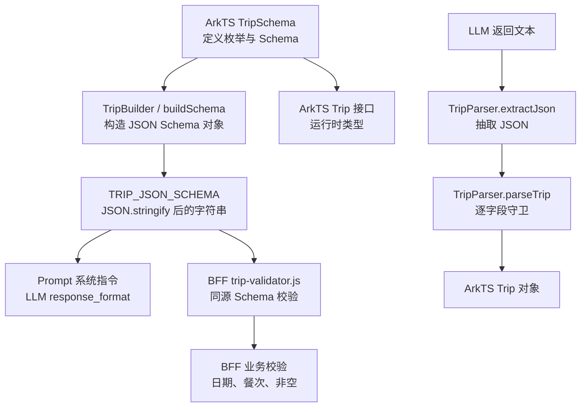
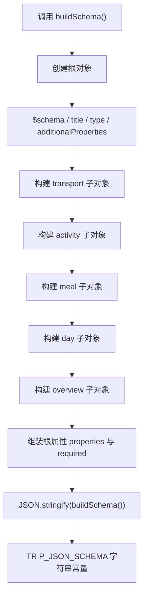
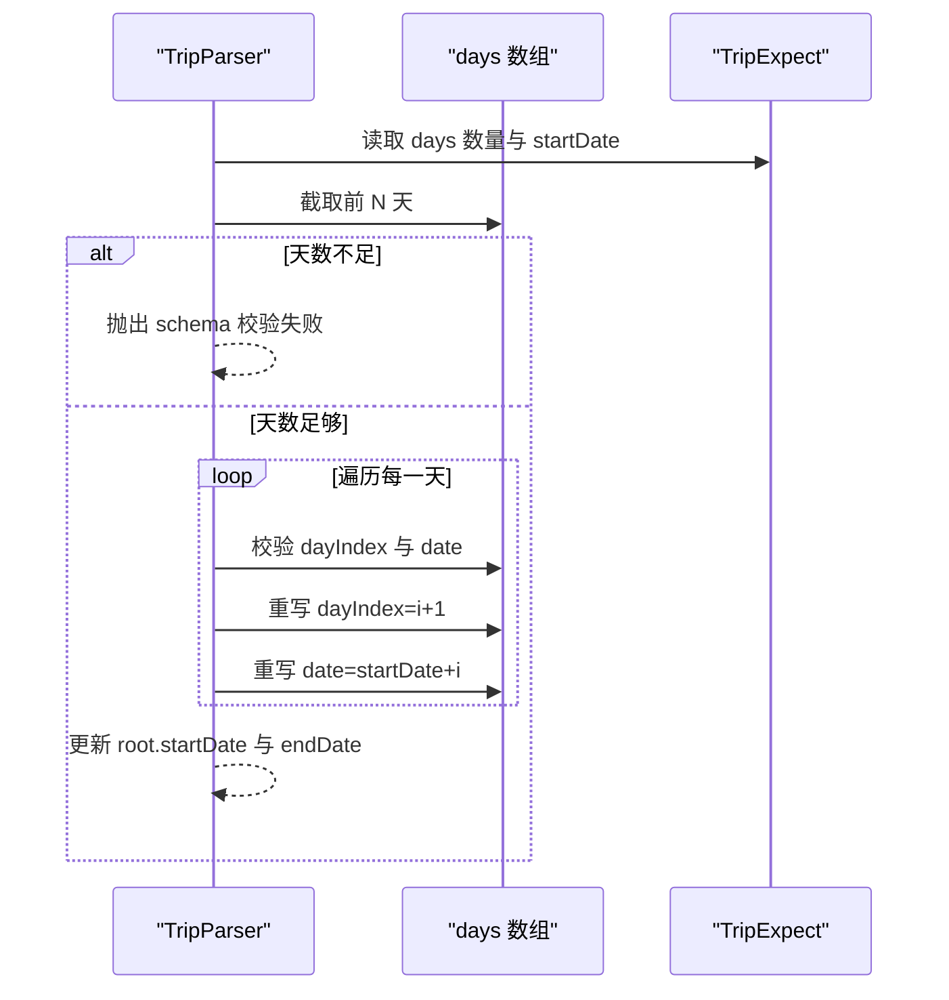
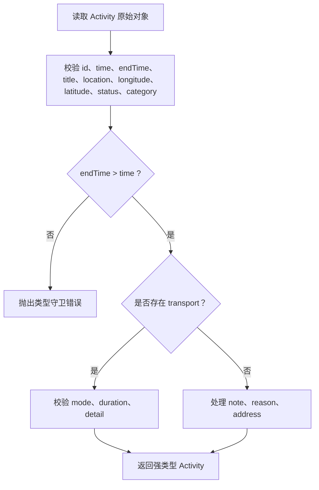
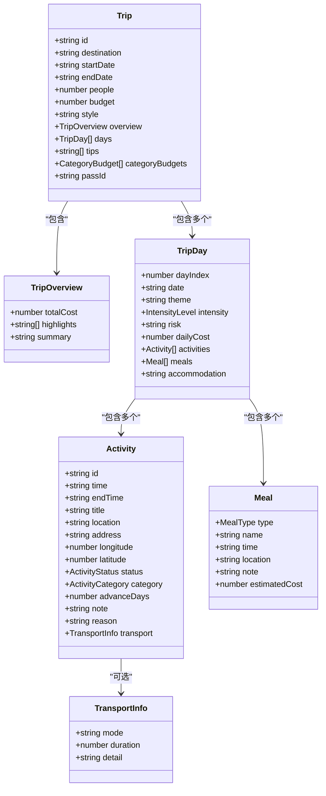
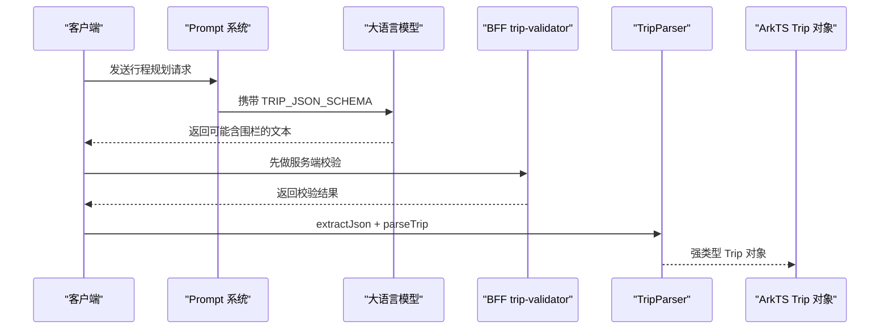

# 行程数据结构定义

<cite>
**本文引用的文件**   
- [entry/src/main/ets/ai/TripSchema.ets](file://entry/src/main/ets/ai/TripSchema.ets)
- [bff/src/prompt/generated/ai/TripSchema.js](file://bff/src/prompt/generated/ai/TripSchema.js)
- [entry/src/main/ets/model/Trip.ets](file://entry/src/main/ets/model/Trip.ets)
- [entry/src/main/ets/ai/TripParser.ets](file://entry/src/main/ets/ai/TripParser.ets)
- [bff/src/prompt/trip-validator.js](file://bff/src/prompt/trip-validator.js)
- [bff/test/fixtures/trip.js](file://bff/test/fixtures/trip.js)
</cite>

## 目录

1. [引言](#引言)
2. [项目结构与契约位置](#项目结构与契约位置)
3. [核心枚举类型](#核心枚举类型)
4. [JSON Schema 动态构建过程](#json-schema-动态构建过程)
5. [根对象 Trip 字段定义](#根对象-trip-字段定义)
6. [TripDay 单日结构](#tripday-单日结构)
7. [Activity 活动实体](#activity-活动实体)
8. [Meal 餐饮实体](#meal-餐饮实体)
9. [TransportInfo 通勤信息](#transportinfo-通勤信息)
10. [ArkTS 类型与 JSON Schema 映射](#arkts-类型与-json-schema-映射)
11. [数据流转与校验防线](#数据流转与校验防线)
12. [实际 JSON 示例](#实际-json-示例)
13. [性能与可维护性建议](#性能与可维护性建议)
14. [故障排查指南](#故障排查指南)
15. [结论](#结论)

## 引言

本文件聚焦“行程数据结构”这一跨端契约：它既是大语言模型输出 JSON 的约束，也是 ArkTS 应用中的运行时类型、服务端校验规则以及测试夹具的共同来源。文档目标不是展示源码片段，而是把 `TripSchema` 的设计理念、枚举语义、`TRIP_JSON_SCHEMA` 的生成逻辑、各实体字段约束，以及从 LLM 响应到 ArkTS `Trip` 对象的数据流讲清楚，帮助后端、前端、AI Prompt 工程师和测试人员使用同一份事实依据。

核心原则是“三元同源”：

- **JSON Schema**：由 ArkTS 侧 `TripSchema.buildSchema()` 生成，用于提示词系统指令与大模型返回格式约束。
- **ArkTS 接口**：由 `model/Trip.ets` 中的 `Trip`、`TripDay`、`Activity`、`Meal`、`TransportInfo` 等接口描述。
- **运行期守卫**：由 `TripParser`（端侧）和 `trip-validator.js`（BFF 侧）对 LLM 输出进行逐字段验证。

三者共享枚举白名单，避免在不同文件中维护多套业务常量。

**章节来源**
- [entry/src/main/ets/ai/TripSchema.ets:1-20](file://entry/src/main/ets/ai/TripSchema.ets#L1-L20)
- [entry/src/main/ets/model/Trip.ets:1-20](file://entry/src/main/ets/model/Trip.ets#L1-L20)
- [entry/src/main/ets/ai/TripParser.ets:1-15](file://entry/src/main/ets/ai/TripParser.ets#L1-L15)

## 项目结构与契约位置

| 层次 | 主要文件 | 职责 |
|---|---|---|
| 契约源 | `entry/src/main/ets/ai/TripSchema.ets` | 定义枚举白名单、`buildSchema`、`TRIP_JSON_SCHEMA` |
| 同步产物 | `bff/src/prompt/generated/ai/TripSchema.js` | 由脚本从 ArkTS 同步生成的 BFF 侧 Schema 常量 |
| 运行时类型 | `entry/src/main/ets/model/Trip.ets` | ArkTS 接口、枚举、领域语义注释 |
| 端侧解析器 | `entry/src/main/ets/ai/TripParser.ets` | LLM 文本 → 强类型 `Trip`，第三层防线 |
| BFF 校验器 | `bff/src/prompt/trip-validator.js` | 基于同源 Schema 的服务端校验与额外业务规则 |
| 测试夹具 | `bff/test/fixtures/trip.js` | 合法 Trip、稀疏请求、富请求示例 |



**图表来源**
- [entry/src/main/ets/ai/TripSchema.ets:21-151](file://entry/src/main/ets/ai/TripSchema.ets#L21-L151)
- [entry/src/main/ets/ai/TripParser.ets:16-80](file://entry/src/main/ets/ai/TripParser.ets#L16-L80)
- [bff/src/prompt/trip-validator.js:1-40](file://bff/src/prompt/trip-validator.js#L1-L40)

**章节来源**
- [entry/src/main/ets/ai/TripSchema.ets:1-20](file://entry/src/main/ets/ai/TripSchema.ets#L1-L20)
- [bff/src/prompt/generated/ai/TripSchema.js:1-10](file://bff/src/prompt/generated/ai/TripSchema.js#L1-L10)
- [entry/src/main/ets/model/Trip.ets:1-20](file://entry/src/main/ets/model/Trip.ets#L1-L20)
- [entry/src/main/ets/ai/TripParser.ets:1-15](file://entry/src/main/ets/ai/TripParser.ets#L1-L15)
- [bff/src/prompt/trip-validator.js:1-20](file://bff/src/prompt/trip-validator.js#L1-L20)

## 核心枚举类型

项目没有为枚举值定义独立字符串常量，而是统一通过 `TripSchema` 的静态数组暴露白名单。ArkTS 接口中再定义更可读的枚举或联合类型，使 UI 和业务代码不直接依赖底层英文码值。

### ACTIVITY_STATUS：活动预约状态

| 枚举值 | 业务含义 | 典型场景 |
|---|---|---|
| `booked` | 已预约 | 用户已完成门票、酒店、餐厅预订 |
| `not_booked` | 未预约 | 景点开放无需预约，或尚未下单 |
| `full` | 约满 | 官方渠道显示名额已满 |
| `pending` | 待定 | 等待出票、排队、审批或人工确认 |
| `no_need` | 无需预约 | 步行入园、免费开放区域等不需要预约的场景 |

该枚举用于 Activity 的 `status` 字段，既影响排期提醒，也影响 UI 上的状态标签和颜色语义。

**章节来源**
- [entry/src/main/ets/ai/TripSchema.ets:21-28](file://entry/src/main/ets/ai/TripSchema.ets#L21-L28)
- [entry/src/main/ets/model/Trip.ets:21-36](file://entry/src/main/ets/model/Trip.ets#L21-L36)
- [entry/src/main/ets/ai/TripParser.ets:120-150](file://entry/src/main/ets/ai/TripParser.ets#L120-L150)

### ACTIVITY_CATEGORY：活动分类

| 枚举值 | 业务含义 | 典型场景 |
|---|---|---|
| `transport` | 交通 | 机场地铁、打车、步行换乘、城际交通 |
| `sight` | 景点 | 博物馆、城墙、公园、地标建筑 |
| `food` | 餐饮 | 早餐、午餐、晚餐、小吃 |
| `shop` | 购物 | 商圈、特产店、免税店 |
| `rest` | 休息 | 酒店入住、咖啡厅休整、午休 |
| `hotel` | 住宿 | 酒店、民宿、青旅 |
| `other` | 其他 | 无法归类的补充节点 |

分类不仅用于结构化存储，还参与预算、地图标记、UI 图标与文案映射。

**章节来源**
- [entry/src/main/ets/ai/TripSchema.ets:25-28](file://entry/src/main/ets/ai/TripSchema.ets#L25-L28)
- [entry/src/main/ets/model/Trip.ets:38-48](file://entry/src/main/ets/model/Trip.ets#L38-L48)
- [entry/src/main/ets/ai/TripParser.ets:130-145](file://entry/src/main/ets/ai/TripParser.ets#L130-L145)

### INTENSITY：单日强度

| 枚举值 | 业务含义 | 使用场景 |
|---|---|---|
| `low` | 低强度 | 节奏宽松、适合家庭或老年出行 |
| `medium` | 中等强度 | 标准城市游节奏 |
| `high` | 高强度 | 紧凑打卡、长距离步行或多场馆串联 |

`TripDay.intensity` 表达当天整体负荷，可与天气、闭馆风险、住宿位置共同影响风险提示。

**章节来源**
- [entry/src/main/ets/ai/TripSchema.ets:27-28](file://entry/src/main/ets/ai/TripSchema.ets#L27-L28)
- [entry/src/main/ets/model/Trip.ets:50-55](file://entry/src/main/ets/model/Trip.ets#L50-L55)
- [entry/src/main/ets/ai/TripParser.ets:95-115](file://entry/src/main/ets/ai/TripParser.ets#L95-L115)

### MEAL_TYPE：餐次

| 枚举值 | 业务含义 | 使用场景 |
|---|---|---|
| `breakfast` | 早餐 | 酒店自助、周边早茶、机场早餐 |
| `lunch` | 午餐 | 午间正餐或简餐 |
| `dinner` | 晚餐 | 晚间正餐、夜宵、特色餐厅 |

BFF 侧额外要求每天至少包含一条午餐和一条晚餐，这是超出基础 Schema 的业务兜底规则。

**章节来源**
- [entry/src/main/ets/ai/TripSchema.ets:28-28](file://entry/src/main/ets/ai/TripSchema.ets#L28-L28)
- [entry/src/main/ets/model/Trip.ets:57-64](file://entry/src/main/ets/model/Trip.ets#L57-L64)
- [bff/src/prompt/trip-validator.js:160-200](file://bff/src/prompt/trip-validator.js#L160-L200)

## JSON Schema 动态构建过程

`TripSchema.TRIP_JSON_SCHEMA` 不是手写的大段 JSON 字符串，而是通过 `buildSchema()` 方法逐步构造一个纯对象，再调用 `JSON.stringify` 序列化。这样做的目的是让枚举白名单成为唯一真相来源，避免 JSON Schema 文本与 ArkTS 枚举不同步。

### 构建入口与顶层约束

根对象声明：

- `$schema`：`http://json-schema.org/draft-07/schema#`
- `title`：`Trip`
- `type`：`object`
- `additionalProperties`：`false`

这意味着 LLM 输出的根对象必须是一个严格对象，不能出现 Schema 未定义的额外键。



**图表来源**
- [entry/src/main/ets/ai/TripSchema.ets:33-151](file://entry/src/main/ets/ai/TripSchema.ets#L33-L151)

### 辅助构造方法

| 方法 | 输入 | 输出语义 | 用途 |
|---|---|---|---|
| `obj(type)` | 类型字符串 | 带 `type` 字段的对象 | 所有 Schema 节点的基对象 |
| `str(required)` | 是否必填 | `string` 类型；可选时加 `nullable` | 可选字符串字段 |
| `enumOf(values)` | 字符串数组 | `string` + `enum` | 枚举字段 |
| `arr(items)` | 子项 Schema | `array` + `items` | 列表字段 |
| `typed(type)` | 类型名 | 仅带 `type` 的对象 | 整数、数字等非字符串基本类型 |

这些方法封装了 JSON Schema draft-07 的常见模式，减少重复键名拼写错误。

**章节来源**
- [entry/src/main/ets/ai/TripSchema.ets:33-68](file://entry/src/main/ets/ai/TripSchema.ets#L33-L68)
- [bff/src/prompt/generated/ai/TripSchema.js:12-68](file://bff/src/prompt/generated/ai/TripSchema.js#L12-L68)

### 为什么用 Record 而非字面量

注释明确指出：ohosTest 编译管线对未定型对象字面量零容忍，因此全部使用 `Record<string, Object>` 逐键赋值。虽然这会牺牲部分 TypeScript 类型推断体验，但保证了测试环境和编译管线稳定。

**章节来源**
- [entry/src/main/ets/ai/TripSchema.ets:11-20](file://entry/src/main/ets/ai/TripSchema.ets#L11-L20)

## 根对象 Trip 字段定义

`Trip` 是行程聚合根，承载一次旅行的元信息、总览、每日行程和提示。

| 字段 | JSON Schema 类型 | 是否必填 | ArkTS 类型 | 业务含义与约束 |
|---|---|---:|---|---|
| `id` | string | 是 | `string` | 行程标识，BFF 测试夹具中使用固定测试 ID |
| `destination` | string | 是 | `string` | 目的地城市 |
| `startDate` | string | 是 | `string` | 出发日期，约定为 `YYYY-MM-DD` |
| `endDate` | string | 是 | `string` | 返程日期，约定为 `YYYY-MM-DD` |
| `people` | integer | 是 | `number` | 出行人数 |
| `budget` | integer | 是 | `number` | 总预算，单位人民币元 |
| `style` | string | 是 | `string` | 旅行风格码值，复用 `PlanParams.TravelStyle` |
| `overview` | object | 是 | `TripOverview` | 行程总览摘要 |
| `days` | array of TripDay | 是 | `TripDay[]` | 按天切分的行程 |
| `tips` | array of string | 是 | `string[]` | 小贴士列表 |

根对象还启用 `additionalProperties=false`，所以 LLM 不应向根对象注入未知键。

`TripOverview` 包含：

| 字段 | 类型 | 是否必填 | 含义 |
|---|---|---:|---|
| `totalCost` | integer | 是 | 预估总花费 |
| `highlights` | string[] | 是 | 亮点条目，通常 3 条左右 |
| `summary` | string | 是 | 一段话总结 |

ArkTS 的 `Trip` 接口比 JSON Schema 多出一些可选字段，例如 `categoryBudgets` 和 `passId`，这些属于应用层扩展，不强制出现在 LLM 输出中。

**章节来源**
- [entry/src/main/ets/ai/TripSchema.ets:108-151](file://entry/src/main/ets/ai/TripSchema.ets#L108-L151)
- [entry/src/main/ets/model/Trip.ets:100-137](file://entry/src/main/ets/model/Trip.ets#L100-L137)
- [bff/test/fixtures/trip.js:3-38](file://bff/test/fixtures/trip.js#L3-L38)

## TripDay 单日结构

`TripDay` 表示一天内的主题化行程切片。

| 字段 | 类型 | 是否必填 | 业务含义 |
|---|---|---:|---|
| `dayIndex` | integer | 是 | 从 1 开始的连续天数索引 |
| `date` | string | 是 | 当日日期，`YYYY-MM-DD` |
| `theme` | string | 是 | 当日主题，例如“故宫国家博物馆文化线” |
| `intensity` | enum | 是 | 当天强度：`low`、`medium`、`high` |
| `risk` | string | 否 | 风险提示，如天气、闭馆日、预约冲突 |
| `dailyCost` | integer | 是 | 当日预估花费 |
| `activities` | Activity[] | 是 | 当日活动列表 |
| `meals` | Meal[] | 是 | 当日餐饮列表 |
| `accommodation` | string | 否 | 当晚住宿描述，通常为区域名加建议档位文案 |

`TripParser.normalizeDays` 会强制将 `dayIndex` 重置为数组位置的 `i+1`，并修正 `date` 为用户期望窗口中的真实日期。这样可以防止模型把 1 天行程错误拆成两天，或把乱序的 `dayIndex` 当成权威来源。



**图表来源**
- [entry/src/main/ets/ai/TripParser.ets:44-80](file://entry/src/main/ets/ai/TripParser.ets#L44-L80)

**章节来源**
- [entry/src/main/ets/ai/TripSchema.ets:84-107](file://entry/src/main/ets/ai/TripSchema.ets#L84-L107)
- [entry/src/main/ets/model/Trip.ets:82-98](file://entry/src/main/ets/model/Trip.ets#L82-L98)
- [entry/src/main/ets/ai/TripParser.ets:44-115](file://entry/src/main/ets/ai/TripParser.ets#L44-L115)

## Activity 活动实体

Activity 是行程中最细粒度的时间块，可以代表景点、交通、餐饮、购物、休息等任何事件。

| 字段 | 类型 | 是否必填 | 约束与业务规则 |
|---|---|---:|---|
| `id` | string | 是 | 活动唯一标识 |
| `time` | string | 是 | 开始时间，格式为 `HH:mm` |
| `endTime` | string | 是 | 结束时间，格式为 `HH:mm` |
| `title` | string | 是 | 活动标题 |
| `location` | string | 是 | 场所名，允许空串但键必须存在 |
| `address` | string | 否 | 详细地址；可由 TripEnrich 回填，故非必填 |
| `longitude` | number | 是 | 经度 |
| `latitude` | number | 是 | 纬度 |
| `status` | enum | 是 | 预约状态，取自 `ACTIVITY_STATUS` |
| `category` | enum | 是 | 活动分类，取自 `ACTIVITY_CATEGORY` |
| `note` | string | 否 | 备注 |
| `reason` | string | 否 | AI 排期理由 |
| `transport` | TransportInfo | 否 | 到达此节点前的通勤信息 |

关键业务规则：

1. `endTime` 必须晚于 `time`，不接受跨午夜安排。
2. `location` 在提示词允许“无入口信息时留空串”，但字段仍要存在。
3. `address` 不再是必填，因为真实地址由后续 enrichment 流程按景点库回填。
4. `transport` 为空或缺失都表示“没有通勤信息”。
5. `status` 和 `category` 必须落在 Schema 枚举白名单内。



**图表来源**
- [entry/src/main/ets/ai/TripParser.ets:116-165](file://entry/src/main/ets/ai/TripParser.ets#L116-L165)

**章节来源**
- [entry/src/main/ets/ai/TripSchema.ets:60-83](file://entry/src/main/ets/ai/TripSchema.ets#L60-L83)
- [entry/src/main/ets/model/Trip.ets:66-80](file://entry/src/main/ets/model/Trip.ets#L66-L80)
- [entry/src/main/ets/ai/TripParser.ets:116-165](file://entry/src/main/ets/ai/TripParser.ets#L116-L165)
- [bff/src/prompt/trip-validator.js:70-110](file://bff/src/prompt/trip-validator.js#L70-L110)

## Meal 餐饮实体

Meal 表示计划中的一顿饭。

| 字段 | 类型 | 是否必填 | 业务含义 |
|---|---|---:|---|
| `type` | enum | 是 | 餐次：`breakfast`、`lunch`、`dinner` |
| `name` | string | 是 | 用餐名称 |
| `time` | string | 否 | 用餐时刻 `HH:mm`；省略时按餐次档位排位，不显示假时间 |
| `location` | string | 是 | 用餐地点 |
| `note` | string | 否 | 备注 |
| `estimatedCost` | integer | 是 | 预估费用 |

BFF 侧额外业务规则：

- 每天至少包含一条 `lunch`。
- 每天至少包含一条 `dinner`。
- `name` 和 `location` 不能为空串。

这条规则来自 PromptBuilder 的规则 6，目的是避免模型漏掉重要餐次后仍然落库。

**章节来源**
- [entry/src/main/ets/ai/TripSchema.ets:85-98](file://entry/src/main/ets/ai/TripSchema.ets#L85-L98)
- [entry/src/main/ets/model/Trip.ets:66-79](file://entry/src/main/ets/model/Trip.ets#L66-L79)
- [bff/src/prompt/trip-validator.js:112-140](file://bff/src/prompt/trip-validator.js#L112-L140)
- [bff/src/prompt/trip-validator.js:160-200](file://bff/src/prompt/trip-validator.js#L160-L200)

## TransportInfo 通勤信息

`TransportInfo` 描述相邻活动之间的通勤方式，尤其适用于交通类活动或非步行衔接。

| 字段 | 类型 | 是否必填 | 业务含义 |
|---|---|---:|---|
| `mode` | string | 是 | 出行方式自由文案，例如“地铁 2 号线”“步行”“打车” |
| `duration` | integer | 是 | 耗时，单位为分钟 |
| `detail` | string | 是 | 通勤详情或换乘说明 |

在 JSON Schema 中，`transport` 是 `Activity` 的可选字段；在 BFF 校验器中，如果存在则要求 `mode` 和 `detail` 非空。端侧 `TripParser.readTransport` 要求三个字段都存在。

注意：BFF 校验器对 `transport=null` 做了宽容处理，以匹配端侧把 `null` 视为“没有通勤”的口径。

**章节来源**
- [entry/src/main/ets/ai/TripSchema.ets:44-58](file://entry/src/main/ets/ai/TripSchema.ets#L44-L58)
- [entry/src/main/ets/model/Trip.ets:57-64](file://entry/src/main/ets/model/Trip.ets#L57-L64)
- [entry/src/main/ets/ai/TripParser.ets:156-165](file://entry/src/main/ets/ai/TripParser.ets#L156-L165)
- [bff/src/prompt/trip-validator.js:40-55](file://bff/src/prompt/trip-validator.js#L40-L55)
- [bff/src/prompt/trip-validator.js:90-110](file://bff/src/prompt/trip-validator.js#L90-L110)

## ArkTS 类型与 JSON Schema 映射

下图展示 ArkTS 接口与 JSON Schema 实体之间的对应关系。ArkTS 类型提供编译期安全，JSON Schema 提供大模型输出约束，二者共同构成“第一层 + 第三层防线”。



**图表来源**
- [entry/src/main/ets/model/Trip.ets:57-137](file://entry/src/main/ets/model/Trip.ets#L57-L137)
- [entry/src/main/ets/ai/TripSchema.ets:44-151](file://entry/src/main/ets/ai/TripSchema.ets#L44-L151)

### 类型映射表

| ArkTS 类型 | JSON Schema 类型 | 说明 |
|---|---|---|
| `string` | `string` | 日期、标题、地点、备注、ID 等 |
| `number` | `integer` | 人数、预算、成本、天数索引 |
| `number` | `number` | 经纬度 |
| `ActivityStatus` | `string` + `enum` | 活动预约状态 |
| `ActivityCategory` | `string` + `enum` | 活动分类 |
| `IntensityLevel` | `string` + `enum` | 单日强度 |
| `MealType` | `string` + `enum` | 餐次 |
| `TransportInfo` | `object` | 通勤信息 |
| `TripOverview` | `object` | 行程总览 |
| `TripDay` | `object` | 单日行程 |
| `Trip` | `object` | 根对象 |

ArkTS 的 `number` 同时承担“整数”和“浮点数”语义：预算、成本、人数、坐标等都用 `number`，而 JSON Schema 区分 `integer` 与 `number`。这是为了保持 ArkTS 类型简洁；运行时由 `TripParser.reqInt` 和 `reqNum` 进一步区分是否为整数。

**章节来源**
- [entry/src/main/ets/model/Trip.ets:21-137](file://entry/src/main/ets/model/Trip.ets#L21-L137)
- [entry/src/main/ets/ai/TripSchema.ets:44-151](file://entry/src/main/ets/ai/TripSchema.ets#L44-L151)
- [entry/src/main/ets/ai/TripParser.ets:166-200](file://entry/src/main/ets/ai/TripParser.ets#L166-L200)

## 数据流转与校验防线

整个行程数据从 LLM 返回文本到 ArkTS 对象，经历四层保护：

1. **Prompt 层**：使用 `TRIP_JSON_SCHEMA` 作为 `response_format`，限制模型输出结构。
2. **BFF 层**：`trip-validator.js` 使用同源 Schema 做快速拦截，并添加日期、餐次等业务规则。
3. **端侧解析层**：`TripParser` 剥出 JSON，逐字段校验类型、枚举、数组、日期顺序和时间先后。
4. **ArkTS 类型层**：编译器检查 `Trip`、`TripDay`、`Activity`、`Meal` 等接口的字段类型。



**图表来源**
- [entry/src/main/ets/ai/TripSchema.ets:1-20](file://entry/src/main/ets/ai/TripSchema.ets#L1-L20)
- [bff/src/prompt/trip-validator.js:1-40](file://bff/src/prompt/trip-validator.js#L1-L40)
- [entry/src/main/ets/ai/TripParser.ets:16-43](file://entry/src/main/ets/ai/TripParser.ets#L16-L43)

**章节来源**
- [entry/src/main/ets/ai/TripParser.ets:1-25](file://entry/src/main/ets/ai/TripParser.ets#L1-L25)
- [bff/src/prompt/trip-validator.js:1-25](file://bff/src/prompt/trip-validator.js#L1-L25)

## 实际 JSON 示例

以下示例来自 BFF 测试夹具，是一份能通过 `TripParser` 口径的合法 `Trip`。为避免粘贴源码内容，这里只给出结构说明。

### 合法 Trip 示例结构

```text
{
  "id": "trip-test",
  "destination": "西安",
  "startDate": "2026-11-06",
  "endDate": "2026-11-06",
  "people": 2,
  "budget": 8000,
  "style": "leisure",
  "overview": {
    "totalCost": 500,
    "highlights": ["碑林区一日"],
    "summary": "测试行程"
  },
  "days": [
    {
      "dayIndex": 1,
      "date": "2026-11-06",
      "theme": "碑林区",
      "intensity": "low",
      "dailyCost": 500,
      "activities": [
        {
          "id": "a1",
          "time": "09:00",
          "endTime": "10:30",
          "title": "西安城墙",
          "location": "南门",
          "address": "",
          "longitude": 108.94,
          "latitude": 34.26,
          "status": "not_booked",
          "category": "sight",
          "transport": {
            "mode": "步行",
            "duration": 10,
            "detail": "约 800m"
          }
        }
      ],
      "meals": [
        {
          "type": "lunch",
          "name": "午餐",
          "time": "12:00",
          "location": "碑林区",
          "estimatedCost": 120
        },
        {
          "type": "dinner",
          "name": "晚餐",
          "time": "18:00",
          "location": "碑林区",
          "estimatedCost": 180
        }
      ],
      "accommodation": "碑林区"
    }
  ],
  "tips": ["预约信息以官方为准"]
}
```

该示例满足：

- 根对象必填字段齐全。
- `days` 非空且 `dayIndex` 从 1 开始。
- Activity 的 `endTime` 晚于 `time`。
- Activity 的 `status` 和 `category` 使用合法枚举值。
- 当天包含午餐和晚餐。
- `transport` 包含 `mode`、`duration`、`detail`。

**章节来源**
- [bff/test/fixtures/trip.js:3-62](file://bff/test/fixtures/trip.js#L3-L62)

## 性能与可维护性建议

### 性能特性

- `TRIP_JSON_SCHEMA` 在模块加载时通过 `JSON.stringify(TripSchema.buildSchema())` 生成，之后作为字符串常量复用，不会在每次请求中重复构建。
- `TripParser` 的解析是线性遍历，时间复杂度与 LLM 返回的 JSON 大小成正比。
- BFF 校验器采用浅层递归，优先拦截明显非法的结构，避免进入深层业务逻辑。

### 可维护性建议

1. **始终修改 `TripSchema` 枚举**：新增枚举值应先在 `TripSchema` 中添加，再同步到 ArkTS 枚举和 BFF 校验逻辑。
2. **不要手写 JSON Schema 文本**：保持 `buildSchema` 为唯一真相来源。
3. **保持 ArkTS 接口与 Schema 对齐**：新增可选字段时应同时考虑 `optional` 语义、默认值处理和测试夹具。
4. **谨慎放宽 `nullable`**：当前只有可选字符串字段使用 `nullable`，新增 nullable 字段需评估上游数据质量。
5. **测试夹具应覆盖边界**：包括空地址、空 transport、跨午夜时间、反向日期区间、缺少餐次等。

[本节为通用建议，不直接分析具体源码行]

## 故障排查指南

### LLM 返回不含 JSON

现象：解析失败，报错提示响应中不含 JSON 主体。

原因：`extractJson` 找不到 `{` 和最后一个 `}`，或起止位置无效。

处理：

- 检查 Prompt 是否要求模型只输出 JSON。
- 检查 `response_format` 是否正确传入 `TRIP_JSON_SCHEMA`。
- 查看 LLM 原始返回，确认是否有完整 JSON 主体。

**章节来源**
- [entry/src/main/ets/ai/TripParser.ets:28-43](file://entry/src/main/ets/ai/TripParser.ets#L28-L43)

### days 为空或天数不足

现象：提示“days 不能为空数组”或“days 只有 N 天，本次行程要求 M 天”。

原因：模型未按用户期望窗口输出足够天数。

处理：

- 重试请求。
- 检查 Prompt 是否强调按用户输入的 `days` 数量输出。
- 确认 `TripExpect` 传入的天数与用户界面一致。

**章节来源**
- [entry/src/main/ets/ai/TripParser.ets:44-80](file://entry/src/main/ets/ai/TripParser.ets#L44-L80)
- [bff/src/prompt/trip-validator.js:140-170](file://bff/src/prompt/trip-validator.js#L140-L170)

### startDate 晚于 endDate

现象：根对象日期校验失败。

原因：模型自述日期与用户输入不一致，或用户草稿本身存在反向区间。

处理：

- 客户端应在生成前修复反向区间。
- `PlanDraft.repairInvertedRange` 已在草稿层处理反向日期。
- `TripParser` 在解析后再次校验根对象日期顺序。

**章节来源**
- [entry/src/main/ets/ai/TripParser.ets:36-43](file://entry/src/main/ets/ai/TripParser.ets#L36-L43)
- [entry/src/main/ets/data/PlanDraft.ets:30-58](file://entry/src/main/ets/data/PlanDraft.ets#L30-L58)
- [bff/src/prompt/trip-validator.js:120-140](file://bff/src/prompt/trip-validator.js#L120-L140)

### Activity 结束时间不晚于开始时间

现象：报类型守卫错误，提示 `endTime` 必须晚于 `time`，不接受跨午夜。

原因：模型生成时间不合理，例如 `09:00` 到 `08:30`。

处理：

- 检查 Prompt 是否禁止跨午夜排期。
- 若确实需要跨天，应在产品层面明确新字段或新语义，而不是沿用当前 HH:mm 约定。
- 重新触发生成。

**章节来源**
- [entry/src/main/ets/ai/TripParser.ets:145-155](file://entry/src/main/ets/ai/TripParser.ets#L145-L155)
- [bff/src/prompt/trip-validator.js:70-90](file://bff/src/prompt/trip-validator.js#L70-L90)

### 缺少午餐或晚餐

现象：BFF 校验返回每天缺少 lunch 或 dinner。

原因：PromptBuilder 规则 6 要求每天至少午餐和晚餐各一条，模型遗漏。

处理：

- 检查 Prompt 是否包含餐次约束。
- 在 BFF 层提前拦截，避免脏数据落库。
- 端侧可根据缺失餐次触发局部重规划或提示用户。

**章节来源**
- [bff/src/prompt/trip-validator.js:160-200](file://bff/src/prompt/trip-validator.js#L160-L200)

### 枚举值不在白名单

现象：校验失败，提示某字段值不在枚举列表中。

原因：ArkTS、Schema、BFF 三方枚举不一致，或模型生成了旧值。

处理：

- 在 `TripSchema` 中统一扩展枚举。
- 重新同步 `bff/src/prompt/generated/ai/TripSchema.js`。
- 更新 ArkTS 枚举和测试夹具。
- 对存量数据增加兼容映射，避免历史行程失效。

**章节来源**
- [entry/src/main/ets/ai/TripSchema.ets:21-28](file://entry/src/main/ets/ai/TripSchema.ets#L21-L28)
- [bff/src/prompt/generated/ai/TripSchema.js:120-137](file://bff/src/prompt/generated/ai/TripSchema.js#L120-L137)

## 结论

`TripSchema` 的核心价值在于把行程数据结构收敛到单一源头：ArkTS 的 `TripSchema` 同时驱动 JSON Schema 生成、ArkTS 类型定义、端侧解析器和 BFF 校验规则。枚举白名单、必填字段、类型约束和业务规则共同构成三层防线，既能约束大模型输出，又能保证运行时 ArkTS 对象的安全。

对于使用者而言，最重要的实践是：

- 新增或修改枚举时，只改 `TripSchema`。
- 新增字段时，同步更新 JSON Schema、ArkTS 接口、解析器和测试夹具。
- 遇到 LLM 输出异常时，优先对照本文件的字段约束、枚举值和校验规则定位问题。
- 不要把 `address`、`time`、`transport` 等可选字段误当作必填，也不要忽略 BFF 层的餐次业务规则。