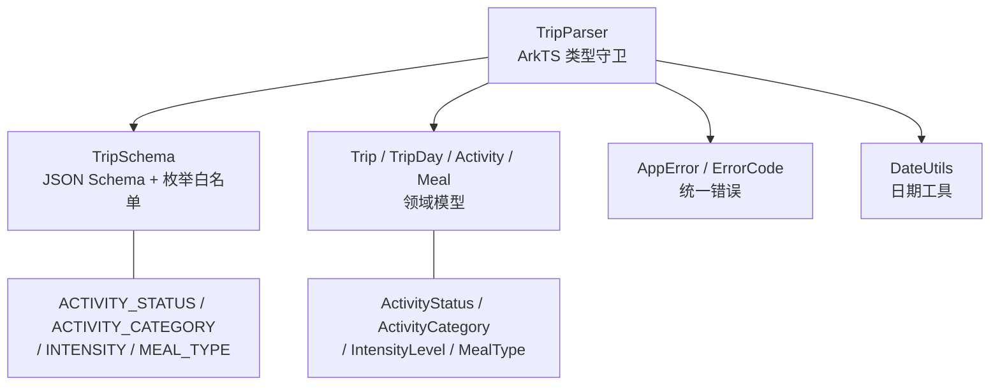
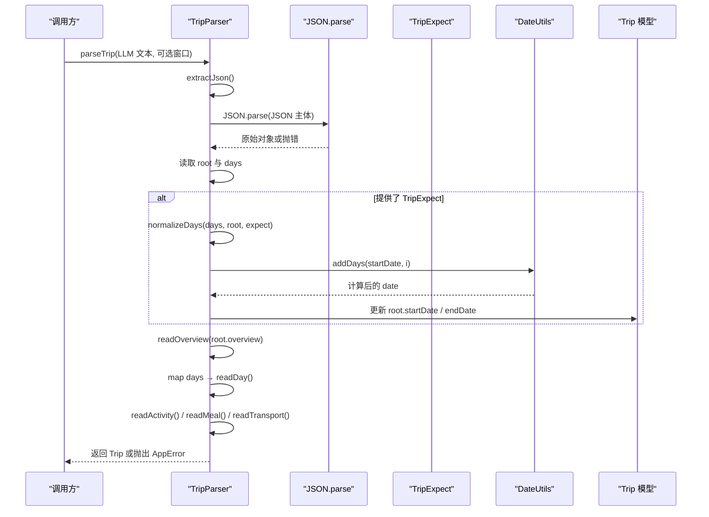
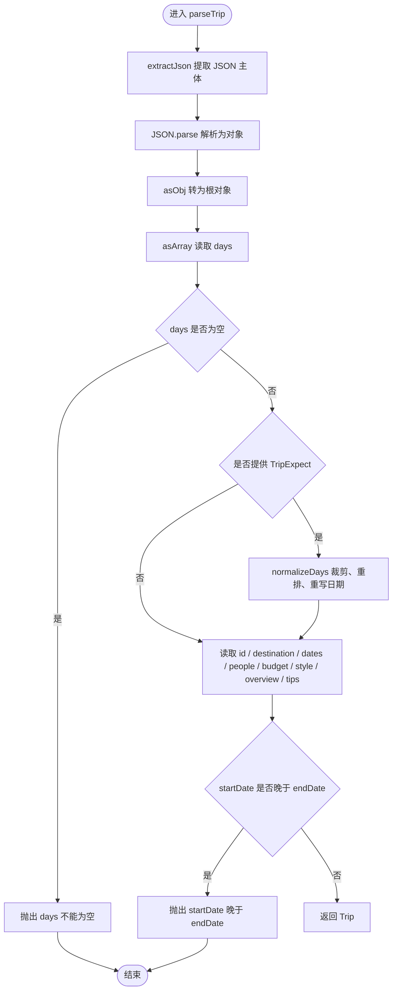
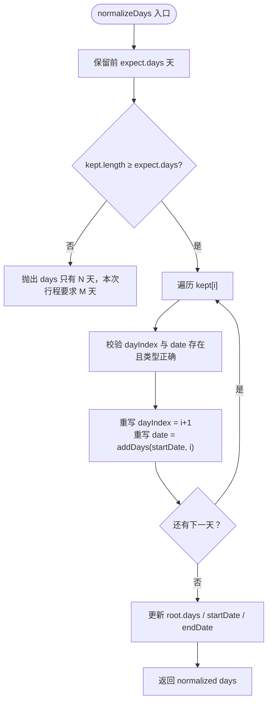
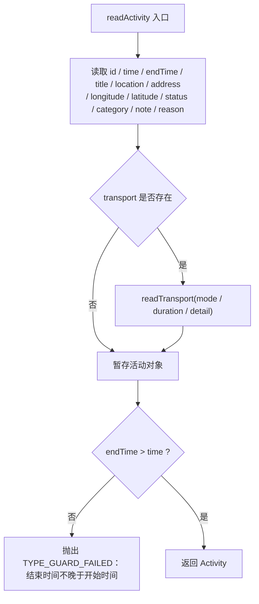
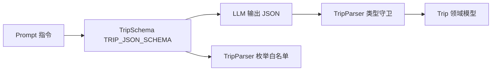

# 行程解析器

<cite>
**本文引用的文件**   
- [TripParser.ets](file://entry/src/main/ets/ai/TripParser.ets)
- [TripSchema.ets](file://entry/src/main/ets/ai/TripSchema.ets)
- [Trip.ets](file://entry/src/main/ets/model/Trip.ets)
- [AppError.ets](file://entry/src/main/ets/common/error/AppError.ets)
- [ErrorCode.ets](file://entry/src/main/ets/common/error/ErrorCode.ets)
- [DateUtils.ets](file://entry/src/main/ets/utils/DateUtils.ets)
</cite>

## 目录
1. [引言](#引言)
2. [项目结构](#项目结构)
3. [核心组件](#核心组件)
4. [架构总览](#架构总览)
5. [详细组件分析](#详细组件分析)
6. [依赖关系分析](#依赖关系分析)
7. [性能考量](#性能考量)
8. [故障排查指南](#故障排查指南)
9. [结论](#结论)

## 引言
本文件面向“行程解析器”，即 ArkTS 端把 LLM 返回的文本转换为强类型 `Trip` 对象的实现。其核心职责是：

- 从可能包含 Markdown 围栏、前后说明文字的响应文本中，剥离出 JSON 主体；
- 将原始对象逐字段校验为 ArkTS 接口定义的数据结构；
- 用枚举白名单限制活动状态、活动分类、强度等级和餐次取值；
- 以用户给定的行程窗口优先于模型自述的方式修正天数与日期；
- 在任一环节失败时抛出统一错误 `AppError`，并附带清晰的路径提示，便于定位 LLM 输出格式问题。

该模块对应开发文档中的“第三层防线”——ArkTS 端类型守卫，与 Prompt 层的 JSON Schema 和运行时枚举共同构成三重安全网。

## 项目结构
本次分析涉及以下关键文件：



**图示来源**
- [TripParser.ets:1-299](file://entry/src/main/ets/ai/TripParser.ets#L1-L299)
- [TripSchema.ets:1-151](file://entry/src/main/ets/ai/TripSchema.ets#L1-L151)
- [Trip.ets:1-137](file://entry/src/main/ets/model/Trip.ets#L1-L137)
- [AppError.ets:1-20](file://entry/src/main/ets/common/error/AppError.ets#L1-L20)
- [ErrorCode.ets:1-48](file://entry/src/main/ets/common/error/ErrorCode.ets#L1-L48)
- [DateUtils.ets:1-80](file://entry/src/main/ets/utils/DateUtils.ets#L1-L80)

**章节来源**
- [TripParser.ets:1-299](file://entry/src/main/ets/ai/TripParser.ets#L1-L299)
- [TripSchema.ets:1-151](file://entry/src/main/ets/ai/TripSchema.ets#L1-L151)
- [Trip.ets:1-137](file://entry/src/main/ets/model/Trip.ets#L1-L137)

## 核心组件
### TripParser
`TripParser` 是一个静态类，承担“LLM 文本 → Trip”的全部解析和校验逻辑。它不持有外部状态，所有方法都是纯函数风格（除调用 `DateUtils.addDays` 外），适合被 UI、测试或后端复用。

关键入口：

| 方法 | 输入 | 输出 | 主要职责 |
|---|---|---|---|
| `extractJson` | 字符串 | 字符串 | 从 LLM 响应中查找第一个 `{` 和最后一个 `}`，提取 JSON 主体 |
| `parseTrip` | 字符串、可选行程窗口 | `Trip` | 解析根对象、校验顶层字段、规范化天数、构造最终行程 |
| `normalizeDays` | 天数组、根对象、期望窗口 | 天数组 | 裁剪多余天数、补齐不足则抛错、重排 `dayIndex` 和 `date` |
| `readDay` | 单天对象、索引 | `TripDay` | 校验单日结构、主题、强度、活动、餐饮、住宿等 |
| `readActivity` | 单个活动对象、行号 | `Activity` | 校验活动时间顺序、枚举、坐标、可选交通信息 |
| `readMeal` | 单个餐饮对象、行列号 | `Meal` | 校验餐次枚举、名称、地点、预算 |
| `readTransport` | 交通对象、路径 | `TransportInfo` | 校验出行方式、耗时、详情 |

**章节来源**
- [TripParser.ets:1-299](file://entry/src/main/ets/ai/TripParser.ets#L1-L299)

### TripExpect
`TripExpect` 是调用方传入的行程窗口：

| 字段 | 类型 | 含义 |
|---|---|---|
| `days` | 数字 | 用户期望的行程天数 |
| `startDate` | 字符串 | 用户期望的出发日期 |

设计原则：**用户输入优先**。如果模型自述的天数比期望多，直接截掉；如果比期望少，直接失败重试，而不是猜测补造缺失天。

**章节来源**
- [TripParser.ets:17-25](file://entry/src/main/ets/ai/TripParser.ets#L17-L25)

### AppError 与 ErrorCode
`AppError` 是跨层统一的错误类型，携带：

- `code`：数值错误码；
- `message`：可读消息；
- `cause`：原始异常。

`ErrorCode` 集中定义错误码区段：

| 区段 | 范围 | 用途 |
|---|---|---|
| 1xxx | 网络 | HTTP 请求、LLM 服务不可用 |
| 2xxx | JSON / 解析 | JSON 解析失败、Schema 校验失败、类型守卫失败 |
| 3xxx | 存储 | RDB 初始化、迁移、事务、查询 |
| 4xxx | 业务规则 | 行程生成前置校验、流程约束 |
| 5xxx | 账号 | UnionID 登录、偏好持久化 |
| 6xxx | 云端 | BFF、权益、计费相关 |

本次解析器主要使用 2xxx 区段：

| 错误码 | 含义 | 典型触发点 |
|---|---|---|
| `JSON_PARSE_FAILED` | JSON 解析失败 | 找不到 `{}`、`JSON.parse` 抛错 |
| `SCHEMA_VALIDATION_FAILED` | Schema 校验失败 | 字段缺失、枚举越界、时间格式不对、日期区间非法 |
| `TYPE_GUARD_FAILED` | 类型守卫失败 | 字段类型不是期望类型、整数非整数、结束时间早于开始时间 |

**章节来源**
- [AppError.ets:1-20](file://entry/src/main/ets/common/error/AppError.ets#L1-L20)
- [ErrorCode.ets:1-48](file://entry/src/main/ets/common/error/ErrorCode.ets#L1-L48)

## 架构总览
下图展示一次完整的 LLM 行程响应进入 ArkTS 后的处理流程：



**图示来源**
- [TripParser.ets:27-73](file://entry/src/main/ets/ai/TripParser.ets#L27-L73)
- [TripParser.ets:75-114](file://entry/src/main/ets/ai/TripParser.ets#L75-L114)
- [TripParser.ets:116-200](file://entry/src/main/ets/ai/TripParser.ets#L116-L200)
- [DateUtils.ets:33-41](file://entry/src/main/ets/utils/DateUtils.ets#L33-L41)

## 详细组件分析

### extractJson：从 LLM 文本中提取 JSON 主体
LLM 可能返回 Markdown 围栏，例如：

```text
以下是行程结果：

```json
{...}
```

请确认是否继续。
```

`extractJson` 的实现策略是：

1. 找到文本中第一个左花括号的位置；
2. 找到最后一个右花括号的位置；
3. 截取两者之间的子串作为 JSON 主体；
4. 如果没有找到合法边界，抛出 `JSON_PARSE_FAILED`；
5. 后续由 `parseTrip` 再调用 `JSON.parse` 做正式解析。

这种实现允许模型输出前后解释文字，也容忍 JSON 出现在任意位置。但它不是完整 Markdown 解析器，不会显式识别 ````json` 标记本身，而是靠花括号定位。

需要注意的风险：

- 如果 LLM 在 JSON 之外还输出了其他花括号，例如列表项中包含 `{key: value}`，最后一个 `}` 可能不是 JSON 结尾；
- 如果 LLM 输出多个并列 JSON 片段，该方法只取“第一个 `{` 到最后一个 `}`”之间的内容；
- 对空字符串或纯说明文本会直接报“响应中不含 JSON 主体”。

**章节来源**
- [TripParser.ets:27-37](file://entry/src/main/ets/ai/TripParser.ets#L27-L37)

### parseTrip：核心验证流程
`parseTrip` 是解析器的主入口，整体流程如下：



**图示来源**
- [TripParser.ets:39-73](file://entry/src/main/ets/ai/TripParser.ets#L39-L73)

#### 根字段校验
根对象必须包含：

| 字段 | 类型要求 | 校验规则 |
|---|---|---|
| `id` | 非空字符串 | 必填 |
| `destination` | 非空字符串 | 必填 |
| `startDate` | 非空字符串 | 必填，且不能晚于 `endDate` |
| `endDate` | 非空字符串 | 必填 |
| `people` | 整数 | 必填 |
| `budget` | 整数 | 必填 |
| `style` | 非空字符串 | 必填 |
| `overview` | 对象 | 必填，递归校验 |
| `days` | 数组 | 必填且非空，每个元素按 `readDay` 校验 |
| `tips` | 字符串数组 | 必填，每项必须是字符串 |

#### 日期区间校验
`startDate` 与 `endDate` 通过去除连字符后的数字比较大小。若 `startDate > endDate`，抛出 `SCHEMA_VALIDATION_FAILED`。

注意：这里没有调用 `DateUtils.isValidIsoDate`，而是用简单正则和数字比较；因此像 `2026-02-30` 这类日历非法日期可能先被当作普通字符串比较，具体行为取决于 LLM 输出的值。

**章节来源**
- [TripParser.ets:39-73](file://entry/src/main/ets/ai/TripParser.ets#L39-L73)
- [TripParser.ets:261-271](file://entry/src/main/ets/ai/TripParser.ets#L261-L271)

### normalizeDays：用户窗口优先的特殊逻辑
这是解析器中最关键的“模型自述 vs 用户意图”协调逻辑。

#### 设计动机
模型可能在 prompt 下自述一个天数，而用户实际输入的行程窗口不同。例如：

- 用户选了 3 天，模型却生成了 4 天；
- 用户选了 3 天，模型只生成了 2 天；
- 模型生成的 `dayIndex` 不是从 1 连续递增；
- 模型的 `date` 与用户输入的 `startDate` 不一致。

#### 处理规则

1. **裁剪多余天数**：保留前 `expect.days` 个天；
2. **不足则失败**：如果模型输出少于期望天数，直接抛错，不再尝试猜测补造；
3. **强制重排 dayIndex**：第 `i` 天的 `dayIndex` 改为 `i + 1`；
4. **强制重写 date**：第 `i` 天的 `date` 设为 `DateUtils.addDays(expect.startDate, i)`；
5. **同步根日期**：`root.startDate` 改为 `expect.startDate`，`root.endDate` 改为最后一天；
6. **先校验后归一**：在重排之前，先检查 `dayIndex` 和 `date` 是否存在且类型正确，避免把脏数据洗成合法数据。

#### 复杂度
- 时间复杂度：`O(n)`，其中 `n` 是天数量；
- 空间复杂度：`O(k)`，`k = expect.days`，因为使用了切片。



**图示来源**
- [TripParser.ets:75-114](file://entry/src/main/ets/ai/TripParser.ets#L75-L114)
- [DateUtils.ets:33-41](file://entry/src/main/ets/utils/DateUtils.ets#L33-L41)

**章节来源**
- [TripParser.ets:75-114](file://entry/src/main/ets/ai/TripParser.ets#L75-L114)
- [DateUtils.ets:33-41](file://entry/src/main/ets/utils/DateUtils.ets#L33-L41)

### readDay：单日行程校验
`readDay` 负责把一个天对象映射为 `TripDay`。

关键字段校验：

| 字段 | 规则 |
|---|---|
| `dayIndex` | 必须是整数，且等于当前数组索引加 1 |
| `date` | 必须是字符串 |
| `theme` | 非空字符串 |
| `intensity` | 必须在 `TripSchema.INTENSITY` 白名单内 |
| `risk` | 可选字符串 |
| `dailyCost` | 整数 |
| `activities` | 数组，逐项调用 `readActivity` |
| `meals` | 数组，逐项调用 `readMeal` |
| `accommodation` | 可选字符串 |

重要语义：即使 `normalizeDays` 已经重写 `dayIndex`，`readDay` 仍会再次校验它是否等于 `i + 1`。这意味着如果模型输出中间出现跳号或重复序号，解析器会拒绝，而不是静默接受。

**章节来源**
- [TripParser.ets:116-146](file://entry/src/main/ets/ai/TripParser.ets#L116-L146)

### readActivity：活动节点校验
活动是最复杂的实体之一。

#### 必填字段
- `id`
- `time`
- `endTime`
- `title`
- `location`
- `longitude`
- `latitude`
- `status`
- `category`

#### 可选字段
- `address`：可为空或不存在；
- `note`；
- `reason`；
- `transport`：整个对象可省略。

#### 特殊规则
- `location` 允许空串，但键必须存在；
- `address` 完全允许缺失或空；
- `status` 必须在 `TripSchema.ACTIVITY_STATUS` 白名单；
- `category` 必须在 `TripSchema.ACTIVITY_CATEGORY` 白名单；
- `endTime` 必须严格晚于 `time`，不接受跨午夜排布；
- `transport` 存在时才调用 `readTransport`。



**图示来源**
- [TripParser.ets:148-192](file://entry/src/main/ets/ai/TripParser.ets#L148-L192)
- [TripParser.ets:194-200](file://entry/src/main/ets/ai/TripParser.ets#L194-L200)

**章节来源**
- [TripParser.ets:148-200](file://entry/src/main/ets/ai/TripParser.ets#L148-L200)

### readMeal：餐饮校验
`readMeal` 校验每餐：

| 字段 | 规则 |
|---|---|
| `type` | 必须在 `TripSchema.MEAL_TYPE` 白名单 |
| `name` | 非空字符串 |
| `time` | 可选字符串 |
| `location` | 非空字符串 |
| `note` | 可选字符串 |
| `estimatedCost` | 整数 |

与活动不同，餐饮没有 `transport`，也没有严格的先后时间校验，只保证枚举和基础类型。

**章节来源**
- [TripParser.ets:202-216](file://entry/src/main/ets/ai/TripParser.ets#L202-L216)

### readTransport：通勤信息校验
`readTransport` 相对简单，用于相邻活动前的通勤描述：

| 字段 | 规则 |
|---|---|
| `mode` | 非空字符串，如“步行”“打车”“地铁 2 号线” |
| `duration` | 整数，单位分钟 |
| `detail` | 非空字符串，如距离、换乘说明 |

**章节来源**
- [TripParser.ets:194-200](file://entry/src/main/ets/ai/TripParser.ets#L194-L200)

### 收口原语：类型守卫的最小单元
`TripParser` 内部有一组私有静态方法，作为所有字段校验的基础单元：

| 方法 | 作用 | 失败时错误码 |
|---|---|---|
| `asObj` | 判断是否为普通对象 | `TYPE_GUARD_FAILED` |
| `reqObj` | 判断字段是否存在且为对象 | `SCHEMA_VALIDATION_FAILED` 或 `TYPE_GUARD_FAILED` |
| `asArray` | 判断是否为数组 | `TYPE_GUARD_FAILED` |
| `reqArray` | 判断字段是否存在且为数组 | `SCHEMA_VALIDATION_FAILED` 或 `TYPE_GUARD_FAILED` |
| `strOrEmpty` | 允许缺失或空串的字符串 | `SCHEMA_VALIDATION_FAILED` |
| `reqStr` | 必填非空字符串 | `SCHEMA_VALIDATION_FAILED` 或 `TYPE_GUARD_FAILED` |
| `reqStrAllowEmpty` | 必填但允许空串 | `SCHEMA_VALIDATION_FAILED` 或 `TYPE_GUARD_FAILED` |
| `optStr` | 可选字符串，空串转 undefined | `TYPE_GUARD_FAILED` |
| `strArray` | 字符串数组 | `TYPE_GUARD_FAILED` |
| `reqNum` | 必填数字 | `SCHEMA_VALIDATION_FAILED` 或 `TYPE_GUARD_FAILED` |
| `reqInt` | 必填整数 | `TYPE_GUARD_FAILED` |
| `reqEnum` | 白名单枚举 | `SCHEMA_VALIDATION_FAILED` |
| `reqTime` | HH:mm 时间格式 | `SCHEMA_VALIDATION_FAILED` |
| `toDateNum` | YYYY-MM-DD 转数字比较 | `SCHEMA_VALIDATION_FAILED` |

这些方法保证了错误信息始终带有字段路径，例如：

- `days[0].activities[2].endTime(10:00) 必须晚于 time(12:00)，跨午夜的排布不予接受`
- `days[0].activities[2].status: 'unknown' 不在枚举 [booked,not_booked,full,pending,no_need]`
- `days[0].activities[2].location: 期望 string`

**章节来源**
- [TripParser.ets:218-299](file://entry/src/main/ets/ai/TripParser.ets#L218-L299)

## 依赖关系分析

### 与 TripSchema 的关系：三重防线
`TripSchema` 同时承担两个角色：

1. **JSON Schema 常量**：构建 `TRIP_JSON_SCHEMA`，用于 Prompt 系统指令和可能的 `response_format`；
2. **枚举白名单**：`ACTIVITY_STATUS`、`ACTIVITY_CATEGORY`、`INTENSITY`、`MEAL_TYPE` 同时被 `TripParser` 引用。

这形成三层防线：

| 层级 | 位置 | 作用 |
|---|---|---|
| 第一层 | Prompt / JSON Schema | 告诉 LLM 输出结构和枚举值 |
| 第二层 | 服务端或上游校验（如有） | 在更靠近 LLM 的一侧拦截明显违规 |
| 第三层 | ArkTS `TripParser` | 最终类型守卫，防止脏数据进入应用层 |



**图示来源**
- [TripSchema.ets:1-151](file://entry/src/main/ets/ai/TripSchema.ets#L1-L151)
- [TripParser.ets:1-299](file://entry/src/main/ets/ai/TripParser.ets#L1-L299)

**章节来源**
- [TripSchema.ets:1-151](file://entry/src/main/ets/ai/TripSchema.ets#L1-L151)
- [TripParser.ets:1-20](file://entry/src/main/ets/ai/TripParser.ets#L1-L20)

### 与 Trip 模型的关系
`TripParser` 不定义数据结构，只消费 `model/Trip` 中定义的接口：

- `Trip`
- `TripDay`
- `Activity`
- `Meal`
- `TransportInfo`
- `TripOverview`
- 枚举：`ActivityStatus`、`ActivityCategory`、`IntensityLevel`、`MealType`

这种解耦使领域模型可以独立演进，只要解析器与接口保持兼容。

**章节来源**
- [Trip.ets:1-137](file://entry/src/main/ets/model/Trip.ets#L1-L137)
- [TripParser.ets:12-16](file://entry/src/main/ets/ai/TripParser.ets#L12-L16)

### 与 DateUtils 的关系
`DateUtils` 提供：

- ISO 日期合法性检查；
- 日期加减；
- 日期格式化；
- 分钟换算。

`TripParser` 在 `normalizeDays` 中使用 `addDays` 重写 `date`，并在根日期比较中使用 `toDateNum`。

**章节来源**
- [DateUtils.ets:1-80](file://entry/src/main/ets/utils/DateUtils.ets#L1-L80)
- [TripParser.ets:75-114](file://entry/src/main/ets/ai/TripParser.ets#L75-L114)

## 性能考量
- `extractJson` 是线性扫描，时间复杂度 `O(n)`；
- `parseTrip` 的时间复杂度主要由 `days.map` 决定，约为 `O(d + a + m)`，其中 `d` 是天数量，`a` 是活动总数，`m` 是餐饮总数；
- `normalizeDays` 只做一次切片和一次线性遍历；
- 枚举白名单使用数组 `indexOf`，单次查找 `O(k)`，其中 `k` 是枚举长度，但枚举很小，影响可忽略；
- 整体解析过程没有异步 I/O，适合在主线程或短任务中执行。

优化建议：

- 如果未来枚举白名单增长很大，可将 `string[]` 改为 `Set<string>` 以降低查找成本；
- 对于超长 LLM 响应，可在 `extractJson` 前先做长度上限检查，避免处理恶意大文本；
- 若需要批量解析多条 LLM 输出，可缓存枚举查找表。

[本节为通用性能讨论，不直接分析特定代码片段]

## 故障排查指南

### 常见错误模式与定位方法

| 现象 | 可能原因 | 错误码 | 定位线索 |
|---|---|------|---|
| “响应中不含 JSON 主体” | LLM 只返回了说明文字，没有 `{}` | `JSON_PARSE_FAILED` | 检查 `extractJson` 是否能找到第一个 `{` 和最后一个 `}` |
| “JSON 解析失败：...” | JSON 语法错误 | `JSON_PARSE_FAILED` | 查看捕获到的原始错误消息 |
| “days 不能为空数组” | LLM 返回了 `days: []` | `SCHEMA_VALIDATION_FAILED` | 检查根对象 `days` 是否确实为空 |
| “days 只有 N 天，本次行程要求 M 天” | 模型自述天数小于用户期望 | `SCHEMA_VALIDATION_FAILED` | 检查 `TripExpect.days` 与模型输出天数 |
| “days[i].dayIndex=N 应为 i+1” | 天序号不连续或从 0 开始 | `SCHEMA_VALIDATION_FAILED` | 检查模型是否输出 `dayIndex: 0` 或跳过序号 |
| “startDate 晚于 endDate” | 日期区间颠倒 | `SCHEMA_VALIDATION_FAILED` | 检查根级 `startDate` 和 `endDate` |
| “endTime(...) 必须晚于 time(...)” | 活动结束时间早于开始时间 | `TYPE_GUARD_FAILED` | 检查该活动的 `time` 与 `endTime` |
| “status: 'xxx' 不在枚举 [...]” | 枚举值拼写错误或新增未同步 | `SCHEMA_VALIDATION_FAILED` | 对比 `TripSchema.ACTIVITY_STATUS` |
| “location: 期望 string” | 字段类型不是字符串 | `TYPE_GUARD_FAILED` | 检查该字段是否为 null、对象或数字 |
| “HH:mm 非 HH:mm” | 时间格式不符合两位小时两位分钟 | `SCHEMA_VALIDATION_FAILED` | 检查 `time` 或 `endTime` 是否带秒或其他格式 |
| “YYYY-MM-DD 非 YYYY-MM-DD” | 根日期格式不符合 ISO | `SCHEMA_VALIDATION_FAILED` | 检查 `startDate` / `endDate` 是否含连字符 |

### 调试技巧

1. **先看错误码**：
   - 2001：JSON 层问题；
   - 2002：Schema / 枚举 / 结构问题；
   - 2003：类型守卫问题。

2. **再看错误消息中的路径**：
   - `days[0].activities[2].transport.mode` 能直接定位到嵌套层级；
   - `overview.totalCost` 表示概览字段；
   - `tips[3]` 表示 tips 数组的第 4 项。

3. **区分“缺字段”和“类型错误”**：
   - `SCHEMA_VALIDATION_FAILED: ... 缺字段` 表示键缺失；
   - `TYPE_GUARD_FAILED: ... 期望 string/number/array/object` 表示键存在但类型不对。

4. **关注 TripExpect 的影响**：
   - 如果日志中出现“days 只有 N 天”，优先检查用户输入天数是否与模型输出一致；
   - 不要试图让解析器自动补造缺失天，应引导上层重试或降级。

5. **隔离 LLM 输出**：
   - 先将 `extractJson` 的输出打印出来；
   - 再用 JSON 校验工具检查语法；
   - 最后对照 `TripSchema` 检查字段是否齐全。

**章节来源**
- [TripParser.ets:27-73](file://entry/src/main/ets/ai/TripParser.ets#L27-L73)
- [TripParser.ets:116-216](file://entry/src/main/ets/ai/TripParser.ets#L116-L216)
- [TripParser.ets:218-299](file://entry/src/main/ets/ai/TripParser.ets#L218-L299)
- [ErrorCode.ets:13-22](file://entry/src/main/ets/common/error/ErrorCode.ets#L13-L22)

## 结论
`TripParser` 是 ArkTS 端行程解析的核心类型守卫，它的价值不仅在于把 JSON 转成 `Trip`，更在于建立一套可诊断、可回归、可维护的校验体系：

- `extractJson` 容忍 Markdown 围栏和前后杂文，提高鲁棒性；
- `parseTrip` 完成根对象、日期区间、天数组、概览、活动和餐饮的全链路校验；
- `normalizeDays` 明确体现“用户窗口优先”的产品决策，避免模型自述污染用户意图；
- 各实体的解析方法都有清晰的字段路径和错误码，便于调试 LLM 输出格式问题；
- `TripSchema` 提供 JSON Schema 和枚举白名单，与 ArkTS 类型守卫同源，形成“Schema、接口、守卫三者同源”的设计。

在实际使用中，遇到解析失败时应优先检查 LLM 输出的 JSON 语法、字段完整性、枚举值和日期时间格式，而不是修改解析器去“宽容”脏数据。这样既能保持下游数据结构干净，又能让 Prompt 和 LLM 行为更容易收敛。