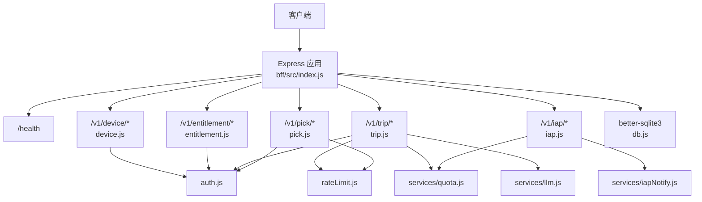
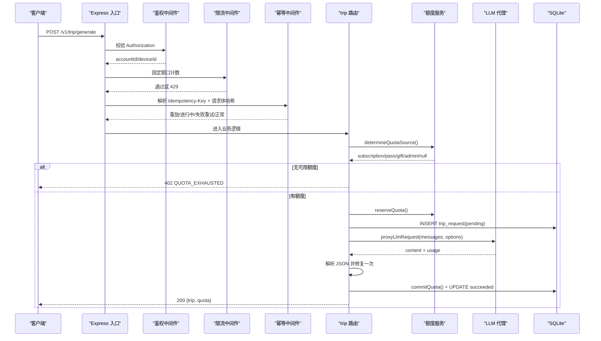
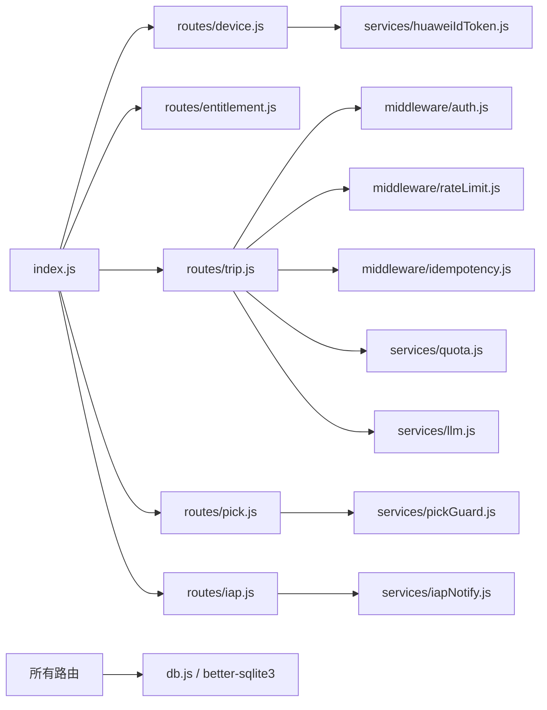

# API 参考文档

<cite>
**本文引用的文件**   
- [bff/src/index.js](file://bff/src/index.js)
- [bff/package.json](file://bff/package.json)
- [bff/src/db.js](file://bff/src/db.js)
- [bff/src/middleware/auth.js](file://bff/src/middleware/auth.js)
- [bff/src/middleware/rateLimit.js](file://bff/src/middleware/rateLimit.js)
- [bff/src/middleware/idempotency.js](file://bff/src/middleware/idempotency.js)
- [bff/src/routes/device.js](file://bff/src/routes/device.js)
- [bff/src/routes/entitlement.js](file://bff/src/routes/entitlement.js)
- [bff/src/routes/trip.js](file://bff/src/routes/trip.js)
- [bff/src/routes/pick.js](file://bff/src/routes/pick.js)
- [bff/src/routes/iap.js](file://bff/src/routes/iap.js)
- [bff/src/services/quota.js](file://bff/src/services/quota.js)
- [bff/src/services/huaweiIdToken.js](file://bff/src/services/huaweiIdToken.js)
- [bff/src/services/pickGuard.js](file://bff/src/services/pickGuard.js)
- [bff/src/lib/http-error.js](file://bff/src/lib/http-error.js)
- [bff/src/lib/json-extract.js](file://bff/src/lib/json-extract.js)
</cite>

## 目录
1. [简介](#简介)
2. [项目结构](#项目结构)
3. [核心组件](#核心组件)
4. [架构总览](#架构总览)
5. [详细接口规范](#详细接口规范)
6. [依赖关系分析](#依赖关系分析)
7. [性能与配额](#性能与配额)
8. [错误码与状态码映射](#错误码与状态码映射)
9. [客户端集成指南](#客户端集成指南)
10. [版本兼容性与迁移](#版本兼容性与迁移)
11. [故障排查](#故障排查)
12. [结论](#结论)

## 简介
有径 BFF 后端是一个基于 Express 的轻量服务，承担设备激活、JWT 鉴权、订阅与通行证 IAP 校验、行程生成代理、景点精选等职责。对外暴露 RESTful API；当前仓库中未实现 WebSocket 端点。所有业务响应统一使用 `{ error, message }`（错误）或领域对象（成功）结构；健康检查返回独立结构。

## 项目结构
BFF 根入口加载环境变量、初始化 SQLite、挂载路由，并注册全局错误处理中间件：
- 健康检查：`GET /health`
- 设备激活：`POST /v1/device/activate`
- 权益查询：`GET /v1/entitlement`
- 行程生成：`POST /v1/trip/generate`
- 景点精选：`POST /v1/pick/spots`
- IAP 校验与回调：`POST /v1/iap/verify`、`POST /v1/iap/notify`



**图表来源**
- [bff/src/index.js:1-55](file://bff/src/index.js#L1-L55)
- [bff/src/db.js:1-136](file://bff/src/db.js#L1-L136)

**章节来源**
- [bff/src/index.js:1-55](file://bff/src/index.js#L1-L55)
- [bff/package.json:1-22](file://bff/package.json#L1-L22)

## 核心组件
- 应用入口与健康检查：负责加载 `.env`、初始化数据库、挂载路由、统一错误处理。
- 鉴权中间件：校验 `Authorization: Bearer <JWT>`，解析 `accountId`、`deviceId`。
- 限流中间件：按账号固定窗口计数，默认 10 次/分钟，可配置。
- 幂等中间件：基于 `Idempotency-Key` 头 + 请求体规范化哈希，防止重复扣费。
- 额度服务：订阅/通行证/赠送额度的查询、预占、提交、回滚与来源判定。
- 华为 idToken 验签：本地 JWKS 验签 RS256/PS256，安全边界严格。
- 数据层：SQLite WAL 模式，包含账户、订阅、通行证、订单、额度账本、行程请求等表。

**章节来源**
- [bff/src/middleware/auth.js:1-25](file://bff/src/middleware/auth.js#L1-L25)
- [bff/src/middleware/rateLimit.js:1-47](file://bff/src/middleware/rateLimit.js#L1-L47)
- [bff/src/middleware/idempotency.js:1-122](file://bff/src/middleware/idempotency.js#L1-L122)
- [bff/src/services/quota.js:1-113](file://bff/src/services/quota.js#L1-L113)
- [bff/src/services/huaweiIdToken.js:1-161](file://bff/src/services/huaweiIdToken.js#L1-L161)
- [bff/src/db.js:1-136](file://bff/src/db.js#L1-L136)

## 架构总览
下图展示一次“行程生成”调用在 BFF 内的完整流程，包括鉴权、限流、幂等、额度、LLM 代理与结果持久化。



**图表来源**
- [bff/src/routes/trip.js:1-234](file://bff/src/routes/trip.js#L1-L234)
- [bff/src/middleware/idempotency.js:1-122](file://bff/src/middleware/idempotency.js#L1-L122)
- [bff/src/services/quota.js:1-113](file://bff/src/services/quota.js#L1-L113)

## 详细接口规范

### 通用约定

- 基础路径：`/v1`
- 认证方式：除 `/health`、`/v1/device/activate`、`/v1/iap/notify` 外，其他接口均要求 `Authorization: Bearer <JWT>`。
- 请求格式：`Content-Type: application/json`（IAP notify 除外）。
- 成功响应：返回具体业务对象。
- 失败响应：`{ error: string, message: string }`。
- 时间格式：日期为 `YYYY-MM-DD`；时间戳为 ISO 字符串。
- 字符限制：各字段在服务端均有长度和类型校验，超限直接返回 4xx。

#### JWT 获取与使用
- 获取：调用 `POST /v1/device/activate`，成功后返回 `deviceToken`。
- 使用：后续请求头部携带 `Authorization: Bearer <deviceToken>`。
- 有效期：30 天，由服务端签发时设置。

#### 幂等性
- 对 `POST /v1/trip/generate`，必须提供请求头 `Idempotency-Key`。
- 同一账号 + 同一 key + 同一请求体才会触发重放；不同请求体会被拒绝。
- 服务端会在首次成功时写入响应体，并重放该响应。

#### 内容长度
- 应用层 JSON body 限制：约 2MB。

**章节来源**
- [bff/src/middleware/auth.js:1-25](file://bff/src/middleware/auth.js#L1-L25)
- [bff/src/middleware/idempotency.js:1-122](file://bff/src/middleware/idempotency.js#L1-L122)
- [bff/src/index.js:1-55](file://bff/src/index.js#L1-L55)

---

### 健康检查

| 项目 | 说明 |
| --- | --- |
| 方法 | `GET` |
| URL | `/health` |
| 认证 | 不需要 |
| 请求头 | 无特殊要求 |
| 请求体 | 无 |
| 成功响应 | `{ status: "ok", db: "ok" }` 或降级时 `{ status: "degraded", db: "error" }` |
| HTTP 状态码 | 200 表示健康；503 表示数据库不可用 |

**章节来源**
- [bff/src/index.js:20-38](file://bff/src/index.js#L20-L38)

---

### 设备激活

| 项目 | 说明 |
| --- | --- |
| 方法 | `POST` |
| URL | `/v1/device/activate` |
| 认证 | 不需要 |
| 请求头 | `Content-Type: application/json` |
| 请求体字段 | `deviceId`（必填）、`idToken`（可选）、`unionId`（可选，仅用于兼容但不采信） |
| 成功响应字段 | `deviceToken`、`entitlement` |
| 典型状态码 | 200、400、401 |

**请求体约束**
- `deviceId`：非空字符串，长度不超过 128。
- `idToken`：可选；若提供则必须是合法 JWT，且需通过华为 JWKS 验签。
- `unionId`：若存在，必须是字符串且长度不超过 128；但服务端不会用它作为身份依据。

**响应体示例**
```json
{
  "deviceToken": "eyJhbGciOiJSUzI1NiIs...",
  "entitlement": {
    "subscription": null,
    "passes": [],
    "giftRemaining": 3,
    "usedToday": 0,
    "dailyCap": 20,
    "unlimited": false
  }
}
```

**错误示例**
```json
{
  "error": "INVALID_ID_TOKEN",
  "message": "华为身份票据无效"
}
```

**章节来源**
- [bff/src/routes/device.js:1-84](file://bff/src/routes/device.js#L1-L84)
- [bff/src/services/huaweiIdToken.js:1-161](file://bff/src/services/huaweiIdToken.js#L1-L161)
- [bff/src/services/quota.js:1-113](file://bff/src/services/quota.js#L1-L113)

---

### 权益查询

| 项目 | 说明 |
| --- | --- |
| 方法 | `GET` |
| URL | `/v1/entitlement` |
| 认证 | 需要 JWT |
| 请求头 | `Authorization: Bearer <token>` |
| 请求体 | 无 |
| 成功响应 | `entitlement` 对象 |

**响应体字段**
- `subscription`：订阅信息，含 `status`、`periodEnd`；无有效订阅时为 `null`。
- `passes`：通行证列表，每项含 `localTripId`、`status`、`expiresAt`。
- `giftRemaining`：赠送额度剩余。
- `usedToday`：当月已用次数（字段名历史保留，实际按月统计）。
- `dailyCap`：月度上限，当前为 20。
- `unlimited`：管理员账户为 `true`。

**章节来源**
- [bff/src/routes/entitlement.js:1-15](file://bff/src/routes/entitlement.js#L1-L15)
- [bff/src/services/quota.js:1-113](file://bff/src/services/quota.js#L1-L113)

---

### 行程生成

| 项目 | 说明 |
| --- | --- |
| 方法 | `POST` |
| URL | `/v1/trip/generate` |
| 认证 | 需要 JWT |
| 限流 | 需要，默认 10 次/分钟 |
| 幂等 | 需要 `Idempotency-Key` 头 |
| 请求头 | `Content-Type: application/json`、`Idempotency-Key` |
| 请求体字段 | `destination`、`startDate`、`endDate`、`people`、`budget`、`passId`（可选） |
| 成功响应字段 | `trip`、`quota` |
| 典型状态码 | 200、400、401、402、409、422、502 |

**请求体约束**
- `destination`：非空字符串。
- `startDate`、`endDate`：`YYYY-MM-DD`，范围 2020-01-01 至 2100-12-31，且 `endDate >= startDate`。
- `people`：整数 1–30。
- `budget`：非负整数。
- `passId`：可选；用于选择通行证额度来源。

**成功响应示例**
```json
{
  "trip": {
    "days": 3,
    "startDate": "2026-12-01",
    "plan": [
      {
        "date": "2026-12-01",
        "spots": [
          {
            "id": "spot_1",
            "name": "示例景点",
            "district": "示例区",
            "start_time": "09:30",
            "end_time": "11:00",
            "transport_mode": "步行",
            "transport_note": "从酒店步行前往"
          }
        ]
      }
    ]
  },
  "quota": {
    "source": "subscription",
    "remainingToday": 19,
    "giftRemaining": 3,
    "passes": []
  }
}
```

**失败示例**
```json
{
  "error": "LLM_INVALID_JSON",
  "message": "模型输出不是合法 JSON（修正后仍失败）: ..."
}
```

**处理要点**
- 额度不足返回 402。
- 并发相同幂等键返回 409。
- 模型输出非 JSON 会尝试一次修复；仍失败返回 502。
- 服务端会对模型输出进行结构化校验，不合法返回 502。

**章节来源**
- [bff/src/routes/trip.js:1-234](file://bff/src/routes/trip.js#L1-L234)
- [bff/src/middleware/idempotency.js:1-122](file://bff/src/middleware/idempotency.js#L1-L122)
- [bff/src/services/quota.js:1-113](file://bff/src/services/quota.js#L1-L113)
- [bff/src/lib/json-extract.js:1-48](file://bff/src/lib/json-extract.js#L1-L48)

---

### 景点精选

| 项目 | 说明 |
| --- | --- |
| 方法 | `POST` |
| URL | `/v1/pick/spots` |
| 认证 | 需要 JWT |
| 限流 | 需要，默认 10 次/分钟 |
| 幂等 | 不需要 |
| 请求头 | `Content-Type: application/json` |
| 请求体字段 | `city`、`days`、`pace`、`interests`、`candidates` |
| 成功响应字段 | `ranked`、`note` |
| 典型状态码 | 200、400、422 |

**请求体约束**
- `city`：非空字符串。
- `days`：整数 1–30。
- `pace`：字符串。
- `interests`：字符串。
- `candidates`：非空数组，最多 40 个候选；每个候选含 `id`、`name`、`tag`、`brief`、`district`、`popularity`、`suggestedDuration`、`requiresBooking`。

**成功响应示例**
```json
{
  "ranked": [
    {
      "id": "spot_a",
      "reason": "符合城市节奏与兴趣标签"
    },
    {
      "id": "spot_b",
      "reason": "距离较近且适合半日游"
    }
  ],
  "note": "最终顺序以服务端排序为准"
}
```

**失败示例**
```json
{
  "error": "DECISION_REJECTED",
  "message": "模型输出不是 JSON"
}
```

**章节来源**
- [bff/src/routes/pick.js:1-45](file://bff/src/routes/pick.js#L1-L45)
- [bff/src/services/pickGuard.js:1-97](file://bff/src/services/pickGuard.js#L1-L97)

---

### IAP 购买凭证校验

| 项目 | 说明 |
| --- | --- |
| 方法 | `POST` |
| URL | `/v1/iap/verify` |
| 认证 | 推荐 JWT；内部也支持从原始 Authorization 头解析 |
| 请求头 | `Content-Type: application/json` |
| 请求体字段 | `productType`、`jwsPurchaseOrder`（可选）、`jwsSubscriptionStatus`（可选）、`productId`（可选）、`localTripId`（通行证必填） |
| 成功响应字段 | `verified`、`entitlement`、`passId`（通行证） |
| 典型状态码 | 200、400、401、409、503 |

**请求体约束**
- `productType`：只能是 `"pass"` 或 `"subscription"`。
- 通行证：必须提供 `jwsPurchaseOrder` 和 `localTripId`。
- 订阅：优先提供 `jwsSubscriptionStatus`，也可提供 `jwsPurchaseOrder`；`productId` 默认 `youjing_sub_monthly`，另支持 `youjing_sub_yearly`。
- JWS 字段：必须是字符串，长度不超过 8192。

**成功响应示例**
```json
{
  "verified": true,
  "entitlement": {
    "subscription": {
      "status": "active",
      "periodEnd": "2027-11-11T00:00:00Z"
    },
    "passes": [],
    "giftRemaining": 3,
    "usedToday": 0,
    "dailyCap": 20,
    "unlimited": false
  },
  "passId": null
}
```

**失败示例**
```json
{
  "error": "RECEIPT_ALREADY_USED",
  "message": "该收据已绑定其他账号"
}
```

**章节来源**
- [bff/src/routes/iap.js:1-192](file://bff/src/routes/iap.js#L1-L192)
- [bff/src/services/quota.js:1-113](file://bff/src/services/quota.js#L1-L113)

---

### IAP 通知回调

| 项目 | 说明 |
| --- | --- |
| 方法 | `POST` |
| URL | `/v1/iap/notify` |
| 认证 | 由平台签名保证，BFF 侧验证通知 JWS |
| 请求头 | 平台发送，通常包含签名相关头 |
| 请求体字段 | `jwsNotification` |
| 成功响应 | `{ ok: true, applied: boolean, kind: string }` |
| 典型状态码 | 200、400、401、503 |

**行为说明**
- 官方 v3 通知体为 `{ jwsNotification }`。
- 部署未配置根证书时返回 503。
- 非 200 会触发平台重推。

**失败示例**
```json
{
  "error": "NOTIFY_BAD_FORMAT",
  "message": "缺少或非法的 jwsNotification"
}
```

**章节来源**
- [bff/src/routes/iap.js:130-192](file://bff/src/routes/iap.js#L130-L192)

---

### 健康检查

已在上方列出，不再重复。

**章节来源**
- [bff/src/index.js:20-38](file://bff/src/index.js#L20-L38)

## 依赖关系分析



**图表来源**
- [bff/src/index.js:1-55](file://bff/src/index.js#L1-L55)
- [bff/src/routes/trip.js:1-234](file://bff/src/routes/trip.js#L1-L234)
- [bff/src/routes/pick.js:1-45](file://bff/src/routes/pick.js#L1-L45)
- [bff/src/routes/iap.js:1-192](file://bff/src/routes/iap.js#L1-L192)
- [bff/src/routes/device.js:1-84](file://bff/src/routes/device.js#L1-L84)
- [bff/src/routes/entitlement.js:1-15](file://bff/src/routes/entitlement.js#L1-L15)
- [bff/src/db.js:1-136](file://bff/src/db.js#L1-L136)

**章节来源**
- [bff/src/index.js:1-55](file://bff/src/index.js#L1-L55)
- [bff/src/db.js:1-136](file://bff/src/db.js#L1-L136)

## 性能与配额

### 速率限制
- 作用范围：`/v1/trip` 和 `/v1/pick`。
- 策略：按账号固定窗口计数。
- 默认值：10 次/分钟。
- 可配置项：
  - `RATE_LIMIT_PER_MINUTE`：每分钟允许请求数。
  - `RATE_LIMIT_WINDOW_MS`：窗口时长毫秒数。
- 超出响应：429 `{ error: "RATE_LIMITED", message: "请求过于频繁，请稍后再试" }`。
- 重要限制：计数保存在进程内存，多实例部署下每实例独立计数。

**章节来源**
- [bff/src/middleware/rateLimit.js:1-47](file://bff/src/middleware/rateLimit.js#L1-L47)

### 额度配额
- 订阅档：每月最多 20 次生成（代码注释明确口径为月，字段名沿用 `usedToday`、`dailyCap`）。
- 赠送额度：默认 3 次，受赠送账本 delta 影响。
- 通行证：按 `localTripId` 关联，用于限定某次旅行额度来源。
- 管理员：可通过管理员账户绕过限额，但仍会计量。
- 额度来源判定优先级：管理员 > 订阅未超月限 > 指定通行证 > 赠送额度。

**章节来源**
- [bff/src/services/quota.js:1-113](file://bff/src/services/quota.js#L1-L113)

## 错误码与状态码映射

### 业务错误码

| 错误码 | HTTP 状态码 | 含义 | 常见触发场景 |
| --- | ---: | --- | --- |
| `MISSING_DEVICE_ID` | 400 | 缺少或非法 deviceId | 设备激活未传 deviceId 或超长 |
| `INVALID_UNION_ID` | 400 | 非法 unionId | 自报 unionId 类型或长度非法 |
| `INVALID_ID_TOKEN` | 400 | 非法 idToken | 非字符串或过长 |
| `ID_TOKEN_INVALID` | 401 | 华为身份票据无效 | JWKS 验签失败、aud/iss/exp 不符 |
| `TOKEN_INVALID` | 401 | 票据失效或无效 | Authorization 缺失、Bearer 格式错误、JWT 验证失败 |
| `MISSING_IDEMPOTENCY_KEY` | 400 | 缺少幂等键 | 未传 `Idempotency-Key` |
| `IDEMPOTENCY_KEY_REUSED` | 422 | 幂等键对应不同请求体 | 同 key 不同 body |
| `IDEMPOTENCY_IN_PROGRESS` | 409 | 幂等键正在处理 | 同 key 并发 |
| `IDEMPOTENCY_STATE_CORRUPT` | 500 | 幂等状态损坏 | 首次响应缺失或状态未知 |
| `INVALID_REQUEST` | 400 | 请求参数非法 | destination/date/people/budget 校验失败 |
| `QUOTA_EXHAUSTED` | 402 | 额度已用尽 | 订阅/通行证/赠送额度均不可用 |
| `LLM_INVALID_JSON` | 502 | 模型输出非合法 JSON | 解析失败且修复失败 |
| `LLM_INVALID_TRIP` | 502 | 模型输出行程结构非法 | 结构化校验失败 |
| `UNSUPPORTED_PRODUCT_TYPE` | 400 | 不支持的商品类型 | productType 不是 pass 或 subscription |
| `UNKNOWN_PRODUCT_ID` | 400 | 未知订阅商品 | productId 不在白名单 |
| `INVALID_JWS` | 400 | 非法 JWS | 非字符串或过长 |
| `MISSING_JWS` | 400 | 缺少必要 JWS | 通行证缺 purchaseOrder、订阅缺两个字段 |
| `MISSING_PARAMS` | 400 | 缺少 productType | IAP verify 未传 productType |
| `MISSING_TRIP_ID` | 400 | 通行证缺少 localTripId | 通行证校验参数非法 |
| `RECEIPT_ALREADY_USED` | 409 | 收据已绑定其他账号 | 同一 purchase_token 属于另一账户 |
| `NOTIFY_BAD_FORMAT` | 400 | IAP 通知格式非法 | 缺少或非法 jwsNotification |
| `INTERNAL_ERROR` | 500 | 未分类内部错误 | 全局错误处理兜底 |

### HTTP 状态码语义
- 200：业务成功。
- 400：客户端参数或格式错误。
- 401：认证失败或缺少票据。
- 402：付费能力不足。
- 409：资源冲突或幂等冲突。
- 422：幂等键复用冲突。
- 429：请求频率超限。
- 502：上游模型输出或结构化校验失败。
- 503：依赖未配置或数据库不可用。
- 500：服务端异常。

**章节来源**
- [bff/src/routes/device.js:1-84](file://bff/src/routes/device.js#L1-L84)
- [bff/src/routes/trip.js:1-234](file://bff/src/routes/trip.js#L1-L234)
- [bff/src/routes/pick.js:1-45](file://bff/src/routes/pick.js#L1-L45)
- [bff/src/routes/iap.js:1-192](file://bff/src/routes/iap.js#L1-L192)
- [bff/src/middleware/auth.js:1-25](file://bff/src/middleware/auth.js#L1-L25)
- [bff/src/middleware/idempotency.js:1-122](file://bff/src/middleware/idempotency.js#L1-L122)
- [bff/src/middleware/rateLimit.js:1-47](file://bff/src/middleware/rateLimit.js#L1-L47)
- [bff/src/lib/http-error.js:1-8](file://bff/src/lib/http-error.js#L1-L8)

## 客户端集成指南

### SDK 使用方法
- 第一步：调用 `POST /v1/device/activate`，传入 `deviceId` 和可选 `idToken`，保存返回的 `deviceToken`。
- 第二步：在所有需要认证的请求头中添加 `Authorization: Bearer <deviceToken>`。
- 第三步：调用 `GET /v1/entitlement` 获取当前额度与订阅状态，用于前端 UI 展示和门禁判断。
- 第四步：生成行程时调用 `POST /v1/trip/generate`，务必带上 `Idempotency-Key`。
- 第五步：如需景点精选，调用 `POST /v1/pick/spots`。
- 第六步：IAP 购买完成后调用 `POST /v1/iap/verify`，将凭证交给后端校验并落库。

### 错误处理
- 对 401：重新激活设备或引导用户登录。
- 对 402：提示用户订阅到期或额度耗尽。
- 对 409：等待短暂延迟后重试，或使用新 `Idempotency-Key`。
- 对 422：更换新的 `Idempotency-Key`。
- 对 429：根据响应文案提示“稍后再试”，并做退避重试。
- 对 502：提示模型暂时不可用，不建议立即无限重试。

### 重试机制建议
- 指数退避：首次 1 秒，二次 2 秒，三次 4 秒，最大间隔不超过 60 秒。
- 幂等重试：仅对 409、429 且 `Idempotency-Key` 相同的请求重试。
- 网络超时：单次请求建议设置合理超时，避免长时间占用连接池。
- 失败观察：记录 `error` 和 `message`，便于定位是客户端参数问题还是服务端上游问题。

### WebSocket 接口
- 当前 BFF 未暴露任何 WebSocket 端点；所有交互均为 HTTP REST。

**章节来源**
- [bff/src/routes/device.js:1-84](file://bff/src/routes/device.js#L1-L84)
- [bff/src/routes/trip.js:1-234](file://bff/src/routes/trip.js#L1-L234)
- [bff/src/routes/pick.js:1-45](file://bff/src/routes/pick.js#L1-L45)
- [bff/src/routes/iap.js:1-192](file://bff/src/routes/iap.js#L1-L192)

## 版本兼容性与迁移

### 当前版本
- 包名称：`youjing-bff`
- 版本：`1.0.0`
- 入口脚本：`node src/index.js`

### 数据迁移
- 数据库文件默认位于 `data/youjing.db`，可通过环境变量 `DB_PATH` 覆盖。
- 启动时会执行 DDL，并对旧库自动补齐 `request_hash`、`response_json` 字段。
- 可通过脚本运行迁移：`npm run migrate`。

### 向后兼容字段
- 额度响应中的 `usedToday`、`dailyCap` 字段名仍保留，但语义已改为“当月用量”和“月度上限”。
- 客户端不应依赖字段名字面含义，而应使用 `entitlement.subscription`、`entitlement.passes`、`entitlement.giftRemaining`、`entitlement.unlimited` 等字段。

### 部署与环境变量
- `PORT`：服务监听端口，默认 3000。
- `JWT_SECRET`：JWT 签名密钥，开发环境默认值为内置测试密钥。
- `DB_PATH`：SQLite 数据库路径。
- `RATE_LIMIT_PER_MINUTE`：每分钟限流次数。
- `RATE_LIMIT_WINDOW_MS`：限流窗口毫秒数。
- `HUAWEI_CLIENT_ID`：华为 Account Kit 客户端 ID。
- `HUAWEI_JWKS_URL`：可选，JWKS 地址。
- `HUAWEI_ISSUER`：可选，发行方地址。

**章节来源**
- [bff/package.json:1-22](file://bff/package.json#L1-L22)
- [bff/src/db.js:1-136](file://bff/src/db.js#L1-L136)
- [bff/src/middleware/auth.js:1-25](file://bff/src/middleware/auth.js#L1-L25)
- [bff/src/middleware/rateLimit.js:1-47](file://bff/src/middleware/rateLimit.js#L1-L47)
- [bff/src/services/huaweiIdToken.js:1-161](file://bff/src/services/huaweiIdToken.js#L1-L161)

## 故障排查

### 常见问题
- 401 票据无效：检查 `Authorization` 是否以 `Bearer ` 开头，JWT 是否过期，服务器 `JWT_SECRET` 是否与激活服务一致。
- 429 请求频繁：检查是否在同一账号下高频调用；必要时增加客户端重试间隔。
- 402 额度耗尽：检查订阅是否仍在有效期内、通行证是否有效、赠送额度是否为 0。
- 409 幂等冲突：确认客户端是否在短时间内重复发起相同 `Idempotency-Key`。
- 502 模型输出非法：通常是 LLM 输出不符合预期；客户端应避免盲目快速重试。
- 503 健康检查失败：数据库不可用或只读；检查 `DB_PATH` 所在卷权限与 WAL 模式。

### 调试建议
- 先调 `/health` 确认数据库健康。
- 打印 BFF 日志中的 `[trip]`、`[device]`、`[iap]`、`[db]` 前缀信息。
- 对 IAP 相关错误，区分 `IAP_NOT_CONFIGURED`（部署配置问题）和收据无效（客户端凭证问题）。

**章节来源**
- [bff/src/index.js:1-55](file://bff/src/index.js#L1-L55)
- [bff/src/db.js:1-136](file://bff/src/db.js#L1-L136)
- [bff/src/routes/iap.js:1-192](file://bff/src/routes/iap.js#L1-L192)

## 结论
本 API 参考文档覆盖了有径 BFF 的全部对外 REST 接口，包括设备激活、JWT 认证、额度与权限、行程生成、景点精选以及 IAP 校验与通知。文档同时明确了错误码、限流规则、幂等机制、额度计算方式以及客户端集成要点。对于生产部署，应重点关注 JWT 密钥、华为 JWKS、数据库路径、限流参数和 IAP 根证书配置。