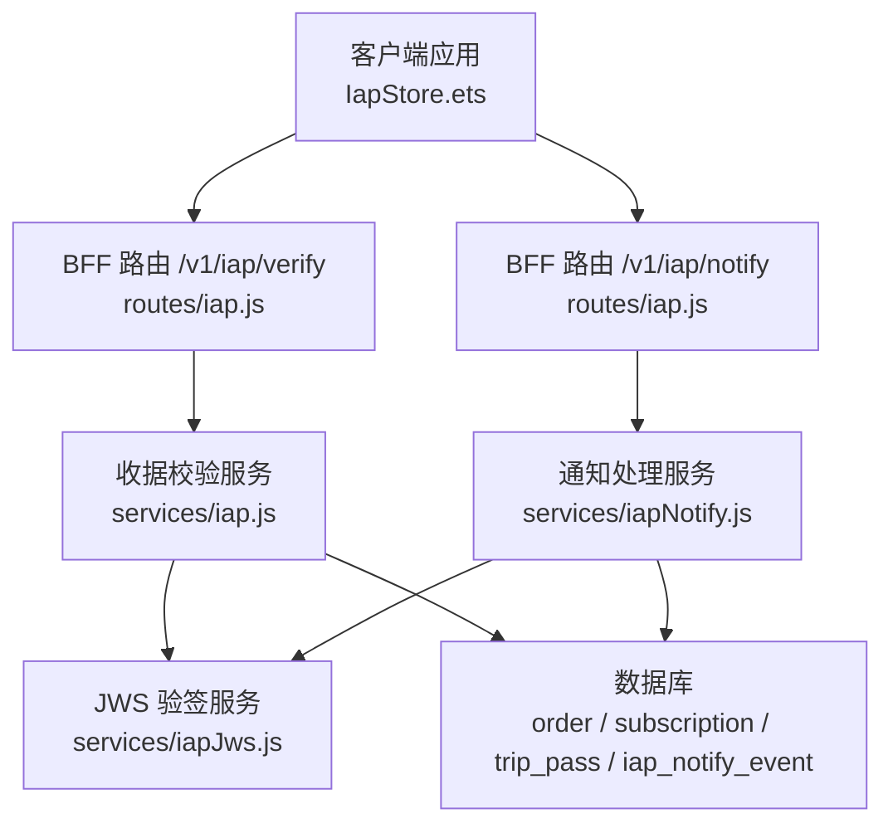
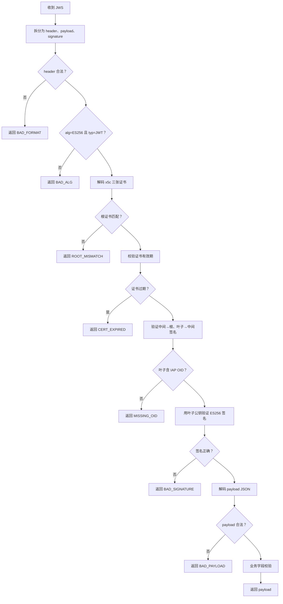
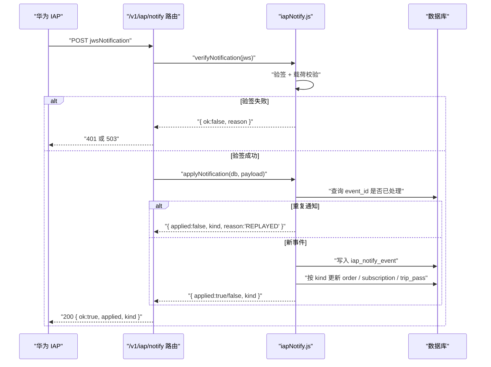
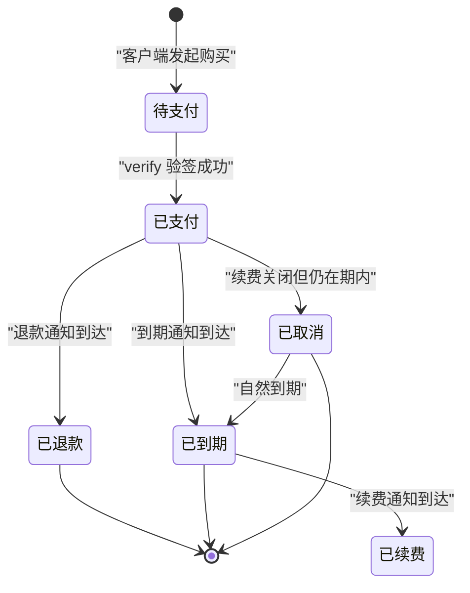
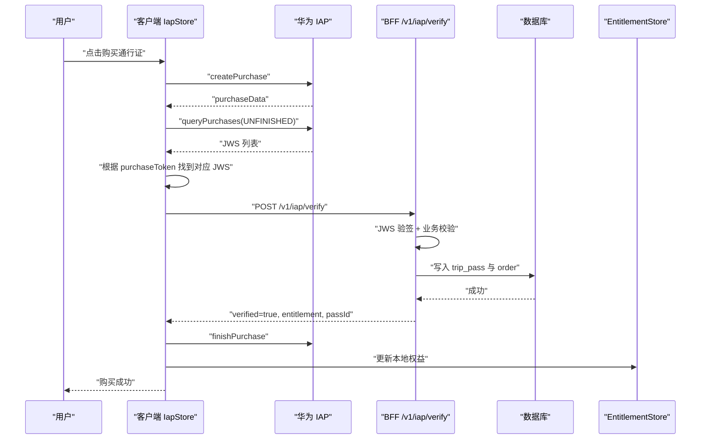
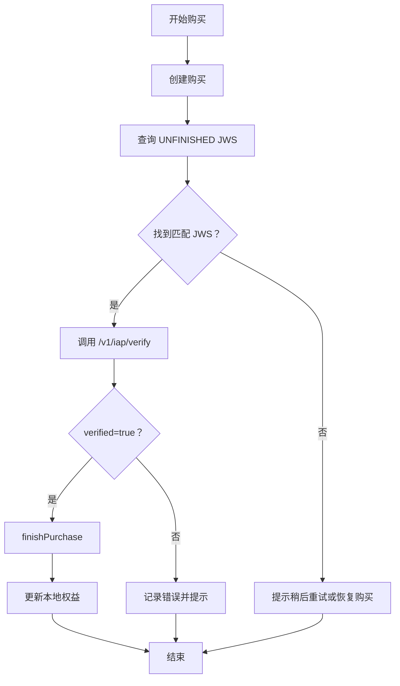
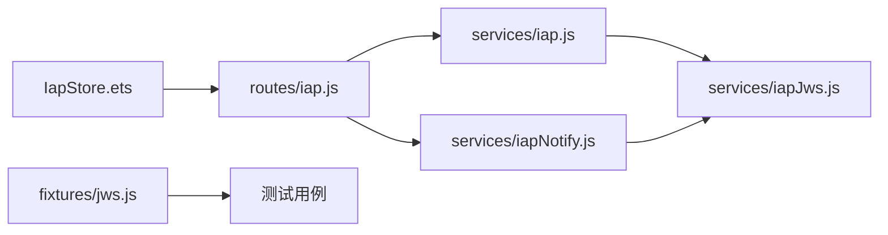

# 内购支付 API

<cite>
**本文引用的文件**   
- [bff/src/routes/iap.js](file://bff/src/routes/iap.js)
- [bff/src/services/iap.js](file://bff/src/services/iap.js)
- [bff/src/services/iapJws.js](file://bff/src/services/iapJws.js)
- [bff/src/services/iapNotify.js](file://bff/src/services/iapNotify.js)
- [entry/src/main/ets/data/IapStore.ets](file://entry/src/main/ets/data/IapStore.ets)
- [bff/test/fixtures/jws.js](file://bff/test/fixtures/jws.js)
- [Docs/analysis/商业化链路真实验收-2026-11-03.md](file://Docs/analysis/商业化链路真实验收-2026-11-03.md)
</cite>

## 目录
1. [引言](#引言)
2. [项目结构](#项目结构)
3. [核心接口规范](#核心接口规范)
4. [IAP JWS 签名验证流程](#iap-jws-签名验证流程)
5. [支付通知处理与幂等机制](#支付通知处理与幂等机制)
6. [订单与权益生命周期](#订单与权益生命周期)
7. [端到端支付流程图](#端到端支付流程图)
8. [错误码与异常处理](#错误码与异常处理)
9. [客户端集成指南](#客户端集成指南)
10. [依赖关系分析](#依赖关系分析)
11. [性能与可靠性要点](#性能与可靠性要点)
12. [故障排查](#故障排查)
13. [结论](#结论)

## 引言
本文件面向后端开发者、前端客户端开发者以及审核与安全人员，系统化说明本项目中基于华为 IAP Kit 的内购支付实现。系统包含两个关键后端接口：购买验证接口 `POST /v1/iap/verify` 与支付通知接口 `POST /v1/iap/notify`；同时覆盖 JWS 本地验签、证书链校验、业务字段校验、订单幂等、订阅续费、到期失效、退款撤销、通知去重、状态同步等完整商业闭环。

## 项目结构
内购相关代码主要分布在 BFF 后端与 HarmonyOS NEXT 客户端两侧：

- BFF 后端
  - 路由层：`bff/src/routes/iap.js`
  - 收据校验服务：`bff/src/services/iap.js`
  - JWS 验签服务：`bff/src/services/iapJws.js`
  - 支付通知服务：`bff/src/services/iapNotify.js`
- 客户端侧
  - IAP 购买与校验逻辑：`entry/src/main/ets/data/IapStore.ets`
- 测试与契约参考
  - JWS 构造工具：`bff/test/fixtures/jws.js`
  - 商业化验收文档：`Docs/analysis/商业化链路真实验收-2026-11-03.md`

**图表来源**
- [bff/src/routes/iap.js:1-192](file://bff/src/routes/iap.js#L1-L192)
- [bff/src/services/iap.js:1-133](file://bff/src/services/iap.js#L1-L133)
- [bff/src/services/iapJws.js:1-148](file://bff/src/services/iapJws.js#L1-L148)
- [bff/src/services/iapNotify.js:1-167](file://bff/src/services/iapNotify.js#L1-L167)
- [entry/src/main/ets/data/IapStore.ets:1-413](file://entry/src/main/ets/data/IapStore.ets#L1-L413)

**章节来源**
- [Docs/analysis/商业化链路真实验收-2026-11-03.md:1-173](file://Docs/analysis/商业化链路真实验收-2026-11-03.md#L1-L173)

## 核心接口规范

### POST /v1/iap/verify：购买验证
该接口用于将客户端从华为 IAP Kit 拿到的 JWS 收据交给服务端验签并落库，最终返回用户当前权益快照。

- 请求方法：`POST`
- 请求路径：`/v1/iap/verify`
- 内容类型：`application/json`
- 鉴权方式：可选 `Authorization: Bearer <token>`；若未提供，会尝试解析 JWT 中的 `accountId`，缺失或无效则返回 `TOKEN_INVALID`
- 请求体字段

| 字段 | 类型 | 是否必填 | 说明 |
|---|---|---|---|
| `productType` | `string` | 是 | 商品类型，仅支持 `pass` 或 `subscription` |
| `jwsPurchaseOrder` | `string` | 条件必填 | 非消耗型通行证订单 JWS；长度上限为 8192 |
| `jwsSubscriptionStatus` | `string` | 条件必填 | 订阅状态 JWS；长度上限为 8192 |
| `productId` | `string` | 可选 | 订阅场景自报商品 ID，默认值为 `youjing_sub_monthly` |
| `localTripId` | `string` | 通行证场景必填 | 行程通行证本地标识，最大 128 字符 |

- 校验规则摘要
  - `productType` 必须为 `pass` 或 `subscription`
  - 订阅场景的 `productId` 只允许 `youjing_sub_monthly` 与 `youjing_sub_yearly`
  - 通行证必须提供 `jwsPurchaseOrder`
  - 订阅必须至少提供 `jwsSubscriptionStatus` 或 `jwsPurchaseOrder`
  - JWS 字符串非空且不超过 8192
  - 服务器未配置根证书或 `IAP_APP_ID` 时返回 `503`
  - 验签失败返回 `verified: false`，不落库
  - 同一收据已绑定其他账号返回 `RECEIPT_ALREADY_USED`
  - 已退款收据再次兑换返回 `verified: false`

- 成功响应
  - HTTP 状态码：`200`
  - 响应体

| 字段 | 类型 | 说明 |
|---|---|---|
| `verified` | `boolean` | 始终为 `true` |
| `entitlement` | `object` | 用户当前权益快照，含通行证与订阅信息 |
| `passId` | `string|null` | 通行证场景返回 `localTripId`，订阅场景为 `null` |

- 典型错误响应

| HTTP 状态码 | 业务错误码 | 含义 |
|---|---|---|
| `400` | `MISSING_PARAMS` | 缺少 `productType` |
| `400` | `UNSUPPORTED_PRODUCT_TYPE` | 不支持的商品类型 |
| `400` | `UNKNOWN_PRODUCT_ID` | 未知订阅商品 ID |
| `400` | `INVALID_JWS` | JWS 字段非法 |
| `400` | `MISSING_JWS` | 缺少必要 JWS |
| `400` | `MISSING_TRIP_ID` | 通行证缺少合法 `localTripId` |
| `401` | `TOKEN_INVALID` | 票据无效或缺失 |
| `409` | `RECEIPT_ALREADY_USED` | 收据已绑定其他账号 |
| `503` | `IAP_NOT_CONFIGURED` | 根证书或应用 ID 未配置 |
| `200` | `verified: false` | 验签失败或业务校验失败，不落库 |

**章节来源**
- [bff/src/routes/iap.js:8-141](file://bff/src/routes/iap.js#L8-L141)
- [bff/src/services/iap.js:1-133](file://bff/src/services/iap.js#L1-L133)

### POST /v1/iap/notify：支付通知
该接口接收华为 IAP 服务端关键事件通知，包括续费、到期、退款、续订开关变更等，负责更新订阅与订单状态。

- 请求方法：`POST`
- 请求路径：`/v1/iap/notify`
- 内容类型：`application/json`
- 鉴权方式：无公开鉴权；安全边界由 JWS 验签与部署态配置承担
- 请求体字段

| 字段 | 类型 | 是否必填 | 说明 |
|---|---|---|---|
| `jwsNotification` | `string` | 是 | 对 NotificationPayload 签名的 JWS，长度上限为 8192 |

- 行为摘要
  - 未配置根证书时返回 `503`
  - 格式错误或签名错误返回 `400` 或 `401`
  - 验签成功后调用通知处理逻辑
  - 官方约定：HTTP `200` 表示已接收，非 `200` 会触发平台重推
  - 响应体包含 `ok`、`applied`、`kind`

- 成功响应
  - HTTP 状态码：`200`
  - 响应体

| 字段 | 类型 | 说明 |
|---|---|---|
| `ok` | `boolean` | 请求被接受处理 |
| `applied` | `boolean` | 是否实际修改了权益状态 |
| `kind` | `string` | 通知类别，如 `renew`、`expire`、`refund`、`renew_status`、`test`、`unknown` |

- 典型错误响应

| HTTP 状态码 | 业务错误码 | 含义 |
|---|---|---|
| `400` | `NOTIFY_BAD_FORMAT` | 缺少或非法 `jwsNotification` |
| `401` | `NOTIFY_*` | 验签失败、载荷非法 |
| `503` | `NOTIFY_NOT_CONFIGURED` | 根证书未配置 |

**章节来源**
- [bff/src/routes/iap.js:143-192](file://bff/src/routes/iap.js#L143-L192)
- [bff/src/services/iapNotify.js:1-167](file://bff/src/services/iapNotify.js#L1-L167)

## IAP JWS 签名验证流程
JWS 是本项目的统一信任锚，既用于 `/v1/iap/verify` 的收据，也用于 `/v1/iap/notify` 的通知。

### JWS 结构
- 三段式 Base64URL 编码：`header.payload.signature`
- header
  - `alg`：固定为 `ES256`
  - `typ`：固定为 `JWT`
  - `x5c`：三张 X.509 证书，顺序为叶子证书、中间证书、根证书
- signature
  - 使用叶子证书公钥对 `header.payload` 做 ES256 签名
  - Node 侧采用 `dsaEncoding: 'ieee-p1363'` 直接消费原始 ECDSA 拼接签名

### 证书链校验步骤
1. 加载根证书，默认路径为 `bff/certs/RootCaG2Ecdsa.cer`，可通过环境变量 `IAP_ROOT_CERT_PATH` 覆盖。
2. 将 `x5c` 三段解码为 X.509 证书对象。
3. 校验根证书是否与受信任根一致。
4. 校验中间证书有效期及根证书对其签名。
5. 校验叶子证书有效期及中间证书对其签名。
6. 检查叶子证书扩展 OID，必须是华为 IAP 专用 OID，防止其他华为用途证书冒充。
7. 用叶子证书公钥验证 JWS 签名。
8. 对 payload 段做 Base64URL 解码与 JSON 校验。

### 业务字段校验
对于购买收据，还需进行以下业务校验：
- `applicationId` 必须等于部署配置的 `IAP_APP_ID`
- `environment` 默认只接受生产环境；沙盒环境需显式设置 `IAP_ALLOW_SANDBOX=1`
- 商品 ID 与商品类型必须与请求一致
- 订单撤销标志为空才视为有效
- 订阅状态必须为生效中
- 购买令牌必须存在且非空

**图表来源**
- [bff/src/services/iapJws.js:1-148](file://bff/src/services/iapJws.js#L1-L148)
- [bff/src/services/iap.js:1-133](file://bff/src/services/iap.js#L1-L133)

**章节来源**
- [bff/src/services/iapJws.js:1-148](file://bff/src/services/iapJws.js#L1-L148)
- [bff/src/services/iap.js:1-133](file://bff/src/services/iap.js#L1-L133)
- [bff/test/fixtures/jws.js:1-143](file://bff/test/fixtures/jws.js#L1-L143)

## 支付通知处理与幂等机制
通知处理遵循“先验签、再幂等、后按类别改权益”的顺序。

### 通知分类
| 通知类型 | 分类结果 | 含义 |
|---|---|---|
| `DID_NEW_TRANSACTION` | `renew` | 新交易，可能为新购、续费、恢复、升级等 |
| `EXPIRE` | `expire` | 订阅到期 |
| `REVOKE` | `refund` | 退款或撤销 |
| `DID_CHANGE_RENEWAL_STATUS` | `renew_status` | 自动续订开关变化 |
| `RENEWAL_TIME_MODIFIED` | `renew_time` | 续费时间修改 |
| `TEST` | `test` | 测试通知 |
| 其他 | `unknown` | 未知类型，不改动权益 |

### 幂等机制
- 幂等键为 `notificationRequestId`
- 首次处理成功写入 `iap_notify_event`
- 重复通知直接返回 `REPLAYED`，不再修改权益
- 即使 `applied=false`，也会记录通知事件，避免无限重推

### 关键事件语义
- **续费**：从原到期时间与当前时间的较晚者起算延长一个周期，恢复 `active` 与自动续订
- **到期**：将活跃订阅置为 `expired`，关闭自动续订
- **退款**：订单标记 `refunded`；订阅置 `refunded`；通行证按购买时绑定的 `order_id` 撤销
- **续订开关变化**：只更新 `auto_renew`，不断供
- **测试与时间修改**：信息类通知，不改变权益

**图表来源**
- [bff/src/routes/iap.js:143-192](file://bff/src/routes/iap.js#L143-L192)
- [bff/src/services/iapNotify.js:1-167](file://bff/src/services/iapNotify.js#L1-L167)

**章节来源**
- [bff/src/services/iapNotify.js:1-167](file://bff/src/services/iapNotify.js#L1-L167)
- [bff/test/iap-notify.test.js:1-200](file://bff/test/iap-notify.test.js#L1-L200)

## 订单与权益生命周期
系统涉及三类权益实体：订单、订阅、通行证。

### 订单表
- 主键：`id`
- 关键字段：`account_id`、`product_type`、`product_id`、`amount_cents`、`purchase_token`、`status`、`paid_at`、`refunded_at`
- 状态转换
  - `paid` → `refunded`（退款）

### 订阅表
- 关键字段：`account_id`、`product_id`、`status`、`period_start`、`period_end`、`auto_renew`、`purchase_token`
- 状态转换
  - `active` → `expired`（到期通知）
  - `active` → `refunded`（退款通知）
  - `active` ↔ `active`（续费延长到期时间）
  - `auto_renew` 可单独开关

### 通行证表
- 关键字段：`account_id`、`local_trip_id`、`status`、`order_id`
- 状态转换
  - `active` → `refunded`（退款通知）

### 幂等与防复用
- 同一 `purchase_token` 不能重复记账
- 同一收据只能绑定一个账号
- 已退款收据不可再次兑换
- 退款回调通过 `order_id` 精确撤销对应通行证

**图表来源**
- [bff/src/routes/iap.js:86-141](file://bff/src/routes/iap.js#L86-L141)
- [bff/src/services/iapNotify.js:63-167](file://bff/src/services/iapNotify.js#L63-L167)

**章节来源**
- [bff/src/routes/iap.js:86-141](file://bff/src/routes/iap.js#L86-L141)
- [bff/src/services/iapNotify.js:63-167](file://bff/src/services/iapNotify.js#L63-L167)

## 端到端支付流程图
以通行证为例，完整流程如下：

**图表来源**
- [entry/src/main/ets/data/IapStore.ets:80-160](file://entry/src/main/ets/data/IapStore.ets#L80-L160)
- [entry/src/main/ets/data/IapStore.ets:290-413](file://entry/src/main/ets/data/IapStore.ets#L290-L413)
- [bff/src/routes/iap.js:8-141](file://bff/src/routes/iap.js#L8-L141)

**章节来源**
- [entry/src/main/ets/data/IapStore.ets:1-413](file://entry/src/main/ets/data/IapStore.ets#L1-L413)
- [bff/src/routes/iap.js:8-141](file://bff/src/routes/iap.js#L8-L141)

## 错误码与异常处理

### 客户端侧常见错误
- 用户取消购买
- 授权被拒绝，需检查沙盒环境、账号授权、签名指纹
- 校验数据未就绪，应引导用户走恢复购买
- 网络超时或 BFF 不可达
- 服务端返回 `verified: false`

### 服务端侧常见错误
- 参数缺失或非法
- JWS 格式错误、签名错误、证书链错误
- 根证书未配置
- 应用 ID 不匹配
- 商品类型或商品 ID 不匹配
- 订单已撤销
- 订阅非生效中
- 收据已绑定其他账号
- 收据已退款
- 通知格式错误
- 通知验签失败
- 通知重复

### 错误分类建议
| 类别 | 处理方式 |
|---|---|
| 参数错误 | 提示用户重试或修正输入 |
| 网络错误 | 指数退避重试，限制最大重试次数 |
| 验签失败 | 不发放权益，上报安全日志 |
| 服务端配置错误 | 提示稍后重试，运维侧检查证书与配置 |
| 业务拒绝 | 明确告知用户原因，例如“校验未通过” |
| 重复通知 | 客户端不应重复发放权益，依赖服务端幂等 |

**章节来源**
- [entry/src/main/ets/data/IapStore.ets:120-160](file://entry/src/main/ets/data/IapStore.ets#L120-L160)
- [entry/src/main/ets/data/IapStore.ets:290-413](file://entry/src/main/ets/data/IapStore.ets#L290-L413)
- [bff/src/routes/iap.js:8-192](file://bff/src/routes/iap.js#L8-L192)
- [bff/test/iap-verify.test.js:1-200](file://bff/test/iap-verify.test.js#L1-L200)
- [bff/test/iap-notify.test.js:1-200](file://bff/test/iap-notify.test.js#L1-L200)

## 客户端集成指南

### 购买通行证
1. 调用华为 `createPurchase`，获取 `purchaseData`。
2. 从 `purchaseData` 中解析 `purchaseToken`。
3. 调用 `queryPurchases(UNFINISHED)` 获取 JWS 列表。
4. 在 JWS 列表中查找与 `purchaseToken` 匹配的 `jwsPurchaseOrder`。
5. 将 JWS、`productType=pass`、`localTripId` 发送给 `/v1/iap/verify`。
6. 服务端返回 `verified=true` 后，调用 `finishPurchase`。
7. 更新本地权益缓存。

### 购买订阅
1. 调用华为 `createPurchase`，获取 `purchaseData`。
2. 优先从 `queryPurchases(UNFINISHED)` 中取 `jwsSubscriptionStatus`。
3. 若没有订阅状态 JWS，退回 `jwsPurchaseOrder`。
4. 将 JWS、`productType=subscription`、`productId` 发送给 `/v1/iap/verify`。
5. 服务端返回 `verified=true` 后，调用 `finishPurchase`。
6. 更新本地权益缓存。

### 恢复购买
1. 分别查询当前通行证与订阅的 `CURRENT_ENTITLEMENT`。
2. 对每个可用 JWS 调用 `/v1/iap/verify`。
3. 成功后执行 `finishPurchase`。
4. 合并返回的权益快照到本地存储。

### 错误重试策略
- 网络超时：指数退避，最多重试 3～5 次
- 服务端返回 `verified: false`：不重试发放权益，提示用户联系人工客服
- 服务端返回 `503`：延迟重试，运维侧修复证书或配置
- 华为返回取消或授权拒绝：不再重试，直接展示用户友好提示
- 恢复购买：在应用启动或进入会员页时触发

**图表来源**
- [entry/src/main/ets/data/IapStore.ets:80-160](file://entry/src/main/ets/data/IapStore.ets#L80-L160)
- [entry/src/main/ets/data/IapStore.ets:200-413](file://entry/src/main/ets/data/IapStore.ets#L200-L413)

**章节来源**
- [entry/src/main/ets/data/IapStore.ets:1-413](file://entry/src/main/ets/data/IapStore.ets#L1-L413)

## 依赖关系分析
IAP 模块的核心依赖关系如下：

**图表来源**
- [bff/src/routes/iap.js:1-192](file://bff/src/routes/iap.js#L1-L192)
- [bff/src/services/iap.js:1-133](file://bff/src/services/iap.js#L1-L133)
- [bff/src/services/iapNotify.js:1-167](file://bff/src/services/iapNotify.js#L1-L167)
- [bff/src/services/iapJws.js:1-148](file://bff/src/services/iapJws.js#L1-L148)
- [entry/src/main/ets/data/IapStore.ets:1-413](file://entry/src/main/ets/data/IapStore.ets#L1-L413)
- [bff/test/fixtures/jws.js:1-143](file://bff/test/fixtures/jws.js#L1-L143)

**章节来源**
- [bff/src/routes/iap.js:1-192](file://bff/src/routes/iap.js#L1-L192)
- [bff/src/services/iap.js:1-133](file://bff/src/services/iap.js#L1-L133)
- [bff/src/services/iapNotify.js:1-167](file://bff/src/services/iapNotify.js#L1-L167)
- [bff/src/services/iapJws.js:1-148](file://bff/src/services/iapJws.js#L1-L148)
- [entry/src/main/ets/data/IapStore.ets:1-413](file://entry/src/main/ets/data/IapStore.ets#L1-L413)
- [bff/test/fixtures/jws.js:1-143](file://bff/test/fixtures/jws.js#L1-L143)

## 性能与可靠性要点
- JWS 验签是 CPU 敏感操作，应避免在高频热点路径外重复计算；当前实现每次验签均加载并校验证书链，属于安全优先设计。
- 根证书路径和 APP_ID 应在部署阶段确认，否则所有购买与通知都会被拒绝。
- 收据幂等通过 `purchase_token` 保证，避免网络抖动导致的重复记账。
- 通知幂等通过 `notificationRequestId` 保证，避免平台重推导致状态反复。
- 订阅续费从“原到期时间与当前时间的较晚者”起算，避免迟到通知吞掉一个周期。
- 客户端在 BFF 未配置时可走开发期旁路，但发布形态下应确保 BFF 地址与鉴权可用。

[本节为通用指导，不直接分析具体源码文件]

## 故障排查
- **伪造收据换不到权益**：这是预期安全行为；若正对照真收据也被拒，检查根证书路径、APP_ID、沙盒开关。
- **订阅到期未生效**：检查 `/v1/iap/notify` 是否返回 `200`，并确认 `EXPIRE` 通知是否到达。
- **退款后仍显示购买成功**：检查退款通知是否成功更新订单与通行证状态。
- **同一收据第二次提交 500**：当前实现已改为幂等，若仍出现 500，检查数据库 UNIQUE 约束与事务隔离。
- **客户端一直提示校验失败**：确认 BFF 可达、JWT 有效、JWS 字段完整、服务端返回 `verified: false` 的原因。
- **沙盒环境无法购买**：检查华为沙盒账号授权、应用签名、`isSandboxActivated` 诊断结果。

**章节来源**
- [Docs/analysis/商业化链路真实验收-2026-11-03.md:1-173](file://Docs/analysis/商业化链路真实验收-2026-11-03.md#L1-L173)
- [entry/src/main/ets/data/IapStore.ets:120-160](file://entry/src/main/ets/data/IapStore.ets#L120-L160)
- [bff/test/iap-verify.test.js:1-200](file://bff/test/iap-verify.test.js#L1-L200)
- [bff/test/iap-notify.test.js:1-200](file://bff/test/iap-notify.test.js#L1-L200)

## 结论
本项目以内购支付为核心，围绕华为 IAP Kit 的 JWS 能力实现了安全的购买验证与可靠的通知处理。系统通过本地证书链验签、严格业务字段校验、收据幂等、通知幂等、订阅续费与退款撤销等机制，构建了完整的内购生命周期。客户端侧负责发起购买、提取 JWS、调用后端、确认发货并更新本地权益；服务端侧负责信任校验、状态落库与权益同步。未来上线前仍需关注部署配置、真实回调字段对齐、端到端联调与错误文案优化。