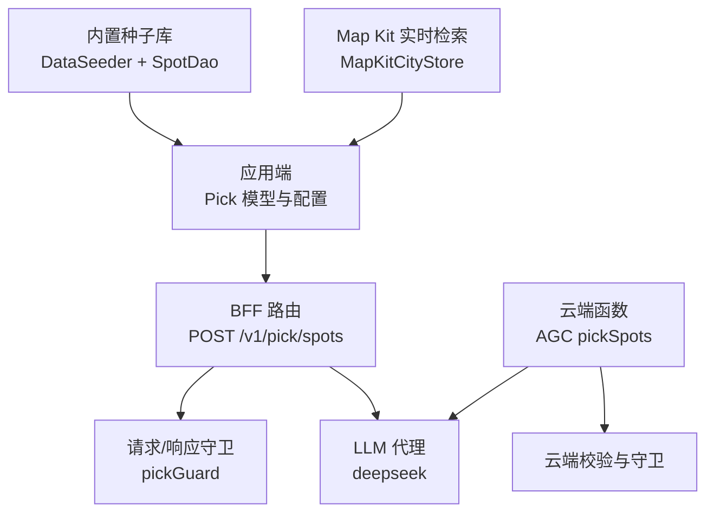
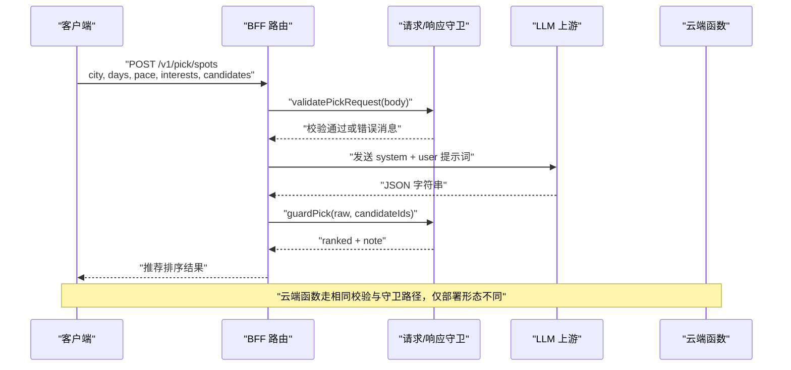
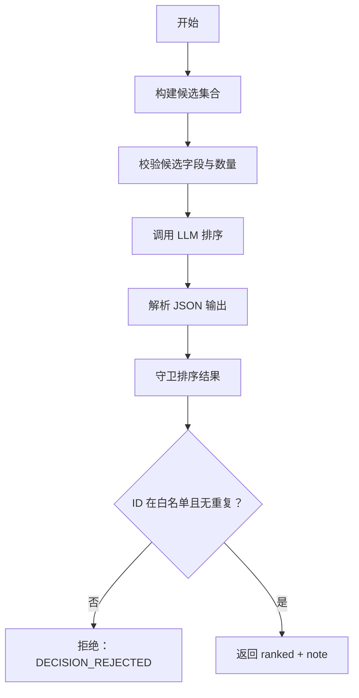
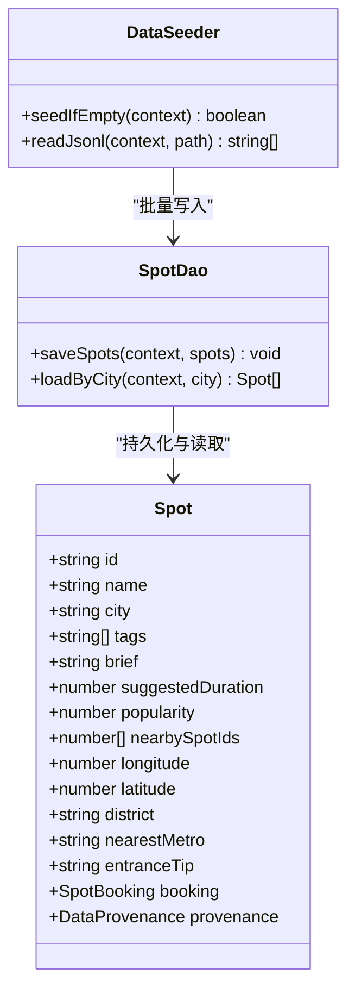
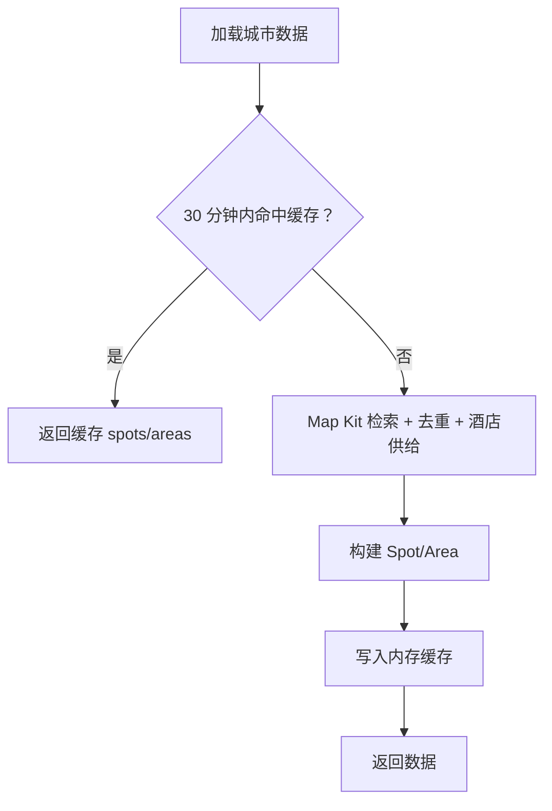
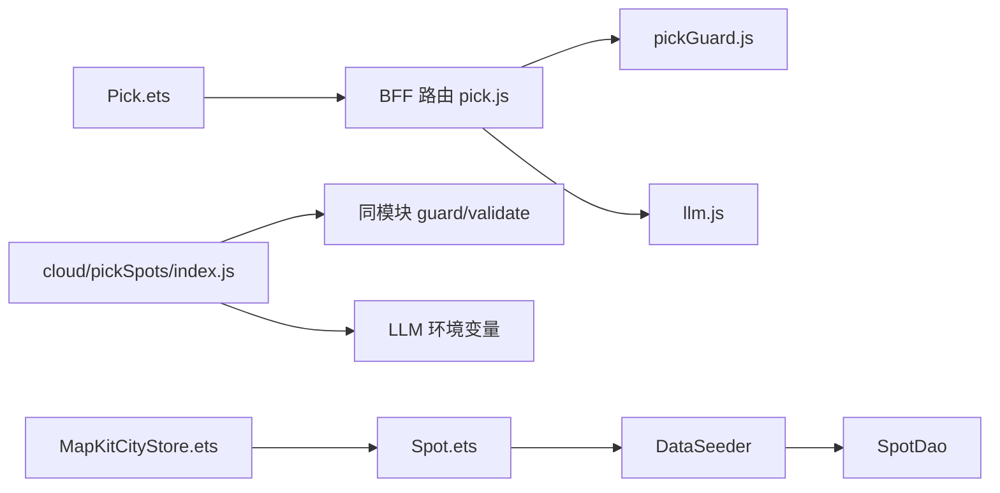

# 景点推荐 API

<cite>
**本文引用的文件**   
- [bff/src/routes/pick.js](file://bff/src/routes/pick.js)
- [bff/src/services/pickGuard.js](file://bff/src/services/pickGuard.js)
- [cloud/pickSpots/index.js](file://cloud/pickSpots/index.js)
- [entry/src/main/ets/model/Pick.ets](file://entry/src/main/ets/model/Pick.ets)
- [entry/src/main/ets/model/Spot.ets](file://entry/src/main/ets/model/Spot.ets)
- [entry/src/main/ets/common/config/PickConfig.ets](file://entry/src/main/ets/common/config/PickConfig.ets)
- [entry/src/main/ets/data/DataSeeder.ets](file://entry/src/main/ets/data/DataSeeder.ets)
- [entry/src/main/ets/data/SpotDao.ets](file://entry/src/main/ets/data/SpotDao.ets)
- [entry/src/main/ets/data/MapKitCityStore.ets](file://entry/src/main/ets/data/MapKitCityStore.ets)
- [Docs/MapKit地点检索探针-2026-10-31.md](file://Docs/MapKit地点检索探针-2026-10-31.md)
</cite>

## 目录
1. [简介](#简介)
2. [项目结构](#项目结构)
3. [核心组件](#核心组件)
4. [架构总览](#架构总览)
5. [接口规范](#接口规范)
6. [推荐算法与过滤机制](#推荐算法与过滤机制)
7. [地点数据源](#地点数据源)
8. [推荐结果数据结构](#推荐结果数据结构)
9. [使用示例](#使用示例)
10. [缓存策略与性能优化](#缓存策略与性能优化)
11. [错误处理指南](#错误处理指南)
12. [依赖关系分析](#依赖关系分析)
13. [结论](#结论)

## 简介
本文件面向“景点推荐”相关后端接口与端侧数据管线，聚焦以下目标：
- 明确景点推荐接口的输入、输出、校验与安全约束。
- 解释基于用户偏好、候选池、时间节奏的排序逻辑边界。
- 说明内置种子库、Map Kit 实时搜索与外部大模型服务的集成方式。
- 给出安全内容过滤、重复去重、评分排序等机制的实现现状与建议。
- 完整定义 Spot 信息、距离计算、开放时间、预约规则等字段语义。
- 提供热点地点缓存、推荐结果缓存与性能优化方案。
- 覆盖无推荐结果、服务不可用等异常场景的处理建议。

需要特别说明的是：仓库当前实现的实际路由为 `POST /v1/pick/spots`，并未实现 `GET /v1/pick/suggestions`；文档将据此如实记录已实现能力，并对建议接口给出概念性设计。

## 项目结构
景点推荐相关代码横跨三个层次：
- 端侧模型与配置：定义推荐契约、景点模型、云函数调用配置。
- BFF 层：Express 路由、请求校验、LLM 代理、响应守卫。
- 云端函数：零依赖部署版本，完成鉴权、校验、调用 LLM、守卫排序。
- 端侧数据层：内置种子库灌入、SQLite DAO、Map Kit 任意城市检索与缓存。

**图示来源**
- [bff/src/routes/pick.js:10-44](file://bff/src/routes/pick.js#L10-L44)
- [cloud/pickSpots/index.js:201-241](file://cloud/pickSpots/index.js#L201-L241)
- [entry/src/main/ets/model/Pick.ets:1-25](file://entry/src/main/ets/model/Pick.ets#L1-L25)
- [entry/src/main/ets/data/DataSeeder.ets:1-120](file://entry/src/main/ets/data/DataSeeder.ets#L1-L120)
- [entry/src/main/ets/data/SpotDao.ets:1-100](file://entry/src/main/ets/data/SpotDao.ets#L1-L100)
- [entry/src/main/ets/data/MapKitCityStore.ets:1-179](file://entry/src/main/ets/data/MapKitCityStore.ets#L1-L179)

**章节来源**
- [bff/src/routes/pick.js:1-45](file://bff/src/routes/pick.js#L1-L45)
- [cloud/pickSpots/index.js:1-241](file://cloud/pickSpots/index.js#L1-L241)
- [entry/src/main/ets/model/Pick.ets:1-25](file://entry/src/main/ets/model/Pick.ets#L1-L25)
- [entry/src/main/ets/data/DataSeeder.ets:1-120](file://entry/src/main/ets/data/DataSeeder.ets#L1-L120)
- [entry/src/main/ets/data/SpotDao.ets:1-100](file://entry/src/main/ets/data/SpotDao.ets#L1-L100)
- [entry/src/main/ets/data/MapKitCityStore.ets:1-179](file://entry/src/main/ets/data/MapKitCityStore.ets#L1-L179)

## 核心组件
- **BFF 推荐路由**：接收端侧候选列表，构造系统提示词与用户提示词，调用 LLM 代理，解析 JSON，执行守卫校验后返回排序结果。
- **请求与响应守卫**：对候选对象、ID 唯一性、文本长度、数值范围进行严格校验；对 LLM 返回的排序列表做白名单校验、去重与长度限制。
- **云端函数**：在 AGC 环境中复用相同校验与守卫逻辑，通过 `x-youjing-token` 鉴权，直接调用外部 LLM。
- **端侧推荐契约**：仅交换候选 ID、名称、标签、简介、行政区、热度、建议时长、是否需要预约、排序项与备注，避免传输完整 Spot 数据以降低 token 成本。
- **景点数据模型**：定义 Spot 全量字段，包括标签、预约规则、经纬度、开放时间、热度、周边景点、数据来源等。
- **内置种子库**：按城市读取 `spots_*.jsonl`，幂等写入 SQLite，并按 `popularity` 降序查询。
- **Map Kit 城市数据源**：带 `cityId` 和 `isCityLimit=true` 的只读探针式检索，内存缓存 30 分钟，不写 RDB。

**章节来源**
- [bff/src/routes/pick.js:10-44](file://bff/src/routes/pick.js#L10-L44)
- [bff/src/services/pickGuard.js:1-97](file://bff/src/services/pickGuard.js#L1-L97)
- [cloud/pickSpots/index.js:1-241](file://cloud/pickSpots/index.js#L1-L241)
- [entry/src/main/ets/model/Pick.ets:1-25](file://entry/src/main/ets/model/Pick.ets#L1-L25)
- [entry/src/main/ets/model/Spot.ets:1-69](file://entry/src/main/ets/model/Spot.ets#L1-L69)
- [entry/src/main/ets/data/DataSeeder.ets:1-120](file://entry/src/main/ets/data/DataSeeder.ets#L1-L120)
- [entry/src/main/ets/data/SpotDao.ets:1-100](file://entry/src/main/ets/data/SpotDao.ets#L1-L100)
- [entry/src/main/ets/data/MapKitCityStore.ets:1-179](file://entry/src/main/ets/data/MapKitCityStore.ets#L1-L179)

## 架构总览
景点推荐的整体流程是“端侧准备候选 → 后端排序 → 返回轻量排序结果”。大模型负责根据用户偏好、天数、节奏对候选景点做理由化排序，而不是凭空生成新景点。

**图示来源**
- [bff/src/routes/pick.js:10-44](file://bff/src/routes/pick.js#L10-L44)
- [bff/src/services/pickGuard.js:1-97](file://bff/src/services/pickGuard.js#L1-L97)
- [cloud/pickSpots/index.js:201-241](file://cloud/pickSpots/index.js#L201-L241)

## 接口规范

### POST /v1/pick/spots（景点推荐）
该接口是仓库中实际实现的景点推荐入口。它接受端侧已经构建好的候选景点列表，由 LLM 结合用户偏好、行程天数与节奏进行排序。

#### 方法
`POST`

#### 路径
`/v1/pick/spots`

#### 认证与限流
- 业务层要求登录鉴权与限流。
- 云端函数额外要求头部 `x-youjing-token` 匹配配置值，否则返回未授权。

#### 请求体
| 字段 | 类型 | 必填 | 约束 | 说明 |
|---|---|---:|---|---|
| city | string | 是 | 非空字符串 | 目的地城市 |
| days | number | 是 | 整数且 1–30 | 行程天数 |
| pace | string | 是 | 字符串 | 行程节奏，用于提示词与排序语境 |
| interests | string | 是 | 字符串 | 用户兴趣描述，用于提示词与排序语境 |
| candidates | array | 是 | 非空数组，最多 40 项 | 候选景点列表，见下方候选项定义 |

#### 候选项字段
| 字段 | 类型 | 必填 | 约束 | 说明 |
|---|---|---:|---|---|
| id | string | 是 | 非空字符串，全局唯一 | 景点标识，LLM 只能排序，不能新增 |
| name | string | 是 | 非空字符串 | 景点名称 |
| tag | string | 是 | 字符串 | 标签文本 |
| brief | string | 是 | 字符串 | 一句话简介 |
| district | string | 是 | 字符串 | 所在区 |
| popularity | number | 是 | 有限数值 | 热度指数 |
| suggestedDuration | number | 是 | 有限数值 | 建议游玩时长 |
| requiresBooking | boolean | 是 | 布尔值 | 是否需要预约 |

#### 成功响应
| 字段 | 类型 | 说明 |
|---|---|---|
| ranked | array | 与候选数量完全一致的排序结果 |
| note | string | 可选备注，最长 200 字符 |

#### ranked 项字段
| 字段 | 类型 | 约束 | 说明 |
|---|---|---|---|
| id | string | 必须来自候选集合 | 被排序的景点 ID |
| reason | string | 非空时最多 80 字符 | 一句推荐理由 |

#### 失败响应
- `400 INVALID_REQUEST`：请求体结构非法。
- `422 DECISION_REJECTED`：LLM 输出不是合法 JSON，或排序结果未覆盖全部候选、出现重复 ID、ID 不在候选内、字段超长。
- `502/504`：LLM 上游错误或超时。
- 云端函数可能返回 `UNAUTHORIZED`、`BAD_REQUEST`、`UPSTREAM_FAILED`。

**章节来源**
- [bff/src/routes/pick.js:10-44](file://bff/src/routes/pick.js#L10-L44)
- [bff/src/services/pickGuard.js:14-97](file://bff/src/services/pickGuard.js#L14-L97)
- [cloud/pickSpots/index.js:201-241](file://cloud/pickSpots/index.js#L201-L241)
- [entry/src/main/ets/model/Pick.ets:1-25](file://entry/src/main/ets/model/Pick.ets#L1-L25)

### GET /v1/pick/suggestions（推荐建议）
仓库中未发现该路由实现。根据现有 `POST /v1/pick/spots` 的设计，可将其理解为“轻量级建议接口”，例如返回热门城市、默认候选标签或快速填充建议。

#### 概念性接口定义
| 属性 | 值 |
|---|---|
| 方法 | GET |
| 路径 | `/v1/pick/suggestions` |
| 用途 | 返回推荐前置建议，如热门城市、默认标签、默认节奏、默认候选模板 |
| 认证 | 建议复用现有登录鉴权与限流 |
| 成功响应 | suggestions 对象，包含建议字段 |
| 失败响应 | 401、429、5xx |

注意：该接口目前属于概念设计，不应作为生产可用 API 调用。

[本节未直接分析具体源文件]

## 推荐算法与过滤机制

### 算法边界
当前实现不是“从空白数据库里重新发明一个景点”，而是：
1. 端侧或数据层先构建候选集合。
2. 将候选 ID、名称、标签、简介、行政区、热度、建议时长、是否需要预约传给 LLM。
3. LLM 输出排序列表与每站一句理由。
4. 后端用守卫强制要求：排序结果必须覆盖全部候选、ID 必须在候选内、不允许重复、理由和备注有长度上限。

这意味着推荐的核心决策点集中在“候选池质量 + 提示词 + 排序结果守卫”。

**图示来源**
- [bff/src/routes/pick.js:10-44](file://bff/src/routes/pick.js#L10-L44)
- [bff/src/services/pickGuard.js:14-97](file://bff/src/services/pickGuard.js#L14-L97)
- [cloud/pickSpots/index.js:201-241](file://cloud/pickSpots/index.js#L201-L241)

### 基于用户偏好的推荐
- 用户偏好通过 `interests` 注入提示词。
- 标签、简介、行政区、热度、建议时长共同构成候选上下文。
- LLM 依据这些信息进行理由化排序，而不是直接返回结构化打分。

### 基于地理位置的推荐
- 内置种子库提供每个 Spot 的经纬度、区、最近地铁站、周边景点 ID。
- Map Kit 实时检索会获取 POI 坐标、区县、开放时段、摘要文本，并映射到 Spot 字段。
- 当前推荐接口本身不直接传入用户位置；地理位置更多体现在候选数据构造阶段。

### 基于时间约束的推荐
- `days` 控制行程天数，用于提示词中的节奏与容量约束。
- `suggestedDuration` 表达单点建议时长。
- 当前排序层没有显式数学规划；时间约束主要通过提示词影响 LLM 的自然语言排序。

### 安全内容过滤
- 推荐链路没有独立的“安全内容分类器”。
- 安全约束主要体现在：
  - 候选 ID 白名单：LLM 不得新增景点。
  - 文本长度限制：reason 最多 80 字符，note 最多 200 字符。
  - 端侧 Spot 字段由种子库或 Map Kit 提供，LLM 不负责编造景点实体。

### 重复地点去重
- 请求层对 `candidates[].id` 做唯一性检查。
- 守卫层对排序结果的 `ranked[].id` 做唯一性检查。
- Map Kit 数据层对站点做去重，并在探针文档中指出需结合距离阈值进一步合并近似重复。

### 评分排序算法
- 当前排序由 LLM 输出决定，后端不重写排序顺序。
- 内置种子库查询按 `popularity` 降序，但这只是候选加载顺序，并非最终推荐顺序。
- Map Kit 检索不提供有效评分；热度通过检索顺序或映射层估算，不伪造真实评分。

**章节来源**
- [bff/src/routes/pick.js:10-44](file://bff/src/routes/pick.js#L10-L44)
- [bff/src/services/pickGuard.js:14-97](file://bff/src/services/pickGuard.js#L14-L97)
- [entry/src/main/ets/data/SpotDao.ets:63-100](file://entry/src/main/ets/data/SpotDao.ets#L63-L100)
- [entry/src/main/ets/data/MapKitCityStore.ets:1-179](file://entry/src/main/ets/data/MapKitCityStore.ets#L1-L179)
- [Docs/MapKit地点检索探针-2026-10-31.md:1-151](file://Docs/MapKit地点检索探针-2026-10-31.md#L1-L151)

## 地点数据源

### 内置种子库
- 数据位于端侧资源目录，按城市组织。
- 首次启动或种子版本升级时，将 `spots_*.jsonl` 解析为 Spot 并批量写入 SQLite。
- SpotDao 支持按城市查询并按热度降序返回。
- 每个 Spot 包含 ID、名称、城市、标签、简介、建议时长、热度、周边景点、经纬度、区、最近地铁、入口提示、预约规则、数据来源与更新时间。

**图示来源**
- [entry/src/main/ets/data/DataSeeder.ets:1-120](file://entry/src/main/ets/data/DataSeeder.ets#L1-L120)
- [entry/src/main/ets/data/SpotDao.ets:1-100](file://entry/src/main/ets/data/SpotDao.ets#L1-L100)
- [entry/src/main/ets/model/Spot.ets:1-69](file://entry/src/main/ets/model/Spot.ets#L1-L69)

### Map Kit 实时搜索
- 使用 `searchByText` 以“景点”为查询词，并强制传入 `cityId` 与 `isCityLimit=true`。
- 分页抓取最多 3 页，每页 20 条。
- 对地址归属做校验，避免把全球结果误认为本地景点。
- 使用 `nearbySearch('酒店')` 判断区县住宿供给，辅助区域排序。
- 结果映射为 Spot/Area，但评分与预约字段不可信，统一标注“以官方为准”。

### 外部服务集成
- BFF 通过 LLM 代理调用 deepseek 兼容接口。
- 云端函数通过环境变量配置 LLM URL、API Key 与模型名。
- 云端函数还通过 `x-youjing-token` 做简单身份校验。

**章节来源**
- [entry/src/main/ets/data/DataSeeder.ets:1-120](file://entry/src/main/ets/data/DataSeeder.ets#L1-L120)
- [entry/src/main/ets/data/SpotDao.ets:1-100](file://entry/src/main/ets/data/SpotDao.ets#L1-L100)
- [entry/src/main/ets/data/MapKitCityStore.ets:1-179](file://entry/src/main/ets/data/MapKitCityStore.ets#L1-L179)
- [Docs/MapKit地点检索探针-2026-10-31.md:1-151](file://Docs/MapKit地点检索探针-2026-10-31.md#L1-L151)
- [cloud/pickSpots/index.js:1-200](file://cloud/pickSpots/index.js#L1-L200)

## 推荐结果数据结构

### PickResult
| 字段 | 类型 | 说明 |
|---|---|---|
| ranked | array | 排序后的景点列表，长度必须等于候选数 |
| note | string | 可选备注，最多 200 字符 |

### RankedItem
| 字段 | 类型 | 说明 |
|---|---|---|
| id | string | 来自候选集合的景点 ID |
| reason | string | 一句推荐理由，最多 80 字符 |

### Spot 主模型
| 字段 | 类型 | 说明 |
|---|---|---|
| id | string | 景点唯一标识 |
| name | string | 景点名称 |
| city | string | 所在城市 |
| tags | SpotTag[] | 必去、经典、小众、亲子 |
| brief | string | 一句话简介 |
| suggestedDuration | number | 建议游玩时长，单位分钟 |
| openingHours | string | 每日一致开放时段，Map Kit 城市可能提供 |
| popularity | number | 热度指数，0–100 组内排序键 |
| nearbySpotIds | string[] | 周边景点 ID，用于串联第三层规划 |
| longitude | number | 经度 |
| latitude | number | 纬度 |
| district | string | 所在区 |
| nearestMetro | string | 最近地铁站名 |
| entranceTip | string | 入口提示 |
| booking | SpotBooking | 预约规则 |
| provenance | DataProvenance | 数据来源、更新时间、可信度 |

### SpotBooking
| 字段 | 类型 | 说明 |
|---|---|---|
| requiresBooking | boolean | 是否需预约 |
| bookingMethod | string | 预约方式 |
| advanceDays | number | 需提前几天 |
| releaseTime | string | 放票时间文案 |
| closedDay | string | 闭馆日 |
| difficulty | string | 预约难度 |

### DataProvenance
| 字段 | 类型 | 说明 |
|---|---|---|
| source | string | 数据来源，如购买、爬虫、官方、MapKit |
| updatedAt | string | 更新时间，YYYY-MM-DD |
| confidence | string | 可信度，高/中/低 |

**章节来源**
- [entry/src/main/ets/model/Pick.ets:1-25](file://entry/src/main/ets/model/Pick.ets#L1-L25)
- [entry/src/main/ets/model/Spot.ets:1-69](file://entry/src/main/ets/model/Spot.ets#L1-L69)

## 使用示例

### 示例一：热门城市一日慢游
- 城市：北京
- 天数：1
- 节奏：慢
- 兴趣：历史建筑、博物馆、步行友好
- 候选：故宫、国家博物馆、颐和园、天坛公园、北海公园

预期行为：
- LLM 根据历史主题与一天时间约束，优先保留可达性强、游览时长合理的景点。
- 返回 ranked 列表，每项附带一句理由。
- 若候选不足或 LLM 无法产出合法 JSON，返回 422 DECISION_REJECTED。

### 示例二：家庭亲子半日推荐
- 城市：上海
- 天数：1
- 节奏：轻松
- 兴趣：亲子、动物园、公园
- 候选：上海野生动物园、上海自然博物馆、世纪公园、迪士尼小镇

预期行为：
- 标签 family 与建议时长参与排序上下文。
- 推荐结果侧重短途、低体力消耗、适合家庭的景点。

### 示例三：无推荐结果
触发条件：
- 候选为空。
- 候选数量超过 40。
- LLM 返回非 JSON。
- 排序结果缺少某个候选 ID。
- 排序结果出现重复 ID。

处理方式：
- 前端应展示“无法生成推荐”的降级状态。
- 允许用户减少候选数量或调整兴趣描述后重试。
- 不向用户暴露内部堆栈，只展示可读错误码与原因。

### 示例四：服务不可用
触发条件：
- LLM 上游超时或 429。
- 云端函数未配置 token。
- Map Kit 检索无结果。

处理方式：
- 区分网络超时、限流、配置错误与服务不可用。
- 对限流提示等待后再试。
- 对地图服务失败显示“地图服务没有返回结果”，并提供重试或修改目的地选项。

[本节为使用场景说明，未直接引用具体代码行]

## 缓存策略与性能优化

### 热点地点缓存
- MapKitCityStore 使用内存缓存，TTL 为 30 分钟。
- 命中缓存时不再发起 Map Kit 检索，显著降低远端调用次数。
- 缓存键为城市名。

### 推荐结果缓存
- 当前实现未在 BFF 或云端函数中对推荐结果做通用缓存。
- 推荐本身依赖 LLM，重复请求可能产生不同理由；如需强一致缓存，应在业务层增加 key（城市、天数、节奏、兴趣、候选哈希）。

### 性能优化建议
- 限制候选数量为 40 以内，避免 token 膨胀。
- 前端对重复提交加防抖与幂等键。
- LLM 超时默认约 45 秒，适合一次失败、二次修正的重试预算。
- 云端函数设置最大请求体 64KB，防止过大 payload。
- Map Kit 检索分页上限 3 页，避免无限翻页。
- 酒店供给查询并行执行，取最慢一条作为并发代价。

**图示来源**
- [entry/src/main/ets/data/MapKitCityStore.ets:1-179](file://entry/src/main/ets/data/MapKitCityStore.ets#L1-L179)

**章节来源**
- [entry/src/main/ets/data/MapKitCityStore.ets:1-179](file://entry/src/main/ets/data/MapKitCityStore.ets#L1-L179)
- [cloud/pickSpots/index.js:1-120](file://cloud/pickSpots/index.js#L1-L120)

## 错误处理指南

### 请求校验错误
- 城市为空。
- 天数不在 1–30。
- 节奏或兴趣不是字符串。
- 候选为空或超过 40。
- 候选 ID 重复。
- 候选字段类型非法。

建议前端提示：“请检查城市、天数、兴趣和候选景点格式”。

### 决策拒绝
- LLM 输出不是 JSON。
- 排序结果长度不等于候选数。
- 排序 ID 不在候选集合内。
- 排序 ID 重复。
- 理由或备注超长。

建议前端提示：“推荐结果校验失败，请重新生成”。

### LLM 上游错误
- 429 限流：提示等待后重试，不继续扣额度。
- 502 上游错误：提示服务异常。
- 504 超时：提示网络或服务延迟，允许重试。

### 云端函数错误
- UNAUTHORIZED：token 不匹配或未配置。
- BAD_REQUEST：请求体不是合法 JSON。
- UPSTREAM_FAILED：LLM 调用失败。

### 地图服务错误
- 无结果：提示“地图服务没有返回景点”。
- 请求失败：包装为业务错误，包含底层 code 与 message。
- 单个区县酒店供给失败：不阻断整城数据加载。

**章节来源**
- [bff/src/routes/pick.js:10-44](file://bff/src/routes/pick.js#L10-L44)
- [bff/src/services/pickGuard.js:14-97](file://bff/src/services/pickGuard.js#L14-L97)
- [cloud/pickSpots/index.js:201-241](file://cloud/pickSpots/index.js#L201-L241)
- [entry/src/main/ets/data/MapKitCityStore.ets:100-179](file://entry/src/main/ets/data/MapKitCityStore.ets#L100-L179)

## 依赖关系分析

**图示来源**
- [bff/src/routes/pick.js:1-45](file://bff/src/routes/pick.js#L1-L45)
- [bff/src/services/pickGuard.js:1-97](file://bff/src/services/pickGuard.js#L1-L97)
- [cloud/pickSpots/index.js:1-241](file://cloud/pickSpots/index.js#L1-L241)
- [entry/src/main/ets/model/Pick.ets:1-25](file://entry/src/main/ets/model/Pick.ets#L1-L25)
- [entry/src/main/ets/model/Spot.ets:1-69](file://entry/src/main/ets/model/Spot.ets#L1-L69)
- [entry/src/main/ets/data/DataSeeder.ets:1-120](file://entry/src/main/ets/data/DataSeeder.ets#L1-L120)
- [entry/src/main/ets/data/SpotDao.ets:1-100](file://entry/src/main/ets/data/SpotDao.ets#L1-L100)
- [entry/src/main/ets/data/MapKitCityStore.ets:1-179](file://entry/src/main/ets/data/MapKitCityStore.ets#L1-L179)

**章节来源**
- [bff/src/routes/pick.js:1-45](file://bff/src/routes/pick.js#L1-L45)
- [cloud/pickSpots/index.js:1-241](file://cloud/pickSpots/index.js#L1-L241)
- [entry/src/main/ets/model/Pick.ets:1-25](file://entry/src/main/ets/model/Pick.ets#L1-L25)
- [entry/src/main/ets/data/DataSeeder.ets:1-120](file://entry/src/main/ets/data/DataSeeder.ets#L1-L120)
- [entry/src/main/ets/data/SpotDao.ets:1-100](file://entry/src/main/ets/data/SpotDao.ets#L1-L100)
- [entry/src/main/ets/data/MapKitCityStore.ets:1-179](file://entry/src/main/ets/data/MapKitCityStore.ets#L1-L179)

## 结论
当前景点推荐 API 的核心设计是“候选池 + LLM 排序 + 严格守卫”。它不依赖 LLM 生成景点实体，也不伪造评分、预约或地理事实；所有关键数据来自内置种子库与 Map Kit 探针式检索。推荐的质量取决于候选数据质量、提示词设计与守卫强度。

对于生产接入，建议：
- 明确使用 `POST /v1/pick/spots`，不要假设 `GET /v1/pick/suggestions` 已实现。
- 严格限制候选数量与字段合法性。
- 对 LLM 超时、限流、上游错误做分级降级。
- 对 Map Kit 无结果情况提供清晰的用户反馈。
- 在业务层按需扩展推荐结果缓存，并结合请求特征键避免缓存污染。
- 继续使用“以官方为准”的免责声明，不对外宣称 Map Kit 没有的评分、门票与预约能力。