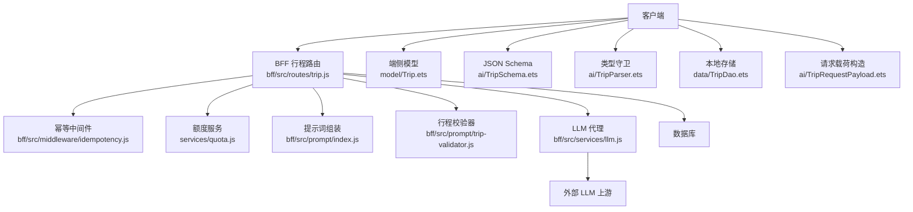
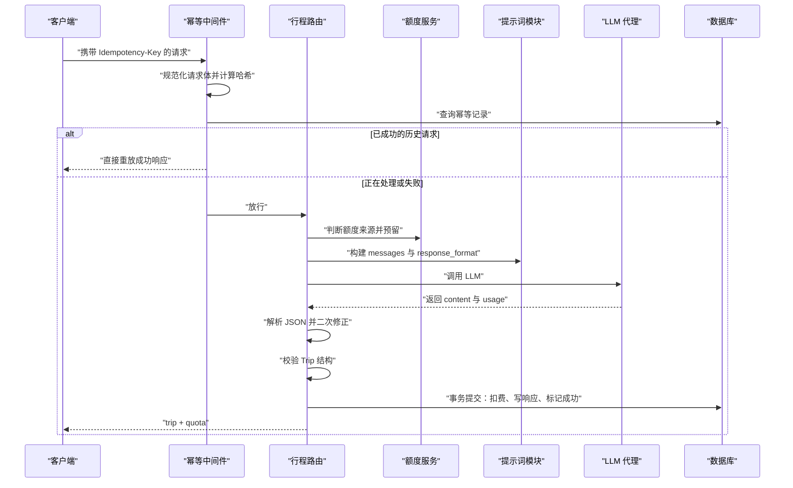
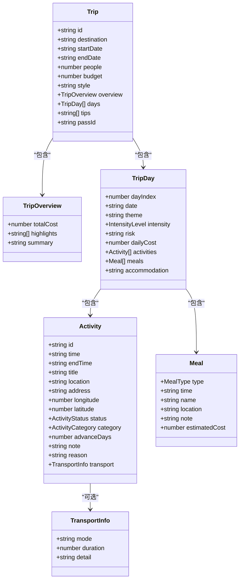
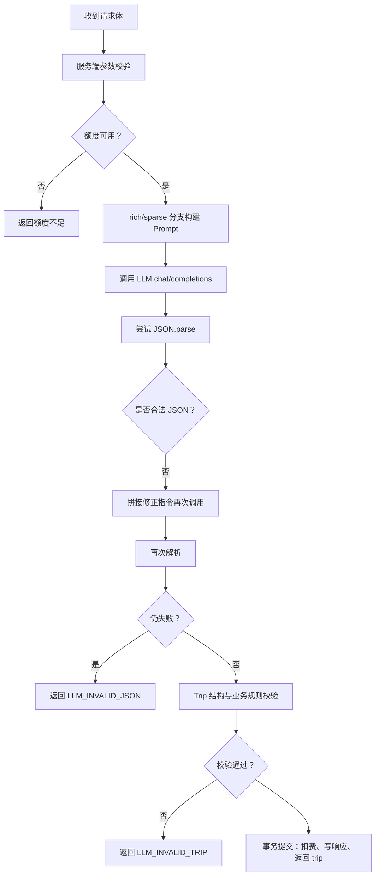
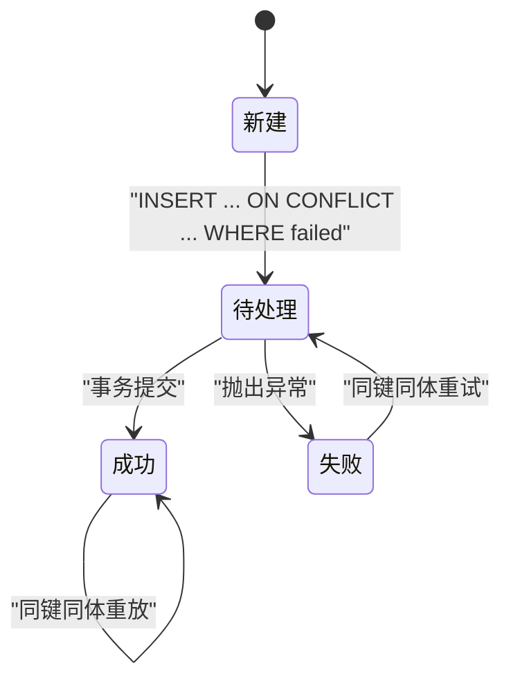
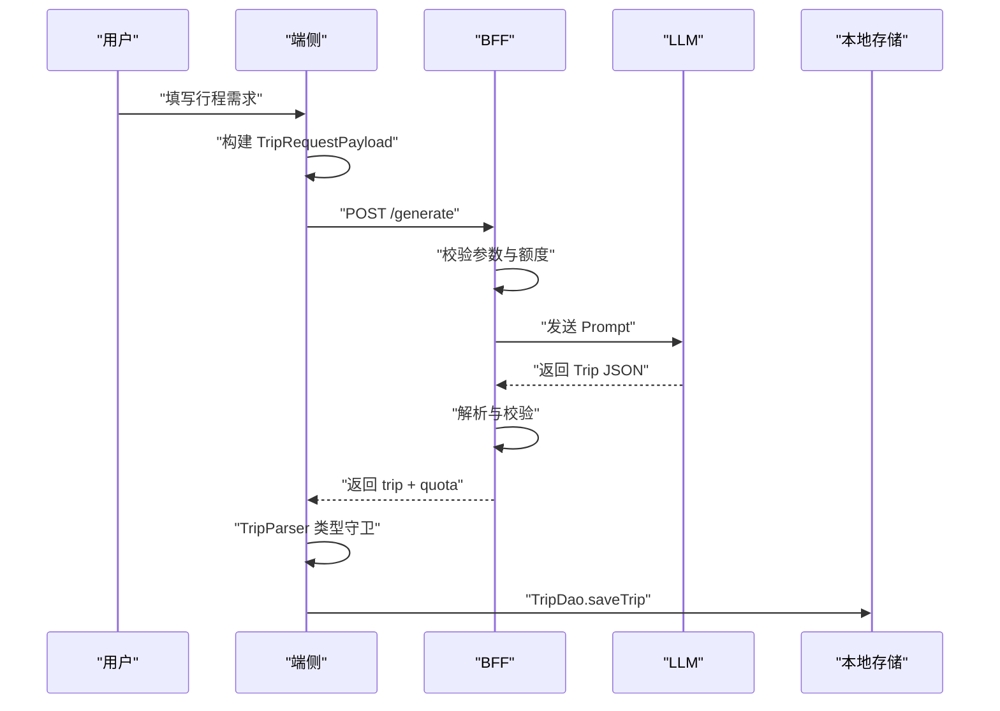
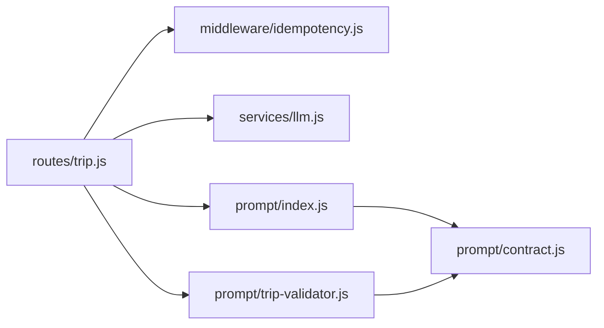

# 行程管理 API

<cite>
**本文引用的文件**   
- [bff/src/routes/trip.js](file://bff/src/routes/trip.js)
- [bff/src/services/llm.js](file://bff/src/services/llm.js)
- [bff/src/middleware/idempotency.js](file://bff/src/middleware/idempotency.js)
- [bff/src/prompt/index.js](file://bff/src/prompt/index.js)
- [bff/src/prompt/contract.js](file://bff/src/prompt/contract.js)
- [bff/src/prompt/trip-validator.js](file://bff/src/prompt/trip-validator.js)
- [entry/src/main/ets/model/Trip.ets](file://entry/src/main/ets/model/Trip.ets)
- [entry/src/main/ets/ai/TripSchema.ets](file://entry/src/main/ets/ai/TripSchema.ets)
- [entry/src/main/ets/ai/TripParser.ets](file://entry/src/main/ets/ai/TripParser.ets)
- [entry/src/main/ets/ai/TripRequestPayload.ets](file://entry/src/main/ets/ai/TripRequestPayload.ets)
- [entry/src/main/ets/data/TripDao.ets](file://entry/src/main/ets/data/TripDao.ets)
- [entry/src/main/ets/utils/BffErrorMap.ets](file://entry/src/main/ets/utils/BffErrorMap.ets)
</cite>

## 目录
1. [引言](#引言)
2. [项目结构](#项目结构)
3. [核心组件](#核心组件)
4. [架构总览](#架构总览)
5. [接口规范](#接口规范)
6. [数据结构定义](#数据结构定义)
7. LLM 集成流程
8. [幂等性保证](#幂等性保证)
9. [行程生成工作流](#行程生成工作流)
10. [错误处理机制](#错误处理机制)
11. [依赖关系分析](#依赖关系分析)
12. [性能与可观测性](#性能与可观测性)
13. [故障排查指南](#故障排查指南)
14. [结论](#结论)

## 引言
本文档围绕“行程管理”的 BFF 接口与端侧模型展开，重点说明：
- 当前代码库中实际暴露的行程生成接口。
- Trip、Activity、Day、Meal 的数据契约。
- LLM 意图解析、Prompt 构建、响应解析与数据验证链路。
- 幂等键生成、重复请求处理与事务一致性。
- 从用户输入到结果返回的完整行程生成工作流。
- 错误分类与客户端映射方式。

需要特别注意：**当前仓库并未实现 REST 风格的路径 `/v1/trip`、`/v1/trip/:id`。** 实际实现的生成入口是 `POST /generate`，并受幂等中间件保护；更新、删除、单条查询和列表查询在 BFF 层未提供对应路由，但端侧存在本地行程持久化能力。

## 项目结构
本项目的行程相关逻辑分布在以下两个主要区域：
- BFF（Node.js）：负责权限校验、额度控制、LLM 调用、幂等控制和响应结算。
- 端侧（ArkTS）：定义 Trip 数据模型、JSON Schema、类型守卫、本地 DAO 与请求载荷构造。

**图示来源**
- [bff/src/routes/trip.js:1-234](file://bff/src/routes/trip.js#L1-L234)
- [bff/src/middleware/idempotency.js:1-122](file://bff/src/middleware/idempotency.js#L1-L122)
- [bff/src/services/llm.js:1-98](file://bff/src/services/llm.js#L1-L98)
- [bff/src/prompt/index.js:1-200](file://bff/src/prompt/index.js#L1-L200)
- [entry/src/main/ets/model/Trip.ets:1-137](file://entry/src/main/ets/model/Trip.ets#L1-L137)
- [entry/src/main/ets/ai/TripSchema.ets:1-151](file://entry/src/main/ets/ai/TripSchema.ets#L1-L151)
- [entry/src/main/ets/ai/TripParser.ets:1-200](file://entry/src/main/ets/ai/TripParser.ets#L1-L200)
- [entry/src/main/ets/data/TripDao.ets:1-200](file://entry/src/main/ets/data/TripDao.ets#L1-L200)
- [entry/src/main/ets/ai/TripRequestPayload.ets:1-75](file://entry/src/main/ets/ai/TripRequestPayload.ets#L1-L75)

**章节来源**
- [bff/src/routes/trip.js:1-234](file://bff/src/routes/trip.js#L1-L234)
- [entry/src/main/ets/model/Trip.ets:1-137](file://entry/src/main/ets/model/Trip.ets#L1-L137)

## 核心组件
- 行程路由：接收生成请求，执行参数边界检查、额度预留、幂等写入、LLM 调用、JSON 解析、Trip 校验、事务结算。
- 幂等中间件：校验 Idempotency-Key、计算请求哈希、根据状态重放成功结果或拒绝冲突请求。
- LLM 代理：封装上游 chat/completions 调用、超时、限流、非 2xx 响应、消息体构建。
- 提示词模块：把端侧 rich 或 sparse 请求转为 PromptBuilder.userPrompt，并输出 response_format。
- 行程校验器：基于 JSON Schema 与业务规则校验 LLM 输出的 Trip。
- 端侧模型与 Schema：Trip、Activity、Day、Meal、TransportInfo、枚举值及 JSON Schema。
- 端侧类型守卫：对 LLM 原始文本做 JSON 提取、字段类型校验、天数窗口归一化。
- 端侧 DAO：本地 Trip 整存整取、今日卡片、游客数据归户、分类预算更新、删除行程。
- 请求载荷构造：端侧把 PlanParams、Spot、Area 组合为 BFF 的 rich 请求体。

**章节来源**
- [bff/src/routes/trip.js:1-234](file://bff/src/routes/trip.js#L1-L234)
- [bff/src/middleware/idempotency.js:1-122](file://bff/src/middleware/idempotency.js#L1-L122)
- [bff/src/services/llm.js:1-98](file://bff/src/services/llm.js#L1-L98)
- [bff/src/prompt/index.js:1-200](file://bff/src/prompt/index.js#L1-L200)
- [bff/src/prompt/trip-validator.js:1-200](file://bff/src/prompt/trip-validator.js#L1-L200)
- [entry/src/main/ets/model/Trip.ets:1-137](file://entry/src/main/ets/model/Trip.ets#L1-L137)
- [entry/src/main/ets/ai/TripSchema.ets:1-151](file://entry/src/main/ets/ai/TripSchema.ets#L1-L151)
- [entry/src/main/ets/ai/TripParser.ets:1-200](file://entry/src/main/ets/ai/TripParser.ets#L1-L200)
- [entry/src/main/ets/data/TripDao.ets:1-384](file://entry/src/main/ets/data/TripDao.ets#L1-L384)
- [entry/src/main/ets/ai/TripRequestPayload.ets:1-75](file://entry/src/main/ets/ai/TripRequestPayload.ets#L1-L75)

## 架构总览
行程生成的核心路径是：客户端 → 幂等中间件 → 行程路由 → 额度与提示词 → LLM → 解析与校验 → 事务落盘 → 返回 trip 与配额快照。

**图示来源**
- [bff/src/middleware/idempotency.js:1-122](file://bff/src/middleware/idempotency.js#L1-L122)
- [bff/src/routes/trip.js:1-234](file://bff/src/routes/trip.js#L1-L234)
- [bff/src/services/llm.js:1-98](file://bff/src/services/llm.js#L1-L98)

## 接口规范

### 实际存在的接口：POST /generate
该接口是本项目中唯一与“生成行程”相关的 BFF 入口。它不是 RESTful 的 `POST /v1/trip`，也没有按资源 ID 的更新、删除、查询、列表接口。

| 项目 | 说明 |
|---|---|
| 方法 | POST |
| 路径 | `/generate` |
| 鉴权 | 由上层认证注入 accountId；若缺失则返回 TOKEN_INVALID |
| 幂等头 | 必须携带 `Idempotency-Key` |
| 内容类型 | application/json |
| 主要职责 | 参数校验、额度控制、幂等占位、LLM 生成、Trip 校验、事务结算、返回 trip 与 quota |

#### 请求体要求
- destination：非空字符串。
- startDate：YYYY-MM-DD，不早于 2020-01-01。
- endDate：YYYY-MM-DD，不早于 startDate，且不晚于 2100-12-31。
- people：1–30 的整数。
- budget：非负整数。
- 可选 passId：用于付费通行证场景，由额度服务决定免费或付费档位。
- 推荐传入 rich 请求体：包含 selectedSpots、spots、area，以便走 PromptBuilder 的富信息路径。

#### 成功响应
响应体包含：
- trip：经校验的 Trip 对象。
- quota：包含 source、remainingToday、giftRemaining、passes、subscription、dailyCap、unlimited。
- 成功时还会设置幂等重放头 `Idempotency-Replayed: true`（仅当命中历史成功记录时）。

#### 典型错误
- 缺少 Idempotency-Key：400 MISSING_IDEMPOTENCY_KEY。
- 账号标识缺失：401 TOKEN_INVALID。
- 请求体不同但使用相同幂等键：422 IDEMPOTENCY_KEY_REUSED。
- 同一幂等键并发占用：409 IDEMPOTENCY_IN_PROGRESS。
- 额度耗尽：402 QUOTA_EXHAUSTED。
- LLM 上游限流：429 LLM_RATE_LIMITED。
- LLM 输出非法 JSON：502 LLM_INVALID_JSON。
- LLM 输出结构不合法：502 LLM_INVALID_TRIP。
- 其他上游异常：502 LLM_UPSTREAM_ERROR。
- 上游超时：504 LLM_TIMEOUT。

**章节来源**
- [bff/src/middleware/idempotency.js:1-122](file://bff/src/middleware/idempotency.js#L1-L122)
- [bff/src/routes/trip.js:1-234](file://bff/src/routes/trip.js#L1-L234)
- [bff/src/services/llm.js:1-98](file://bff/src/services/llm.js#L1-L98)

### 当前未实现的 REST 接口
以下接口在仓库中没有对应的 Express Router：
- PUT /v1/trip/:id
- DELETE /v1/trip/:id
- GET /v1/trip/:id
- GET /v1/trip

因此不能把它们作为生产 API 契约。它们可作为未来扩展方向，但现有代码不应被理解为已经实现。

**章节来源**
- [bff/src/routes/trip.js:1-234](file://bff/src/routes/trip.js#L1-L234)

## 数据结构定义
Trip 是聚合根，Day 是时间分组，Activity 是节点，Meal 是餐饮安排。端侧模型与 LLM JSON Schema 同源，形成三层防线。

**图示来源**
- [entry/src/main/ets/model/Trip.ets:1-137](file://entry/src/main/ets/model/Trip.ets#L1-L137)
- [entry/src/main/ets/ai/TripSchema.ets:1-151](file://entry/src/main/ets/ai/TripSchema.ets#L1-L151)

### Trip 模型
- id：行程唯一标识。
- destination：目的地城市。
- startDate、endDate：行程起止日期，YYYY-MM-DD。
- people：出行人数。
- budget：总预算，单位元。
- style：旅行风格码值。
- overview：总览，含 totalCost、highlights、summary。
- days：按天分组。
- tips：小贴士数组。
- passId：通行证 ID，可选。

### Activity 节点
- id：活动编号。
- time、endTime：HH:mm，且 endTime 必须晚于 time。
- title、location、address：标题、场所名、地址。
- longitude、latitude：坐标。
- status：预约状态。
- category：活动类别。
- advanceDays：提前预约天数，可选。
- note、reason：备注与排期理由，可选。
- transport：相邻活动前的通勤信息，可选。

### Day 分组
- dayIndex：从 1 开始。
- date：日期。
- theme：当日主题。
- intensity：强度 low、medium、high。
- risk：风险提示，可选。
- dailyCost：当日费用。
- activities：活动数组。
- meals：餐饮数组。
- accommodation：住宿描述，可选。

### Meal 安排
- type：breakfast、lunch、dinner。
- time：HH:mm，可选。
- name：餐厅名称。
- location：用餐地点。
- note：备注，可选。
- estimatedCost：预估费用。

**章节来源**
- [entry/src/main/ets/model/Trip.ets:1-137](file://entry/src/main/ets/model/Trip.ets#L1-L137)
- [entry/src/main/ets/ai/TripSchema.ets:1-151](file://entry/src/main/ets/ai/TripSchema.ets#L1-L151)

## LLM 集成流程
LLM 集成分为四个阶段：意图解析、Prompt 构建、响应解析、数据验证。

**图示来源**
- [bff/src/routes/trip.js:1-234](file://bff/src/routes/trip.js#L1-L234)
- [bff/src/services/llm.js:1-98](file://bff/src/services/llm.js#L1-L98)
- [bff/src/prompt/index.js:1-200](file://bff/src/prompt/index.js#L1-L200)
- [bff/src/prompt/trip-validator.js:1-200](file://bff/src/prompt/trip-validator.js#L1-L200)

### 意图解析
服务端首先校验 destination、startDate、endDate、people、budget 等基本字段，并计算 expectedDayCount。如果日期无效、人数越界、预算为负或天数不在 1–30，则直接返回 INVALID_REQUEST。

### Prompt 构建
提示词模块支持两种模式：
- rich：当请求中包含完整的 spots 与 area，以及 selectedSpots 时，调用 PromptBuilder.userPrompt，带上景点坐标、停留时长、预约信息等。
- sparse：当只传 selectedSpots 名称与 selectedArea 名称时，如实告知 LLM 缺失信息，避免幻觉。

response_format 默认使用 json_schema，strict 模式强制结构化输出；可通过环境变量降级为 json_object。

### 响应解析
后端先尝试直接 JSON.parse；失败后尝试提取第一个完整 JSON 对象。若仍失败，会追加修正指令再次调用 LLM，并把两次 usage 合并统计。

### 数据验证
Trip 校验器基于 TRIP_SCHEMA_OBJECT 进行结构校验，同时补充业务规则：
- Trip 必须有 id、destination、style、overview.summary。
- startDate、endDate 必须符合 YYYY-MM-DD，且 startDate 不晚于 endDate。
- days 非空，且数量不少于期望天数。
- Activity 的 time、endTime、title、location、status、category 必填。
- Activity.endTime 必须晚于 time。
- Meal 必须有 name、location、estimatedCost。
- 每天至少一条 lunch 与一条 dinner。

**章节来源**
- [bff/src/routes/trip.js:1-234](file://bff/src/routes/trip.js#L1-L234)
- [bff/src/prompt/index.js:1-200](file://bff/src/prompt/index.js#L1-L200)
- [bff/src/prompt/contract.js:1-57](file://bff/src/prompt/contract.js#L1-L57)
- [bff/src/prompt/trip-validator.js:1-200](file://bff/src/prompt/trip-validator.js#L1-L200)
- [bff/src/services/llm.js:1-98](file://bff/src/services/llm.js#L1-L98)

## 幂等性保证
幂等性贯穿请求进入、额度预留、LLM 调用与响应落盘全过程。

**图示来源**
- [bff/src/middleware/idempotency.js:1-122](file://bff/src/middleware/idempotency.js#L1-L122)
- [bff/src/routes/trip.js:1-234](file://bff/src/routes/trip.js#L1-L234)

### 幂等键生成
- 客户端需提供 Idempotency-Key。
- 中间件将 accountId 与 clientKey 组合后进行 SHA-256 哈希，作为数据库幂等主键作用域。
- 请求体先做规范化 JSON：对象键排序、忽略 undefined 值，再计算 SHA-256 作为 requestHash。

### 重复请求处理
- 无记录：放行。
- 已成功：返回原 response_json，并设置 Idempotency-Replayed 头。
- 正在处理：返回 409 IDEMPOTENCY_IN_PROGRESS。
- 失败且请求体相同：允许复用该行重新运行。
- 失败但请求体不同：返回 422 IDEMPOTENCY_KEY_REUSED。

### 事务一致性
- 额度预留发生在幂等行写入之前。
- 成功后通过事务完成 commitQuota、更新 trip_request 状态、读取 entitlement 快照、写入 response_json。
- 任何一步失败都会回滚并释放额度，同时标记失败状态，允许同键同体重试。

**章节来源**
- [bff/src/middleware/idempotency.js:1-122](file://bff/src/middleware/idempotency.js#L1-L122)
- [bff/src/routes/trip.js:1-234](file://bff/src/routes/trip.js#L1-L234)

## 行程生成工作流
完整工作流如下：

1. 用户输入目的地、日期、人数、预算、风格、节奏、交通偏好、选中景点与区域。
2. 端侧 TripRequestPayload 把这些信息组合为 rich 请求体。
3. BFF 校验基础参数并确定额度来源。
4. 中间件建立幂等记录。
5. 提示词模块根据 rich 或 sparse 情况构建 messages。
6. LLM 返回结构化 Trip JSON。
7. 解析失败时触发一次修正调用。
8. 校验器确认 Trip 结构、天数、餐次等业务约束。
9. 事务提交后返回 trip 与配额快照。
10. 端侧 TripParser 再做类型守卫，TripDao 保存本地行程。

**图示来源**
- [entry/src/main/ets/ai/TripRequestPayload.ets:1-75](file://entry/src/main/ets/ai/TripRequestPayload.ets#L1-L75)
- [bff/src/routes/trip.js:1-234](file://bff/src/routes/trip.js#L1-L234)
- [entry/src/main/ets/ai/TripParser.ets:1-200](file://entry/src/main/ets/ai/TripParser.ets#L1-L200)
- [entry/src/main/ets/data/TripDao.ets:1-200](file://entry/src/main/ets/data/TripDao.ets#L1-L200)

## 错误处理机制
错误分为三类：HTTP 层错误、LLM 上游错误、Trip 数据错误。

| 错误场景 | 状态码 | 错误码 | 客户端表现 |
|---|---:|---|---|
| 缺少 Idempotency-Key | 400 | MISSING_IDEMPOTENCY_KEY | 提示缺少幂等键 |
| 缺少账号标识 | 401 | TOKEN_INVALID | 跳转登录或重新鉴权 |
| 幂等键被重用 | 422 | IDEMPOTENCY_KEY_REUSED | 提示更换幂等键 |
| 并发幂等冲突 | 409 | IDEMPOTENCY_IN_PROGRESS | 稍后重试 |
| 额度耗尽 | 402 | QUOTA_EXHAUSTED | 提示订阅或购买通行证 |
| LLM 上游限流 | 429 | LLM_RATE_LIMITED | 提示等待后重试，不再重复扣费 |
| LLM 输出非法 JSON | 502 | LLM_INVALID_JSON | 提示已重试但仍失败 |
| LLM 输出非法 Trip | 502 | LLM_INVALID_TRIP | 提示已重试但仍失败 |
| LLM 上游异常 | 502 | LLM_UPSTREAM_ERROR | 视为网络或服务不可用 |
| LLM 上游超时 | 504 | LLM_TIMEOUT | 提示超时 |

端侧通过 BffErrorMap 将服务端错误映射为 ErrorCode：
- 401 → CLOUD_TOKEN_INVALID。
- 402 → CLOUD_QUOTA_EXHAUSTED。
- 429 → CLOUD_RATE_LIMITED。
- 409 → CLOUD_IDEMPOTENCY_CONFLICT。
- 5xx 中的 LLM_INVALID_JSON 或 LLM_INVALID_TRIP → TRIP_GENERATE_RETRY_EXHAUSTED。
- 其他 5xx → LLM_UNAVAILABLE。
- 其他错误 → NETWORK_REQUEST_FAILED。

**章节来源**
- [bff/src/middleware/idempotency.js:1-122](file://bff/src/middleware/idempotency.js#L1-L122)
- [bff/src/routes/trip.js:1-234](file://bff/src/routes/trip.js#L1-L234)
- [bff/src/services/llm.js:1-98](file://bff/src/services/llm.js#L1-L98)
- [entry/src/main/ets/utils/BffErrorMap.ets:1-41](file://entry/src/main/ets/utils/BffErrorMap.ets#L1-L41)

## 依赖关系分析
BFF 层的核心依赖链如下：

**图示来源**
- [bff/src/routes/trip.js:1-234](file://bff/src/routes/trip.js#L1-L234)
- [bff/src/middleware/idempotency.js:1-122](file://bff/src/middleware/idempotency.js#L1-L122)
- [bff/src/services/llm.js:1-98](file://bff/src/services/llm.js#L1-L98)
- [bff/src/prompt/index.js:1-200](file://bff/src/prompt/index.js#L1-L200)
- [bff/src/prompt/contract.js:1-57](file://bff/src/prompt/contract.js#L1-L57)
- [bff/src/prompt/trip-validator.js:1-200](file://bff/src/prompt/trip-validator.js#L1-L200)

端侧模型与解析链依赖关系：

**图示来源**
- [entry/src/main/ets/ai/TripRequestPayload.ets:1-75](file://entry/src/main/ets/ai/TripRequestPayload.ets#L1-L75)
- [entry/src/main/ets/model/Trip.ets:1-137](file://entry/src/main/ets/model/Trip.ets#L1-L137)
- [entry/src/main/ets/ai/TripSchema.ets:1-151](file://entry/src/main/ets/ai/TripSchema.ets#L1-L151)
- [entry/src/main/ets/ai/TripParser.ets:1-200](file://entry/src/main/ets/ai/TripParser.ets#L1-L200)
- [entry/src/main/ets/data/TripDao.ets:1-384](file://entry/src/main/ets/data/TripDao.ets#L1-L384)

**章节来源**
- [bff/src/routes/trip.js:1-234](file://bff/src/routes/trip.js#L1-L234)
- [entry/src/main/ets/model/Trip.ets:1-137](file://entry/src/main/ets/model/Trip.ets#L1-L137)

## 性能与可观测性
- LLM 默认超时为 45 秒，为“修正重问”留出余量，整体不超过端侧读超时 120 秒。
- 免费档 maxTokens 为 8192，付费档为 16384；修正调用会提升到至少 16384。
- LLM 日志记录 HTTP 状态、response_format、model、prompt_tokens、completion_tokens。
- 行程路由日志记录 promptMode、quotaSource、freeTier、response_format。
- TripDao 在 saveTrip 时记录 days 数量，便于定位大行程。

优化建议：
- 长行程优先走 rich 请求，减少 LLM 猜测成本。
- 端侧 TripParser 的天数归一化应避免重复拆分一天行程。
- 列表查询应限制更新时间范围，避免全量加载。
- 删除行程时注意打卡与费用孤儿数据的清理策略。

[本节为通用性能讨论，不直接分析具体代码片段]

## 故障排查指南
常见问题与定位思路：

| 现象 | 可能原因 | 排查位置 |
|---|---|---|
| 一直返回“缺少 Idempotency-Key” | 客户端未设置幂等头 | bff/src/middleware/idempotency.js |
| 频繁出现“已被另一请求占用” | 并发重试或 UI 重复点击 | bff/src/middleware/idempotency.js、bff/src/routes/trip.js |
| 429 限流但 UI 显示“连不上行程服务” | 未正确映射 429 错误 | entry/src/main/ets/utils/BffErrorMap.ets |
| 502 LLM_INVALID_JSON | 模型输出截断或附带围栏 | bff/src/routes/trip.js |
| 502 LLM_INVALID_TRIP | LLM 输出缺餐次、缺天、时间倒序 | bff/src/prompt/trip-validator.js |
| 端侧报 TRIP_GENERATE_RETRY_EXHAUSTED | 两次解析/校验都失败 | entry/src/main/ets/ai/TripParser.ets |
| 本地行程为空 | TripDao.saveTrip 未执行或 DAO 映射失败 | entry/src/main/ets/data/TripDao.ets |

**章节来源**
- [bff/src/middleware/idempotency.js:1-122](file://bff/src/middleware/idempotency.js#L1-L122)
- [bff/src/routes/trip.js:1-234](file://bff/src/routes/trip.js#L1-L234)
- [bff/src/prompt/trip-validator.js:1-200](file://bff/src/prompt/trip-validator.js#L1-L200)
- [entry/src/main/ets/ai/TripParser.ets:1-200](file://entry/src/main/ets/ai/TripParser.ets#L1-L200)
- [entry/src/main/ets/data/TripDao.ets:1-384](file://entry/src/main/ets/data/TripDao.ets#L1-L384)
- [entry/src/main/ets/utils/BffErrorMap.ets:1-41](file://entry/src/main/ets/utils/BffErrorMap.ets#L1-L41)

## 结论
当前仓库的行程管理能力以 BFF 的 `POST /generate` 为核心，配合幂等中间件、额度服务、LLM 代理、提示词模块与 Trip 校验器构成完整生成链路。Trip 模型通过端侧 TripSchema、BFF 校验器与 TripParser 形成三层防线，确保 LLM 输出稳定可解析。

REST 风格的 `/v1/trip` 系列接口尚未实现；如需对外暴露标准 CRUD API，应在 BFF 层新增对应 Router，并与现有 trip_request、entitlement、quota 体系对齐。端侧已有 TripDao 的整存整取、今日卡片、分类预算更新与删除能力，可作为后续 REST 接口落地的数据基础。