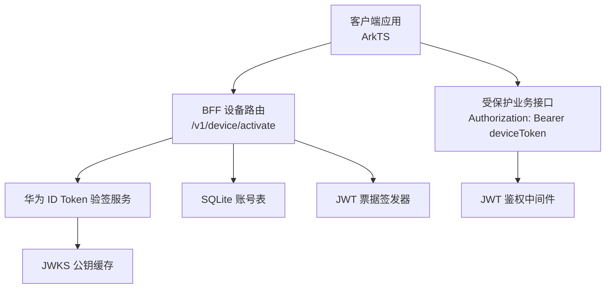
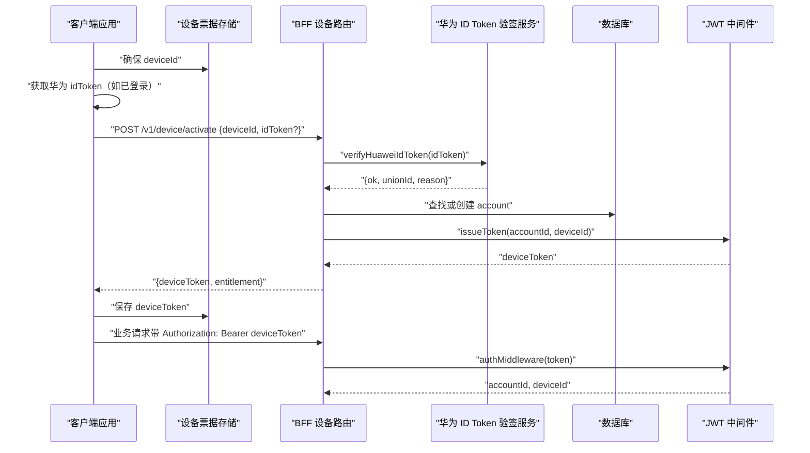
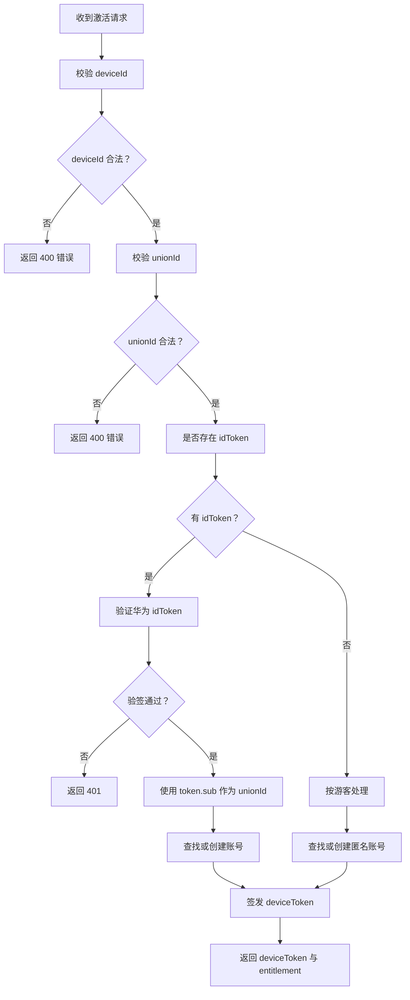
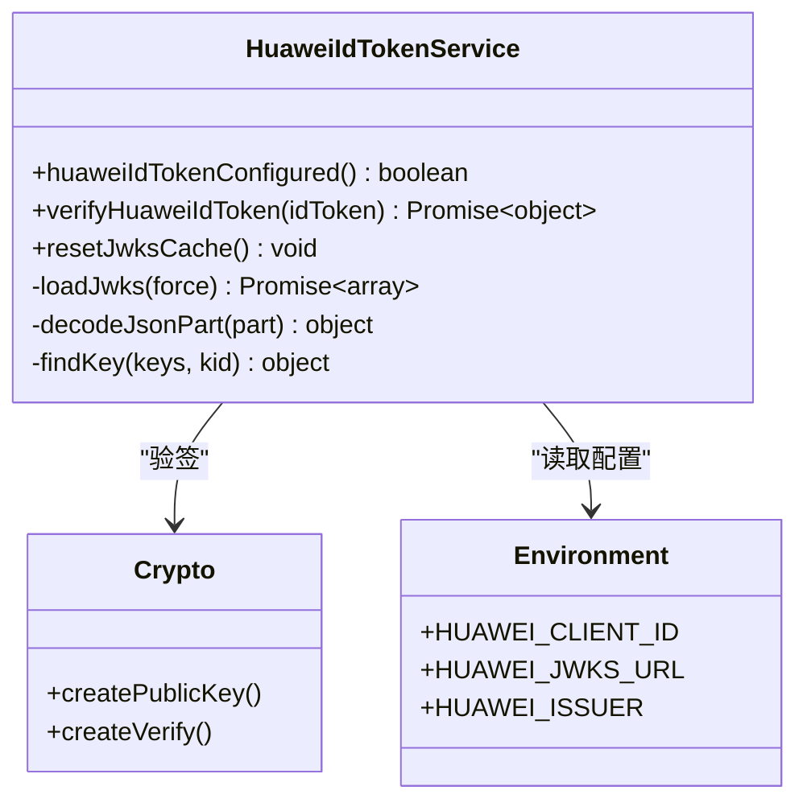
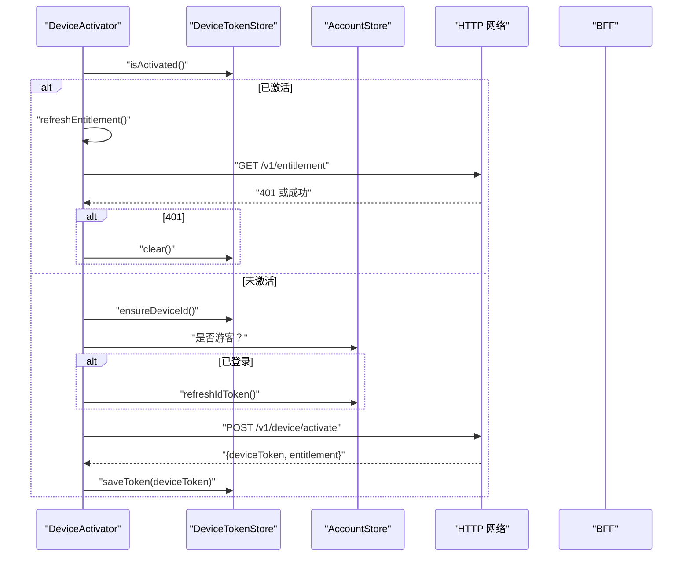
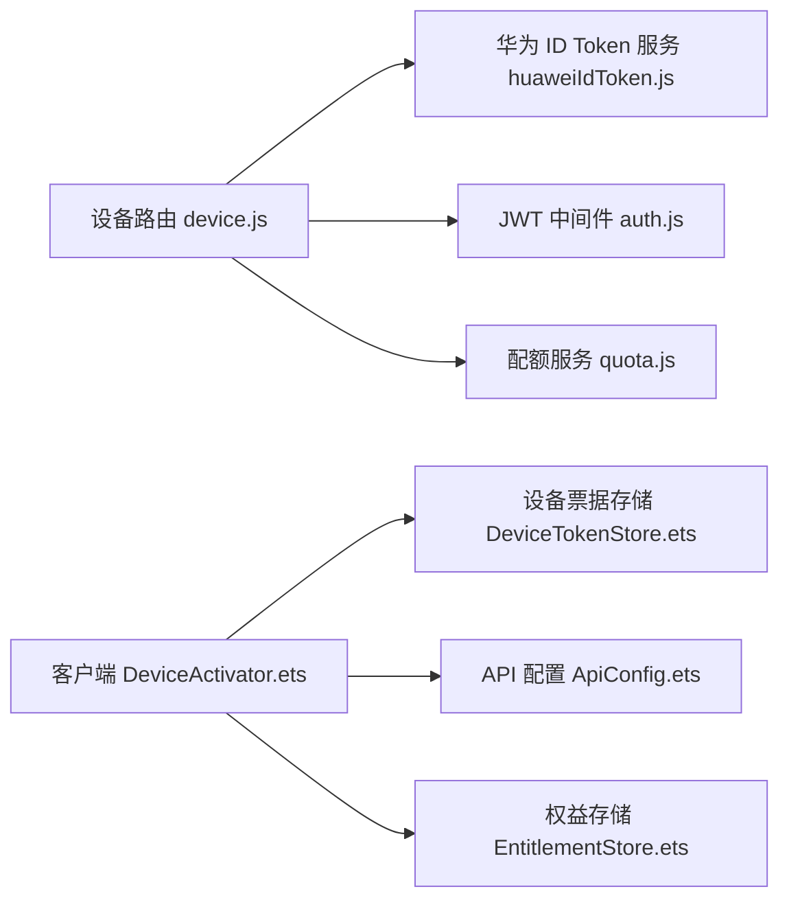

# 设备管理 API

<cite>
**本文引用的文件**   
- [bff/src/routes/device.js](file://bff/src/routes/device.js)
- [bff/src/services/huaweiIdToken.js](file://bff/src/services/huaweiIdToken.js)
- [bff/src/middleware/auth.js](file://bff/src/middleware/auth.js)
- [bff/test/device-idtoken.test.js](file://bff/test/device-idtoken.test.js)
- [bff/test/device-validate.test.js](file://bff/test/device-validate.test.js)
- [entry/src/main/ets/data/DeviceActivator.ets](file://entry/src/main/ets/data/DeviceActivator.ets)
- [entry/src/main/ets/data/DeviceTokenStore.ets](file://entry/src/main/ets/data/DeviceTokenStore.ets)
- [entry/src/main/ets/common/config/ApiConfig.ets](file://entry/src/main/ets/common/config/ApiConfig.ets)
</cite>

## 目录
1. [简介](#简介)
2. [项目结构](#项目结构)
3. [核心组件](#核心组件)
4. [架构总览](#架构总览)
5. [接口规范](#接口规范)
6. [JWT 与华为 ID Token 机制](#jwt-与华为-id-token-机制)
7. [详细组件分析](#详细组件分析)
8. [依赖关系分析](#依赖关系分析)
9. [性能与可用性](#性能与可用性)
10. [故障排查](#故障排查)
11. [结论](#结论)

## 简介
本文件面向设备管理相关接口的实现与集成，覆盖设备注册、设备验证、华为 ID Token 校验以及服务端签发的设备票据（deviceToken）管理机制。需要特别说明的是：仓库中实际暴露的设备端点为 `POST /v1/device/activate`，并非文档目标中的 `/v1/device/register` 或 `/v1/device/validate`。因此本文以代码真实路径为准，把“设备注册”对应到激活接口，并明确说明现有实现中没有独立的“设备验证”接口。

## 项目结构
设备能力由后端 BFF 和前端应用共同实现：
- 后端 BFF：Express 路由负责设备激活；华为 ID Token 验签服务负责验证客户端身份；中间件负责签发和校验 BFF 内部使用的 deviceToken。
- 前端应用：ArkTS 侧负责生成设备唯一标识、获取华为 idToken、调用激活接口、持久化 deviceToken，并在后续请求中携带该票据。



图示来源
- [bff/src/routes/device.js:1-84](file://bff/src/routes/device.js#L1-L84)
- [bff/src/services/huaweiIdToken.js:1-161](file://bff/src/services/huaweiIdToken.js#L1-L161)
- [bff/src/middleware/auth.js:1-25](file://bff/src/middleware/auth.js#L1-L25)
- [entry/src/main/ets/data/DeviceActivator.ets:1-159](file://entry/src/main/ets/data/DeviceActivator.ets#L1-L159)

章节来源
- [bff/src/routes/device.js:1-84](file://bff/src/routes/device.js#L1-L84)
- [entry/src/main/ets/data/DeviceActivator.ets:1-159](file://entry/src/main/ets/data/DeviceActivator.ets#L1-L159)

## 核心组件
- 设备激活路由：处理设备注册逻辑、华为 ID Token 校验、匿名账号处理、设备与账号关联、签发 deviceToken。
- 华为 ID Token 验签服务：从环境变量加载 Client ID、Issuer、JWKS URL，拉取并缓存公钥，完成 RS256/PS256 签名校验及 iss/aud/exp/sub 字段校验。
- JWT 中间件：签发有效期 30 天的 deviceToken，并在其他受保护接口中解析 Authorization 头、校验票据。
- 客户端激活器：生成设备 UUID、获取华为 idToken、调用激活接口、保存 deviceToken 并刷新权益。
- 设备票据存储：本地持久化 deviceId、deviceToken、激活时间，并提供清理、恢复等能力。

章节来源
- [bff/src/routes/device.js:1-84](file://bff/src/routes/device.js#L1-L84)
- [bff/src/services/huaweiIdToken.js:1-161](file://bff/src/services/huaweiIdToken.js#L1-L161)
- [bff/src/middleware/auth.js:1-25](file://bff/src/middleware/auth.js#L1-L25)
- [entry/src/main/ets/data/DeviceActivator.ets:1-159](file://entry/src/main/ets/data/DeviceActivator.ets#L1-L159)
- [entry/src/main/ets/data/DeviceTokenStore.ets:1-142](file://entry/src/main/ets/data/DeviceTokenStore.ets#L1-L142)

## 架构总览
设备管理的关键流程如下：
1. 客户端首次启动时生成设备唯一标识 deviceId。
2. 如果用户已登录，客户端通过华为账号体系获取 idToken。
3. 客户端向 BFF 的 `/v1/device/activate` 提交 deviceId 与可选 idToken。
4. BFF 验签 idToken（若提供），确定 unionId，并在数据库中建立或更新 account 记录。
5. BFF 签发 deviceToken 返回给客户端；客户端将其存入本地存储，并在后续业务请求中作为 Bearer 票据使用。
6. 当 BFF 返回 401 或业务错误码指示票据失效时，客户端重新执行激活流程。



图示来源
- [entry/src/main/ets/data/DeviceActivator.ets:1-159](file://entry/src/main/ets/data/DeviceActivator.ets#L1-L159)
- [bff/src/routes/device.js:1-84](file://bff/src/routes/device.js#L1-L84)
- [bff/src/services/huaweiIdToken.js:1-161](file://bff/src/services/huaweiIdToken.js#L1-L161)
- [bff/src/middleware/auth.js:1-25](file://bff/src/middleware/auth.js#L1-L25)

## 接口规范

### POST /v1/device/activate（设备注册/激活）

- HTTP 方法：POST
- URL 路径：/v1/device/activate
- 内容类型：application/json
- 认证要求：无（这是获取 deviceToken 的入口）
- 请求体参数：

| 字段 | 类型 | 必填 | 说明 |
| --- | --- | --- | --- |
| deviceId | string | 是 | 客户端生成的设备唯一标识，长度不超过 128 字符 |
| idToken | string | 否 | 华为账号体系下发的 idToken；提供后按签名校验结果使用其 sub 作为 unionId |
| unionId | string | 否 | 客户端自报 unionId；不提供或为空时走游客流程 |

- 成功响应：

| 字段 | 类型 | 说明 |
| --- | --- | --- |
| deviceToken | string | BFF 签发的 Bearer 票据，后续请求需在 Authorization 头携带 |
| entitlement | object | 设备权益信息，例如剩余次数、当日用量、每日上限等（具体字段由权益服务决定） |

- 错误响应示例：

| 场景 | HTTP 状态码 | error 值 | message 含义 |
| --- | --- | --- | --- |
| deviceId 缺失、非字符串、空串或超长 | 400 | MISSING_DEVICE_ID | 缺少或非法的 deviceId |
| unionId 非字符串或超长 | 400 | INVALID_UNION_ID | 非法的 unionId |
| idToken 非字符串或过长 | 400 | INVALID_ID_TOKEN | 非法的 idToken |
| 华为 idToken 验签失败 | 401 | ID_TOKEN_INVALID | 华为身份票据无效 |

- 实际请求示例（JSON）：

```json
{
  "deviceId": "a1b2c3d4-e5f6-4a7b-8c9d-0e1f2a3b4c5d",
  "idToken": "eyJhbGciOiJSUzI1NiIsInR5cCI6IkpXVCJ9.eyJzdWIiOiJ1bmlvbi1mcm9tLXRva2VuIiwiaXNzIjoiaHR0cHM6Ly9hY2NvdW50cy5odWF3ZWkuY29tIiwiYXVkIjoiY2xpZW50LXVuZGVyLXRlc3QiLCJleHAiOjE3OTQwMDAwMDB9.signature"
}
```

- 实际成功响应示例（JSON）：

```json
{
  "deviceToken": "eyJhbGciOiJIUzI1NiIsInR5cCI6IkpXVCJ9.eyJhY2NvdW50SWQiOiIxMjMiLCJkZXZpY2VJZCI6ImExYjJjM2Q0LWU1ZjYtNGE3Yi04YzlkLTBlMWYyYTNiNGM1ZCIsImlhdCI6MTczODg4MDAwMH0.signature",
  "entitlement": {
    "giftRemaining": 5,
    "usedToday": 2,
    "dailyCap": 10
  }
}
```

- 关键行为说明：
  - 如果提供有效的华为 idToken，服务器只信任 idToken 验签后的 sub 作为 unionId，忽略请求体中的 unionId。
  - 如果没有 idToken，但提供了非空 unionId，服务器会按游客处理，不会使用该 unionId 冒用他人身份。
  - 匿名激活会为同一 deviceId 创建形如 anon-deviceId 的 unionId，并限定只能命中匿名账号。
  - 并发激活使用数据库层 INSERT OR IGNORE 与重取策略，避免 UNIQUE 约束导致 500。

章节来源
- [bff/src/routes/device.js:1-84](file://bff/src/routes/device.js#L1-L84)
- [bff/test/device-validate.test.js:1-86](file://bff/test/device-validate.test.js#L1-L86)
- [bff/test/device-idtoken.test.js:1-184](file://bff/test/device-idtoken.test.js#L1-184)

### POST /v1/device/validate（设备验证）

仓库中没有定义 `/v1/device/validate` 路由。设备能力的入口是 `/v1/device/activate`。若业务希望增加一个独立验证接口，应参考现有 activate 路由的输入校验、idToken 验签与 JWT 签发逻辑进行扩展。当前阶段不能宣称存在 `/v1/device/validate` 接口。

章节来源
- [bff/src/routes/device.js:1-84](file://bff/src/routes/device.js#L1-L84)

## JWT 与华为 ID Token 机制

### 设备票据 deviceToken（JWT）

- 用途：客户端在后续访问受保护接口时，通过 Authorization: Bearer deviceToken 证明设备已激活且有权使用业务。
- 签发位置：BFF 设备激活路由调用 `issueToken`。
- 载荷字段：
  - accountId：数据库中的账号主键。
  - deviceId：设备唯一标识。
- 有效期：30 天。
- 密钥来源：环境变量 JWT_SECRET；未配置时使用开发默认值。
- 失效处理：当中间件验签失败时返回 401，客户端应触发重新激活。

章节来源
- [bff/src/middleware/auth.js:1-25](file://bff/src/middleware/auth.js#L1-L25)

### 华为 ID Token 校验

- 目的：确认客户端身份，将华为账号的 unionId 与设备绑定。
- 支持的算法：RS256、PS256。
- 校验步骤：
  1. 检查环境变量 HUAWEI_CLIENT_ID 是否配置。
  2. 解析 JWT 三段结构，解码 header 与 payload。
  3. 校验 alg 是否为 RS256 或 PS256。
  4. 从 JWKS 端点拉取公钥并缓存，根据 kid 匹配 JWK。
  5. 使用 Node.js crypto 进行 RSA-SHA256 验签。
  6. 校验 exp 未过期、iss 等于预期 Issuer、aud 包含 Client ID。
  7. 取 payload.sub 作为 unionId。
- JWKS 缓存：默认 10 分钟 TTL，超时 5 秒；新 kid 未命中时会强制刷新一次。
- 失败原因包括：未配置 Client ID、令牌格式错误、算法不合法、kid 不存在、公钥不可用、签名无效、令牌过期、Issuer 不符、Audience 不符、sub 缺失。

章节来源
- [bff/src/services/huaweiIdToken.js:1-161](file://bff/src/services/huaweiIdToken.js#L1-L161)

## 详细组件分析

### 设备激活路由

设备激活路由承担以下职责：
- 校验 deviceId、unionId、idToken 的类型与长度。
- 调用华为 ID Token 验签服务，决定是否使用 unionId。
- 在数据库中查找或创建 account 记录，区分华为账号与匿名用户。
- 调用 JWT 中间件签发 deviceToken。
- 查询并返回 entitlement。



图示来源
- [bff/src/routes/device.js:1-84](file://bff/src/routes/device.js#L1-L84)
- [bff/src/services/huaweiIdToken.js:1-161](file://bff/src/services/huaweiIdToken.js#L1-L161)
- [bff/src/middleware/auth.js:1-25](file://bff/src/middleware/auth.js#L1-L25)

章节来源
- [bff/src/routes/device.js:1-84](file://bff/src/routes/device.js#L1-L84)

### 华为 ID Token 验签服务

该服务实现了较完整的安全边界：
- 不接受 alg=none 或非对称算法之外的方案。
- 要求 kid 存在且为 RSA 类型。
- 对 JWKS 拉取失败、kid 不存在、JWK 构造失败、签名失败等情况统一返回 ok=false。
- 支持 kid 轮换时的自动刷新逻辑，降低公钥轮换导致的误判窗口。



图示来源
- [bff/src/services/huaweiIdToken.js:1-161](file://bff/src/services/huaweiIdToken.js#L1-L161)

章节来源
- [bff/src/services/huaweiIdToken.js:1-161](file://bff/src/services/huaweiIdToken.js#L1-L161)

### 客户端设备激活流程

客户端激活器负责：
- 判断是否已激活；已激活则优先刷新权益。
- 防止重复激活并发。
- 在开发环境未配置 BFF 时跳过激活。
- 对于已登录但未取得 idToken 的情况，不降级为游客，而是跳过本次激活。
- 调用激活接口后保存 deviceToken 与 entitlement。
- 遇到 401 时清除旧票据并重新激活。



图示来源
- [entry/src/main/ets/data/DeviceActivator.ets:1-159](file://entry/src/main/ets/data/DeviceActivator.ets#L1-L159)
- [entry/src/main/ets/data/DeviceTokenStore.ets:1-142](file://entry/src/main/ets/data/DeviceTokenStore.ets#L1-L142)

章节来源
- [entry/src/main/ets/data/DeviceActivator.ets:1-159](file://entry/src/main/ets/data/DeviceActivator.ets#L1-L159)
- [entry/src/main/ets/data/DeviceTokenStore.ets:1-142](file://entry/src/main/ets/data/DeviceTokenStore.ets#L1-L142)

## 依赖关系分析



图示来源
- [bff/src/routes/device.js:1-84](file://bff/src/routes/device.js#L1-L84)
- [bff/src/services/huaweiIdToken.js:1-161](file://bff/src/services/huaweiIdToken.js#L1-L161)
- [bff/src/middleware/auth.js:1-25](file://bff/src/middleware/auth.js#L1-L25)
- [entry/src/main/ets/data/DeviceActivator.ets:1-159](file://entry/src/main/ets/data/DeviceActivator.ets#L1-L159)
- [entry/src/main/ets/data/DeviceTokenStore.ets:1-142](file://entry/src/main/ets/data/DeviceTokenStore.ets#L1-L142)
- [entry/src/main/ets/common/config/ApiConfig.ets:1-66](file://entry/src/main/ets/common/config/ApiConfig.ets#L1-L66)

章节来源
- [bff/src/routes/device.js:1-84](file://bff/src/routes/device.js#L1-L84)
- [entry/src/main/ets/data/DeviceActivator.ets:1-159](file://entry/src/main/ets/data/DeviceActivator.ets#L1-L159)

## 性能与可用性
- JWKS 缓存可降低每次验签都拉取公钥的网络开销，默认 10 分钟缓存，配合较短的拉取超时。
- 设备激活路由对并发激活做了数据库层防护，避免 UNIQUE 约束导致 500。
- 客户端激活器对重复激活做了防抖，避免短时间内多次发起相同请求。
- 设备票据有效期较长（30 天），可减少频繁激活带来的额外网络交互；同时通过 401 触发重新激活，保证票据失效后可恢复。

[本节为通用性能讨论，不直接分析具体代码行]

## 故障排查

常见错误与处理方式：

| 现象 | 可能原因 | 建议处理 |
| --- | --- | --- |
| 激活返回 400，error 为 MISSING_DEVICE_ID | deviceId 缺失、非字符串、空串或超长 | 检查客户端是否生成并传入合法的 UUID 型 deviceId |
| 激活返回 400，error 为 INVALID_UNION_ID | unionId 非字符串或超长 | 不要自行拼接 unionId；如需华为账号，请提供 idToken |
| 激活返回 400，error 为 INVALID_ID_TOKEN | idToken 不是字符串或过长 | 检查华为账号 SDK 返回的 idToken 类型与长度 |
| 激活返回 401，error 为 ID_TOKEN_INVALID | 华为 idToken 验签失败 | 检查 JWKS 是否可访问、Client ID 是否配置、令牌是否过期或签名无效 |
| 业务接口返回 401 | deviceToken 缺失、格式错误或已过期 | 清除本地票据并重新调用激活接口 |
| 权益刷新返回 401 | deviceToken 失效 | 清除本地票据并重新激活 |
| 设备切换账号后数据异常 | 使用了错误的 deviceId 或 unionId | 确认华为账号激活写入的是正确 deviceId，且匿名激活不会覆盖已有华为账号 |

章节来源
- [bff/src/routes/device.js:1-84](file://bff/src/routes/device.js#L1-L84)
- [bff/src/middleware/auth.js:1-25](file://bff/src/middleware/auth.js#L1-L25)
- [entry/src/main/ets/data/DeviceActivator.ets:1-159](file://entry/src/main/ets/data/DeviceActivator.ets#L1-L159)

## 结论
- 仓库中实际的设备管理接口是 `POST /v1/device/activate`，没有 `/v1/device/register` 或 `/v1/device/validate`。
- 设备注册的核心是 deviceId 与可选华为 idToken 的联合激活，最终返回 BFF 内部的 deviceToken。
- 华为 ID Token 采用本地 JWKS 验签，支持 RS256 与 PS256，并通过 iss/aud/exp/sub 完成安全校验。
- deviceToken 有效期为 30 天，客户端应在 401 时重新激活。
- 客户端集成应遵循：生成并持久化 deviceId、获取 idToken、调用激活接口、保存 deviceToken、在后续请求中携带 Authorization 头。

[本节为总结性内容，不直接分析具体文件]