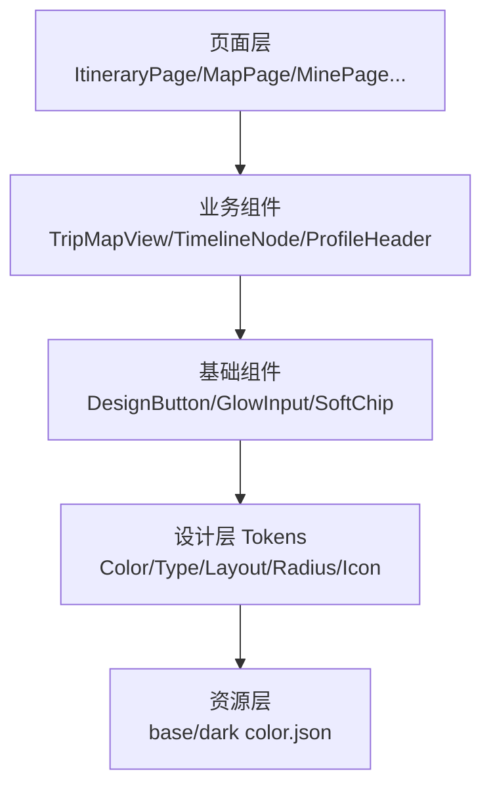
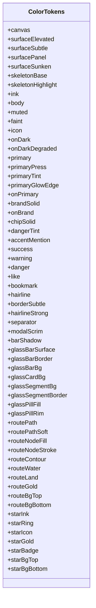
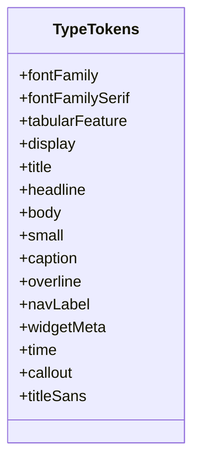
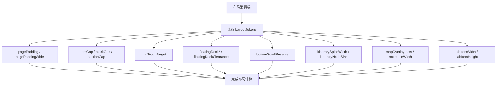
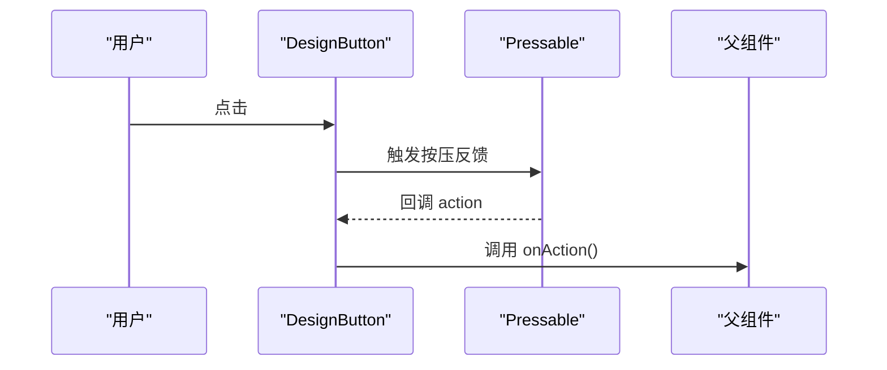
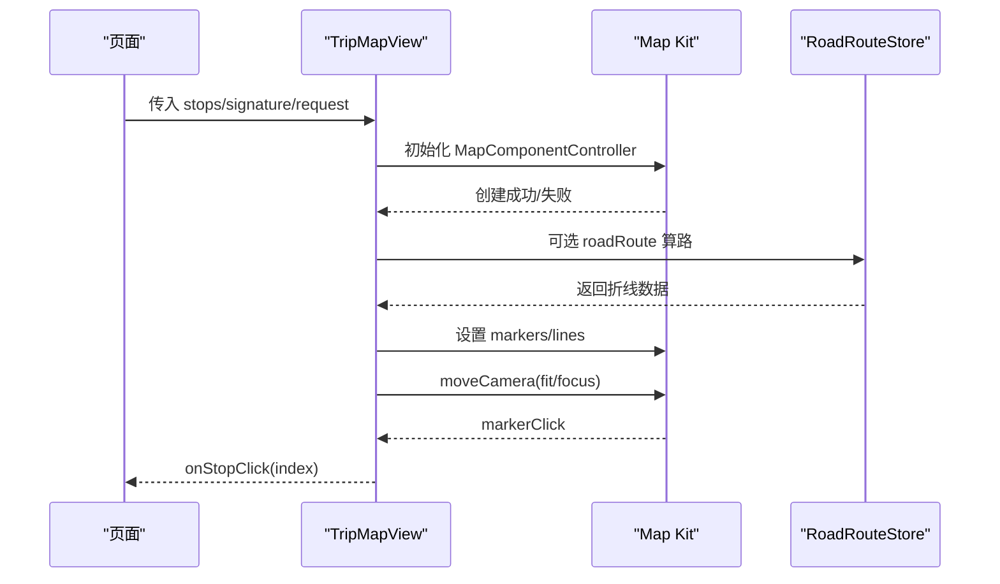
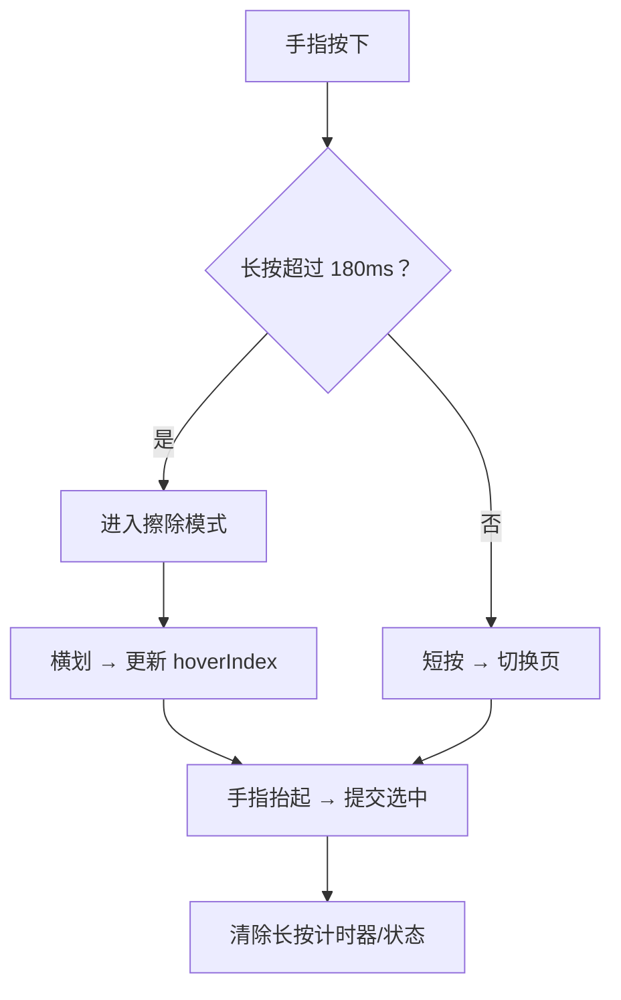
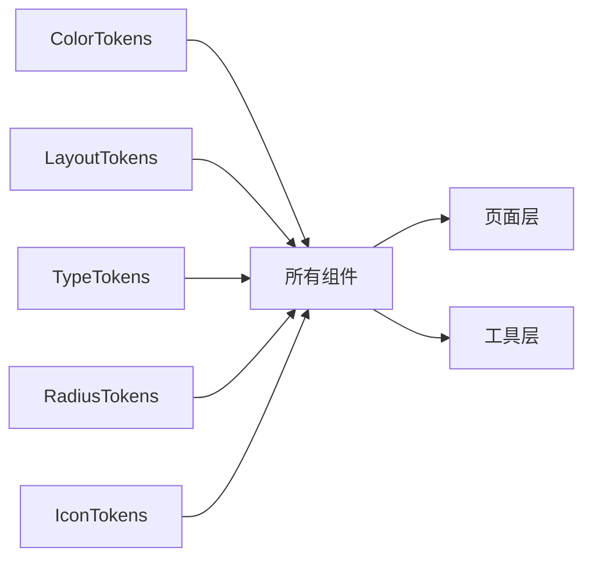

# UI 组件系统

<cite>
**本文引用的文件**   
- [ColorTokens.ets](file://entry/src/main/ets/design/ColorTokens.ets)
- [LayoutTokens.ets](file://entry/src/main/ets/design/LayoutTokens.ets)
- [TypeTokens.ets](file://entry/src/main/ets/design/TypeTokens.ets)
- [RadiusTokens.ets](file://entry/src/main/ets/design/RadiusTokens.ets)
- [IconTokens.ets](file://entry/src/main/ets/design/IconTokens.ets)
- [color.json（浅色）](file://entry/src/main/resources/base/element/color.json)
- [color.json（深色）](file://entry/src/main/resources/dark/element/color.json)
- [float.json](file://entry/src/main/resources/base/element/float.json)
- [DesignButton.ets](file://entry/src/main/ets/components/DesignButton.ets)
- [YoujingButton.ets](file://entry/src/main/ets/components/YoujingButton.ets)
- [GlowInput.ets](file://entry/src/main/ets/components/GlowInput.ets)
- [TripMapView.ets](file://entry/src/main/ets/components/TripMapView.ets)
- [TimelineNode.ets](file://entry/src/main/ets/components/TimelineNode.ets)
- [ProfileHeader.ets](file://entry/src/main/ets/components/ProfileHeader.ets)
- [BottomTabBar.ets](file://entry/src/main/ets/components/BottomTabBar.ets)
- [Skeleton.ets](file://entry/src/main/ets/components/Skeleton.ets)
- [GlassPanel.ets](file://entry/src/main/ets/components/GlassPanel.ets)
- [OptionCard.ets](file://entry/src/main/ets/components/OptionCard.ets)
- [EmptyState.ets](file://entry/src/main/ets/components/EmptyState.ets)
- [FlowSteps.ets](file://entry/src/main/ets/components/FlowSteps.ets)
- [BadgeEarnedDialog.ets](file://entry/src/main/ets/components/BadgeEarnedDialog.ets)
- [PrivacyConsentDialog.ets](file://entry/src/main/ets/components/PrivacyConsentDialog.ets)
- [SoftChip.ets](file://entry/src/main/ets/components/SoftChip.ets)
- [responsive.ets](file://entry/src/main/ets/utils/responsive.ets)
</cite>

## 目录
1. [引言](#引言)
2. [项目结构](#项目结构)
3. [核心组件](#核心组件)
4. [架构总览](#架构总览)
5. [详细组件分析](#详细组件分析)
6. [依赖关系分析](#依赖关系分析)
7. [性能与可维护性](#性能与可维护性)
8. [故障排查指南](#故障排查指南)
9. [结论](#结论)
10. [附录：响应式与无障碍](#附录响应式与无障碍)

## 引言
本文件说明“有径”应用的 UI 组件系统与视觉规范，覆盖 DesignTokens 体系、基础/业务/复合三层组件、设计原则、使用示例、响应式布局与开发指南。文档的目标是让前端开发者快速理解颜色、字体、间距、圆角等设计原子，以及按钮、输入框、地图、时间线、个人资料头、页签栏、对话框、骨架屏等具体组件的职责、属性、事件和样式定制方式。

## 项目结构
UI 相关代码集中在 `entry/src/main/ets` 下，采用分层组织：
- `design/`：DesignTokens，集中定义颜色、布局、字体、圆角、图标尺寸等契约值。
- `components/`：可复用 UI 组件，分为基础组件、业务组件和复合组件。
- `utils/`：工具函数，包括响应式断点映射、导航适配、主题切换辅助等。
- `resources/`：系统资源，包含浅色/深色两套 color.json，以及浮点资源 float.json。

```mermaid
graph TB
  subgraph "设计层"
    CT["ColorTokens<br/>颜色契约"]
    LT["LayoutTokens<br/>布局与尺寸契约"]
    TT["TypeTokens<br/>字阶契约"]
    RT["RadiusTokens<br/>圆角契约"]
    IT["IconTokens<br/>图标尺寸"]
  end

  subgraph "组件层"
    DB["DesignButton<br/>基础按钮"]
    YB["YoujingButton<br/>按钮适配层"]
    GI["GlowInput<br/>输入框"]
    TM["TripMapView<br/>行程地图"]
    TN["TimelineNode<br/>时间线节点"]
    PH["ProfileHeader<br/>个人资料头"]
    BT["BottomTabBar<br/>底部页签栏"]
    SK["Skeleton<br/>骨架屏"]
    GP["GlassPanel<br/>玻璃面板"]
    OC["OptionCard<br/>选项卡片"]
    ES["EmptyState<br/>空态"]
    FS["FlowSteps<br/>流程步骤"]
    BD["BadgeEarnedDialog<br/>勋章弹窗"]
    PC["PrivacyConsentDialog<br/>隐私同意弹窗"]
    SC["SoftChip<br/>软胶囊"]
  end

  subgraph "资源层"
    RC["base/element/color.json<br/>浅色色板"]
    DC["dark/element/color.json<br/>深色色板"]
    FL["base/element/float.json<br/>浮动字号"]
  end

  CT --> DB
  CT --> GI
  CT --> TM
  CT --> TN
  CT --> PH
  CT --> BT
  CT --> SK
  CT --> GP
  CT --> OC
  CT --> ES
  CT --> FS
  CT --> BD
  CT --> PC
  CT --> SC

  LT --> DB
  LT --> GI
  LT --> TM
  LT --> TN
  LT --> PH
  LT --> BT
  LT --> SK
  LT --> GP
  LT --> OC
  LT --> ES
  LT --> FS
  LT --> BD
  LT --> PC
  LT --> SC

  TT --> DB
  TT --> GI
  TT --> TM
  TT --> TN
  TT --> PH
  TT --> BT
  TT --> SK
  TT --> GP
  TT --> OC
  TT --> ES
  TT --> FS
  TT --> BD
  TT --> PC
  TT --> SC

  RT --> DB
  RT --> GI
  RT --> TM
  RT --> TN
  RT --> PH
  RT --> BT
  RT --> SK
  RT --> GP
  RT --> OC
  RT --> ES
  RT --> FS
  RT --> BD
  RT --> PC
  RT --> SC

  IT --> DB
  IT --> GI
  IT --> TM
  IT --> TN
  IT --> PH
  IT --> BT
  IT --> SK
  IT --> GP
  IT --> OC
  IT --> ES
  IT --> FS
  IT --> BD
  IT --> PC
  IT --> SC

  RC --> CT
  DC --> CT
  FL --> TT
```

**图示来源**
- [ColorTokens.ets:1-200](file://entry/src/main/ets/design/ColorTokens.ets#L1-L200)
- [LayoutTokens.ets:1-200](file://entry/src/main/ets/design/LayoutTokens.ets#L1-L200)
- [TypeTokens.ets:1-94](file://entry/src/main/ets/design/TypeTokens.ets#L1-L94)
- [RadiusTokens.ets:1-43](file://entry/src/main/ets/design/RadiusTokens.ets#L1-L43)
- [IconTokens.ets:1-12](file://entry/src/main/ets/design/IconTokens.ets#L1-L12)
- [color.json（浅色）:1-200](file://entry/src/main/resources/base/element/color.json#L1-L200)
- [color.json（深色）:1-200](file://entry/src/main/resources/dark/element/color.json#L1-L200)
- [float.json:1-8](file://entry/src/main/resources/base/element/float.json#L1-L8)

**章节来源**
- [ColorTokens.ets:1-200](file://entry/src/main/ets/design/ColorTokens.ets#L1-L200)
- [LayoutTokens.ets:1-200](file://entry/src/main/ets/design/LayoutTokens.ets#L1-L200)
- [TypeTokens.ets:1-94](file://entry/src/main/ets/design/TypeTokens.ets#L1-L94)
- [RadiusTokens.ets:1-43](file://entry/src/main/ets/design/RadiusTokens.ets#L1-L43)
- [IconTokens.ets:1-12](file://entry/src/main/ets/design/IconTokens.ets#L1-L12)

## 核心组件
本节按职责分层梳理组件族：

### 基础组件
- DesignButton：四变体按钮（主实底、描边、幽灵、玻璃），统一最小命中区、禁用透明度、Pressable 按下反馈、系统材质避让。
- YoujingButton：对外 API 适配层，把业务语义的 PRIMARY/SECONDARY/TEXT/GLASS 映射到 DesignButton 的四变体，保护既有调用方签名。
- GlowInput：统一输入框，默认官方原生样式；segmentStyle=true 时走分段栏同款玻璃效果。
- SoftChip：小型动作胶囊，支持 neutral/brand/danger 三档。

### 业务组件
- TripMapView：基于 Map Kit 的真实地图组件，负责落点、动线、镜头收敛、主题切换、错误兜底。
- TimelineNode：行程时间轴节点圆环，按活动类型映射到 ColorTokens。
- ProfileHeader：个人资料头，组合头像身份、统计项、编辑资料胶囊与草稿箱/废纸篓工具行。
- OptionCard：追问选项卡，选中态品牌实底 + 白字 + 对勾。

### 复合组件
- BottomTabBar：低 SDK 降级悬浮底栏，含长按擦除模式、按压光斑、滑动跟随、红点徽标。
- GlassPanel：内容卡玻璃面，支持系统材质接管与自绘降级。
- EmptyState：空态组件（图标、标题、解释、出口按钮）。
- FlowSteps：建行程主链进度条与步数文案。
- BadgeEarnedDialog / PrivacyConsentDialog：两类 @CustomDialog 弹窗。
- Skeleton：静态骨架条，无流光，仅底色+圆角+尺寸。

**章节来源**
- [DesignButton.ets:1-139](file://entry/src/main/ets/components/DesignButton.ets#L1-L139)
- [YoujingButton.ets:1-60](file://entry/src/main/ets/components/YoujingButton.ets#L1-L60)
- [GlowInput.ets:1-83](file://entry/src/main/ets/components/GlowInput.ets#L1-L83)
- [SoftChip.ets:1-95](file://entry/src/main/ets/components/SoftChip.ets#L1-L95)
- [TripMapView.ets:1-200](file://entry/src/main/ets/components/TripMapView.ets#L1-L200)
- [TimelineNode.ets:1-53](file://entry/src/main/ets/components/TimelineNode.ets#L1-L53)
- [ProfileHeader.ets:1-106](file://entry/src/main/ets/components/ProfileHeader.ets#L1-L106)
- [OptionCard.ets:1-74](file://entry/src/main/ets/components/OptionCard.ets#L1-L74)
- [BottomTabBar.ets:1-200](file://entry/src/main/ets/components/BottomTabBar.ets#L1-L200)
- [GlassPanel.ets:1-54](file://entry/src/main/ets/components/GlassPanel.ets#L1-L54)
- [EmptyState.ets:1-85](file://entry/src/main/ets/components/EmptyState.ets#L1-L85)
- [FlowSteps.ets:1-52](file://entry/src/main/ets/components/FlowSteps.ets#L1-L52)
- [BadgeEarnedDialog.ets:1-83](file://entry/src/main/ets/components/BadgeEarnedDialog.ets#L1-L83)
- [PrivacyConsentDialog.ets:1-113](file://entry/src/main/ets/components/PrivacyConsentDialog.ets#L1-L113)
- [Skeleton.ets:1-39](file://entry/src/main/ets/components/Skeleton.ets#L1-L39)

## 架构总览
UI 层遵循“设计层 → 组件层 → 页面层”单向依赖：
- 设计层提供不可随意插值的 DesignTokens。
- 组件层消费 DesignTokens，封装交互细节与平台差异。
- 页面层组合业务组件，处理领域数据与路由。

**图示来源**
- [TripMapView.ets:1-200](file://entry/src/main/ets/components/TripMapView.ets#L1-L200)
- [DesignButton.ets:1-139](file://entry/src/main/ets/components/DesignButton.ets#L1-L139)
- [ColorTokens.ets:1-200](file://entry/src/main/ets/design/ColorTokens.ets#L1-L200)
- [color.json（浅色）:1-200](file://entry/src/main/resources/base/element/color.json#L1-L200)

## 详细组件分析

### DesignTokens 体系

#### 颜色规范
ColorTokens 是应用色彩的唯一入口，所有颜色值来自 `resources/base/element/color.json` 与 `resources/dark/element/color.json`。浅色与深色同名 key 对应不同 ARGB 值，系统根据 ColorMode 自动切换，页面无需分支。

主要语义色分类：
- 画布与表面：canvas、surfaceElevated、surfaceSubtle、surfacePanel、surfaceSunken、skeletonBase、skeletonHighlight。
- 文字与图标：ink、body、muted、faint、icon、onDark、onDarkDegraded。
- 品牌与语义：primary、primaryPress、primaryTint、primaryGlowEdge、onPrimary、brandSolid、onBrand、chipSolid、dangerTint、accentMention、success、warning、danger、like、bookmark。
- 线与遮罩：hairline、borderSubtle、hairlineStrong、separator、modalScrim、barShadow。
- 玻璃栏面族：glassBarSurface、glassBarBorder、glassBarBg、glassCardBg、glassSegmentBg、glassSegmentBorder、glassPillFill、glassPillRim。
- 路线图与星图：routePath、routePathSoft、routeNodeFill、routeNodeStroke、routeContour、routeWater、routeLand、routeGold、routeBgTop、routeBgBottom；starInk、starRing、starIcon、starGold、starBadge、starBgTop、starBgBottom。
- 有据别名：secondary、tertiary、sunken、brand、brandTint、brandPress、barSurface、barBorder 等，用于兼容搬运组件。

**图示来源**
- [ColorTokens.ets:1-200](file://entry/src/main/ets/design/ColorTokens.ets#L1-L200)

实际色值以两份 color.json 为准。浅色 primary 为蓝系，深色 primary 为亮蓝；success/warning/danger/like/bookmark 在浅色/深色分别提供可读色值；barShadow 浅色较浅、深色更浓，用于栏面投影。

**章节来源**
- [ColorTokens.ets:1-200](file://entry/src/main/ets/design/ColorTokens.ets#L1-L200)
- [color.json（浅色）:1-200](file://entry/src/main/resources/base/element/color.json#L1-L200)
- [color.json（深色）:1-200](file://entry/src/main/resources/dark/element/color.json#L1-L200)

#### 字体规范
TypeTokens 定义九档字阶，限制字号集合为 10/11/12/14/16/18/21/32，禁止插值。全局字距为 0；数字统一 tabular（tnum on）。serif 字体 NotoSerifSC 仅用于特定展示位，sans 字体 HarmonyOS Sans 用于控件与站点名。

字阶角色：
- display：页面大标题，32/700/44，serif。
- title：日标题、卡片目的地名，21/700/32，serif。
- headline：站点名，18/600/24，sans。
- body：正文，16/400/24。
- small：次级信息，14/400/20。
- caption：辅助信息，12/450/16。
- overline：标签，11/600，lineHeight 表示“不设行高”。
- navLabel：dock 项标签，10/400/14，全 App 唯一允许小于 11px 字符串。
- widgetMeta：桌面卡片辅助行，11/400/14。
- time：行程时间，12/600 tabular。
- callout：据有名别名，等于 small。
- titleSans：控件标题 sans 档，21/650/28。

**图示来源**
- [TypeTokens.ets:1-94](file://entry/src/main/ets/design/TypeTokens.ets#L1-L94)

**章节来源**
- [TypeTokens.ets:1-94](file://entry/src/main/ets/design/TypeTokens.ets#L1-L94)
- [float.json:1-8](file://entry/src/main/resources/base/element/float.json#L1-L8)

#### 间距与布局标准
LayoutTokens 提供具名布局常量，单位 vp，覆盖：
- 基线网格 gridBaseline。
- 页面内缩 pagePadding/pagePaddingWide。
- 条目/区块/分区间隙 itemGap/blockGap/sectionGap。
- 内容最大宽 contentMaxWidth。
- 最小命中区 minTouchTarget。
- 顶栏高、分段控件高、底部 tab 栏高。
- 浮动 dock 宽度、边距、底部净空、渐变遮罩高。
- 通用底部滚动预留 bottomScrollReserve。
- 行程主轴、时间槽、节点尺寸、媒体缩略位。
- 地图浮层内缩、紧凑地图高、路线线宽。
- 吸顶组头高、追问选项间隙与最小高。
- 小组件内缩、个人资料头像直径、tab 项宽高。
- 安全区 fallback。

**图示来源**
- [LayoutTokens.ets:1-200](file://entry/src/main/ets/design/LayoutTokens.ets#L1-L200)

**章节来源**
- [LayoutTokens.ets:1-200](file://entry/src/main/ets/design/LayoutTokens.ets#L1-L200)

#### 圆角与阴影层级
RadiusTokens 封闭八值：none/media/capsule/reason/card/hero/dock/pill/floatingBar/lg。ShadowTokens 通过 ShadowTokens.none、ShadowTokens.cardAmbient 等供组件选择；DesignButton 与 GlassPanel 明确在系统材质生效时关闭自绘 shadow。

**章节来源**
- [RadiusTokens.ets:1-43](file://entry/src/main/ets/design/RadiusTokens.ets#L1-L43)
- [DesignButton.ets:1-139](file://entry/src/main/ets/components/DesignButton.ets#L1-L139)
- [GlassPanel.ets:1-54](file://entry/src/main/ets/components/GlassPanel.ets#L1-L54)

#### 图标尺寸
IconTokens 提供 compact(16)、standard(24)，另有 LayoutTokens 中的 IconSizes/tabBar/display 等尺寸由不同场景使用。

**章节来源**
- [IconTokens.ets:1-12](file://entry/src/main/ets/design/IconTokens.ets#L1-L12)
- [LayoutTokens.ets:1-200](file://entry/src/main/ets/design/LayoutTokens.ets#L1-L200)

### 基础组件

#### DesignButton
- 属性：label、variant、disabled、fillWidth、visualWidth、leadingSymbol、trailingSymbol、useSystemMaterial。
- 事件：onAction。
- 样式定制：通过 variant 选择 primary/outlined/ghost/glass；useSystemMaterial=true 且系统材质激活时，自绘 border/shadow/blur 归零，背景透明并交由系统材质渲染。
- 行为：禁用透明度 0.45；最小命中区 minTouchTarget；按下反馈由 Pressable 实现。

**图示来源**
- [DesignButton.ets:1-139](file://entry/src/main/ets/components/DesignButton.ets#L1-L139)

**章节来源**
- [DesignButton.ets:1-139](file://entry/src/main/ets/components/DesignButton.ets#L1-L139)

#### YoujingButton
- 属性：variant(PRIMARY/SECONDARY/TEXT/GLASS)、label、fullWidth、buttonWidth、leadingSymbol、trailingSymbol、disabled。
- 事件：onAction。
- 行为：将 SECONDARY→outlined、TEXT→ghost、GLASS→glass、PRIMARY→primary，委托给 DesignButton。

**章节来源**
- [YoujingButton.ets:1-60](file://entry/src/main/ets/components/YoujingButton.ets#L1-L60)
- [DesignButton.ets:1-139](file://entry/src/main/ets/components/DesignButton.ets#L1-L139)

#### GlowInput
- 属性：text(@Link)、placeholder、fillWidth、inputHeight、radius、segmentStyle、maxLength。
- 事件：onChange、onEnter、onFocusChanged。
- 样式定制：默认官方原生样式；segmentStyle=true 时半透明底+backdropBlur+高光边框。
- 行为：LTR 方向；长度上限；焦点变化回调。

**章节来源**
- [GlowInput.ets:1-83](file://entry/src/main/ets/components/GlowInput.ets#L1-L83)

#### SoftChip
- 属性：label、tone(NEUTRAL/BRAND/DANGER)、visualHeight、disabled。
- 事件：action。
- 样式定制：品牌/危险/中性三档；禁用透明度 0.45。

**章节来源**
- [SoftChip.ets:1-95](file://entry/src/main/ets/components/SoftChip.ets#L1-L95)

### 业务组件

#### TripMapView
- 属性：stops、signature、request、route、roadRoute、fitTopPx、fitBottomPx。
- 事件：onStopClick。
- 行为：
  - 首帧收敛到全部落点或默认缩放。
  - request 支持 'fit' 与 'focus:<index>:<seq>'。
  - 主题切换通过 StorageProp('isDarkMode') 控制 DayNightMode。
  - 鉴权失败时显示“地图加载失败”，错误码进入 Logger。
  - 坐标系统说明：Map Kit 在中国大陆用 GCJ02，WGS84 会偏移，需种子层转换。

**图示来源**
- [TripMapView.ets:1-200](file://entry/src/main/ets/components/TripMapView.ets#L1-L200)

**章节来源**
- [TripMapView.ets:1-200](file://entry/src/main/ets/components/TripMapView.ets#L1-L200)

#### TimelineNode
- 属性：cat(ActivityCategory)。
- 行为：按 CategoryStyle.colorName 映射到 bookmark/accentMention/icon/faint/primary。
- 尺寸：外层 24vp，内圈 10vp。

**章节来源**
- [TimelineNode.ets:1-53](file://entry/src/main/ets/components/TimelineNode.ets#L1-L53)

#### ProfileHeader
- 属性：avatar、name、gender、bio、userId、isLoggedIn、followingCount、followerCount、totalLikes、statLabels、showToolPills、onBackground。
- 事件：onOpenFollowing、onOpenFollowers、onEdit、onOpenDrafts、onOpenTrash、onLogin。
- 布局：头像身份 + 统计三列 + 编辑资料胶囊 + 可选草稿箱/废纸篓两胶囊。
- 注意事项：363vp 屏放不下原布局，胶囊拆独立行右对齐。

**章节来源**
- [ProfileHeader.ets:1-106](file://entry/src/main/ets/components/ProfileHeader.ets#L1-L106)

#### OptionCard
- 属性：label、subline、selected。
- 事件：onAction。
- 样式：选中态 brandSolid 底 + onBrand 字 + 对勾；未选中 surfaceElevated 底。
- 约束：最小高度 questionOptionMinHeight。

**章节来源**
- [OptionCard.ets:1-74](file://entry/src/main/ets/components/OptionCard.ets#L1-L74)

### 复合组件

#### BottomTabBar
- 属性：items、currentIndex(@Link)、unreadCount、badgeIndex、onSelect。
- 状态：scrubbing、glowX、hoverIndex、barPressed、barWidth。
- 行为：
  - 短按切换页。
  - 长按 180ms 进入擦除模式，横划预览选中格，松手切页。
  - 按压光斑跟随手指。
  - 整条栏按压缩放，未选中格缩放。
  - 支持 unread 徽标。
  - 低 SDK 降级方案，API 23+ 才用官方 HdsTabs.barFloatingStyle。

**图示来源**
- [BottomTabBar.ets:1-200](file://entry/src/main/ets/components/BottomTabBar.ets#L1-L200)

**章节来源**
- [BottomTabBar.ets:1-200](file://entry/src/main/ets/components/BottomTabBar.ets#L1-L200)

#### GlassPanel
- 属性：content(@BuilderParam)、panelPadding、radius、useSystemMaterial。
- 行为：useSystemMaterial=true 且系统材质生效时，backgroundBlurStyle 改为 NONE，背景透明，shadow 归零；否则 Card 级别 glass 效果。

**章节来源**
- [GlassPanel.ets:1-54](file://entry/src/main/ets/components/GlassPanel.ets#L1-L54)

#### EmptyState
- 属性：icon、title、message、actionLabel、onAction。
- 行为：图标 + 标题 + 可选解释 + 可选主按钮出口；accessibilityGroup(true)。

**章节来源**
- [EmptyState.ets:1-85](file://entry/src/main/ets/components/EmptyState.ets#L1-L85)

#### FlowSteps
- 属性：step(从 0 起)。
- 行为：五段进度条 + “第 N/5 步 · 当前步骤名”文案；FLOW_STEPS 集中定义，避免硬编码。

**章节来源**
- [FlowSteps.ets:1-52](file://entry/src/main/ets/components/FlowSteps.ets#L1-L52)

#### BadgeEarnedDialog
- 属性：controller、spotName、city、sourceLabel、total、onViewWall、onDismiss。
- 行为：勋章获得提示，含查看勋章与继续行程两个出口。

**章节来源**
- [BadgeEarnedDialog.ets:1-83](file://entry/src/main/ets/components/BadgeEarnedDialog.ets#L1-L83)

#### PrivacyConsentDialog
- 属性：controller、onAgree、onDecline、onOpenDoc。
- 行为：同意/不同意双出口；内置《隐私政策》《用户协议》链接，就地展开 LegalDocReader；TEXTUAL 按钮带 44 命中区。

**章节来源**
- [PrivacyConsentDialog.ets:1-113](file://entry/src/main/ets/components/PrivacyConsentDialog.ets#L1-L113)

#### Skeleton
- 属性：skeletonWidth、skeletonHeight、radius。
- 行为：Stack 承载，仅 backgroundColor + borderRadius；无流光动画。

**章节来源**
- [Skeleton.ets:1-39](file://entry/src/main/ets/components/Skeleton.ets#L1-L39)

## 依赖关系分析

**图示来源**
- [ColorTokens.ets:1-200](file://entry/src/main/ets/design/ColorTokens.ets#L1-L200)
- [LayoutTokens.ets:1-200](file://entry/src/main/ets/design/LayoutTokens.ets#L1-L200)
- [TypeTokens.ets:1-94](file://entry/src/main/ets/design/TypeTokens.ets#L1-L94)
- [RadiusTokens.ets:1-43](file://entry/src/main/ets/design/RadiusTokens.ets#L1-L43)
- [IconTokens.ets:1-12](file://entry/src/main/ets/design/IconTokens.ets#L1-L12)

组件耦合特点：
- 组件普遍依赖 design 层，但 utils 层不反向引用 design（例如 responsive.ets 只读断点，maxWidth 由消费方传入）。
- 组件之间通过组合复用：ProfileHeader 组合 ProfileIdentity/ProfileStatItem/GlassPillButton；EmptyState 使用 YoujingButton；BottomTabBar 使用 SharedSlide。
- 外部依赖：TripMapView 依赖 Map Kit、Logger、RoadRouteStore、MapStops、NumberedPin。

**章节来源**
- [responsive.ets:1-78](file://entry/src/main/ets/utils/responsive.ets#L1-L78)
- [TripMapView.ets:1-200](file://entry/src/main/ets/components/TripMapView.ets#L1-L200)
- [ProfileHeader.ets:1-106](file://entry/src/main/ets/components/ProfileHeader.ets#L1-L106)
- [EmptyState.ets:1-85](file://entry/src/main/ets/components/EmptyState.ets#L1-L85)

## 性能与可维护性

### 性能考虑
- 地图组件 TripMapView 使用 signature 作为重铺键，避免数组本体变更时机不可靠导致的重复绘制；roadRoute 算路请求用递增 seq 丢弃旧结果，防止竞态覆盖。
- BottomTabBar 在 aboutToDisappear 中清理长按定时器，避免已销毁组件写状态导致崩溃。
- 骨架屏 Skeleton 移除流光动画，减少不必要的 Canvas/Gradient 开销。
- DesignButton/GlassPanel 在系统材质生效时关闭自绘 shadow/blur，避免双重材质叠加造成性能浪费。

### 可维护性建议
- 新增颜色必须先在 resources/{base,dark}/element/color.json 成对登记，再在 ColorTokens 暴露字段，禁止硬编码十六进制。
- 新增字号不得跳出 ALLOWED_FONT_SIZES 集合；新增圆角不得跳出 ALLOWED_RADII。
- 组件命名保持业务语义清晰：YoujingButton 对外暴露业务语义，内部委托 DesignButton。
- 复杂交互逻辑下沉到组件私有方法，公共 API 尽量稳定，避免频繁破坏调用方。

[本节为通用指导，不直接分析具体文件]

## 故障排查指南

### 常见问题与定位
- 地图空白或偏移：检查 Map Kit 鉴权是否成功；确认坐标是否为 GCJ02；查看 mapError 与 Logger 输出。
- 栏面投影被截断：确保 segmentBarShadowRoom 不被缩减，横向 List 视口要留足投影净空。
- 钉底按钮被 dock 压住：确认底部滚动预留 bottomScrollReserve 与 floatingDockClearance 配合正确。
- 小屏个人资料布局溢出：编辑资料胶囊应独立一行右对齐，避免 363vp 屏右缘裁切。
- 输入框玻璃效果异常：segmentStyle=true 时才启用 backdropBlur；系统材质生效时自绘 blur 归零。

**章节来源**
- [TripMapView.ets:1-200](file://entry/src/main/ets/components/TripMapView.ets#L1-L200)
- [LayoutTokens.ets:1-200](file://entry/src/main/ets/design/LayoutTokens.ets#L1-L200)
- [ProfileHeader.ets:1-106](file://entry/src/main/ets/components/ProfileHeader.ets#L1-L106)
- [GlowInput.ets:1-83](file://entry/src/main/ets/components/GlowInput.ets#L1-L83)

## 结论
有径 UI 组件系统以 DesignTokens 为单一事实源，通过基础组件、业务组件、复合组件三层构建，强调单一职责、可复用性、可访问性与主题适配。颜色、字体、间距、圆角、图标尺寸均受控于 tokens，组件通过属性配置、事件回调与有限的样式定制参数对外暴露能力。响应式布局由断点中心与 responsive.ets 统一映射，保证手机竖屏、折叠屏展开、平板横屏下的列表列数与阅读行长合理。

[本节为总结性内容，不直接分析具体文件]

## 附录：响应式与无障碍

### 响应式布局实现
- 断点映射：listLanesForBreakpoint 将 sm/md/lg 映射为 List.lanes 1/2/3。
- 长文最大宽：longFormMaxWidth 在 lg 取 capVp，md 取 BP_MD_MIN_VP，sm 返回 '100%'。
- 对称内缩：symmetricInsetForCap 根据窗口宽与目标栏宽计算两侧 padding。
- 屏幕适配要点：
  - 竖屏窄屏单列，折叠屏展开两列，平板横屏三列。
  - 长文容器用 .width 而非 constraintSize.maxWidth，避免子级测量错位。
  - 横竖屏切换由 windowSizeChange 在 breakpointCenter 注册一处，组件通过 @StorageProp + @Watch 读取。

**章节来源**
- [responsive.ets:1-78](file://entry/src/main/ets/utils/responsive.ets#L1-L78)

### 无障碍与可访问性
- EmptyState 使用 accessibilityGroup(true) 让图标、标题、解释、按钮组成一个可访问组。
- PrivacyConsentDialog 的文档链接使用 TEXTUAL 按钮，保留官方按压反馈与可访问语义，并用 44 高 Row 包裹提升命中区。
- DesignButton/GlowInput/SoftChip 统一使用最小命中区 minTouchTarget，保障触控可达性。

**章节来源**
- [EmptyState.ets:1-85](file://entry/src/main/ets/components/EmptyState.ets#L1-L85)
- [PrivacyConsentDialog.ets:1-113](file://entry/src/main/ets/components/PrivacyConsentDialog.ets#L1-L113)
- [DesignButton.ets:1-139](file://entry/src/main/ets/components/DesignButton.ets#L1-L139)
- [GlowInput.ets:1-83](file://entry/src/main/ets/components/GlowInput.ets#L1-L83)
- [SoftChip.ets:1-95](file://entry/src/main/ets/components/SoftChip.ets#L1-L95)