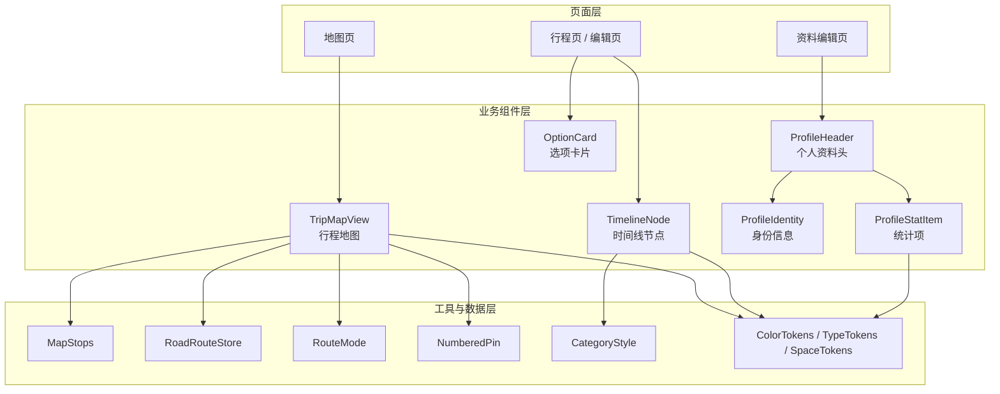
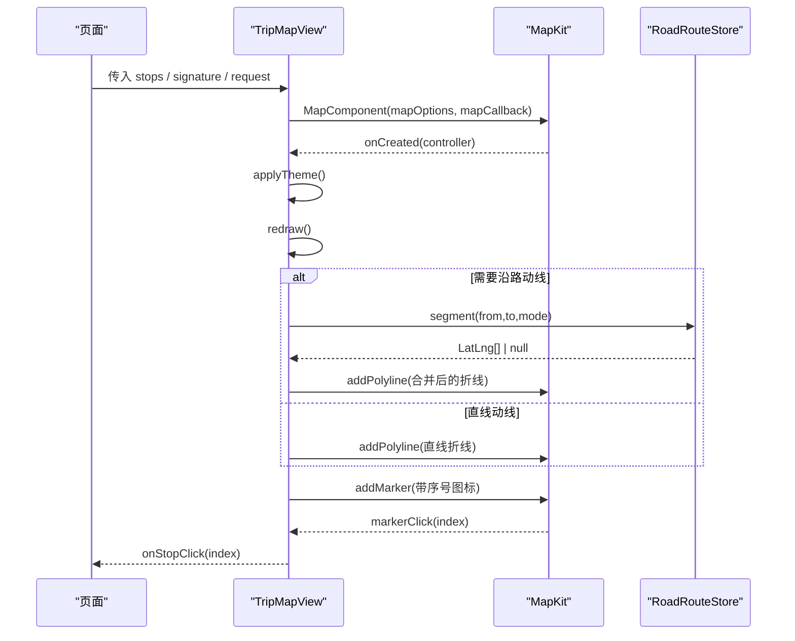
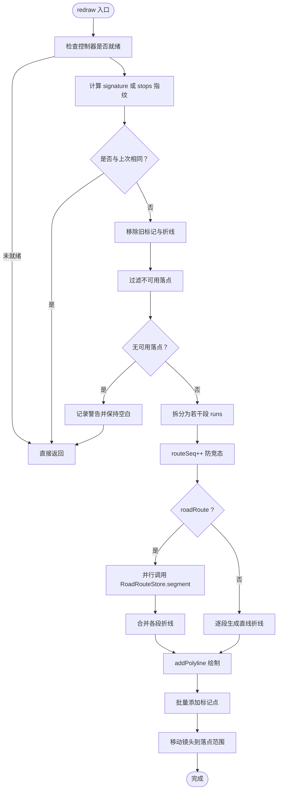
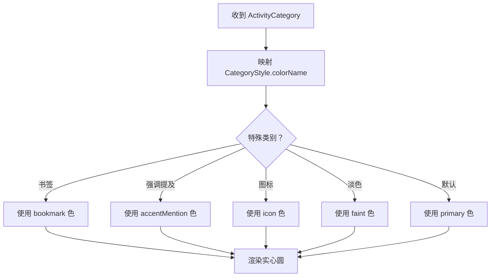
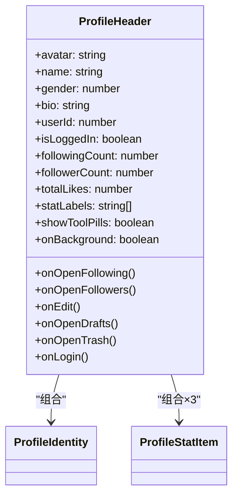
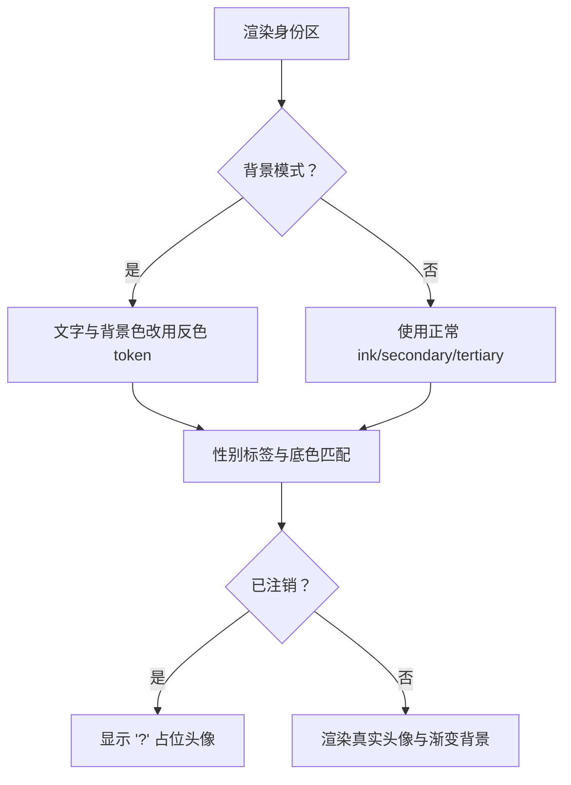
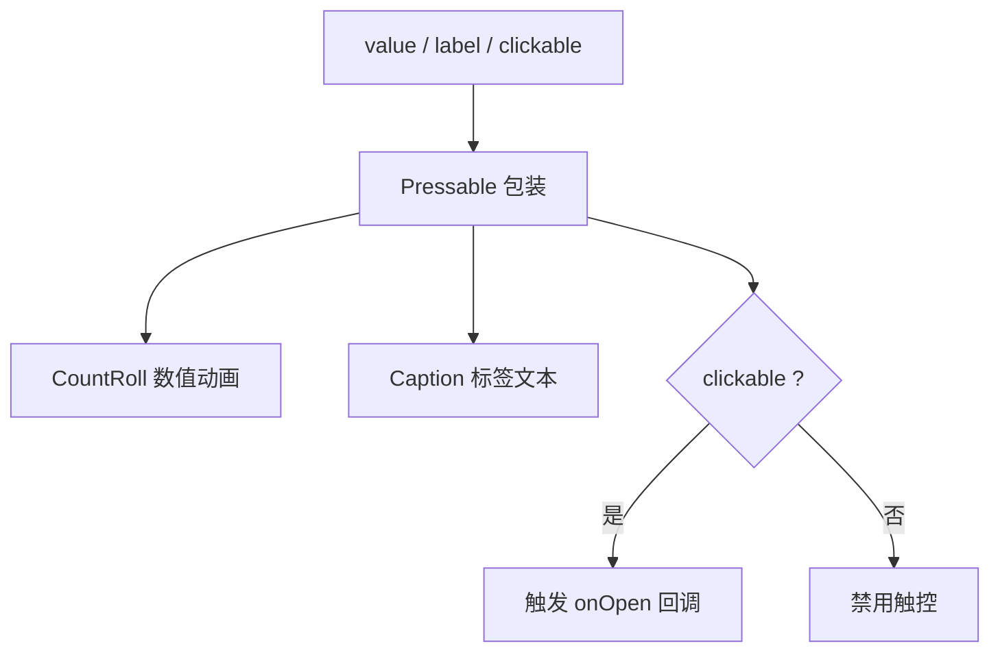
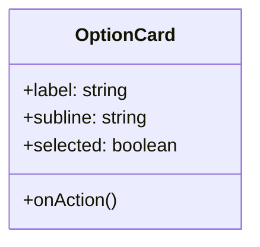
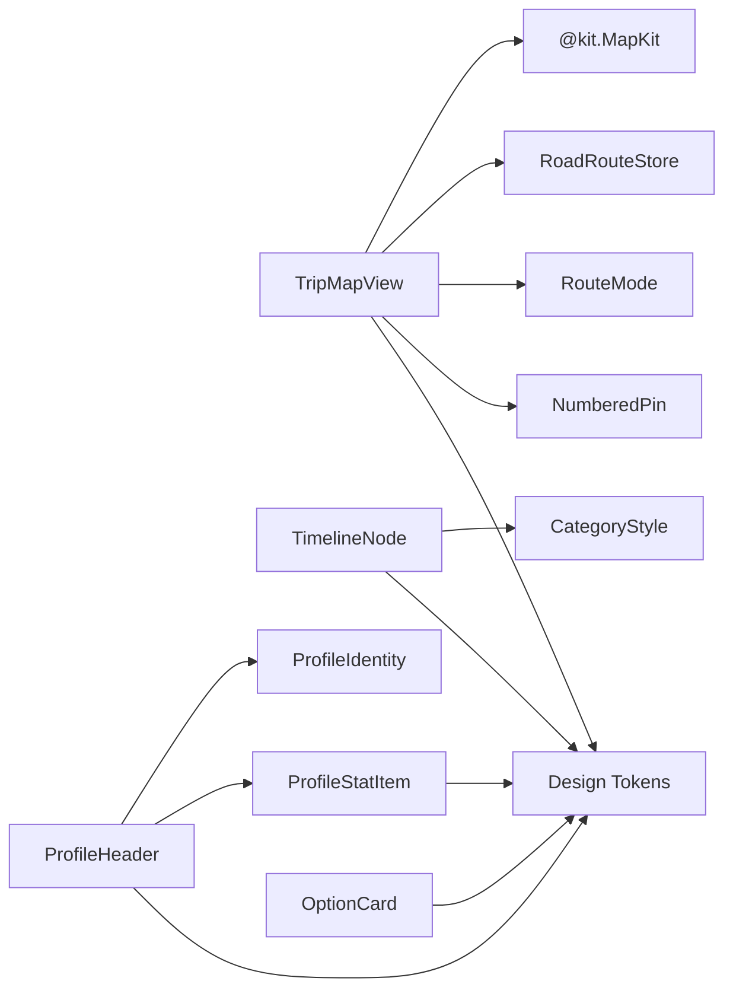

# 业务组件

<cite>
**本文引用的文件**   
- [TripMapView.ets](file://entry/src/main/ets/components/TripMapView.ets)
- [TimelineNode.ets](file://entry/src/main/ets/components/TimelineNode.ets)
- [ProfileHeader.ets](file://entry/src/main/ets/components/ProfileHeader.ets)
- [ProfileIdentity.ets](file://entry/src/main/ets/components/ProfileIdentity.ets)
- [ProfileStatItem.ets](file://entry/src/main/ets/components/ProfileStatItem.ets)
- [OptionCard.ets](file://entry/src/main/ets/components/OptionCard.ets)
</cite>

## 目录
1. [引言](#引言)
2. [项目结构](#项目结构)
3. [核心组件](#核心组件)
4. [架构总览](#架构总览)
5. [详细组件分析](#详细组件分析)
6. [依赖关系分析](#依赖关系分析)
7. [性能与稳定性](#性能与稳定性)
8. [故障排查](#故障排查)
9. [结论](#结论)
10. [附录：使用与组合最佳实践](#附录使用与组合最佳实践)

## 引言
本文聚焦一组面向具体业务场景的复合组件，覆盖行程地图、时间线节点、个人资料展示与编辑入口、统计项以及选项卡片。文档从系统架构、组件职责、数据流、交互流程到错误处理进行分层说明，帮助读者在不深入源码的前提下理解这些组件如何协同工作，并给出可落地的组合模式与最佳实践。

## 项目结构
这些业务组件均位于 `entry/src/main/ets/components` 目录下，彼此之间通过属性、回调和工具模块耦合：

**图表来源**
- [TripMapView.ets:1-200](file://entry/src/main/ets/components/TripMapView.ets#L1-L200)
- [TripMapView.ets:201-385](file://entry/src/main/ets/components/TripMapView.ets#L201-L385)
- [TimelineNode.ets:1-53](file://entry/src/main/ets/components/TimelineNode.ets#L1-L53)
- [ProfileHeader.ets:1-106](file://entry/src/main/ets/components/ProfileHeader.ets#L1-L106)
- [ProfileIdentity.ets:1-116](file://entry/src/main/ets/components/ProfileIdentity.ets#L1-L116)
- [ProfileStatItem.ets:1-43](file://entry/src/main/ets/components/ProfileStatItem.ets#L1-L43)
- [OptionCard.ets:1-74](file://entry/src/main/ets/components/OptionCard.ets#L1-L74)

**章节来源**
- [TripMapView.ets:1-200](file://entry/src/main/ets/components/TripMapView.ets#L1-L200)
- [TimelineNode.ets:1-53](file://entry/src/main/ets/components/TimelineNode.ets#L1-L53)
- [ProfileHeader.ets:1-106](file://entry/src/main/ets/components/ProfileHeader.ets#L1-L106)
- [ProfileIdentity.ets:1-116](file://entry/src/main/ets/components/ProfileIdentity.ets#L1-L116)
- [ProfileStatItem.ets:1-43](file://entry/src/main/ets/components/ProfileStatItem.ets#L1-L43)
- [OptionCard.ets:1-74](file://entry/src/main/ets/components/OptionCard.ets#L1-L74)

## 核心组件
- **TripMapView 行程地图**：封装华为 Map Kit 底图、标记点、路线绘制、镜头控制与主题切换，向上暴露点击落点回调与相机指令。
- **TimelineNode 时间线节点**：按活动分类渲染圆环颜色，供行程详情与编辑态共用。
- **ProfileHeader 个人资料头**：组合身份信息、统计三列、编辑入口及草稿箱/废纸篓胶囊。
- **ProfileIdentity 身份信息**：头像、昵称、性别标签、简介与用户 ID，支持背景模式与已注销占位。
- **ProfileStatItem 统计项**：数值滚动显示与可选的可点击行为。
- **OptionCard 选项卡片**：选中实心底+对勾的追问选项，承载标题、副标题与点击事件。

**章节来源**
- [TripMapView.ets:1-200](file://entry/src/main/ets/components/TripMapView.ets#L1-L200)
- [TimelineNode.ets:1-53](file://entry/src/main/ets/components/TimelineNode.ets#L1-L53)
- [ProfileHeader.ets:1-106](file://entry/src/main/ets/components/ProfileHeader.ets#L1-L106)
- [ProfileIdentity.ets:1-116](file://entry/src/main/ets/components/ProfileIdentity.ets#L1-L116)
- [ProfileStatItem.ets:1-43](file://entry/src/main/ets/components/ProfileStatItem.ets#L1-L43)
- [OptionCard.ets:1-74](file://entry/src/main/ets/components/OptionCard.ets#L1-L74)

## 架构总览
这些组件遵循“页面持有状态 → 组件以属性接收 → 通过回调上报动作”的单向数据流；地图类组件额外维护本地控制器与覆盖物集合，并通过指纹与序列号避免竞态。

**图表来源**
- [TripMapView.ets:1-200](file://entry/src/main/ets/components/TripMapView.ets#L1-L200)
- [TripMapView.ets:201-385](file://entry/src/main/ets/components/TripMapView.ets#L201-L385)

## 详细组件分析

### TripMapView 行程地图组件
#### 职责与能力
- 集成华为 Map Kit 的 `MapComponent`，提供初始化、生命周期清理、夜间模式切换。
- 管理标记点与多段路线：支持直线连接与基于道路网络的折线拼接。
- 响应父组件指令：全览收敛或聚焦指定落点。
- 暴露落点点击回调，供上层同步列表高亮。

#### 关键设计
- **建图前置条件**：`mapOptions` 必须包含合法中心点；组件在 `aboutToAppear` 中用首个可用落点初始化初始镜头。
- **坐标口径**：中国大陆地图采用 GCJ02，WGS84 会整体偏移，需由种子层转换后入库。
- **鉴权兜底**：底层鉴权失败仅表现为空白底图，不抛错；组件内部将错误码写入日志并提示用户。
- **镜头留白**：为图钉锚点和面板浮层预留像素级边距，避免首站被裁切。
- **防竞态**：每次重绘递增 `routeSeq`，异步算路结果若序列不一致则丢弃。

#### 核心流程图（重绘）

**图表来源**
- [TripMapView.ets:201-385](file://entry/src/main/ets/components/TripMapView.ets#L201-L385)

#### API 与属性要点
- 输入属性：落点数组、签名指纹、相机请求字符串、是否连线、是否走道路网络、顶部/底部留白像素等。
- 回调：`onStopClick` 返回落点索引，供页面同步 UI。
- 相机指令：`fit` 全览；`focus:<index>:<seq>` 聚焦某落点。
- 主题：监听深色模式变化，切换 Map Kit 昼夜模式。

#### 错误处理
- 地图初始化失败：设置用户可见提示，同时记录错误码。
- 异步回调时控制器为空：忽略结果并记录警告，避免进程崩溃。
- 落点或折线绘制失败：记录错误码与消息，不影响其他覆盖物。

**章节来源**
- [TripMapView.ets:1-200](file://entry/src/main/ets/components/TripMapView.ets#L1-L200)
- [TripMapView.ets:201-385](file://entry/src/main/ets/components/TripMapView.ets#L201-L385)

### TimelineNode 时间线节点
#### 职责与能力
- 根据活动分类映射到设计 token 的颜色，渲染一个圆环节点。
- 兼容书签、强调提及、图标、淡色等特殊语义类别。

#### 设计要点
- 外层描边圆 + 内填充圆，尺寸由布局 token 统一约束。
- 颜色决策逻辑集中在组件层，避免工具模块反向依赖设计 token。

**图表来源**
- [TimelineNode.ets:1-53](file://entry/src/main/ets/components/TimelineNode.ets#L1-L53)

**章节来源**
- [TimelineNode.ets:1-53](file://entry/src/main/ets/components/TimelineNode.ets#L1-L53)

### ProfileHeader 个人资料头
#### 职责与能力
- 组合 `ProfileIdentity` 与三个 `ProfileStatItem`，呈现头像、昵称、性别、简介与关注/粉丝/获赞数据。
- 提供“编辑资料/去登录”主按钮，以及可选的草稿箱/废纸篓双胶囊行。
- 所有按钮统一走玻璃胶囊模板，保证视觉一致性。

#### 布局与响应式
- 统计三列独占一行，解决窄屏放不下“编辑资料”胶囊的问题。
- 工具胶囊行仅在登录且允许展示时出现，左右均匀分配权重。

**图表来源**
- [ProfileHeader.ets:1-106](file://entry/src/main/ets/components/ProfileHeader.ets#L1-L106)
- [ProfileIdentity.ets:1-116](file://entry/src/main/ets/components/ProfileIdentity.ets#L1-L116)
- [ProfileStatItem.ets:1-43](file://entry/src/main/ets/components/ProfileStatItem.ets#L1-L43)

**章节来源**
- [ProfileHeader.ets:1-106](file://entry/src/main/ets/components/ProfileHeader.ets#L1-L106)

### ProfileIdentity 身份信息
#### 职责与能力
- 展示头像、昵称、性别标签、个人简介与用户 ID。
- 支持背景模式下的对比度调整，以及已注销用户的占位态。

#### 性别与对比度
- 性别标签颜色与底色成对：男为淡蓝系，女为对应女系，保密为中性。
- 已注销占位使用中性底色与次级字色，满足可读性要求。

**图表来源**
- [ProfileIdentity.ets:1-116](file://entry/src/main/ets/components/ProfileIdentity.ets#L1-L116)

**章节来源**
- [ProfileIdentity.ets:1-116](file://entry/src/main/ets/components/ProfileIdentity.ets#L1-L116)

### ProfileStatItem 统计项
#### 职责与能力
- 展示数值与标签，数值区域使用滚动数字控件。
- 可选可点击态，由页面决定是否打开关注/粉丝列表。

**图表来源**
- [ProfileStatItem.ets:1-43](file://entry/src/main/ets/components/ProfileStatItem.ets#L1-L43)

**章节来源**
- [ProfileStatItem.ets:1-43](file://entry/src/main/ets/components/ProfileStatItem.ets#L1-L43)

### OptionCard 选项卡片
#### 职责与能力
- 作为追问选项卡，展示标题、副标题与选中状态。
- 选中态使用品牌实心底与品牌上字色，右上角显示对勾。

**图表来源**
- [OptionCard.ets:1-74](file://entry/src/main/ets/components/OptionCard.ets#L1-L74)

**章节来源**
- [OptionCard.ets:1-74](file://entry/src/main/ets/components/OptionCard.ets#L1-L74)

## 依赖关系分析
- **TripMapView** 依赖地图 SDK、道路路径存储、路线模式工具、编号图钉与 Token 体系。
- **TimelineNode** 依赖活动分类样式与设计 token。
- **ProfileHeader** 聚合身份与统计子组件，并复用玻璃胶囊按钮模板。
- **ProfileIdentity** 依赖头像组件与 token 体系，负责展示逻辑。
- **ProfileStatItem** 依赖计数动画与可点击容器。
- **OptionCard** 依赖 token 与系统符号，表达选中态。

**图表来源**
- [TripMapView.ets:1-200](file://entry/src/main/ets/components/TripMapView.ets#L1-L200)
- [TimelineNode.ets:1-53](file://entry/src/main/ets/components/TimelineNode.ets#L1-L53)
- [ProfileHeader.ets:1-106](file://entry/src/main/ets/components/ProfileHeader.ets#L1-L106)
- [ProfileIdentity.ets:1-116](file://entry/src/main/ets/components/ProfileIdentity.ets#L1-L116)
- [ProfileStatItem.ets:1-43](file://entry/src/main/ets/components/ProfileStatItem.ets#L1-L43)
- [OptionCard.ets:1-74](file://entry/src/main/ets/components/OptionCard.ets#L1-L74)

**章节来源**
- [TripMapView.ets:1-200](file://entry/src/main/ets/components/TripMapView.ets#L1-L200)
- [TimelineNode.ets:1-53](file://entry/src/main/ets/components/TimelineNode.ets#L1-L53)
- [ProfileHeader.ets:1-106](file://entry/src/main/ets/components/ProfileHeader.ets#L1-L106)
- [ProfileIdentity.ets:1-116](file://entry/src/main/ets/components/ProfileIdentity.ets#L1-L116)
- [ProfileStatItem.ets:1-43](file://entry/src/main/ets/components/ProfileStatItem.ets#L1-L43)
- [OptionCard.ets:1-74](file://entry/src/main/ets/components/OptionCard.ets#L1-L74)

## 性能与稳定性
- **地图重绘节流**：通过 `signature` 与内部 `drawn` 键避免重复绘制；`routeSeq` 防止异步算路覆盖最新结果。
- **覆盖物清理**：组件销毁前卸载事件监听、移除标记与折线，避免原生侧对象失效引发崩溃。
- **镜头收敛策略**：多点时使用边界留白收敛，单点使用固定缩放，减少频繁大幅缩放。
- **资源与尺寸**：折线宽度按设备密度换算为像素值，保证契约一致的视觉粗细。
- **可访问性与对比度**：性别标签、已注销占位与品牌实心底文本均考虑浅色/深色对比度。

[本节为通用指导，不直接分析具体文件]

## 故障排查
- **地图空白但无报错**：检查 Map Kit 鉴权与坐标口径；查看组件内部日志中的错误码，不要向用户直接抛出原始错误。
- **首站图钉被裁切**：确认父组件传入了合适的 `fitTopPx`/`fitBottomPx`，避免小面板下镜头退得太远。
- **落点点击无效**：确认 `marker.getTag()` 能解析为正整数索引，且在组件拆除期不会重复回调。
- **路线断续或错位**：检查 `roadRoute` 分支是否正确开启，以及 `RouteTravelMode` 是否按落点顺序正确传入。
- **资料区布局异常**：确认窄屏下统计三列独立行；胶囊行仅在登录与允许展示时出现。

**章节来源**
- [TripMapView.ets:1-200](file://entry/src/main/ets/components/TripMapView.ets#L1-L200)
- [TripMapView.ets:201-385](file://entry/src/main/ets/components/TripMapView.ets#L201-L385)
- [ProfileHeader.ets:1-106](file://entry/src/main/ets/components/ProfileHeader.ets#L1-L106)

## 结论
这组业务组件以清晰的单向数据流组织页面状态：页面负责领域状态与导航，组件专注展示、交互与轻量逻辑。TripMapView 在地图 SDK 之上提供了健壮的覆盖物管理与防竞态机制；个人资料相关组件通过 token 与子组件组合，兼顾可复用性与视觉一致性；时间线节点与选项卡片则把高频展示与交互收敛到最小单元，便于跨页面复用。

[本节为总结，不直接分析具体文件]

## 附录：使用与组合最佳实践
- **TripMapView 使用要点**
  - 在获取到首个有效坐标后再挂载组件，确保 `mapOptions` 有合法中心点。
  - 使用 `signature` 作为重绘准绳，`stops` 仅作单向拷贝。
  - 通过 `request` 传递 `fit` 或 `focus:<index>:<seq>` 控制镜头。
  - 在 `onStopClick` 中同步列表高亮，保持地图与时间线一致。
  - 对于小面板，务必传入足够的顶部/底部留白像素。

- **TimelineNode 使用要点**
  - 只传入活动分类，颜色映射由组件决定，避免页面重复维护色表。
  - 如需扩展新类别，优先扩展分类样式映射，再更新组件分支。

- **ProfileHeader 使用要点**
  - 由页面决定跳转与数据加载；组件只暴露回调。
  - 根据 UGC 域开关草稿箱/废纸篓胶囊；非 UGC 场景传 `false`。
  - 统计三列标签可按旅行域替换为“行程/勋章/足迹”。

- **ProfileIdentity 使用要点**
  - 区分本人主页与他人主页的权限展示，组件本身不包含权限逻辑。
  - 背景模式用于资料区叠加在深色背景上的场景，注意对比度。

- **ProfileStatItem 使用要点**
  - 仅负责数值与标签；是否可点击由 `clickable` 控制。
  - 数值过大时使用 CountRoll 提升可读性。

- **OptionCard 使用要点**
  - 选中态使用品牌实心底与品牌上字色，保证对比度达标。
  - 通过 `onAction` 通知页面更新选中状态，避免在组件内部持有外部状态。

[本节为通用指导，不直接分析具体文件]