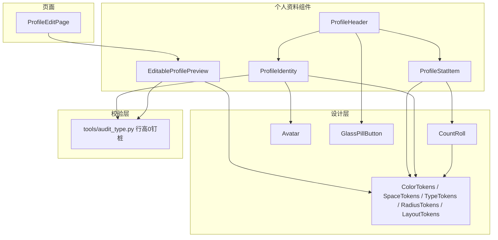
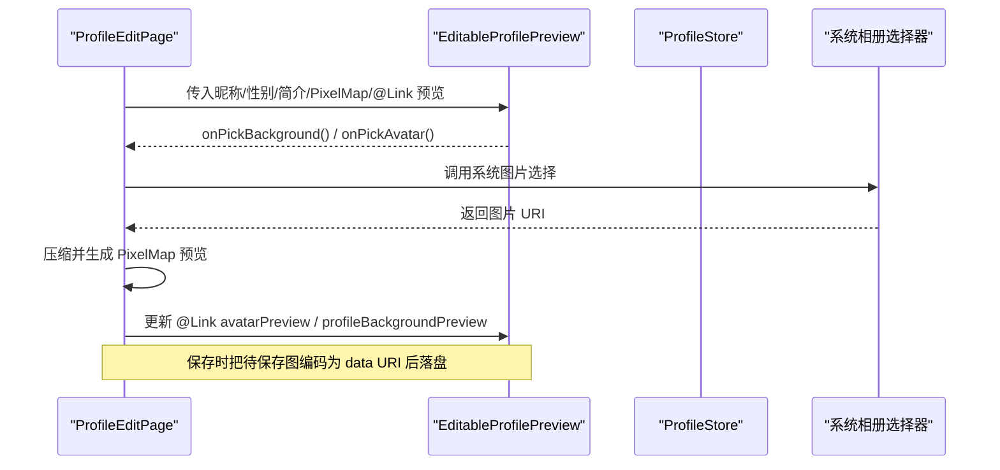
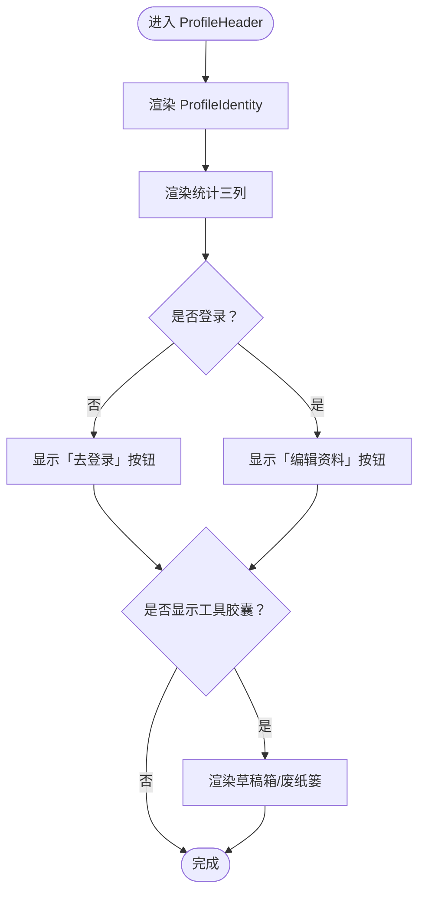
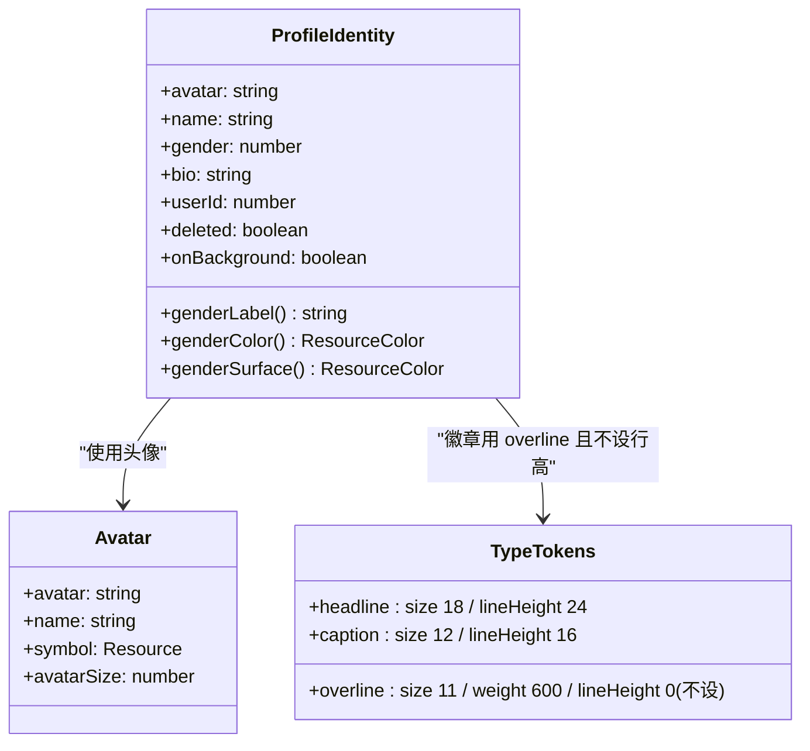
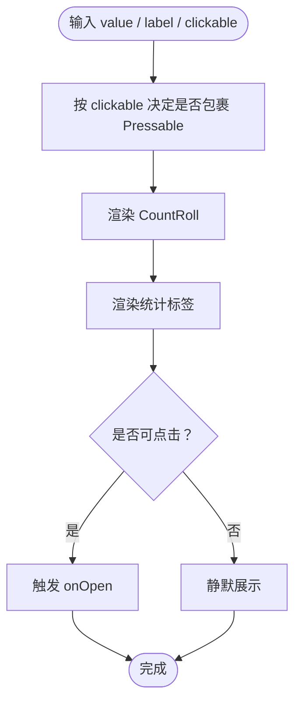
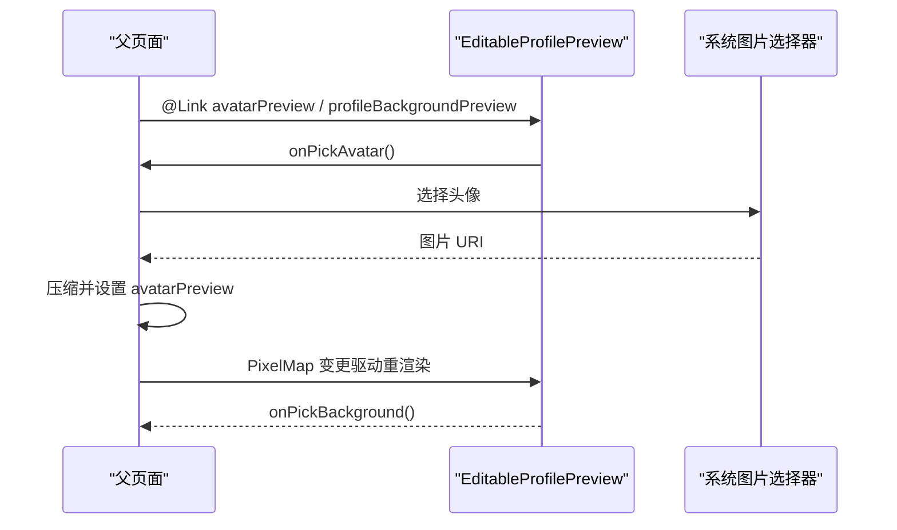
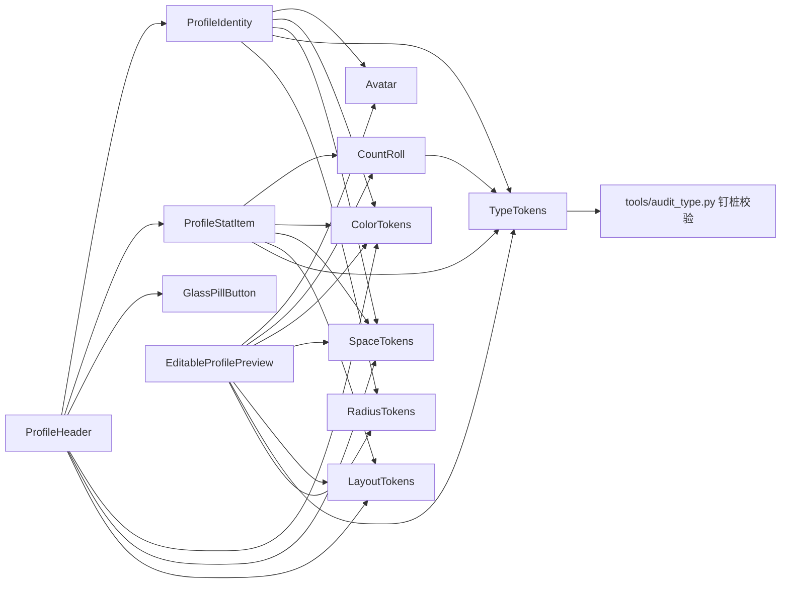

# 个人资料组件集

<cite>
**本文引用的文件**   
- [ProfileHeader.ets](file://entry/src/main/ets/components/ProfileHeader.ets)
- [ProfileIdentity.ets](file://entry/src/main/ets/components/ProfileIdentity.ets)
- [ProfileStatItem.ets](file://entry/src/main/ets/components/ProfileStatItem.ets)
- [EditableProfilePreview.ets](file://entry/src/main/ets/components/EditableProfilePreview.ets)
- [CountRoll.ets](file://entry/src/main/ets/design/CountRoll.ets)
- [Avatar.ets](file://entry/src/main/ets/components/Avatar.ets)
- [GlassPillButton.ets](file://entry/src/main/ets/design/GlassPillButton.ets)
- [ColorTokens.ets](file://entry/src/main/ets/design/ColorTokens.ets)
- [SpaceTokens.ets](file://entry/src/main/ets/design/SpaceTokens.ets)
- [LayoutTokens.ets](file://entry/src/main/ets/design/LayoutTokens.ets)
- [TypeTokens.ets](file://entry/src/main/ets/design/TypeTokens.ets)
- [RadiusTokens.ets](file://entry/src/main/ets/design/RadiusTokens.ets)
- [ProfileEditPage.ets](file://entry/src/main/ets/pages/ProfileEditPage.ets)
- [audit_type.py](file://tools/audit_type.py)
</cite>

## 更新概要
**本次变更内容**   
- 「详细组件分析 → ProfileIdentity」补充性别徽章（`overline` 档）**不再显式设置 lineHeight** 的排版口径，并说明原因：`TypeTokens.overline.lineHeight` 的值是 `0`，含义为「这一档不设行高、走系统默认」，把它当行高喂进 `.lineHeight(0)` 会把行盒压到字高以下，导致徽章行高塌陷。  
- 「故障排查指南」新增「性别徽章/标签行高塌陷（文字被压扁、上下裁切）」条目，给出定位方法与正确写法。  
- 「组合使用示例与最佳实践 → 设计一致性最佳实践」新增「行高 Token 语义」规范，明确 `overline` / `time` 两档不可直接透传 `lineHeight`，需要行高时按有据同位值（`overline` = 14）显式写。  
- 「性能与渲染特性 → 布局稳定性」补充徽章行高依赖系统默认所带来的稳定性说明。  
- 目录结构与既有章节层级保持不变，仅做定点修订。

## 目录
1. [简介](#简介)
2. [项目结构](#项目结构)
3. [核心组件](#核心组件)
4. [架构总览](#架构总览)
5. [详细组件分析](#详细组件分析)
6. [依赖关系分析](#依赖关系分析)
7. [性能与渲染特性](#性能与渲染特性)
8. [故障排查指南](#故障排查指南)
9. [组合使用示例与最佳实践](#组合使用示例与最佳实践)
10. [结论](#结论)

## 简介
本文聚焦个人资料展示与编辑链路中的四个核心组件：`ProfileHeader`、`ProfileIdentity`、`ProfileStatItem` 和 `EditableProfilePreview`。它们共同承担“资料头信息呈现”“身份信息渲染”“统计项交互”“编辑预览与媒体选择”职责，并通过 ArkUI 的 `@Prop`、`@Link` 与回调函数实现清晰的数据流。文档同时说明性别徽章配色、玻璃胶囊按钮模板复用、间距 Token 等设计一致性规范，并特别记录 `overline` 字阶「行高值为 0 = 不设行高」这一契约语义在徽章上的落地方式，最后给出在编辑页中组合使用的完整参考路径。

## 项目结构
个人资料相关代码集中在 `entry/src/main/ets/components`（业务组件）与 `entry/src/main/ets/design`（设计 Token 与通用组件），并由 `entry/src/main/ets/pages/ProfileEditPage.ets` 作为编辑场景的编排页面。字阶契约由 `TypeTokens.ets` 定义，并由 `tools/audit_type.py` 做静态钉桩校验。

**图表来源**
- [ProfileHeader.ets:1-106](file://entry/src/main/ets/components/ProfileHeader.ets#L1-L106)
- [ProfileIdentity.ets:1-115](file://entry/src/main/ets/components/ProfileIdentity.ets#L1-L115)
- [ProfileStatItem.ets:1-43](file://entry/src/main/ets/components/ProfileStatItem.ets#L1-L43)
- [EditableProfilePreview.ets:1-207](file://entry/src/main/ets/components/EditableProfilePreview.ets#L1-L207)
- [CountRoll.ets:1-58](file://entry/src/main/ets/design/CountRoll.ets#L1-L58)
- [Avatar.ets:1-95](file://entry/src/main/ets/components/Avatar.ets#L1-L95)
- [GlassPillButton.ets:1-105](file://entry/src/main/ets/design/GlassPillButton.ets#L1-L105)
- [TypeTokens.ets:74-92](file://entry/src/main/ets/design/TypeTokens.ets#L74-L92)
- [audit_type.py:19-24](file://tools/audit_type.py#L19-L24)

**章节来源**
- [ProfileHeader.ets:1-106](file://entry/src/main/ets/components/ProfileHeader.ets#L1-L106)
- [ProfileIdentity.ets:1-115](file://entry/src/main/ets/components/ProfileIdentity.ets#L1-L115)
- [ProfileStatItem.ets:1-43](file://entry/src/main/ets/components/ProfileStatItem.ets#L1-L43)
- [EditableProfilePreview.ets:1-207](file://entry/src/main/ets/components/EditableProfilePreview.ets#L1-L207)
- [ProfileEditPage.ets:1-70](file://entry/src/main/ets/pages/ProfileEditPage.ets#L1-L70)

## 核心组件
- **ProfileHeader（个人资料头）**  
  负责组装身份区块、统计三列、编辑入口与工具胶囊；对外暴露关注、粉丝、编辑、草稿箱、废纸篓、登录等回调。
- **ProfileIdentity（身份信息）**  
  负责头像容器、昵称、性别徽章、Bio、用户 ID 与已注销占位，并适配背景模式下的文本色。性别徽章走 `overline` 字阶，且**不显式设置行高**。
- **ProfileStatItem（统计项）**  
  封装数字滚动、标签与触控反馈，支持可点击状态与背景模式文本色适配。
- **EditableProfilePreview（编辑预览）**  
  提供 PixelMap 图片预览、背景图上传状态、统计列 Builder 参数传递、媒体选择交互入口；其性别徽章与 `ProfileIdentity` 同款排版（同样不显式设置行高）。

**章节来源**
- [ProfileHeader.ets:1-106](file://entry/src/main/ets/components/ProfileHeader.ets#L1-L106)
- [ProfileIdentity.ets:1-115](file://entry/src/main/ets/components/ProfileIdentity.ets#L1-L115)
- [ProfileStatItem.ets:1-43](file://entry/src/main/ets/components/ProfileStatItem.ets#L1-L43)
- [EditableProfilePreview.ets:1-207](file://entry/src/main/ets/components/EditableProfilePreview.ets#L1-L207)

## 架构总览
个人资料展示与编辑两条主线如下：

- **只读展示线**：页面 → `ProfileHeader` → `ProfileIdentity` + `ProfileStatItem` → `CountRoll` / `Avatar`。
- **编辑预览线**：`ProfileEditPage` → `EditableProfilePreview` → 头像/背景 PixelMap 预览 + 统计列 Builder + 媒体选择回调。

**图表来源**
- [ProfileEditPage.ets:1-70](file://entry/src/main/ets/pages/ProfileEditPage.ets#L1-L70)
- [EditableProfilePreview.ets:1-207](file://entry/src/main/ets/components/EditableProfilePreview.ets#L1-L207)

## 详细组件分析

### ProfileHeader：个人资料头
- **职责边界**  
  仅负责呈现与操作意图；跳转、分享和数据加载由宿主页面决定。
- **关键属性**  
  - 基础信息：头像、昵称、性别、Bio、用户 ID、登录态。
  - 统计信息：关注数、粉丝数、获赞数，以及可自定义的统计标签数组 `statLabels`。
  - 工具区：`showToolPills` 控制是否显示草稿箱/废纸篓胶囊。
  - 背景模式：`onBackground` 用于控制身份区与统计区的深浅色文本适配。
- **布局结构**  
  1. 身份区块：委托 `ProfileIdentity`。  
  2. 统计三列：使用 `Row` + `ProfileStatItem`，宽度 100%，左右内边距一致。  
  3. 编辑入口：右侧对齐的 `GlassPillButton`，根据登录态切换文案与动作。  
  4. 工具胶囊：仅在登录且允许显示时渲染草稿箱与废纸篓两列。
- **交互与事件**  
  - 关注/粉丝列支持点击，通过 `onOpenFollowing` / `onOpenFollowers` 上抛。  
  - 未登录时编辑按钮走登录回调，登录后走编辑回调。  
  - 工具胶囊分别回调 `onOpenDrafts` / `onOpenTrash`。
- **设计一致性**  
  - 所有胶囊统一使用 `GlassPillButton`，内容区默认不启用系统材质，避免退化成透明壳。  
  - 行间距、列间距、按钮高度均引用 `SpaceTokens` / `LayoutTokens`。

**图表来源**
- [ProfileHeader.ets:34-105](file://entry/src/main/ets/components/ProfileHeader.ets#L34-L105)
- [GlassPillButton.ets:1-40](file://entry/src/main/ets/design/GlassPillButton.ets#L1-L40)

**章节来源**
- [ProfileHeader.ets:1-106](file://entry/src/main/ets/components/ProfileHeader.ets#L1-L106)

### ProfileIdentity：身份信息
- **头像容器**  
  非注销状态下渲染径向渐变背景与 `Avatar`；注销状态下以带圆角的问号占位，强调该位置不是真实头像。占位面使用 `sunken` 底 + `secondary` 字以保证对比度达标。
- **性别徽章配色**  
  - 男：淡蓝底 + 蓝字（`genderMaleSurface` / `genderMaleText`）。  
  - 女：粉色系底 + 粉色系字（`genderFemaleSurface` / `genderFemaleText`）。  
  - 保密：中性面 `sunken` + 次要文字色 `secondary`。  
  该配色逻辑与 `EditableProfilePreview` 同步，修改需两处一起改。
- **性别徽章排版（重要变更）**  
  徽章文本使用 `overline` 字阶，只引用 `size`、`weight`、`tracking` 三项，**不再显式设置 `lineHeight`**。原因是 `TypeTokens.overline.lineHeight` 的取值为 `0`，该 `0` 的契约含义是「这一档不设行高、走系统默认」，而不是一个可用行高值；一旦把它当行高透传进 `.lineHeight(0)`，行盒会被压到字高以下，表现为徽章文字被压扁/上下裁切（行高塌陷）。若确有行高需求，应按有据同位值（`overline` 为 11/600/**14**）显式写死数值，而不是引用 Token 的 `lineHeight` 字段。这条约束由 `tools/audit_type.py` 以正则钉桩强制拦截，任何 `.lineHeight(TypeTokens.overline.lineHeight)` 或 `.lineHeight(0)` 写法都会被判定为必须修。
- **已注销状态**  
  当 `deleted=true` 时，昵称替换为固定文案「已注销用户」，性别徽章隐藏，ID 仍正常显示。
- **背景模式适配**  
  当 `onBackground=true` 时，头像尺寸、昵称主文字色、Bio 颜色、用户 ID 颜色都切换到浅色主题值，确保卡片叠加于背景图上可读。
- **布局细节**  
  左侧头像区域与右侧信息列通过 `Row` 排列；右侧列右对齐，Bio 最多两行省略，用户 ID 使用等宽数字特征（`tabularFeature`）。昵称/Bio/ID 三处均有各自的 `lineHeight` 引用（`headline` / `caption` 两档定义了有效行高），只有性别徽章一处刻意不设行高。

**图表来源**
- [ProfileIdentity.ets:18-95](file://entry/src/main/ets/components/ProfileIdentity.ets#L18-L95)
- [Avatar.ets:1-95](file://entry/src/main/ets/components/Avatar.ets#L1-L95)
- [TypeTokens.ets:74-92](file://entry/src/main/ets/design/TypeTokens.ets#L74-L92)

**章节来源**
- [ProfileIdentity.ets:1-115](file://entry/src/main/ets/components/ProfileIdentity.ets#L1-L115)
- [Avatar.ets:1-95](file://entry/src/main/ets/components/Avatar.ets#L1-L95)
- [ColorTokens.ets:76-138](file://entry/src/main/ets/design/ColorTokens.ets#L76-L138)
- [TypeTokens.ets:74-92](file://entry/src/main/ets/design/TypeTokens.ets#L74-L92)
- [audit_type.py:19-24](file://tools/audit_type.py#L19-L24)

### ProfileStatItem：统计项
- **数字滚动**  
  内部使用 `CountRoll`，数字变化时触发淡入淡出与轻微位移动画，配合等宽数字特征保证滚动时宽度稳定。
- **可点击交互**  
  当 `clickable=true` 时由 `Pressable` 包裹并交给上层 `onOpen` 回调处理；不可点击时仍可展示统计值。
- **背景模式适配**  
  数字主色随 `onBackground` 切换为白色或深色 ink；标签文字使用次要色或半透明白色。
- **尺寸约束**  
  统计列宽度来自 `LayoutTokens.profileStatWidth`，视觉高度取自 `LayoutTokens.segmentedHeight`，触控目标不低于 `LayoutTokens.minTouchTarget`，并通过 `SpaceTokens.xs` 保持列间间距。
- **排版口径对照**  
  统计标签走 `caption` 档并显式引用 `lineHeight`（该档行高为有效值 16），与性别徽章的 `overline` 档形成对照：**有有效行高的档位可以直接透传，值为 0 的档位不可以**。

**图表来源**
- [ProfileStatItem.ets:17-42](file://entry/src/main/ets/components/ProfileStatItem.ets#L17-L42)
- [CountRoll.ets:1-58](file://entry/src/main/ets/design/CountRoll.ets#L1-L58)

**章节来源**
- [ProfileStatItem.ets:1-43](file://entry/src/main/ets/components/ProfileStatItem.ets#L1-L43)
- [CountRoll.ets:1-58](file://entry/src/main/ets/design/CountRoll.ets#L1-L58)
- [LayoutTokens.ets:147-218](file://entry/src/main/ets/design/LayoutTokens.ets#L147-L218)

### EditableProfilePreview：编辑预览
- **PixelMap 图片预览**  
  - 头像预览使用 `@Link` 共享父组件的 `image.PixelMap | null`，避免单向 `@Prop` 对复杂对象仅比较引用导致不重渲染的问题。  
  - 背景预览同样使用 `@Link`，优先显示 PixelMap 预览，否则回退到字符串 URL，最后兜底为纯色底。
- **背景图上传状态**  
  - 通过 `backgroundStatus` 显示“待保存”或“保存失败”等状态胶囊。  
  - 通过 `uploadingBackground` 显示居中 Loading 提示，并使用玻璃模糊样式与主题感知的背景透明度。
- **统计列 Builder 参数传递**  
  - 内部定义 `PreviewStatSpec` 接口，使用 ArkUI 的 `@Builder` 加 `$$` 引用传参，确保异步回填计数后能驱动重新执行。  
  - 三个统计列分别绑定关注/粉丝/获赞值与可配置的 `statLabels`。
- **媒体选择交互**  
  - 提供“修改背景”“修改头像”两个可点击操作，通过 `onPickBackground` / `onPickAvatar` 回调给页面。  
  - 操作按钮使用统一触控目标、图标、边框与圆角 Token。
- **性别徽章配色与排版同步**  
  与 `ProfileIdentity` 保持一致：男=淡蓝底蓝字、女=粉色系、保密=中性色；排版同样只引用 `overline.size` 与 `overline.weight`，**不设置 `lineHeight`**，避免把「不设行高」的 0 变成「行高为 0」。

**图表来源**
- [EditableProfilePreview.ets:22-110](file://entry/src/main/ets/components/EditableProfilePreview.ets#L22-L110)
- [ProfileEditPage.ets:1-70](file://entry/src/main/ets/pages/ProfileEditPage.ets#L1-L70)

**章节来源**
- [EditableProfilePreview.ets:1-207](file://entry/src/main/ets/components/EditableProfilePreview.ets#L1-L207)

## 依赖关系分析

**图表来源**
- [ProfileHeader.ets:1-32](file://entry/src/main/ets/components/ProfileHeader.ets#L1-L32)
- [ProfileIdentity.ets:1-31](file://entry/src/main/ets/components/ProfileIdentity.ets#L1-L31)
- [ProfileStatItem.ets:1-16](file://entry/src/main/ets/components/ProfileStatItem.ets#L1-L16)
- [EditableProfilePreview.ets:1-45](file://entry/src/main/ets/components/EditableProfilePreview.ets#L1-L45)
- [CountRoll.ets:1-58](file://entry/src/main/ets/design/CountRoll.ets#L1-L58)
- [Avatar.ets:1-95](file://entry/src/main/ets/components/Avatar.ets#L1-L95)
- [GlassPillButton.ets:1-40](file://entry/src/main/ets/design/GlassPillButton.ets#L1-L40)
- [TypeTokens.ets:74-92](file://entry/src/main/ets/design/TypeTokens.ets#L74-L92)
- [audit_type.py:19-83](file://tools/audit_type.py#L19-L83)

**章节来源**
- [ProfileHeader.ets:1-106](file://entry/src/main/ets/components/ProfileHeader.ets#L1-L106)
- [ProfileIdentity.ets:1-115](file://entry/src/main/ets/components/ProfileIdentity.ets#L1-L115)
- [ProfileStatItem.ets:1-43](file://entry/src/main/ets/components/ProfileStatItem.ets#L1-L43)
- [EditableProfilePreview.ets:1-207](file://entry/src/main/ets/components/EditableProfilePreview.ets#L1-L207)

## 性能与渲染特性
- **数字滚动动画**  
  `CountRoll` 使用 UI 上下文动画将内容透明度与 Y 轴偏移组合成进出场效果；数值变化时使用定时器防抖，并在组件销毁时清理定时器，避免内存泄漏。
- **PixelMap 预览刷新**  
  编辑预览使用 `@Link` 而非 `@Prop` 传递 PixelMap，确保父子共享引用，避免复杂对象浅比较导致的预览卡住。
- **玻璃胶囊材质分支**  
  `GlassPillButton` 根据 `useSystemMaterial` 与系统能力判断，在内容区采用玻璃模糊兜底，在标题栏或浮层则让渡给系统材质，避免双圈描边与透明壳问题。
- **布局稳定性**  
  统计项使用固定宽度 Token，头像与性别徽章使用固定尺寸与内边距，减少动态测量抖动。性别徽章的高度由「上下 `inlineTight` 内边距 + 字号对应的系统默认行盒」共同决定；由于不再注入 0 行高，行盒不会被压到字高以下，徽章垂直尺寸回归稳定，跨设备表现一致。

**章节来源**
- [CountRoll.ets:1-58](file://entry/src/main/ets/design/CountRoll.ets#L1-L58)
- [EditableProfilePreview.ets:1-207](file://entry/src/main/ets/components/EditableProfilePreview.ets#L1-L207)
- [GlassPillButton.ets:1-40](file://entry/src/main/ets/design/GlassPillButton.ets#L1-L40)
- [ProfileIdentity.ets:79-89](file://entry/src/main/ets/components/ProfileIdentity.ets#L79-L89)

## 故障排查指南
- **性别徽章行高塌陷（文字被压扁、上下裁切、徽章高度异常偏矮）**  
  检查 `ProfileIdentity` 与 `EditableProfilePreview` 的徽章 `Text` 上是否存在 `.lineHeight(TypeTokens.overline.lineHeight)` 或 `.lineHeight(0)`。`overline`（以及 `time`）档的 `lineHeight` 值是 `0`，语义是「不设行高、走系统默认」；把它当行高透传等于把「没设」变成「设成 0」，行盒会被压到字高以下。正确做法是**不要在该徽章上设置行高**；若确需指定行高，按有据同位值显式写 `14`。可直接运行 `tools/audit_type.py`，其「行高 0 被显式喂进 .lineHeight()（必须修）」一类会列出全部违规点。
- **编辑预览选图后头像不刷新**  
  确认头像预览使用的是 `@Link avatarPreview` 而不是 `@Prop`；父页面更新 PixelMap 后子组件才会重渲染。
- **统计列始终显示首帧值**  
  编辑预览中的统计列必须使用 `@Builder` 加 `$$` 引用传参；若按值传参，异步数据回填不会驱动 Builder 重新执行。
- **性别徽章颜色不一致**  
  检查 `ProfileIdentity` 与 `EditableProfilePreview` 是否使用同一组 `ColorTokens.genderMale*` / `genderFemale*`；改色需两处同步。同理，两处的徽章排版口径（不设行高）也必须同步，否则同名徽章在两处会出现高度差。
- **玻璃胶囊按钮在内容区白屏或只剩描边**  
  内容区应设置 `useSystemMaterial=false`，让 `GlassPillButton` 使用玻璃模糊兜底；不要在内容区强押系统材质。
- **背景模式文字不可读**  
  检查 `ProfileIdentity` 与 `ProfileStatItem` 的 `onBackground` 是否正确传递；背景模式下昵称、Bio、统计数字都应切换到浅色主题色。
- **已注销用户头像异常**  
  确认 `deleted=true` 时渲染问号占位，而不是空头像；其背景与文字对比度已调整为可读级别。

**章节来源**
- [ProfileIdentity.ets:79-89](file://entry/src/main/ets/components/ProfileIdentity.ets#L79-L89)
- [EditableProfilePreview.ets:96-107](file://entry/src/main/ets/components/EditableProfilePreview.ets#L96-L107)
- [TypeTokens.ets:74-92](file://entry/src/main/ets/design/TypeTokens.ets#L74-L92)
- [audit_type.py:19-83](file://tools/audit_type.py#L19-L83)
- [EditableProfilePreview.ets:1-207](file://entry/src/main/ets/components/EditableProfilePreview.ets#L1-L207)
- [GlassPillButton.ets:1-40](file://entry/src/main/ets/design/GlassPillButton.ets#L1-L40)

## 组合使用示例与最佳实践

### 在“我的”页面展示资料头
- 从账户或资料存储读取头像、昵称、性别、Bio、用户 ID、关注/粉丝/获赞数。
- 向 `ProfileHeader` 传入基础属性与回调：编辑跳转、草稿箱、废纸篓、关注列表、粉丝列表。
- 如果资料区处于背景图上，设置 `onBackground=true`；无对应 UGC 页面时把 `showToolPills` 置 `false`。

**参考路径**
- [ProfileHeader.ets:11-32](file://entry/src/main/ets/components/ProfileHeader.ets#L11-L32)

### 在编辑资料页组合预览与表单
- 页面持有昵称、Bio、性别、头像 URL、背景 URL、PixelMap 预览与脏态标记。
- 顶部使用 `EditableProfilePreview`，传入：
  - 静态字段：昵称、Bio、性别、统计值、统计标签。
  - 双向预览：`@Link avatarPreview`、`@Link profileBackgroundPreview`。
  - 回调：`onPickAvatar`、`onPickBackground`。
- 用户选择图片后，页面压缩并设置 PixelMap 预览；保存时将待保存图编码为 data URI 后写入本地资料存储。

**参考路径**
- [ProfileEditPage.ets:1-70](file://entry/src/main/ets/pages/ProfileEditPage.ets#L1-L70)
- [EditableProfilePreview.ets:1-207](file://entry/src/main/ets/components/EditableProfilePreview.ets#L1-L207)

### 设计一致性最佳实践
- **性别徽章配色**  
  在所有个人资料位置统一引用 `ColorTokens.genderMaleText/Surface` 与 `genderFemaleText/Surface`，不要手写三元硬编码颜色。
- **性别徽章排版**  
  `ProfileIdentity` 与 `EditableProfilePreview` 两处徽章保持同一套属性集合：`overline.size` + `fontFamily` + `overline.weight` + `overline.tracking` + 左右 `sm`、上下 `inlineTight` 内边距 + `pill` 圆角；**两处都不设置 `lineHeight`**，任一处的改动必须同步到另一处。
- **行高 Token 语义（新增规范）**  
  引用 `TypeTokens` 的 `lineHeight` 前先确认该档是否为有效值。`overline` 与 `time` 两档的 `lineHeight` 是 `0`，代表「本档不设行高」，只能引用其 `size` / `weight` / `tracking`；需要行高时按有据同位值显式书写（`overline` = 14）。其余档位（`display` 44、`title` 32、`headline` 24、`body` 24、`small`/`callout` 20、`caption` 16、`navLabel`/`widgetMeta` 14、`titleSans` 28）可直接透传。提交前用 `tools/audit_type.py` 自检，命中「行高 0 被显式喂进 .lineHeight()」即视为必须修。
- **玻璃胶囊按钮模板**  
  新增“草稿箱”“废纸篓”“关注”“私信”等按钮一律使用 `GlassPillButton`，禁止再手写玻璃配方。
- **间距 Token**  
  行间距使用 `SpaceTokens.sm` / `xs` / `base`，紧凑行内间距使用 `inlineTight`（=8）/ `inline`（=12），避免散落魔法数字。
- **类型与圆角**  
  字号、字重、行高使用 `TypeTokens`；圆角使用 `RadiusTokens.pill` / `lg` / `floatingBar` 等语义化值。
- **统计宽度**  
  统计列宽度使用 `LayoutTokens.profileStatWidth`，保证不同屏幕下三列对齐。

**章节来源**
- [ColorTokens.ets:76-138](file://entry/src/main/ets/design/ColorTokens.ets#L76-L138)
- [SpaceTokens.ets:16-40](file://entry/src/main/ets/design/SpaceTokens.ets#L16-L40)
- [TypeTokens.ets:74-92](file://entry/src/main/ets/design/TypeTokens.ets#L74-L92)
- [GlassPillButton.ets:1-40](file://entry/src/main/ets/design/GlassPillButton.ets#L1-L40)
- [audit_type.py:19-83](file://tools/audit_type.py#L19-L83)

## 结论
`ProfileHeader`、`ProfileIdentity`、`ProfileStatItem` 与 `EditableProfilePreview` 构成个人资料展示与编辑的核心闭环：前者负责只读展示与操作入口，后者负责编辑预览与媒体选择。组件之间通过 `@Prop` 单向传递、`@Link` 双向共享与回调函数事件上抛形成清晰数据流。配合 `ColorTokens`、`SpaceTokens`、`GlassPillButton` 等设计与通用组件，可保证性别徽章配色、玻璃胶囊样式、间距与圆角的一致性。本轮修订进一步明确了字阶契约中的一个易踩坑点：`overline` 档的 `lineHeight = 0` 表示「不设行高」，因此性别徽章不再显式设置行高，从而消除行高塌陷；该口径已在 `ProfileIdentity` 与 `EditableProfilePreview` 两处同步，并由 `tools/audit_type.py` 钉桩守护。在实际工程中，建议始终以 Token 表达视觉差异、以回调解耦页面领域行为、以 `@Link` 处理复杂对象预览刷新，并在引用行高 Token 前先确认该档行高是否为有效值。