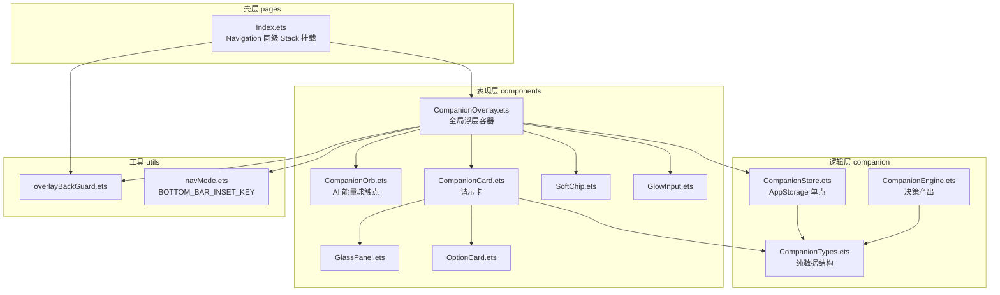
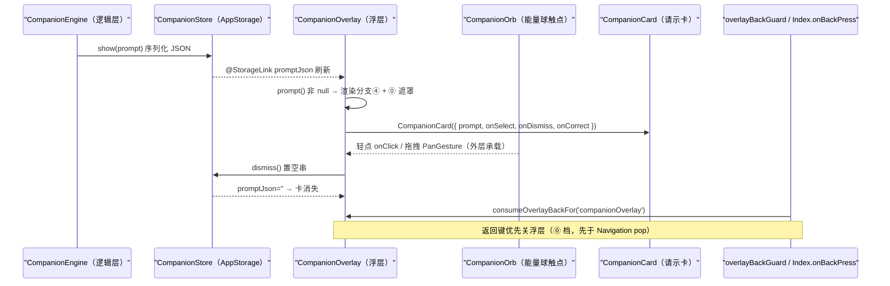
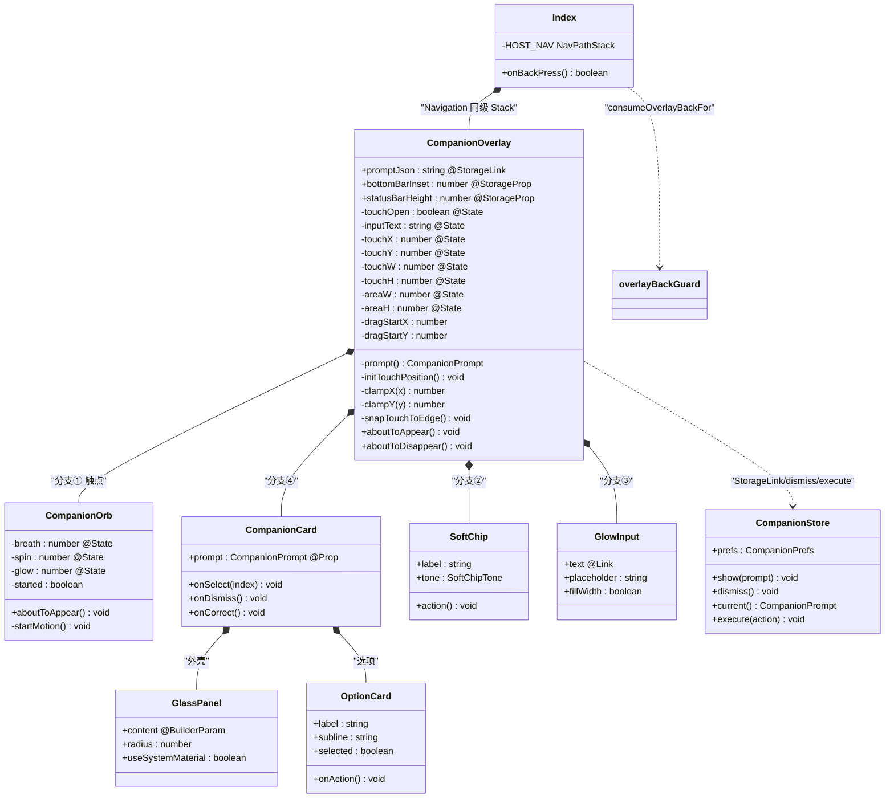
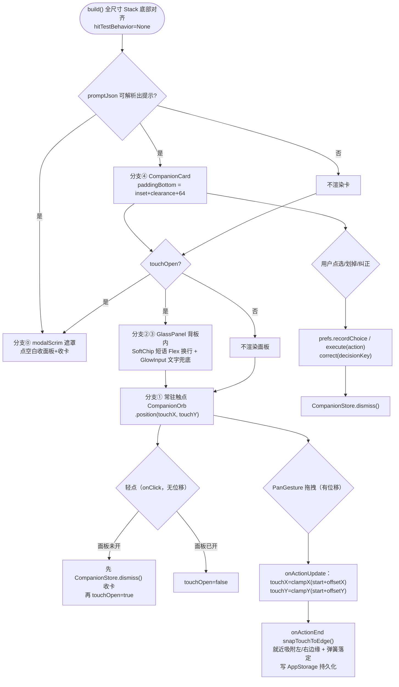
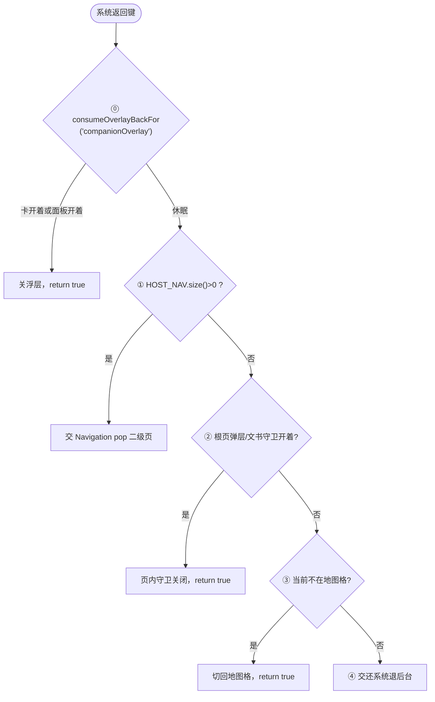
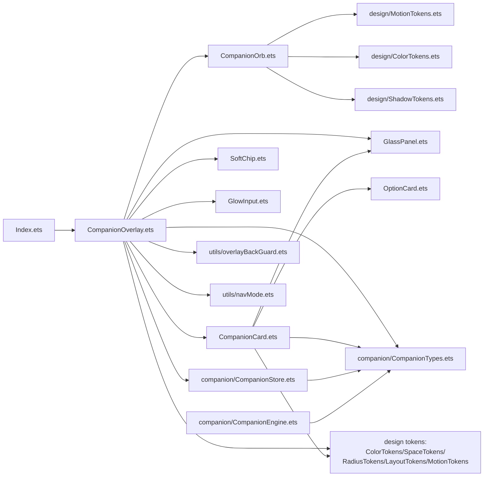

# 伴随浮层与请示卡组件

<cite>
**本文档引用的文件**
- [CompanionOverlay.ets](file://entry/src/main/ets/components/CompanionOverlay.ets)
- [CompanionOrb.ets](file://entry/src/main/ets/components/CompanionOrb.ets)
- [CompanionCard.ets](file://entry/src/main/ets/components/CompanionCard.ets)
- [GlassPanel.ets](file://entry/src/main/ets/components/GlassPanel.ets)
- [OptionCard.ets](file://entry/src/main/ets/components/OptionCard.ets)
- [SoftChip.ets](file://entry/src/main/ets/components/SoftChip.ets)
- [GlowInput.ets](file://entry/src/main/ets/components/GlowInput.ets)
- [MotionTokens.ets](file://entry/src/main/ets/design/MotionTokens.ets)
- [ColorTokens.ets](file://entry/src/main/ets/design/ColorTokens.ets)
- [LayoutTokens.ets](file://entry/src/main/ets/design/LayoutTokens.ets)
- [CompanionStore.ets](file://entry/src/main/ets/companion/CompanionStore.ets)
- [CompanionTypes.ets](file://entry/src/main/ets/companion/CompanionTypes.ets)
- [CompanionEngine.ets](file://entry/src/main/ets/companion/CompanionEngine.ets)
- [overlayBackGuard.ets](file://entry/src/main/ets/utils/overlayBackGuard.ets)
- [navMode.ets](file://entry/src/main/ets/utils/navMode.ets)
- [Index.ets](file://entry/src/main/ets/pages/Index.ets)
</cite>

## 更新摘要

**变更内容**
- 触点部件由 `GlassPillButton`「助手」胶囊替换为 `CompanionOrb` AI 能量球（自绘径向渐变 + 旋转能量环 + 呼吸动效），设计语言复用映射表与部件表同步更新。
- 新增触点交互契约：可拖拽、松手就近吸附左/右屏幕边缘、纵向夹在状态栏与 dock 净空之间；轻点开面板与 `PanGesture` 拖拽共存（无位移=点击，有位移=拖拽）。
- 新增 `companionTouchX` / `companionTouchY` 两个 `PersistentStorage` 持久化键与首次默认右下角落位逻辑。
- 类图、依赖分析、渲染流程图、故障排查表同步刷新。

## 目录
1. [引言](#引言)
2. [项目结构](#项目结构)
3. [核心组件](#核心组件)
4. [架构总览](#架构总览)
5. [详细组件分析](#详细组件分析)
6. [依赖分析](#依赖分析)
7. [性能考量](#性能考量)
8. [故障排查指南](#故障排查指南)
9. [结论](#结论)

## 引言

本次文档聚焦业务组件体系的伴随助手表现层载体：**CompanionOverlay（伴随助手全局浮层）**、**CompanionOrb（AI 能量球常驻触点）** 与 **CompanionCard（伴随助手请示卡/决策卡）**。它们为「伴随式 AI 助手」提供落地形态：当行中引擎判定「计划 vs 现实出现真实后果」（如规划外到访挤占后续站点）时，无需页面跳转、无需重组导航，即可在五 tab 与二级页之上就地浮出一张带默认推荐的可点选决策卡；而常驻触点已升级为可自由摆放的 AI 能量球——用户把它拖到任意顺手位置，松手即就近吸附屏幕边缘并跨重启保留。

设计立场有三条主线：

- **全局挂载、零侵入**：浮层挂在 `Index` 的 `Navigation` 同级 `Stack` 兄弟位置，盖住二级页；默认休眠（AppStorage 键为空串即无提示、触点收起），不干扰任何现有 UI。
- **触摸穿透**：容器统一 `hitTestBehavior(HitTestMode.None)`，空白处触摸穿透到下层页面，仅交互件（请示卡/触点/短语/输入框）接收命中——与既有 dock 覆盖层同形态。
- **不造新视觉语言**：玻璃面复用 `GlassPanel`，选项复用 `OptionCard`（选中态=品牌实心，与屏3追问选项同源），快捷短语复用 `SoftChip`，文字兜底复用 `GlowInput`；触点由早期复用的 `GlassPillButton` 升级为全新的 `CompanionOrb` 能量球——但能量球本身仍不引入新配方，颜色全走 `ColorTokens`、动效全走 `MotionTokens`，无任何字面量。

## 项目结构

该功能横跨三个层次：表现层（`components/` 下的浮层、能量球与请示卡）、逻辑层（`companion/` 下的引擎、状态仓与共享类型）、壳层集成（`pages/Index.ets` 挂载 + `utils/overlayBackGuard.ets` 返回键守卫）。

**图示来源**
- [CompanionOverlay.ets:1-255](file://entry/src/main/ets/components/CompanionOverlay.ets#L1-L255)
- [CompanionOrb.ets:1-103](file://entry/src/main/ets/components/CompanionOrb.ets#L1-L103)
- [CompanionCard.ets:1-90](file://entry/src/main/ets/components/CompanionCard.ets#L1-L90)
- [Index.ets:1012-1027](file://entry/src/main/ets/pages/Index.ets#L1012-L1027)

**章节来源**
- [CompanionOverlay.ets:1-35](file://entry/src/main/ets/components/CompanionOverlay.ets#L1-L35)
- [Index.ets:1012-1027](file://entry/src/main/ets/pages/Index.ets#L1012-L1027)

## 核心组件

### CompanionOverlay（全局浮层）

`CompanionOverlay` 是一个全尺寸 `Stack`（底部对齐），由「四件套」构成，按条件渲染：

| 组成 | 组件 | 显示条件 | 职责 |
|---|---|---|---|
| ① 常驻触点 | `CompanionOrb`（AI 能量球，64×64） | 恒在，初始右下角拇指区 | 轻点展开/收起快捷面板（开面板前先收卡，两层互斥）；支持拖拽移动，松手就近吸附左/右屏幕边缘，位置持久化 |
| ② 快捷短语面板 | `Flex(wrap)` × `SoftChip`（NEUTRAL 档，`GlassPanel` 实心背板） | `touchOpen=true` | 上下文意图一键表达（当前为静态五条：我累了/附近有啥吃的/跳过这站/换个地方/时间够吗） |
| ③ 文字兜底 | `GlowInput`（`fillWidth:false`） | `touchOpen=true` | 「或直接说/写你想怎样…」自由输入 |
| ⓪ 遮罩 | `modalScrim` 压暗 `Column` | 面板开着或有卡 | 把浮层与下层内容分离，点空白处收起 |
| ④ 请示卡 | `CompanionCard` | AppStorage 有提示 JSON | 决策卡浮出，底部让出触点高度 |

关键实现要点：

- **状态驱动**：通过 `@StorageLink(COMPANION_PROMPT_KEY)` 订阅提示 JSON 串，`prompt()` 私有方法按需 `JSON.parse`，解析失败静默返回 null（休眠态）。选择 JSON 串而非复杂嵌套对象存储，是为了规避 V1 状态管理 `@StorageProp` 对嵌套对象刷新不可靠的问题。
- **安全区适配**：卡与面板的底部内边距 = `bottomBarInset + floatingDockClearance + 64`，其中 `bottomBarInset` 来自 `@StorageProp(BOTTOM_BAR_INSET_KEY)`，由 `navMode.ets` 依据窗口尺寸计算写入 AppStorage；触点纵向活动范围同样以「状态栏下沿 ~ dock 净空上沿」为夹取区间，保证能量球任何时刻都不被系统栏遮挡。
- **位置持久化**：`aboutToAppear` 中以 `PersistentStorage.persistProp` 登记 `companionTouchX` / `companionTouchY` 两键（哨兵值 `-1` 表示未初始化），并从 AppStorage 回读；首次量到浮层与触点尺寸后由 `initTouchPosition()` 落默认右下角落位，已有持久化位置则不覆盖。
- **触摸穿透**：根 `Stack` 及各条件分支层均置 `HitTestMode.None`，只有卡、能量球、短语、输入这些交互件本身收命中——空白区域点击直达下层官方页签与页面内容。
- **返回键接管**：`aboutToAppear` 以 id `'companionOverlay'` 登记返回守卫（`isOpen` = 有卡或面板开着；`close` = 收卡 + 收面板），`aboutToDisappear` 成对注销防止闭包拖住已销毁实例。

**章节来源**
- [CompanionOverlay.ets:36-255](file://entry/src/main/ets/components/CompanionOverlay.ets#L36-L255)
- [CompanionStore.ets:1-57](file://entry/src/main/ets/companion/CompanionStore.ets#L1-L57)
- [navMode.ets:32-94](file://entry/src/main/ets/utils/navMode.ets#L32-L94)

### CompanionOrb（AI 能量球触点）

`CompanionOrb` 是替代「助手」两字胶囊的新触点图标组件——一个 64×64 的三层 `Stack` 圆形能量球，**纯展示件**：不含任何手势与状态通道，轻点/拖拽手势全部由外层 `CompanionOverlay` 承载。

- **视觉配方**：主 orb 为 48×48 紫→蓝径向渐变（`accentMention → primary → primaryPress`），左上偏心高光营造球体感，附 `ShadowTokens.floating` 投影与 35% 透明度的玻璃高光点，中心为 `sys.symbol.wand_and_stars` 魔法棒符号；外圈是 60 直径的 `sweepGradient` 旋转能量环（被主 orb 盖住中心、露出 6vp 旋转环），最外是 64 直径的径向光晕。颜色全部取自 `ColorTokens`，无新增字面量。
- **常驻动效**：`aboutToAppear` 触发 `startMotion()`，以 `started` 布尔量做幂等保护。两组无限动画均走 `MotionTokens.shimmer`（1200ms 半程 ≈ 2.4s 一次呼吸）：呼吸组用 `MotionCurves.standard` + `PlayMode.Alternate` 让整体缩放 1→1.06、光晕透明度 0.4→0.85 往复；旋转组用 `MotionCurves.linear` 让能量环匀速转到 360°。
- **命中尺寸**：组件本体 64×64，大于 44vp 最小触控目标要求，外层触点 `Column` 直接吃 `onClick` 与 `PanGesture`。

**章节来源**
- [CompanionOrb.ets:1-103](file://entry/src/main/ets/components/CompanionOrb.ets#L1-L103)
- [MotionTokens.ets:18-23](file://entry/src/main/ets/design/MotionTokens.ets#L18-L23)
- [ColorTokens.ets:37-66](file://entry/src/main/ets/design/ColorTokens.ets#L37-L66)

### CompanionCard（请示卡）

`CompanionCard` 是一张纯展示决策卡：外壳 `GlassPanel({ radius: hero })`，内部纵向布局为「标题行 + 后果说明 + （notify 态透明化提示 + 纠正入口）+ 选项列表」。

- **属性契约**：`@Prop prompt: CompanionPrompt`（默认空卡常量 `EMPTY_PROMPT`），回调 `onSelect?: (index) => void`、`onDismiss?: () => void` 与 `onCorrect?: () => void`。组件只渲染并抛回调，**不直接改行程**。
- **标题行**：标题走 `TypeTokens.headline` + `ColorTokens.ink`，`layoutWeight(1)` 撑满；右侧 44×44 命中区的透明按钮承载 `sys.symbol.xmark` 划掉图标（沉默也是回答）。
- **推荐高亮**：`ForEach` 渲染选项时以 `idx === prompt.recommendedIndex` 作为 `OptionCard.selected`，即品牌实心底 + 白字 + 右上对勾——「保姆级：思考做完，用户多数只确认」。
- **通知态透明化**：`prompt.mode === 'notify'` 时多渲染一句「照你之前的习惯，先这么安排了」的来源解释与「这次问我」纠正入口（触发 `onCorrect`），向用户说明降级来源并保留反悔通道。
- **稳定 key**：`ForEach` 键生成用 `${prompt.id}-${opt.key}`，跨文案变更保持 identity 稳定。

**章节来源**
- [CompanionCard.ets:1-90](file://entry/src/main/ets/components/CompanionCard.ets#L1-L90)

### 数据契约 CompanionPrompt（组件消费的大脑产出）

请示卡渲染的数据结构定义于 `CompanionTypes.ets`（纯数据、无 @kit 依赖、可离线断言）：

| 字段 | 类型 | 语义 |
|---|---|---|
| `id` | string | 去重键，同情境不重复浮 |
| `kind` | `'unplanned_arrival' \| 'unknown_place'` | 提示种类 |
| `title` / `detail` | string | 标题 / 后果说明 |
| `options` | `CompanionOption[]` | 每项含稳定意图键 `key`、主文案 `label`、后果副文案 `subline`、结构化 `action` |
| `recommendedIndex` | number | 默认推荐项下标 |
| `stake` | `'low' \| 'high'` | 高风险恒请示 |
| `mode` | `'ask' \| 'notify'` | 偏好降级决定请示还是通知 |

`CompanionStore` 是其唯一的全局读写通道：`show()` 序列化写入 AppStorage、`dismiss()` 置空串收起、`current()` 反序列化读取；另持有共享 `prefs`（`CompanionPrefs` 单例，浮层记录点选与 OnTrip 生成提示共用同一实例，降级闭环才成立）与执行委托 `execute()`（OnTrip 注册执行器，浮层只抛意图）。Phase 1 引擎（`CompanionEngine.unplannedArrival`）只在「规划外到访挤占后续站点且有真实后果」时产出该结构，无后果返回 null 安静吸收。

**章节来源**
- [CompanionTypes.ets:25-72](file://entry/src/main/ets/companion/CompanionTypes.ets#L25-L72)
- [CompanionStore.ets:11-57](file://entry/src/main/ets/companion/CompanionStore.ets#L11-L57)
- [CompanionEngine.ets:26-60](file://entry/src/main/ets/companion/CompanionEngine.ets#L26-L60)

## 架构总览

从「大脑产出提示 → 状态单点广播 → 浮层渲染 → 用户响应回收」的完整链路看，组件处于表现层末端，与逻辑层严格解耦：

**图示来源**
- [CompanionStore.ets:36-53](file://entry/src/main/ets/companion/CompanionStore.ets#L36-L53)
- [CompanionOverlay.ets:57-100](file://entry/src/main/ets/components/CompanionOverlay.ets#L57-L100)
- [CompanionOverlay.ets:214-244](file://entry/src/main/ets/components/CompanionOverlay.ets#L214-L244)
- [CompanionCard.ets:26-88](file://entry/src/main/ets/components/CompanionCard.ets#L26-L88)
- [Index.ets:208-214](file://entry/src/main/ets/pages/Index.ets#L208-L214)

### 挂载位置：Navigation 同级 Stack 兄弟

`Index.build` 尾部在一个 `Alignment.Bottom` 的 `Stack` 里并列放置 `Navigation(HOST_NAV)`（全屏、隐藏标题栏、挂 `routerMap` 二级页）与 `CompanionOverlay()`。由于是同级兄弟且后者绘制在上，浮层天然盖住所有 Navigation push 出的二级页——这正是「不重组导航就能全局覆盖」的实现方式。

**图示来源**
- [Index.ets:1012-1027](file://entry/src/main/ets/pages/Index.ets#L1012-L1027)
- [CompanionOverlay.ets:40-113](file://entry/src/main/ets/components/CompanionOverlay.ets#L40-L113)
- [CompanionOverlay.ets:214-244](file://entry/src/main/ets/components/CompanionOverlay.ets#L214-L244)
- [CompanionOrb.ets:15-48](file://entry/src/main/ets/components/CompanionOrb.ets#L15-L48)
- [CompanionCard.ets:25-90](file://entry/src/main/ets/components/CompanionCard.ets#L25-L90)

**章节来源**
- [Index.ets:1012-1027](file://entry/src/main/ets/pages/Index.ets#L1012-L1027)

## 详细组件分析

### CompanionOverlay 渲染流程

浮层的分支渲染与互斥逻辑如下——注意「卡与面板互斥：开面板先收卡」这条规则避免了两层叠加：

**图示来源**
- [CompanionOverlay.ets:115-255](file://entry/src/main/ets/components/CompanionOverlay.ets#L115-L255)

两个易踩的实现细节被注释显式记录：其一，`GlowInput` 的 `fillWidth=true` 会置 `layoutWeight(1)`，在纵向 `Column` 中会把剩余高度填满、撑爆面板，因此浮层内必须传 `fillWidth:false`——要横向 100% 但不纵向扩张；其二，触点上的轻点与拖拽靠手势优先级共存——`onClick` 仅在无位移时触发，一旦 `PanGesture` 吃掉移动事件就不会误开面板，反之原地按下抬起仍是点击。

**章节来源**
- [CompanionOverlay.ets:185-207](file://entry/src/main/ets/components/CompanionOverlay.ets#L185-L207)
- [CompanionOverlay.ets:214-244](file://entry/src/main/ets/components/CompanionOverlay.ets#L214-L244)

### 触点拖拽与吸附交互契约

能量球触点的空间行为由四条规则构成完整契约，全部实现在 `CompanionOverlay` 私有方法中：

| 环节 | 方法/钩子 | 规则 |
|---|---|---|
| 首次落位 | `initTouchPosition()` | 浮层与触点尺寸均由 `onAreaChange` 量到、且 `touchX < 0`（未初始化）时才生效：默认落在右下角——x 留出 `SpaceTokens.base` 右边距，y 压在 `bottomBarInset + LayoutTokens.floatingDockClearance + SpaceTokens.xs` 之上；已有持久化位置则不覆盖 |
| 拖拽中 | `clampX()` / `clampY()` | `onActionUpdate` 以起始位置 + 手指偏移实时落点，并即时夹取：横向左右各留 `SpaceTokens.xxs` 边距；纵向下限 = `statusBarHeight + SpaceTokens.xs`（状态栏之下），上限 = `areaH - touchH - bottomBarInset - floatingDockClearance`（dock 净空之上） |
| 松手吸附 | `snapTouchToEdge()` | 以触点中心相对浮层中线判断就近边缘，吸附到左/右 `SpaceTokens.base` 处；纵向用 `clampY` 夹回安全区；整段用 `animateTo({ duration: MotionTokens.control, curve: MotionCurves.springSoft })` 弹簧落定 |
| 持久化 | `TOUCH_X_KEY` / `TOUCH_Y_KEY` | `aboutToAppear` 里 `PersistentStorage.persistProp('companionTouchX', -1)` / `('companionTouchY', -1)` 登记并回读；吸附完成后 `AppStorage.setOrCreate` 写入最终坐标，跨重启保留 |

拖拽期间只做实时跟手与边界夹取、**不落盘**；仅 `onActionEnd` 吸附后才写持久化键，避免高频 IO。

**章节来源**
- [CompanionOverlay.ets:33-35](file://entry/src/main/ets/components/CompanionOverlay.ets#L33-L35)
- [CompanionOverlay.ets:57-66](file://entry/src/main/ets/components/CompanionOverlay.ets#L57-L66)
- [CompanionOverlay.ets:83-113](file://entry/src/main/ets/components/CompanionOverlay.ets#L83-L113)
- [CompanionOverlay.ets:222-244](file://entry/src/main/ets/components/CompanionOverlay.ets#L222-L244)
- [LayoutTokens.ets:183](file://entry/src/main/ets/design/LayoutTokens.ets#L183)

### hitTestBehavior 穿透策略

ArkUI 的 `Stack` 默认参与命中测试，若浮层容器吃掉全部触摸，下层五 tab 与页面内容将不可交互。本组件采用与既有 dock 覆盖层完全一致的形态：

| 层级 | 命中模式 | 效果 |
|---|---|---|
| 根 `Stack`（浮层容器） | `None` | 容器自身不拦截，空白处穿透 |
| 分支⓪遮罩 `Column` | 默认（收命中） | 激活时点空白收起浮层，属有意拦截 |
| 分支④外层 `Column` | `None` | 卡的留白边距穿透，卡体（GlassPanel 内 Button）仍收命中 |
| 分支②③外层 `Column` | `None` | 同上，仅 SoftChip/GlowInput 收命中 |
| 分支①触点 `Column` | 默认（收命中） | 仅 64×64 能量球本体收命中，其 `.position` 之外的区域不拦截 |

对照参考：dock 覆盖层同样在根层置 `None`，而 dock 胶囊那层单独用 `Transparent` 收命中（注释警示改档后须真机验证不吃掉官方页签点击）——两套覆盖层的穿透语义在此保持一致心智。触点抬到 dock 净空之上的纵向夹取规则，正是为了修复历史上「助手触点命中区压住 dock『我的』tab」的缺陷。

**章节来源**
- [CompanionOverlay.ets:115-255](file://entry/src/main/ets/components/CompanionOverlay.ets#L115-L255)
- [Index.ets:651-658](file://entry/src/main/ets/pages/Index.ets#L651-L658)

### 返回键优先级链

`Index.onBackPress` 定义了五档优先级，伴随浮层新增第 ⓪ 档置于最前：

因为浮层盖在二级页之上，无论宿主栈里有没有页，返回都必须先收浮层——这就是 ⓪ 档排在 Navigation pop 之前的原因。守卫登记遵循 `overlayBackGuard` 三条约定：幂等登记（appear 一次/disappear 注销，不随开关反复注册）、闭包成对注销防泄漏、按 id 消费防误关他页。触点拖拽与位置持久化不参与返回键语义——返回只关「面板/卡」两层，能量球本体始终常驻。

**图示来源**
- [Index.ets:202-214](file://entry/src/main/ets/pages/Index.ets#L202-L214)
- [CompanionOverlay.ets:57-73](file://entry/src/main/ets/components/CompanionOverlay.ets#L57-L73)
- [overlayBackGuard.ets:1-60](file://entry/src/main/ets/utils/overlayBackGuard.ets#L1-L60)

**章节来源**
- [overlayBackGuard.ets:1-60](file://entry/src/main/ets/utils/overlayBackGuard.ets#L1-L60)

### 设计语言复用映射

各组件部位全部映射到既有家族件与 token 配方；唯一的自绘件 `CompanionOrb` 也只用 token 色值与 token 动效：

| 组件部位 | 复用件/配方 | 采用的档位/参数 | 视觉出处 |
|---|---|---|---|
| 请示卡表面 | `GlassPanel` | `radius=RadiusTokens.hero`（面板背板 `useSystemMaterial=false` 实心保可读） | 普通内容卡玻璃面 |
| 请示卡选项 | `OptionCard` | `selected=recommendedIndex` → brandSolid 实心 + onBrand 字 + 对勾 | 屏3 追问选项同源 |
| 划掉按钮 | 透明 `Button` + `SymbolGlyph(xmark)` | 44vp 最小命中区（`LayoutTokens.minTouchTarget` 同规） | 官方按压态/焦点/无障碍由系统给 |
| 快捷短语 | `SoftChip` | `tone=NEUTRAL`（surfaceSubtle 底 + primary 字 + hairline 描边 + pill 圆角） | components.tag-pill 家族件 |
| 文字兜底 | `GlowInput` | 默认官方原生样式（subtle 实色 + 20 圆角胶囊），`fillWidth=false` | 统一输入框定稿 |
| 常驻触点 | `CompanionOrb`（自绘） | 径向渐变 `accentMention→primary→primaryPress`、`sweepGradient` 能量环、`ShadowTokens.floating`、`sys.symbol.wand_and_stars` | 替代旧 `GlassPillButton`「助手」胶囊 |
| 触点动效 | `MotionTokens` + `MotionCurves` | 呼吸/旋转 = `shimmer`(1200ms) `standard`/`linear` 无限循环；吸附落定 = `control`(220ms) `springSoft` | 契约 motion token 表 |
| 激活遮罩 | `ColorTokens.modalScrim` | 压暗分离浮层与内容，点空白收起 | 契约 modal 遮罩色 |
| 排版/间距 | `TypeTokens`、`SpaceTokens`、`ColorTokens`、`LayoutTokens` | headline/small/caption、xxs/xs/base/sm、ink/body/muted/separator、`floatingDockClearance` | 契约 token 表 |

**章节来源**
- [CompanionCard.ets:12-90](file://entry/src/main/ets/components/CompanionCard.ets#L12-L90)
- [CompanionOrb.ets:49-103](file://entry/src/main/ets/components/CompanionOrb.ets#L49-L103)
- [GlassPanel.ets:20-54](file://entry/src/main/ets/components/GlassPanel.ets#L20-L54)
- [OptionCard.ets:17-74](file://entry/src/main/ets/components/OptionCard.ets#L17-L74)
- [SoftChip.ets:24-95](file://entry/src/main/ets/components/SoftChip.ets#L24-L95)
- [GlowInput.ets:20-83](file://entry/src/main/ets/components/GlowInput.ets#L20-L83)
- [MotionTokens.ets:18-23](file://entry/src/main/ets/design/MotionTokens.ets#L18-L23)

**章节来源**
- [CompanionOverlay.ets:115-127](file://entry/src/main/ets/components/CompanionOverlay.ets#L115-L127)

### 阶段边界：骨架先行 vs 接线

浮层已从早期「只搭骨架」推进到偏好学习闭环接线：`onSelect` 记录 `prefs.recordChoice`（连续选推荐项会把同类决定降为通知）并经 `CompanionStore.execute()` 委托 OnTrip 执行器落地意图；`onCorrect` 撤销降级、下次同类回请示；快捷短语中「我累了」「跳过这站」直连排程能力。状态通道（`CompanionStore.show/dismiss`）与数据契约（`CompanionPrompt`）保持稳定，接线不改组件；触点拖拽/吸附则是纯表现层增量，与逻辑层零耦合。

**章节来源**
- [CompanionOverlay.ets:129-167](file://entry/src/main/ets/components/CompanionOverlay.ets#L129-L167)
- [CompanionStore.ets:14-33](file://entry/src/main/ets/companion/CompanionStore.ets#L14-L33)
- [CompanionEngine.ets:1-10](file://entry/src/main/ets/companion/CompanionEngine.ets#L1-L10)

## 依赖分析

新组件的 import 依赖呈严格的单向分层，无环：

依赖特征：

- **表现层 → 逻辑层单向**：组件只依赖 `CompanionTypes`（接口）与 `CompanionStore`（状态通道 + 执行委托 + 共享 prefs），不依赖 `CompanionEngine`，保证卡片可在引擎缺席时独立渲染与测试。
- **触点与手势解耦**：`CompanionOrb` 是零 props、零回调的纯展示件，不知道 AppStorage 也不知道手势——拖拽/吸附/持久化全在 `CompanionOverlay`，未来换触点皮肤不动交互逻辑。
- **共享叶子模块**：`overlayBackGuard` 是模块级数组单例，`Index`（消费方）与 `CompanionOverlay`（登记方）共同依赖它；`navMode` 的 `BOTTOM_BAR_INSET_KEY` 由系统栏测量写入、浮层只读。
- **外部框架依赖**：ArkUI `@Component/@Prop/@State/@StorageLink/@StorageProp`、`AppStorage`、**`PersistentStorage.persistProp`（新增，触点坐标跨重启持久化）**、`SymbolGlyph(sys.symbol.*)`、`radialGradient/sweepGradient`、`animateTo`；无第三方包引入。

**图示来源**
- [CompanionOverlay.ets:16-30](file://entry/src/main/ets/components/CompanionOverlay.ets#L16-L30)
- [CompanionOrb.ets:10-13](file://entry/src/main/ets/components/CompanionOrb.ets#L10-L13)
- [CompanionCard.ets:12-19](file://entry/src/main/ets/components/CompanionCard.ets#L12-L19)
- [CompanionStore.ets:9-12](file://entry/src/main/ets/companion/CompanionStore.ets#L9-L12)

**章节来源**
- [overlayBackGuard.ets:19-31](file://entry/src/main/ets/utils/overlayBackGuard.ets#L19-L31)
- [navMode.ets:32-94](file://entry/src/main/ets/utils/navMode.ets#L32-L94)

## 性能考量

- **休眠低开销**：默认 `promptJson=''` 时分支⓪④②③全部不渲染，浮层实际只剩一个能量球触点；`@StorageLink` 仅在键变化时触发刷新。
- **parse 频率**：`prompt()` 在 build 中被调用多次（遮罩条件 + 分支条件 + 传参），每次同步 `JSON.parse` 一个小对象，成本可忽略；若提示高频更新，可考虑缓存解析结果于 `@State`。
- **常驻动画成本**：能量球的呼吸缩放 + 光晕明暗 + 能量环旋转是两组 `iterations:-1` 无限动画，属于持续渲染负载；组件已通过 `started` 标志防止重复启动，且动画挂在合成属性（scale/rotate/opacity）上，不触发布局重算。
- **拖拽期不落盘**：`onActionUpdate` 每帧只改 `@State` 坐标并做数学夹取，`AppStorage`/`PersistentStorage` 写入仅发生在 `onActionEnd` 吸附后的一次，避免触摸跟手路径上的 IO 抖动。
- **穿透免命中树膨胀**：`HitTestMode.None` 使大面积透明容器不参与命中测试路径，避免每帧触摸分发经过冗余节点。
- **ForEach 稳定键**：以 `prompt.id-option.key` 为键，提示切换时最小化子树重建。

[本节为综合性能讨论，部分依据触点实现]

**章节来源**
- [CompanionOrb.ets:23-48](file://entry/src/main/ets/components/CompanionOrb.ets#L23-L48)
- [CompanionOverlay.ets:226-244](file://entry/src/main/ets/components/CompanionOverlay.ets#L226-L244)

## 故障排查指南

| 症状 | 可能原因 | 定位路径 |
|---|---|---|
| 浮层挡住下层页面点击 | 某层漏置 `HitTestMode.None`，或交互件父层误收命中 | 检查各分支外层与根 Stack 的命中档位（遮罩层收命中是有意为之） |
| 请示卡/面板被底部 dock 遮挡 | `BOTTOM_BAR_INSET_KEY` 未写入，或 `inset + floatingDockClearance + 64` 不足 | 核对 `navMode` 的 inset 计算与 `LayoutTokens.floatingDockClearance` |
| 触点被 dock 或状态栏吃掉 | `clampY` 上下限计算异常，或 `statusBarHeight` 键未写入 AppStorage | 检查 `clampY` 的 `statusBarHeight + xs` 下限与 `areaH - touchH - inset - clearance` 上限 |
| 触点拖不到想要的屏幕位置 | 横向 `clampX` 的 `xxs` 边距限制，或松手吸附必然贴左/右边缘（设计如此，非缺陷） | 检查 `clampX` 与 `snapTouchToEdge` 的就近判定（以触点中心 vs 浮层中线） |
| 触点位置重启后丢失 | `PersistentStorage.persistProp` 未在 `aboutToAppear` 登记，或吸附后未 `setOrCreate` 写键 | 核对 `TOUCH_X_KEY`/`TOUCH_Y_KEY` 的登记、回读与吸附落盘三处 |
| 触点位置错乱/跑到屏外 | 尺寸未量到就落位（`initTouchPosition` 需 area 与 touch 尺寸都 >0），或持久化了负值哨兵 | 检查两处 `onAreaChange` 回调与 `-1` 哨兵判定 |
| 拖动能量球却打开了面板（或反之） | `onClick` 与 `PanGesture` 共存关系被破坏（如无位移阈值失效、手势被外层吞掉） | 检查触点 `Column` 的 `onClick` 与 `gesture(PanGesture())` 是否同挂一层 |
| 返回键跳过了该关的浮层 | 守卫未按 ⓪ 档优先消费，或 `isOpen` 判定遗漏 `touchOpen` | 检查 `Index.onBackPress` 首档与浮层 `isOpen` 闭包 |
| 卡与短语面板叠在一起 | 触点动作遗漏「开面板先收卡」互斥 | 检查触点 `onClick` 中的 `CompanionStore.dismiss()` |
| 快捷面板纵向撑爆屏幕 | `GlowInput` 误传 `fillWidth=true`（layoutWeight 在 Column 内吃满高度） | 浮层内必须 `fillWidth:false` |
| 卡不出现但引擎已产出提示 | `CompanionStore.show()` 写入的 JSON 非法导致 parse 静默失败 | 校验 `CompanionPrompt` 序列化完整性 |
| 能量球不动/无呼吸 | `startMotion` 的 `started` 幂等标志被提前置位，或 `animateTo` 未拿到 UIContext | 检查 `CompanionOrb.aboutToAppear` 调用链 |
| 页面销毁后浮层仍响应返回 | 守卫未成对注销，闭包拖住实例 | 确认 `aboutToDisappear` 调 `unregisterOverlayBackGuard` |

**章节来源**
- [CompanionOverlay.ets:57-113](file://entry/src/main/ets/components/CompanionOverlay.ets#L57-L113)
- [CompanionOverlay.ets:214-255](file://entry/src/main/ets/components/CompanionOverlay.ets#L214-L255)
- [CompanionOrb.ets:23-48](file://entry/src/main/ets/companion/../components/CompanionOrb.ets#L23-L48)
- [overlayBackGuard.ets:13-18](file://entry/src/main/ets/utils/overlayBackGuard.ets#L13-L18)
- [CompanionStore.ets:36-57](file://entry/src/main/ets/companion/CompanionStore.ets#L36-L57)

## 结论

CompanionOverlay、CompanionOrb 与 CompanionCard 以「三个不」确立了伴随助手表现层的落地范式：**不重组导航**（Navigation 同级 Stack 兄弟即得全局覆盖）、**不抢触摸**（容器 None 穿透、交互件收命中的 dock 同形态）、**不造视觉语言**（GlassPanel/OptionCard/SoftChip/GlowInput 四件复用，加上新能量球触点仍全程 ColorTokens/MotionTokens/ShadowTokens 全覆盖）。触点+快捷短语+文字兜底+请示卡的四件套为用户提供了「一键确认、一句话表达、一个字兜底、划掉即沉默」的完整响应梯度；而升级后的 AI 能量球触点进一步把「放在哪里顺手」的决定权交给用户——拖拽就近吸附边缘、纵向永远夹在状态栏与 dock 净空之间、坐标跨重启持久化，且这套空间契约与逻辑层零耦合。数据契约 `CompanionPrompt` 与状态通道 `CompanionStore` 已支撑起偏好学习闭环（recordChoice 降级、correct 回弹、execute 委托），接线不改组件。作为业务组件体系的新成员，三者共同验证了一条可复制的路径：全局浮层类需求应优先采用「壳层同级挂载 + StorageLink 驱动 + 守卫接管返回」的组合，而非页面级 bindSheet 或路由跳转。

[本节为总结性内容，未直接分析特定源码文件]