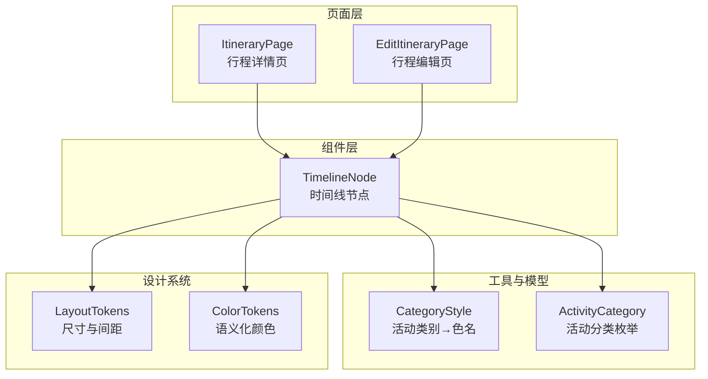
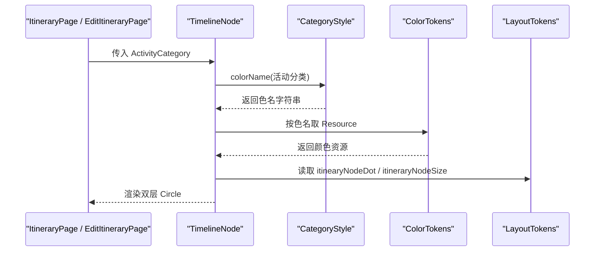
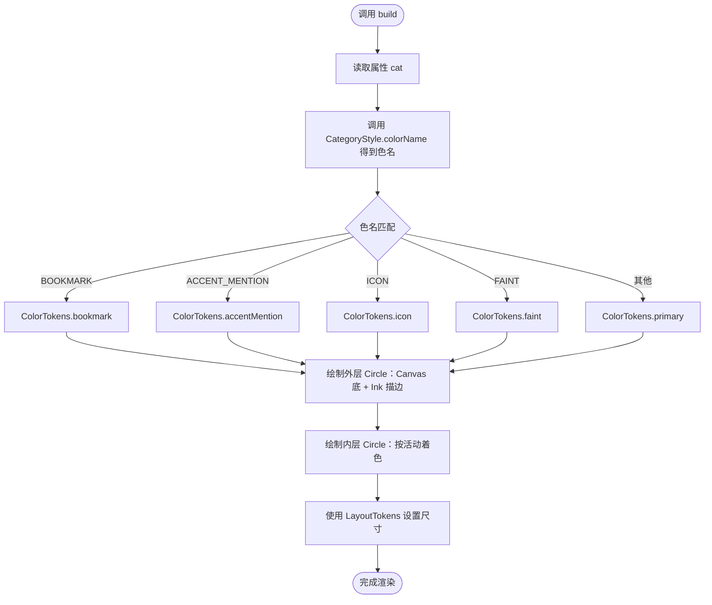
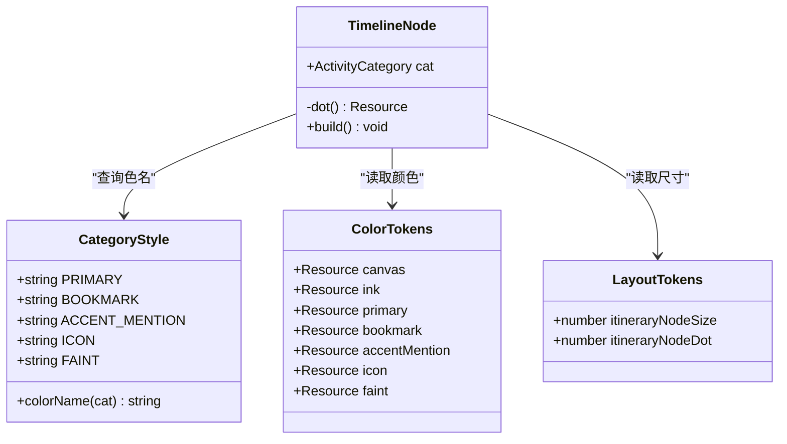
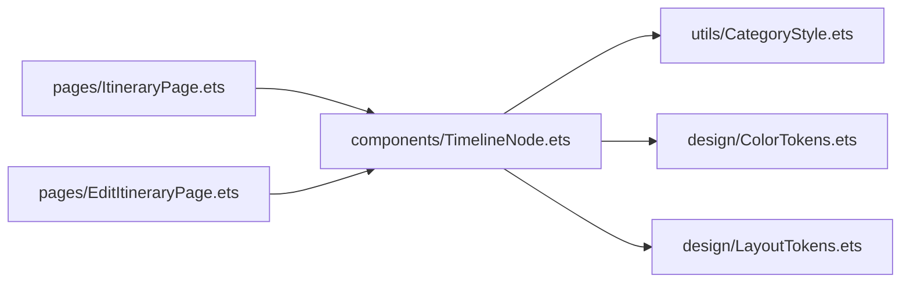

# 时间线节点 TimelineNode

<cite>
**本文引用的文件**   
- [TimelineNode.ets](file://entry/src/main/ets/components/TimelineNode.ets)
- [CategoryStyle.ets](file://entry/src/main/ets/utils/CategoryStyle.ets)
- [LayoutTokens.ets](file://entry/src/main/ets/design/LayoutTokens.ets)
- [ColorTokens.ets](file://entry/src/main/ets/design/ColorTokens.ets)
- [ItineraryPage.ets](file://entry/src/main/ets/pages/ItineraryPage.ets)
- [EditItineraryPage.ets](file://entry/src/main/ets/pages/EditItineraryPage.ets)
</cite>

## 目录
1. [简介](#简介)
2. [项目结构定位](#项目结构定位)
3. [核心组件说明](#核心组件说明)
4. [架构总览](#架构总览)
5. [详细组件分析](#详细组件分析)
6. [依赖关系分析](#依赖关系分析)
7. [性能与渲染特性](#性能与渲染特性)
8. [使用示例与复用模式](#使用示例与复用模式)
9. [自定义扩展指南](#自定义扩展指南)
10. [故障排查](#故障排查)
11. [结论](#结论)

## 简介
`TimelineNode` 是“有径”应用中的时间线圆环指示器组件，用于在屏8行程详情与屏9编辑态中统一展示活动节点。它接收一个 `ActivityCategory` 分类参数，根据活动类型自动选择语义化颜色，并以双层 Circle 结构渲染：外层为描边占位圆环，内层为按活动类别着色的实心圆点。

该组件的职责边界很清晰：只负责“把某个活动的时间线节点画出来”，不负责布局、滚动、拖拽或数据加载；视觉尺寸由设计 Token 集中管理，颜色映射通过 `CategoryStyle` 计算后再落到 `ColorTokens`。

## 项目结构定位

**图表来源**
- [ItineraryPage.ets:25-742](file://entry/src/main/ets/pages/ItineraryPage.ets#L25-L742)
- [EditItineraryPage.ets:22-399](file://entry/src/main/ets/pages/EditItineraryPage.ets#L22-L399)
- [TimelineNode.ets:1-53](file://entry/src/main/ets/components/TimelineNode.ets#L1-L53)

**章节来源**
- [ItineraryPage.ets:25-742](file://entry/src/main/ets/pages/ItineraryPage.ets#L25-L742)
- [EditItineraryPage.ets:22-399](file://entry/src/main/ets/pages/EditItineraryPage.ets#L22-L399)
- [TimelineNode.ets:1-53](file://entry/src/main/ets/components/TimelineNode.ets#L1-L53)

## 核心组件说明
`TimelineNode` 是一个 ArkUI `@Component`，对外暴露以下关键能力：

| 维度 | 说明 |
|---|---|
| **公开属性** | `cat: ActivityCategory`，默认值为 `ActivityCategory.SIGHT`，表示普通景点类活动。 |
| **内部职责** | 将活动分类映射为颜色名称，再从 `ColorTokens` 取资源值，渲染双层圆形。 |
| **视觉结构** | 外层 `Circle` 负责背景填充、描边和固定 22vp 占位；内层 `Circle` 使用 `LayoutTokens.itineraryNodeDot` 作为直径。 |
| **响应式行为** | 当 `cat` 变化时，组件重新执行 `dot()`，切换内圈颜色。 |
| **尺寸契约** | 外层容器宽高为 `LayoutTokens.itineraryNodeSize`（24vp），内圈点直径为 `LayoutTokens.itineraryNodeDot`（10vp）。 |

**章节来源**
- [TimelineNode.ets:1-53](file://entry/src/main/ets/components/TimelineNode.ets#L1-L53)
- [LayoutTokens.ets:1-265](file://entry/src/main/ets/design/LayoutTokens.ets#L1-L265)

## 架构总览
`TimelineNode` 处于“页面 → 组件 → 设计系统”的中间层：

**图表来源**
- [TimelineNode.ets:1-53](file://entry/src/main/ets/components/TimelineNode.ets#L1-L53)
- [CategoryStyle.ets:1-51](file://entry/src/main/ets/utils/CategoryStyle.ets#L1-L51)
- [ColorTokens.ets:1-202](file://entry/src/main/ets/design/ColorTokens.ets#L1-L202)
- [LayoutTokens.ets:1-265](file://entry/src/main/ets/design/LayoutTokens.ets#L1-L265)

## 详细组件分析

### 组件结构与渲染流程
`TimelineNode` 的构建逻辑可抽象为如下流程：

**图表来源**
- [TimelineNode.ets:1-53](file://entry/src/main/ets/components/TimelineNode.ets#L1-L53)
- [CategoryStyle.ets:1-51](file://entry/src/main/ets/utils/CategoryStyle.ets#L1-L51)
- [ColorTokens.ets:1-202](file://entry/src/main/ets/design/ColorTokens.ets#L1-L202)
- [LayoutTokens.ets:1-265](file://entry/src/main/ets/design/LayoutTokens.ets#L1-L265)

### ActivityCategory 分类映射
`CategoryStyle` 提供唯一的“活动类别 → 色名”映射，覆盖常见业务场景：

| 活动分类 | 映射色名 | 语义含义 | 对应 ColorTokens |
|---|---|---|---|
| `FOOD` | `BOOKMARK` | 餐饮 | `bookmark` |
| `HOTEL` | `ACCENT_MENTION` | 住宿 | `accentMention` |
| `TRANSPORT` | `ICON` | 交通 | `icon` |
| `REST` | `FAINT` | 休息 | `faint` |
| 其他分类 | `PRIMARY` | 默认主色 | `primary` |

这意味着：
- 非特殊分类（如 `SIGHT`）会走兜底的 `primary`，即品牌主色。
- 新增活动类型时，应优先扩展 `CategoryStyle.colorName`，而不是在页面或组件里写分支。
- `colorName` 返回的是字符串色名，不是直接的颜色资源；这是为了适配 Form UI 等不能直接 import `design/` 的场景。

**章节来源**
- [CategoryStyle.ets:1-51](file://entry/src/main/ets/utils/CategoryStyle.ets#L1-L51)
- [TimelineNode.ets:1-53](file://entry/src/main/ets/components/TimelineNode.ets#L1-L53)

### 视觉设计规范

#### 双层 Circle 结构
- **外圈**：22vp × 22vp 的 `Circle`，使用 `canvas` 作为填充、`ink` 作为描边，描边宽度为 2vp。官方文档注释指出，描边居中于半径 11 的圆上，因此整体占位为 22vp。
- **内圈**：直径由 `LayoutTokens.itineraryNodeDot` 控制，默认值为 10vp，颜色由活动分类决定。
- **容器**：外层 `Stack` 的宽高为 `LayoutTokens.itineraryNodeSize`，默认值为 24vp，保证时间线主轴上的节点槽位一致。

**图表来源**
- [TimelineNode.ets:1-53](file://entry/src/main/ets/components/TimelineNode.ets#L1-L53)
- [CategoryStyle.ets:1-51](file://entry/src/main/ets/utils/CategoryStyle.ets#L1-L51)
- [ColorTokens.ets:1-202](file://entry/src/main/ets/design/ColorTokens.ets#L1-L202)
- [LayoutTokens.ets:1-265](file://entry/src/main/ets/design/LayoutTokens.ets#L1-L265)

#### 尺寸规范
| Token | 值 | 用途 |
|---|---:|---|
| `itineraryNodeSize` | 24vp | 时间线节点容器宽高 |
| `itineraryNodeDot` | 10vp | 活动色点直径 |

这个组合让外层描边和内圈色点在视觉上保持同心，同时留出稳定的布局占位。

**章节来源**
- [LayoutTokens.ets:1-265](file://entry/src/main/ets/design/LayoutTokens.ets#L1-L265)
- [TimelineNode.ets:1-53](file://entry/src/main/ets/components/TimelineNode.ets#L1-L53)

#### 配色语义
`ColorTokens` 将设计系统中的语义色导出为资源引用，支持浅色与深色两套 `color.json`，由系统主题自动切换。时间线节点使用的关键语义包括：

| 语义 | 使用位置 | 典型场景 |
|---|---|---|
| `primary` | 默认活动色点 | 景点、未识别分类 |
| `bookmark` | 餐饮节点 | 食物类活动 |
| `accentMention` | 住宿节点 | 酒店类活动 |
| `icon` | 交通节点 | 交通类活动 |
| `faint` | 休息节点 | 休息类活动 |
| `ink` | 外圈描边 | 所有节点的外轮廓 |
| `canvas` | 外圈背景 | 所有节点的底层底色 |

**章节来源**
- [ColorTokens.ets:1-202](file://entry/src/main/ets/design/ColorTokens.ets#L1-L202)
- [TimelineNode.ets:1-53](file://entry/src/main/ets/components/TimelineNode.ets#L1-L53)

### 响应式行为
`TimelineNode` 的响应式来自 ArkUI 属性机制：

- 外部传入的 `cat` 是 `@Prop`，变化时会触发组件重建。
- 重建时 `dot()` 重新执行，根据新的 `ActivityCategory` 返回新颜色。
- 如果页面侧状态变化导致节点重新渲染，不同活动类型会呈现不同颜色。

这保证了“同一时间线节点在不同活动下自动变色”，而无需页面层手动判断颜色。

**章节来源**
- [TimelineNode.ets:1-53](file://entry/src/main/ets/components/TimelineNode.ets#L1-L53)

## 依赖关系分析

**图表来源**
- [TimelineNode.ets:1-53](file://entry/src/main/ets/components/TimelineNode.ets#L1-L53)
- [ItineraryPage.ets:25-742](file://entry/src/main/ets/pages/ItineraryPage.ets#L25-L742)
- [EditItineraryPage.ets:22-399](file://entry/src/main/ets/pages/EditItineraryPage.ets#L22-L399)

依赖特点：
- 组件向上依赖两个页面消费方，向下依赖设计系统和分类工具。
- 组件不直接持有页面状态，耦合度低。
- 颜色映射集中在 `CategoryStyle`，避免在各页面重复实现分类到颜色的分支逻辑。

**章节来源**
- [TimelineNode.ets:1-53](file://entry/src/main/ets/components/TimelineNode.ets#L1-L53)
- [ItineraryPage.ets:25-742](file://entry/src/main/ets/pages/ItineraryPage.ets#L25-L742)
- [EditItineraryPage.ets:22-399](file://entry/src/main/ets/pages/EditItineraryPage.ets#L22-L399)

## 性能与渲染特性
- **轻量绘制**：每个节点仅绘制两个 `Circle`，没有复杂渐变或阴影，适合时间线列表大量渲染。
- **尺寸稳定**：外层容器固定 24vp，内圈 10vp，有利于列表项对齐与滚动性能。
- **颜色计算简单**：`dot()` 是短分支字符串比较，成本极低。
- **无副作用**：组件不发起网络请求、不修改全局状态，适合被频繁重建。
- **主题切换成本低**：颜色来自 `ColorTokens`，深浅档切换时由系统资源解析，不需要额外分支。

[本节为通用性能建议，不直接分析具体代码片段]

## 使用示例与复用模式

### 在行程详情页中使用
行程详情页通过 `TimelineNode` 渲染每个活动的节点，并将当前活动的 `category` 传入：

- 导入路径：`../components/TimelineNode`
- 使用方式：以活动对象作为上下文，将 `activity.category` 传给 `cat` 属性。

**章节来源**
- [ItineraryPage.ets:25-742](file://entry/src/main/ets/pages/ItineraryPage.ets#L25-L742)

### 在行程编辑页中使用
编辑页同样复用 `TimelineNode`，确保用户编辑时的视觉与查看时一致：

- 导入路径：`../components/TimelineNode`
- 使用方式：遍历当日活动，将 `act.category` 传入 `cat`。

**章节来源**
- [EditItineraryPage.ets:22-399](file://entry/src/main/ets/pages/EditItineraryPage.ets#L22-L399)

### 与其他时间线元素的组合
虽然 `TimelineNode` 只负责节点圆环，但它在时间线中的典型组合方式包括：

| 组合元素 | 作用 | 与 TimelineNode 的关系 |
|---|---|---|
| 时间线主轴容器 | 提供 24vp 节点槽位 | 容器尺寸应与 `LayoutTokens.itineraryNodeSize` 对齐 |
| 连接线或轨道 | 连接上下节点 | 通常与节点垂直排列，高度受节点尺寸影响 |
| 时间文本 | 显示活动开始时间 | 与节点水平相邻，保持可读间距 |
| 活动标题与地点 | 描述活动内容 | 与节点在同一行，左侧节点、右侧信息 |
| 媒体缩略图 | 活动配图预览 | 通常在节点右侧更远的区域，不改变节点尺寸 |

由于组件本身不包含这些元素，页面层需要自行组织布局，但可遵循以下原则：
- 节点槽位固定为 24vp，不要随意缩放 `TimelineNode`。
- 内圈点尺寸由 `LayoutTokens.itineraryNodeDot` 控制，不要硬编码 10vp。
- 若需要强调选中态，应在页面层做附加视觉处理，而不是改组件内部默认样式。

[本节为概念性复用指导，不直接分析具体代码片段]

## 自定义扩展指南

### 新增一种活动颜色
推荐步骤：

1. 在 `CategoryStyle` 中新增分类映射，返回新的色名字符串。
2. 在 `ColorTokens` 中新增对应的语义颜色资源。
3. 在 `TimelineNode.dot()` 中增加该色名的分支，指向新 token。
4. 在 `resources/base/element/color.json` 与 `resources/dark/element/color.json` 中配置浅色与深色值。

这样做的好处是：
- 分类逻辑与颜色资源解耦。
- 新增类别不影响现有节点结构。
- 深浅档切换仍由系统资源接管。

**章节来源**
- [CategoryStyle.ets:1-51](file://entry/src/main/ets/utils/CategoryStyle.ets#L1-L51)
- [ColorTokens.ets:1-202](file://entry/src/main/ets/design/ColorTokens.ets#L1-L202)
- [TimelineNode.ets:1-53](file://entry/src/main/ets/components/TimelineNode.ets#L1-L53)

### 调整节点尺寸
如果需要更大或更小的时间线节点：

- 修改 `LayoutTokens.itineraryNodeSize` 调整容器大小。
- 修改 `LayoutTokens.itineraryNodeDot` 调整内圈点大小。
- 注意外层 Circle 的 22vp 与描边 2vp 占位关系：若容器变小，需同步评估描边是否仍符合设计意图。

**章节来源**
- [LayoutTokens.ets:1-265](file://entry/src/main/ets/design/LayoutTokens.ets#L1-L265)
- [TimelineNode.ets:1-53](file://entry/src/main/ets/components/TimelineNode.ets#L1-L53)

### 自定义节点外观
如果业务需要更多变体（例如选中态、禁用态、进度态），建议在 `TimelineNode` 上扩展可选属性，而不是复制一份组件：

| 可选属性 | 类型 | 说明 |
|---|---|---|
| `isActive` | boolean | 是否高亮或放大 |
| `isDisabled` | boolean | 是否降低透明度或使用中性色 |
| `showProgress` | boolean | 是否显示进行中指示 |
| `customColor` | Resource \| undefined | 覆盖自动分类颜色 |

扩展时应保留默认行为：未传参时仍按 `ActivityCategory` 渲染。

[本节为扩展建议，不直接分析具体代码片段]

## 故障排查

| 现象 | 可能原因 | 排查方法 |
|---|---|---|
| 节点颜色始终为主色 | 活动分类不在 `FOOD/HOTEL/TRANSPORT/REST` 中 | 检查传入的 `ActivityCategory` 是否为 `SIGHT` 或其他未映射类型 |
| 节点颜色不对 | `CategoryStyle` 未更新新分类 | 确认新增分类已在 `colorName` 中映射 |
| 节点尺寸异常 | 页面层覆盖了容器尺寸 | 检查是否对 `TimelineNode` 设置了自定义宽高 |
| 内外圈不同心 | 容器尺寸不等于 24vp 或内圈尺寸不等于 10vp | 使用 `LayoutTokens` 常量，避免硬编码 |
| 深浅档颜色不一致 | 未在资源文件中配置对应 token | 检查 `base` 与 `dark` 的 `color.json` |
| 编辑页与详情页颜色不一致 | 两处传入的 `category` 不同 | 对比两个页面传入的 `ActivityCategory` |

**章节来源**
- [TimelineNode.ets:1-53](file://entry/src/main/ets/components/TimelineNode.ets#L1-L53)
- [CategoryStyle.ets:1-51](file://entry/src/main/ets/utils/CategoryStyle.ets#L1-L51)
- [ItineraryPage.ets:25-742](file://entry/src/main/ets/pages/ItineraryPage.ets#L25-L742)
- [EditItineraryPage.ets:22-399](file://entry/src/main/ets/pages/EditItineraryPage.ets#L22-L399)

## 结论
`TimelineNode` 是一个小而稳的时间线基础组件：它用明确的输入 `ActivityCategory`、清晰的输出双层 Circle、以及集中的设计 Token，把“活动节点长什么样”这一视觉问题从页面逻辑中剥离出来。

最佳实践是：
- 在页面层只传递 `category`，不关心颜色细节。
- 新增活动类型时优先改 `CategoryStyle`。
- 调整尺寸时优先改 `LayoutTokens`。
- 调整颜色时优先改 `ColorTokens`。
- 只在确实需要时扩展 `TimelineNode` 的属性，避免复制组件造成视觉漂移。

这样可以让屏8行程详情与屏9编辑态保持一致的时间线体验，并为后续更多时间线消费方提供可靠的基础构件。