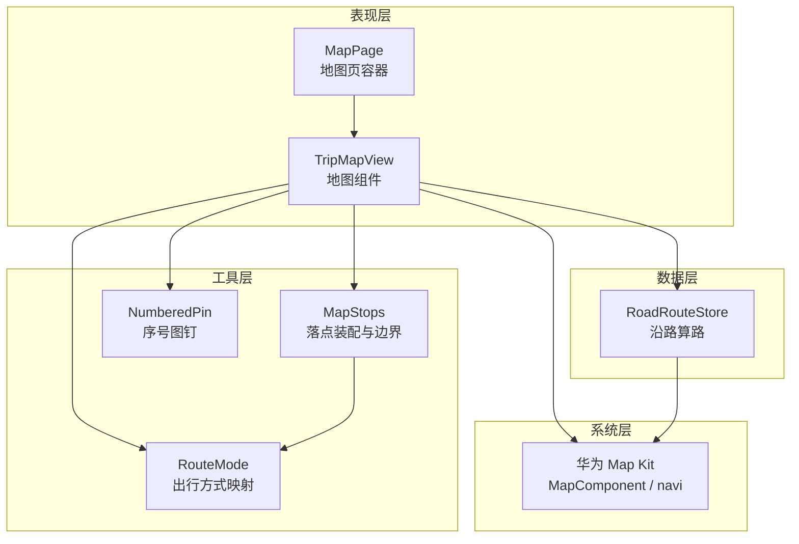
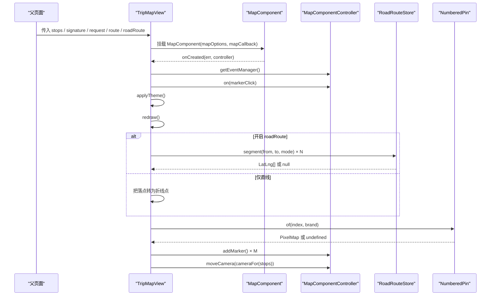
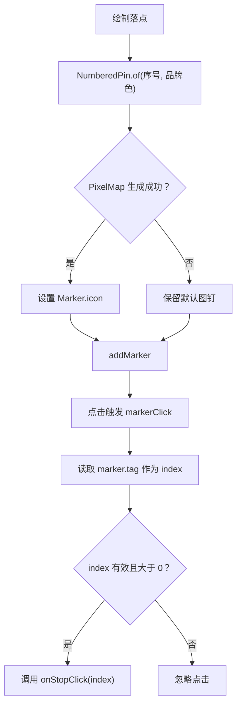
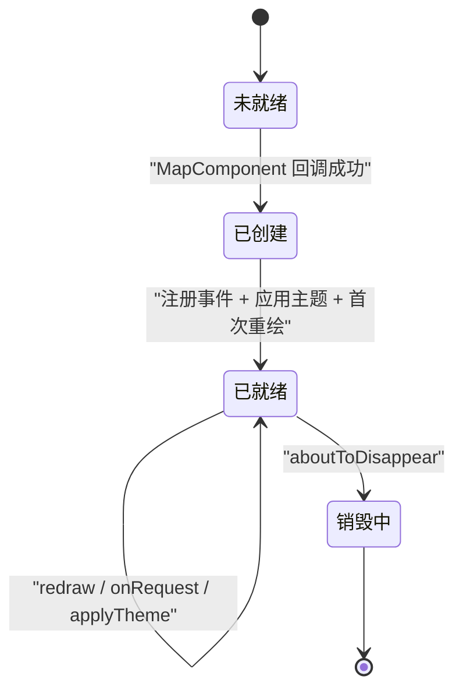
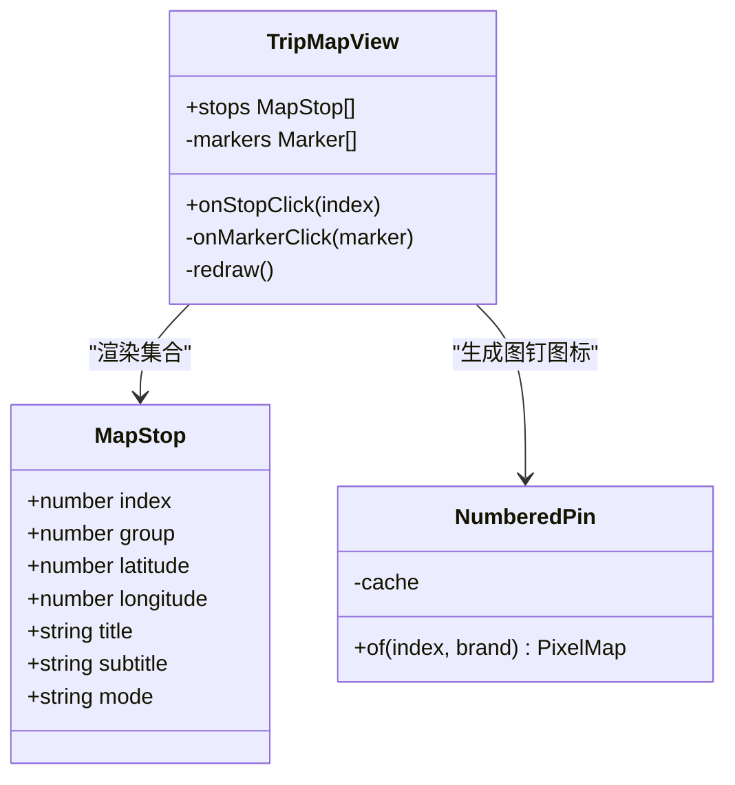
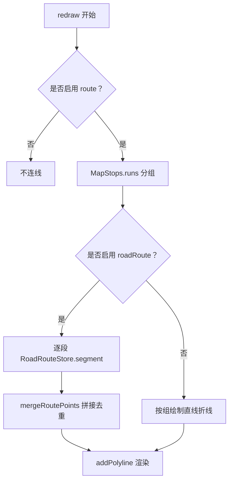
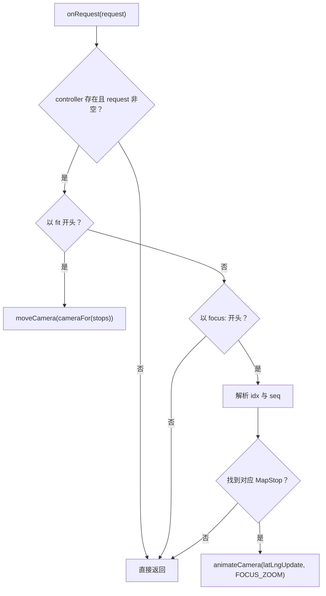
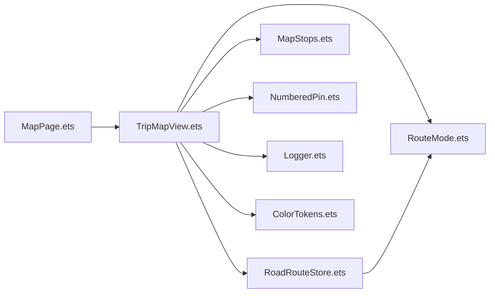
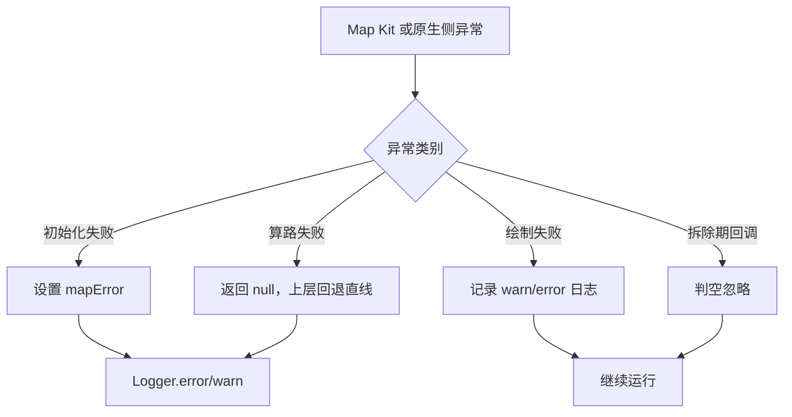
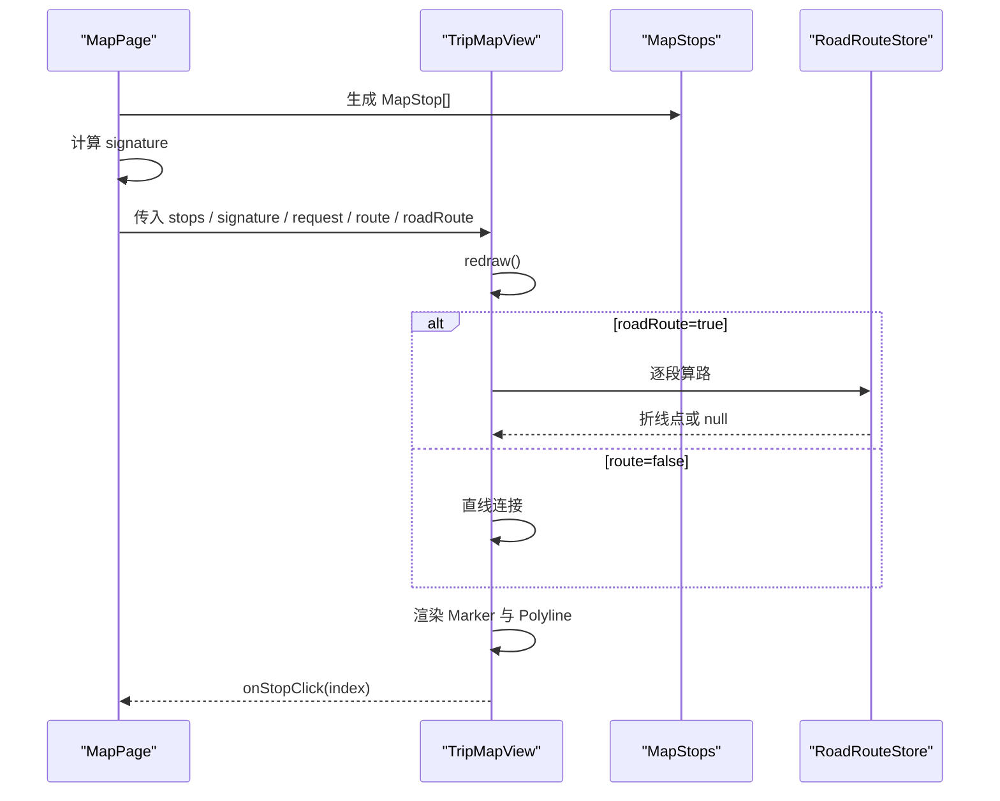

# 行程地图 TripMapView

<cite>
**本文引用的文件**   
- [TripMapView.ets](file://entry/src/main/ets/components/TripMapView.ets)
- [RoadRouteStore.ets](file://entry/src/main/ets/data/RoadRouteStore.ets)
- [NumberedPin.ets](file://entry/src/main/ets/utils/NumberedPin.ets)
- [MapStops.ets](file://entry/src/main/ets/utils/MapStops.ets)
- [Logger.ets](file://entry/src/main/ets/common/logger/Logger.ets)
- [ColorTokens.ets](file://entry/src/main/ets/design/ColorTokens.ets)
- [RouteMode.ets](file://entry/src/main/ets/utils/RouteMode.ets)
- [MapPage.ets](file://entry/src/main/ets/pages/MapPage.ets)
</cite>

## 目录
1. [简介](#简介)
2. [项目结构定位](#项目结构定位)
3. [核心组件总览](#核心组件总览)
4. [架构与数据流](#架构与数据流)
5. [详细组件分析](#详细组件分析)
6. [依赖关系分析](#依赖关系分析)
7. [性能与渲染策略](#性能与渲染策略)
8. [错误处理与容错](#错误处理与容错)
9. [使用示例与最佳实践](#使用示例与最佳实践)
10. [结论](#结论)

## 简介
`TripMapView` 是面向华为 Map Kit 的行程地图组件，负责把一组落点（`MapStop`）渲染为带序号的图钉，并在可选情况下连接成直线或道路折线。它同时承担以下职责：
- 初始化 `MapComponent`、持有控制器、注册 marker 点击事件。
- 根据父组件指令控制相机全览或聚焦某个站点。
- 将 WGS84 种子坐标按中国大陆 GCJ02 口径交给 Map Kit。
- 通过 `RoadRouteStore` 异步算路，并用竞态序列避免旧结果覆盖新行程。
- 在日间与夜间主题下切换地图模式与品牌色。
- 在鉴权失败或原生异常时给出用户可见兜底状态，并记录结构化日志。

该组件可复用在屏 8 地图面板、dock 地图页以及片区候选卡等场景；其中不同宿主只改变传参口径，不改变组件内部三条核心规则。

## 项目结构定位
`TripMapView` 位于 ArkTS 应用层的 UI 组件目录中，属于表现层入口之一；它与数据层 `RoadRouteStore`、纯逻辑工具 `MapStops` 和 `RouteMode`、UI 资源 `ColorTokens` 以及日志 `Logger` 协作，但不直接访问数据库或网络。

**图示来源**
- [TripMapView.ets:1-385](file://entry/src/main/ets/components/TripMapView.ets#L1-L385)
- [RoadRouteStore.ets:1-118](file://entry/src/main/ets/data/RoadRouteStore.ets#L1-L118)
- [MapStops.ets:1-187](file://entry/src/main/ets/utils/MapStops.ets#L1-L187)
- [NumberedPin.ets:1-86](file://entry/src/main/ets/utils/NumberedPin.ets#L1-L86)
- [RouteMode.ets:1-68](file://entry/src/main/ets/utils/RouteMode.ets#L1-L68)
- [MapPage.ets:1-200](file://entry/src/main/ets/pages/MapPage.ets#L1-L200)

**章节来源**
- [TripMapView.ets:1-60](file://entry/src/main/ets/components/TripMapView.ets#L1-L60)
- [MapPage.ets:1-60](file://entry/src/main/ets/pages/MapPage.ets#L1-L60)

## 核心组件总览

| 名称 | 类型 | 主要职责 | 关键属性或方法 |
|---|---|---|---|
| `TripMapView` | ArkTS 组件 | 地图初始化、落点与动线渲染、相机控制、主题适配、生命周期清理 | `stops`、`signature`、`request`、`route`、`roadRoute`、`onStopClick`、`fitTopPx`、`fitBottomPx` |
| `MapStops` | 纯逻辑类 | 从行程、景点、片区生成 `MapStop`，计算边界、分组与内容指纹 | `fromDay`、`fromDays`、`fromSpots`、`fromAreas`、`bounds`、`runs`、`signature` |
| `NumberedPin` | 纯逻辑类 | 用离屏画布生成带序号的品牌图钉像素图，供 Marker 使用 | `of(index, brand)` |
| `RoadRouteStore` | 数据层类 | 调用 Map Kit `navi` 获取步行/驾车/公交路线，带缓存与容错 | `segment(context, from, to, mode)` |
| `RouteMode` | 纯逻辑模块 | 把自由文案出行方式收敛为三档，并合并重复路线点 | `routeModeOf(mode)`、`mergeRoutePoints(segments)` |
| `Logger` | 日志工具 | 统一 hilog 输出，区分 debug/info/warn/error | `debug`、`info`、`warn`、`error` |
| `ColorTokens` | 设计令牌 | 导出品牌色、文字色、路线色等资源引用 | `brand`、`routePath`、`ink`、`muted` 等 |

**章节来源**
- [TripMapView.ets:1-385](file://entry/src/main/ets/components/TripMapView.ets#L1-L385)
- [MapStops.ets:1-187](file://entry/src/main/ets/utils/MapStops.ets#L1-L187)
- [NumberedPin.ets:1-86](file://entry/src/main/ets/utils/NumberedPin.ets#L1-L86)
- [RoadRouteStore.ets:1-118](file://entry/src/main/ets/data/RoadRouteStore.ets#L1-L118)
- [RouteMode.ets:1-68](file://entry/src/main/ets/utils/RouteMode.ets#L1-L68)
- [Logger.ets:1-35](file://entry/src/main/ets/common/logger/Logger.ets#L1-L35)
- [ColorTokens.ets:1-202](file://entry/src/main/ets/design/ColorTokens.ets#L1-L202)

## 架构与数据流

### 地图初始化与控制流程
`TripMapView` 在构建函数中挂载 `MapComponent`，并通过回调拿到控制器。控制器创建后，组件会注册 marker 点击事件、应用当前主题、执行首次重绘，并把相机收敛到全部落点。

**图示来源**
- [TripMapView.ets:60-180](file://entry/src/main/ets/components/TripMapView.ets#L60-L180)
- [TripMapView.ets:201-385](file://entry/src/main/ets/components/TripMapView.ets#L201-L385)
- [RoadRouteStore.ets:28-70](file://entry/src/main/ets/data/RoadRouteStore.ets#L28-L70)
- [NumberedPin.ets:34-86](file://entry/src/main/ets/utils/NumberedPin.ets#L34-L86)

### 标记点与点击回调流程
每个 `MapStop` 对应一个 Marker。`NumberedPin.of` 用序号和品牌色生成像素图；若生成失败则退回默认图钉。Marker 点击后，组件读取其 tag，再调用父组件传入的 `onStopClick`。

**图示来源**
- [TripMapView.ets:300-385](file://entry/src/main/ets/components/TripMapView.ets#L300-L385)
- [NumberedPin.ets:34-86](file://entry/src/main/ets/utils/NumberedPin.ets#L34-L86)

**章节来源**
- [TripMapView.ets:60-120](file://entry/src/main/ets/components/TripMapView.ets#L60-L120)
- [TripMapView.ets:300-385](file://entry/src/main/ets/components/TripMapView.ets#L300-L385)
- [NumberedPin.ets:1-86](file://entry/src/main/ets/utils/NumberedPin.ets#L1-L86)

## 详细组件分析

### 华为 Map Kit 集成：初始化、控制器、事件与生命周期
`TripMapView` 使用 `@kit.MapKit` 中的 `map` 和 `mapCommon`。组件构造时先建立默认 `MapOptions`，中心点默认为北京，缩放级别为 `DEFAULT_ZOOM`，并关闭缩放控件、指南针、比例尺、定位按钮以及倾斜旋转手势。

在 `aboutToAppear` 中，如果已有可用落点，会用第一个落点的坐标替换初始中心点，保证首帧不显示空白城市。真正的控制器在 `onCreated` 回调中获得；此时才注册 `markerClick` 事件、应用主题并执行首次重绘。

生命周期结束时，`aboutToDisappear` 必须做两件事：
1. 注销 `markerClick` 监听器。
2. 移除所有 Marker 与 Polyline。

这两步都被包裹在 `try/catch` 中，因为底层对象可能在组件拆除期被回收；任何未捕获异常都会导致进程崩溃。

**图示来源**
- [TripMapView.ets:60-120](file://entry/src/main/ets/components/TripMapView.ets#L60-L120)
- [TripMapView.ets:120-180](file://entry/src/main/ets/components/TripMapView.ets#L120-L180)

**章节来源**
- [TripMapView.ets:60-180](file://entry/src/main/ets/components/TripMapView.ets#L60-L180)

### 标记点系统：MapStop 集合、NumberedPin 与点击回调
`MapStop` 由 `MapStops` 从行程活动、景点或片区数据组装而来。每个落点包含序号、分组、经纬度、标题、副标题和可选交通方式。`MapStops.usable` 在中国大陆范围内过滤无效坐标，防止整条动线被拉偏。

`NumberedPin` 使用 ArkTS 自带的 OffscreenCanvas 绘制白底胶囊徽章、品牌描边、细尖角和固定深蓝色序号。结果按“序号+品牌色”键缓存；同一行程在不同天之间切换不会重复绘制。生成失败时返回 `undefined`，组件会回退到默认图钉，确保地图不会因为图钉渲染问题而失去所有落点。

点击回调通过 `marker.getTag()` 取回 `MapStop.index`。由于 Map Kit 在组件拆除期可能用 `undefined` 再次回调，代码显式判断空值，避免 TypeError 拖垮进程。

**图示来源**
- [MapStops.ets:17-40](file://entry/src/main/ets/utils/MapStops.ets#L17-L40)
- [NumberedPin.ets:34-86](file://entry/src/main/ets/utils/NumberedPin.ets#L34-L86)
- [TripMapView.ets:300-385](file://entry/src/main/ets/components/TripMapView.ets#L300-L385)

**章节来源**
- [MapStops.ets:1-187](file://entry/src/main/ets/utils/MapStops.ets#L1-L187)
- [NumberedPin.ets:1-86](file://entry/src/main/ets/utils/NumberedPin.ets#L1-L86)
- [TripMapView.ets:300-385](file://entry/src/main/ets/components/TripMapView.ets#L300-L385)

### 路线绘制：直线与道路折线切换
当 `route=true` 且某组内落点数大于 1 时，组件会绘制动线。有两种模式：

| 模式 | 行为 | 适用场景 |
|---|---|---|
| 直线 | 直接把同组内相邻落点连成折线 | 屏 5 片区卡、互斥候选项 |
| 道路折线 | 每段调用 `RoadRouteStore.segment` 获取 Map Kit `navi` 路径 | 行程详情页、地图页全程视图 |

`roadRoute=false` 时走直线分支；`roadRoute=true` 时按组拆分，对每组内每两个相邻落点发起并行算路请求。每个路段失败都回退为直线 `[from, to]`，保证整条动线不断。所有路段完成后，再通过 `mergeRoutePoints` 拼接去重，最后统一调用 `addPolyline` 渲染。

**图示来源**
- [TripMapView.ets:201-385](file://entry/src/main/ets/components/TripMapView.ets#L201-L385)
- [RoadRouteStore.ets:28-70](file://entry/src/main/ets/data/RoadRouteStore.ets#L28-L70)
- [RouteMode.ets:1-68](file://entry/src/main/ets/utils/RouteMode.ets#L1-L68)

**章节来源**
- [TripMapView.ets:201-385](file://entry/src/main/ets/components/TripMapView.ets#L201-L385)
- [RoadRouteStore.ets:1-118](file://entry/src/main/ets/data/RoadRouteStore.ets#L1-L118)
- [RouteMode.ets:1-68](file://entry/src/main/ets/utils/RouteMode.ets#L1-L68)

### 相机控制：全览、聚焦与缩放策略
相机控制分为三类：

| 控制方式 | 含义 | 实现要点 |
|---|---|---|
| `request='fit'` | 全览所有落点 | 计算 `MapBounds`，加左右上下留白，返回 `newLatLngBounds` |
| `request='focus:<idx>:<seq>'` | 聚焦指定序号的落点 | 查找匹配 `MapStop`，以 `FOCUS_ZOOM=14` 平滑动画 |
| 首帧自动收敛 | 组件创建后立即收敛到全部落点 | 防止首帧停留在默认缩放，气泡挤在一起 |

缩放策略如下：

| 常量 | 值 | 用途 |
|---|---:|---|
| `SINGLE_ZOOM` | 15 | 单落点时放大查看 |
| `DEFAULT_ZOOM` | 11 | 初始中心点默认缩放 |
| `FOCUS_ZOOM` | 14 | 聚焦单个站点的动画缩放 |

全览时优先使用落点边界；如果边界为空，则回退到北京默认位置与默认缩放。

**图示来源**
- [TripMapView.ets:120-200](file://entry/src/main/ets/components/TripMapView.ets#L120-L200)

**章节来源**
- [TripMapView.ets:120-200](file://entry/src/main/ets/components/TripMapView.ets#L120-L200)

### 坐标系统与边界计算
组件头注释明确说明：中国大陆环境下 Map Kit 使用 GCJ02，而种子数据通常以 WGS84 存储，因此必须在入库前完成转换；组件本身不再做坐标系转换，而是直接使用落点中的经纬度传给 Map Kit。

`MapStops.bounds` 扫描全部落点，计算最小最大经纬度边界；`cameraFor` 将其转换为 `LatLngBounds`，并按 `FIT_PAD_SIDE`、`FIT_PAD_TOP`、`FIT_PAD_BOTTOM` 添加留白。注释强调这些单位是像素而非虚拟像素，并且顶部留白必须足够容纳图钉尖角以上部分，否则首站会被界面边缘裁切。

| 参数 | 默认值 | 说明 |
|---|---:|---|
| `FIT_PAD_SIDE` | 120 | 左右留白 |
| `FIT_PAD_TOP` | 280 | 顶部留白，需覆盖图钉高度 |
| `FIT_PAD_BOTTOM` | 150 | 底部留白 |
| `fitTopPx` | 继承 `FIT_PAD_TOP` | 宿主可自定义顶部留白 |
| `fitBottomPx` | 继承 `FIT_PAD_BOTTOM` | 宿主可自定义底部留白 |

**章节来源**
- [TripMapView.ets:1-60](file://entry/src/main/ets/components/TripMapView.ets#L1-L60)
- [TripMapView.ets:120-200](file://entry/src/main/ets/components/TripMapView.ets#L120-L200)
- [MapStops.ets:120-187](file://entry/src/main/ets/utils/MapStops.ets#L120-L187)

### 主题适配与品牌色
组件通过 `@StorageProp('isDarkMode')` 监听深浅档，并在控制器可用时调用 `setDayNightMode`。地图颜色方面，动线颜色使用硬编码的 ARGB 数值：浅色为 `#FF0066CC`，深色为 `#FF7DB8FF`，与契约中的 `route_path` 语义对齐。

图钉品牌色也分两档：浅色 `#FF0066CC`，深色 `#FF7DB8FF`，并以 `'#AARRGGBB'` 字符串形式传给 Canvas。虽然 `ColorTokens` 暴露了 `brand`、`routePath` 等资源令牌，但本组件目前用常量表达地图 SDK 所需的数值格式。

**章节来源**
- [TripMapView.ets:1-60](file://entry/src/main/ets/components/TripMapView.ets#L1-L60)
- [TripMapView.ets:180-200](file://entry/src/main/ets/components/TripMapView.ets#L180-L200)
- [TripMapView.ets:201-385](file://entry/src/main/ets/components/TripMapView.ets#L201-L385)
- [ColorTokens.ets:1-202](file://entry/src/main/ets/design/ColorTokens.ets#L1-L202)

### 错误处理与日志
组件的错误处理遵循三层原则：

1. **用户可见兜底**：地图加载失败时设置 `mapError`，并在构建函数中渲染“底图没出来”提示。
2. **原生侧异常保护**：`aboutToDisappear` 中的事件注销与覆盖物清理均使用 `try/catch`，并记录警告日志。
3. **结构化日志**：所有异常经 `Logger.error` 或 `Logger.warn` 输出，tag 为 `Ui.Map`。

`RoadRouteStore` 对 Map Kit `navi` 的鉴权失败、服务不可用、权限未开通等错误也做统一捕获，返回 `null`，让上层回退为直线，而不是让地图断成空白。

| 错误场景 | 处理方式 |
|---|---|
| `MapComponent` 初始化失败 | 设置用户提示，记录 error 日志 |
| 组件拆除期回调 marker | 判空后忽略，避免进程崩溃 |
| 路线算路失败 | 记录 warn，返回 null，上层回退直线 |
| 落点或折线异步绘制时控制器已销毁 | 记录 warn，丢弃结果 |
| 无可用落点 | 记录 warn，保持地图空白 |

**章节来源**
- [TripMapView.ets:60-180](file://entry/src/main/ets/components/TripMapView.ets#L60-L180)
- [TripMapView.ets:201-385](file://entry/src/main/ets/components/TripMapView.ets#L201-L385)
- [RoadRouteStore.ets:28-70](file://entry/src/main/ets/data/RoadRouteStore.ets#L28-L70)
- [Logger.ets:1-35](file://entry/src/main/ets/common/logger/Logger.ets#L1-L35)

## 依赖关系分析

**图示来源**
- [TripMapView.ets:1-60](file://entry/src/main/ets/components/TripMapView.ets#L1-L60)
- [MapPage.ets:1-60](file://entry/src/main/ets/pages/MapPage.ets#L1-L60)

### 耦合与内聚
- `TripMapView` 是高内聚的地图表现组件，但耦合了多个外部模块：地图 SDK、算路数据层、落点装配工具、图钉生成器和日志。
- `RoadRouteStore` 是低耦合的数据层封装，只关心起止点和出行方式，不感知 UI。
- `MapStops` 和 `RouteMode` 是纯逻辑，不依赖 `@kit`，便于离线测试。
- `NumberedPin` 只依赖图像 API 与日志，失败时降级，不阻断主流程。

### 潜在循环依赖
当前依赖方向单向：页面 → 组件 → 工具/数据层 → 系统 SDK，没有明显循环引用。

**章节来源**
- [TripMapView.ets:1-60](file://entry/src/main/ets/components/TripMapView.ets#L1-L60)
- [RoadRouteStore.ets:1-28](file://entry/src/main/ets/data/RoadRouteStore.ets#L1-L28)
- [MapStops.ets:1-16](file://entry/src/main/ets/utils/MapStops.ets#L1-L16)
- [RouteMode.ets:1-12](file://entry/src/main/ets/utils/RouteMode.ets#L1-L12)

## 性能与渲染策略

### 重绘门控
组件使用 `signature` 作为重铺准绳：如果签名与上次绘制一致，`redraw` 直接返回。父组件应优先维护这个标量键，而不是依赖数组变更时机；源码注释明确指出数组 `@Prop` 的变更时机不可靠。

### 落点与路线并发
- 所有 Marker 创建使用 `Promise.all` 并发。
- 每条道路路段使用并行 Promise 数组，再由 `Promise.all` 汇总。
- 落点与路线绘制分别维护 `markers` 和 `lines` 列表，避免混放。

### 竞态处理
每次 `redraw` 递增私有字段 `routeSeq`。异步算路完成后，只有 `mySeq === this.routeSeq` 时才继续渲染。这能防止旧行程的算路结果覆盖新行程的路线。

### 图钉缓存
`NumberedPin` 按“序号+品牌色”缓存 `PixelMap`，避免频繁重绘相同序号图钉。

### 留白与视角权衡
小面板受净高限制，顶部留白 280、底部留白 150、侧边留白 120 后，可视带变小；两点相距较远时镜头必然退到街区以上。这是有意取舍：小面板用于“当日动线概览”，不是导航级近景。

**章节来源**
- [TripMapView.ets:1-60](file://entry/src/main/ets/components/TripMapView.ets#L1-L60)
- [TripMapView.ets:201-385](file://entry/src/main/ets/components/TripMapView.ets#L201-L385)
- [NumberedPin.ets:34-86](file://entry/src/main/ets/utils/NumberedPin.ets#L34-L86)

## 错误处理与容错

### 鉴权失败兜底
`RoadRouteStore` 对算路异常统一捕获，记录 code、message 和出行方式，然后返回 `null`。调用方 `TripMapView.drawRoadRoutes` 会把失败路段回退为起点到终点的直线，从而保证地图不断线。

### 原生侧异常保护
组件在 `aboutToDisappear` 中清理事件和覆盖物时使用 `try/catch`，并写入 `Logger.warn`。这避免底层对象已释放时的异常向上逃逸造成进程崩溃。

### 日志规范
所有日志通过 `Logger` 输出，tag 按模块命名，例如 `Ui.Map`、`Data.RoadRoute`、`Ui.MapPin`。生产环境禁止直接调用控制台输出，以便设备端通过 hilog 统一过滤。

**图示来源**
- [TripMapView.ets:60-180](file://entry/src/main/ets/components/TripMapView.ets#L60-L180)
- [TripMapView.ets:201-385](file://entry/src/main/ets/components/TripMapView.ets#L201-L385)
- [RoadRouteStore.ets:28-70](file://entry/src/main/ets/data/RoadRouteStore.ets#L28-L70)
- [Logger.ets:1-35](file://entry/src/main/ets/common/logger/Logger.ets#L1-L35)

**章节来源**
- [TripMapView.ets:60-180](file://entry/src/main/ets/components/TripMapView.ets#L60-L180)
- [RoadRouteStore.ets:28-70](file://entry/src/main/ets/data/RoadRouteStore.ets#L28-L70)
- [Logger.ets:1-35](file://entry/src/main/ets/common/logger/Logger.ets#L1-L35)

## 使用示例与最佳实践

### 父组件数据绑定
父组件应维护以下状态并传给 `TripMapView`：

| 父组件状态 | 组件属性 | 说明 |
|---|---|---|
| 落点数组 | `stops` | 由 `MapStops.fromDay` 或 `fromDays` 生成 |
| 内容指纹 | `signature` | 由 `MapStops.signature` 生成，避免数组变更不可靠 |
| 相机指令 | `request` | `'fit'` 或 `'focus:<idx>:<seq>'` |
| 是否连线 | `route` | 行程为真，互斥候选为假 |
| 是否道路折线 | `roadRoute` | 行程详情与地图页为真，片区卡为假 |
| 点击回调 | `onStopClick` | 同步列表或站点条高亮 |
| 顶部留白 | `fitTopPx` | 宿主根据浮层高度测量传入 |
| 底部留白 | `fitBottomPx` | 同上 |

推荐做法：
- 只在数据真正变化时更新 `signature`。
- 每次相机指令附带自增序列号，例如 `fit:${seq}` 或 `focus:${index}:${seq}`，帮助父组件忽略过时响应。
- 点击地图落点后，通过 `MapStops.activityIndex` 反查原始活动下标，再滚动列表或站点条到对应行。

**章节来源**
- [MapPage.ets:100-200](file://entry/src/main/ets/pages/MapPage.ets#L100-L200)
- [MapStops.ets:40-120](file://entry/src/main/ets/utils/MapStops.ets#L40-L120)
- [TripMapView.ets:1-60](file://entry/src/main/ets/components/TripMapView.ets#L1-L60)

### 指令传递模式
`TripMapView` 把相机控制抽象为字符串指令：
- `'fit'`：全览。
- `'focus:<index>:<seq>'`：聚焦指定序号，并携带 `seq` 参与幂等判断。

这种模式的优点是：
- 指令是单一字符串，易于比较和去抖。
- `seq` 可以配合父组件的递增计数器，避免旧点击结果覆盖新点击。
- 不需要在组件内部暴露复杂的相机 API。

**章节来源**
- [TripMapView.ets:120-200](file://entry/src/main/ets/components/TripMapView.ets#L120-L200)

### 性能优化建议
1. **优先使用 `signature`**：不要依赖数组变化触发重绘。
2. **合理设置 `roadRoute`**：只在需要真实道路折线的场景开启；片区候选卡应关闭。
3. **控制落点数量**：大量落点会导致大量 Marker 和 Promise 并发，必要时分页或聚合。
4. **复用 `NumberedPin` 缓存**：序号和品牌色不变时不重复生成像素图。
5. **避免重复算路**：`RoadRouteStore` 自带 30 分钟缓存；父组件应避免短时间内反复触发相同起终点请求。
6. **注意小面板留白**：不要在浅面板上误以为留白越大越好；280 顶部留白是为了给图钉留出空间。
7. **主题切换时重建必要内容**：深浅档变化会改变品牌色与地图模式，可通过 `signature` 或组件重建确保图钉颜色正确。

### 典型使用流程

**图示来源**
- [MapPage.ets:270-450](file://entry/src/main/ets/pages/MapPage.ets#L270-L450)
- [TripMapView.ets:201-385](file://entry/src/main/ets/components/TripMapView.ets#L201-L385)
- [RoadRouteStore.ets:28-70](file://entry/src/main/ets/data/RoadRouteStore.ets#L28-L70)

## 结论
`TripMapView` 是一个职责清晰、容错完整的地图表现组件。它以 `MapStop` 为统一数据模型，把落点渲染、路线连接、相机控制和主题适配集中在一个可复用组件中；同时把地图 SDK 调用下沉到组件内部，让父组件只需关注数据、指令和交互。

它的设计亮点包括：
- 用 `signature` 解决 ArkTS 数组 `@Prop` 变更时机不可靠的问题。
- 用 `routeSeq` 解决多段异步算路的竞态问题。
- 用 `MapStops.runs` 按天分组，避免跨天误连。
- 用 `NumberedPin` 提供可识别的序号图钉，并支持离线降级。
- 用 `RoadRouteStore` 隔离 Map Kit 算路细节，并提供缓存与回退。
- 用 `Logger` 统一日志出口，配合 try/catch 保护原生侧生命周期。

在使用时，应重点关注父组件的 `signature` 管理、指令中的 `seq` 幂等、落点可用性过滤、道路算路开关，以及宿主提供的留白参数。只要遵守这些约定，`TripMapView` 就能在行程地图、片区地图和候选地点地图等多个场景中稳定工作。