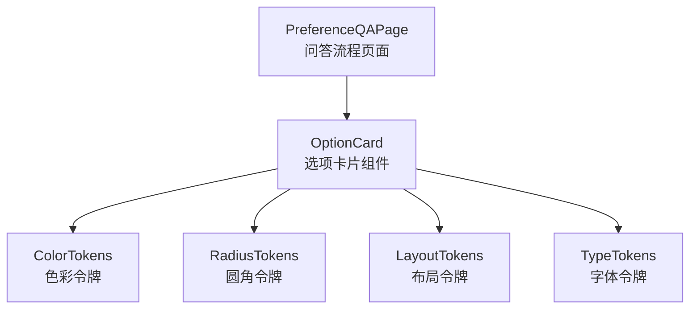
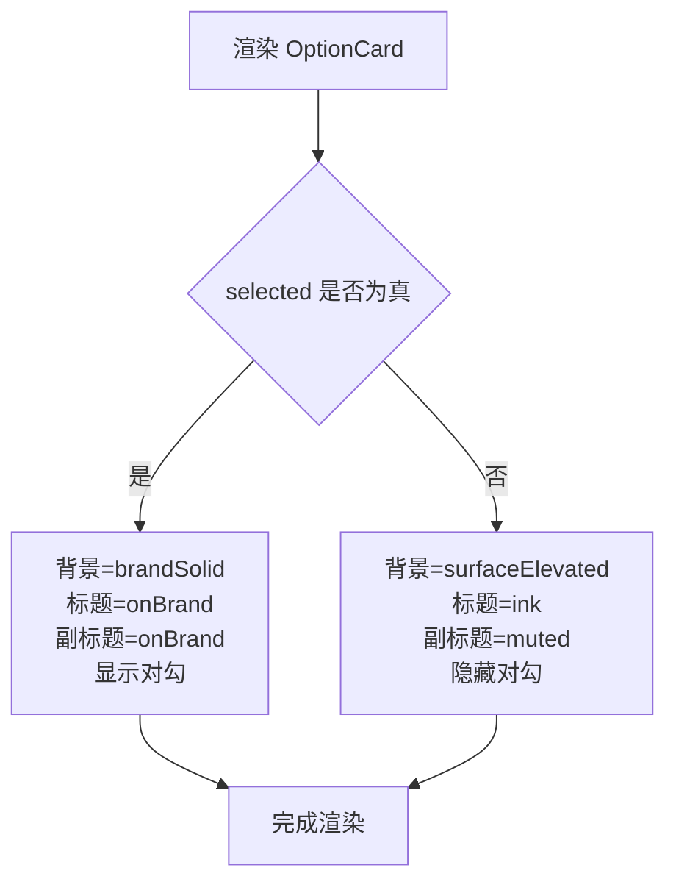
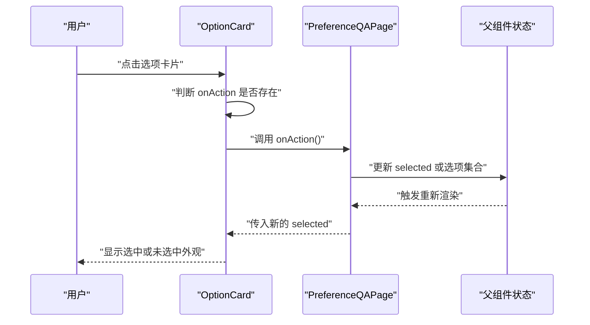
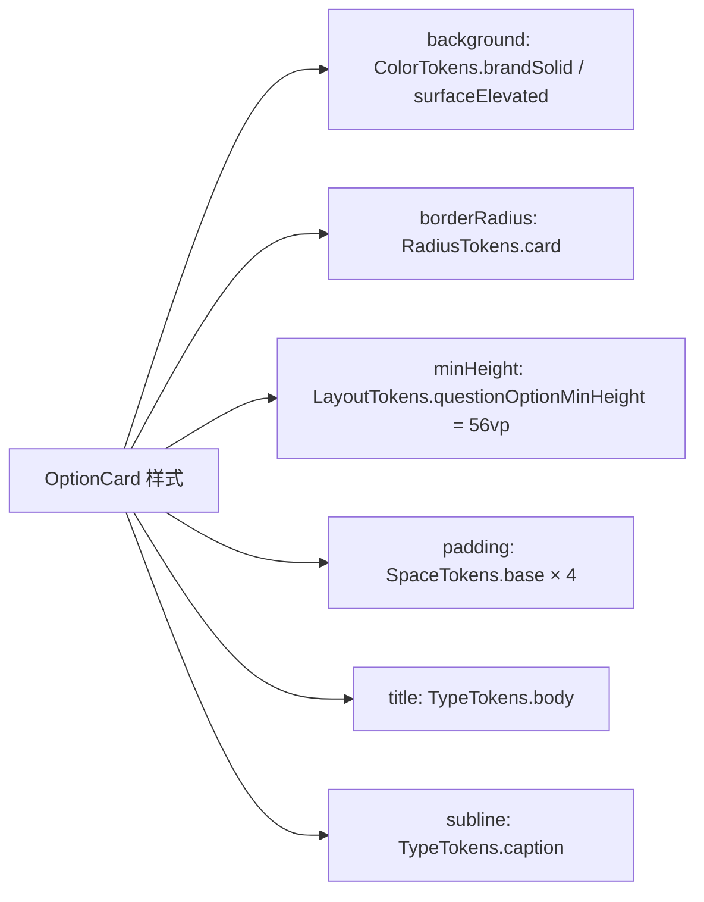
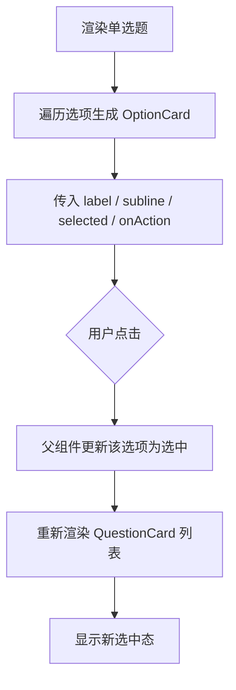
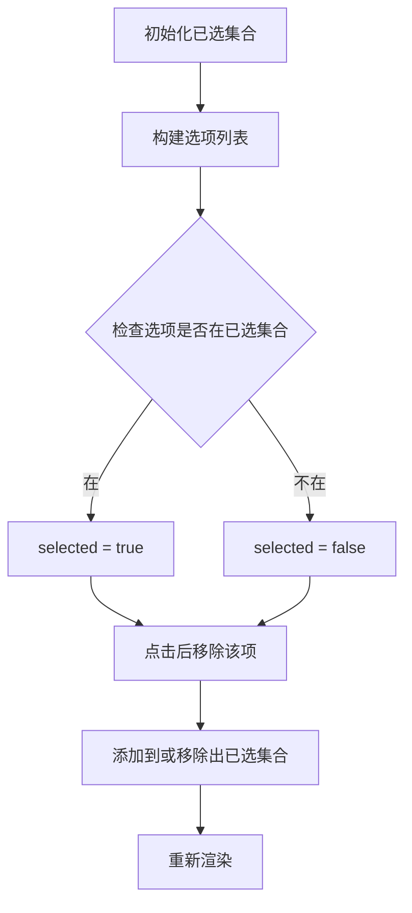
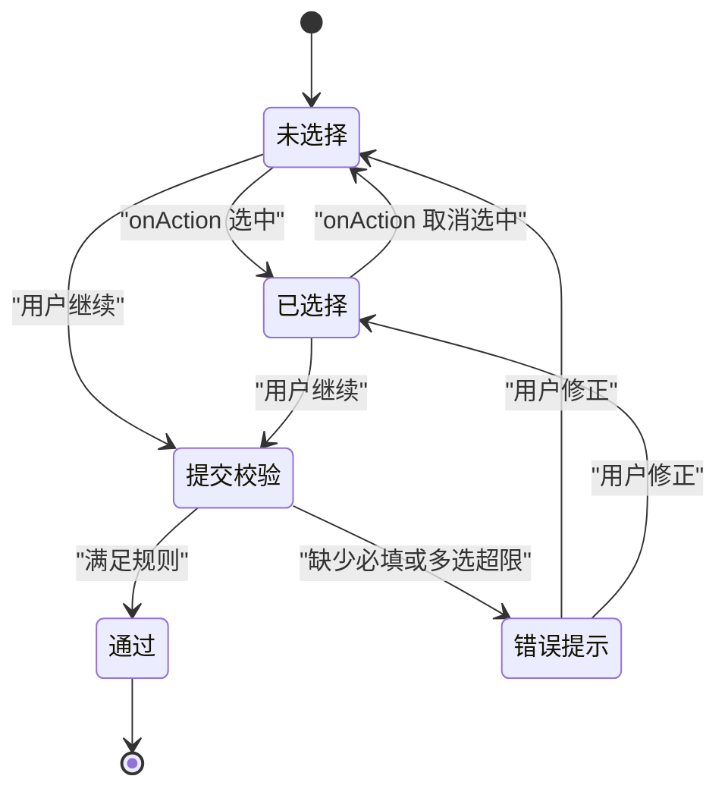
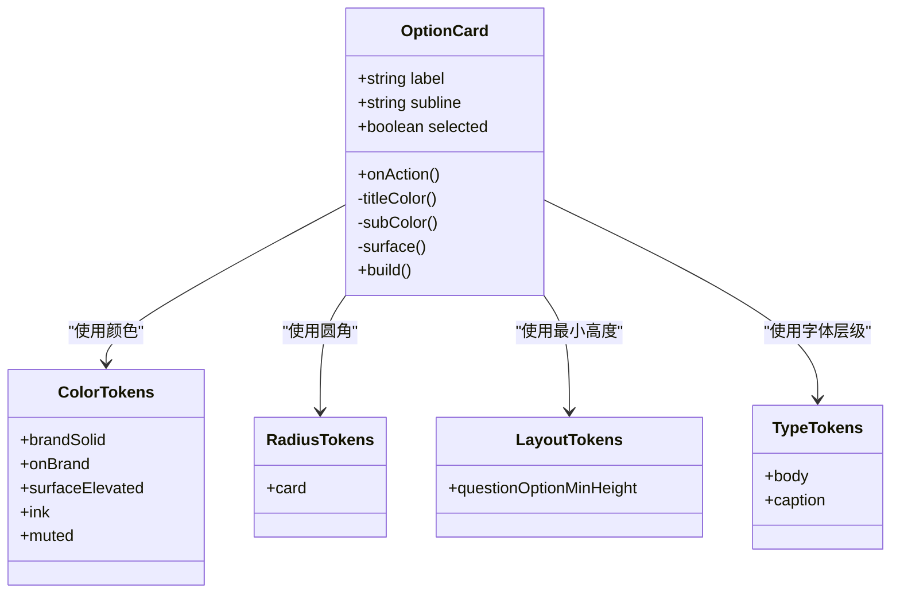

# 选项卡片 OptionCard

<cite>
**本文引用的文件 **
- [OptionCard.ets](file://entry/src/main/ets/components/OptionCard.ets)
- [PreferenceQAPage.ets](file://entry/src/main/ets/pages/PreferenceQAPage.ets)
- [ColorTokens.ets](file://entry/src/main/ets/design/ColorTokens.ets)
- [RadiusTokens.ets](file://entry/src/main/ets/design/RadiusTokens.ets)
- [LayoutTokens.ets](file://entry/src/main/ets/design/LayoutTokens.ets)
- [TypeTokens.ets](file://entry/src/main/ets/design/TypeTokens.ets)
- [color.json（浅色）](file://entry/src/main/resources/base/element/color.json)
- [color.json（深色）](file://entry/src/main/resources/dark/element/color.json)
</cite>

## 目录
1. [简介](#简介)
2. [项目结构中的位置](#项目结构中的位置)
3. [组件用途与适用场景](#组件用途与适用场景)
4. [视觉设计说明](#视觉设计说明)
5. [交互逻辑](#交互逻辑)
6. [样式规范](#样式规范)
7. [无障碍支持](#无障碍支持)
8. [对比度合规](#对比度合规)
9. [使用示例](#使用示例)
10. [依赖关系分析](#依赖关系分析)
11. [常见问题排查](#常见问题排查)
12. [总结](#总结)

## 简介
OptionCard 是用于屏 3 / 屏 3b 问答流程的追问选项卡组件。它把“标题 + 副标题 + 选中标记”封装成一个可点击卡片，供用户在单选或多选场景中确认偏好、目的地类型、出行方式等结构化问题。组件本身不维护业务状态，只负责渲染选中态和触发 `onAction` 回调，由上层页面管理表单数据。

该组件按有据源码全量对齐：选中态使用品牌实心底 `brandSolid` 搭配白字 `onBrand`，并在右上角显示对勾标记；未选中态使用浮起表面 `surfaceElevated` 加主文字色 `ink`。外层使用系统 Button，保留按压态、焦点态和无障碍行为。

**章节来源**
- [OptionCard.ets:1-74](file://entry/src/main/ets/components/OptionCard.ets#L1-L74)

## 项目结构中的位置
OptionCard 位于通用组件层，被问答页引用。其视觉语义来自 design token 层，布局尺寸也走 layout token，不直接硬编码颜色或间距常量。

**图示来源**
- [OptionCard.ets:1-74](file://entry/src/main/ets/components/OptionCard.ets#L1-L74)
- [PreferenceQAPage.ets:180-260](file://entry/src/main/ets/pages/PreferenceQAPage.ets#L180-L260)
- [ColorTokens.ets:1-202](file://entry/src/main/ets/design/ColorTokens.ets#L1-L202)
- [RadiusTokens.ets:1-43](file://entry/src/main/ets/design/RadiusTokens.ets#L1-L43)
- [LayoutTokens.ets:1-200](file://entry/src/main/ets/design/LayoutTokens.ets#L1-L200)
- [TypeTokens.ets:1-94](file://entry/src/main/ets/design/TypeTokens.ets#L1-L94)

**章节来源**
- [OptionCard.ets:1-74](file://entry/src/main/ets/components/OptionCard.ets#L1-L74)
- [PreferenceQAPage.ets:180-260](file://entry/src/main/ets/pages/PreferenceQAPage.ets#L180-L260)

## 组件用途与适用场景
- 主要用途：呈现一个可选择的问答选项，包含主文案和可选副文案。
- 典型场景：
  - 用户偏好选择，如“喜欢自然风景”“喜欢城市漫步”。
  - 目的地类型筛选，如“海滨”“山地”“古镇”。
  - 多轮问答中需要明确选中项并反馈到下一步的数据收集。
- 状态边界：组件内部只持有 `selected` 布尔值；所有实际选项集合、单选/多选约束、默认值都应由父组件维护。

**章节来源**
- [OptionCard.ets:1-74](file://entry/src/main/ets/components/OptionCard.ets#L1-L74)
- [PreferenceQAPage.ets:180-260](file://entry/src/main/ets/pages/PreferenceQAPage.ets#L180-L260)

## 视觉设计说明

### 整体形态
- 控件外壳：系统 Button，宽度占满容器。
- 内容布局：左侧为主标题和副标题，右侧仅在选中时显示对勾符号。
- 背景色：根据 `selected` 在 `brandSolid` 与 `surfaceElevated` 之间切换。
- 圆角：使用 `RadiusTokens.card`。
- 最小高度：使用 `LayoutTokens.questionOptionMinHeight`，契约值为 56vp。
- 内边距：四边统一使用 `SpaceTokens.base`。

### 文本层级
- 主标题：使用 `TypeTokens.body.size`，字重 400，颜色随选中态切换。
- 副标题：使用 `TypeTokens.caption.size`，字重 450，启用等宽数字特性，颜色随选中态切换。
- 对勾符号：使用控制级图标尺寸，颜色与选中态文字一致。

### 颜色映射
| 状态 | 背景 | 主标题颜色 | 副标题颜色 | 对勾 |
|---|---|---|---|---|
| 选中 | `brandSolid` | `onBrand` | `onBrand` | `onBrand` |
| 未选中 | `surfaceElevated` | `ink` | `muted` | 不显示 |

**图示来源**
- [OptionCard.ets:1-74](file://entry/src/main/ets/components/OptionCard.ets#L1-L74)
- [ColorTokens.ets:1-202](file://entry/src/main/ets/design/ColorTokens.ets#L1-L202)

**章节来源**
- [OptionCard.ets:1-74](file://entry/src/main/ets/components/OptionCard.ets#L1-L74)
- [ColorTokens.ets:1-202](file://entry/src/main/ets/design/ColorTokens.ets#L1-L202)
- [TypeTokens.ets:1-94](file://entry/src/main/ets/design/TypeTokens.ets#L1-L94)
- [RadiusTokens.ets:1-43](file://entry/src/main/ets/design/RadiusTokens.ets#L1-L43)
- [LayoutTokens.ets:1-200](file://entry/src/main/ets/design/LayoutTokens.ets#L1-L200)

## 交互逻辑

### 基础控件封装
OptionCard 以 ArkUI 的 `Button` 为外壳，内部用 `Row` 承载文本和对勾，保证点击区域完整覆盖卡片。按钮类型设为普通模式，避免误用高亮或禁用态。

### 点击事件处理
- 当用户点击卡片时，如果传入 `onAction`，则调用该回调。
- 如果未传入 `onAction`，点击不会产生副作用。
- 父组件应在 `onAction` 中更新对应选项的选中状态，并通过 `@State` 驱动重新渲染。

### onAction 回调机制
- `onAction` 是可选函数属性。
- 推荐用法：在父组件中根据当前问题和选项值切换选中状态，再传给子组件的 `selected`。
- 对于单选：先清空同题其他选项，再选中当前项。
- 对于多选：将当前选项加入或从已选集合中移除。

**图示来源**
- [OptionCard.ets:1-74](file://entry/src/main/ets/components/OptionCard.ets#L1-L74)
- [PreferenceQAPage.ets:180-260](file://entry/src/main/ets/pages/PreferenceQAPage.ets#L180-L260)

**章节来源**
- [OptionCard.ets:1-74](file://entry/src/main/ets/components/OptionCard.ets#L1-L74)
- [PreferenceQAPage.ets:180-260](file://entry/src/main/ets/pages/PreferenceQAPage.ets#L180-L260)

## 样式规范

### 尺寸与间距
- 最小高度：`LayoutTokens.questionOptionMinHeight`，值为 56vp。注释指出这是契约 option-chip 的最小高度，而非仅命中区。
- 圆角：`RadiusTokens.card`，属于封闭八值之一，表示卡片与弹层圆角。
- 内边距：上下左右均为 `SpaceTokens.base`，保持卡片内容呼吸感一致。
- 宽度：占满父容器。

### 字体层级
- 主标题使用 `TypeTokens.body`：字号 16，字重 400，行高 24。
- 副标题使用 `TypeTokens.caption`：字号 12，字重 450，行高 16，并开启等宽数字。
- 对勾图标使用控制级图标尺寸，不直接设置字号数值。

### Token 约束
- 颜色全部通过 `ColorTokens` 引用，不允许在组件内写死十六进制值。
- 圆角必须从 `RadiusTokens` 取用。
- 布局尺寸应使用 `LayoutTokens`，避免手工计算 56vp 以外的值。

**图示来源**
- [OptionCard.ets:1-74](file://entry/src/main/ets/components/OptionCard.ets#L1-L74)
- [LayoutTokens.ets:1-200](file://entry/src/main/ets/design/LayoutTokens.ets#L1-L200)
- [TypeTokens.ets:1-94](file://entry/src/main/ets/design/TypeTokens.ets#L1-L94)
- [RadiusTokens.ets:1-43](file://entry/src/main/ets/design/RadiusTokens.ets#L1-L43)

**章节来源**
- [OptionCard.ets:1-74](file://entry/src/main/ets/components/OptionCard.ets#L1-L74)
- [LayoutTokens.ets:1-200](file://entry/src/main/ets/design/LayoutTokens.ets#L1-L200)
- [TypeTokens.ets:1-94](file://entry/src/main/ets/design/TypeTokens.ets#L1-L94)
- [RadiusTokens.ets:1-43](file://entry/src/main/ets/design/RadiusTokens.ets#L1-L43)

## 无障碍支持
- 控件基于系统 Button，因此继承系统 Button 的：
  - 按压态反馈。
  - 焦点状态。
  - 读屏语义。
- 文本可读性：主标题和副标题分别使用不同字号和字重，便于读屏软件区分信息层级。
- 选中提示：对勾符号配合背景和文字颜色变化，向视障用户传达“该选项已被选中”。
- 注意：若上层页面自定义了 Button 的可访问性描述，应确保仍表达“第 X 个选项”和“是否选中”。

**章节来源**
- [OptionCard.ets:1-74](file://entry/src/main/ets/components/OptionCard.ets#L1-L74)

## 对比度合规
组件注释明确给出品牌实心底上白字的对比度要求：
- 浅色模式下品牌底色 #0066CC，白字对比度 ≥ 4.5:1。
- 深色模式下品牌底色 #0050A0，白字对比度 7.91:1。

这两个值由资源文件中的 `brand_solid` 和 `on_brand` 提供，并通过 `ColorTokens` 暴露给组件。

| 主题 | 品牌底色 | 文字色 | 对比度 |
|---|---|---|---|
| 浅色 | #0066CC | 白色 | ≥ 4.5:1 |
| 深色 | #0050A0 | 白色 | 7.91:1 |

实际色值定义位于浅色和深色的 `color.json` 中，组件只通过 token 引用，不直接声明色值。

**章节来源**
- [OptionCard.ets:1-74](file://entry/src/main/ets/components/OptionCard.ets#L1-L74)
- [ColorTokens.ets:1-202](file://entry/src/main/ets/design/ColorTokens.ets#L1-L202)
- [color.json（浅色）](file://entry/src/main/resources/base/element/color.json)
- [color.json（深色）](file://entry/src/main/resources/dark/element/color.json)

## 使用示例

### 单选场景
在问答页中，每个问题的选项列表通过 `ForEach` 渲染。父组件根据当前题目索引和选项值判断是否选中，并在 `onAction` 中切换选中状态。

实现要点：
- 为每个 `OptionCard` 传入 `label`、`subline`、`selected` 和 `onAction`。
- `selected` 由父组件根据当前题目和选项值计算。
- `onAction` 中更新父组件状态，使 UI 刷新。

**图示来源**
- [PreferenceQAPage.ets:180-260](file://entry/src/main/ets/pages/PreferenceQAPage.ets#L180-L260)
- [OptionCard.ets:1-74](file://entry/src/main/ets/components/OptionCard.ets#L1-L74)

**章节来源**
- [PreferenceQAPage.ets:180-260](file://entry/src/main/ets/pages/PreferenceQAPage.ets#L180-L260)
- [OptionCard.ets:1-74](file://entry/src/main/ets/components/OptionCard.ets#L1-L74)

### 多选场景
多选场景的核心是把“单个选中布尔值”升级为“已选集合”。

实现建议：
- 父组件维护一个已选选项集合，例如数组或 Set。
- `selected` 改为判断当前选项是否在已选集合中。
- `onAction` 中根据集合是否存在该选项进行添加或移除。
- 若需要限制最大选择数，可在 `onAction` 中加入校验逻辑。

**图示来源**
- [OptionCard.ets:1-74](file://entry/src/main/ets/components/OptionCard.ets#L1-L74)

**章节来源**
- [OptionCard.ets:1-74](file://entry/src/main/ets/components/OptionCard.ets#L1-L74)

### 与表单状态的集成方法
- 表单数据源：父组件应维护一个对象或结构体，键为问题 ID，值为选项值或选项数组。
- 初始值：在页面初始化时填充默认答案，避免空提交。
- 提交前校验：
  - 必填问题是否有选中项。
  - 多选是否达到最少数量。
  - 多选是否超过最多数量。
- 状态同步：每次 `onAction` 后立即写入表单模型，不要延迟到下一题再合并。
- 回退与重置：返回上一页或重置表单时，应清空或恢复对应问题的选项集合。

[本图为概念流程图，不对应具体代码结构，因此无图示来源]

**章节来源**
- [OptionCard.ets:1-74](file://entry/src/main/ets/components/OptionCard.ets#L1-L74)
- [PreferenceQAPage.ets:180-260](file://entry/src/main/ets/pages/PreferenceQAPage.ets#L180-L260)

## 依赖关系分析

### 组件依赖图

**图示来源**
- [OptionCard.ets:1-74](file://entry/src/main/ets/components/OptionCard.ets#L1-L74)
- [ColorTokens.ets:1-202](file://entry/src/main/ets/design/ColorTokens.ets#L1-L202)
- [RadiusTokens.ets:1-43](file://entry/src/main/ets/design/RadiusTokens.ets#L1-L43)
- [LayoutTokens.ets:1-200](file://entry/src/main/ets/design/LayoutTokens.ets#L1-L200)
- [TypeTokens.ets:1-94](file://entry/src/main/ets/design/TypeTokens.ets#L1-L94)

### 页面引用关系
- `PreferenceQAPage` 导入 `OptionCard`。
- 在题干下方使用 `List` 包裹多个 `ListItem`，每个选项一个 `OptionCard`。
- `selected` 通过父组件的状态判断函数计算。
- `onAction` 中调用父组件的状态更新方法。

**章节来源**
- [PreferenceQAPage.ets:180-260](file://entry/src/main/ets/pages/PreferenceQAPage.ets#L180-L260)
- [OptionCard.ets:1-74](file://entry/src/main/ets/components/OptionCard.ets#L1-L74)

## 常见问题排查

### 选中态没有对勾
- 检查传入的 `selected` 是否为 `true`。
- 检查父组件是否在 `onAction` 中更新了状态。
- 确认没有在外层强制覆盖 `backgroundColor` 或 `fontColor`。

### 点击没有反应
- 检查是否传入了 `onAction`。
- 检查父组件的 `onAction` 是否正确执行并更新状态。
- 检查外层容器是否拦截点击事件。

### 卡片高度异常
- 确认没有手动设置 `height` 覆盖 `constraintSize`。
- 确认使用的是 `LayoutTokens.questionOptionMinHeight`，而不是随意数值。
- 确认内边距没有被外部容器额外压缩。

### 颜色不符合设计
- 不要在组件内写死十六进制颜色。
- 确认使用的 token 是 `brandSolid`、`onBrand`、`surfaceElevated`、`ink`、`muted`。
- 检查浅色和深色资源文件是否同时存在对应 key。

**章节来源**
- [OptionCard.ets:1-74](file://entry/src/main/ets/components/OptionCard.ets#L1-L74)
- [ColorTokens.ets:1-202](file://entry/src/main/ets/design/ColorTokens.ets#L1-L202)
- [LayoutTokens.ets:1-200](file://entry/src/main/ets/design/LayoutTokens.ets#L1-L200)

## 总结
OptionCard 是一个职责单一、视觉规范明确的问答选项卡组件。它以系统 Button 为基础，通过 token 体系实现选中态的品牌实心底、白字和对勾标记，以及未选中态的表面底色和主次文字色。组件不关心业务单选或多选逻辑，而是通过 `onAction` 与父组件协作，由父组件管理表单状态。使用时应严格遵循最小高度 56vp、卡片圆角、内边距和字体层级规范，并确保品牌底色上的文字对比度符合无障碍要求。