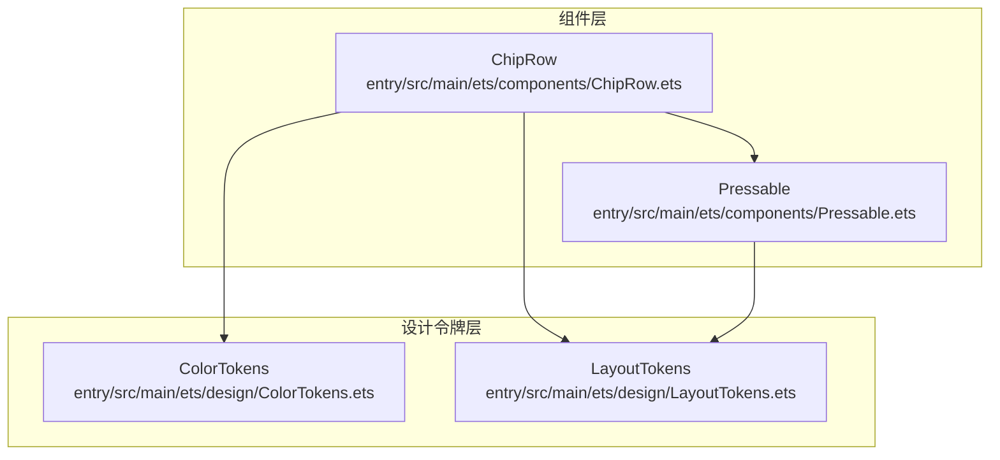
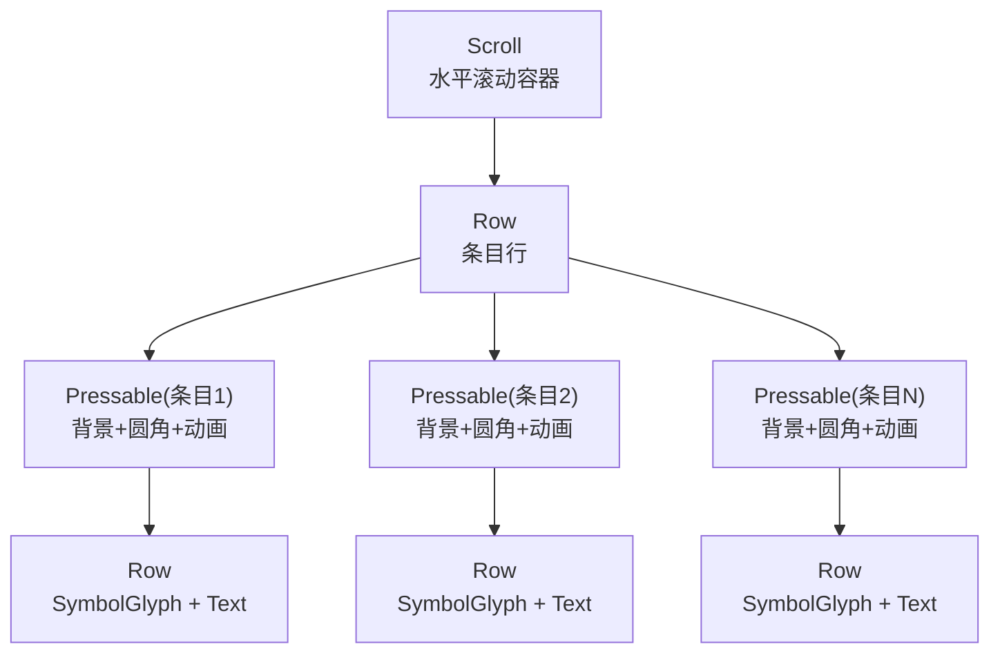
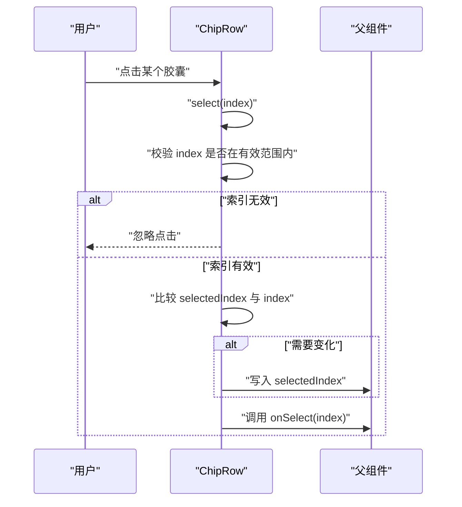
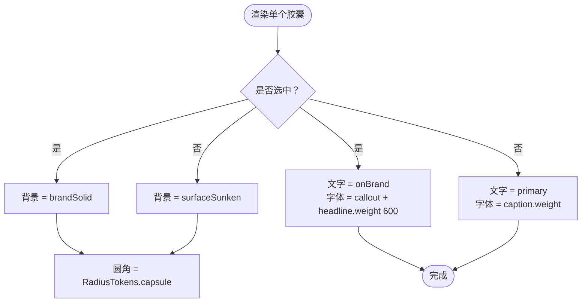
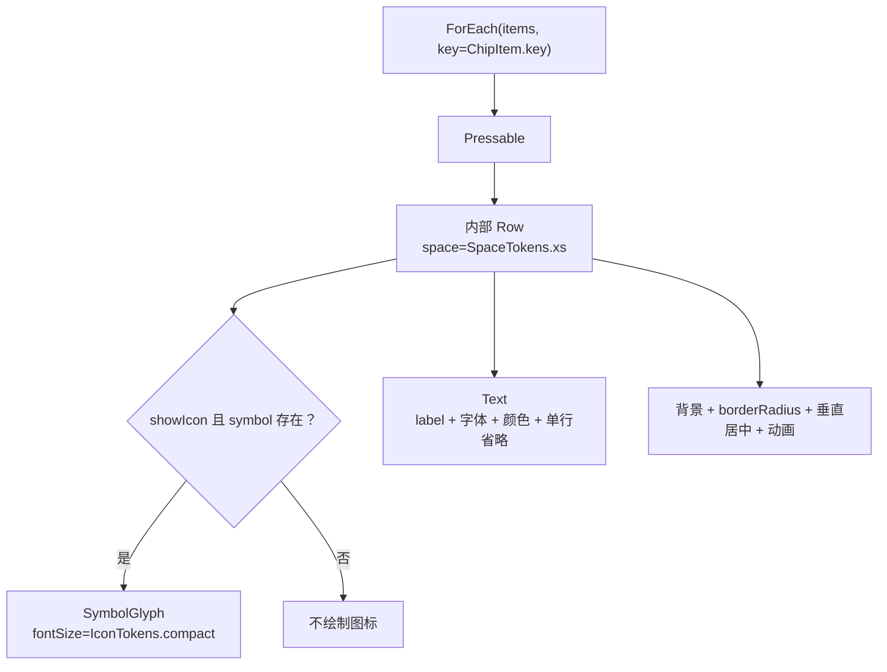
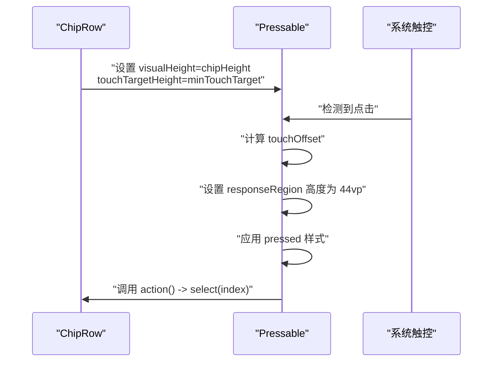
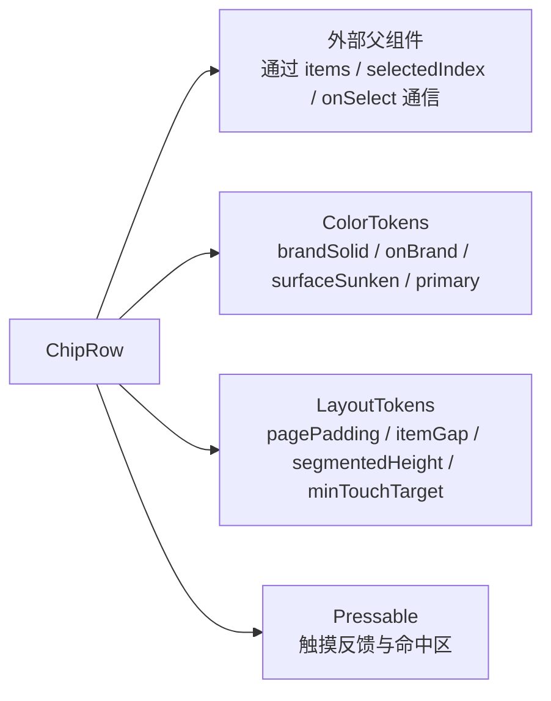
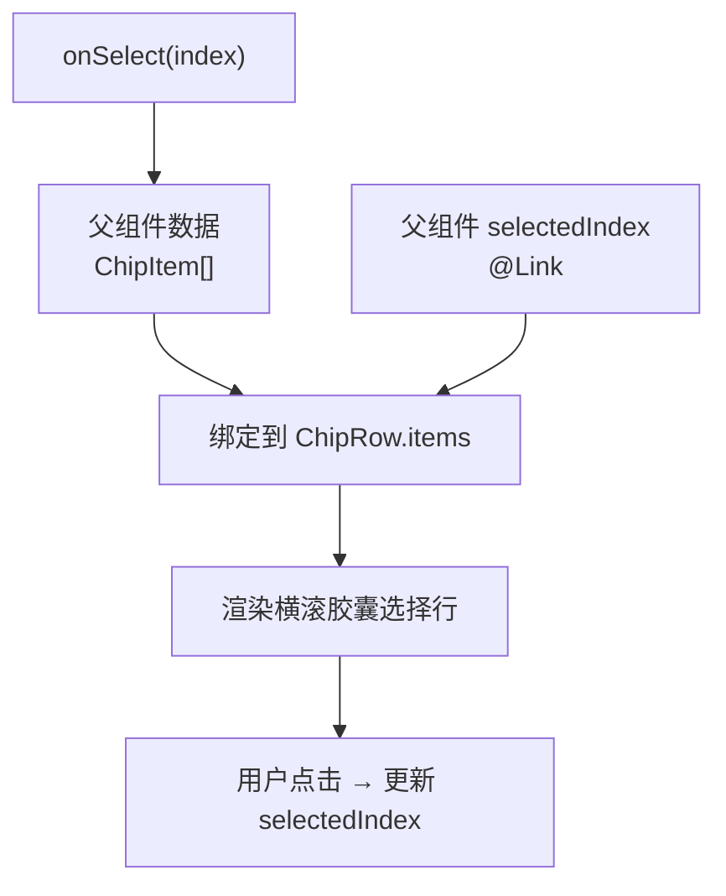

# ChipRow 标签选择行

<cite>
**本文引用的文件**   
- [entry/src/main/ets/components/ChipRow.ets](file://entry/src/main/ets/components/ChipRow.ets)
- [entry/src/main/ets/components/Pressable.ets](file://entry/src/main/ets/components/Pressable.ets)
- [entry/src/main/ets/design/ColorTokens.ets](file://entry/src/main/ets/design/ColorTokens.ets)
- [entry/src/main/ets/design/LayoutTokens.ets](file://entry/src/main/ets/design/LayoutTokens.ets)
</cite>

## 目录
1. [引言](#引言)
2. [项目结构](#项目结构)
3. [核心组件](#核心组件)
4. [架构总览](#架构总览)
5. [详细组件分析](#详细组件分析)
6. [依赖关系分析](#依赖关系分析)
7. [性能与可访问性](#性能与可访问性)
8. [故障排查指南](#故障排查指南)
9. [结论](#结论)
10. [附录：API 参考与使用示例](#附录api-参考与使用示例)

## 引言
ChipRow 是本项目中唯一实现的横滚胶囊选择行家族组件，用于展示一组横向可滚动、带触摸反馈的胶囊标签，并允许用户单选其中一项。该实现严格对标设计仓库中的 `design/components/ChipRow.ets`，在数据模型、属性命名、选中态配色、字体规范、圆角语义和交互命中区等方面保持一致。

核心要点：
- 数据模型为 `ChipItem`，包含唯一键 `key`、显示文本 `label` 和可选图标 `symbol`。
- 通过 `@Link selectedIndex` 与父组件双向绑定当前选中项索引。
- 选中态使用品牌实心底 + 品牌前景字；未选态使用下沉表面 + 主文字色。
- 圆角采用胶囊半径，方片表示待选择，pill 形态表达已选标签。
- 外层使用 `Scroll` 水平滚动，内部使用 `ForEach` 渲染条目，每个条目由 `Pressable` 包裹以提供统一按下动效与命中区。

## 项目结构
ChipRow 位于应用入口模块的通用组件目录下，依赖统一的 Design Tokens 与家族 Pressable 交互封装。

**图示来源**
- [entry/src/main/ets/components/ChipRow.ets:1-109](file://entry/src/main/ets/components/ChipRow.ets#L1-L109)
- [entry/src/main/ets/components/Pressable.ets:1-84](file://entry/src/main/ets/components/Pressable.ets#L1-L84)
- [entry/src/main/ets/design/ColorTokens.ets:1-200](file://entry/src/main/ets/design/ColorTokens.ets#L1-L200)
- [entry/src/main/ets/design/LayoutTokens.ets:1-200](file://entry/src/main/ets/design/LayoutTokens.ets#L1-L200)

**章节来源**
- [entry/src/main/ets/components/ChipRow.ets:1-20](file://entry/src/main/ets/components/ChipRow.ets#L1-L20)

## 核心组件
### 数据模型：ChipItem
`ChipItem` 是 ChipRow 的数据单元，字段如下：

| 字段 | 类型 | 是否必填 | 说明 |
| --- | --- | ---: | --- |
| `key` | `string` | 是 | 条目的稳定唯一标识，用于 `ForEach` 的 key 函数，避免重复渲染。 |
| `label` | `string` | 是 | 胶囊上显示的文本内容。 |
| `symbol` | `Resource` | 否 | 可选官方符号资源；仅当 `showIcon=true` 且 `symbol` 存在时绘制图标位。 |

设计意图：
- `key` 必须稳定，保证列表更新时条目顺序与状态正确。
- `symbol` 是可选资源，不传则不预留图标空间，避免布局抖动。

**章节来源**
- [entry/src/main/ets/components/ChipRow.ets:27-36](file://entry/src/main/ets/components/ChipRow.ets#L27-L36)

### 组件属性
| 属性 | 类型 | 默认值 | 行为说明 |
| --- | --- | --- | --- |
| `items` | `ChipItem[]` | `[]` | 要渲染的胶囊选项数组。 |
| `selectedIndex` | `number`（`@Link`） | 无默认值 | 双向绑定当前选中索引；组件内部会校验范围后写入。 |
| `showIcon` | `boolean` | `false` | 是否启用图标模式。只有同时开启且条目含 `symbol` 时才画图标。 |
| `sidePadding` | `number` | `LayoutTokens.pagePadding` | 整行左右内缩，默认与页面内边距一致。 |
| `itemGap` | `number` | `LayoutTokens.itemGap` | 相邻胶囊之间的间距。 |
| `chipHeight` | `number` | `LayoutTokens.segmentedHeight` | 胶囊视觉高度，默认与分段控件高度一致。 |
| `onSelect` | `(index: number) => void` | `undefined` | 选择回调；仅在选中索引发生变化时触发。 |

关键约定：
- `selectedIndex` 由外部管理，组件只负责安全写回和通知。
- `sidePadding` 映射到 `LayoutTokens.pagePadding`，即默认左右各 16vp。
- `itemGap` 映射到 `LayoutTokens.itemGap`，即 12vp。
- `chipHeight` 映射到 `LayoutTokens.segmentedHeight`，即 36vp；但实际命中区由 `Pressable` 提升到 44vp。

**章节来源**
- [entry/src/main/ets/components/ChipRow.ets:37-56](file://entry/src/main/ets/components/ChipRow.ets#L37-L56)
- [entry/src/main/ets/design/LayoutTokens.ets:165-174](file://entry/src/main/ets/design/LayoutTokens.ets#L165-L174)

## 架构总览
ChipRow 的渲染结构可以概括为“滚动容器 → 行 → 多个可点胶囊”。

**图示来源**
- [entry/src/main/ets/components/ChipRow.ets:74-109](file://entry/src/main/ets/components/ChipRow.ets#L74-L109)

## 详细组件分析

### 选择流程与状态管理
选择逻辑集中在私有方法中：先校验索引边界，再判断是否需要更新状态，最后调用外部回调。

**图示来源**
- [entry/src/main/ets/components/ChipRow.ets:57-73](file://entry/src/main/ets/components/ChipRow.ets#L57-L73)

**章节来源**
- [entry/src/main/ets/components/ChipRow.ets:57-73](file://entry/src/main/ets/components/ChipRow.ets#L57-L73)

### 选中态设计
选中态与未选态的视觉差异通过两个 token 辅助方法决定：

| 状态 | 背景 | 文字颜色 |
| --- | --- | --- |
| 选中 | `brandSolid` | `onBrand` |
| 未选 | `surfaceSunken` | `primary` |

此外：
- 选中文案使用 `callout` 字号与 `headline.weight 600`。
- 未选文案使用 `caption.weight`。
- 圆角使用 `RadiusTokens.capsule`，表达胶囊形态；注释明确区分“方片表示待选择，pill 表示已选标签”的语义。

**图示来源**
- [entry/src/main/ets/components/ChipRow.ets:63-73](file://entry/src/main/ets/components/ChipRow.ets#L63-L73)
- [entry/src/main/ets/components/ChipRow.ets:90-104](file://entry/src/main/ets/components/ChipRow.ets#L90-L104)
- [entry/src/main/ets/design/ColorTokens.ets:43-46](file://entry/src/main/ets/design/ColorTokens.ets#L43-L46)
- [entry/src/main/ets/design/ColorTokens.ets:127-162](file://entry/src/main/ets/design/ColorTokens.ets#L127-L162)

**章节来源**
- [entry/src/main/ets/components/ChipRow.ets:63-73](file://entry/src/main/ets/components/ChipRow.ets#L63-L73)
- [entry/src/main/ets/components/ChipRow.ets:90-104](file://entry/src/main/ets/components/ChipRow.ets#L90-L104)
- [entry/src/main/ets/design/ColorTokens.ets:127-162](file://entry/src/main/ets/design/ColorTokens.ets#L127-L162)

### 渲染结构与优化
ChipRow 使用三层结构组织渲染：

1. **外层 Scroll**
   - 方向：水平。
   - 宽度：占满父容器。
   - 高度：由 `chipHeight` 控制。
   - 滚动效果：启用弹簧边缘效果，隐藏滚动条。

2. **Row 条目行**
   - 使用 `space=itemGap` 控制胶囊间距。
   - 整体左右内缩由 `sidePadding` 控制。

3. **ForEach 条目**
   - 每个条目是一个 `Pressable`，包裹一个内部 `Row`。
   - 内部 Row 可能包含 `SymbolGlyph` 和 `Text`。
   - 文本最多单行，溢出省略。
   - 背景、圆角、对齐和动画都定义在内部 Row 上。
   - `ForEach` 的 key 函数取 `item.key`，确保稳定渲染。

**图示来源**
- [entry/src/main/ets/components/ChipRow.ets:74-109](file://entry/src/main/ets/components/ChipRow.ets#L74-L109)

**章节来源**
- [entry/src/main/ets/components/ChipRow.ets:74-109](file://entry/src/main/ets/components/ChipRow.ets#L74-L109)

### 触摸反馈与命中区
Pressable 是家族统一的交互封装，承担以下职责：
- 将视觉内容与响应区域解耦。
- 当传入 `visualHeight` 小于最小命中区时，自动计算居中偏移，使 44vp 命中带包住矮控件。
- 按下态通过透明度与缩放表达，禁用态关闭交互。
- 点击事件最终委托给调用方的 `action`。

对 ChipRow 而言：
- 胶囊视觉高默认为 36vp。
- 命中区由 `Pressable` 提升到 44vp。
- 动画参数来自 `MotionTokens.press` 与 `MotionCurves.standard`。

**图示来源**
- [entry/src/main/ets/components/ChipRow.ets:81-89](file://entry/src/main/ets/components/ChipRow.ets#L81-L89)
- [entry/src/main/ets/components/Pressable.ets:33-84](file://entry/src/main/ets/components/Pressable.ets#L33-L84)
- [entry/src/main/ets/design/LayoutTokens.ets:165-174](file://entry/src/main/ets/design/LayoutTokens.ets#L165-L174)

**章节来源**
- [entry/src/main/ets/components/Pressable.ets:1-84](file://entry/src/main/ets/components/Pressable.ets#L1-L84)

### 动画与动效
- 每条胶囊的背景、圆角、对齐方式都启用了动画。
- 动画时长和曲线来自 `MotionTokens.fast` 与 `MotionCurves.standard`。
- 按下反馈由 Pressable 统一管理，使用 press 时长与标准曲线。

这意味着：
- 切换选中项时，新旧胶囊背景与文字粗细变化具备过渡。
- 触摸按下时有轻微的缩小与透明度变化，提升触感反馈。

**章节来源**
- [entry/src/main/ets/components/ChipRow.ets:90-104](file://entry/src/main/ets/components/ChipRow.ets#L90-L104)
- [entry/src/main/ets/components/Pressable.ets:60-84](file://entry/src/main/ets/components/Pressable.ets#L60-L84)

## 依赖关系分析
ChipRow 对外暴露稳定的 API，对内依赖三类设计资产：

**图示来源**
- [entry/src/main/ets/components/ChipRow.ets:21-26](file://entry/src/main/ets/components/ChipRow.ets#L21-L26)
- [entry/src/main/ets/design/ColorTokens.ets:43-46](file://entry/src/main/ets/design/ColorTokens.ets#L43-L46)
- [entry/src/main/ets/design/LayoutTokens.ets:165-174](file://entry/src/main/ets/design/LayoutTokens.ets#L165-L174)
- [entry/src/main/ets/components/Pressable.ets:33-84](file://entry/src/main/ets/components/Pressable.ets#L33-L84)

耦合关系说明：
- 与父组件松耦合：仅通过属性与回调通信。
- 与设计令牌强耦合：所有颜色、尺寸、间距都走 Token，便于主题与契约变更。
- 与 Pressable 复用耦合：统一按下态与命中区策略，避免分散实现。

**章节来源**
- [entry/src/main/ets/components/ChipRow.ets:21-26](file://entry/src/main/ets/components/ChipRow.ets#L21-L26)

## 性能与可访问性
### 渲染性能
- 使用 `ForEach` 并提供 `item.key`，有助于框架识别稳定条目，减少不必要重建。
- 文本强制单行并启用省略，避免多行换行导致布局重排。
- 图标按需绘制，只有在 `showIcon=true` 且 `symbol` 存在时才创建 `SymbolGlyph`。

### 交互体验
- 水平 `Scroll` 支持大量选项，不会因长列表而一次性铺满屏幕。
- 隐藏滚动条，保持 UI 简洁。
- 命中区统一为 44vp，符合可访问性建议，提升点击成功率。

### 无障碍建议
- 若未来接入无障碍服务，可为 `Text` 补充可读名称，并与 `label` 保持一致。
- 对 `selectedIndex` 变化进行日志或埋点上报时，应避免泄露敏感业务信息。

[本节为通用指导，不直接分析具体代码文件]

## 故障排查指南
### 常见问题
| 现象 | 可能原因 | 处理建议 |
| --- | --- | --- |
| 点击胶囊没有反应 | `items` 为空、`selectedIndex` 未绑定、或 `onSelect` 未实现 | 检查父组件是否正确传入数组并绑定 `@Link`。 |
| 点击后索引越界 | 父组件直接赋值了超出范围的索引 | 组件内部已有边界保护，但仍应保证父组件状态合法。 |
| 图标不显示 | 未设置 `showIcon`，或条目缺少 `symbol` | 确认组件开启了 `showIcon`，且对应 `ChipItem.symbol` 不为空。 |
| 胶囊太窄或文本被截断 | 文本过长且容器宽度不足 | 使用较短 label，或扩大外层容器宽度；必要时考虑多行方案。 |
| 点击命中区偏上 | 未正确使用 `Pressable` 或自定义了过小的视觉高度 | 让 Pressable 接管命中区计算，不要绕过其 `responseRegion`。 |
| 深色模式下颜色异常 | 资源未成对配置或 Token 值错误 | 确认 `brand_solid`、`on_brand`、`surface_sunken`、`primary` 等资源在浅色与深色资源文件中都有对应值。 |

**章节来源**
- [entry/src/main/ets/components/ChipRow.ets:57-73](file://entry/src/main/ets/components/ChipRow.ets#L57-L73)
- [entry/src/main/ets/components/Pressable.ets:33-84](file://entry/src/main/ets/components/Pressable.ets#L33-L84)
- [entry/src/main/ets/design/ColorTokens.ets:127-162](file://entry/src/main/ets/design/ColorTokens.ets#L127-L162)

## 结论
ChipRow 是一个结构清晰、职责单一、与设计契约对齐的横滚胶囊选择行组件。它通过 `ChipItem` 描述数据，通过 `@Link selectedIndex` 管理状态，通过 ColorTokens 和 LayoutTokens 表达视觉，通过 Pressable 统一交互。其核心价值在于：
- 为上层页面提供一致的选择行抽象。
- 用 Token 驱动颜色和尺寸，降低硬编码风险。
- 用 Pressable 收敛触摸反馈，避免散落的状态机。
- 用 Scroll + ForEach 组合，兼顾性能与可扩展性。

[本节为总结性内容，不直接分析具体代码文件]

## 附录：API 参考与使用示例

### API 参考表
| 名称 | 类型 | 默认值 | 必填 | 说明 |
| --- | --- | --- | ---: | --- |
| `items` | `ChipItem[]` | `[]` | 否 | 选项数据数组。 |
| `selectedIndex` | `number`（`@Link`） | 无 | 是 | 当前选中索引，双向绑定。 |
| `showIcon` | `boolean` | `false` | 否 | 是否显示图标。 |
| `sidePadding` | `number` | `LayoutTokens.pagePadding` | 否 | 左右内缩。 |
| `itemGap` | `number` | `LayoutTokens.itemGap` | 否 | 胶囊间隙。 |
| `chipHeight` | `number` | `LayoutTokens.segmentedHeight` | 否 | 视觉高度。 |
| `onSelect` | `(index: number) => void` | `undefined` | 否 | 选择回调。 |

### ChipItem 字段表
| 字段 | 类型 | 必填 | 说明 |
| --- | --- | ---: | --- |
| `key` | `string` | 是 | 唯一标识，供 `ForEach` 使用。 |
| `label` | `string` | 是 | 显示文本。 |
| `symbol` | `Resource` | 否 | 可选图标资源。 |

### 使用示例说明
以下示例以伪代码形式描述用法，不包含具体源码片段：

1. 定义选项数据：
   - 创建一个 `ChipItem[]`，每个元素包含稳定 `key`、可读 `label`，以及可选 `symbol`。

2. 在父组件中维护选中索引：
   - 声明一个数字变量作为 `selectedIndex`。
   - 将该变量以 `@Link` 形式绑定到 `ChipRow.selectedIndex`。

3. 实现选择回调：
   - 可选地实现 `onSelect`，用于记录选择历史、触发后续流程或联动其他 UI。

4. 控制图标显示：
   - 如果希望显示图标，设置 `showIcon=true`，并为需要图标的条目提供 `symbol`。

5. 调整外观：
   - 如需改变内外边距，可调整 `sidePadding` 与 `itemGap`。
   - 如需调整胶囊高度，可修改 `chipHeight`，但需注意命中区仍由 Pressable 保障。

**图示来源**
- [entry/src/main/ets/components/ChipRow.ets:37-56](file://entry/src/main/ets/components/ChipRow.ets#L37-L56)
- [entry/src/main/ets/components/ChipRow.ets:57-73](file://entry/src/main/ets/components/ChipRow.ets#L57-L73)