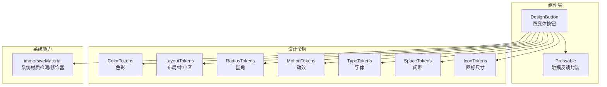
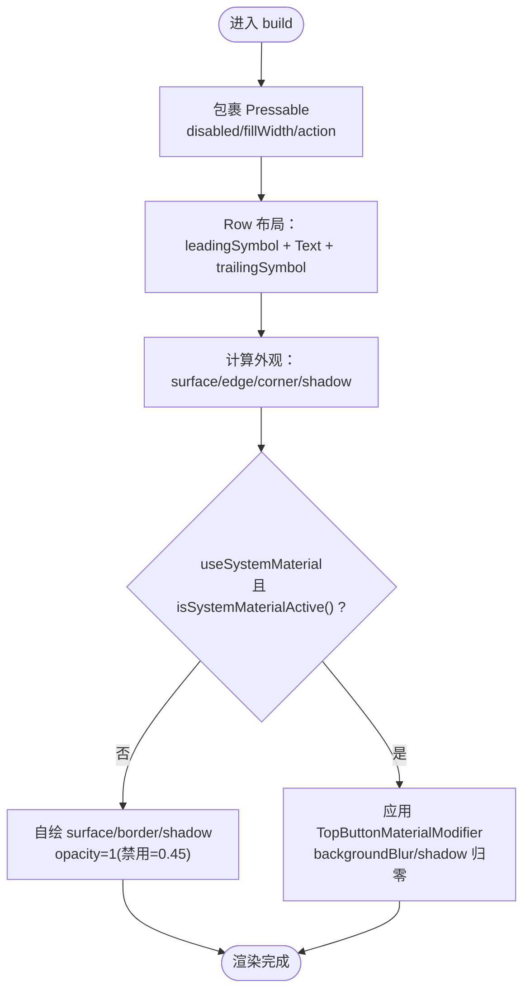
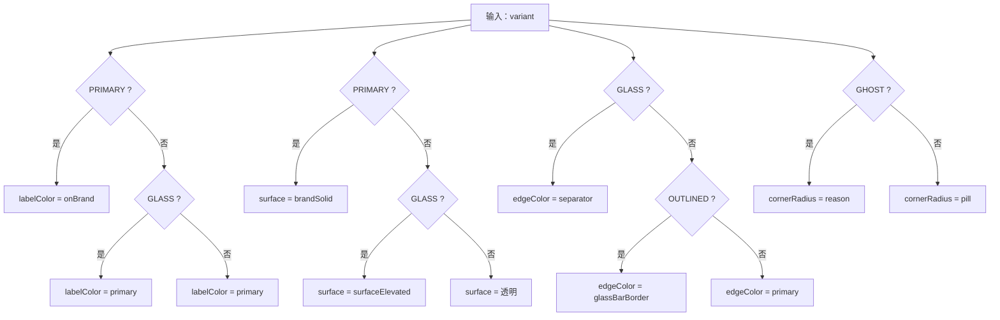
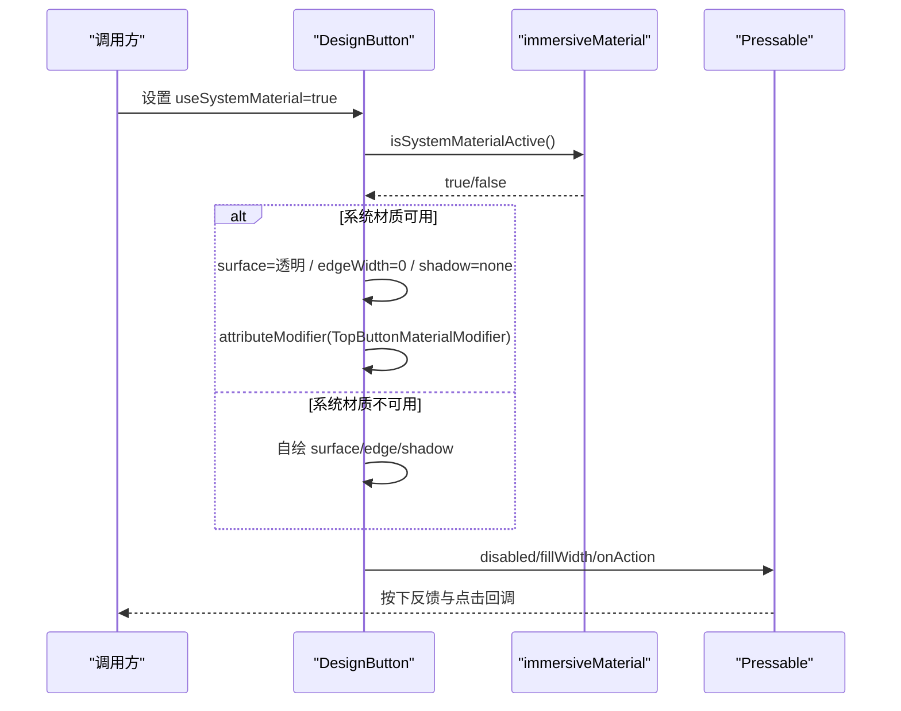
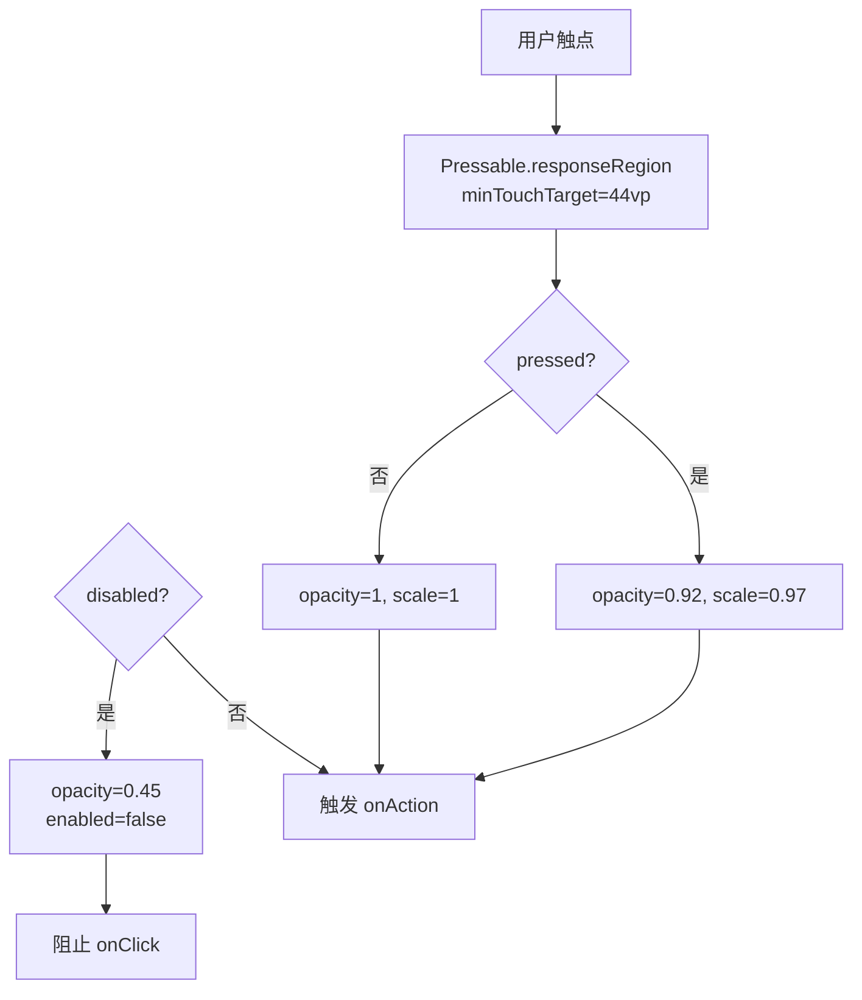
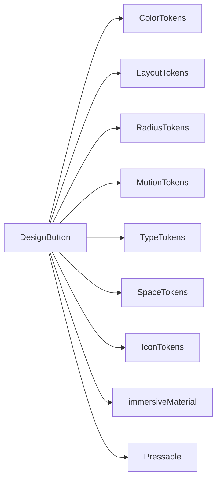

# DesignButton 设计系统按钮

<cite>
**本文引用的文件**   
- [DesignButton.ets](file://entry/src/main/ets/components/DesignButton.ets)
- [Pressable.ets](file://entry/src/main/ets/components/Pressable.ets)
- [immersiveMaterial.ets](file://entry/src/main/ets/utils/immersiveMaterial.ets)
- [ColorTokens.ets](file://entry/src/main/ets/design/ColorTokens.ets)
- [LayoutTokens.ets](file://entry/src/main/ets/design/LayoutTokens.ets)
- [RadiusTokens.ets](file://entry/src/main/ets/design/RadiusTokens.ets)
- [MotionTokens.ets](file://entry/src/main/ets/design/MotionTokens.ets)
- [TypeTokens.ets](file://entry/src/main/ets/design/TypeTokens.ets)
- [SpaceTokens.ets](file://entry/src/main/ets/design/SpaceTokens.ets)
- [IconTokens.ets](file://entry/src/main/ets/design/IconTokens.ets)
</cite>

## 目录
1. [简介](#简介)
2. [项目结构](#项目结构)
3. [核心组件](#核心组件)
4. [架构总览](#架构总览)
5. [详细组件分析](#详细组件分析)
6. [依赖关系分析](#依赖关系分析)
7. [性能与可访问性](#性能与可访问性)
8. [API 参考](#api-参考)
9. [使用示例](#使用示例)
10. [故障排查](#故障排查)
11. [结论](#结论)

## 简介
DesignButton 是本项目“设计系统”按钮组件的主件，完整移植有据 `design/components/DesignButton.ets`。它统一承载四套视觉变体、触摸反馈、材质避让与动画规范，是页面中所有“操作入口”的单一实现来源。

四变体规则：
- PRIMARY（品牌实心）：品牌实心底 + onBrand 文字；一屏只许一颗，用于最高优先级操作。
- OUTLINED（描边）：透明底 + 1vp 玻璃描边 + pill 圆角。
- GHOST（幽灵）：primary 文字色 + reason 圆角；无背景、无边框。
- GLASS（玻璃）：elevated 底 + separator 描边 + cardAmbient 阴影。

颜色与字体全部走 design token，避免在业务页直接写死色值或字号。

**章节来源**
- [DesignButton.ets:1-22](file://entry/src/main/ets/components/DesignButton.ets#L1-L22)

## 项目结构
DesignButton 位于组件层 `entry/src/main/ets/components`，依赖同层的 Pressable，以及 design token 与 utils 中的沉浸材质能力。

**图表来源**
- [DesignButton.ets:24-40](file://entry/src/main/ets/components/DesignButton.ets#L24-L40)
- [immersiveMaterial.ets:1-30](file://entry/src/main/ets/utils/immersiveMaterial.ets#L1-L30)

**章节来源**
- [DesignButton.ets:24-40](file://entry/src/main/ets/components/DesignButton.ets#L24-L40)
- [Pressable.ets:1-25](file://entry/src/main/ets/components/Pressable.ets#L1-L25)
- [immersiveMaterial.ets:1-30](file://entry/src/main/ets/utils/immersiveMaterial.ets#L1-L30)

## 核心组件
- **DesignButton**：对外暴露按钮 API，内部组合 Row + Text + SymbolGlyph，并委托 Pressable 处理点击态。
- **Pressable**：家族统一的按下反馈封装，负责 opacity/scale 状态样式、命中区域、禁用门控和 onClick 转发。
- **TopButtonMaterialModifier**：当系统材质生效时替换自绘表面，关闭自绘 border/shadow/blur。
- **isSystemMaterialActive()**：同步缓存当前设备是否支持 systemMaterial 属性。

**章节来源**
- [DesignButton.ets:41-139](file://entry/src/main/ets/components/DesignButton.ets#L41-L139)
- [Pressable.ets:27-84](file://entry/src/main/ets/components/Pressable.ets#L27-L84)
- [immersiveMaterial.ets:120-170](file://entry/src/main/ets/utils/immersiveMaterial.ets#L120-L170)

## 架构总览
DesignButton 的渲染路径分为两条：普通模式与系统材质模式。

**图表来源**
- [DesignButton.ets:80-139](file://entry/src/main/ets/components/DesignButton.ets#L80-L139)
- [immersiveMaterial.ets:145-170](file://entry/src/main/ets/utils/immersiveMaterial.ets#L145-L170)

**章节来源**
- [DesignButton.ets:80-139](file://entry/src/main/ets/components/DesignButton.ets#L80-L139)

## 详细组件分析

### 四变体设计语义
| 变体 | 背景 | 边框 | 圆角 | 文字色 | 阴影 | 典型用途 |
|---|---|---|---|---|---|---|
| PRIMARY | brandSolid | 0 | pill | onBrand | none | 主操作；一屏只允许一颗 |
| OUTLINED | 透明 | 1vp glassBarBorder | pill | primary | none | 次级操作、筛选类动作 |
| GHOST | 透明 | 0 | reason | primary | none | 轻量动作、辅助入口 |
| GLASS | surfaceElevated | separator | pill | primary | cardAmbient | 需要浮起感的玻璃按钮 |

注意：GLASS 的文字色仍走 primary，而非 onBrand；onBrand 仅用于 PRIMARY 背景上的高对比文字。

**章节来源**
- [DesignButton.ets:24-39](file://entry/src/main/ets/components/DesignButton.ets#L24-L39)
- [DesignButton.ets:60-78](file://entry/src/main/ets/components/DesignButton.ets#L60-L78)

### 颜色计算逻辑
- `labelColor()`：PRIMARY → onBrand；其他变体 → primary。
- `surface()`：PRIMARY → brandSolid；GLASS → surfaceElevated；其余 → 透明。
- `edgeColor()`：GLASS → separator；OUTLINED → glassBarBorder；其余 → primary。
- `cornerRadius()`：GHOST → reason；其余 → pill。

这些方法把业务判断集中在组件内部，外部调用方只需选择 variant，无需关心具体色值。

**图表来源**
- [DesignButton.ets:60-78](file://entry/src/main/ets/components/DesignButton.ets#L60-L78)
- [ColorTokens.ets:40-120](file://entry/src/main/ets/design/ColorTokens.ets#L40-L120)
- [RadiusTokens.ets:10-43](file://entry/src/main/ets/design/RadiusTokens.ets#L10-L43)

**章节来源**
- [DesignButton.ets:60-78](file://entry/src/main/ets/components/DesignButton.ets#L60-L78)
- [ColorTokens.ets:40-120](file://entry/src/main/ets/design/ColorTokens.ets#L40-L120)
- [RadiusTokens.ets:10-43](file://entry/src/main/ets/design/RadiusTokens.ets#L10-L43)

### 材质避让机制
当同时满足以下条件时，DesignButton 启用系统材质：
1. `useSystemMaterial` 为 true；
2. `isSystemMaterialActive()` 返回 true；
3. 通过 `attributeModifier` 挂载 `TopButtonMaterialModifier`。

此时组件会：
- 将 background 设为透明；
- 将 border width 置 0；
- 将 shadow 置 ShadowTokens.none；
- 由系统提供沉浸式光感材质。

这是“官方件优先、禁自绘”禁令废止后的兼容策略：在具备能力的设备上交给系统，否则回退到自绘玻璃效果。

**图表来源**
- [DesignButton.ets:52-78](file://entry/src/main/ets/components/DesignButton.ets#L52-L78)
- [DesignButton.ets:108-139](file://entry/src/main/ets/components/DesignButton.ets#L108-L139)
- [immersiveMaterial.ets:145-170](file://entry/src/main/ets/utils/immersiveMaterial.ets#L145-L170)

**章节来源**
- [DesignButton.ets:52-78](file://entry/src/main/ets/components/DesignButton.ets#L52-L78)
- [DesignButton.ets:108-139](file://entry/src/main/ets/components/DesignButton.ets#L108-L139)
- [immersiveMaterial.ets:120-170](file://entry/src/main/ets/utils/immersiveMaterial.ets#L120-L170)

### 触摸反馈与动画
DesignButton 不自行实现 stateStyles，而是委托 Pressable：
- 正常态：opacity 1，scale 1；
- 按下态：opacity 0.92，scale 0.97；
- 禁用态：enabled(false)，并由 DesignButton 自身设置 opacity 0.45；
- 动画时长来自 MotionTokens.fast（140ms），曲线使用 standard。

Pressable 还负责响应区：当 visualHeight 小于最小命中带 44vp 时，通过 responseRegion 让命中区域居中包满 44vp，避免“看着能点、实际只能点上沿”的问题。

**图表来源**
- [Pressable.ets:27-84](file://entry/src/main/ets/components/Pressable.ets#L27-L84)
- [MotionTokens.ets:20-60](file://entry/src/main/ets/design/MotionTokens.ets#L20-L60)
- [LayoutTokens.ets:110-130](file://entry/src/main/ets/design/LayoutTokens.ets#L110-L130)

**章节来源**
- [Pressable.ets:27-84](file://entry/src/main/ets/components/Pressable.ets#L27-L84)
- [DesignButton.ets:80-139](file://entry/src/main/ets/components/DesignButton.ets#L80-L139)
- [MotionTokens.ets:20-60](file://entry/src/main/ets/design/MotionTokens.ets#L20-L60)

### 无障碍与文本呈现
- 文本字号采用 TypeTokens.callout（14sp），字重使用 TypeTokens.headline.weight（600）。
- 数字启用 tabular 特性 `'tnum' on`，保证等宽数字对齐。
- leadingSymbol 与 trailingSymbol 使用 IconSizes.control 作为图标尺寸，并与 label 同一色。
- 当前实现未显式设置 ariaLabel/accessibilityRole；若需增强读屏体验，可在外层容器或后续版本扩展 accessibleName/accessibilityHint。

**章节来源**
- [DesignButton.ets:90-107](file://entry/src/main/ets/components/DesignButton.ets#L90-L107)
- [TypeTokens.ets:1-94](file://entry/src/main/ets/design/TypeTokens.ets#L1-L94)
- [IconTokens.ets:1-12](file://entry/src/main/ets/design/IconTokens.ets#L1-L12)

## 依赖关系分析
DesignButton 的直接依赖如下：

- 耦合度较低：颜色、尺寸、圆角、动效、字体、间距均从 token 层读取，变更一处即可全局生效。
- 唯一运行时分支：`materialOn()` 在渲染阶段决定是否应用系统材质修饰器。
- 无循环依赖：components 不反向依赖 utils，utils 也不依赖 components。

**图表来源**
- [DesignButton.ets:24-40](file://entry/src/main/ets/components/DesignButton.ets#L24-L40)

**章节来源**
- [DesignButton.ets:24-40](file://entry/src/main/ets/components/DesignButton.ets#L24-L40)

## 性能与可访问性
- 渲染开销低：单行 Row + 可选两个 SymbolGlyph，无复杂嵌套。
- 动画成本可控：仅对 Pressable 的 opacity/scale 做 140ms 过渡。
- 材质降级安全：系统材质不可用时自动回退自绘，不会因 API 缺失崩溃。
- 可访问性建议：如需屏幕阅读器朗读，建议在业务层为外层容器提供 accessibilityLabel，或在组件扩展中增加 accessibleName/accessibilityHint 属性。

[本节为通用指导，不直接分析具体代码文件]

## API 参考

### 枚举：DesignButtonVariant
| 值 | 含义 | 说明 |
|---|---|---|
| PRIMARY | 品牌实心 | 一屏只允许一颗主按钮 |
| OUTLINED | 描边 | 透明底 + 1vp 描边 |
| GHOST | 幽灵 | 仅文字 + reason 圆角 |
| GLASS | 玻璃 | elevated 底 + separator 描边 + cardAmbient 阴影 |

**章节来源**
- [DesignButton.ets:24-31](file://entry/src/main/ets/components/DesignButton.ets#L24-L31)

### 属性表
| 属性 | 类型 | 默认值 | 说明 |
|---|---|---|---|
| label | string | '' | 按钮文本；null 会被 safeLabel 转为空字符串 |
| variant | DesignButtonVariant | PRIMARY | 控制变体 |
| disabled | boolean | false | 禁用态：禁用点击、透明度降至 0.45 |
| fillWidth | boolean | false | 是否占满父容器宽度 |
| visualWidth | Length | 150 | 非满宽时的按钮宽度 |
| leadingSymbol | Resource \| undefined | undefined | 左侧图标资源 |
| trailingSymbol | Resource \| undefined | undefined | 右侧图标资源 |
| useSystemMaterial | boolean | false | 驻留 Navigation 标题栏时，交由系统材质接管表面 |
| onAction | (() => void) \| undefined | undefined | 点击回调；disabled 时不会触发 |

**章节来源**
- [DesignButton.ets:33-49](file://entry/src/main/ets/components/DesignButton.ets#L33-L49)

### 内部计算函数
| 函数 | 返回值 | 行为摘要 |
|---|---|---|
| isPrimary() | boolean | 是否为 PRIMARY 变体 |
| isGlass() | boolean | 是否为 GLASS 变体 |
| materialOn() | boolean | useSystemMaterial 且系统支持 systemMaterial |
| labelColor() | Resource | PRIMARY → onBrand；其余 → primary |
| surface() | ResourceColor | PRIMARY → brandSolid；GLASS → surfaceElevated；其余 → 透明 |
| edgeWidth() | number | PRIMARY 或材质生效时为 0；OUTLINED/GLASS 为 glassBorderWidth |
| edgeColor() | ResourceColor | GLASS → separator；OUTLINED → glassBarBorder；其余 → primary |
| cornerRadius() | number | GHOST → reason；其余 → pill |
| safeLabel() | string | null 兜底为空字符串 |

**章节来源**
- [DesignButton.ets:51-78](file://entry/src/main/ets/components/DesignButton.ets#L51-L78)

## 使用示例

### 基本用法
- PRIMARY 主按钮：
  - variant 设置为 PRIMARY；
  - 一屏只放一个；
  - label 为主操作文案；
  - onAction 中执行主要业务逻辑。

- OUTLINED 次要按钮：
  - variant 设置为 OUTLINED；
  - 适合筛选、取消、重置等动作；
  - 可与 PRIMARY 并列但不得喧宾夺主。

- GHOST 轻量按钮：
  - variant 设置为 GHOST；
  - 适合辅助操作，如“查看详情”“切换模式”。

- GLASS 玻璃按钮：
  - variant 设置为 GLASS；
  - 适合需要浮起感和玻璃质感的场景。

### 图标与宽度
- leadingSymbol/trailingSymbol 传入 Resource，图标尺寸由 IconSizes.control 控制。
- 横向排列多个按钮时，fillWidth 通常保持 false，并给每个按钮指定合理 visualWidth。
- 钉底通栏按钮可将 fillWidth 设为 true，visualWidth 不再生效。

### 系统材质
- 当按钮位于 Navigation 标题栏等常驻顶部位置时，设置 useSystemMaterial=true。
- 在支持 systemMaterial 的设备上，按钮背景变为沉浸式材质，自绘边框与阴影被移除。
- 在不支持该 API 的设备上，自动回退为自绘 surface/border/shadow，视觉保持一致。

### 禁用与交互
- disabled=true 时，按钮视觉上降低透明度，Pressable 会阻止 onClick。
- 不要同时通过外部状态再设置 opacity 表达禁用，以免与组件内部 0.45 冲突。

[本节为使用指导，不直接展示源码内容]

## 故障排查

| 现象 | 可能原因 | 处理建议 |
|---|---|---|
| 按钮点击无反应 | disabled=true 或未传 onAction | 检查 disabled 与 onAction 是否存在 |
| 点击区域太小 | 未设置 visualHeight 或命中区异常 | 确保 Pressable 的 touchTargetHeight=44vp，且 visualHeight 与视觉高度一致 |
| 按下缩放不生效 | animation 未紧贴 stateStyles 之前 | 确认使用的是 Pressable 封装，而不是自行实现 stateStyles |
| PRIMARY 按钮过多 | 违反“一屏只许一颗”原则 | 保留唯一 PRIMARY，其余改为 OUTLINED/GHOST |
| 玻璃按钮没有阴影 | 使用了 useSystemMaterial 且系统材质生效 | 这是预期行为；如需可见阴影，关闭 useSystemMaterial |
| 边框颜色异常 | OUTLINED 与 GLASS 的 edgeColor 不同 | OUTLINED 使用 glassBarBorder，GLASS 使用 separator |
| 文字色异常 | 误以为 GLASS 也使用 onBrand | 只有 PRIMARY 使用 onBrand；GLASS/GHOST/OUTLINED 使用 primary |
| 圆角不符合预期 | 混淆 GHOST 与其他变体 | GHOST 使用 reason 圆角，其余使用 pill |

**章节来源**
- [DesignButton.ets:60-139](file://entry/src/main/ets/components/DesignButton.ets#L60-L139)
- [Pressable.ets:27-84](file://entry/src/main/ets/components/Pressable.ets#L27-L84)
- [immersiveMaterial.ets:120-170](file://entry/src/main/ets/utils/immersiveMaterial.ets#L120-L170)

## 结论
DesignButton 以 minimal API 聚合了四变体视觉、token 化配色、Pressable 触摸反馈、系统材质避让与统一动画参数。对于调用方而言，最重要的是：
- 严格遵循 PRIMARY 一屏一颗的规则；
- 根据语义选择 OUTLINED、GHOST、GLASS；
- 在导航标题栏场景中开启 useSystemMaterial；
- 通过 design token 而非硬编码维护颜色、圆角、字号与间距。

这使 DesignButton 成为设计系统中稳定、可复用且易于审计的按钮主件。

[本节为总结性内容，不直接分析具体代码文件]