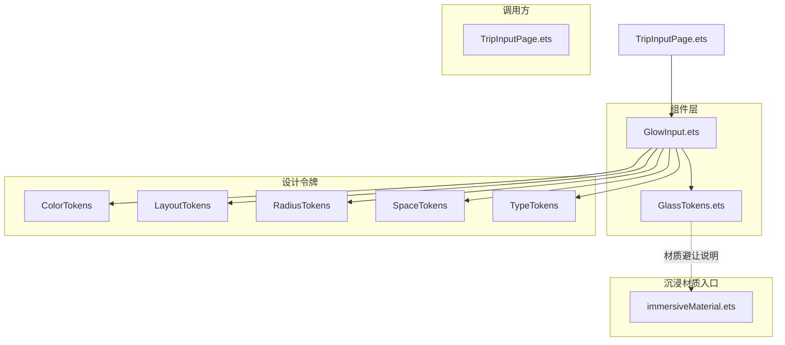
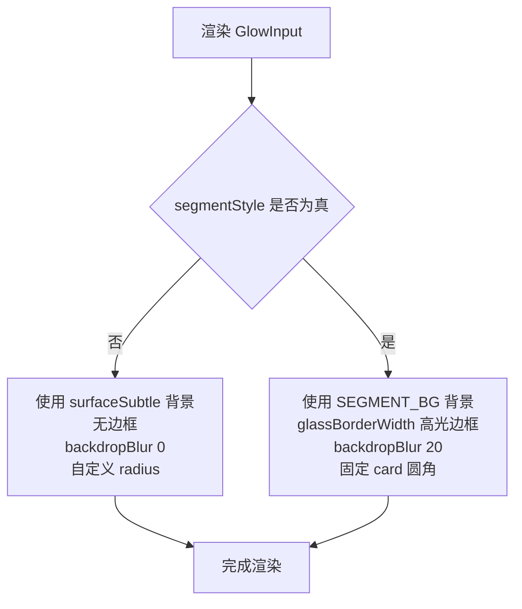
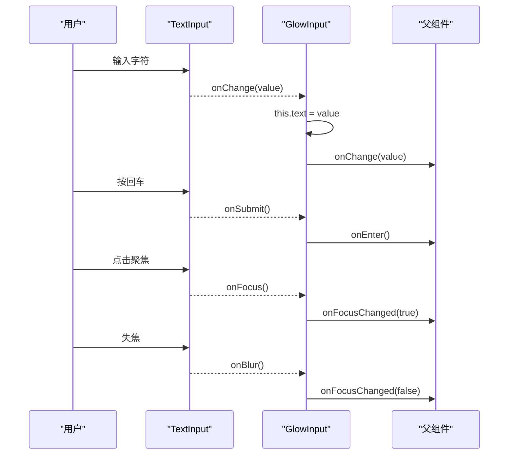
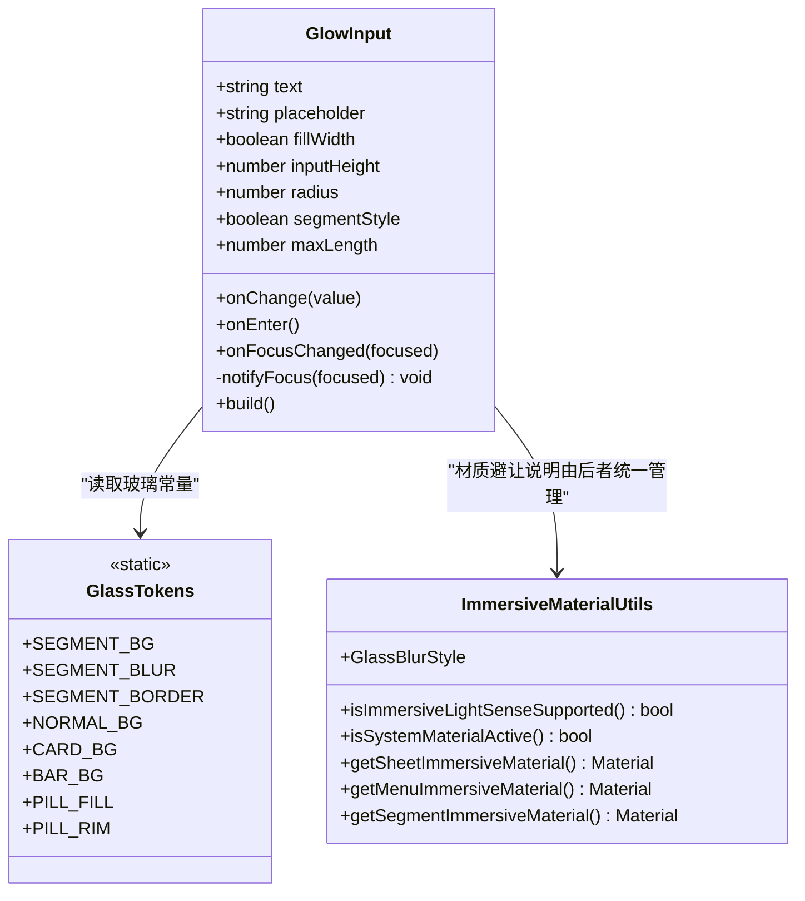
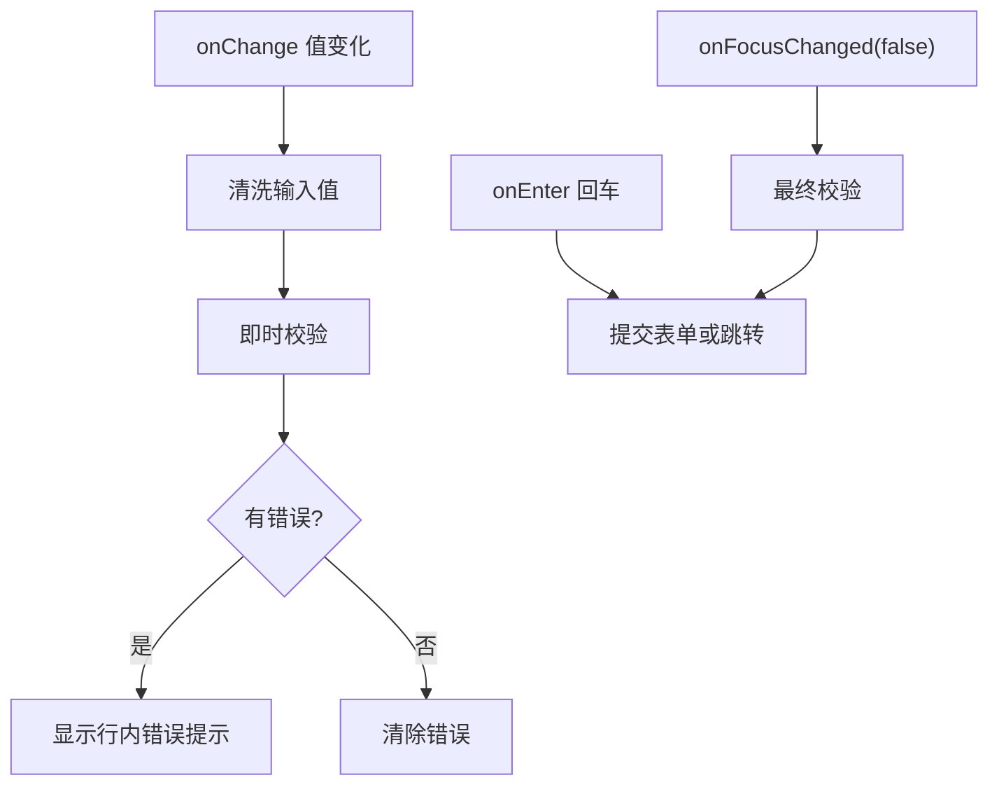
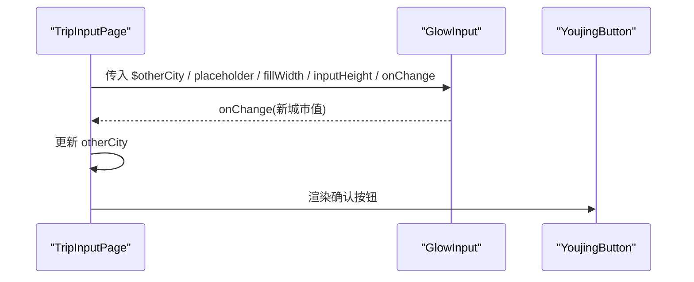
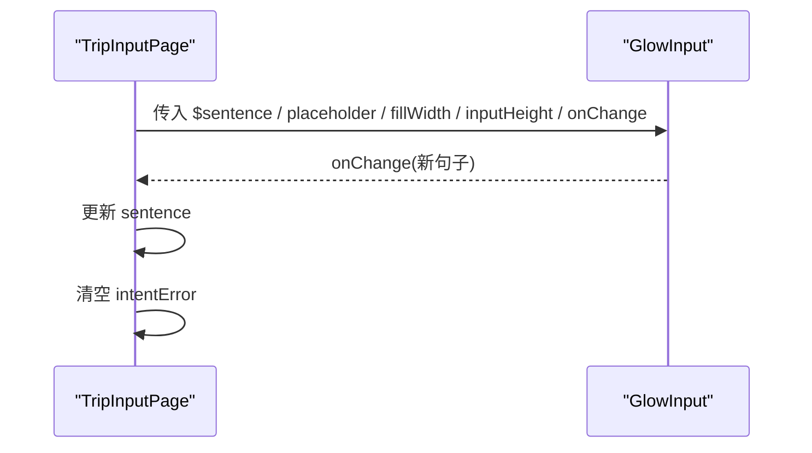
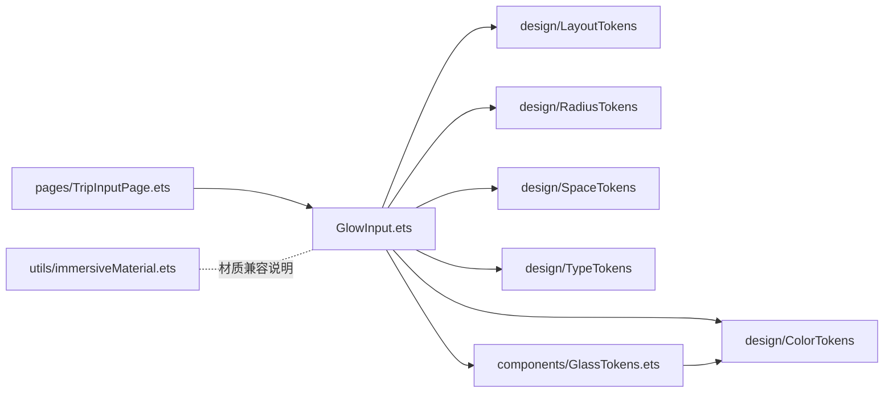

# GlowInput 发光输入框

<cite>
**本文引用的文件**   
- [GlowInput.ets](file://entry/src/main/ets/components/GlowInput.ets)
- [GlassTokens.ets](file://entry/src/main/ets/components/GlassTokens.ets)
- [immersiveMaterial.ets](file://entry/src/main/ets/utils/immersiveMaterial.ets)
- [TripInputPage.ets](file://entry/src/main/ets/pages/TripInputPage.ets)
</cite>

## 目录
1. [简介](#简介)
2. [项目结构中的位置](#项目结构中的位置)
3. [核心设计目标](#核心设计目标)
4. [样式模式](#样式模式)
5. [属性参考](#属性参考)
6. [事件回调](#事件回调)
7. [渲染与材质机制](#渲染与材质机制)
8. [键盘、验证与错误提示最佳实践](#键盘验证与错误提示最佳实践)
9. [API 参考表](#api-参考表)
10. [使用示例与表单集成](#使用示例与表单集成)
11. [依赖关系分析](#依赖关系分析)
12. [常见问题排查](#常见问题排查)
13. [结论](#结论)

## 简介
GlowInput 发光输入框是一个统一输入体验的 ArkUI 组件，用于在旅行规划类页面中提供一致的文本输入行为。该组件是据 design/components/GlowInput.ets 的移植版本，默认实现官方原生样式，并在 segmentStyle=true 时切换为玻璃模式。

它通过 @Link text 与外部状态双向绑定，封装了 TextInput 的样式、占位符、长度限制、回车提交和焦点变化等常用能力，使上层页面无需直接操作底层输入控件。

## 项目结构中的位置
GlowInput 位于业务组件层，属于 entry/src/main/ets/components 目录下的可复用 UI 组件。它与设计令牌（ColorTokens、LayoutTokens、RadiusTokens、SpaceTokens、TypeTokens）以及 GlassTokens 玻璃样式集中管理文件配合使用。

**图示来源**
- [GlowInput.ets:1-83](file://entry/src/main/ets/components/GlowInput.ets#L1-L83)
- [GlassTokens.ets:1-28](file://entry/src/main/ets/components/GlassTokens.ets#L1-L28)
- [immersiveMaterial.ets:1-203](file://entry/src/main/ets/utils/immersiveMaterial.ets#L1-L203)
- [TripInputPage.ets:1-26](file://entry/src/main/ets/pages/TripInputPage.ets#L1-L26)

**章节来源**
- [GlowInput.ets:1-83](file://entry/src/main/ets/components/GlowInput.ets#L1-L83)

## 核心设计目标
- 提供统一输入体验：隐藏不同页面中对 TextInput 的重复样式配置。
- 默认分支走官方原生样式：实色 subtle 背景、无描边、圆角胶囊、固定高度。
- 可选玻璃模式：segmentStyle=true 时使用半透明底、backdropBlur 20 和高光边框，与分段栏视觉一致。
- 双向数据绑定：text 使用 @Link，便于父组件用 @State 变量控制。
- 明确尺寸语义：inputHeight 避免与 CustomComponent 基类 height 成员冲突；radius 控制圆角；fillWidth 控制 Row 内布局填充。
- 事件收敛：onChange、onEnter、onFocusChanged 集中在组件内部触发，降低调用方复杂度。

**章节来源**
- [GlowInput.ets:1-83](file://entry/src/main/ets/components/GlowInput.ets#L1-L83)

## 样式模式
GlowInput 根据 segmentStyle 决定两种外观：

| 模式 | segmentStyle | 背景 | 描边 | 模糊 | 圆角 | 典型用途 |
|---|---:|---|---|---|---|---|
| 默认原生样式 | false | ColorTokens.surfaceSubtle | 宽度 0 | backdropBlur 0 | radius 属性值 | 普通表单输入 |
| 玻璃模式 | true | GlassTokens.SEGMENT_BG | LayoutTokens.glassBorderWidth | GlassTokens.SEGMENT_BLUR=20 | RadiusTokens.card | 与分段栏同风格的高亮输入区 |

默认模式下，组件不绘制可见边框，背景采用 subtle 表面色，整体呈现干净、低对比度的输入块。玻璃模式下，背景改为半透明玻璃色，启用 backdropBlur 20，并添加 1vp 高光边框，视觉上更接近“发光”效果。

**图示来源**
- [GlowInput.ets:30-78](file://entry/src/main/ets/components/GlowInput.ets#L30-L78)
- [GlassTokens.ets:12-28](file://entry/src/main/ets/components/GlassTokens.ets#L12-L28)

**章节来源**
- [GlowInput.ets:30-78](file://entry/src/main/ets/components/GlowInput.ets#L30-L78)
- [GlassTokens.ets:1-28](file://entry/src/main/ets/components/GlassTokens.ets#L1-L28)

## 属性参考
GlowInput 的属性分为受控数据、布局尺寸、外观模式和交互边界四类。

| 属性 | 类型 | 默认值 | 含义 | 注意事项 |
|---|---|---:|---|---|
| text | string（@Link） | 由父组件 @State 提供 | 双向绑定的输入文本 | 建议用 $text 传递，变更会同步到父组件 |
| placeholder | string | '' | 未输入时的占位文字 | 颜色由 ColorTokens.muted 控制 |
| fillWidth | boolean | true | 是否在 flex 容器中拉伸 | true 时 layoutWeight=1、width='auto'；false 时 width='100%' |
| inputHeight | number | LayoutTokens.minTouchTarget - SpaceTokens.xxs | 输入框高度 | 不叫 height，避免与基类成员冲突 |
| radius | number | RadiusTokens.card | 非玻璃模式的圆角半径 | 玻璃模式固定使用 RadiusTokens.card |
| segmentStyle | boolean | false | 是否启用玻璃模式 | true 时启用 glassBackground、blur 和边框 |
| maxLength | number | 0 | 最大输入长度 | 0 表示使用系统默认上限 |

当 maxLength > 0 时，组件内部将 maxLength 传给 TextInput；否则传入一个极大整数值，表示不限制业务长度。

**章节来源**
- [GlowInput.ets:17-29](file://entry/src/main/ets/components/GlowInput.ets#L17-L29)
- [GlowInput.ets:56-63](file://entry/src/main/ets/components/GlowInput.ets#L56-L63)

## 事件回调
GlowInput 暴露三个回调，覆盖常见输入流程。

| 回调 | 参数 | 触发时机 | 推荐用法 |
|---|---|---|---|
| onChange | value: string | 输入内容变化时 | 同步更新父组件 state，并可触发搜索或自动补全 |
| onEnter | 无 | 用户按下回车键 | 提交表单、发起请求或跳转下一步 |
| onFocusChanged | focused: boolean | 获得或失去焦点 | 显示校验提示、收起其他面板或记录焦点状态 |

内部实现顺序如下：
1. onChange：先更新 this.text，再调用外部 onChange。
2. onSubmit：转发为 onEnter。
3. onFocus/onBlur：统一调用 notifyFocus，再触发 onFocusChanged。

**图示来源**
- [GlowInput.ets:43-78](file://entry/src/main/ets/components/GlowInput.ets#L43-L78)

**章节来源**
- [GlowInput.ets:43-78](file://entry/src/main/ets/components/GlowInput.ets#L43-L78)

## 渲染与材质机制
GlowInput 的 build 方法使用 Stack 包裹 TextInput，并通过以下关键修饰器控制外观：

- fontFamily、fontSize、lineHeight、fontColor、placeholderColor：来自 TypeTokens 和 ColorTokens。
- width：始终为 '100%'。
- height：使用 inputHeight。
- backdropBlur：segmentStyle 为真时取 GlassTokens.SEGMENT_BLUR，否则为 0。
- backgroundColor：segmentStyle 为真时取 GlassTokens.SEGMENT_BG，否则取 ColorTokens.surfaceSubtle。
- border：segmentStyle 为真时设置宽度、颜色为 GlassTokens.SEGMENT_BORDER；否则宽度为 0。
- borderRadius：segmentStyle 为真时固定 RadiusTokens.card；否则使用 radius。
- padding：左右 SpaceTokens.sm，上下为 0。
- maxLength：maxLength > 0 时使用该值，否则使用极大值。

外层 Stack 负责布局权重和宽度：
- fillWidth=true：layoutWeight=1，width='auto'，适合与按钮并列。
- fillWidth=false：width='100%'，占满父容器宽。

### 材质避让机制
GlassTokens 注释明确三条避让规则：
1. 材质生效时，自绘 border、shadow、backgroundBlurStyle 必须归零，避免双圈描边和灰缝。
2. systemMaterial 只在导航栏、TabBar 等系统载体生效，内容区应使用 backgroundBlurStyle + 实色兜底。
3. 材质 API 门禁集中在 utils/immersiveMaterial.ets，不应在其他模块直接静态引用缺失模块。

immersiveMaterial.ets 提供了 isImmersiveLightSenseSupported、isSystemMaterialActive、getSheetImmersiveMaterial、getMenuImmersiveMaterial、getSegmentImmersiveMaterial、GlassBlurStyle 等工具，并强调低版本设备需通过 deviceInfo.apiAvailable 和 canIUse 进行运行时判断，避免加载即崩溃。

虽然当前 GlowInput 直接使用 backdropBlur 和 ColorTokens，但它的存在为后续接入沉浸式材质提供了清晰扩展点：可在 GlassTokens 或 immersiveMaterial 中统一控制 blur 与背景，而不必分散修改每个输入框。

**图示来源**
- [GlowInput.ets:1-83](file://entry/src/main/ets/components/GlowInput.ets#L1-L83)
- [GlassTokens.ets:1-28](file://entry/src/main/ets/components/GlassTokens.ets#L1-L28)
- [immersiveMaterial.ets:1-203](file://entry/src/main/ets/utils/immersiveMaterial.ets#L1-L203)

**章节来源**
- [GlowInput.ets:30-83](file://entry/src/main/ets/components/GlowInput.ets#L30-L83)
- [GlassTokens.ets:1-28](file://entry/src/main/ets/components/GlassTokens.ets#L1-L28)
- [immersiveMaterial.ets:1-203](file://entry/src/main/ets/utils/immersiveMaterial.ets#L1-L203)

## 键盘、验证与错误提示最佳实践
GlowInput 本身不内置表单校验逻辑，而是把值变化、回车事件和焦点变化交给调用方处理。推荐实践如下：

- 使用 @State 变量 + $text 双向绑定，确保父组件始终持有最新输入。
- 在 onChange 中做轻量级清洗（如去除首尾空白），但不要在此处做昂贵异步请求。
- 对必填字段使用 maxLength 或额外校验逻辑；maxLength=0 时由系统决定是否限制长度。
- 在 onFocusChanged(false) 时执行最终校验，并将错误信息展示在输入框下方或作为 Toast。
- 在 onEnter 中触发提交，避免用户必须主动点击按钮才能发送。
- 若输入区域位于滚动页底部，注意键盘弹出后按钮仍可点击的问题——TripInputPage 已将主操作放在滚动区外，避免被键盘遮挡。
- 如需禁用输入法，应结合外部 editable、enabled 或键盘拦截策略，而不是在组件内部硬编码。

[本图为概念流程，不对应具体源码结构]

## API 参考表
| 名称 | 类型 | 必填 | 默认值 | 说明 |
|---|---|---:|---:|---|
| text | string（@Link） | 是 | 由父组件提供 | 双向绑定的输入值 |
| placeholder | string | 否 | '' | 占位符文本 |
| fillWidth | boolean | 否 | true | 是否在 flex 容器中参与拉伸 |
| inputHeight | number | 否 | LayoutTokens.minTouchTarget - SpaceTokens.xxs | 输入框高度 |
| radius | number | 否 | RadiusTokens.card | 非玻璃模式圆角半径 |
| segmentStyle | boolean | 否 | false | 是否启用玻璃模式 |
| maxLength | number | 否 | 0 | 最大长度，0 表示使用系统默认 |
| onChange | (value: string) => void | 否 | undefined | 值变化回调 |
| onEnter | () => void | 否 | undefined | 回车回调 |
| onFocusChanged | (focused: boolean) => void | 否 | undefined | 焦点变化回调 |

**章节来源**
- [GlowInput.ets:17-41](file://entry/src/main/ets/components/GlowInput.ets#L17-L41)

## 使用示例与表单集成
### 示例一：城市输入行
TripInputPage 在 Row 中使用 GlowInput，配合 YoujingButton 组成“输入城市 + 确认按钮”的组合。

关键点：
- text 双向绑定到 otherCity。
- placeholder 提示“输入城市名，如西安”。
- fillWidth=true，使输入框与按钮在同一行内合理分配空间。
- inputHeight 使用 LayoutTokens.minTouchTarget，保证触摸目标大小。
- onChange 将输入值回写到父组件 state。

**图示来源**
- [TripInputPage.ets:544-559](file://entry/src/main/ets/pages/TripInputPage.ets#L544-L559)

### 示例二：自然语言行程输入
TripInputPage 还有一处使用 GlowInput 接收用户自然语言描述，例如“下周五去上海玩三天，两个人”。

关键点：
- text 双向绑定到 sentence。
- placeholder 给出示例语句。
- onChange 不仅更新 sentence，还会清空已有的 intentError，体现“重新输入即清除错误”的交互。
- 回车后可触发意图解析或提交逻辑。

**图示来源**
- [TripInputPage.ets:814-824](file://entry/src/main/ets/pages/TripInputPage.ets#L814-L824)

### 示例三：玻璃模式输入
当 segmentStyle=true 时，GlowInput 会使用 GlassTokens.SEGMENT_BG、GlassTokens.SEGMENT_BLUR 和 GlassTokens.SEGMENT_BORDER。适用于需要突出输入区的场景，例如临时筛选条件、高亮搜索框或分段式表单头。

使用方式：
- 保持其他属性不变。
- 将 segmentStyle 设为 true。
- 若希望圆角更明显，可使用默认 radius；玻璃模式会固定为 RadiusTokens.card。

**章节来源**
- [TripInputPage.ets:544-559](file://entry/src/main/ets/pages/TripInputPage.ets#L544-L559)
- [TripInputPage.ets:814-824](file://entry/src/main/ets/pages/TripInputPage.ets#L814-L824)
- [GlowInput.ets:30-78](file://entry/src/main/ets/components/GlowInput.ets#L30-L78)

## 依赖关系分析
GlowInput 的依赖链清晰且低耦合：

- 组件自身只依赖 design 层的 ColorTokens、LayoutTokens、RadiusTokens、SpaceTokens、TypeTokens。
- 玻璃样式从 components/GlassTokens.ets 读取，避免各组件各自维护相同常量。
- 材质兼容性、systemMaterial 门禁和 GlassBlurStyle 定义在 utils/immersiveMaterial.ets，GlowInput 文档注释明确指出材质相关门禁应集中于此。
- 实际调用方目前主要在 TripInputPage.ets 中引入并使用。

**图示来源**
- [GlowInput.ets:1-83](file://entry/src/main/ets/components/GlowInput.ets#L1-L83)
- [GlassTokens.ets:1-28](file://entry/src/main/ets/components/GlassTokens.ets#L1-L28)
- [immersiveMaterial.ets:1-203](file://entry/src/main/ets/utils/immersiveMaterial.ets#L1-L203)
- [TripInputPage.ets:16](file://entry/src/main/ets/pages/TripInputPage.ets#L16)

**章节来源**
- [GlowInput.ets:1-83](file://entry/src/main/ets/components/GlowInput.ets#L1-L83)
- [GlassTokens.ets:1-28](file://entry/src/main/ets/components/GlassTokens.ets#L1-L28)
- [immersiveMaterial.ets:1-203](file://entry/src/main/ets/utils/immersiveMaterial.ets#L1-L203)
- [TripInputPage.ets:16](file://entry/src/main/ets/pages/TripInputPage.ets#L16)

## 常见问题排查
| 问题 | 可能原因 | 解决方案 |
|---|---|---|
| 输入框没有占满父容器 | fillWidth=false 或未放入 flex 容器 | 在 Row 中使用时保持 fillWidth=true；在 Column 中使用时确保父容器宽度正确 |
| 输入框过高或过低 | inputHeight 被覆盖 | 检查父组件是否传入了异常数值，建议使用 LayoutTokens 相关常量 |
| 玻璃模式没有模糊效果 | 设备不支持 backdropBlur 或系统材质降级 | 确认平台支持；如需系统材质，按 immersiveMaterial.ets 的门禁方式使用 |
| 玻璃模式出现双边框 | 自绘边框与系统材质叠加 | 遵循 GlassTokens 和 immersiveMaterial.ets 的材质避让规则，必要时关闭自绘边框 |
| 回车没有触发提交 | 未设置 onEnter | 在 GlowInput 上传入 onEnter 回调 |
| 失焦后仍显示错误 | 未在 onFocusChanged(false) 中触发校验 | 在失焦回调中执行最终校验并展示错误 |
| maxLength 不生效 | maxLength=0 | 传入正整数以启用长度限制 |

**章节来源**
- [GlowInput.ets:30-78](file://entry/src/main/ets/components/GlowInput.ets#L30-L78)
- [GlassTokens.ets:1-28](file://entry/src/main/ets/components/GlassTokens.ets#L1-L28)
- [immersiveMaterial.ets:1-203](file://entry/src/main/ets/utils/immersiveMaterial.ets#L1-L203)

## 结论
GlowInput 是一个简洁、可复用的输入组件，核心价值在于统一默认原生样式与可选玻璃样式，并通过 @Link text、onChange、onEnter、onFocusChanged 提供完整的输入生命周期。它的设计克制：不自行实现复杂表单逻辑，而是让调用方在父组件中组合校验、错误提示和提交流程。对于需要与分段栏、玻璃面板、沉浸材质保持一致视觉的项目，GlowInput 可作为基础输入单元，配合 GlassTokens 和 immersiveMaterial.ets 形成统一的输入体验体系。