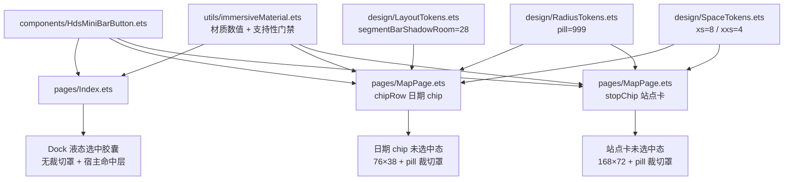
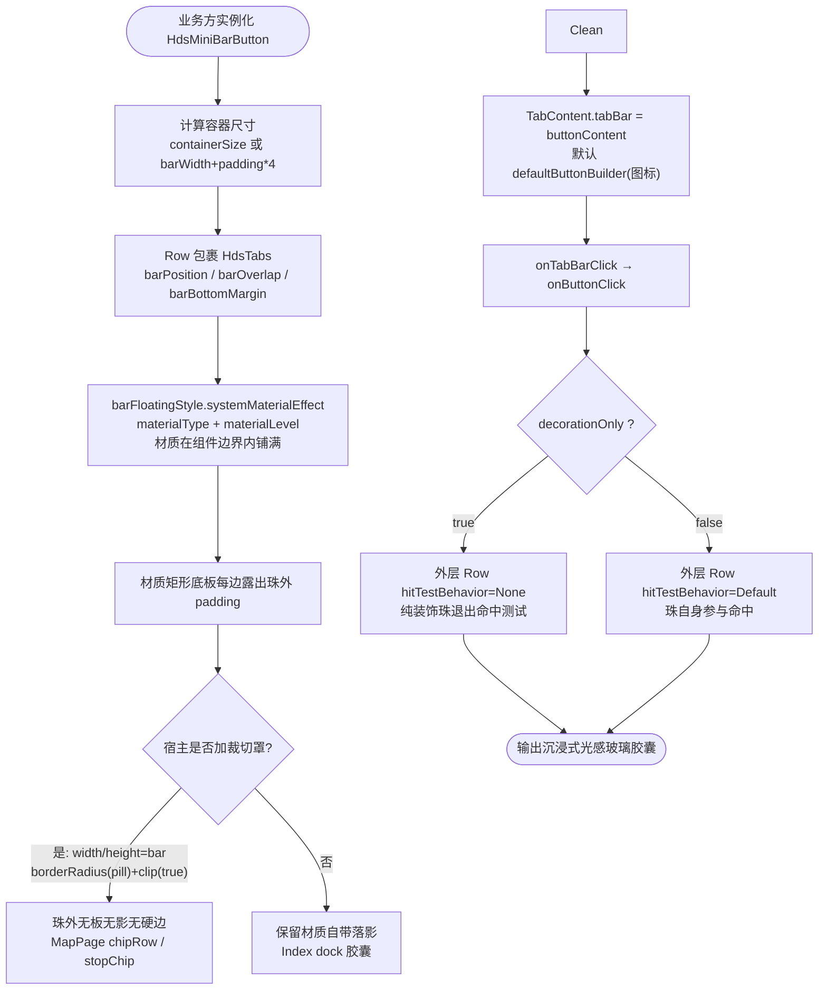
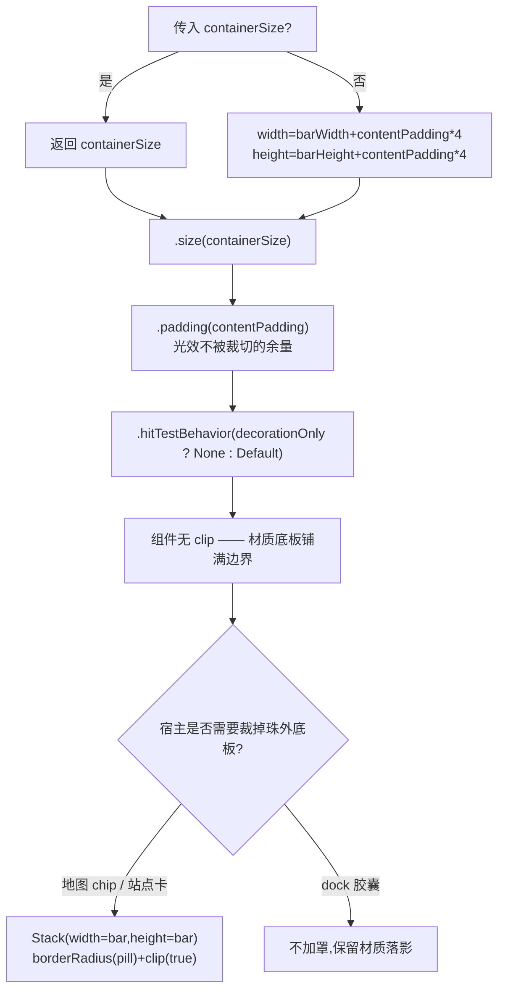
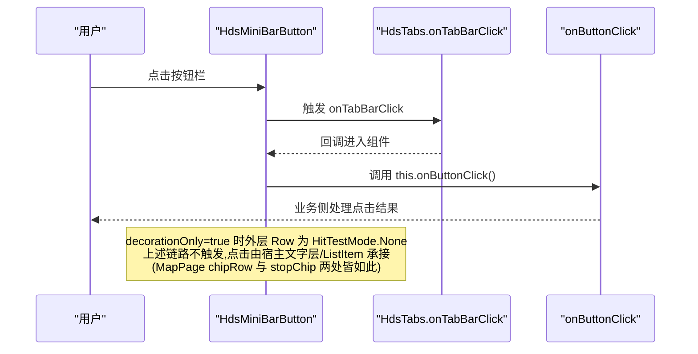
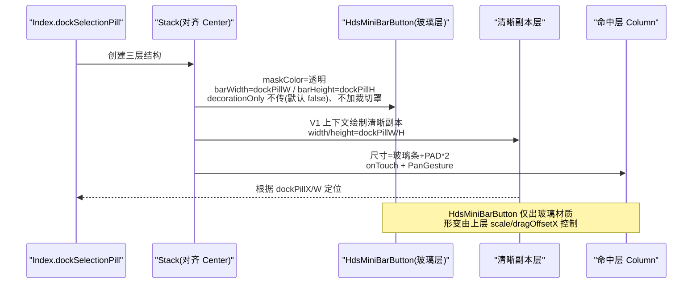
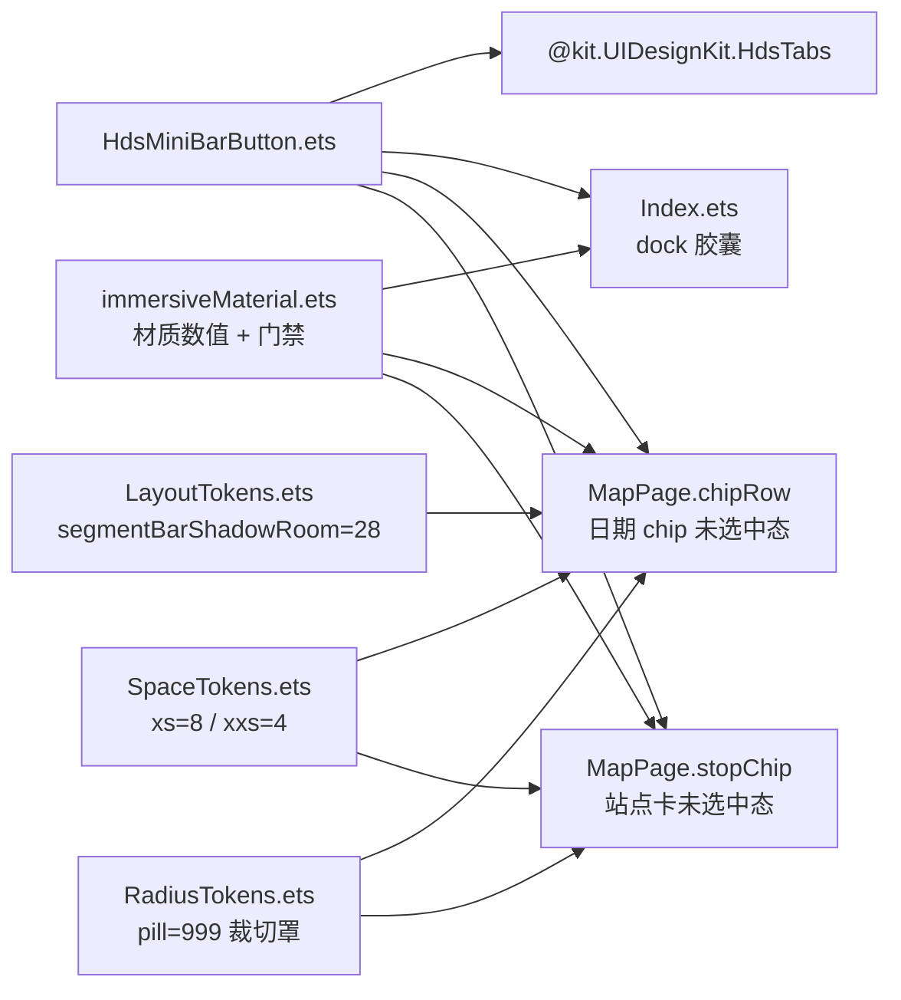

# HdsMiniBarButton 迷你浮动栏

<cite>
**本文引用的文件**
- [HdsMiniBarButton.ets](file://entry/src/main/ets/components/HdsMiniBarButton.ets)
- [Index.ets](file://entry/src/main/ets/pages/Index.ets)
- [MapPage.ets](file://entry/src/main/ets/pages/MapPage.ets)
- [immersiveMaterial.ets](file://entry/src/main/ets/utils/immersiveMaterial.ets)
- [SpaceTokens.ets](file://entry/src/main/ets/design/SpaceTokens.ets)
- [RadiusTokens.ets](file://entry/src/main/ets/design/RadiusTokens.ets)
- [LayoutTokens.ets](file://entry/src/main/ets/design/LayoutTokens.ets)
</cite>

## 更新概要
**变更内容**
- MapPage 的使用场景由「仅日期 chip 行」扩展为**两处宿主**：顶部日期 chip（76×38）与底部站点卡（168×72），二者共用同一套「同款模式」——`decorationOnly: true` + `contentPadding/barBottomMargin = SpaceTokens.xs(8)` + IMMERSIVE+EXQUISITE 材质 + 内容槽传空 Column。
- **新增关键用法约束（第五处偏离/铁律）**：玻璃珠必须包在 `width/height = bar 尺寸` + `borderRadius(RadiusTokens.pill)` + `clip(true)` 的**裁切罩**内，否则 `contentPadding=8` 撑出的材质矩形底板会在浅色地图上连成淡灰矩形；参数层没有关闭底板的开关。
- 「本地化偏离」表述由四处调整为「四处代码偏离 + 一条宿主侧裁切铁律」，并在简介、项目结构、核心组件、详细组件分析、依赖分析、性能与兼容性、故障排查、结论、附录示例各处同步改写为多宿主同款模式。
- 重写「在地图 chip 行的使用」为「在地图页的多宿主使用」，补充站点卡调用与两条 List 轨道净空的差异说明。
- API 参考表补入「宿主裁切罩」要求；故障排查表把「灰带」条目拆分为「落影被切成灰带」与「材质底板连成淡灰矩形」两类成因。

## 目录
1. [简介](#简介)
2. [项目结构](#项目结构)
3. [核心组件](#核心组件)
4. [架构总览](#架构总览)
5. [详细组件分析](#详细组件分析)
6. [依赖分析](#依赖分析)
7. [性能与兼容性](#性能与兼容性)
8. [故障排查](#故障排查)
9. [结论](#结论)
10. [附录：API 参考与示例](#附录api-参考与示例)

## 简介
HdsMiniBarButton 是一个基于 HdsTabs 实现的沉浸式光感玻璃悬浮按钮，用于在任意容器中渲染真沉浸光感玻璃效果。它的核心价值在于解决 systemMaterial 在覆盖层不出图的问题——通过 Row 包裹 HdsTabs，并借助 HdsTabs.barFloatingStyle 的官方材质渲染通道，让 glass-like 磨砂、折射、高光效果在覆盖层正常出图。这是仓内唯一在内容区**覆盖层**能出真折射光感的通道：组件级 systemMaterial 在覆盖层透明到只剩黑字浮在地图上（2026-11-09 真机实证）。

该组件是"有据"工程中同名组件的本地化移植，本仓在代码层做了四处关键偏离，并在宿主侧追加一条不可省略的裁切铁律：
1. materialType / materialLevel 参数从枚举改为 number 类型，避免静态 import @hms.hds.hdsMaterial 在 API 22 及以下设备启动即崩。
2. 内部 HdsTabs 调用 .scrollable(false)，关闭内置滑动以消除手势竞争，使外层 PanGesture 可正常拖动玻璃珠。
3. 移除拖拽形变功能；本组件仅作为玻璃材质载体，不承载业务侧形变逻辑。
4. **decorationOnly 参数（有径 2026-11-11）**：默认 false；为 true 时外层 Row 整体 `hitTestBehavior = HitTestMode.None`，纯装饰珠完全退出命中测试。多颗珠并排时，contentPadding 放大出的不可见容器会盖到邻珠边缘、空 TabContent 会把点击吞掉或转发给邻珠；装饰态下宿主自有文字层承接命中、onClick 挂在 ListItem 上，珠本体无需参与测试。dock 不传该参数，行为与上游保持一致。
5. **宿主侧裁切铁律（有径 2026-11-11，随站点卡接入确立）**：HdsTabs 的沉浸材质在**组件自身边界**内铺满渲染，胶囊珠只是画在这块底板上的 bar。contentPadding=8 时组件尺寸为 bar + 每边 32vp（宽/高各扩 padding×4），材质矩形底板每边露出珠外 8vp，在浅色地图上就是一块淡灰矩形，相邻底板叠压会连成整条。**每个调用方都必须把珠包进 `width/height = barWidth/barHeight` + `borderRadius(RadiusTokens.pill)` + `clip(true)` 的裁切罩**。SDK 全参数核对确认参数层拆不开：gradientMask 是底部渐隐遮罩且已传全透明，barOpacity 只调整体透明度，没有关底板的开关。padding=0 时底板恰好等于珠形看不见，但 bar 的系统落影零余量会被组件底边硬切成灰带——两种 padding 是同一枚硬币的两面，因此正确解是「padding 保留 + 外面加裁切罩」。

**章节来源**
- [HdsMiniBarButton.ets:1-40](file://entry/src/main/ets/components/HdsMiniBarButton.ets#L1-L40)
- [HdsMiniBarButton.ets:130-143](file://entry/src/main/ets/components/HdsMiniBarButton.ets#L130-L143)
- [MapPage.ets:303-345](file://entry/src/main/ets/pages/MapPage.ets#L303-L345)
- [MapPage.ets:400-425](file://entry/src/main/ets/pages/MapPage.ets#L400-L425)

## 项目结构
HdsMiniBarButton 位于 entry 模块的可复用 UI 组件目录中，当前有三个直接引用点：Index 页面（dock 液态选中胶囊）、MapPage 顶部日期 chip 行（未选中态）、MapPage 底部站点卡（未选中态）。三处都通过 immersiveMaterial 的统一材质档位与门禁取值，不各自硬编码枚举；MapPage 两处宿主更是逐字段同参，只有 bar 尺寸与裁切罩形状不同。

**图示来源**
- [HdsMiniBarButton.ets:1-226](file://entry/src/main/ets/components/HdsMiniBarButton.ets#L1-L226)
- [Index.ets:576-655](file://entry/src/main/ets/pages/Index.ets#L576-L655)
- [MapPage.ets:301-395](file://entry/src/main/ets/pages/MapPage.ets#L301-L395)
- [MapPage.ets:397-490](file://entry/src/main/ets/pages/MapPage.ets#L397-L490)
- [immersiveMaterial.ets:41-49](file://entry/src/main/ets/utils/immersiveMaterial.ets#L41-L49)
- [RadiusTokens.ets:30-43](file://entry/src/main/ets/design/RadiusTokens.ets#L30-L43)

**章节来源**
- [HdsMiniBarButton.ets:1-226](file://entry/src/main/ets/components/HdsMiniBarButton.ets#L1-L226)
- [Index.ets:45-49](file://entry/src/main/ets/pages/Index.ets#L45-L49)
- [MapPage.ets:23-30](file://entry/src/main/ets/pages/MapPage.ets#L23-L30)
- [MapPage.ets:60-64](file://entry/src/main/ets/pages/MapPage.ets#L60-L64)

## 核心组件
HdsMiniBarButton 是一个 @ComponentV2，封装了尺寸、图标、遮罩、材质、布局、命中测试模式、点击事件及 Builder 自定义能力。其 UI 构建由一个 Row 包裹 HdsTabs 组成，TabContent 的 tabBar 使用 buttonContent 槽位渲染内容，并通过 barFloatingStyle.systemMaterialEffect 注入材质。

关键点：
- 容器尺寸优先使用 containerSize；未设置时按 barWidth/barHeight 与 contentPadding 自动计算（padding×4 余量）。
- 默认按钮构建函数 defaultButtonBuilder 用 SymbolGlyph 渲染图标，支持 iconSize 与 iconColor。
- 点击通过 onTabBarClick 转发到 onButtonClick。
- 材质相关属性采用 number 类型，避免静态 import 崩溃。
- **最外层 Row 的 hitTestBehavior 由 decorationOnly 决定**：false → HitTestMode.Default（保留珠自身命中）；true → HitTestMode.None（整颗玻璃层退出命中测试，触摸穿透给宿主）。
- **组件本身不提供裁切能力**：`.size()` 与 `.padding()` 之外没有任何 clip 或圆角属性，材质底板必然铺满组件边界。裁切罩由宿主负责——MapPage 的两个 chip 宿主都在外套了一层 `Stack().width(bar).height(bar).borderRadius(RadiusTokens.pill).clip(true)`；Index 的 dock 胶囊因不在浅色底图上并排摆放，且需要保留材质自带落影，故不加裁切罩。

**章节来源**
- [HdsMiniBarButton.ets:41-226](file://entry/src/main/ets/components/HdsMiniBarButton.ets#L41-L226)
- [MapPage.ets:327-345](file://entry/src/main/ets/pages/MapPage.ets#L327-L345)
- [MapPage.ets:408-425](file://entry/src/main/ets/pages/MapPage.ets#L408-L425)

## 架构总览
HdsMiniBarButton 并不直接实现系统级 glass 材质，而是借用 HdsTabs 的 barFloatingStyle 官方通道。上层业务只需传入材质数值、容器尺寸与遮罩，即可得到可浮动的玻璃胶囊；但必须自行决定是否加裁切罩。

**图示来源**
- [HdsMiniBarButton.ets:186-225](file://entry/src/main/ets/components/HdsMiniBarButton.ets#L186-L225)
- [MapPage.ets:316-345](file://entry/src/main/ets/pages/MapPage.ets#L316-L345)

## 详细组件分析

### 设计动机与四处代码偏离 + 一条裁切铁律
**更新** 本节把原「四处本地化偏离」扩充为四处组件代码偏离，另立第五条为宿主侧用法铁律（不属于组件源码改动，但不写就必出错）。

- **为什么需要 HdsMiniBarButton**
  官方 HdsTabs 没有选中指示器属性；在覆盖层挂 systemMaterial 不出图。唯一能在覆盖层拿到真沉浸光感玻璃的方式就是"Row 包 HdsTabs"，这也是本组件存在的根本原因。
- **偏离一：materialType/materialLevel 为 number**
  上游 HAR 静态 import 了 @hms.hds.hdsMaterial 枚举，在 API 22 及以下设备加载即崩。为避免启动链路崩溃，本组件将这两个参数改为 number，由调用方传数值字面量（IMMERSIVE=101 / EXQUISITE=0 / ADAPTIVE=10，对照见 immersiveMaterial 头注释）。
- **偏离二：.scrollable(false)**
  HdsTabs 内置滑动手势会吃掉宿主的横向滑动，导致外层 PanGesture 无法触发、玻璃珠不可拖动。本组件作为指示器使用时，内部只有一颗空 TabContent，禁滑无副作用。
- **偏离三：移除拖拽形变**
  本组件只提供玻璃材质载体；拖拽形变等交互由上层（如 Index 的 dockSelectionPill）自行处理。
- **偏离四：decorationOnly 命中测试开关**
  contentPadding 的存在使组件容器比可见玻璃大出 padding×4；单颗珠独立摆放时无害，多颗珠并排（地图页日期 chip 间距仅 4vp、站点卡间距 8vp）时，放大的不可见容器会压到邻珠边缘，空 TabContent 把邻珠的点击吞掉或转发错对象。上游没有对应开关，本仓在外层 Row 上加一行条件式 hitTestBehavior：`decorationOnly === true` 时整层设为 HitTestMode.None。默认 false，dock 用法不传，行为与有据逐字一致。
- **铁律五（新增）：宿主必须自备 pill 形裁切罩**
  2026-11-11 底部站点卡接入时暴露的问题：HdsTabs 的沉浸材质在组件自身边界内铺满渲染，胶囊珠只是画在底板上的 bar。contentPadding=8 时组件为 92×54（日期 chip）/ 200×104（站点卡），材质矩形底板每边露出珠外 8vp，在浅色地图上就是一块淡灰矩形，相邻底板叠压连成整条（真机逐像素实测：板区 x=[珠左−24px, 珠右+24px]，选中 chip 旁正好是亮缺口）。参数层无关闭开关（gradientMask 是底部渐隐遮罩且已传全透明、barOpacity 只调整体），因此**凡是需要把珠贴在浅色底图上并排摆放的宿主，都必须外包一层 `width/height = bar 尺寸` + `borderRadius(RadiusTokens.pill)` + `clip(true)` 的 Stack**。裁切后材质在珠内原样保留（dock 同款真玻璃），珠外无板无影无硬边。dock 场景不加罩，因为它要保留材质自带落影且不与其他珠并排。

**章节来源**
- [HdsMiniBarButton.ets:1-40](file://entry/src/main/ets/components/HdsMiniBarButton.ets#L1-L40)
- [HdsMiniBarButton.ets:130-143](file://entry/src/main/ets/components/HdsMiniBarButton.ets#L130-L143)
- [HdsMiniBarButton.ets:186-225](file://entry/src/main/ets/components/HdsMiniBarButton.ets#L186-L225)
- [immersiveMaterial.ets:1-20](file://entry/src/main/ets/utils/immersiveMaterial.ets#L1-L20)
- [MapPage.ets:316-345](file://entry/src/main/ets/pages/MapPage.ets#L316-L345)
- [MapPage.ets:400-425](file://entry/src/main/ets/pages/MapPage.ets#L400-L425)

### 配置参数说明
| 参数 | 类型 | 默认值 | 说明 |
|---|---|---:|---|
| barWidth | number | 50 | 按钮栏宽度；裁切罩的宽必须与此同值 |
| barHeight | number | 50 | 按钮栏高度；裁切罩的高必须与此同值 |
| contentPadding | number | 8 | 容器内边距，上游定义为「防止光效被裁切」的余量；归零会把玻璃珠落影硬切成灰带，非零会让材质底板外溢——须由宿主裁切罩兜住 |
| containerSize | SizeOptions \| undefined | undefined | 容器尺寸；优先于 barWidth/barHeight 自动计算 |
| iconResource | Resource | $r('sys.symbol.plus') | 图标资源（SymbolGlyph） |
| iconSize | number | 27 | 图标大小 |
| iconColor | ResourceColor[] | [Color.Gray] | 图标颜色数组，支持渐变 |
| maskColor | ResourceColor | Color.Transparent | 渐变遮罩颜色；三处宿主均传 '#00ffffff' 隐藏遮罩 |
| barBottomMargin | number | 8 | 按钮栏底部边距；与 contentPadding 同值时珠底贴 Stack 底 |
| materialType | number | 101 | 材质类型（沉浸式 IMMERSIVE） |
| materialLevel | number | 10 | 材质级别（ADAPTIVE；要折射需显式传 0=EXQUISITE） |
| barPosition | BarPosition | BarPosition.End | 按钮栏位置 |
| barOverlap | boolean | true | 是否与内容重叠 |
| decorationOnly | boolean | false | 为 true 时外层 Row 整体 hitTestBehavior=HitTestMode.None，纯装饰珠退出命中测试；MapPage 两处宿主均传 true，dock 不传 |
| onButtonClick | (() => void) \| undefined | undefined | 点击回调（decorationOnly=true 时不会触发） |

⚠️ 表中没有「裁切罩」这一参数——组件不提供裁切能力，裁切必须由宿主承担，详见上一条铁律。

**章节来源**
- [HdsMiniBarButton.ets:44-150](file://entry/src/main/ets/components/HdsMiniBarButton.ets#L44-L150)
- [immersiveMaterial.ets:41-49](file://entry/src/main/ets/utils/immersiveMaterial.ets#L41-L49)
- [RadiusTokens.ets:30-43](file://entry/src/main/ets/design/RadiusTokens.ets#L30-L43)

### Builder 自定义能力
- **defaultButtonBuilder**：默认构建函数，使用 SymbolGlyph 渲染图标，支持 fontSize 与 fontColor。
- **buttonContent**：@BuilderParam 自定义内容槽位；未传参时使用 defaultButtonBuilder。

典型用法：
- 仅显示图标：不传 buttonContent。
- 自定义内容：传入尾随闭包，替换 TabContent.tabBar 的视觉表现。
- 纯出材质：传入空的 Column 闭包。**三个宿主全部采用此写法**——Index 的 dock 胶囊、MapPage 的 chipRow 日期 chip、MapPage 的 stopChip 站点卡，内容槽都不承担可见内容，可见文字一律画在宿主 Stack 的文字层里。
- 与 dock 胶囊结合：上层 Stack 叠加"玻璃层 + 清晰副本层 + 命中层"，HdsMiniBarButton 只负责出玻璃材质。
- 与地图两态卡片结合：上层 Stack 为「裁切罩内的玻璃层 + 同宽同高的文字层」，选中态/低版本回退走自绘面（chipSolid 实心底或 GlassPanel 同款自绘玻璃）。
- ⚠️ 内容槽是 @ComponentV2 上下文，闭包里读不到宿主页面 V1 @State 的更新；需要跟随页面状态的可见内容必须画在宿主 Stack 里，而不是画进尾随闭包（MapPage 的 daySel / selectedStop 同理）。

**章节来源**
- [HdsMiniBarButton.ets:152-171](file://entry/src/main/ets/components/HdsMiniBarButton.ets#L152-L171)
- [Index.ets:576-596](file://entry/src/main/ets/pages/Index.ets#L576-L596)
- [MapPage.ets:301-315](file://entry/src/main/ets/pages/MapPage.ets#L301-L315)
- [MapPage.ets:397-406](file://entry/src/main/ets/pages/MapPage.ets#L397-L406)

### 尺寸与布局计算
- 当 containerSize 已设置时，直接使用。
- 否则容器 size 为 { width: barWidth + contentPadding×4, height: barHeight + contentPadding×4 }。
- 最终对外 padding 为 contentPadding，用于给玻璃光效留出裁剪空间。
- 由此推论出两个宿主侧必办事项：**其一**，容器必然比可见玻璃宽/高各出一截，这正是 decorationOnly 需要处理的命中越界来源，也是 dock 的 position 需要反向补偿 padding×2 的原因；**其二**，材质底板同样铺满这多出的一截，所以并排贴在浅色底图上的宿主必须用裁切罩把这截裁掉。

**图示来源**
- [HdsMiniBarButton.ets:173-225](file://entry/src/main/ets/components/HdsMiniBarButton.ets#L173-L225)
- [MapPage.ets:340-343](file://entry/src/main/ets/pages/MapPage.ets#L340-L343)
- [MapPage.ets:421-424](file://entry/src/main/ets/pages/MapPage.ets#L421-L424)

**章节来源**
- [HdsMiniBarButton.ets:173-225](file://entry/src/main/ets/components/HdsMiniBarButton.ets#L173-L225)

### 事件流程

**图示来源**
- [HdsMiniBarButton.ets:186-225](file://entry/src/main/ets/components/HdsMiniBarButton.ets#L186-L225)
- [MapPage.ets:384-393](file://entry/src/main/ets/pages/MapPage.ets#L384-L393)
- [MapPage.ets:478-488](file://entry/src/main/ets/pages/MapPage.ets#L478-L488)

**章节来源**
- [HdsMiniBarButton.ets:196-225](file://entry/src/main/ets/components/HdsMiniBarButton.ets#L196-L225)

### 在 dock 导航指示器中的集成方案
Index.ets 将 HdsMiniBarButton 用作 dock 液态选中胶囊的玻璃层：
- 三层 Stack 叠放：玻璃渲染层（HdsMiniBarButton）、清晰副本层（V1 上下文绘制）、命中层（独占玻璃区域的触摸）。
- 通过 maskColor='#00ffffff' 隐藏遮罩，仅保留系统材质渲染；内容槽传空 Column。
- **不传 decorationOnly**（保持默认 false），也**不加裁切罩**——dock 底图是深色遮罩带而非浅色地图，材质底板不外溢成可见灰块，且这里需要保留 HdsTabs 自带的系统落影。交互仍由上层独立命中层的 onTouch/PanGesture 承担，行为与有据一致。
- 容器 position 反向补偿 DOCK_PILL_MINI_PAD=16，因为容器 size 包含 contentPadding×4，玻璃居中后需减去 padding×2。
- 形变（scale、dragOffsetX）由上层 State 管理，避免直写 HdsMiniBarButton 内部布局尺寸（那是真 HdsTabs 的布局尺寸，逐帧直写 = 每帧重布局 + 材质重采样），减少重布局与材质重采样。
- 命中层 Stack 的 hitTestBehavior 必须是 Transparent 而不是 None：既要收进玻璃区域的触摸，又要让玻璃以外区域的点击透给下层官方页签。

**图示来源**
- [Index.ets:566-655](file://entry/src/main/ets/pages/Index.ets#L566-L655)
- [Index.ets:83-86](file://entry/src/main/ets/pages/Index.ets#L83-L86)

**章节来源**
- [Index.ets:566-655](file://entry/src/main/ets/pages/Index.ets#L566-L655)
- [Index.ets:83-86](file://entry/src/main/ets/pages/Index.ets#L83-L86)
- [Index.ets:160-172](file://entry/src/main/ets/pages/Index.ets#L160-L172)
- [Index.ets:255-258](file://entry/src/main/ets/pages/Index.ets#L255-L258)

### 在地图页的多宿主使用
**本节已改写**：由「仅日期 chip 行」扩展为「日期 chip 行 + 底部站点卡」两处，并给出新增的裁切罩约束。

MapPage.ets 现在有两个 HdsMiniBarButton 宿主，都是「未选中态出玻璃珠、选中态走实心底」的双态件：

| 宿主 | bar 尺寸常量 | 值 | 珠间距（List space） | 项顶内缩 | 裁切罩 |
|---|---|---|---|---|---|
| chipRow（顶部日期 chip） | CHIP_BEAD_WIDTH / CHIP_BEAD_HEIGHT | 76 × 38 | SpaceTokens.xxs (4vp) | SpaceTokens.xs (8vp) | 76×38 + pill + clip |
| stopChip（底部站点卡） | STOP_CARD_WIDTH / STOP_CARD_HEIGHT | 168 × 72 | SpaceTokens.xs (8vp) | SpaceTokens.xxs (4vp) | 168×72 + pill + clip |

两处调用的其余参数**逐字段相同**（这就是"多宿主同款模式"）：

- `maskColor: '#00ffffff'`；
- `contentPadding: SpaceTokens.xs`(8)、`barBottomMargin: SpaceTokens.xs`(8)；
- `decorationOnly: true`；
- `materialType: HDS_MATERIAL_TYPE_IMMERSIVE`、`materialLevel: HDS_MATERIAL_LEVEL_EXQUISITE`，内容槽传空 Column；
- 外层 Stack 结构相同：`if (未选中 && isImmersiveLightSenseSupported())` 出玻璃层（内含裁切罩），`else` 走自绘面（选中态 chipSolid 中性深灰实心底 / 低版本退回 GlassBlurStyle.Card 自绘磨砂），再叠一层与玻璃同宽同高、居中的文字层；
- 两态形状统一走 RadiusTokens.pill（HdsTabs 浮动栏固定胶囊形，168×72 也是上下圆头卡）。

关于 contentPadding 与裁切罩的三条结论（含旧结论作废说明）：
- **contentPadding 不能归零**。上游对它的定义就是「防止光效被裁切」的容器余量：HdsTabs 的光效层在自身边界内渲染，归零时珠底贴着组件底边、落影零余量，会被硬切成一道灰带（2026-11-11 真机：List 净空修到 28 后选中 chip 的自绘影清了，玻璃珠的灰带还在，截断边界在 HdsMiniBarButton 内部）。
- **归零也不是解，裁切罩才是解**。padding=0 时底板恰好等于珠形看不见，但落影被切；padding=8 时落影有余量，但底板每边外溢 8vp 连成淡灰矩形。两者是同一枚硬币的两面，SDK 参数层拆不开——正确做法是保留 padding 并在外套 `width/height = bar 尺寸` + `borderRadius(RadiusTokens.pill)` + `clip(true)`，把珠外的一切裁掉，材质在珠内原样保留。
- **「两态等高对齐」性质不变**。珠底 = barHeight + contentPadding − barBottomMargin，两参同值（8 = 8）时珠底仍贴 Stack 底。旧结论『必须归零才对齐』是在 padding=0 的前提下测得的，已作废。
- 配套改动（chip 行）：chip 顶部内缩由 xxs 提到 xs（8vp），保证光效盒顶边留在 List 视口内；List 轨道 margin 同步上移 4vp 抵消，chip 落位与净空修复前逐像素一致。轨道高 = 38 + xxs + segmentBarShadowRoom(28)，这段净空是给选中 chip 的 pillFloat 自绘影收尾用的，玻璃珠材质的落影由 HdsTabs 在自身光效盒内渲染、不依赖它。
- 配套改动（站点卡）：轨道高维持 92 = 72 + xxs + base(16)，够选中态 pillFloat（radius 8 + offsetY 3，下探约 11vp）收尾；**未选玻璃珠的材质落影被裁切罩裁掉，不吃这段净空**，因此卡片落位与珠化前逐像素一致。
- 两个 List 都**不给左右 padding**：List 的裁切视口按「组件区域 − padding」算，padding 是来向侧一条隐形切线（2026-11-10 真机实证：滑动中卡片在 x=1086px 被硬切）；静息内缩改由首末项 margin 承担，裁切线回到屏幕边缘。
- **decorationOnly: true 的必要性**：chip 之间 List space 仅 4vp、站点卡之间 8vp，而 contentPadding=8 使每颗珠的容器向四周各扩出 32vp 的不可见区域，会盖住邻珠边缘；空 TabContent 会把邻珠的点击吞掉或转发错对象。两处命中都由 Stack 内的文字层与 ListItem 的 onClick 承接（chipRow 走 applySel、stopChip 走 focusStop），珠本体无需参与命中测试。

**章节来源**
- [MapPage.ets:301-395](file://entry/src/main/ets/pages/MapPage.ets#L301-L395)
- [MapPage.ets:397-490](file://entry/src/main/ets/pages/MapPage.ets#L397-L490)
- [MapPage.ets:55-64](file://entry/src/main/ets/pages/MapPage.ets#L55-L64)
- [MapPage.ets:117-123](file://entry/src/main/ets/pages/MapPage.ets#L117-L123)
- [MapPage.ets:533-575](file://entry/src/main/ets/pages/MapPage.ets#L533-L575)
- [MapPage.ets:585-601](file://entry/src/main/ets/pages/MapPage.ets#L585-L601)
- [SpaceTokens.ets:30-43](file://entry/src/main/ets/design/SpaceTokens.ets#L30-L43)
- [RadiusTokens.ets:30-43](file://entry/src/main/ets/design/RadiusTokens.ets#L30-L43)
- [LayoutTokens.ets:43-49](file://entry/src/main/ets/design/LayoutTokens.ets#L43-L49)

## 依赖分析
HdsMiniBarButton 的直接依赖是 @kit.UIDesignKit 提供的 HdsTabs；业务侧通过传入 number 类型的 materialType 与 materialLevel，绕过对 @hms.hds.hdsMaterial 枚举的静态 import。材质数值与支持性门禁集中在 utils/immersiveMaterial 出口，Index 与 MapPage 共用同一组常量与 isImmersiveLightSenseSupported() 判定。

三个宿主对 token 的取用略有分工：Index 只用材质常量与自身的 DOCK_PILL_MINI_PAD 补偿量，不需要圆角 token（不加裁切罩）；MapPage 的两个 chip 宿主除材质常量外，还共同依赖 SpaceTokens（xs=8 的同参 padding/margin、xxs=4 的间距档）与 RadiusTokens.pill（裁切罩与两态形状），chip 轨道额外依赖 LayoutTokens.segmentBarShadowRoom(28)。

**图示来源**
- [HdsMiniBarButton.ets:20-21](file://entry/src/main/ets/components/HdsMiniBarButton.ets#L20-L21)
- [Index.ets:45-49](file://entry/src/main/ets/pages/Index.ets#L45-L49)
- [MapPage.ets:23-30](file://entry/src/main/ets/pages/MapPage.ets#L23-L30)
- [immersiveMaterial.ets:18-49](file://entry/src/main/ets/utils/immersiveMaterial.ets#L18-L49)
- [RadiusTokens.ets:30-43](file://entry/src/main/ets/design/RadiusTokens.ets#L30-L43)

**章节来源**
- [HdsMiniBarButton.ets:20-21](file://entry/src/main/ets/components/HdsMiniBarButton.ets#L20-L21)
- [Index.ets:45-49](file://entry/src/main/ets/pages/Index.ets#L45-L49)
- [MapPage.ets:23-30](file://entry/src/main/ets/pages/MapPage.ets#L23-L30)
- [immersiveMaterial.ets:18-49](file://entry/src/main/ets/utils/immersiveMaterial.ets#L18-L49)

## 性能与兼容性

### 性能要点
- 禁用内部滑动：.scrollable(false) 消除 Tabs 内置手势与宿主 PanGesture 的竞争，避免外层拖动失效。
- 避免直写内部布局尺寸：Index 中对 dock 胶囊的形变使用 scale 变换而非修改 barWidth/barHeight，以减少逐帧重布局与材质重采样。
- 容器尺寸预计算：getComputedContainerSize 避免重复计算，配合 padding 保证光效不被裁切。
- 命中测试成本可控：decorationOnly=true 时整棵子树一次性退出命中链，比在珠上再叠一层遮挡或反查坐标更省，也避免了并排珠互相吞点击带来的额外试错路径。
- 裁切罩代价低于替代方案：宿主用一层 `clip(true)` 的 Stack 换掉「为躲底板而把 padding 归零再自绘落影」的做法，既不引入第二套阴影公式，也让 chipRow 与 stopChip 两个宿主共享同一份几何口径。

### 兼容性与 ohpm 规避原因
- 直接 ohpm 依赖 hds_button@1.0.1 会被 hvigor 构建期 SDK 校验拒绝，因为其 compatibleSdkVersion 高于本工程 6.0.0(20)。
- 源码落库后，仅在 API 23+ 设备进入；入口已通过 isImmersiveLightSenseSupported()（API ≥ 23 且声明 HDS syscap）门禁，运行时安全性由调用方保证。MapPage 的两个宿主都把这条门禁写在双态分支条件里（`未选中 && isImmersiveLightSenseSupported()`），低版本设备退回自绘磨砂，不会加载即崩。
- materialType/materialLevel 使用 number 类型，避免 @hms.hds.hdsMaterial 在低版本设备上静态加载崩溃。
- decorationOnly 只用到 ArkUI 通用属性 hitTestBehavior，不涉及任何 HMS 模块，对所有 API 等级安全；默认 false 也不改变既有调用方的行为。
- 裁切罩同样只用 ArkUI 通用属性（borderRadius / clip），与 API 等级无关；但它只在并排贴浅色底图的宿主上是必需的，dock 场景加了反而会丢掉材质自带落影。

**章节来源**
- [HdsMiniBarButton.ets:1-40](file://entry/src/main/ets/components/HdsMiniBarButton.ets#L1-L40)
- [HdsMiniBarButton.ets:186-225](file://entry/src/main/ets/components/HdsMiniBarButton.ets#L186-L225)
- [immersiveMaterial.ets:1-49](file://entry/src/main/ets/utils/immersiveMaterial.ets#L1-L49)
- [Index.ets:255-258](file://entry/src/main/ets/pages/Index.ets#L255-L258)
- [MapPage.ets:117-123](file://entry/src/main/ets/pages/MapPage.ets#L117-L123)

## 故障排查
| 现象 | 可能原因 | 处理方式 |
|---|---|---|
| 覆盖层看不到 glass 材质 | 使用了普通组件挂 systemMaterial | 改用 HdsMiniBarButton 的 Row+HdsTabs 通道 |
| **珠周围出现淡灰矩形、并排时连成整条** | 材质矩形底板铺满组件边界，contentPadding=8 使其每边露出珠外 8vp；参数层无关闭开关 | 给珠套裁切罩：`Stack().width(barWidth).height(barHeight).borderRadius(RadiusTokens.pill).clip(true)`（见 MapPage chipRow / stopChip） |
| 玻璃珠落影被硬切成灰带 | contentPadding 归零，光效层无余量渲染落影 | 恢复 contentPadding 与 barBottomMargin 同值（dock/chip/站点卡均为 SpaceTokens.xs=8），改用裁切罩处理底板外溢；对齐关系不因此改变 |
| 加了裁切罩后珠下缘没有落影 | 裁切罩把材质自带系统落影一并裁掉 | 这是预期取舍：并排贴浅色底图时不留外溢影；若需要材质落影（dock），则不加罩并保留 padding |
| **并排珠邻珠点击被吞** | contentPadding 放大出的不可见容器盖到邻珠边缘，空 TabContent 吞掉或转发点击 | 纯装饰用法传 `decorationOnly: true`，让整颗珠退出命中测试，点击交给宿主文字层/ListItem（见 MapPage 日期 chip 与站点卡） |
| 传了 decorationOnly 后珠自身不再响应 | 该参数的语义就是整层 HitTestMode.None，onButtonClick 不会触发 | 把 onClick 挂在宿主的 ListItem/文字层上；需要珠自身命中时保持默认 false |
| chip 上缘被切一道 | 光效盒（珠 + 四周 padding）顶边落在 List 视口外 | 项顶内缩提到 SpaceTokens.xs(8) 并把轨道 margin 上移 4vp 抵消；轨道高给足 38 + xxs + segmentBarShadowRoom |
| 滑动中卡片在屏幕内被提前裁断 | List 给了左右 padding，形成来向侧隐形切线 | 去掉 List 左右 padding，静息内缩改由首末项 margin 承担 |
| 构建时报 SDK 版本错误 | 直接 ohpm 引入 hds_button | 使用仓库内本地化源码，不在 oh-package.json5 中添加该依赖 |
| 低版本设备启动崩溃 | 静态 import @hms.hds.hdsMaterial 枚举 | 确保使用本地化版本，materialType/materialLevel 传 number，并由 isImmersiveLightSenseSupported() 门禁 |
| dock 胶囊偏移 | position 未补偿 DOCK_PILL_MINI_PAD | 容器 position 应减去 padding×2=16 |
| 点击无效 | 未传 onButtonClick | 传入点击回调处理业务跳转或状态切换（decorationOnly=false 时才生效） |

**章节来源**
- [HdsMiniBarButton.ets:1-40](file://entry/src/main/ets/components/HdsMiniBarButton.ets#L1-L40)
- [HdsMiniBarButton.ets:130-143](file://entry/src/main/ets/components/HdsMiniBarButton.ets#L130-L143)
- [HdsMiniBarButton.ets:186-225](file://entry/src/main/ets/components/HdsMiniBarButton.ets#L186-L225)
- [MapPage.ets:316-345](file://entry/src/main/ets/pages/MapPage.ets#L316-L345)
- [MapPage.ets:376-395](file://entry/src/main/ets/pages/MapPage.ets#L376-L395)
- [MapPage.ets:553-575](file://entry/src/main/ets/pages/MapPage.ets#L553-L575)
- [Index.ets:633-655](file://entry/src/main/ets/pages/Index.ets#L633-L655)

## 结论
HdsMiniBarButton 解决了在覆盖层渲染真实沉浸光感玻璃的关键问题，并以最小侵入方式把 HdsTabs 的材质通道暴露为可复用的浮动胶囊。通过四处本地化偏离，它既规避了 ohpm 依赖与静态枚举崩溃风险、消除了手势竞争，又新增了 decorationOnly 让纯装饰珠可以整体退出命中测试，从而支持多颗珠并排的排版场景。与此同时，2026-11-11 站点卡接入确立了一条宿主侧铁律：**组件不带裁切能力，材质底板必然铺满组件边界**，凡并排贴在浅色底图上的用法，都必须自备 `width/height = bar 尺寸` + `borderRadius(RadiusTokens.pill)` + `clip(true)` 的裁切罩——padding 归零不是解，它会换来另一条灰带。

在实际工程中，它与 Index 的 dock 胶囊（decorationOnly 不传、不加裁切罩、走宿主命中层）、MapPage 的日期 chip 未选中态（76×38、decorationOnly:true、pill 裁切罩）、MapPage 的站点卡未选中态（168×72、decorationOnly:true、pill 裁切罩）共同构成一致的 glass 体验；后两处除 bar 尺寸外逐字段同参（contentPadding/barBottomMargin 同为 SpaceTokens.xs=8、材质同为 IMMERSIVE+EXQUISITE、内容槽同为空 Column），是"一处材质、多宿主同款"的标准范式。

## 附录：API 参考与示例

### API 参考
- 组件名：HdsMiniBarButton
- 装饰器：@ComponentV2
- 关键参数：
  - 尺寸：barWidth、barHeight、contentPadding（默认 8，勿归零）、containerSize
  - 图标：iconResource、iconSize、iconColor
  - 样式：maskColor、barBottomMargin、materialType、materialLevel
  - 布局：barPosition、barOverlap
  - 命中测试：**decorationOnly（boolean，默认 false）**——true 时外层 Row 整体 hitTestBehavior=HitTestMode.None，珠不参与命中、onButtonClick 不触发
  - 事件：onButtonClick
  - 构建：defaultButtonBuilder、buttonContent
- **宿主义务（非组件参数）**：并排贴浅色底图时必须外套裁切罩 `Stack().width(barWidth).height(barHeight).borderRadius(RadiusTokens.pill).clip(true)`；组件自身无 clip 与圆角属性。

### 使用示例（描述性）
- 基础用法：传入 barWidth、barHeight、iconResource、iconSize、iconColor，点击时执行 onButtonClick。
- 自定义内容：传入 buttonContent 闭包，替换默认图标。
- dock 胶囊（Index.dockSelectionPill）：maskColor 设为透明，barWidth/barHeight 跟随 dock 胶囊尺寸（dockPillW/dockPillH），**不传 decorationOnly、不加裁切罩**（交互由上层命中层的 onTouch/PanGesture 承担，且需保留材质自带落影），position 反向补偿 DOCK_PILL_MINI_PAD，形变由上层 scale 控制。
- 地图日期 chip（MapPage.chipRow）：barWidth/barHeight = 76/38，使用 IMMERSIVE+EXQUISITE 材质组合，contentPadding 与 barBottomMargin 同为 SpaceTokens.xs(8)，传 decorationOnly:true，外套 76×38 + pill + clip(true) 的裁切罩；项顶内缩 8vp、轨道高 38 + xxs + segmentBarShadowRoom，List 不给左右 padding。
- 地图站点卡（MapPage.stopChip）：barWidth/barHeight = 168/72，其余参数与日期 chip **逐字段相同**（xs/xs 同参、decorationOnly:true、IMMSERSIVE+EXQUISITE、空 Column 内容槽），外套 168×72 + pill + clip(true) 的裁切罩；轨道高维持 92 = 72 + xxs + base，选中态 pillFloat 用这段净空，未选珠的材质落影由裁切罩裁掉、不吃净空。
- 多珠并排的通用规则：只要珠只是视觉装饰、命中由宿主承接，就一律 decorationOnly:true **并同时**套上 bar 尺寸的 pill 裁切罩；只要珠本体需要响应点击（dock），就保持默认 false 且不加罩，并确保容器扩展区不与邻件重叠。
- 两态件的通用骨架：Stack 内 `if (未选中 && isImmersiveLightSenseSupported())` 放「裁切罩 + 珠 + 空内容槽」，`else` 放自绘面（实心底或自绘磨砂），最后叠一层与 bar 同宽同高的文字层承载可见内容与命中。

**章节来源**
- [HdsMiniBarButton.ets:44-225](file://entry/src/main/ets/components/HdsMiniBarButton.ets#L44-L225)
- [Index.ets:566-655](file://entry/src/main/ets/pages/Index.ets#L566-L655)
- [MapPage.ets:301-395](file://entry/src/main/ets/pages/MapPage.ets#L301-L395)
- [MapPage.ets:397-490](file://entry/src/main/ets/pages/MapPage.ets#L397-L490)
- [MapPage.ets:55-64](file://entry/src/main/ets/pages/MapPage.ets#L55-L64)