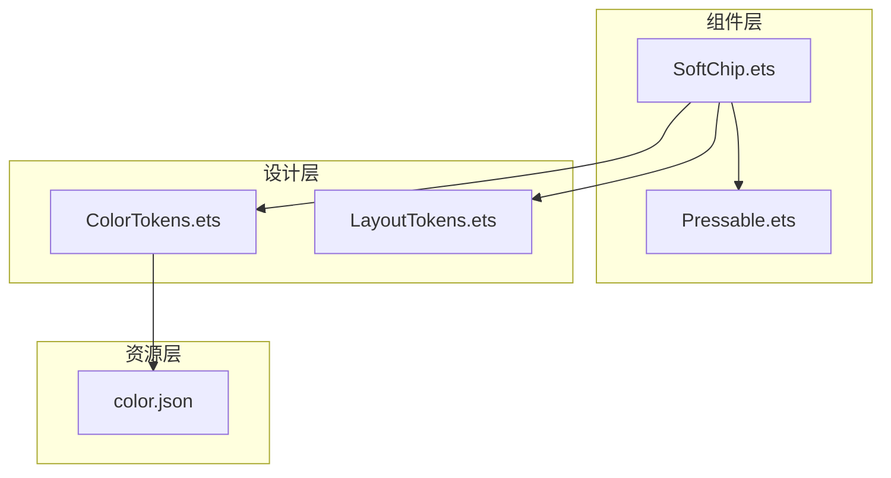
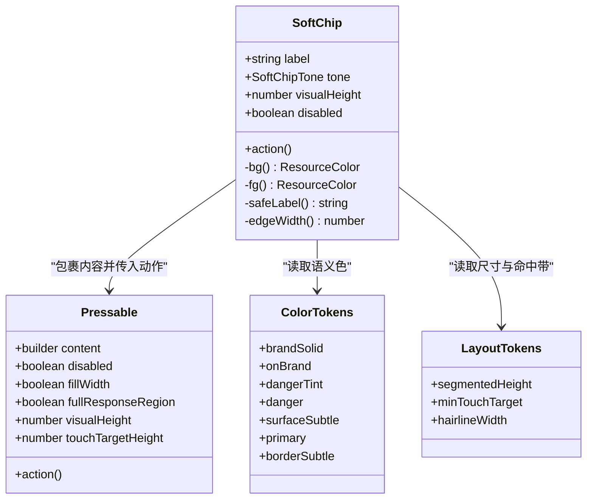
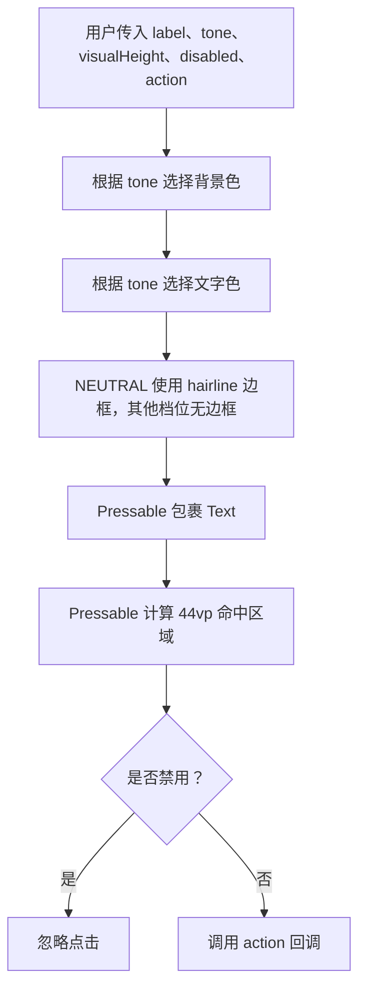
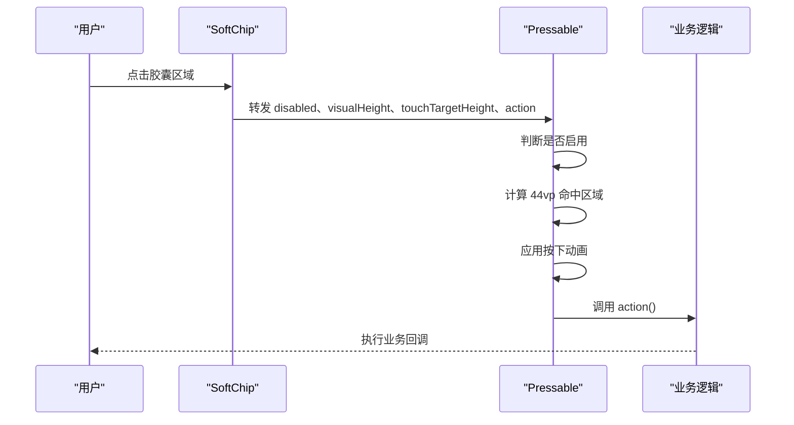

# SoftChip 软标签

<cite>
**本文引用的文件**   
- [SoftChip.ets](file://entry/src/main/ets/components/SoftChip.ets)
- [Pressable.ets](file://entry/src/main/ets/components/Pressable.ets)
- [ColorTokens.ets](file://entry/src/main/ets/design/ColorTokens.ets)
- [LayoutTokens.ets](file://entry/src/main/ets/design/LayoutTokens.ets)
- [color.json](file://entry/src/main/resources/base/element/color.json)
</cite>

## 目录
1. [简介](#简介)
2. [项目结构定位](#项目结构定位)
3. [核心组件总览](#核心组件总览)
4. [架构与依赖关系](#架构与依赖关系)
5. [详细组件分析](#详细组件分析)
6. [属性与配置表](#属性与配置表)
7. [使用示例](#使用示例)
8. [颜色计算逻辑](#颜色计算逻辑)
9. [禁用态与可访问性](#禁用态与可访问性)
10. [与 Pressable 的集成](#与-pressable-的集成)
11. [常见问题与排错](#常见问题与排错)
12. [结论](#结论)

## 简介
SoftChip 是「小型实色动作胶囊」家族组件，对标设计仓库中的 `design/components/SoftChip.ets`，用于承载短文本操作入口，例如「重试」「加一块」等轻量级动作。它通过三档语义色调表达不同重要性与风险等级，同时复用 Pressable 统一触摸反馈、命中区域和禁用行为，确保整个应用的动作胶囊具有一致的交互体验。

该组件强调：
- 视觉高度由 `visualHeight` 控制，默认继承分段控件高度。
- 触摸目标始终满足 44vp 无障碍标准，但视觉上仍保持紧凑胶囊尺寸。
- 颜色、间距、圆角、字体全部走设计 token，不硬编码业务值。
- 禁用态使用整体透明度降级，而不是替换文字颜色。

## 项目结构定位
SoftChip 位于应用组件层，属于 `components` 目录下的家族件之一；其视觉语义来自 `design` 层的 ColorTokens 与 LayoutTokens；运行时通过 ArkTS 资源引用绑定到 `resources/base/element/color.json` 中的色值定义。

**图表来源**
- [SoftChip.ets:1-95](file://entry/src/main/ets/components/SoftChip.ets#L1-L95)
- [Pressable.ets:1-84](file://entry/src/main/ets/components/Pressable.ets#L1-L84)
- [ColorTokens.ets:1-200](file://entry/src/main/ets/design/ColorTokens.ets#L1-L200)
- [LayoutTokens.ets:1-200](file://entry/src/main/ets/design/LayoutTokens.ets#L1-L200)
- [color.json:1-200](file://entry/src/main/resources/base/element/color.json#L1-L200)

**章节来源**
- [SoftChip.ets:1-20](file://entry/src/main/ets/components/SoftChip.ets#L1-L20)

## 核心组件总览
SoftChip 是一个 ArkTS 结构体组件，对外暴露以下关键能力：
- 三档语义色调：中性 NEUTRAL、品牌 BRAND、危险 DANGER。
- 文本标签 label。
- 视觉高度 visualHeight。
- 禁用状态 disabled。
- 点击回调 action。

内部通过三个私有方法决定外观：
- `bg()`：背景色。
- `fg()`：前景文字色。
- `edgeWidth()`：边框宽度。

这些方法组合后作用于 Pressable 包裹的 Text，最终形成带圆角、内边距、可选细边框和禁用透明度的胶囊。

**章节来源**
- [SoftChip.ets:22-95](file://entry/src/main/ets/components/SoftChip.ets#L22-L95)

## 架构与依赖关系
SoftChip 并不直接实现按下反馈或触摸命中逻辑，而是委托给 Pressable。这样可以把“如何点”和“长什么样”解耦：
- Pressable 负责响应区、动画、禁用门控、点击派发。
- SoftChip 负责文本、字号、字重、背景、前景、边框、圆角、禁用透明度。

**图表来源**
- [SoftChip.ets:22-95](file://entry/src/main/ets/components/SoftChip.ets#L22-L95)
- [Pressable.ets:15-84](file://entry/src/main/ets/components/Pressable.ets#L15-L84)
- [ColorTokens.ets:1-200](file://entry/src/main/ets/design/ColorTokens.ets#L1-L200)
- [LayoutTokens.ets:1-200](file://entry/src/main/ets/design/LayoutTokens.ets#L1-L200)

**章节来源**
- [SoftChip.ets:1-21](file://entry/src/main/ets/components/SoftChip.ets#L1-L21)
- [Pressable.ets:1-25](file://entry/src/main/ets/components/Pressable.ets#L1-L25)

## 详细组件分析

### 组件结构
SoftChip 使用 `@Component` 装饰的结构体，具备以下状态：
- `label`：显示文本，默认为空字符串。
- `tone`：色调枚举，默认 NEUTRAL。
- `visualHeight`：视觉高度，默认使用 `LayoutTokens.segmentedHeight`。
- `disabled`：是否禁用，默认 false。
- `action`：点击回调，默认返回空函数。

构建阶段中，SoftChip 用 Pressable 包裹 Text，设置字号、字重、字体族、文字颜色、居中对齐、视觉高度、左右内边距、背景色、边框、圆角和禁用透明度。

**章节来源**
- [SoftChip.ets:22-40](file://entry/src/main/ets/components/SoftChip.ets#L22-L40)
- [SoftChip.ets:63-95](file://entry/src/main/ets/components/SoftChip.ets#L63-L95)

### 三档语义色调
| 色调 | 英文键名 | 背景色 | 文字色 | 典型用途 |
|---|---|---|---|---|
| 中性 | NEUTRAL | surfaceSubtle | primary | 普通操作入口，如「重试」 |
| 品牌 | BRAND | brandSolid | onBrand | 强调品牌主操作 |
| 危险 | DANGER | dangerTint | danger | 高风险或破坏性操作 |

NEUTRAL 还额外绘制 hairline 宽度的浅色边框，以在浅色背景下区分轮廓；BRAND 和 DANGER 不使用描边，因为底色本身已足够强调。

**章节来源**
- [SoftChip.ets:26-30](file://entry/src/main/ets/components/SoftChip.ets#L26-L30)
- [SoftChip.ets:42-61](file://entry/src/main/ets/components/SoftChip.ets#L42-L61)
- [SoftChip.ets:77-90](file://entry/src/main/ets/components/SoftChip.ets#L77-L90)

### 尺寸与排版
- 视觉高度默认等于 segmentedHeight，即 36vp。
- 文字使用 caption 字号、字重和字体族。
- 左右内边距使用 SpaceTokens.xs，纵向上下无额外 padding，高度由 Text.height 控制。
- 圆角使用 RadiusTokens.pill，形成胶囊形状。
- 边框宽度对 NEUTRAL 为 hairlineWidth，对 BRAND/DANGER 为 0。

这意味着 SoftChip 看起来是紧凑胶囊，但实际可点击区域通过 Pressable 提升到 44vp。

**章节来源**
- [SoftChip.ets:31-34](file://entry/src/main/ets/components/SoftChip.ets#L31-L34)
- [SoftChip.ets:70-90](file://entry/src/main/ets/components/SoftChip.ets#L70-L90)
- [LayoutTokens.ets:170-190](file://entry/src/main/ets/design/LayoutTokens.ets#L170-L190)

### 数据流概览

**图表来源**
- [SoftChip.ets:42-95](file://entry/src/main/ets/components/SoftChip.ets#L42-L95)
- [Pressable.ets:38-84](file://entry/src/main/ets/components/Pressable.ets#L38-L84)

## 属性与配置表

| 属性名 | 类型 | 默认值 | 说明 |
|---|---|---|---|
| label | string | '' | 胶囊显示的文本 |
| tone | SoftChipTone | NEUTRAL | 三档色调之一 |
| visualHeight | number | LayoutTokens.segmentedHeight | 胶囊视觉高度 |
| disabled | boolean | false | 是否禁用 |
| action | () => void | 空函数 | 点击动作回调 |

SoftChipTone 枚举包含：
- NEUTRAL：中性
- BRAND：品牌
- DANGER：危险

**章节来源**
- [SoftChip.ets:26-35](file://entry/src/main/ets/components/SoftChip.ets#L26-L35)

## 使用示例

### 中性软标签
适用于普通操作入口，例如「重试」。  
使用方式要点：
- 设置 label 为操作文案。
- tone 使用 NEUTRAL。
- 提供 action 执行重试逻辑。

### 品牌软标签
适用于强调型品牌操作，例如「加一块」。  
使用方式要点：
- tone 使用 BRAND。
- background 使用 brandSolid，text 使用 onBrand。
- 不需要自定义边框，因为实心底色已经足够突出。

### 危险软标签
适用于删除、移除、取消订阅等高风险操作。  
使用方式要点：
- tone 使用 DANGER。
- background 使用 dangerTint，text 使用 danger。
- 谨慎暴露给普通用户，通常放在二次确认流程附近。

### 组合使用模式
多个 SoftChip 可以横向排列，表现为一组轻量操作按钮。推荐模式：
- 同一行内混合 NEUTRAL 与 BRAND，体现主次。
- 危险操作单独成行或放在操作区末端。
- 所有胶囊共享相同 visualHeight，保证对齐。
- 使用统一间距容器（如 Row 或 Flow）控制胶囊之间的间隙。

示例思路：
- 一个 Row 包含两个 NEUTRAL 胶囊和一个 BRAND 胶囊。
- 最后一个位置放置 DANGER 胶囊作为破坏性入口。
- 每个胶囊的 action 分别绑定各自业务逻辑。

[本节为使用指导，不直接分析具体代码行]

## 颜色计算逻辑

### 背景色 bg()
bg() 按 tone 分支返回背景资源：
- BRAND → brandSolid
- DANGER → dangerTint
- 其他 → surfaceSubtle

这保证了 NEUTRAL 使用浅色表面底，BRAND 使用品牌实心底，DANGER 使用危险 tint 底。

**章节来源**
- [SoftChip.ets:42-50](file://entry/src/main/ets/components/SoftChip.ets#L42-L50)
- [ColorTokens.ets:52-85](file://entry/src/main/ets/design/ColorTokens.ets#L52-L85)

### 前景色 fg()
fg() 按 tone 分支返回文字资源：
- BRAND → onBrand
- DANGER → danger
- 其他 → primary

这保证品牌底色上使用 onBrand 文字，危险底色上使用 danger 文字，中性底色上使用 primary 文字。

**章节来源**
- [SoftChip.ets:52-61](file://entry/src/main/ets/components/SoftChip.ets#L52-L61)
- [ColorTokens.ets:52-85](file://entry/src/main/ets/design/ColorTokens.ets#L52-L85)

### 边框宽度 edgeWidth()
edgeWidth() 只对 NEUTRAL 返回 hairlineWidth，其他档位返回 0。  
注释明确说明该方法不能命名为 borderWidth，因为 ArkTS CustomComponent 已有同名成员，会触发编译错误。

**章节来源**
- [SoftChip.ets:63-74](file://entry/src/main/ets/components/SoftChip.ets#L63-L74)
- [LayoutTokens.ets:170-190](file://entry/src/main/ets/design/LayoutTokens.ets#L170-L190)

### 资源绑定
ColorTokens 通过 `$r('app.color.xxx')` 引用资源文件，因此实际色值落在 `resources/base/element/color.json` 及其深色主题对应文件中。新增的 brandSolid、onBrand、dangerTint 等 token 需要成对登记在浅色和深色资源中，以实现自动明暗主题切换。

**章节来源**
- [ColorTokens.ets:1-25](file://entry/src/main/ets/design/ColorTokens.ets#L1-L25)
- [ColorTokens.ets:120-200](file://entry/src/main/ets/design/ColorTokens.ets#L120-L200)
- [color.json:1-200](file://entry/src/main/resources/base/element/color.json#L1-L200)

## 禁用态与可访问性

### 禁用态处理
SoftChip 的禁用态采用整体透明度降级：
- disabled 为 true 时，opacity 设为 0.45。
- disabled 为 false 时，opacity 设为 1。

这与早期「禁用换 muted 字色、不用 opacity」的实现不同。当前设计允许通过 opacity 表达禁用状态，从而避免改变语义色，也符合 Pressable 文档中关于禁用态分工的约定。

**章节来源**
- [SoftChip.ets:77-90](file://entry/src/main/ets/components/SoftChip.ets#L77-L90)
- [Pressable.ets:1-20](file://entry/src/main/ets/components/Pressable.ets#L1-L20)

### 触摸目标尺寸
SoftChip 将 `touchTargetHeight` 设置为 `LayoutTokens.minTouchTarget`，即 44vp。Pressable 会根据 visualHeight 计算垂直偏移，使 44vp 命中带居中包住矮胶囊。

这意味着：
- 视觉上胶囊可能只有 36vp 高。
- 实际可点击区域至少 44vp 高。
- 用户更容易点击到小胶囊，减少误触。

**章节来源**
- [SoftChip.ets:31-34](file://entry/src/main/ets/components/SoftChip.ets#L31-L34)
- [Pressable.ets:30-60](file://entry/src/main/ets/components/Pressable.ets#L30-L60)
- [LayoutTokens.ets:170-190](file://entry/src/main/ets/design/LayoutTokens.ets#L170-L190)

## 与 Pressable 的集成

### 集成方式
SoftChip 在 build() 中创建 Pressable，并传入：
- disabled：直接透传。
- visualHeight：传递胶囊视觉高度。
- touchTargetHeight：固定为 44vp。
- action：透传点击回调。

Pressable 内部再包裹 Column 和内容 builder，设置 responseRegion、animation、stateStyles 和 onClick。

**图表来源**
- [SoftChip.ets:70-95](file://entry/src/main/ets/components/SoftChip.ets#L70-L95)
- [Pressable.ets:38-84](file://entry/src/main/ets/components/Pressable.ets#L38-L84)

### 按下反馈
Pressable 的按下反馈同时包含透明度和缩放：
- normal：opacity 1，scale 1。
- pressed：opacity 0.92，scale 0.97。

当组件处于 disabled 时，Pressable 自身不会执行按下动效，而 SoftChip 外层再通过 opacity 0.45 表达禁用态。二者叠加后，禁用胶囊既不可点击，也呈现更淡的外观。

**章节来源**
- [Pressable.ets:45-84](file://entry/src/main/ets/components/Pressable.ets#L45-L84)
- [SoftChip.ets:77-90](file://entry/src/main/ets/components/SoftChip.ets#L77-L90)

## 常见问题与排错

### 问题一：设置了边框但没有看到
原因：只有 NEUTRAL 档位会绘制 hairline 边框；BRAND 和 DANGER 的 edgeWidth() 返回 0。  
解决：如果希望危险或品牌胶囊也有边框，应显式扩展 SoftChip 的 edgeWidth() 逻辑，而不是直接修改外部样式。

**章节来源**
- [SoftChip.ets:63-74](file://entry/src/main/ets/components/SoftChip.ets#L63-L74)

### 问题二：点击没反应
原因：disabled 为 true 时，Pressable 会阻止 onClick 派发；同时 SoftChip 会将整体透明度降为 0.45。  
解决：检查传入的 disabled 是否为 true；如需临时禁用，改为条件渲染或使用业务状态控制。

**章节来源**
- [Pressable.ets:70-84](file://entry/src/main/ets/components/Pressable.ets#L70-L84)
- [SoftChip.ets:77-90](file://entry/src/main/ets/components/SoftChip.ets#L77-L90)

### 问题三：文字太小或太挤
原因：SoftChip 使用 caption 字号，且左右内边距较小。  
解决：不要直接覆盖 Text 的 fontSize；若需要更大文案，应考虑改用按钮类组件，或在父容器中使用更大的视觉高度与间距。

**章节来源**
- [SoftChip.ets:70-85](file://entry/src/main/ets/components/SoftChip.ets#L70-L85)

### 问题四：深色模式下颜色异常
原因：ColorTokens 的值来源于 color.json；如果新增 token 没有在浅色和深色资源中都登记，可能出现单主题缺失。  
解决：确保 brandSolid、onBrand、dangerTint、danger 等 token 成对出现在 base 与 dark 的资源配置中。

**章节来源**
- [ColorTokens.ets:1-25](file://entry/src/main/ets/design/ColorTokens.ets#L1-L25)
- [ColorTokens.ets:120-200](file://entry/src/main/ets/design/ColorTokens.ets#L120-L200)

### 问题五：命名冲突导致编译报错
原因：SoftChip 把边框宽度方法命名为 edgeWidth()，而不是 borderWidth()，以避免与 ArkTS CustomComponent 的 borderWidth 成员冲突。  
解决：不要自行改回 borderWidth；如需扩展边框逻辑，继续在 edgeWidth() 内分支处理。

**章节来源**
- [SoftChip.ets:63-74](file://entry/src/main/ets/components/SoftChip.ets#L63-L74)

## 结论
SoftChip 是一个职责清晰的小型动作胶囊组件：它专注展示 label、tone、visualHeight、disabled 和 action，并通过 Pressable 获得一致的触摸目标、按下反馈和禁用门控。三档色调分别对应 neutral、brand、danger，颜色完全来自 ColorTokens，尺寸完全来自 LayoutTokens，从而保证在不同页面、不同主题下保持一致的设计语言。

在实际使用中，建议：
- 普通操作使用 NEUTRAL。
- 强调型品牌操作使用 BRAND。
- 高风险操作使用 DANGER，并配合确认流程。
- 多胶囊并列时统一 visualHeight 和间距。
- 不要绕过 Pressable 自行实现点击反馈。
- 新增颜色必须同步浅色与深色资源，避免主题切换异常。