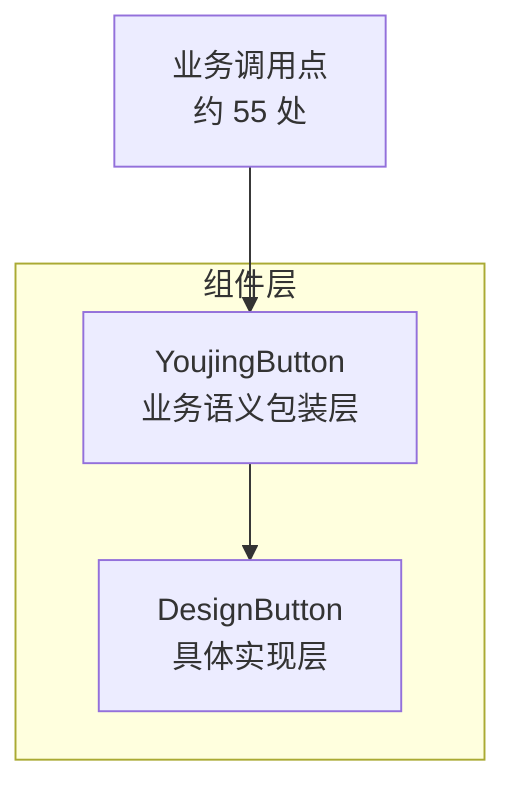
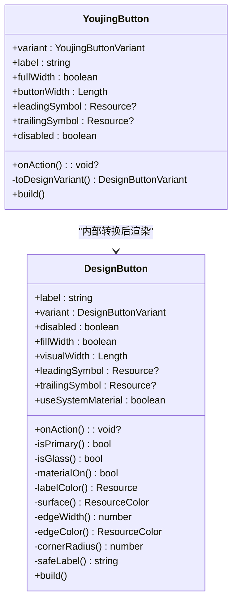
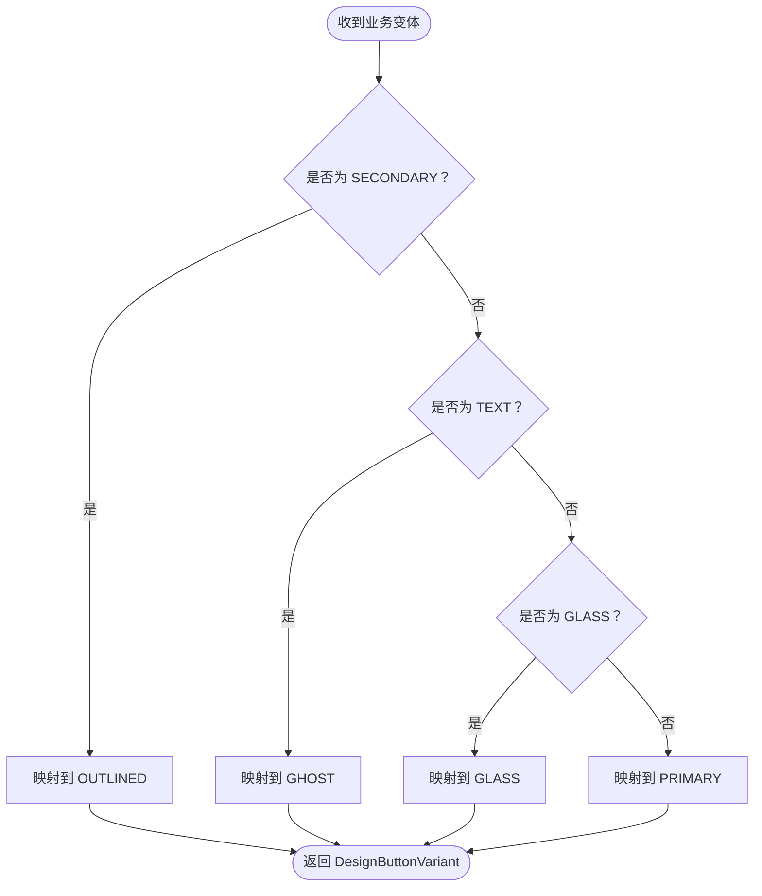
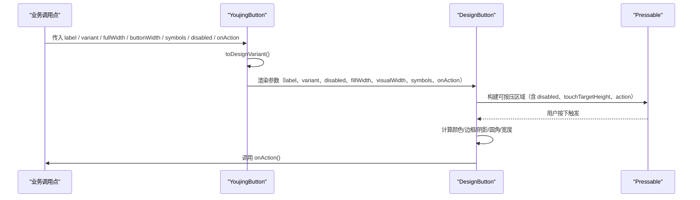
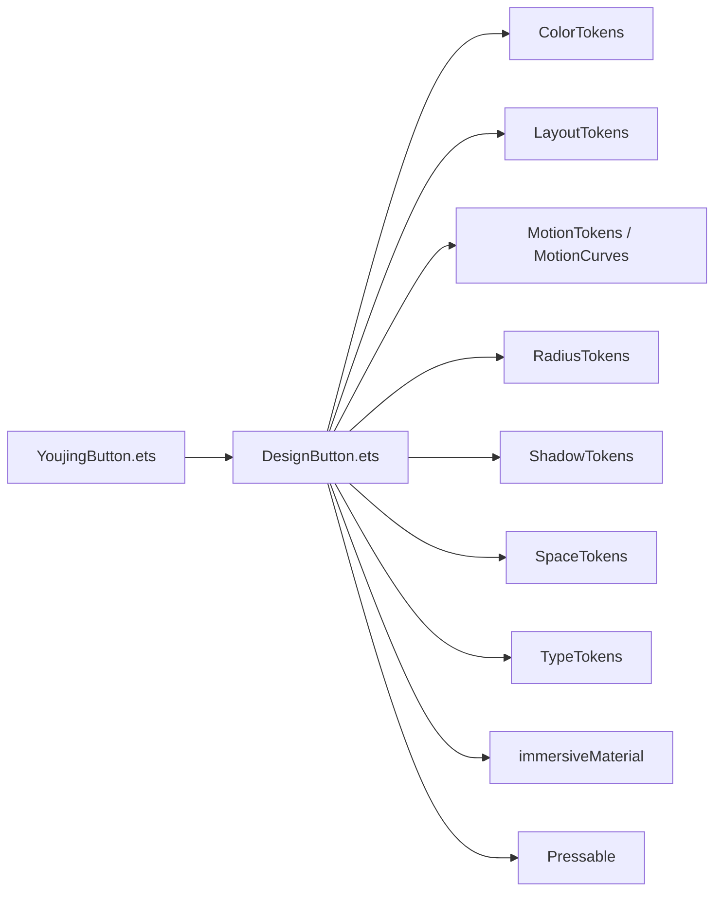

# YoujingButton 按钮适配层

<cite>
**本文引用的文件**   
- [YoujingButton.ets](file://entry/src/main/ets/components/YoujingButton.ets)
- [DesignButton.ets](file://entry/src/main/ets/components/DesignButton.ets)
</cite>

## 目录
1. [引言](#引言)
2. [项目结构](#项目结构)
3. [核心组件](#核心组件)
4. [架构总览](#架构总览)
5. [详细组件分析](#详细组件分析)
6. [依赖关系分析](#依赖关系分析)
7. [性能与交互特性](#性能与交互特性)
8. [使用示例](#使用示例)
9. [常见问题排查](#常见问题排查)
10. [结论](#结论)

## 引言
YoujingButton 是面向业务侧的“语义化按钮适配层”，用于兼容既有 55 个调用点，避免直接暴露 DesignButton 的内部变体名和属性名。其职责很明确：保留业务调用的 props（如 variant、label、fullWidth、buttonWidth、leadingSymbol、trailingSymbol、disabled、onAction），并在内部把业务语义映射到 DesignButton 的真实实现上。

关键设计要点：
- 对外暴露业务枚举 `YoujingButtonVariant`，对内转换到 `DesignButtonVariant`。
- 四变体映射为：PRIMARY → primary、SECONDARY → outlined、TEXT → ghost、GLASS → glass。
- 宽度策略：满宽模式由 `fillWidth` 接管；非满宽时通过 `visualWidth`（默认 150vp）固定宽度。
- 禁用态统一交由底层 Pressable 与样式 opacity 控制。
- 点击回调 onAction 透传到 DesignButton，并做空判断保护。

该文档聚焦 YoujingButton 的接口契约、内部转换逻辑、与 DesignButton 的集成方式，以及常见用法与问题处理建议。

## 项目结构
YoujingButton 位于 `entry/src/main/ets/components/` 下，与 DesignButton 同属组件层，但职责不同：
- YoujingButton：业务语义包装层，保持 55 处调用点的 API 不变。
- DesignButton：具体实现层，负责渲染、材质、尺寸、阴影、边框、圆角、Pressable 按下反馈等视觉细节。

图示来源
- [YoujingButton.ets:1-60](file://entry/src/main/ets/components/YoujingButton.ets#L1-L60)
- [DesignButton.ets:1-139](file://entry/src/main/ets/components/DesignButton.ets#L1-L139)

章节来源
- [YoujingButton.ets:1-60](file://entry/src/main/ets/components/YoujingButton.ets#L1-L60)
- [DesignButton.ets:1-139](file://entry/src/main/ets/components/DesignButton.ets#L1-L139)

## 核心组件
YoujingButton 对外提供以下能力：

| 属性 | 类型 | 默认值 | 说明 |
| --- | --- | ---: | --- |
| variant | `YoujingButtonVariant` | PRIMARY | 业务侧变体枚举，内部映射到 DesignButton 的变体 |
| label | string | '' | 按钮文本 |
| fullWidth | boolean | false | 是否占满父容器宽度 |
| buttonWidth | Length | 150 | 非满宽时的固定宽度 |
| leadingSymbol | Resource \| undefined | undefined | 前导图标资源 |
| trailingSymbol | Resource \| undefined | undefined | 尾部图标资源 |
| disabled | boolean | false | 禁用状态 |
| onAction | (() => void) \| undefined | undefined | 点击回调 |

内部还定义了一个私有方法 `toDesignVariant()`，负责将业务枚举转换为 DesignButton 的枚举。

章节来源
- [YoujingButton.ets:12-59](file://entry/src/main/ets/components/YoujingButton.ets#L12-L59)

## 架构总览
YoujingButton 作为中间适配层，不直接参与复杂渲染逻辑，而是把自身 props 翻译成 DesignButton 的参数。DesignButton 再组合 Pressable、文本、图标、材质修饰器、阴影、边框、圆角等完成最终绘制。

图示来源
- [YoujingButton.ets:12-59](file://entry/src/main/ets/components/YoujingButton.ets#L12-L59)
- [DesignButton.ets:14-139](file://entry/src/main/ets/components/DesignButton.ets#L14-L139)

## 详细组件分析

### YoujingButton：业务语义包装层
YoujingButton 的核心价值在于“对外稳定、对内可替换”。它定义了业务侧的 `YoujingButtonVariant` 枚举，并与 DesignButton 的变体建立映射关系：

- PRIMARY → primary
- SECONDARY → outlined
- TEXT → ghost
- GLASS → glass

在 build 中，YoujingButton 把自身的属性转译为 DesignButton 的参数：
- label → label
- toDesignVariant() → variant
- disabled → disabled
- fullWidth → fillWidth
- buttonWidth → visualWidth
- leadingSymbol / trailingSymbol → leadingSymbol / trailingSymbol
- onAction → onAction（包裹一层空判断）

这种设计让现有 55 处调用点无需修改签名，同时未来若更换底层实现，也只需调整 YoujingButton 内部的映射。

#### 变体映射流程

图示来源
- [YoujingButton.ets:29-42](file://entry/src/main/ets/components/YoujingButton.ets#L29-L42)

章节来源
- [YoujingButton.ets:12-59](file://entry/src/main/ets/components/YoujingButton.ets#L12-L59)

### DesignButton：具体实现层
DesignButton 承担真正的渲染职责，包括：
- 四变体样式：primary（品牌实心）、outlined（描边+药丸圆角）、ghost（文字+原因圆角）、glass（悬浮卡片材质+分隔线）。
- 文本排版：callout 字号、headline 字重、等宽数字特征。
- 图标对齐：前后图标统一使用控制尺寸与标签色。
- 尺寸约束：最小触摸目标高度，按 fullFill/visualWidth 决定宽度。
- 禁用态：opacity 0.45。
- 按下反馈：由 Pressable 提供透明度与缩放动画。
- 系统材质：当 useSystemMaterial 开启且系统材质生效时，自绘 border/shadow/blur 归零，改用 TopButtonMaterialModifier。

图示来源
- [YoujingButton.ets:44-59](file://entry/src/main/ets/components/YoujingButton.ets#L44-L59)
- [DesignButton.ets:59-139](file://entry/src/main/ets/components/DesignButton.ets#L59-L139)

章节来源
- [DesignButton.ets:14-139](file://entry/src/main/ets/components/DesignButton.ets#L14-L139)

## 依赖关系分析
YoujingButton 仅依赖 DesignButton，耦合方向单一；DesignButton 依赖设计令牌、材质工具与 Pressable，形成更丰富的内部依赖。

图示来源
- [YoujingButton.ets:12-59](file://entry/src/main/ets/components/YoujingButton.ets#L12-L59)
- [DesignButton.ets:14-139](file://entry/src/main/ets/components/DesignButton.ets#L14-L139)

章节来源
- [YoujingButton.ets:12-59](file://entry/src/main/ets/components/YoujingButton.ets#L12-L59)
- [DesignButton.ets:14-139](file://entry/src/main/ets/components/DesignButton.ets#L14-L139)

## 性能与交互特性
- 无 hover 支持：YoujingButton 与 DesignButton 均未引入 hover 行为，减少额外状态分支。
- 按下反馈集中：由 Pressable 统一处理透明度与缩放动画，避免重复 stateStyles。
- 禁用态成本低：通过 opacity 切换，避免重新布局或重建复杂材质。
- 材质优化：当系统材质生效时，自绘边框、阴影、模糊归零，改由 TopButtonMaterialModifier 接管表面表现。
- 尺寸稳定：最小触摸目标高度保证触控体验，非满宽场景以固定宽度减少测量波动。

章节来源
- [DesignButton.ets:1-18](file://entry/src/main/ets/components/DesignButton.ets#L1-L18)
- [DesignButton.ets:59-139](file://entry/src/main/ets/components/DesignButton.ets#L59-L139)

## 使用示例
以下为 YoujingButton 的典型用法说明（以行为描述为主，便于对照既有 55 处调用点迁移）：

- 主要按钮（品牌主色）
  - 设置 variant 为 PRIMARY，label 为主操作文案。
  - 适合页面主入口，一屏只推荐一个。

- 次要按钮（描边轮廓）
  - 设置 variant 为 SECONDARY，内部映射为 outlined。
  - 适合并列辅助操作，视觉上弱于主按钮。

- 文本按钮（幽灵风格）
  - 设置 variant 为 TEXT，内部映射为 ghost。
  - 适合轻量动作，例如取消、查看详情。

- 玻璃按钮（悬浮材质）
  - 设置 variant 为 GLASS，内部映射为 glass。
  - 适合需要强调悬浮层级但不抢主按钮的场景。

- 满宽模式
  - 设置 fullWidth 为 true，按钮宽度由父容器决定。
  - 常用于表单底部主操作。

- 固定宽度
  - 不设置 fullWidth，使用默认 buttonWidth 150vp，或通过 buttonWidth 自定义。
  - 适合列表项右侧的操作按钮。

- 带图标
  - 通过 leadingSymbol 或 trailingSymbol 传入图标资源。
  - 图标大小与文本颜色跟随 DesignButton 的设计令牌。

- 禁用状态
  - 设置 disabled 为 true，整体透明度降低，不可点击。

- 点击回调
  - 设置 onAction 执行业务逻辑。
  - YoujingButton 会确保 onAction 存在后再调用。

章节来源
- [YoujingButton.ets:12-59](file://entry/src/main/ets/components/YoujingButton.ets#L12-L59)
- [DesignButton.ets:14-139](file://entry/src/main/ets/components/DesignButton.ets#L14-L139)

## 常见问题排查

### 为什么我的按钮没有变出预期的视觉风格？
- 确认 variant 取值是否正确：业务侧应使用 YoujingButtonVariant 的 PRIMARY、SECONDARY、TEXT、GLASS。
- 注意 SECONDARY 实际映射为 outlined，TEXT 映射为 ghost，GLASS 映射为 glass。
- 如果仍不符合预期，检查是否存在外层样式覆盖或容器宽度限制。

章节来源
- [YoujingButton.ets:29-42](file://entry/src/main/ets/components/YoujingButton.ets#L29-L42)

### 按钮宽度不对，如何调整？
- 使用 fullWidth 设置为 true 时，按钮会撑满父容器宽度。
- 不使用 fullWidth 时，可通过 buttonWidth 指定固定宽度，默认值为 150vp。
- 若外层容器有 padding、List 裁剪或其他布局约束，可能影响显示宽度。

章节来源
- [YoujingButton.ets:18-27](file://entry/src/main/ets/components/YoujingButton.ets#L18-L27)
- [DesignButton.ets:24-31](file://entry/src/main/ets/components/DesignButton.ets#L24-L31)

### 图标颜色或大小不符合预期？
- 图标大小由 DesignButton 的控制尺寸决定，无法通过 YoujingButton 直接调整。
- 图标颜色与标签色一致：primary 变体使用 onBrand，其他变体使用 primary。
- 如需更大或更小图标，建议在业务层换用更合适的图标资源，或在更上层封装适配。

章节来源
- [DesignButton.ets:88-114](file://entry/src/main/ets/components/DesignButton.ets#L88-L114)

### 禁用状态下仍可点击？
- 检查是否设置了 disabled 为 true。
- 确认外层 Pressable 或父容器未绕过 disabled 传递。
- YoujingButton 会把 disabled 透传给 DesignButton，而 DesignButton 会通过 Pressable 与 opacity 共同控制禁用态。

章节来源
- [YoujingButton.ets:22-27](file://entry/src/main/ets/components/YoujingButton.ets#L22-L27)
- [DesignButton.ets:116-139](file://entry/src/main/ets/components/DesignButton.ets#L116-L139)

### onAction 没有被触发？
- 确认 onAction 已赋值且未被外层事件拦截。
- YoujingButton 会在内部调用前检查 onAction 是否存在。
- 若仍无效，检查 DesignButton 的 Pressable action 是否被禁用或父级阻止冒泡。

章节来源
- [YoujingButton.ets:44-59](file://entry/src/main/ets/components/YoujingButton.ets#L44-L59)
- [DesignButton.ets:63-76](file://entry/src/main/ets/components/DesignButton.ets#L63-L76)

### 样式覆盖导致边框或阴影异常？
- 当 useSystemMaterial 开启且系统材质激活时，DesignButton 会关闭自绘边框、阴影与模糊，改由材质修饰器处理。
- 如果业务侧自行叠加了 border、shadow、backgroundColor，可能与材质机制冲突。
- 建议优先通过 DesignButton 提供的变体和 useSystemMaterial 控制外观，而不是在外部强覆盖。

章节来源
- [DesignButton.ets:1-18](file://entry/src/main/ets/components/DesignButton.ets#L1-L18)
- [DesignButton.ets:48-86](file://entry/src/main/ets/components/DesignButton.ets#L48-L86)
- [DesignButton.ets:116-139](file://entry/src/main/ets/components/DesignButton.ets#L116-L139)

## 结论
YoujingButton 是一个简洁而稳定的业务语义适配层：对外保持 55 处调用点的 props 不变，对内将业务变体映射到 DesignButton 的真实实现。它屏蔽了 DesignButton 的内部命名差异，同时保留了完整的按钮能力——文本、图标、满宽、固定宽度、禁用态与点击回调。对于后续维护者而言，修改视觉规范时应优先调整 DesignButton，而非逐个改动业务调用点；YoujingButton 的存在正是为了保障这种“变更向下收敛”的工程实践。