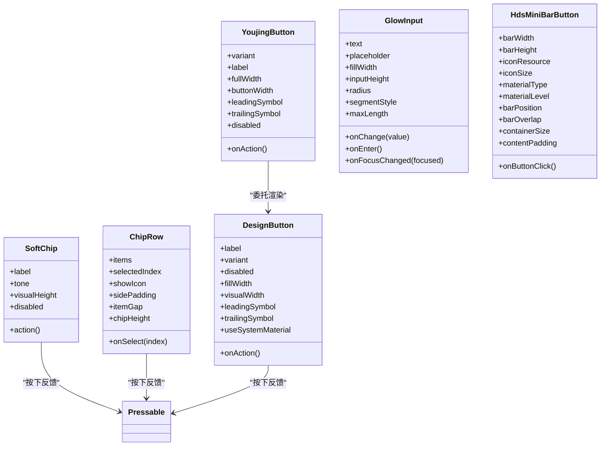
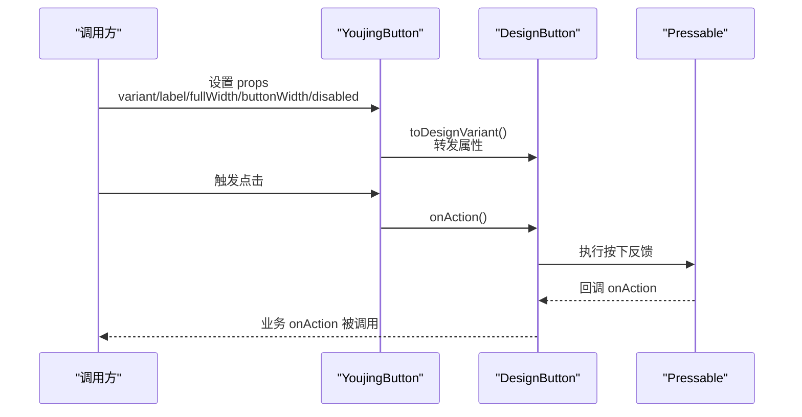
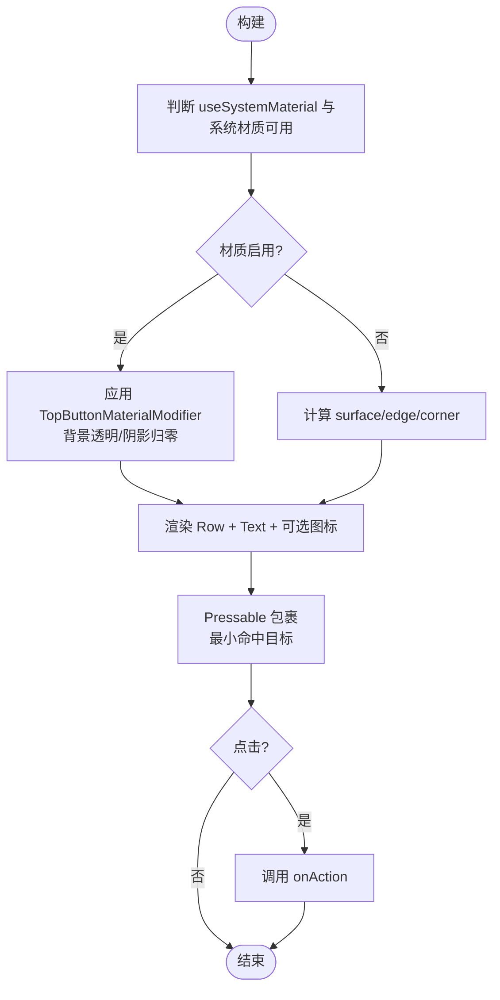
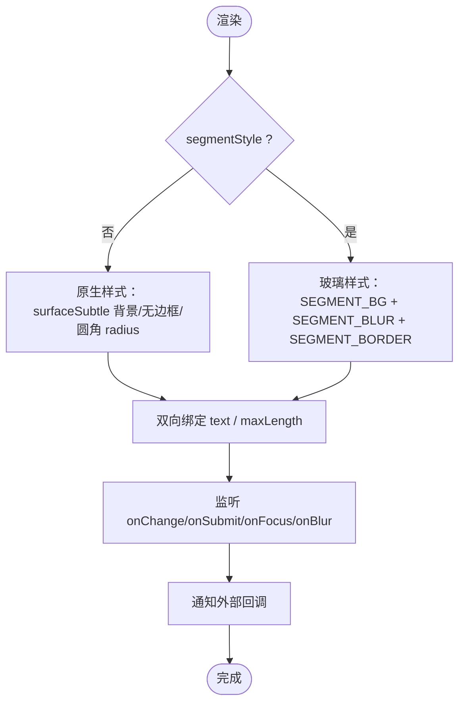
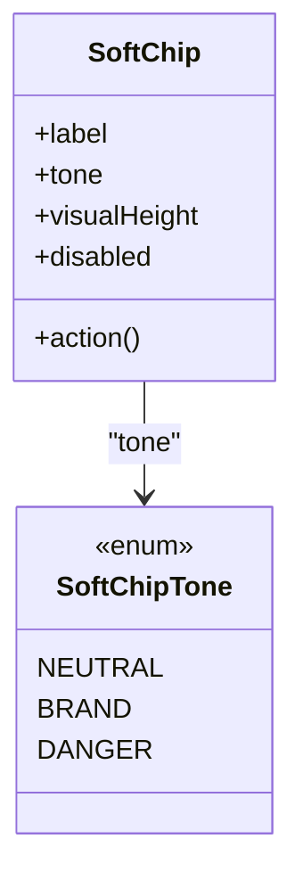
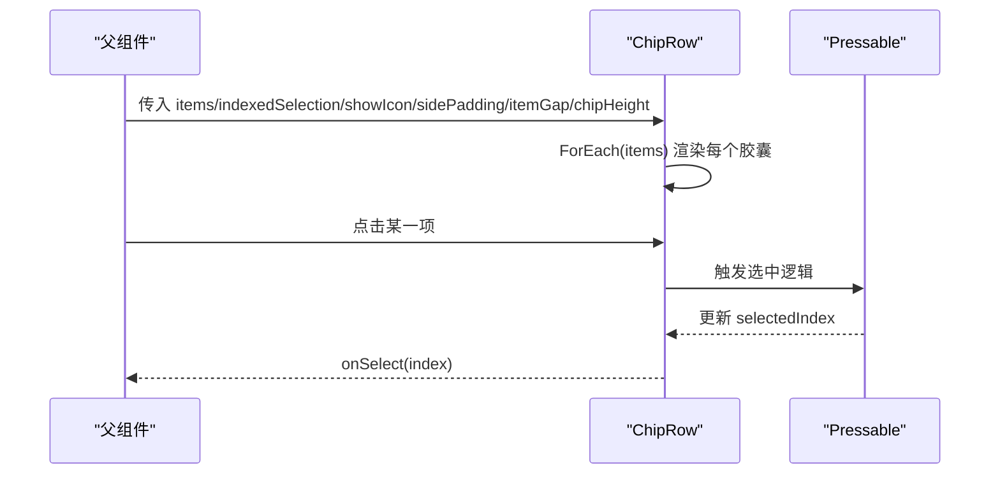
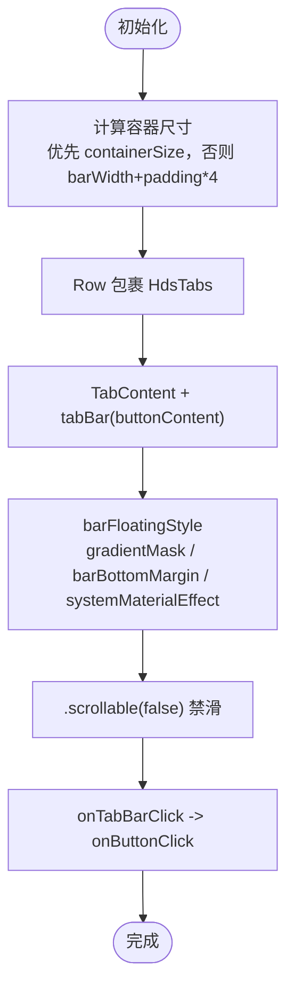
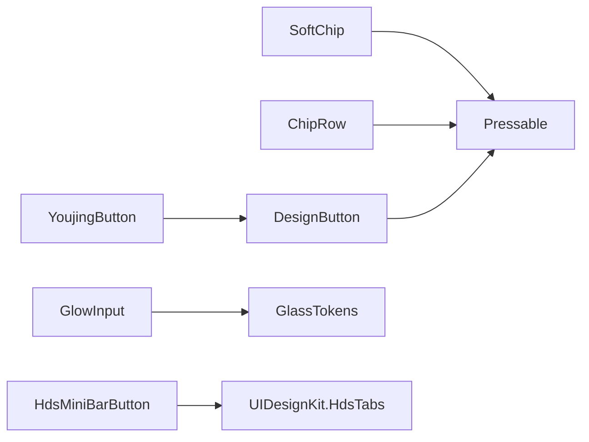

# 基础组件

<cite>
**本文引用的文件**   
- [YoujingButton.ets](file://entry/src/main/ets/components/YoujingButton.ets)
- [DesignButton.ets](file://entry/src/main/ets/components/DesignButton.ets)
- [GlowInput.ets](file://entry/src/main/ets/components/GlowInput.ets)
- [SoftChip.ets](file://entry/src/main/ets/components/SoftChip.ets)
- [ChipRow.ets](file://entry/src/main/ets/components/ChipRow.ets)
- [HdsMiniBarButton.ets](file://entry/src/main/ets/components/HdsMiniBarButton.ets)
</cite>

## 目录
1. [引言](#引言)
2. [项目结构](#项目结构)
3. [核心组件总览](#核心组件总览)
4. [架构总览](#架构总览)
5. [组件详细分析](#组件详细分析)
6. [依赖关系分析](#依赖关系分析)
7. [性能与交互特性](#性能与交互特性)
8. [常见问题与排错](#常见问题与排错)
9. [结论](#结论)

## 引言
本文聚焦可复用的 UI 原子组件，覆盖按钮、输入框、标签及迷你浮动栏等高频控件。目标是帮助读者快速理解：
- YoujingButton 的样式变体、尺寸、状态与事件；
- DesignButton 的设计系统语义与 Hds 材质集成；
- GlowInput 的发光效果、输入行为与键盘适配；
- SoftChip 软标签与 ChipRow 标签行的展示、选择与交互；
- HdsMiniBarButton 的图标按钮、操作入口与手势注意点。

## 项目结构
这些基础组件统一位于 `entry/src/main/ets/components`，并复用设计令牌（颜色、间距、圆角、字号）和通用交互组件（如 Pressable）。下图给出组件间的直接依赖关系。

```mermaid
graph TB
  YoujingButton["YoujingButton.ets"] --> DesignButton["DesignButton.ets"]
  DesignButton["DesignButton.ets"] --> ColorTokens["design/ColorTokens.ets"]
  DesignButton["DesignButton.ets"] --> LayoutTokens["design/LayoutTokens.ets"]
  DesignButton["DesignButton.ets"] --> RadiusTokens["design/RadiusTokens.ets"]
  DesignButton["DesignButton.ets"] --> ShadowTokens["design/ShadowTokens.ets"]
  DesignButton["DesignButton.ets"] --> SpaceTokens["design/SpaceTokens.ets"]
  DesignButton["DesignButton.ets"] --> TypeTokens["design/TypeTokens.ets"]
  DesignButton["DesignButton.ets"] --> MaterialUtil["utils/immersiveMaterial.ets"]
  DesignButton["DesignButton.ets"] --> Pressable["components/Pressable.ets"]
  GlowInput["GlowInput.ets"] --> ColorTokens
  GlowInput["GlowInput.ets"] --> LayoutTokens
  GlowInput["GlowInput.ets"] --> RadiusTokens
  GlowInput["GlowInput.ets"] --> SpaceTokens
  GlowInput["GlowInput.ets"] --> TypeTokens
  GlowInput["GlowInput.ets"] --> GlassTokens["components/GlassTokens.ets"]
  SoftChip["SoftChip.ets"] --> ColorTokens
  SoftChip["SoftChip.ets"] --> LayoutTokens
  SoftChip["SoftChip.ets"] --> RadiusTokens
  SoftChip["SoftChip.ets"] --> SpaceTokens
  SoftChip["SoftChip.ets"] --> TypeTokens
  SoftChip["SoftChip.ets"] --> Pressable
  ChipRow["ChipRow.ets"] --> ColorTokens
  ChipRow["ChipRow.ets"] --> LayoutTokens
  ChipRow["ChipRow.ets"] --> MotionTokens["design/MotionTokens.ets"]
  ChipRow["ChipRow.ets"] --> RadiusTokens
  ChipRow["ChipRow.ets"] --> SpaceTokens
  ChipRow["ChipRow.ets"] --> TypeTokens
  ChipRow["ChipRow.ets"] --> Pressable
  HdsMiniBarButton["HdsMiniBarButton.ets"] --> UIDesignKit["@kit.UIDesignKit.HdsTabs"]
```

**图表来源**
- [YoujingButton.ets:1-60](file://entry/src/main/ets/components/YoujingButton.ets#L1-L60)
- [DesignButton.ets:1-139](file://entry/src/main/ets/components/DesignButton.ets#L1-L139)
- [GlowInput.ets:1-83](file://entry/src/main/ets/components/GlowInput.ets#L1-L83)
- [SoftChip.ets:1-95](file://entry/src/main/ets/components/SoftChip.ets#L1-L95)
- [ChipRow.ets:1-109](file://entry/src/main/ets/components/ChipRow.ets#L1-L109)
- [HdsMiniBarButton.ets:1-212](file://entry/src/main/ets/components/HdsMiniBarButton.ets#L1-L212)

**章节来源**
- [YoujingButton.ets:1-60](file://entry/src/main/ets/components/YoujingButton.ets#L1-L60)
- [DesignButton.ets:1-139](file://entry/src/main/ets/components/DesignButton.ets#L1-L139)
- [GlowInput.ets:1-83](file://entry/src/main/ets/components/GlowInput.ets#L1-L83)
- [SoftChip.ets:1-95](file://entry/src/main/ets/components/SoftChip.ets#L1-L95)
- [ChipRow.ets:1-109](file://entry/src/main/ets/components/ChipRow.ets#L1-L109)
- [HdsMiniBarButton.ets:1-212](file://entry/src/main/ets/components/HdsMiniBarButton.ets#L1-L212)

## 核心组件总览
| 组件 | 职责 | 关键属性 | 主要事件 | 备注 |
|---|---|---|---|---|
| YoujingButton | 业务侧按钮适配层 | variant、label、fullWidth、buttonWidth、leadingSymbol、trailingSymbol、disabled | onAction | 内部映射到 DesignButton |
| DesignButton | 设计系统主按钮 | label、variant、disabled、fillWidth、visualWidth、leadingSymbol、trailingSymbol、useSystemMaterial | onAction | 四变体 + Pressable 反馈 |
| GlowInput | 统一输入框 | text、placeholder、fillWidth、inputHeight、radius、segmentStyle、maxLength | onChange、onEnter、onFocusChanged | 默认原生样式；可选玻璃段风格 |
| SoftChip | 小型动作胶囊 | label、tone、visualHeight、disabled | action | neutral / brand / danger |
| ChipRow | 横滚胶囊选择条 | items、selectedIndex、showIcon、sidePadding、itemGap、chipHeight | onSelect | 单选、水平滚动 |
| HdsMiniBarButton | 基于 HdsTabs 的迷你浮动按钮 | barWidth、barHeight、iconResource、iconSize、materialType、materialLevel、barPosition、barOverlap、containerSize、contentPadding | onButtonClick | 悬浮沉浸光感玻璃 |

**章节来源**
- [YoujingButton.ets:1-60](file://entry/src/main/ets/components/YoujingButton.ets#L1-L60)
- [DesignButton.ets:1-139](file://entry/src/main/ets/components/DesignButton.ets#L1-L139)
- [GlowInput.ets:1-83](file://entry/src/main/ets/components/GlowInput.ets#L1-L83)
- [SoftChip.ets:1-95](file://entry/src/main/ets/components/SoftChip.ets#L1-L95)
- [ChipRow.ets:1-109](file://entry/src/main/ets/components/ChipRow.ets#L1-L109)
- [HdsMiniBarButton.ets:1-212](file://entry/src/main/ets/components/HdsMiniBarButton.ets#L1-L212)

## 架构总览

**图表来源**
- [YoujingButton.ets:1-60](file://entry/src/main/ets/components/YoujingButton.ets#L1-L60)
- [DesignButton.ets:1-139](file://entry/src/main/ets/components/DesignButton.ets#L1-L139)
- [GlowInput.ets:1-83](file://entry/src/main/ets/components/GlowInput.ets#L1-L83)
- [SoftChip.ets:1-95](file://entry/src/main/ets/components/SoftChip.ets#L1-L95)
- [ChipRow.ets:1-109](file://entry/src/main/ets/components/ChipRow.ets#L1-L109)
- [HdsMiniBarButton.ets:1-212](file://entry/src/main/ets/components/HdsMiniBarButton.ets#L1-L212)

## 组件详细分析

### YoujingButton 按钮适配层
YoujingButton 是业务侧对 DesignButton 的轻量封装，保留既有调用签名，将业务语义变体映射为设计系统变体：
- PRIMARY → PRIMARY
- SECONDARY → OUTLINED
- TEXT → GHOST
- GLASS → GLASS

它不实现 hover，也不重复处理按下态，全部交给底层 DesignButton 与 Pressable。

**图表来源**
- [YoujingButton.ets:1-60](file://entry/src/main/ets/components/YoujingButton.ets#L1-L60)
- [DesignButton.ets:1-139](file://entry/src/main/ets/components/DesignButton.ets#L1-L139)

#### API 参考
- 属性
  - variant：枚举值 primary / secondary / text / glass
  - label：按钮文案
  - fullWidth：是否占满父宽
  - buttonWidth：非满宽时的固定宽度
  - leadingSymbol / trailingSymbol：前后图标资源
  - disabled：禁用
- 事件
  - onAction：点击回调

**章节来源**
- [YoujingButton.ets:1-60](file://entry/src/main/ets/components/YoujingButton.ets#L1-L60)

### DesignButton 设计系统按钮
DesignButton 是“有据”体系的主按钮实现，提供四种视觉变体，并通过 Pressable 统一管理按下反馈与最小命中目标。

- 变体
  - PRIMARY：品牌实心背景 + onBrand 字色，一屏只允许一颗
  - OUTLINED：透明底 + 细边框 + pill 圆角
  - GHOST：primary 字色 + reason 圆角
  - GLASS：elevated 底 + separator 描边 + cardAmbient 阴影
- 文本与尺寸
  - 字体档 callout，字号按 TypeTokens.callout，字重 headline.weight
  - 高度使用最小触摸目标，确保可点性
- 禁用态
  - 整体 opacity 降至 0.45
- 按下反馈
  - 由 Pressable 负责，避免重复实现 stateStyles
- 与 Hds 材质集成
  - useSystemMaterial 开启时，通过 TopButtonMaterialModifier 接入系统材质通道
  - 材质生效时自绘 border/shadow/blur 归零，内容区 systemMaterial 不渲染
  - 材质开关受 isSystemMaterialActive() 控制

**图表来源**
- [DesignButton.ets:1-139](file://entry/src/main/ets/components/DesignButton.ets#L1-L139)

#### API 参考
- 属性
  - label：文案
  - variant：PRIMARY / OUTLINED / GHOST / GLASS
  - disabled：禁用
  - fillWidth：是否占满父宽
  - visualWidth：非满宽时的宽度
  - leadingSymbol / trailingSymbol：前后图标
  - useSystemMaterial：是否让系统材质接管表面
- 事件
  - onAction：点击回调

**章节来源**
- [DesignButton.ets:1-139](file://entry/src/main/ets/components/DesignButton.ets#L1-L139)

### GlowInput 输入框
GlowInput 提供统一输入体验，默认走官方原生样式：实色 subtle 背景、无描边、无模糊、胶囊圆角、标准触控高度。当 segmentStyle=true 时，切换为分段栏同款玻璃风格（半透明底 + backdropBlur + 高光边框）。

**图表来源**
- [GlowInput.ets:1-83](file://entry/src/main/ets/components/GlowInput.ets#L1-L83)

#### API 参考
- 属性
  - text：受控文本，支持双向绑定
  - placeholder：占位提示
  - fillWidth：是否在 Stack 中参与拉伸
  - inputHeight：输入框高度
  - radius：圆角半径（非 segmentStyle 生效）
  - segmentStyle：是否使用分段栏玻璃风格
  - maxLength：最大长度，0 表示不限制
- 事件
  - onChange(value)：输入变化
  - onEnter()：回车提交
  - onFocusChanged(focused)：焦点变化

注意：该组件未内置输入校验逻辑，错误提示应由上层表单组件管理。

**章节来源**
- [GlowInput.ets:1-83](file://entry/src/main/ets/components/GlowInput.ets#L1-L83)

### SoftChip 软标签
SoftChip 用于小型动作胶囊，如“重试 / 加一块”。支持三档 tone：neutral、brand、danger。禁用态统一使用 opacity 0.45。

**图表来源**
- [SoftChip.ets:1-95](file://entry/src/main/ets/components/SoftChip.ets#L1-L95)

#### API 参考
- 属性
  - label：标签文案
  - tone：neutral / brand / danger
  - visualHeight：视觉高度（命中带仍为最小触摸目标）
  - disabled：禁用
- 事件
  - action：点击回调

**章节来源**
- [SoftChip.ets:1-95](file://entry/src/main/ets/components/SoftChip.ets#L1-L95)

### ChipRow 标签行
ChipRow 是横向滚动的胶囊选择条，对外暴露 selectedIndex 供父组件双向绑定，内部用 Pressable 管理命中区域与按下反馈。选中项使用 brandSolid 背景 + onBrand 文字，未选中使用 sunken 背景 + primary 文字。

**图表来源**
- [ChipRow.ets:1-109](file://entry/src/main/ets/components/ChipRow.ets#L1-L109)

#### API 参考
- 属性
  - items：[{ key, label, symbol? }]
  - selectedIndex：当前选中索引（@Link）
  - showIcon：是否显示图标
  - sidePadding：左右内边距
  - itemGap：胶囊间距
  - chipHeight：视觉高度（命中带由 Pressable 保证）
- 事件
  - onSelect(index)：选中回调

**章节来源**
- [ChipRow.ets:1-109](file://entry/src/main/ets/components/ChipRow.ets#L1-L109)

### HdsMiniBarButton 迷你浮动按钮
HdsMiniBarButton 基于 @kit.UIDesignKit 的 HdsTabs 实现“悬浮 dock”式的沉浸式光感玻璃按钮。源码在本地化时做了三处偏离：
1. 将 materialType / materialLevel 类型从枚举改为 number，避免在低版本设备启动期加载不存在模块导致崩溃；
2. 关闭内部 Tabs 滑动 .scrollable(false)，防止手势竞争吞掉外层 PanGesture；
3. 使用 barFloatingStyle 的系统材质效果，在覆盖层获取真实玻璃质感。

**图表来源**
- [HdsMiniBarButton.ets:1-212](file://entry/src/main/ets/components/HdsMiniBarButton.ets#L1-L212)

#### API 参考
- 尺寸参数
  - barWidth：按钮栏宽度
  - barHeight：按钮栏高度
  - contentPadding：容器内边距
  - containerSize：容器尺寸（可选）
- 图标参数
  - iconResource：图标资源
  - iconSize：图标大小
  - iconColor：图标颜色数组
- 浮动样式参数
  - maskColor：遮罩颜色
  - barBottomMargin：底部边距
  - materialType：材质类型（数值）
  - materialLevel：材质级别（数值）
- 布局参数
  - barPosition：位置
  - barOverlap：是否与内容重叠
- 事件
  - onButtonClick：点击回调
- 构建器
  - defaultButtonBuilder：默认图标构建
  - buttonContent：自定义内容槽位（尾随闭包）

**章节来源**
- [HdsMiniBarButton.ets:1-212](file://entry/src/main/ets/components/HdsMiniBarButton.ets#L1-L212)

## 依赖关系分析
- DesignButton 是按钮家族的核心，YoujingButton 仅做语义映射；SoftChip 与 ChipRow 复用 Pressable 以统一按下反馈与最小命中目标。
- GlowInput 依赖 GlassTokens 实现玻璃风格分支，但默认路径保持原生输入框样式，便于与系统键盘协作。
- HdsMiniBarButton 依赖 HdsTabs 的沉浸式浮动能力，并通过本地化规避 SDK 兼容性与手势竞争问题。

**图表来源**
- [YoujingButton.ets:1-60](file://entry/src/main/ets/components/YoujingButton.ets#L1-L60)
- [DesignButton.ets:1-139](file://entry/src/main/ets/components/DesignButton.ets#L1-L139)
- [SoftChip.ets:1-95](file://entry/src/main/ets/components/SoftChip.ets#L1-L95)
- [ChipRow.ets:1-109](file://entry/src/main/ets/components/ChipRow.ets#L1-L109)
- [GlowInput.ets:1-83](file://entry/src/main/ets/components/GlowInput.ets#L1-L83)
- [HdsMiniBarButton.ets:1-212](file://entry/src/main/ets/components/HdsMiniBarButton.ets#L1-L212)

**章节来源**
- [YoujingButton.ets:1-60](file://entry/src/main/ets/components/YoujingButton.ets#L1-L60)
- [DesignButton.ets:1-139](file://entry/src/main/ets/components/DesignButton.ets#L1-L139)
- [SoftChip.ets:1-95](file://entry/src/main/ets/components/SoftChip.ets#L1-L95)
- [ChipRow.ets:1-109](file://entry/src/main/ets/components/ChipRow.ets#L1-L109)
- [GlowInput.ets:1-83](file://entry/src/main/ets/components/GlowInput.ets#L1-L83)
- [HdsMiniBarButton.ets:1-212](file://entry/src/main/ets/components/HdsMiniBarButton.ets#L1-L212)

## 性能与交互特性
- 按下反馈统一下沉至 Pressable，避免各组件重复实现动画与缩放，减少抖动与内存分配。
- DesignButton 在系统材质启用时关闭自绘 border/shadow/blur，降低复杂绘制开销。
- ChipRow 使用水平 Scroll + BarState.Off，适合轻交互标签选择；如需频繁大数据量，应结合虚拟列表或分页。
- GlowInput 的 segmentStyle 会启用 backdropBlur，在高刷新率设备上可能增加 GPU 压力，建议仅在必要场景开启。
- HdsMiniBarButton 关闭内部滑动以避免手势竞争，同时避免多余 Tab 内容重绘。

[本节为通用指导，不直接分析具体文件]

## 常见问题与排错
- YoujingButton 点击无效
  - 检查 disabled 是否为 true；确认 onAction 已正确传入；确认父容器未拦截点击。
- DesignButton 材质不生效
  - 确认 useSystemMaterial 为 true 且系统材质可用；检查是否在覆盖层渲染（需通过本组件提供的材质通道）。
- GlowInput 无法输入中文或光标错位
  - 确认 maxLength 未误设为 0 以外的极小值；若使用 segmentStyle，确认容器未被裁剪。
- SoftChip 禁用后颜色异常
  - 禁用态采用全局 opacity 0.45，无需额外修改字色。
- ChipRow 选中态不明显
  - 确认使用了 brandSolid / onBrand 作为选中样式；必要时调整 sidePadding / itemGap 提升可读性。
- HdsMiniBarButton 在低版本设备崩溃
  - 确认 materialType / materialLevel 传值为 number，而非引用枚举类型；确认运行环境满足 API 要求。
- HdsMiniBarButton 手势冲突
  - 组件内部已关闭 .scrollable(false)；若外层仍有手势冲突，请检查宿主容器的手势优先级。

**章节来源**
- [DesignButton.ets:1-139](file://entry/src/main/ets/components/DesignButton.ets#L1-L139)
- [GlowInput.ets:1-83](file://entry/src/main/ets/components/GlowInput.ets#L1-L83)
- [SoftChip.ets:1-95](file://entry/src/main/ets/components/SoftChip.ets#L1-L95)
- [ChipRow.ets:1-109](file://entry/src/main/ets/components/ChipRow.ets#L1-L109)
- [HdsMiniBarButton.ets:1-212](file://entry/src/main/ets/components/HdsMiniBarButton.ets#L1-L212)

## 结论
这组基础组件围绕“设计令牌 + 统一交互”展开：DesignButton 定义按钮语义与材质通道，YoujingButton 面向业务语义做映射；GlowInput 提供可控输入体验；SoftChip 与 ChipRow 组合成轻量标签体系；HdsMiniBarButton 借助 HdsTabs 打通覆盖层的沉浸玻璃效果。在实际使用中，建议优先使用 DesignButton 与 ChipRow 的设计语义，通过 YoujingButton 过渡历史调用，并以 Pressable 的统一按下反馈保证一致性。