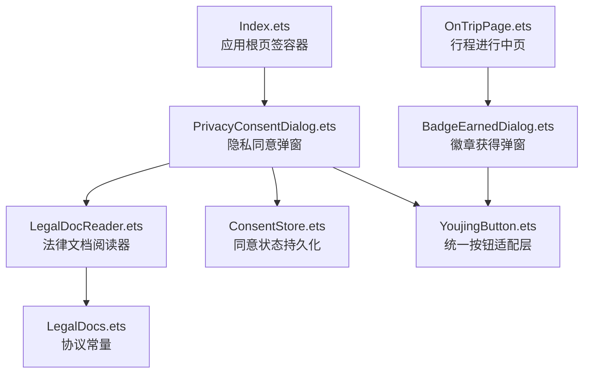
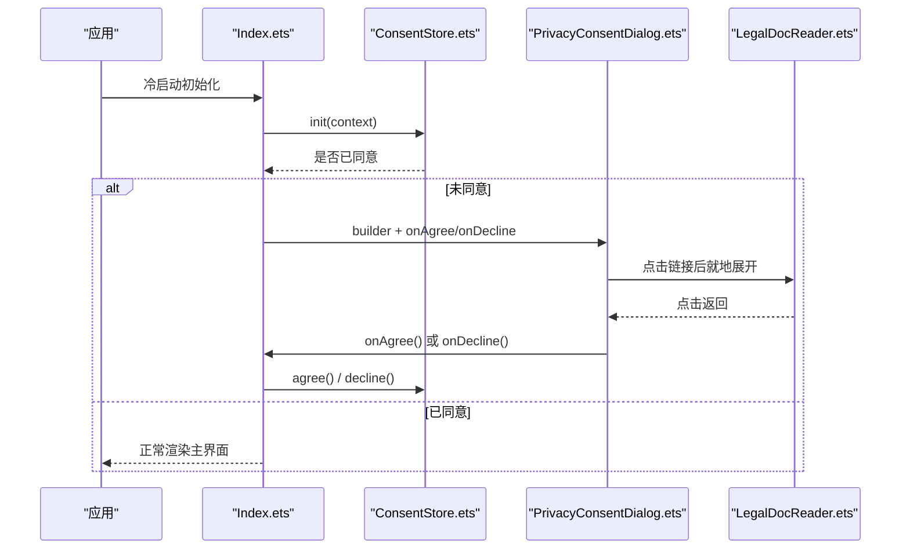
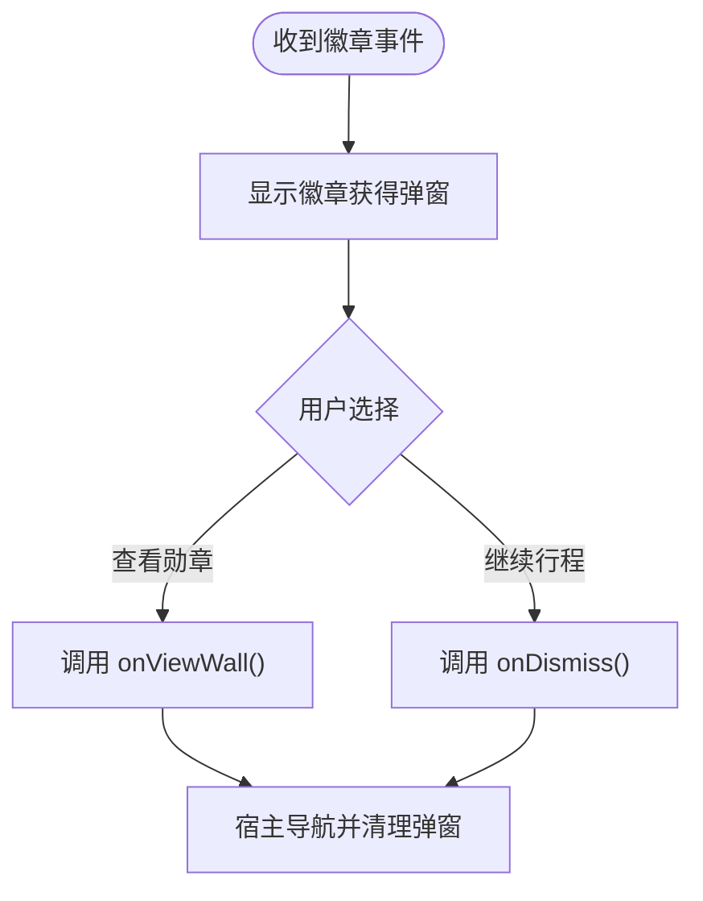
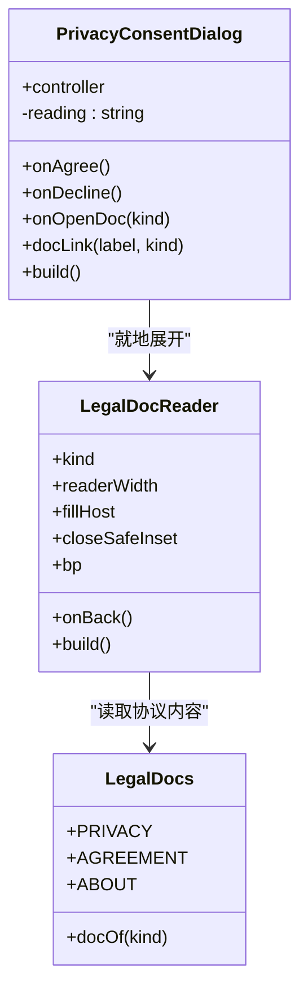
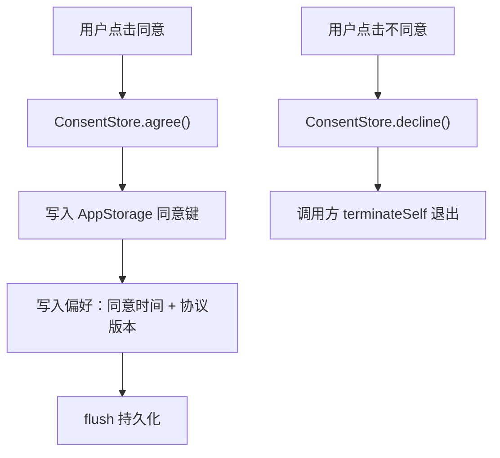
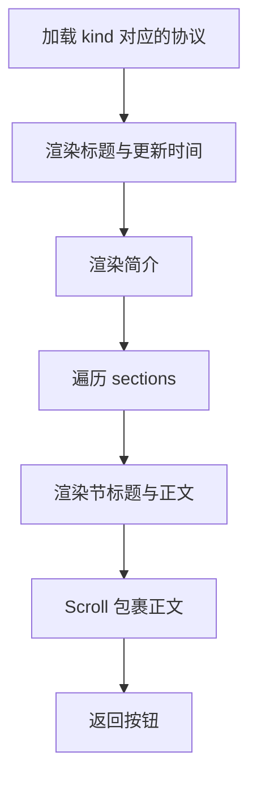
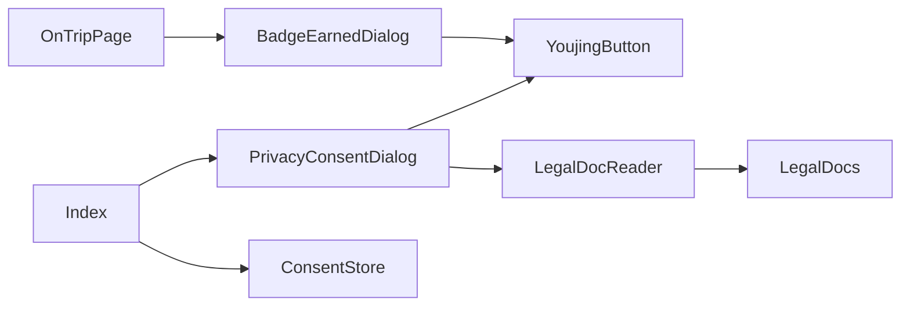

# 对话框组件

<cite>
**本文引用的文件**   
- [BadgeEarnedDialog.ets](file://entry/src/main/ets/components/BadgeEarnedDialog.ets)
- [PrivacyConsentDialog.ets](file://entry/src/main/ets/components/PrivacyConsentDialog.ets)
- [LegalDocReader.ets](file://entry/src/main/ets/components/LegalDocReader.ets)
- [LegalDocs.ets](file://entry/src/main/ets/common/constants/LegalDocs.ets)
- [ConsentStore.ets](file://entry/src/main/ets/utils/ConsentStore.ets)
- [Index.ets](file://entry/src/main/ets/pages/Index.ets)
- [OnTripPage.ets](file://entry/src/main/ets/pages/OnTripPage.ets)
- [YoujingButton.ets](file://entry/src/main/ets/components/YoujingButton.ets)
</cite>

## 目录
1. [引言](#引言)
2. [项目结构](#项目结构)
3. [核心组件](#核心组件)
4. [架构总览](#架构总览)
5. [详细组件分析](#详细组件分析)
6. [依赖关系分析](#依赖关系分析)
7. [性能与内存考量](#性能与内存考量)
8. [故障排查指南](#故障排查指南)
9. [设计原则](#设计原则)
10. [结论](#结论)

## 引言
本文件聚焦应用中的三类关键对话框与阅读器：徽章获得提示、隐私同意闸门、法律文档阅读器。它们共同承担模态交互、合规明示同意和长文阅读体验，并与应用根页面、数据层和 UI 设计系统协作。本文从实现细节出发，给出生命周期、交互流程、数据结构、错误处理和可维护性建议，帮助开发者在不深入源码的情况下理解这些组件的职责边界。

## 项目结构
对话框相关代码集中在 `entry/src/main/ets/components` 下，配合 `common/constants/LegalDocs.ets` 提供协议文本，由 `pages/Index.ets` 和 `pages/OnTripPage.ets` 作为宿主打开对话框；同意状态通过 `utils/ConsentStore.ets` 管理并写入本地偏好。

**图表来源**
- [Index.ets:24-25](file://entry/src/main/ets/pages/Index.ets#L24-L25)
- [Index.ets:707-731](file://entry/src/main/ets/pages/Index.ets#L707-L731)
- [OnTripPage.ets:40](file://entry/src/main/ets/pages/OnTripPage.ets#L40)
- [OnTripPage.ets:1390-1401](file://entry/src/main/ets/pages/OnTripPage.ets#L1390-L1401)
- [BadgeEarnedDialog.ets:1-83](file://entry/src/main/ets/components/BadgeEarnedDialog.ets#L1-L83)
- [PrivacyConsentDialog.ets:1-113](file://entry/src/main/ets/components/PrivacyConsentDialog.ets#L1-L113)
- [LegalDocReader.ets:1-122](file://entry/src/main/ets/components/LegalDocReader.ets#L1-L122)
- [LegalDocs.ets:1-121](file://entry/src/main/ets/common/constants/LegalDocs.ets#L1-L121)
- [ConsentStore.ets:1-82](file://entry/src/main/ets/utils/ConsentStore.ets#L1-L82)
- [YoujingButton.ets:1-60](file://entry/src/main/ets/components/YoujingButton.ets#L1-L60)

**章节来源**
- [BadgeEarnedDialog.ets:1-83](file://entry/src/main/ets/components/BadgeEarnedDialog.ets#L1-L83)
- [PrivacyConsentDialog.ets:1-113](file://entry/src/main/ets/components/PrivacyConsentDialog.ets#L1-L113)
- [LegalDocReader.ets:1-122](file://entry/src/main/ets/components/LegalDocReader.ets#L1-L122)
- [LegalDocs.ets:1-121](file://entry/src/main/ets/common/constants/LegalDocs.ets#L1-L121)
- [ConsentStore.ets:1-82](file://entry/src/main/ets/utils/ConsentStore.ets#L1-L82)
- [Index.ets:24-25](file://entry/src/main/ets/pages/Index.ets#L24-L25)
- [Index.ets:707-731](file://entry/src/main/ets/pages/Index.ets#L707-L731)
- [OnTripPage.ets:40](file://entry/src/main/ets/pages/OnTripPage.ets#L40)
- [OnTripPage.ets:1390-1401](file://entry/src/main/ets/pages/OnTripPage.ets#L1390-L1401)
- [YoujingButton.ets:1-60](file://entry/src/main/ets/components/YoujingButton.ets#L1-L60)

## 核心组件
- **BadgeEarnedDialog**：打卡成功后首次获得勋章时弹出的成就确认弹窗，展示徽章名称、城市、来源和行囊总数，提供“查看勋章”和“继续行程”两个入口。
- **PrivacyConsentDialog**：启动前的隐私政策与用户协议同意弹窗，支持就地阅读条款、勾选式同意、明确退出路径，并通过 ConsentStore 记录同意版本。
- **LegalDocReader**：协议正文阅读器，以列表形式渲染标题与段落，提供返回动作，并处理整页宿主与弹窗宿主的布局差异。

**章节来源**
- [BadgeEarnedDialog.ets:1-83](file://entry/src/main/ets/components/BadgeEarnedDialog.ets#L1-L83)
- [PrivacyConsentDialog.ets:1-113](file://entry/src/main/ets/components/PrivacyConsentDialog.ets#L1-L113)
- [LegalDocReader.ets:1-122](file://entry/src/main/ets/components/LegalDocReader.ets#L1-L122)

## 架构总览
对话框采用官方 `@CustomDialog` 模式，不自绘遮罩层，由宿主页面负责打开时机与控制器清理。隐私同意流程由应用根页拦截未同意状态；徽章弹窗由行程进行中页在检测到新徽章时弹出。

**图表来源**
- [Index.ets:24-25](file://entry/src/main/ets/pages/Index.ets#L24-L25)
- [Index.ets:707-731](file://entry/src/main/ets/pages/Index.ets#L707-L731)
- [ConsentStore.ets:24-82](file://entry/src/main/ets/utils/ConsentStore.ets#L24-L82)
- [PrivacyConsentDialog.ets:17-113](file://entry/src/main/ets/components/PrivacyConsentDialog.ets#L17-L113)
- [LegalDocReader.ets:25-122](file://entry/src/main/ets/components/LegalDocReader.ets#L25-L122)

## 详细组件分析

### BadgeEarnedDialog 徽章获得对话框
徽章弹窗用于“这次打卡就是这枚章的首次收下”场景，避免重复打卡频繁打断流程。它展示徽章图标、徽章名称、城市与来源标签、行囊中已有徽章数量，并提供两条操作路径：跳转到勋章墙或关闭弹窗继续行程。

#### 结构与行为
- 徽章图标使用系统符号，主色强调。
- 徽章名称最多两行，超长省略。
- 来源标签如实区分“到站打卡”与“手动打卡”。
- 行囊总数使用等宽数字特性显示。
- “查看勋章”调用宿主回调，通常导航至勋章集合页。
- “继续行程”触发 `onDismiss`，由宿主清理控制器引用。

**图表来源**
- [BadgeEarnedDialog.ets:1-83](file://entry/src/main/ets/components/BadgeEarnedDialog.ets#L1-L83)
- [OnTripPage.ets:1390-1401](file://entry/src/main/ets/pages/OnTripPage.ets#L1390-L1401)

#### 属性与方法说明
- `controller`：自定义对话框控制器。
- `spotName`：徽章对应地点名称。
- `city`：徽章归属城市。
- `sourceLabel`：徽章来源文案。
- `total`：当前行囊中徽章总数。
- `onViewWall`：跳转勋章墙回调。
- `onDismiss`：关闭弹窗回调，宿主应清理控制器。

#### 动画与分享
当前实现为静态展示，不包含显式动画或分享入口。若后续需要动效，可在宿主层使用 ArkUI 的动画 API 控制弹窗出现与消失；分享入口建议放在勋章详情页而非弹窗内，以保持弹窗职责单一。

#### 实际使用示例
在行程进行中页检测到新徽章时打开弹窗，并传入徽章信息与行囊总数：

- 打开位置：[OnTripPage.ets:1390-1401](file://entry/src/main/ets/pages/OnTripPage.ets#L1390-L1401)
- 参数包括徽章名称、城市、来源标签、总数以及两个回调。

**章节来源**
- [BadgeEarnedDialog.ets:1-83](file://entry/src/main/ets/components/BadgeEarnedDialog.ets#L1-L83)
- [OnTripPage.ets:1390-1401](file://entry/src/main/ets/pages/OnTripPage.ets#L1390-L1401)

### PrivacyConsentDialog 隐私同意对话框
隐私同意弹窗是合规闸门，确保用户在采集设备标识前完成明示同意。它包含三个出口：《隐私政策》原文、《用户协议》原文、“不同意并退出”，同时提供“同意并继续”。

#### 条款展示与多语言支持
- 正文不直接写死，而是通过 `LegalDocReader` 就地渲染。
- 文档内容由 `LegalDocs.docOf(kind)` 统一映射到隐私政策、用户协议或关于页。
- 当前文案为中文；如需多语言，应在 `LegalDocs.ets` 中扩展语言键，并在 `docOf` 与界面文案处同步切换。

**图表来源**
- [PrivacyConsentDialog.ets:17-113](file://entry/src/main/ets/components/PrivacyConsentDialog.ets#L17-L113)
- [LegalDocReader.ets:25-122](file://entry/src/main/ets/components/LegalDocReader.ets#L25-L122)
- [LegalDocs.ets:1-121](file://entry/src/main/ets/common/constants/LegalDocs.ets#L1-L121)

#### 勾选控件与交互
当前实现没有传统复选框，而是通过“同意并继续”按钮表达同意；“不同意并退出”保证拒绝路径真实存在。链接点击会设置 `reading` 状态，就地切换到 `LegalDocReader`；返回时清空该状态回到同意主视图。

#### 本地存储与版本管理
同意状态由 `ConsentStore` 管理：
- `init` 初始化并同步 AppStorage 值，供 UI 门控。
- `agree` 写入同意时间与协议版本，并 flush 持久化。
- `decline` 将同意态置为否，调用方应退出应用。
- 版本号随协议正文变化升级，老用户重新询问。

**图表来源**
- [ConsentStore.ets:24-82](file://entry/src/main/ets/utils/ConsentStore.ets#L24-L82)
- [Index.ets:707-731](file://entry/src/main/ets/pages/Index.ets#L707-L731)

#### 实际使用示例
应用根页在冷启动时初始化同意状态，并根据结果决定是否弹出同意弹窗：

- 导入与初始化：[Index.ets:24-25](file://entry/src/main/ets/pages/Index.ets#L24-L25)、[Index.ets:256](file://entry/src/main/ets/pages/Index.ets#L256)
- 弹窗构建与回调：[Index.ets:707-731](file://entry/src/main/ets/pages/Index.ets#L707-L731)

**章节来源**
- [PrivacyConsentDialog.ets:1-113](file://entry/src/main/ets/components/PrivacyConsentDialog.ets#L1-L113)
- [LegalDocReader.ets:1-122](file://entry/src/main/ets/components/LegalDocReader.ets#L1-L122)
- [LegalDocs.ets:1-121](file://entry/src/main/ets/common/constants/LegalDocs.ets#L1-L121)
- [ConsentStore.ets:1-82](file://entry/src/main/ets/utils/ConsentStore.ets#L1-L82)
- [Index.ets:24-25](file://entry/src/main/ets/pages/Index.ets#L24-L25)
- [Index.ets:256](file://entry/src/main/ets/pages/Index.ets#L256)
- [Index.ets:707-731](file://entry/src/main/ets/pages/Index.ets#L707-L731)

### LegalDocReader 法律文档阅读器
阅读器以结构化方式渲染协议正文，提供滚动区域、标题更新信息和返回按钮。它既可用于弹窗内部，也可用于整页宿主，通过 `fillHost` 控制是否占满父容器高度。

#### 富文本渲染
当前实现不是富文本编辑器，而是按节渲染标题与正文段落：
- 标题来自 `docOf(this.kind).title`。
- 更新时间来自 `docOf(this.kind).updated`。
- 简介来自 `docOf(this.kind).intro`。
- 正文通过 `ForEach` 遍历 `sections`，每节包含编号标题与段落文本。

**图表来源**
- [LegalDocReader.ets:25-122](file://entry/src/main/ets/components/LegalDocReader.ets#L25-L122)
- [LegalDocs.ets:1-121](file://entry/src/main/ets/common/constants/LegalDocs.ets#L1-L121)

#### 滚动监听与阅读进度
当前实现未暴露滚动回调或阅读进度百分比。若需要：
- 可在 `Scroll` 上添加滚动回调，计算可视区域相对于总高度的比例。
- 将比例通过回调上报给宿主，用于记录阅读进度或显示进度条。
- 注意避免高频状态更新导致重建，可对滚动事件做节流或防抖。

#### 返回导航
返回动作通过 `onBack` 回调通知宿主。在隐私同意弹窗中，宿主会清空 `reading` 状态以回到同意主视图；在整页宿主中，宿主可自行处理页面栈或状态恢复。

#### 宽度与断点
- `readerWidth` 允许调用方控制宽度。
- `constraintSize` 设置最小面板宽度与基于断点的最大宽度。
- `fillHost` 控制根节点是否参与剩余空间分配，解决弹窗与整页宿主的高度差异问题。

**章节来源**
- [LegalDocReader.ets:1-122](file://entry/src/main/ets/components/LegalDocReader.ets#L1-L122)
- [LegalDocs.ets:1-121](file://entry/src/main/ets/common/constants/LegalDocs.ets#L1-L121)

## 依赖关系分析
三个组件围绕“协议内容”和“统一按钮”形成稳定依赖：
- `PrivacyConsentDialog` 依赖 `LegalDocReader` 和 `YoujingButton`。
- `BadgeEarnedDialog` 依赖 `YoujingButton`。
- `LegalDocReader` 依赖 `LegalDocs` 提供的协议常量。
- 同意状态由 `ConsentStore` 提供，并由 `Index` 控制弹窗开关。

**图表来源**
- [BadgeEarnedDialog.ets:1-83](file://entry/src/main/ets/components/BadgeEarnedDialog.ets#L1-L83)
- [PrivacyConsentDialog.ets:1-113](file://entry/src/main/ets/components/PrivacyConsentDialog.ets#L1-L113)
- [LegalDocReader.ets:1-122](file://entry/src/main/ets/components/LegalDocReader.ets#L1-L122)
- [LegalDocs.ets:1-121](file://entry/src/main/ets/common/constants/LegalDocs.ets#L1-L121)
- [ConsentStore.ets:1-82](file://entry/src/main/ets/utils/ConsentStore.ets#L1-L82)
- [Index.ets:707-731](file://entry/src/main/ets/pages/Index.ets#L707-L731)
- [OnTripPage.ets:1390-1401](file://entry/src/main/ets/pages/OnTripPage.ets#L1390-L1401)
- [YoujingButton.ets:1-60](file://entry/src/main/ets/components/YoujingButton.ets#L1-L60)

**章节来源**
- [BadgeEarnedDialog.ets:1-83](file://entry/src/main/ets/components/BadgeEarnedDialog.ets#L1-L83)
- [PrivacyConsentDialog.ets:1-113](file://entry/src/main/ets/components/PrivacyConsentDialog.ets#L1-L113)
- [LegalDocReader.ets:1-122](file://entry/src/main/ets/components/LegalDocReader.ets#L1-L122)
- [LegalDocs.ets:1-121](file://entry/src/main/ets/common/constants/LegalDocs.ets#L1-L121)
- [ConsentStore.ets:1-82](file://entry/src/main/ets/utils/ConsentStore.ets#L1-L82)
- [Index.ets:707-731](file://entry/src/main/ets/pages/Index.ets#L707-L731)
- [OnTripPage.ets:1390-1401](file://entry/src/main/ets/pages/OnTripPage.ets#L1390-L1401)
- [YoujingButton.ets:1-60](file://entry/src/main/ets/components/YoujingButton.ets#L1-L60)

## 性能与内存考量
- 弹窗不绘制自定义遮罩层，降低布局复杂度，依赖系统弹窗能力。
- `BadgeEarnedDialog` 仅在首次获得徽章时弹出，避免重复打卡频繁阻塞。
- `PrivacyConsentDialog` 就地展开 `LegalDocReader`，避免弹窗内 push 路由导致的返回竞态。
- `LegalDocReader` 使用 `Scroll` 承载长文，并通过 `layoutWeight` 控制是否在宿主中占满高度，防止无界容器撑开内容。
- 同意状态读写使用 `preferences`，失败路径记录日志并按“未同意”处理，宁可误问也不误放行。
- 建议在徽章弹窗增加淡入淡出动画时，使用 GPU 合成变换而非频繁重排。

**章节来源**
- [BadgeEarnedDialog.ets:1-83](file://entry/src/main/ets/components/BadgeEarnedDialog.ets#L1-L83)
- [PrivacyConsentDialog.ets:17-113](file://entry/src/main/ets/components/PrivacyConsentDialog.ets#L17-L113)
- [LegalDocReader.ets:25-122](file://entry/src/main/ets/components/LegalDocReader.ets#L25-L122)
- [ConsentStore.ets:24-82](file://entry/src/main/ets/utils/ConsentStore.ets#L24-L82)

## 故障排查指南
- **弹窗无法关闭**
  - 检查宿主是否正确调用 `onDismiss` 并清理控制器引用。
  - 参考徽章弹窗关闭路径：[OnTripPage.ets:1390-1401](file://entry/src/main/ets/pages/OnTripPage.ets#L1390-L1401)。
- **点击协议链接无反应**
  - 确认 `onOpenDoc` 回调已传递，且 `reading` 状态能切换。
  - 参考链接构造与点击逻辑：[PrivacyConsentDialog.ets:39-73](file://entry/src/main/ets/components/PrivacyConsentDialog.ets#L39-L73)。
- **同意状态未持久化**
  - 检查 `ConsentStore.init` 是否成功获取 preferences。
  - 查看 `agree` 写入与 flush 异常日志。
  - 参考：[ConsentStore.ets:24-82](file://entry/src/main/ets/utils/ConsentStore.ets#L24-L82)。
- **协议内容为空或错误**
  - 核对 `kind` 值是否被正确映射。
  - 确认 `LegalDocs.docOf` 返回值符合预期。
  - 参考：[LegalDocs.ets:96-121](file://entry/src/main/ets/common/constants/LegalDocs.ets#L96-L121)。
- **长文溢出或被截断**
  - 确认 `fillHost` 与 `readerWidth` 配置正确。
  - 整页宿主需传 `fillHost=true`，弹窗保持默认。
  - 参考：[LegalDocReader.ets:33-44](file://entry/src/main/ets/components/LegalDocReader.ets#L33-L44)、[LegalDocReader.ets:96-122](file://entry/src/main/ets/components/LegalDocReader.ets#L96-L122)。

**章节来源**
- [OnTripPage.ets:1390-1401](file://entry/src/main/ets/pages/OnTripPage.ets#L1390-L1401)
- [PrivacyConsentDialog.ets:39-73](file://entry/src/main/ets/components/PrivacyConsentDialog.ets#L39-L73)
- [ConsentStore.ets:24-82](file://entry/src/main/ets/utils/ConsentStore.ets#L24-L82)
- [LegalDocs.ets:96-121](file://entry/src/main/ets/common/constants/LegalDocs.ets#L96-L121)
- [LegalDocReader.ets:33-44](file://entry/src/main/ets/components/LegalDocReader.ets#L33-L44)
- [LegalDocReader.ets:96-122](file://entry/src/main/ets/components/LegalDocReader.ets#L96-L122)

## 设计原则
- **信息层次清晰**：徽章弹窗先展示荣誉，再引导下一步；隐私弹窗先表达意图，再提供条款与操作。
- **操作明确**：徽章弹窗提供“查看勋章”和“继续行程”；隐私弹窗提供“同意并继续”和“不同意并退出”，拒绝路径真实可用。
- **无障碍支持**：按钮使用统一组件，保留按压反馈；链接使用官方 TEXTUAL 样式，提升命中区与可读性；文案可结合无障碍描述增强屏幕阅读器体验。
- **可维护性**：协议内容集中管理，kind 映射统一收口；同意状态与 UI 门控分离；弹窗职责单一，避免在弹窗内做复杂导航。

**章节来源**
- [BadgeEarnedDialog.ets:1-83](file://entry/src/main/ets/components/BadgeEarnedDialog.ets#L1-L83)
- [PrivacyConsentDialog.ets:17-113](file://entry/src/main/ets/components/PrivacyConsentDialog.ets#L17-L113)
- [LegalDocReader.ets:25-122](file://entry/src/main/ets/components/LegalDocReader.ets#L25-L122)
- [LegalDocs.ets:1-121](file://entry/src/main/ets/common/constants/LegalDocs.ets#L1-L121)
- [YoujingButton.ets:1-60](file://entry/src/main/ets/components/YoujingButton.ets#L1-L60)

## 结论
徽章获得对话框、隐私同意对话框和法律文档阅读器构成了应用中的重要模态交互层。它们分别承担成就反馈、合规同意和长文阅读职责，并通过统一的按钮组件、协议常量与同意存储协同工作。未来可扩展动画、分享入口、阅读进度和多语言支持，但应保持弹窗职责单一、拒绝路径真实、协议内容可审计，并确保宿主正确管理弹窗生命周期与内存释放。