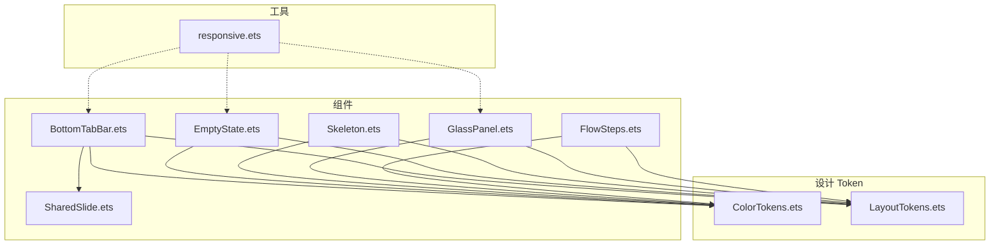
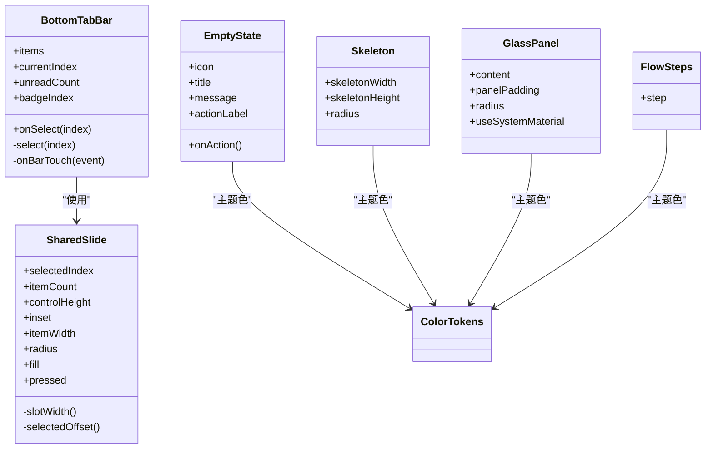
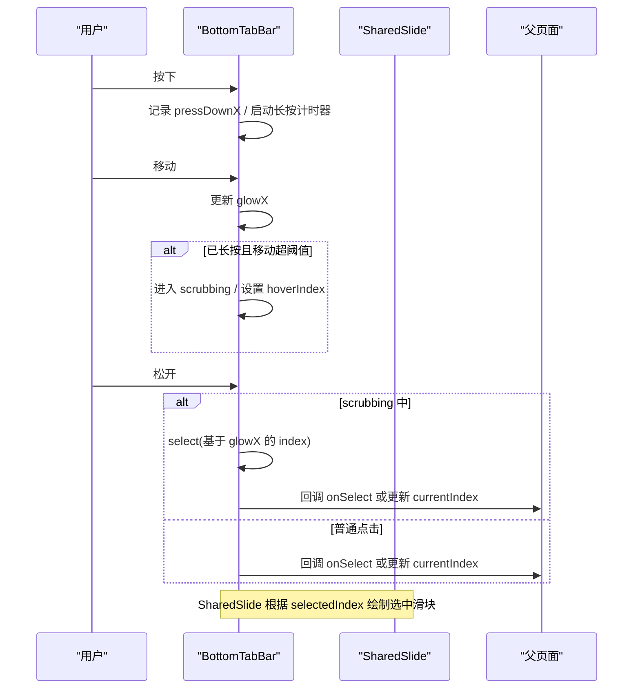
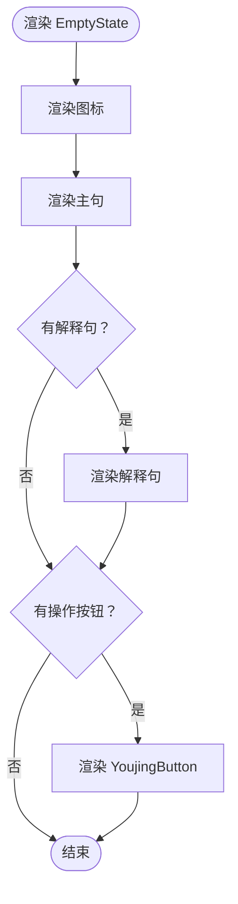
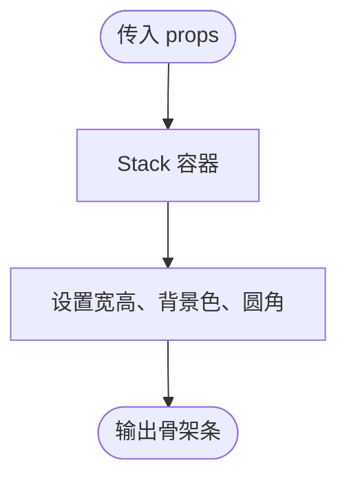
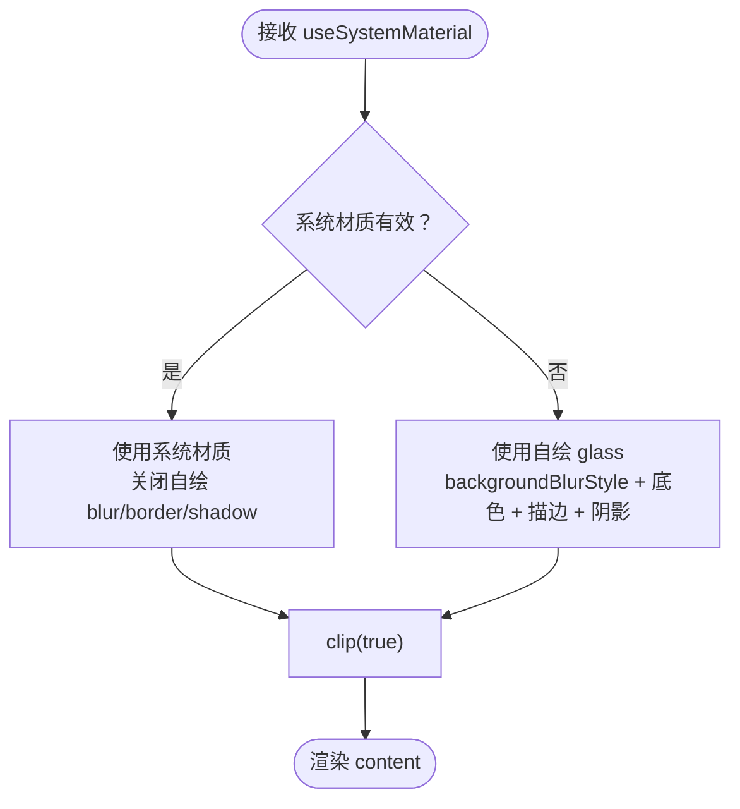
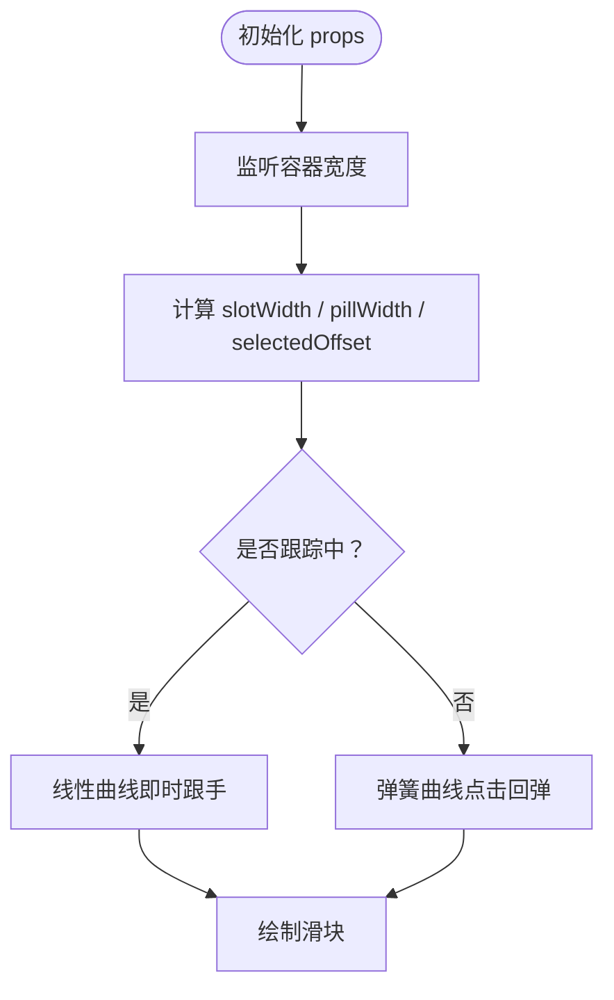
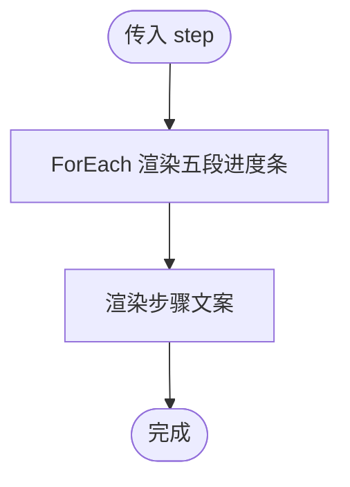
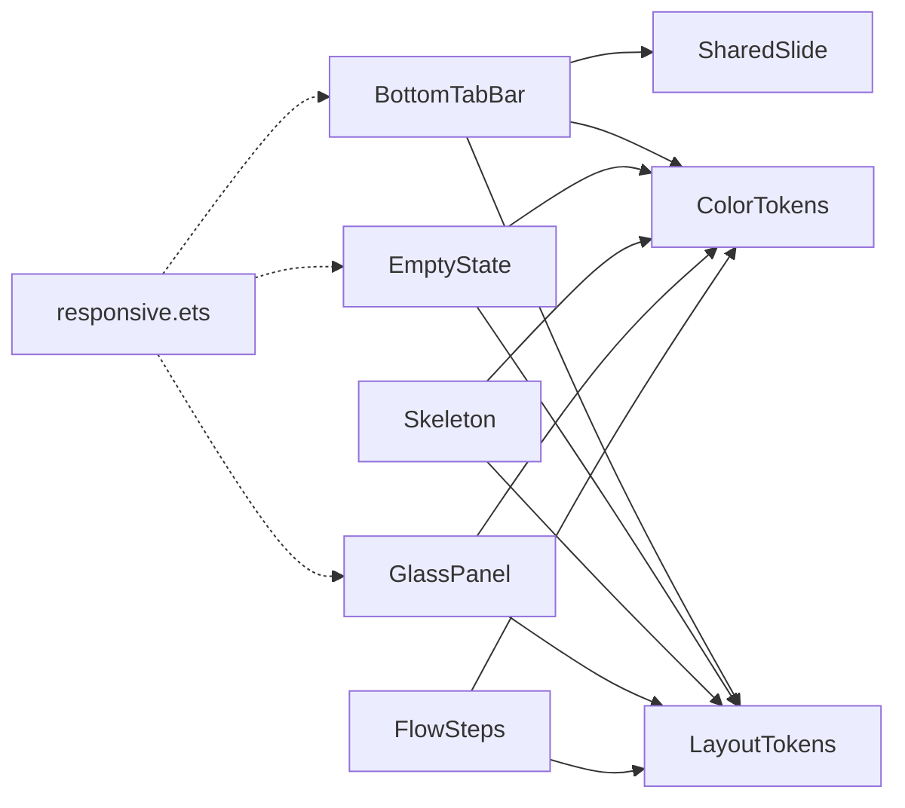

# 布局组件

<cite>
**本文引用的文件**   
- [BottomTabBar.ets](file://entry/src/main/ets/components/BottomTabBar.ets)
- [EmptyState.ets](file://entry/src/main/ets/components/EmptyState.ets)
- [Skeleton.ets](file://entry/src/main/ets/components/Skeleton.ets)
- [GlassPanel.ets](file://entry/src/main/ets/components/GlassPanel.ets)
- [SharedSlide.ets](file://entry/src/main/ets/components/SharedSlide.ets)
- [FlowSteps.ets](file://entry/src/main/ets/components/FlowSteps.ets)
- [responsive.ets](file://entry/src/main/ets/utils/responsive.ets)
- [LayoutTokens.ets](file://entry/src/main/ets/design/LayoutTokens.ets)
- [ColorTokens.ets](file://entry/src/main/ets/design/ColorTokens.ets)
</cite>

## 目录
1. [引言](#引言)
2. [项目结构](#项目结构)
3. [核心组件](#核心组件)
4. [架构总览](#架构总览)
5. [详细组件分析](#详细组件分析)
6. [依赖关系分析](#依赖关系分析)
7. [性能与响应式适配](#性能与响应式适配)
8. [故障排查指南](#故障排查指南)
9. [结论](#结论)

## 引言
本文件面向“有径”应用的前端布局层，聚焦一组通用页面布局与交互组件：底部页签栏、空状态、骨架屏、毛玻璃面板、共享滑动容器和流程步骤。这些组件共同构成页面的基础骨架与视觉语言，承担导航、状态提示、加载占位、材质表现、手势切换与流程引导等职责。文档从实现结构、数据流、交互逻辑、依赖关系、性能特征及响应式策略五个维度展开，帮助读者快速理解并安全复用。

## 项目结构
布局组件集中在 `entry/src/main/ets/components` 下，由设计 Token（颜色、尺寸、圆角、阴影）与工具函数（响应式、系统材质）支撑：

图表来源
- [BottomTabBar.ets:1-200](file://entry/src/main/ets/components/BottomTabBar.ets#L1-L200)
- [EmptyState.ets:1-85](file://entry/src/main/ets/components/EmptyState.ets#L1-L85)
- [Skeleton.ets:1-39](file://entry/src/main/ets/components/Skeleton.ets#L1-L39)
- [GlassPanel.ets:1-54](file://entry/src/main/ets/components/GlassPanel.ets#L1-L54)
- [SharedSlide.ets:1-97](file://entry/src/main/ets/components/SharedSlide.ets#L1-L97)
- [FlowSteps.ets:1-52](file://entry/src/main/ets/components/FlowSteps.ets#L1-L52)
- [ColorTokens.ets:1-200](file://entry/src/main/ets/design/ColorTokens.ets#L1-L200)
- [LayoutTokens.ets:1-200](file://entry/src/main/ets/design/LayoutTokens.ets#L1-L200)
- [responsive.ets:1-78](file://entry/src/main/ets/utils/responsive.ets#L1-L78)

章节来源
- [BottomTabBar.ets:1-307](file://entry/src/main/ets/components/BottomTabBar.ets#L1-L307)
- [EmptyState.ets:1-85](file://entry/src/main/ets/components/EmptyState.ets#L1-L85)
- [Skeleton.ets:1-39](file://entry/src/main/ets/components/Skeleton.ets#L1-L39)
- [GlassPanel.ets:1-54](file://entry/src/main/ets/components/GlassPanel.ets#L1-L54)
- [SharedSlide.ets:1-97](file://entry/src/main/ets/components/SharedSlide.ets#L1-L97)
- [FlowSteps.ets:1-52](file://entry/src/main/ets/components/FlowSteps.ets#L1-L52)
- [LayoutTokens.ets:1-200](file://entry/src/main/ets/design/LayoutTokens.ets#L1-L200)
- [ColorTokens.ets:1-200](file://entry/src/main/ets/design/ColorTokens.ets#L1-L200)
- [responsive.ets:1-78](file://entry/src/main/ets/utils/responsive.ets#L1-L78)

## 核心组件
本节概述六个布局组件的职责、对外接口与内部关键机制。

- BottomTabBar：五页签底部悬浮底栏，承载选中态指示、长按进入擦除模式的手势切换、未读红点标记、按压光斑与整体缩放反馈。
- EmptyState：统一的空状态展示，包含图标、主句、解释文案与一个主操作按钮，支持无障碍分组。
- Skeleton：静态骨架条，用于占位渲染，避免内容抖动，不叠加流光动画。
- GlassPanel：毛玻璃卡片，按系统材质能力切换自绘与原生模糊，统一边框、圆角、阴影与裁剪。
- SharedSlide：可复用的滑块指示器，提供跟手位移、点击回弹、按压缩放与尺寸自适应。
- FlowSteps：流程进度条，显示步数分段与当前步骤文案，贯穿建行程主链。

章节来源
- [BottomTabBar.ets:1-307](file://entry/src/main/ets/components/BottomTabBar.ets#L1-L307)
- [EmptyState.ets:1-85](file://entry/src/main/ets/components/EmptyState.ets#L1-L85)
- [Skeleton.ets:1-39](file://entry/src/main/ets/components/Skeleton.ets#L1-L39)
- [GlassPanel.ets:1-54](file://entry/src/main/ets/components/GlassPanel.ets#L1-L54)
- [SharedSlide.ets:1-97](file://entry/src/main/ets/components/SharedSlide.ets#L1-L97)
- [FlowSteps.ets:1-52](file://entry/src/main/ets/components/FlowSteps.ets#L1-L52)

## 架构总览
布局组件以 Token 为单一事实源，通过组合方式构建页面骨架；BottomTabBar 作为导航容器，内嵌 SharedSlide 完成选中态跟随；GlassPanel 抽象背景材质；Skeleton 提供轻量占位；EmptyState 表达业务空态；FlowSteps 表达业务流程进度。

图表来源
- [BottomTabBar.ets:1-307](file://entry/src/main/ets/components/BottomTabBar.ets#L1-L307)
- [SharedSlide.ets:1-97](file://entry/src/main/ets/components/SharedSlide.ets#L1-L97)
- [EmptyState.ets:1-85](file://entry/src/main/ets/components/EmptyState.ets#L1-L85)
- [Skeleton.ets:1-39](file://entry/src/main/ets/components/Skeleton.ets#L1-L39)
- [GlassPanel.ets:1-54](file://entry/src/main/ets/components/GlassPanel.ets#L1-L54)
- [FlowSteps.ets:1-52](file://entry/src/main/ets/components/FlowSteps.ets#L1-L52)
- [ColorTokens.ets:1-200](file://entry/src/main/ets/design/ColorTokens.ets#L1-L200)

## 详细组件分析

### BottomTabBar 底部页签栏
BottomTabBar 是五页签导航的入口，负责：
- 五页签导航：通过 items 数组驱动 ForEach 渲染，每个 Tab 含图标、标题与可选未读标记。
- 选中状态：使用 SharedSlide 作为选中指示块，结合 selectedIndex 计算偏移，实现跟手移动与点击回弹。
- 未读标记：当 badgeIndex 匹配且 unreadCount > 0 时，在对应 Tab 右上角显示红点。
- 手势切换：
  - 按下触发按压光斑（径向渐变），随手指位置更新 glowX。
  - 长按 180ms 进入“擦除”模式；横划超过阈值后进入 scrubbing，实时高亮 hoverIndex。
  - 松手后根据当前位置 select 目标索引，并在短窗口内抑制 click，避免误触。
- 视觉反馈：整栏按压缩放、未选中格轻微缩小、选中项图标放大与品牌色、背景模糊与投影。

图表来源
- [BottomTabBar.ets:1-307](file://entry/src/main/ets/components/BottomTabBar.ets#L1-L307)
- [SharedSlide.ets:1-97](file://entry/src/main/ets/components/SharedSlide.ets#L1-L97)

实现要点
- 选择逻辑：select 优先走外部 onSelect，否则直接更新 currentIndex。
- 活跃判定：isActive 区分 scrubbing 与正常态，确保预览与最终选中一致。
- 触摸处理：Down/Move/Up 三段式处理，清理长按计时器，防止销毁后写状态。
- 光斑与层级：径向渐变光斑 hitTest=none，避免拦截手势；整体栏 onAreaChange 获取宽度供索引计算。
- 降级策略：沉浸材质不可用时 fallback 到 backgroundBlurStyle 与实色背板。

章节来源
- [BottomTabBar.ets:1-307](file://entry/src/main/ets/components/BottomTabBar.ets#L1-L307)

### EmptyState 空状态组件
EmptyState 用于表达“当前没有数据”的场景，包括：
- 占位图：SymbolGlyph 图标，尺寸与颜色来自 Token。
- 引导文案：主句 headline 加粗居中，可选解释句 callout。
- 操作按钮：通过 YoujingButton 提供唯一主出口，保证实心主按钮语义与深色主题一致性。
- 主题适配：所有颜色与字号均从 ColorTokens/TypeTokens 读取，自动跟随深浅色。
- 无障碍：accessibilityGroup(true) 将整组读成一个空态单元。

图表来源
- [EmptyState.ets:1-85](file://entry/src/main/ets/components/EmptyState.ets#L1-L85)

章节来源
- [EmptyState.ets:1-85](file://entry/src/main/ets/components/EmptyState.ets#L1-L85)

### Skeleton 骨架屏
Skeleton 提供轻量静态占位：
- 占位形状：Stack 容器承载 backgroundColor 与 borderRadius，避免被审计规则判为死占位。
- 无动画：不再叠加渐变扫光或 translate 动画，避免视觉噪音与性能损耗。
- 参数化：支持自定义宽度、高度、圆角，默认高度与圆角对齐契约。

图表来源
- [Skeleton.ets:1-39](file://entry/src/main/ets/components/Skeleton.ets#L1-L39)

章节来源
- [Skeleton.ets:1-39](file://entry/src/main/ets/components/Skeleton.ets#L1-L39)

### GlassPanel 毛玻璃面板
GlassPanel 抽象内容卡片的材质表现：
- 背景模糊：useSystemMaterial=true 且系统材质生效时，关闭自绘模糊；否则使用 Card 档背景模糊。
- 层级控制：材质生效时归零自绘 border/shadow，避免双重描边与灰缝。
- 阴影效果：材质失效时使用 cardAmbient 阴影；材质开启则用 ShadowTokens.none。
- 尺寸与裁剪：统一 padding、borderRadius 与 clip(true)，确保内容与材质边界一致。

图表来源
- [GlassPanel.ets:1-54](file://entry/src/main/ets/components/GlassPanel.ets#L1-L54)

章节来源
- [GlassPanel.ets:1-54](file://entry/src/main/ets/components/GlassPanel.ets#L1-L54)

### SharedSlide 共享滑动容器
SharedSlide 作为可复用的滑块指示器，承担：
- 手势处理：与父容器分离，通过 containerWidth 与 slotWidth 计算滑块位置。
- 页面切换：selectedIndex 可为浮点数表示跟踪中的连续位置，整数表示点击切换。
- 内存管理：onAreaChange 仅在有意义变化时更新宽度，避免抖动导致宽度为 0。
- 动画策略：跟踪阶段使用线性曲线即时跟手；非跟踪阶段使用弹簧过弹回弹。
- 尺寸声明顺序：width/height/borderRadius 放在 animation 之后，避免显式动画吞掉初始帧属性。

图表来源
- [SharedSlide.ets:1-97](file://entry/src/main/ets/components/SharedSlide.ets#L1-L97)

章节来源
- [SharedSlide.ets:1-97](file://entry/src/main/ets/components/SharedSlide.ets#L1-L97)

### FlowSteps 流程步骤
FlowSteps 表达建行程主链的进度：
- 进度指示：固定五段进度条，当前步及之前为品牌色，后续为分隔线色。
- 步骤导航：常量定义各步骤标签与序号，页面传 step 即可正确显示。
- 状态管理：step 从 0 起，文本动态生成“第 N/M 步 · 当前步骤名”。
- 终点约定：结果页不挂具体 step，避免错误地显示“第 5/5 步”。

图表来源
- [FlowSteps.ets:1-52](file://entry/src/main/ets/components/FlowSteps.ets#L1-L52)

章节来源
- [FlowSteps.ets:1-52](file://entry/src/main/ets/components/FlowSteps.ets#L1-L52)

## 依赖关系分析
组件之间的耦合关系如下：
- BottomTabBar 强依赖 SharedSlide 实现选中态跟随；同时依赖 LayoutTokens 与 ColorTokens 提供尺寸与色彩。
- EmptyState、Skeleton、GlassPanel、FlowSteps 均依赖 ColorTokens 与 LayoutTokens 进行主题与尺寸适配。
- responsive.ets 提供断点映射与宽度约束，虽未在组件内直接 import，但消费方应据此控制 List 列数与长文最大宽度。

图表来源
- [BottomTabBar.ets:1-307](file://entry/src/main/ets/components/BottomTabBar.ets#L1-L307)
- [SharedSlide.ets:1-97](file://entry/src/main/ets/components/SharedSlide.ets#L1-L97)
- [EmptyState.ets:1-85](file://entry/src/main/ets/components/EmptyState.ets#L1-L85)
- [Skeleton.ets:1-39](file://entry/src/main/ets/components/Skeleton.ets#L1-L39)
- [GlassPanel.ets:1-54](file://entry/src/main/ets/components/GlassPanel.ets#L1-L54)
- [FlowSteps.ets:1-52](file://entry/src/main/ets/components/FlowSteps.ets#L1-L52)
- [ColorTokens.ets:1-200](file://entry/src/main/ets/design/ColorTokens.ets#L1-L200)
- [LayoutTokens.ets:1-200](file://entry/src/main/ets/design/LayoutTokens.ets#L1-L200)
- [responsive.ets:1-78](file://entry/src/main/ets/utils/responsive.ets#L1-L78)

章节来源
- [BottomTabBar.ets:1-307](file://entry/src/main/ets/components/BottomTabBar.ets#L1-L307)
- [SharedSlide.ets:1-97](file://entry/src/main/ets/components/SharedSlide.ets#L1-L97)
- [ColorTokens.ets:1-200](file://entry/src/main/ets/design/ColorTokens.ets#L1-L200)
- [LayoutTokens.ets:1-200](file://entry/src/main/ets/design/LayoutTokens.ets#L1-L200)
- [responsive.ets:1-78](file://entry/src/main/ets/utils/responsive.ets#L1-L78)

## 性能与响应式适配

### 性能优化建议
- SharedSlide 动画分支：跟踪阶段使用线性曲线，避免物理弹簧导致的滞后；点击切换保留弹簧回弹，提升手感。
- SharedSlide 尺寸声明顺序：width/height/borderRadius 放在 animation 之后，避免首帧异常跳动。
- SharedSlide 宽度更新：仅在大于 0 且变化超过阈值时更新 containerWidth，防止抖动造成 0 宽。
- BottomTabBar 触摸节流：长按计时器与 click 抑制窗口避免重复触发选择；aboutToDisappear 清理定时器。
- GlassPanel 材质门控：系统材质生效时关闭自绘 blur/border/shadow，避免双重渲染。
- Skeleton 静态占位：移除渐变与位移动画，降低重绘开销。

章节来源
- [SharedSlide.ets:1-97](file://entry/src/main/ets/components/SharedSlide.ets#L1-L97)
- [BottomTabBar.ets:1-307](file://entry/src/main/ets/components/BottomTabBar.ets#L1-L307)
- [GlassPanel.ets:1-54](file://entry/src/main/ets/components/GlassPanel.ets#L1-L54)
- [Skeleton.ets:1-39](file://entry/src/main/ets/components/Skeleton.ets#L1-L39)

### 响应式适配
- 屏幕尺寸适配：responsive.ets 提供 listLanesForBreakpoint，按断点返回 1/2/3 列，避免宽屏下单列 List 行长失控。
- 横竖屏切换：断点中心统一注册 windowSizeChange，组件侧只读 @StorageProp + @Watch，避免多处监听。
- 大字体支持：Typography 与 Icon 尺寸均来自 TypeTokens/IconTokens，主题切换时自动适配；EmptyState 标题与说明字族、字号遵循契约。
- 长文最大宽度：longFormMaxWidth 在 md 档限制为 600vp，lg 档使用 capVp，sm 档保持 100%；消费方需挂载到 .width() 而非 constraintSize.maxWidth，以避免子级测量溢出。
- 对称内缩：symmetricInsetForCap 针对不能限宽的容器提供两侧等宽留白，使内容在宽屏下呈现居中的一栏。

章节来源
- [responsive.ets:1-78](file://entry/src/main/ets/utils/responsive.ets#L1-L78)
- [EmptyState.ets:1-85](file://entry/src/main/ets/components/EmptyState.ets#L1-L85)
- [LayoutTokens.ets:1-200](file://entry/src/main/ets/design/LayoutTokens.ets#L1-L200)

## 故障排查指南
- 底部页签栏无法切换：
  - 检查 items.length 是否为 0；select 会直接 return。
  - 确认 BadgeIndex 与 unreadCount 是否正确；若 badgeIndex=-1 或未读数为 0，不会显示红点。
  - 长按进入擦除模式后松手未选择：检查 CLICK_SUPPRESS_MS 窗口内是否误触 onClick。
- 选中滑块错位或闪烁：
  - 确认 containerWidth 在 onAreaChange 中是否大于 0 且有变化；0 值会导致 pillWidth 为 0。
  - 检查 width/height/borderRadius 是否在 animation 之后声明。
- 毛玻璃面板出现双描边或灰缝：
  - 确认 useSystemMaterial 与 isSystemMaterialActive 的门控逻辑；材质生效时应关闭自绘 border/shadow。
- 空状态按钮未显示：
  - 检查 actionLabel 是否为空串；为空则不渲染按钮。
- 骨架屏无占位效果：
  - 确认 skeletonWidth/skeletonHeight 已传入；Skeleton 默认高度为 SpaceTokens.base。
- 流程步骤文案错乱：
  - 确认 step 从 0 起，且不超过 FLOW_STEPS.length；结果页不应挂 step。

章节来源
- [BottomTabBar.ets:1-307](file://entry/src/main/ets/components/BottomTabBar.ets#L1-L307)
- [SharedSlide.ets:1-97](file://entry/src/main/ets/components/SharedSlide.ets#L1-L97)
- [GlassPanel.ets:1-54](file://entry/src/main/ets/components/GlassPanel.ets#L1-L54)
- [EmptyState.ets:1-85](file://entry/src/main/ets/components/EmptyState.ets#L1-L85)
- [Skeleton.ets:1-39](file://entry/src/main/ets/components/Skeleton.ets#L1-L39)
- [FlowSteps.ets:1-52](file://entry/src/main/ets/components/FlowSteps.ets#L1-L52)

## 结论
这组布局组件以 Token 为中心，形成稳定、可复用、可主题的页面骨架。BottomTabBar 提供五页签导航与丰富手势体验；EmptyState 与 Skeleton 分别表达空态与加载态；GlassPanel 统一材质表现；SharedSlide 提供可靠的滑块行为；FlowSteps 明确业务流程进度。配合 responsive.ets 的断点策略，组件可在不同屏幕尺寸与横竖屏切换下保持一致体验。建议在消费方严格遵循 Token、动画顺序与门控逻辑，以获得最佳性能与视觉一致性。