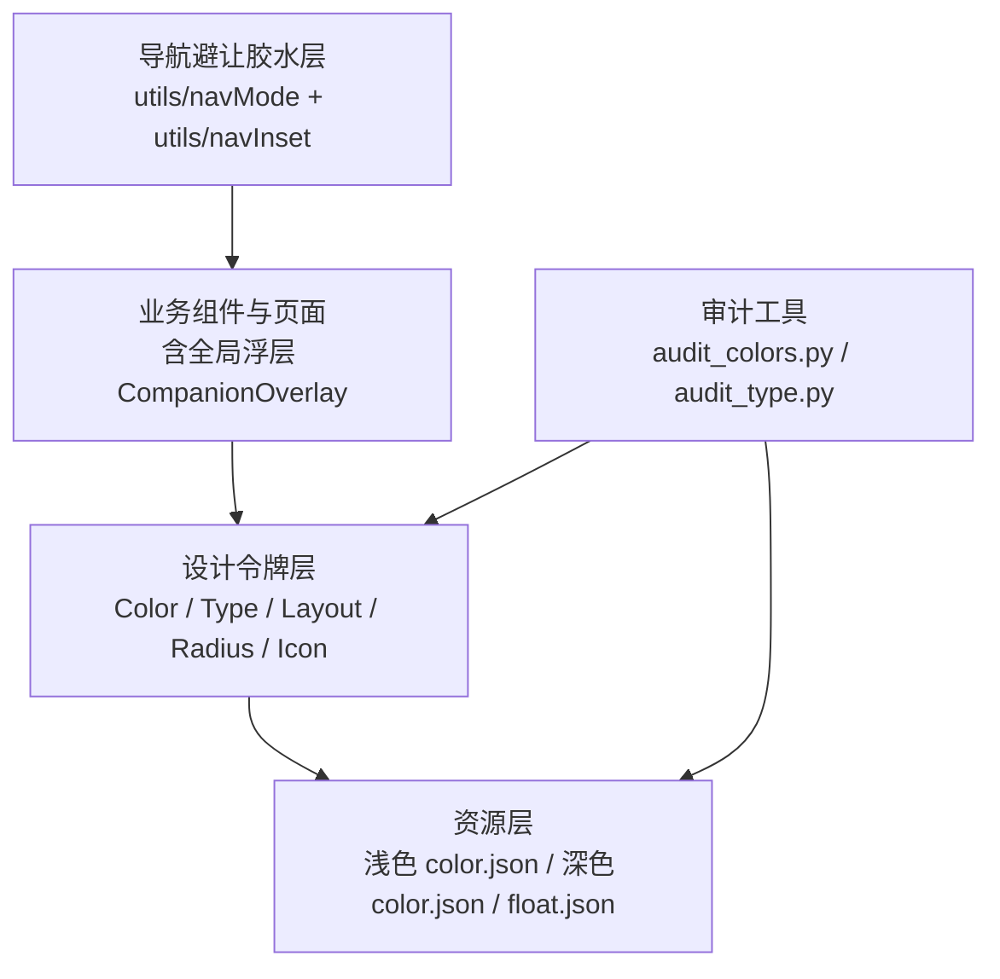
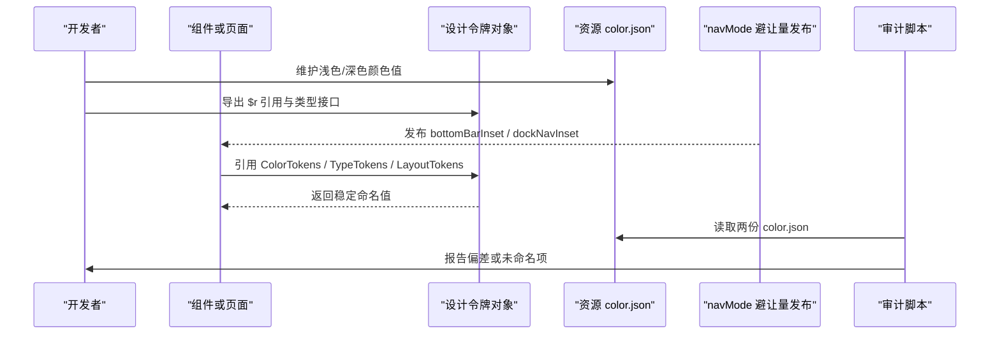
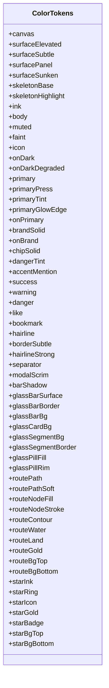
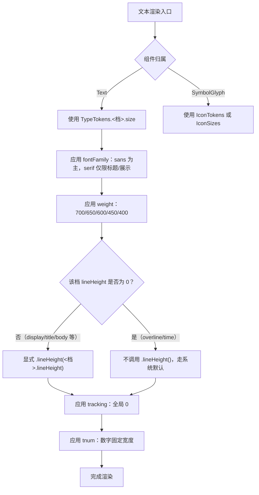
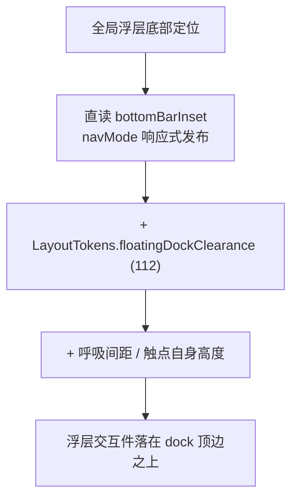
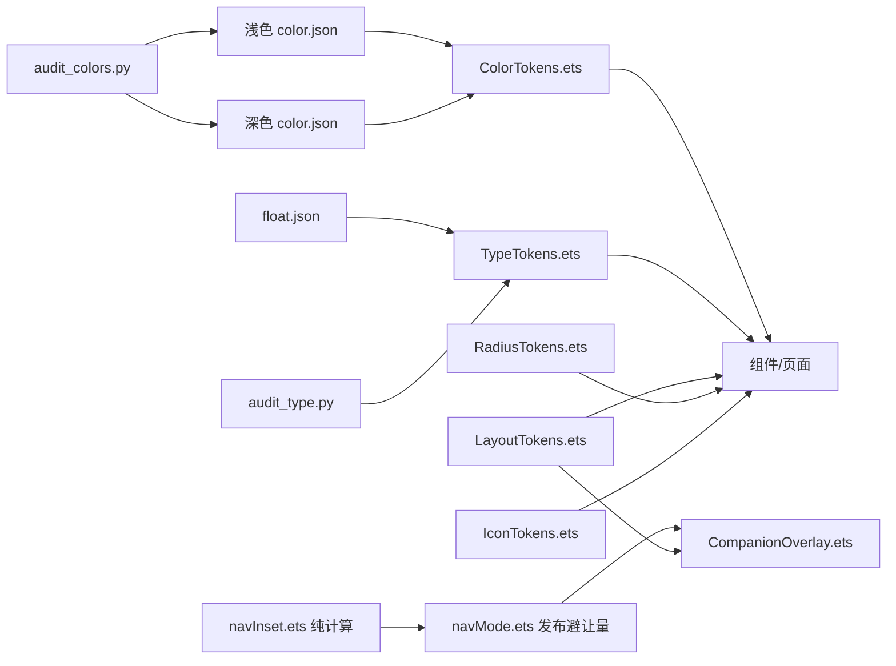

# 设计令牌系统

<cite>
**本文引用的文件**
- [ColorTokens.ets](file://entry/src/main/ets/design/ColorTokens.ets)
- [TypeTokens.ets](file://entry/src/main/ets/design/TypeTokens.ets)
- [LayoutTokens.ets](file://entry/src/main/ets/design/LayoutTokens.ets)
- [RadiusTokens.ets](file://entry/src/main/ets/design/RadiusTokens.ets)
- [IconTokens.ets](file://entry/src/main/ets/design/IconTokens.ets)
- [CompanionOverlay.ets](file://entry/src/main/ets/components/CompanionOverlay.ets)
- [PricingPage.ets](file://entry/src/main/ets/pages/PricingPage.ets)
- [ProfileIdentity.ets](file://entry/src/main/ets/components/ProfileIdentity.ets)
- [navMode.ets](file://entry/src/main/ets/utils/navMode.ets)
- [navInset.ets](file://entry/src/main/ets/utils/navInset.ets)
- [color.json（浅色）](file://entry/src/main/resources/base/element/color.json)
- [color.json（深色）](file://entry/src/main/resources/dark/element/color.json)
- [float.json](file://entry/src/main/resources/base/element/float.json)
- [audit_colors.py](file://tools/audit_colors.py)
- [audit_type.py](file://tools/audit_type.py)
</cite>

## 目录
1. [引言](#引言)
2. [项目结构](#项目结构)
3. [核心组件](#核心组件)
4. [架构总览](#架构总览)
5. [详细组件分析](#详细组件分析)
6. [依赖关系分析](#依赖关系分析)
7. [性能与一致性考量](#性能与一致性考量)
8. [故障排查指南](#故障排查指南)
9. [结论](#结论)
10. [附录：使用示例与扩展规范](#附录使用示例与扩展规范)

## 更新摘要
**变更内容**
- 「图标规范 IconTokens」一节补充 `compact` 档的正例消费点：`PricingPage` 套餐特性勾选图标（`SymbolGlyph($r('sys.symbol.checkmark'))`）由硬编码 `14px` 改为引用 `IconTokens.compact`，消除一处 audit_type「应写具名档」违规。
- 「字体规范 TypeTokens」与「字号与行高违规排查」两节补充 `overline`/`time` 行高为 0 的契约含义说明，并记录 `ProfileIdentity` 移除对 `overline.lineHeight`（定义为 0）误传 `.lineHeight()` 的正例修复。
- 「故障排查指南 → 字号与行高违规排查」标注 `audit_type.py` 三类 must-fix 检查项当前已清零，并把上述两处列为契约遵守的参考消费点。
- 「布局系统 LayoutTokens」「浮层 dock 遮挡」等其余章节保持原有结构与结论不变。

## 引言
本文件面向有径应用的设计规范基础层，系统化说明"设计令牌"如何把视觉契约沉淀为可维护、可审计、可暗色切换的实现。整个体系由五类令牌构成：颜色、字体、布局、圆角、图标；其中颜色资源落盘在浅色与深色两套 `color.json`，ETS 层只暴露类型化 token 对象，页面和组件通过引用 token 消费样式，从而保证"一处改、处处对齐"。

## 项目结构
设计令牌相关代码集中在 `entry/src/main/ets/design`，配套资源在 `entry/src/main/resources/{base,dark}/element`，校验工具在 `tools/`。浮层类组件（如伴随助手全局浮层）是布局令牌的重要消费方，其底部避让逻辑同时依赖 `design/LayoutTokens` 与 `utils/navMode` 发布的运行时避让量。排版/图标维度上，业务页面与组件（如 `PricingPage`、`ProfileIdentity`）是 `IconTokens` 与 `TypeTokens` 的直接消费方，也是 `audit_type.py` 逐行扫描的对象。

**图表来源**
- [ColorTokens.ets:1-200](file://entry/src/main/ets/design/ColorTokens.ets#L1-L200)
- [TypeTokens.ets:1-94](file://entry/src/main/ets/design/TypeTokens.ets#L1-L94)
- [LayoutTokens.ets:1-200](file://entry/src/main/ets/design/LayoutTokens.ets#L1-L200)
- [RadiusTokens.ets:1-43](file://entry/src/main/ets/design/RadiusTokens.ets#L1-L43)
- [IconTokens.ets:1-12](file://entry/src/main/ets/design/IconTokens.ets#L1-L12)
- [CompanionOverlay.ets:85-150](file://entry/src/main/ets/components/CompanionOverlay.ets#L85-L150)
- [navMode.ets:30-70](file://entry/src/main/ets/utils/navMode.ets#L30-L70)
- [color.json（浅色）:1-200](file://entry/src/main/resources/base/element/color.json#L1-L200)
- [color.json（深色）:1-200](file://entry/src/main/resources/dark/element/color.json#L1-L200)
- [float.json:1-8](file://entry/src/main/resources/base/element/float.json#L1-L8)
- [audit_colors.py:1-113](file://tools/audit_colors.py#L1-L113)
- [audit_type.py:1-87](file://tools/audit_type.py#L1-L87)

**章节来源**
- [ColorTokens.ets:1-200](file://entry/src/main/ets/design/ColorTokens.ets#L1-L200)
- [TypeTokens.ets:1-94](file://entry/src/main/ets/design/TypeTokens.ets#L1-L94)
- [LayoutTokens.ets:1-200](file://entry/src/main/ets/design/LayoutTokens.ets#L1-L200)
- [RadiusTokens.ets:1-43](file://entry/src/main/ets/design/RadiusTokens.ets#L1-L43)
- [IconTokens.ets:1-12](file://entry/src/main/ets/design/IconTokens.ets#L1-L12)
- [color.json（浅色）:1-200](file://entry/src/main/resources/base/element/color.json#L1-L200)
- [color.json（深色）:1-200](file://entry/src/main/resources/dark/element/color.json#L1-L200)
- [float.json:1-8](file://entry/src/main/resources/base/element/float.json#L1-L8)

## 核心组件
- **ColorTokens**：导出类型化颜色命名空间，映射到 `app.color.*` 资源键；同时提供别名与运行时常量，覆盖画布表面、文字、品牌语义、线条遮罩、路线图、星图、玻璃栏面等主题域。
- **TypeTokens**：定义九档字阶及全局字体族、数字 tabular 特性；明确 serif/sans 使用边界与字号封闭集，并以注释钉住 `overline`/`time` 两档行高为 0 的"不设行高"语义。
- **LayoutTokens**：统一间距、网格基线、内边距、安全区、吸底条净空、浮动 dock、行程主轴、地图浮层等布局尺寸；其中 `floatingDockClearance` 既服务钉底按钮条，也已成为全局浮层底部避让的强制组成部分。同文件还发布有据全量的 `IconSizes` 与 `IconTokensType` 十档图标集合。
- **RadiusTokens**：八值圆角集合，约束卡片、胶囊、dock、按钮等形状。
- **IconTokens**：图标尺寸命名空间，区分紧凑图标与标准图标，供搬运组件具名引用。

**章节来源**
- [ColorTokens.ets:1-200](file://entry/src/main/ets/design/ColorTokens.ets#L1-L200)
- [TypeTokens.ets:1-94](file://entry/src/main/ets/design/TypeTokens.ets#L1-L94)
- [LayoutTokens.ets:120-265](file://entry/src/main/ets/design/LayoutTokens.ets#L120-L265)
- [RadiusTokens.ets:1-43](file://entry/src/main/ets/design/RadiusTokens.ets#L1-L43)
- [IconTokens.ets:1-12](file://entry/src/main/ets/design/IconTokens.ets#L1-L12)

## 架构总览
设计令牌系统的运行路径是"资源 → token 对象 → 组件消费"，并配合审计脚本做契约核对。布局维度上还有一条并行链路：`utils/navMode` 在运行时探测系统导航方式并发布底部避让量，浮层与钉底控件把它与 `LayoutTokens.floatingDockClearance` 组合后消费。排版/图标维度上，`audit_type.py` 直接逐行扫描 `pages/`、`components/`、`widget/` 下的源码，把绕过 token 的字面量与"行高 0 误喂"列为必须修项。

**图表来源**
- [ColorTokens.ets:1-200](file://entry/src/main/ets/design/ColorTokens.ets#L1-L200)
- [LayoutTokens.ets:120-200](file://entry/src/main/ets/design/LayoutTokens.ets#L120-L200)
- [navMode.ets:30-70](file://entry/src/main/ets/utils/navMode.ets#L30-L70)
- [color.json（浅色）:1-200](file://entry/src/main/resources/base/element/color.json#L1-L200)
- [color.json（深色）:1-200](file://entry/src/main/resources/dark/element/color.json#L1-L200)
- [audit_colors.py:1-113](file://tools/audit_colors.py#L1-L113)

## 详细组件分析

### 颜色体系 ColorTokens
ColorTokens 将设计色表抽象为 ETS 可消费的 token 对象，主要分组如下：

| 类别 | 代表字段 | 含义与使用场景 |
|---|---|---|
| 画布与表面 | `canvas`、`surfaceElevated`、`surfaceSubtle`、`surfacePanel`、`surfaceSunken` | 页面背景、层级面板、凹陷区域骨架占位 |
| 文字与图标 | `ink`、`body`、`muted`、`faint`、`icon`、`onDark`、`onDarkDegraded` | 主文本、次级文本、弱化文本、图标色、深色模式前景降级 |
| 品牌与主色 | `primary`、`primaryPress`、`primaryTint`、`primaryGlowEdge`、`onPrimary` | 主交互色、按下态、半透明强调、光晕边缘、白字反显 |
| 品牌实心与危险辅助 | `brandSolid`、`onBrand`、`dangerTint` | 选中胶囊/主按钮实心底、品牌上文字、SoftChip 危险档 |
| 中性选择与功能标记 | `chipSolid`、`accentMention`、`like`、`bookmark` | 地图 Chip 选中背板、提及高亮、收藏与点赞语义 |
| 语义状态色 | `success`、`warning`、`danger` | 成功、警告、错误三类通用语义 |
| 线与遮罩 | `hairline`、`borderSubtle`、`hairlineStrong`、`separator`、`modalScrim` | 细线、次要描边、分隔符、模态遮罩 |
| 栏面投影与玻璃 | `barShadow`、`glassBarSurface`、`glassBarBorder`、`glassCardBg`、`glassSegmentBg` | 分段/悬浮 dock 的阴影、自绘玻璃件表面与边框兜底 |
| 性别徽章 | `genderMaleSurface`、`genderMaleText`、`genderFemaleSurface`、`genderFemaleText` | 资料卡性别标识四件套 |
| 路线图 | `routePath`、`routePathSoft`、`routeNodeFill`、`routeNodeStroke`、`routeContour`、`routeWater`、`routeLand`、`routeGold`、`routeBgTop`、`routeBgBottom` | 路线轨迹、节点、等高线、水域、陆地、渐变背景 |
| 星图 | `starInk`、`starRing`、`starIcon`、`starGold`、`starBadge`、`starBgTop`、`starBgBottom` | 星图 widget 与空状态配色 |

实现要点：
- 所有颜色值来源于 `resources/base/element/color.json` 与 `resources/dark/element/color.json`，token 仅做 `$r('app.color.*')` 映射。
- 新增语义色需要同时在浅深两份 `color.json` 登记，并在 ColorTokens 中保持同名导出；历史别名如 `brand`、`secondary`、`tertiary`、`sunken` 仍保留以兼容搬运组件。
- 注释明确禁止随意自绘材质，官方材质生效时自绘 border/shadow/blur 需归零避让。

**图表来源**
- [ColorTokens.ets:1-200](file://entry/src/main/ets/design/ColorTokens.ets#L1-L200)

**章节来源**
- [ColorTokens.ets:1-200](file://entry/src/main/ets/design/ColorTokens.ets#L1-L200)
- [color.json（浅色）:1-200](file://entry/src/main/resources/base/element/color.json#L1-L200)
- [color.json（深色）:1-200](file://entry/src/main/resources/dark/element/color.json#L1-L200)

### 字体规范 TypeTokens
TypeTokens 收敛了全局字体族、字号档位、行高与数字排版特性：

- **字体族**：无衬线体 `HarmonyOS Sans` 为主，衬线体 `NotoSerifSC` 用于标题与展示型标题；serif 被严格限制：永不上控件、永不上站点名、永不上数字，唯一例外是金额 hero 用 display 档但走 sans。
- **字号封闭集**：允许 `10/11/12/14/16/18/21/32`，不存在 `13/15/17/19/20`。
- **字重与行高**：display 32/700/44、title 21/700/32、headline 18/600/24、body 16/400/24、small/callout 14/400/20、caption 12/450/16、overline 11/600（行高 0 表示不强制）、navLabel 10/400/14、widgetMeta 11/400/14、time 12/600（行高 0）、titleSans 21/650/28。
- **行高 0 的契约语义**：`overline` 与 `time` 两档的 `lineHeight` 写 0，含义是"这一档不设行高、走系统默认"，而不是行高数值本身。把它直接喂进 `.lineHeight(0)` 会把"没设"变成"设成 0"，导致行盒压到字高以下；`tools/audit_type.py` 用正则钉住这条规则并列为必须修。确有固定行高需求时按有据同位值显式写出（overline 同位为 11/600/**14**）。
- **中英文混排**：全局字距为 0；数字统一启用 tabular 数字特性 `'tnum' on`，避免数字宽度抖动。
- **最小字号**：全 app 唯一允许小于 11px 的是 dock navLabel 10；widget 最小文本契约为 11。

正例消费点：`ProfileIdentity` 资料卡的性别标签走 `overline` 档，仅引用 `overline.size`、`overline.weight`、`overline.tracking`，不再对该档调用 `.lineHeight()`——即移除了此前把 `TypeTokens.overline.lineHeight`（值为 0）误传给 `.lineHeight()` 的用法，符合"行高 0 表示不设行高"的契约。同组件的姓名（headline）、简介与 ID（caption）等其他档位则正常携带各自非 0 的 `lineHeight`，体现"非 0 档才显式设置行高"的规则。

**图表来源**
- [TypeTokens.ets:1-94](file://entry/src/main/ets/design/TypeTokens.ets#L1-L94)
- [ProfileIdentity.ets:71-106](file://entry/src/main/ets/components/ProfileIdentity.ets#L71-L106)
- [audit_type.py:21-24](file://tools/audit_type.py#L21-L24)

**章节来源**
- [TypeTokens.ets:1-94](file://entry/src/main/ets/design/TypeTokens.ets#L1-L94)
- [ProfileIdentity.ets:71-106](file://entry/src/main/ets/components/ProfileIdentity.ets#L71-L106)
- [float.json:1-8](file://entry/src/main/resources/base/element/float.json#L1-L8)

### 布局系统 LayoutTokens
LayoutTokens 统一了间距、内边距、网格、控件高度与安全区适配，关键维度包括：

| 维度 | 关键字段 | 说明 |
|---|---|---|
| 网格与间距 | `gridBaseline`、`itemGap`、`blockGap`、`sectionGap` | 4vp 基线网格，条目/区块/分区阶梯间距 |
| 页面内边距 | `pagePadding`、`pagePaddingWide` | 常规与宽屏左右内缩 |
| 内容最大宽 | `contentMaxWidth` | 宽屏内容约束 |
| 触摸目标 | `minTouchTarget` | 最小命中区 |
| 导航与分段 | `titleBarHeight`、`segmentedControlHeight`、`segmentedHeight`、`segmentBarShadowRoom` | 顶栏、分段控件轨道高、投影净空 |
| 底部 Tab | `tabBarHeight` | 底部标签栏高 |
| 浮动 Dock | `floatingDockWidth`、`floatingDockMediumWidth`、`floatingDockWideWidth`、`floatingDockBottomMargin`、`floatingDockBarHeight`、`floatingDockClearance`、`floatingDockSideMargin` | 浮动 dock 输入尺寸、两档 medium/large 同值以避免跳档、钉底净空 |
| 玻璃栏面遮罩 | `barGradientMaskHeight` | 顶栏、悬浮 dock、吸顶日栏统一 92px 渐变遮罩 |
| 滚动预留 | `bottomScrollReserve`、`stickyBarScrollReserve`、`shareBarScrollReserve` | 通用底部预留、吸底 CTA 与分享动作条预留 |
| 行程主轴 | `itinerarySpineWidth`、`itineraryTimeGutter`、`itineraryNodeSize`、`itineraryNodeDot`、`itineraryRowMinHeight`、`itineraryBlockGap` | 时间槽、节点、缩略图、行高与区块间隙 |
| 地图与浮层 | `mapOverlayInset`、`mapHeightCompact` | 地图浮层内缩与紧凑地图高 |
| 小组件 | `widget2x2Padding`、`widget2x4Padding`、`profileAvatarSize` | 2×2/2×4 卡片内缩、头像直径 |
| 安全区 | `safeAreaFallback` | 底部安全区兜底值 |

特别注意：
- `floatingDockClearance` 按最大档钉住（现值 112vp），确保手势档和三键档都不会让末行掉入 dock 下方。其构成为 `floatingDockBarHeight`(56) + `floatingDockBottomMargin`(28) + 底部避让量：手势档避让量为 0 时约 84vp，三键档约 28.8vp 时需要 112.8vp，故取最大档上界 112 而不是随手留大或按 84 钉死。
- `segmentBarShadowRoom` 不可减少，否则玻璃珠系统投影会被 List 下边缘裁成硬边灰带。
- `bottomScrollReserve` 必须与 `dockNavInset` 组合使用，不能单独作为最终底部预留。

**新增消费事实：`floatingDockClearance` 已是全局浮层底部避让的强制组成部分**。伴随助手全局浮层（常驻触点、请示卡、快捷短语面板 + 文字兜底）盖在五 tab 与二级页之上，它的三条底部内边距全部按同一公式计算：系统底部避让量 `bottomBarInset` ＋ `LayoutTokens.floatingDockClearance` ＋ 一档呼吸间距（面板与请示卡另加触点自身高度）。这意味着任何新浮层都**不得**只用系统 `bottomBarInset`，也不得自估一个固定小值——那样浮层交互件会直接坐进 dock 命中区。系统避让量本身由 `utils/navMode` 单源发布（权威信号读 settings 的 `float_navigation_info`，缺失时按 avoidArea 高度＋是否横贯整屏兜底判别），消费方必须 `@StorageProp`/`@StorageLink` 挂键并在 build 属性里直读，否则 ArkUI 不建立刷新绑定。

**Updated**：本节补充 `floatingDockClearance` 在全局浮层中的强制消费约定与避让量组合公式。

**图表来源**
- [CompanionOverlay.ets:30-35](file://entry/src/main/ets/components/CompanionOverlay.ets#L30-L35)
- [CompanionOverlay.ets:85-150](file://entry/src/main/ets/components/CompanionOverlay.ets#L85-L150)
- [LayoutTokens.ets:80-95](file://entry/src/main/ets/design/LayoutTokens.ets#L80-L95)
- [navMode.ets:30-70](file://entry/src/main/ets/utils/navMode.ets#L30-L70)

**章节来源**
- [LayoutTokens.ets:80-200](file://entry/src/main/ets/design/LayoutTokens.ets#L80-L200)
- [CompanionOverlay.ets:30-35](file://entry/src/main/ets/components/CompanionOverlay.ets#L30-L35)
- [CompanionOverlay.ets:85-150](file://entry/src/main/ets/components/CompanionOverlay.ets#L85-L150)
- [navMode.ets:30-70](file://entry/src/main/ets/utils/navMode.ets#L30-L70)
- [navInset.ets:36-50](file://entry/src/main/ets/utils/navInset.ets#L36-L50)

### 圆角规范 RadiusTokens
RadiusTokens 将圆角收敛为八个允许值：`0/6/10/14/20/28/30/999`。

| 字段 | 值 | 适用 |
|---|---:|---|
| `none` | 0 | 直角 |
| `media` | 6 | 媒体与卡片内嵌套 |
| `capsule` | 10 | 胶囊与输入框 |
| `reason` | 14 | 理由件 |
| `card` | 20 | 卡片与弹层 |
| `hero` | 28 | Hero 面板 |
| `dock` | 30 | 浮动 dock 与分段控件 |
| `pill` | 999 | 按钮、徽标、头像 |
| `floatingBar` | 30 | 玻璃胶囊按钮 |
| `lg` | 20 | 资料卡/预览卡 |

新增圆角必须从封闭集中取，不允许自定义收紧或加宽。

**章节来源**
- [RadiusTokens.ets:1-43](file://entry/src/main/ets/design/RadiusTokens.ets#L1-L43)

### 图标规范 IconTokens
IconTokens 提供两类图标尺寸：

| 字段 | 尺寸 | 场景 |
|---|---:|---|
| `compact` | 16 | 玻璃胶囊内联图标，如草稿箱、废纸篓、修改头像；亦适用于列表行内的勾选/状态符号 |
| `standard` | 24 | 标准图标 |

注意：有径既有 `IconSizes` 不与 `IconTokens` 合并；搬运组件继续引用 `IconTokens`，原生组件引用 `IconSizes`，两套并存各归其主。`IconSizes` 与十档 `IconTokensType`（`canvas/stroke/compact/small/standard/tabBar/avatarCompact/avatarProfile/empty/shortcutTile`）随 `LayoutTokens.ets` 一并发布，2026-11-07 全量对齐后有据控制档为 24、展示/空态档为 44，旧 22/48 封闭集废止。

正例消费点：`PricingPage` 套餐特性行的勾选符号 `SymbolGlyph($r('sys.symbol.checkmark'))` 此前把字号硬编码为 `14px`，触发 `audit_type.py` 的"图标应写具名档"提示；现已改为 `.fontSize(IconTokens.compact)`，图标尺寸回归 token 具名档，该行不再是待裁决字面量。这是把裸数字图标尺寸替换为 `IconTokens` 具名档的标准做法，可作为同类页面的参考消费点。

**Updated**：本节补充 `IconTokens.compact` 在 `PricingPage` 勾选图标上的正例消费，以及 `IconSizes`/十档 `IconTokensType` 与两套并存的现状说明。

**章节来源**
- [IconTokens.ets:1-12](file://entry/src/main/ets/design/IconTokens.ets#L1-L12)
- [LayoutTokens.ets:228-265](file://entry/src/main/ets/design/LayoutTokens.ets#L228-L265)
- [PricingPage.ets:286-295](file://entry/src/main/ets/pages/PricingPage.ets#L286-L295)

## 依赖关系分析
设计令牌之间的依赖较弱，主要是"资源 → token → 组件"单向依赖；颜色资源与 token 之间通过 `app.color.*` 资源键绑定，字体族名称与字号则直接由 TypeTokens 导出。布局维度额外存在一条运行时依赖：`utils/navInset` 提供纯计算判据，`utils/navMode` 把系统信号换算成避让量写入 AppStorage，浮层组件（如 `CompanionOverlay`）再与 `LayoutTokens.floatingDockClearance` 组合消费。排版/图标维度的消费点分布在 `pages/` 与 `components/`（如 `PricingPage` 引 `IconTokens.compact`、`ProfileIdentity` 按档携带 `TypeTokens`），均被 `audit_type.py` 纳入扫描范围。

**图表来源**
- [ColorTokens.ets:1-200](file://entry/src/main/ets/design/ColorTokens.ets#L1-L200)
- [TypeTokens.ets:1-94](file://entry/src/main/ets/design/TypeTokens.ets#L1-L94)
- [LayoutTokens.ets:1-200](file://entry/src/main/ets/design/LayoutTokens.ets#L1-L200)
- [RadiusTokens.ets:1-43](file://entry/src/main/ets/design/RadiusTokens.ets#L1-L43)
- [IconTokens.ets:1-12](file://entry/src/main/ets/design/IconTokens.ets#L1-L12)
- [CompanionOverlay.ets:15-35](file://entry/src/main/ets/components/CompanionOverlay.ets#L15-L35)
- [navMode.ets:20-70](file://entry/src/main/ets/utils/navMode.ets#L20-L70)
- [navInset.ets:1-50](file://entry/src/main/ets/utils/navInset.ets#L1-L50)
- [color.json（浅色）:1-200](file://entry/src/main/resources/base/element/color.json#L1-L200)
- [color.json（深色）:1-200](file://entry/src/main/resources/dark/element/color.json#L1-L200)
- [float.json:1-8](file://entry/src/main/resources/base/element/float.json#L1-L8)
- [audit_colors.py:1-113](file://tools/audit_colors.py#L1-L113)
- [audit_type.py:1-87](file://tools/audit_type.py#L1-L87)

**章节来源**
- [ColorTokens.ets:1-200](file://entry/src/main/ets/design/ColorTokens.ets#L1-L200)
- [TypeTokens.ets:1-94](file://entry/src/main/ets/design/TypeTokens.ets#L1-L94)
- [LayoutTokens.ets:1-200](file://entry/src/main/ets/design/LayoutTokens.ets#L1-L200)
- [RadiusTokens.ets:1-43](file://entry/src/main/ets/design/RadiusTokens.ets#L1-L43)
- [IconTokens.ets:1-12](file://entry/src/main/ets/design/IconTokens.ets#L1-L12)
- [navMode.ets:1-70](file://entry/src/main/ets/utils/navMode.ets#L1-L70)

## 性能与一致性考量
- **暗色模式零分支**：颜色值落在两套 `color.json`，token 只负责引用；系统根据 `ColorMode` 自动切换，页面无需条件判断。
- **封闭集约束**：字号、圆角、图标尺寸均有允许集合，便于静态审计发现越界值。
- **语义化命名**：颜色与布局均按用途命名，而不是直接写死十六进制或数值，降低"复制粘贴式样式漂移"。
- **图标尺寸具名化**：`SymbolGlyph` 一律走 `IconTokens`/`IconSizes` 具名档，杜绝页面各自写死数字（如曾经的 `checkmark` 14px），一改即辐射全 App。
- **行高语义保护**：`overline`/`time` 的 0 行高通过审计正则保护，防止"不设行高"被误写成"行高 0"造成行盒塌陷。
- **投影与遮罩统一**：玻璃栏面阴影、渐变遮罩高度统一由 token 表达，避免组件各自估算导致视觉不一致。
- **安全区与 dock 净空**：底部滚动预留与浮动 dock 清除量按最大档计算，防止不同导航手势或按键布局下内容被遮挡；浮层与钉底控件共用同一个 `floatingDockClearance` 上界，避免"页面修好了、浮层还在压 dock"的半截修复。

[本节为通用指导，不直接分析具体文件]

## 故障排查指南

### 颜色偏差排查
当浅色或深色颜色值与设计契约不一致时，优先使用 `audit_colors.py`：

- 该脚本读取浅色与深色 `color.json`，并与设计契约解析结果逐件比对。
- 支持特殊命名映射，如 `border_subtle`、`modal_scrim`。
- 对 `route_*`、`star_*` 前缀会映射到契约中的 paper/night 对应键。
- 退出码 0 表示一致，1 表示存在偏差，2 表示找不到契约文件。

建议流程：
1. 确认契约文件路径是否更新。
2. 运行脚本查看偏差列表。
3. 优先修正 `resources/{base,dark}/element/color.json`。
4. 同步更新 `ColorTokens.ets` 的导出与注释。

**章节来源**
- [audit_colors.py:1-113](file://tools/audit_colors.py#L1-L113)
- [color.json（浅色）:1-200](file://entry/src/main/resources/base/element/color.json#L1-L200)
- [color.json（深色）:1-200](file://entry/src/main/resources/dark/element/color.json#L1-L200)

### 字号与行高违规排查
使用 `audit_type.py` 检查页面与组件中是否存在绕过 token 的字号与非法行高用法。脚本扫描 `pages/*.ets`、`components/*.ets` 与 `widget/**/*.ets`，输出三类清单，退出码 1 的条件是存在「Text 绕过字阶 token」或「行高 0 被显式喂进 `.lineHeight()`」这两类必须修项：

- **Text 字号**：检查 `Text.fontSize()` 是否为允许字号，若不在八档内报错；若在允许集中但仍写死数字，提示应改为 `TypeTokens.<档>.size`。
- **图标尺寸**：检查 `SymbolGlyph` 图标尺寸是否落在允许集合（`12/14/16/18/20/24/44/56/68`）；即便在集合内，写死数字仍提示应改为 `IconSizes.<档>`/`IconTokens.<档>` 具名引用。
- **行高 0 误喂**：检查是否把 `TypeTokens.overline.lineHeight` 或 `TypeTokens.time.lineHeight` 的 0 直接喂给 `.lineHeight()`；0 在此处表示"不设行高"，不应被当作数值传入。

当前状态：经本轮合规修复，`audit_type.py` 的 must-fix 项已清零——`PricingPage` 勾选图标改引 `IconTokens.compact` 消除了图标字面量，`ProfileIdentity` 移除对 `overline` 档误传 `.lineHeight()` 消除了行高 0 误喂。二者可作为后续同类问题的正例消费点参考。

建议流程：
1. 运行脚本定位违规文件与行号。
2. 将 Text 字号替换为 `TypeTokens.<档>.size`。
3. 对 overline/time 的行高，不要显式设为 0；如需固定行高，按契约显式写出实际值（overline 同位 14）。
4. 图标尺寸改用 `IconTokens` 或 `IconSizes` 具名档，参考 `PricingPage` 的 `IconTokens.compact` 写法。

**章节来源**
- [audit_type.py:1-87](file://tools/audit_type.py#L1-L87)
- [TypeTokens.ets:1-94](file://entry/src/main/ets/design/TypeTokens.ets#L1-L94)
- [PricingPage.ets:286-295](file://entry/src/main/ets/pages/PricingPage.ets#L286-L295)
- [ProfileIdentity.ets:71-106](file://entry/src/main/ets/components/ProfileIdentity.ets#L71-L106)

### 布局与 dock 遮挡问题
若出现底部内容被 dock 压住、分段投影被截断、滚动末行隐藏等问题，优先检查：

- 是否正确使用 `floatingDockClearance` 与 `bottomScrollReserve`。
- 是否误减 `segmentBarShadowRoom`。
- 是否遗漏 `barGradientMaskHeight` 导致的渐变遮罩不足。
- 是否在宽窄屏间误用 `pagePadding` 与 `pagePaddingWide`。

**新增典型症状：浮层交互件命中盒压住 dock 页签。** 全局浮层（伴随助手触点、请示卡、快捷短语面板）的容器通常铺满全屏且空白处触摸穿透，只有交互件收命中；一旦交互件的底部位置只算了系统 `bottomBarInset` 或自估了一个固定小值，它看起来"贴边合理"，实际 44vp 级别的命中盒会整片盖在悬浮 dock 的页签上——最直观的后果就是 dock 上的「我的」等页签点不动，而视觉上并没有明显叠影，极易被误判为点击事件丢失。真机上已出现过「助手」触点压住 dock「我的」tab 的案例，修复方式就是把触点抬到 dock 净空之上。

规范做法（避让量以 token 组合计算，不允许自估）：
1. 响应式直读 `utils/navMode` 发布的底部避让量（如 `BOTTOM_BAR_INSET_KEY` 对应的 `bottomBarInset`），必须在 build 属性里直接读该变量，只挂 link 不进 build 不会产生刷新绑定。
2. 叠加 `LayoutTokens.floatingDockClearance`（112vp 最大档上界，任何导航档位都盖得住），这是强制组成部分，不是可选余量。
3. 再叠加一档呼吸间距；位于触点之上的请示卡与快捷短语面板还要再加上触点自身高度，保证两层不互相遮挡。
4. 浮层容器与空白区域保持 `HitTestMode.None`，仅交互件收命中，避免穿透失效造成新的遮挡。

**Updated**：本小节补充浮层命中盒压住 dock 页签的症状描述与 token 组合计算避让量的规范步骤。

**章节来源**
- [LayoutTokens.ets:80-95](file://entry/src/main/ets/design/LayoutTokens.ets#L80-L95)
- [CompanionOverlay.ets:30-35](file://entry/src/main/ets/components/CompanionOverlay.ets#L30-L35)
- [CompanionOverlay.ets:85-150](file://entry/src/main/ets/components/CompanionOverlay.ets#L85-L150)
- [navMode.ets:10-70](file://entry/src/main/ets/utils/navMode.ets#L10-L70)

## 结论
有径应用的设计令牌系统以"资源双档 + token 类型化 + 审计脚本"的方式，把色彩、字体、布局、圆角、图标统一到可维护的契约层。它既保证了暗色模式下的自动化切换，也通过封闭集和命名约定限制了样式漂移。布局层还多了一条运行时协作链路：`navMode` 发布系统避让量、`LayoutTokens` 提供 dock 净空上界，浮层与钉底控件按同一公式组合消费。本轮 `PricingPage` 图标具名化与 `ProfileIdentity` 行高误喂清理使 `audit_type.py` 的 must-fix 项清零，进一步验证了"先资源、后 token、再消费点"的顺序有效性。未来扩展新令牌时，仍应遵循该顺序，并通过现有审计脚本持续验证一致性。

[本节为总结性内容，不直接分析具体文件]

## 附录：使用示例与扩展规范

### 在组件中引用设计令牌
- 颜色：组件中通过导入 `ColorTokens`，使用其语义字段，例如主色、语义成功/警告/错误、中性 ink/body/muted、玻璃栏面 surface/border、路线图 path/node/background 等。
- 字体：通过 `TypeTokens.display/title/headline/body/small/caption/overline/navLabel/widgetMeta/time/callout/titleSans` 获取 family、size、weight、lineHeight；数字文本启用 `'tnum' on`。注意 `overline`/`time` 两档的 `lineHeight` 为 0，表示"不设行高"，不要对其调用 `.lineHeight()`（参考 `ProfileIdentity` 性别标签的处理）。
- 布局：通过 `LayoutTokens.pagePadding/itemGap/blockGap/sectionGap/minTouchTarget/floatingDockClearance/bottomScrollReserve/segmentBarShadowRoom/barGradientMaskHeight` 等具名值组织页面结构；浮层底部定位一律写成"系统避让量 + `floatingDockClearance` + 呼吸量"的组合，参考 `CompanionOverlay` 的三处消费点。
- 圆角：通过 `RadiusTokens.card/capsule/pill/dock/media/hero/reason/floatingBar/lg/none` 控制形状。
- 图标：通过 `IconTokens.compact` 与 `IconTokens.standard` 控制图标大小；`SymbolGlyph` 一律引用具名档而非裸数字，参考 `PricingPage` 勾选图标 `.fontSize(IconTokens.compact)` 的写法。

**章节来源**
- [ColorTokens.ets:1-200](file://entry/src/main/ets/design/ColorTokens.ets#L1-L200)
- [TypeTokens.ets:1-94](file://entry/src/main/ets/design/TypeTokens.ets#L1-L94)
- [LayoutTokens.ets:80-265](file://entry/src/main/ets/design/LayoutTokens.ets#L80-L265)
- [RadiusTokens.ets:1-43](file://entry/src/main/ets/design/RadiusTokens.ets#L1-L43)
- [IconTokens.ets:1-12](file://entry/src/main/ets/design/IconTokens.ets#L1-L12)
- [CompanionOverlay.ets:85-150](file://entry/src/main/ets/components/CompanionOverlay.ets#L85-L150)
- [PricingPage.ets:286-295](file://entry/src/main/ets/pages/PricingPage.ets#L286-L295)
- [ProfileIdentity.ets:71-106](file://entry/src/main/ets/components/ProfileIdentity.ets#L71-L106)

### 扩展新的令牌值
新增令牌的推荐步骤：

1. **确定语义**：明确新值是主色变体、语义色、中性色、表面层、线条遮罩还是领域专用色。
2. **登记资源**：在浅色与深色 `color.json` 中添加同名键，并确保可读性与对比度符合契约。
3. **导出 token**：在 `ColorTokens.ets` 的类型接口与实例对象中添加同名字段，指向 `app.color.*`。
4. **补充注释**：说明使用场景、明暗差异、与旧别名的关系。
5. **审计核对**：运行 `audit_colors.py` 确认无偏差；若涉及字号/行高/图标，运行 `audit_type.py` 确认没有绕过 token。
6. **组件消费**：只在组件中引用新 token，不再手写十六进制或数值。

布局类新增值的规则与之同形：先在 `LayoutTokensType` 接口与实例中具名，并在注释里写清构成公式与真机测量来源（如 `floatingDockClearance = 栏体 56 + 基线 28 + 底部避让量`，按最大档钉 112），再要求消费点直读 token；不允许在任何页面或浮层里出现裸数字的底部避让量。图标类同理：新增尺寸先进 `IconTokensType`/`IconSizes` 具名档，再要求 `SymbolGlyph` 直引具名档，杜绝页面写死数字。

**章节来源**
- [ColorTokens.ets:1-200](file://entry/src/main/ets/design/ColorTokens.ets#L1-L200)
- [color.json（浅色）:1-200](file://entry/src/main/resources/base/element/color.json#L1-L200)
- [color.json（深色）:1-200](file://entry/src/main/resources/dark/element/color.json#L1-L200)
- [LayoutTokens.ets:80-95](file://entry/src/main/ets/design/LayoutTokens.ets#L80-L95)
- [audit_colors.py:1-113](file://tools/audit_colors.py#L1-L113)
- [audit_type.py:1-87](file://tools/audit_type.py#L1-L87)

### 暗色模式适配最佳实践
- 不要在页面中对颜色值写 `if (dark)` 分支；让系统通过 `resources/dark` 自动切换。
- 如果某个 token 在深色模式下需要更高对比度，应在深色 `color.json` 中调整，而不是在组件里临时提高 opacity。
- 对于"白字降级"场景，使用 `onDarkDegraded`，避免在复杂背景上直接使用纯白。
- 对 glass 栏面、投影、遮罩等复合效果，优先使用 token 提供的 `barShadow`、`glassBarSurface`、`glassBarBorder`、`barGradientMaskHeight`，减少手工拼色。

**章节来源**
- [ColorTokens.ets:1-200](file://entry/src/main/ets/design/ColorTokens.ets#L1-L200)
- [color.json（浅色）:1-200](file://entry/src/main/resources/base/element/color.json#L1-L200)
- [color.json（深色）:1-200](file://entry/src/main/resources/dark/element/color.json#L1-L200)