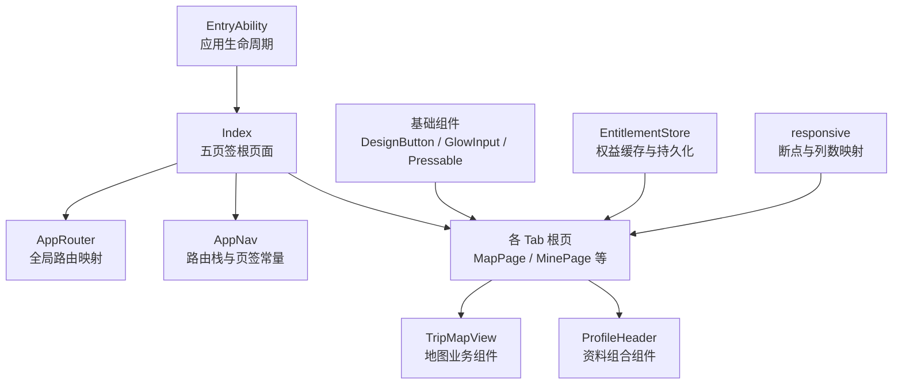
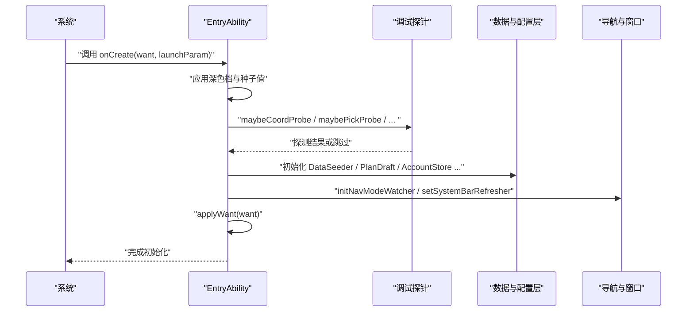
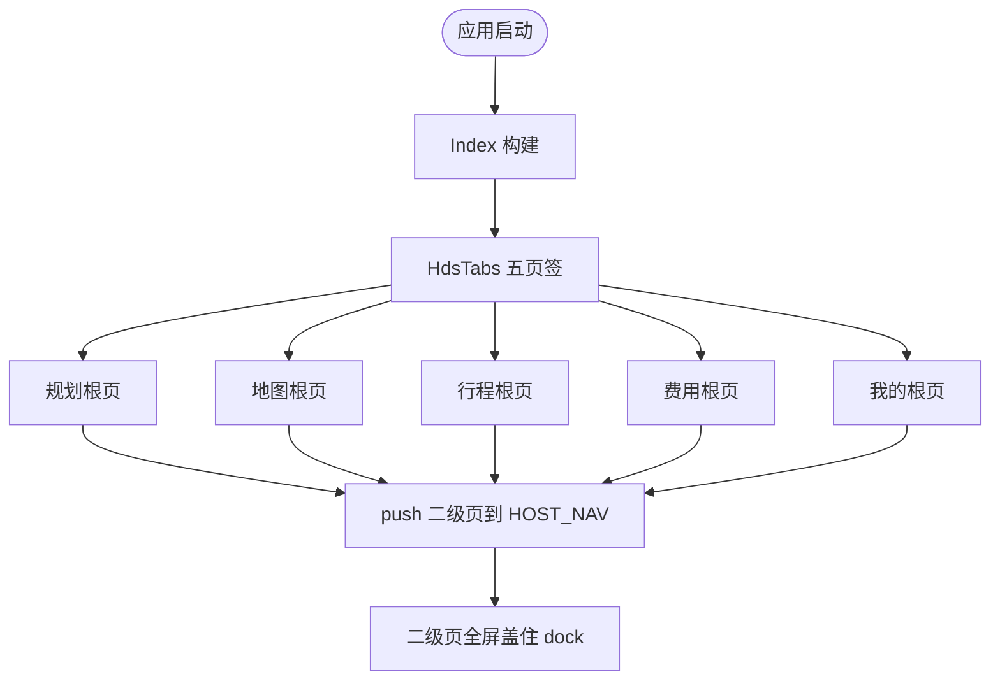
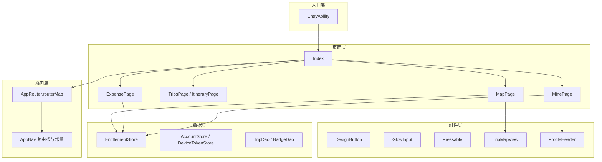
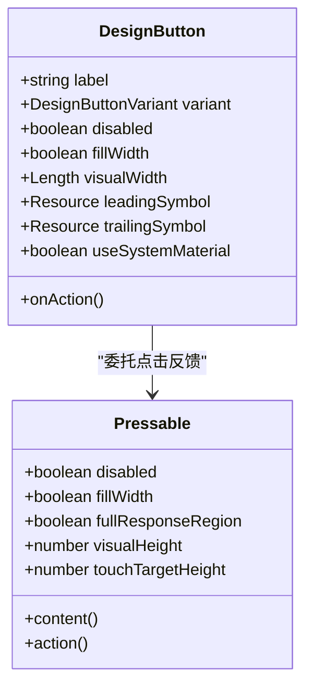
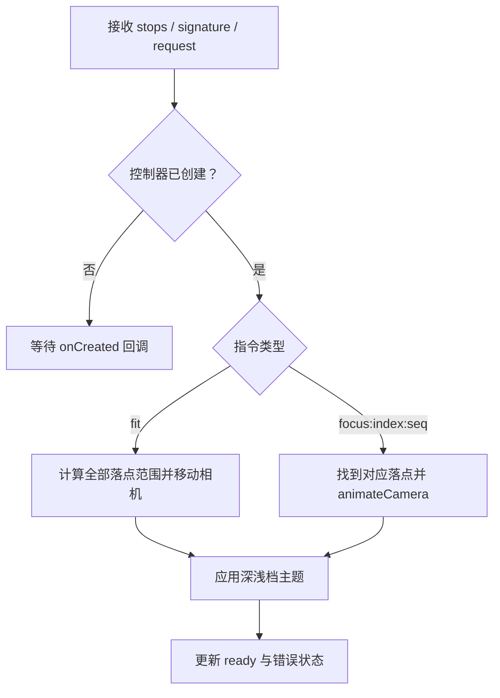
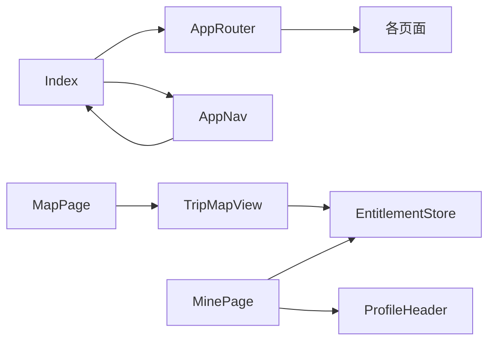

# 前端架构

<cite>
**本文引用的文件**   
- [EntryAbility.ets](file://entry/src/main/ets/entryability/EntryAbility.ets)
- [Index.ets](file://entry/src/main/ets/pages/Index.ets)
- [AppRouter.ets](file://entry/src/main/ets/pages/AppRouter.ets)
- [AppNav.ets](file://entry/src/main/ets/common/constants/AppNav.ets)
- [DesignButton.ets](file://entry/src/main/ets/components/DesignButton.ets)
- [GlowInput.ets](file://entry/src/main/ets/components/GlowInput.ets)
- [Pressable.ets](file://entry/src/main/ets/components/Pressable.ets)
- [TripMapView.ets](file://entry/src/main/ets/components/TripMapView.ets)
- [ProfileHeader.ets](file://entry/src/main/ets/components/ProfileHeader.ets)
- [EntitlementStore.ets](file://entry/src/main/ets/data/EntitlementStore.ets)
- [MapPage.ets](file://entry/src/main/ets/pages/MapPage.ets)
- [MinePage.ets](file://entry/src/main/ets/pages/MinePage.ets)
- [responsive.ets](file://entry/src/main/ets/utils/responsive.ets)
</cite>

## 目录
1. [引言](#引言)
2. [项目结构](#项目结构)
3. [核心组件](#核心组件)
4. [架构总览](#架构总览)
5. [详细组件分析](#详细组件分析)
6. [依赖关系分析](#依赖关系分析)
7. [性能与可维护性](#性能与可维护性)
8. [故障排查指南](#故障排查指南)
9. [结论](#结论)

## 引言
本文面向 HarmonyOS Stage 模型下的「有径」前端工程，系统化梳理应用入口、页面架构、路由、组件体系、状态管理与持久化策略，并补充响应式布局与横竖屏适配方案。文档以仓库实际源码为依据，重点解释：
- `EntryAbility` 生命周期中的权限申请、数据库与配置初始化流程；
- `Index` 根页面的五页签布局、二级页全屏化与路由参数传递；
- 基础组件、业务组件与组合组件的职责边界；
- AppStorage 全局广播、`@State`/`@Link` 组件级状态以及偏好存储等持久化机制；
- 断点驱动的多列 List 与长文最大宽度控制。

## 项目结构
本仓库采用按功能分层的 ArkTS 工程：
- `entry/src/main/ets/entryability`：Stage 应用入口；
- `entry/src/main/ets/pages`：页面与路由表；
- `entry/src/main/ets/components`：基础、业务与组合组件；
- `entry/src/main/ets/data`：数据层 Store、DAO、工具类；
- `entry/src/main/ets/common`：配置、常量、错误、日志、定位、天气等共享能力；
- `entry/src/main/ets/design`：设计令牌；
- `entry/src/main/ets/utils`：响应式、导航模式、地图辅助、时间工具等；
- `entry/src/main/ets/widget`：系统卡片相关。

图表来源
- [EntryAbility.ets:1-120](file://entry/src/main/ets/entryability/EntryAbility.ets#L1-L120)
- [Index.ets:1-120](file://entry/src/main/ets/pages/Index.ets#L1-L120)
- [AppRouter.ets:1-100](file://entry/src/main/ets/pages/AppRouter.ets#L1-L100)
- [AppNav.ets:1-120](file://entry/src/main/ets/common/constants/AppNav.ets#L1-L120)

章节来源
- [EntryAbility.ets:1-120](file://entry/src/main/ets/entryability/EntryAbility.ets#L1-L120)
- [Index.ets:1-120](file://entry/src/main/ets/pages/Index.ets#L1-L120)

## 核心组件
本节聚焦应用启动、根页面与全局路由三个关键入口。

### EntryAbility：生命周期与初始化
`EntryAbility` 继承 `UIAbility`，在 `onCreate` 中完成以下工作：
- 应用深色模式探针与种子值设置；
- 解析启动 Want，触发各类调试探针（坐标校准、精选调用、围栏、提醒同步等）；
- 通过 `applyWant` 处理深链参数；
- 初始化导航模式、窗口系统栏、设备激活、配额与行程提醒等能力。

关键点：
- 权限申请集中在位置能力路径：使用 `ArrivalWatcher.ensurePermission` 获取定位权限后再读当前位置；
- 配置加载来自 `ApiConfig`、`BuildConfig`、`BudgetConfig` 等配置模块；
- 数据初始化由 `DataSeeder`、`PlanDraft`、`AccountStore`、`DeviceActivator`、`WidgetSync` 等协作完成；
- 调试探针只在 `BuildConfig.IS_DEBUG` 下生效，避免生产包副作用。

图表来源
- [EntryAbility.ets:1-120](file://entry/src/main/ets/entryability/EntryAbility.ets#L1-L120)
- [EntryAbility.ets:120-220](file://entry/src/main/ets/entryability/EntryAbility.ets#L120-L220)

章节来源
- [EntryAbility.ets:1-120](file://entry/src/main/ets/entryability/EntryAbility.ets#L1-L120)
- [EntryAbility.ets:120-220](file://entry/src/main/ets/entryability/EntryAbility.ets#L120-L220)

### Index：五页签布局与二级页全屏化
`Index` 是应用根页面，使用官方 `HdsTabs` 承载五个根页签：
- 地图；
- 行程；
- 规划；
- 费用；
- 我的。

每个根页内联自己的 `HdsNavigation` 栈，而所有二级页统一 push 到外层宿主栈 `HOST_NAV`，实现“一级页签 + 二级页全屏”的标准形态。切页签由 `HdsTabsController.changeIndex` 控制，外部深链通过 `TAB_INDEX_KEY` 作为初始页签传入，运行期切换通过 `TAB_SWITCH_KEY`。

要点：
- 冷启深链使用 `index` 初始值，而非运行期 `changeIndex`；
- 根页通过 `stackOfTab` 取各自栈，非根路由通过 `stackOfRoute` 走宿主栈；
- 根页通过 `TAB_SHOWN_KEY` 广播重取数据，避免首次进入后缓存过期不刷新；
- 底部 dock 液态胶囊与拖拽形变属于 UI 细节，不影响路由主流程。

图表来源
- [Index.ets:1-120](file://entry/src/main/ets/pages/Index.ets#L1-L120)
- [AppNav.ets:1-120](file://entry/src/main/ets/common/constants/AppNav.ets#L1-L120)

章节来源
- [Index.ets:1-120](file://entry/src/main/ets/pages/Index.ets#L1-L120)
- [AppNav.ets:1-120](file://entry/src/main/ets/common/constants/AppNav.ets#L1-L120)

### AppRouter 与 AppNav：路由协议
`AppRouter` 提供集中式 `routerMap`，把路由名和参数转换为具体页面构造；`AppNav` 定义：
- 各 Tab 的独立栈；
- 宿主栈 `HOST_NAV`；
- 页签序号常量 `TAB_MAP`、`TAB_ITINERARY`、`TAB_PLAN`、`TAB_EXPENSE`、`TAB_MINE`；
- 页签槽位数据 `DOCK_TABS`；
- 深链、当前活跃行程、草稿脏标记、页签展示广播等 AppStorage 键；
- `enterPlanningFlow`、`stackOfRoute`、`stackOfTab`、`isTabRoot`、`tabOfRoute` 等路由决策函数。

章节来源
- [AppRouter.ets:1-100](file://entry/src/main/ets/pages/AppRouter.ets#L1-L100)
- [AppNav.ets:1-200](file://entry/src/main/ets/common/constants/AppNav.ets#L1-L200)

## 架构总览
从系统视角看，应用遵循“入口 → 根页面 → 根页导航 → 二级页宿主栈 → 业务组件 → 数据层”的分层：

图表来源
- [EntryAbility.ets:1-120](file://entry/src/main/ets/entryability/EntryAbility.ets#L1-L120)
- [Index.ets:1-120](file://entry/src/main/ets/pages/Index.ets#L1-L120)
- [AppRouter.ets:1-100](file://entry/src/main/ets/pages/AppRouter.ets#L1-L100)
- [AppNav.ets:1-120](file://entry/src/main/ets/common/constants/AppNav.ets#L1-L120)
- [TripMapView.ets:1-120](file://entry/src/main/ets/components/TripMapView.ets#L1-L120)
- [ProfileHeader.ets:1-80](file://entry/src/main/ets/components/ProfileHeader.ets#L1-L80)
- [EntitlementStore.ets:1-120](file://entry/src/main/ets/data/EntitlementStore.ets#L1-L120)

## 详细组件分析

### 基础组件：DesignButton、GlowInput、Pressable
#### DesignButton
DesignButton 是家族按钮主件，支持四种变体：
- primary：品牌实心按钮；
- outlined：描边透明按钮；
- ghost：品牌文字按钮；
- glass：玻璃质感按钮。

它封装了尺寸、颜色、圆角、阴影、禁用态与系统材质接管逻辑，并把点击反馈委托给 `Pressable`，避免重复实现按下动画。

图表来源
- [DesignButton.ets:1-139](file://entry/src/main/ets/components/DesignButton.ets#L1-L139)
- [Pressable.ets:1-84](file://entry/src/main/ets/components/Pressable.ets#L1-L84)

章节来源
- [DesignButton.ets:1-139](file://entry/src/main/ets/components/DesignButton.ets#L1-L139)
- [Pressable.ets:1-84](file://entry/src/main/ets/components/Pressable.ets#L1-L84)

#### GlowInput
GlowInput 是统一输入框组件：
- 默认使用系统原生样式；
- 可选 segmentStyle 走玻璃风格；
- 双向绑定 `@Link text`；
- 暴露 `onChange`、`onEnter`、`onFocusChanged`；
- 长度上限使用 `maxLength`，默认值设为较大整数以兼容未传参场景。

章节来源
- [GlowInput.ets:1-83](file://entry/src/main/ets/components/GlowInput.ets#L1-L83)

#### Pressable
Pressable 是家族统一的交互容器：
- 命中区域保证至少 44vp；
- 按下态同时使用透明度与缩放；
- 对矮控件自动居中响应区；
- 禁用态由调用方自行控制表面透明度，Pressable 只负责 enabled 与点击拦截。

章节来源
- [Pressable.ets:1-84](file://entry/src/main/ets/components/Pressable.ets#L1-L84)

### 业务组件：TripMapView
TripMapView 是 Map Kit 地图业务组件，职责包括：
- 渲染落点与动线；
- 根据指令执行全览或聚焦镜头；
- 根据深浅档切换地图昼夜模式；
- 处理鉴权失败、组件销毁期事件注销与覆盖物清理。

重要约束：
- MapComponent 需要合法初始中心点；
- 中国大陆地图使用 GCJ02，WGS84 会偏移；
- 鉴权失败时底图可能空白，组件内部只记录错误码，不向用户抛出异常；
- 全览留白 px 值必须大于图钉高度，否则首站会被裁掉。

图表来源
- [TripMapView.ets:1-120](file://entry/src/main/ets/components/TripMapView.ets#L1-L120)
- [TripMapView.ets:120-220](file://entry/src/main/ets/components/TripMapView.ets#L120-L220)

章节来源
- [TripMapView.ets:1-200](file://entry/src/main/ets/components/TripMapView.ets#L1-L200)

### 组合组件：ProfileHeader
ProfileHeader 是个人资料组合组件，负责呈现：
- 头像、昵称、性别、简介；
- 关注、粉丝、获赞三列统计；
- 编辑资料或去登录胶囊；
- 草稿箱与废纸篓工具胶囊。

该组件不持有领域数据，也不直接决定跳转目标，而是通过回调把操作意图交给页面层。

章节来源
- [ProfileHeader.ets:1-106](file://entry/src/main/ets/components/ProfileHeader.ets#L1-L106)

### 页面示例：MapPage 与 MinePage
MapPage 作为 dock 地图根页：
- 区分全程与单日视图；
- 使用 TripMapView 渲染地图；
- 通过 `TAB_SHOWN_KEY` 在切回页签时重新加载；
- 二级页 push 到 `HOST_NAV`，自身 `HdsNavigation` 仅承载标题栏。

MinePage 作为 dock 我的根页：
- 展示会员卡、勋章概览、行程计数；
- 使用 ProfileHeader 展示资料区；
- 订阅权益变更与用户资料变更广播，即时刷新界面；
- 同样将二级页 push 到 `HOST_NAV`。

章节来源
- [MapPage.ets:1-150](file://entry/src/main/ets/pages/MapPage.ets#L1-L150)
- [MinePage.ets:1-150](file://entry/src/main/ets/pages/MinePage.ets#L1-L150)

## 依赖关系分析
组件与模块之间的依赖关系体现为“页面依赖路由，页面与业务组件依赖数据层，基础组件不依赖业务逻辑”。

图表来源
- [Index.ets:1-120](file://entry/src/main/ets/pages/Index.ets#L1-L120)
- [AppRouter.ets:1-100](file://entry/src/main/ets/pages/AppRouter.ets#L1-L100)
- [AppNav.ets:1-120](file://entry/src/main/ets/common/constants/AppNav.ets#L1-L120)
- [TripMapView.ets:1-120](file://entry/src/main/ets/components/TripMapView.ets#L1-L120)
- [ProfileHeader.ets:1-80](file://entry/src/main/ets/components/ProfileHeader.ets#L1-L80)
- [EntitlementStore.ets:1-120](file://entry/src/main/ets/data/EntitlementStore.ets#L1-L120)

章节来源
- [AppRouter.ets:1-100](file://entry/src/main/ets/pages/AppRouter.ets#L1-L100)
- [AppNav.ets:1-120](file://entry/src/main/ets/common/constants/AppNav.ets#L1-L120)

## 性能与可维护性

### 状态管理模式
本项目使用三层状态：
1. **AppStorage 全局广播**
   - 用于跨 Tab 与跨页面通知，如当前页签、活跃行程、草稿脏标记、页签展示 tick、登录态、权益 tick、主题 tick 等；
   - 消费方用 `@StorageProp` 读取，配合 `@Watch` 触发局部刷新；
   - 典型键见 `AppNav`，例如 `TAB_INDEX_KEY`、`ACTIVE_TRIP_KEY`、`TAB_SWITCH_KEY`、`TAB_SHOWN_KEY`、`DRAFT_DIRTY_KEY`。
2. **组件级状态**
   - `@State` 用于组件内部 UI 状态，如地图组件的 `ready`、`mapError`，根页的选中站点、标题文本等；
   - `@Link` 用于受控输入框的双向绑定，如 `GlowInput.text`。
3. **持久化存储**
   - 使用 `preferences` 保存权益缓存、提醒 ID、账号与设备 token 等；
   - `EntitlementStore` 实现 TTL 缓存、合并服务端快照、导出与生成门禁。

建议：
- 全局状态保持最小集合，仅广播必要变化；
- 组件内部状态不要随意上抛到 AppStorage；
- 持久化字段要区分“本地校验可用”和“服务端授权有效”。

### 响应式设计与横竖屏适配
响应式逻辑集中在 `utils/responsive.ets`：
- 断点唯一来源是 `breakpointCenter`；
- `listLanesForBreakpoint` 返回 List 的列数：sm 一列、md 两列、lg 三列；
- `longFormMaxWidth` 控制单列长文在 md 档的最大宽度为 600vp，lg 档使用传入上限；
- `symmetricInsetForCap` 提供对称内缩，避免宽屏下内容贴边。

横竖屏适配原则：
- 不在页面里重复注册 `windowSizeChange`；
- 通过 `@StorageProp` 读取断点与窗口宽度；
- 列表用 `List.lanes` 控制卡片列数；
- 表单与长文用 `width(数值)` 限制最大宽度，不使用 `constraintSize.maxWidth` 以避免子级测量异常。

章节来源
- [responsive.ets:1-78](file://entry/src/main/ets/utils/responsive.ets#L1-L78)

## 故障排查指南

### 常见问题与定位思路
1. **二级页无法显示**
   - 检查是否误把子页 push 到某个 Tab 的私有栈而不是 `HOST_NAV`；
   - 确认没有多个 `Navigation` 绑定同一个 `NavPathStack`。
2. **切页签后数据不刷新**
   - 根页应监听 `TAB_SHOWN_KEY`，并通过 `isTabShownTick` 判断是否轮到自己；
   - 注意冷启数据应在 `aboutToAppear` 加载，`onShown` 用于回退刷新。
3. **地图鉴权失败但无报错**
   - Map Kit 鉴权失败可能只表现为空白底图；
   - 查看 Logger 中地图初始化错误码，并在 UI 层给出说明。
4. **深链落到错误页签**
   - 检查 `routerMap` 的路由名与 `tabOfRoute` 分支是否一致；
   - 根路由不会 push，应靠 `isTabRoot` 判定。
5. **权益缓存导致付费墙异常**
   - 若缓存过期且本机无 token，可能永久停在付费页；
   - 检查 `canGenerate` 中 `isCacheValid` 与 `DeviceTokenStore.hasToken` 的组合逻辑。

章节来源
- [AppNav.ets:120-200](file://entry/src/main/ets/common/constants/AppNav.ets#L120-L200)
- [TripMapView.ets:1-120](file://entry/src/main/ets/components/TripMapView.ets#L1-L120)
- [EntitlementStore.ets:120-235](file://entry/src/main/ets/data/EntitlementStore.ets#L120-L235)

## 结论
本项目的 ArkTS 前端架构围绕 HarmonyOS Stage 模型展开：
- `EntryAbility` 承担启动、探针、权限与基础设施初始化；
- `Index` 通过 `HdsTabs` 组织五页签，并以 `HOST_NAV` 实现二级页全屏；
- `AppRouter` 与 `AppNav` 统一管理路由名、路由参数与页签栈；
- 组件体系按基础、业务、组合分层，`Pressable` 统一交互反馈；
- 状态管理以 AppStorage 为主、组件状态为辅，配合 preferences 做持久化；
- 响应式布局通过断点中心与 `responsive` 工具控制列数与最大宽度。

这套结构便于扩展新页面、新路由与新组件，同时通过集中式路由、集中式页签常量与集中式响应式映射降低多端适配与维护成本。