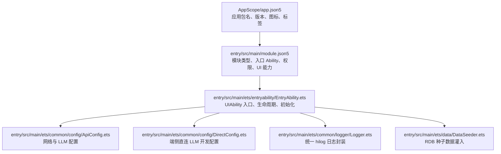
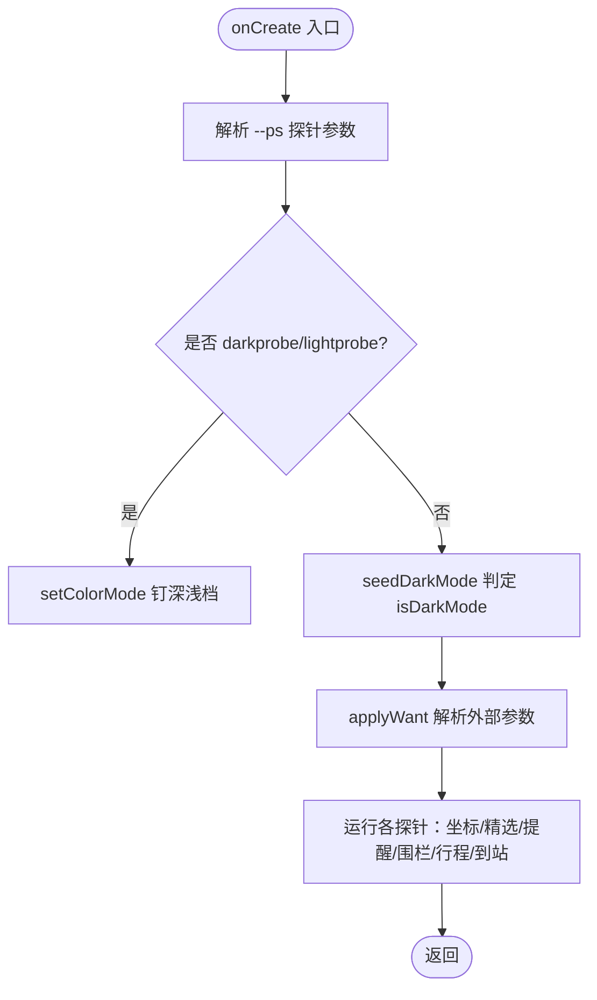
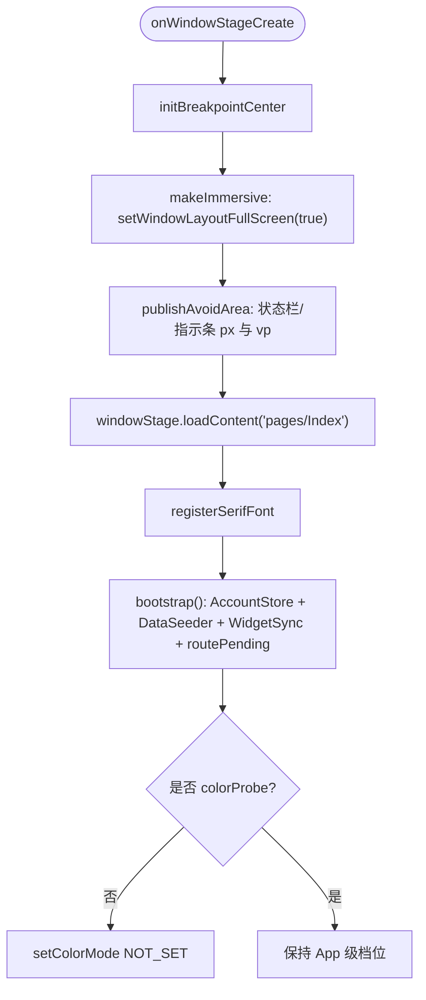
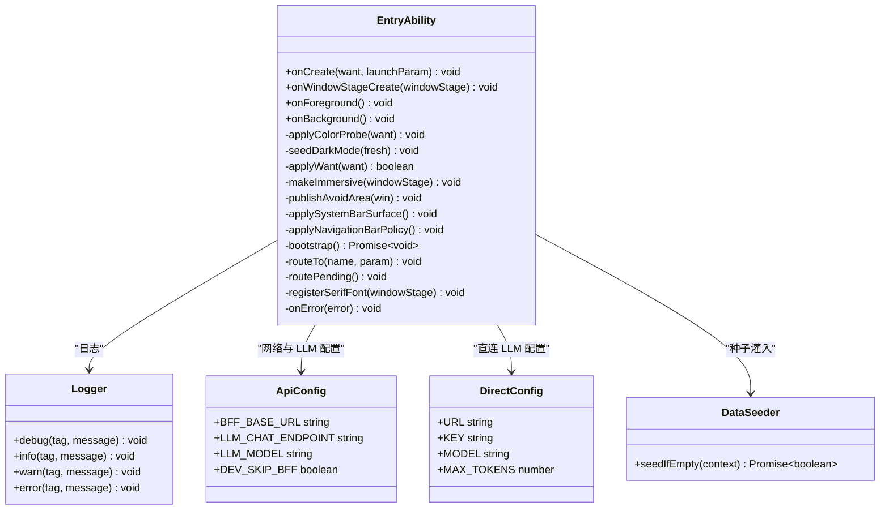

# 应用入口与生命周期

<cite>
**本文引用的文件**   
- [EntryAbility.ets](file://entry/src/main/ets/entryability/EntryAbility.ets)
- [module.json5](file://entry/src/main/module.json5)
- [app.json5](file://AppScope/app.json5)
- [ApiConfig.ets](file://entry/src/main/ets/common/config/ApiConfig.ets)
- [DirectConfig.ets](file://entry/src/main/ets/common/config/DirectConfig.ets)
- [Logger.ets](file://entry/src/main/ets/common/logger/Logger.ets)
- [DataSeeder.ets](file://entry/src/main/ets/data/DataSeeder.ets)
</cite>

## 目录
1. [引言](#引言)
2. [项目结构](#项目结构)
3. [核心组件](#核心组件)
4. [架构总览](#架构总览)
5. [详细组件分析](#详细组件分析)
6. [依赖关系分析](#依赖关系分析)
7. [性能考虑](#性能考虑)
8. [故障排查指南](#故障排查指南)
9. [结论](#结论)
10. [附录：扩展与示例](#附录扩展与示例)

## 引言
本文面向 HarmonyOS Stage 模型下的应用入口与生命周期，聚焦 `EntryAbility` 的完整实现。文档说明 Ability 生命周期方法 `onCreate`、`onWindowStageCreate`、`onForeground`、`onBackground` 的执行时机与职责，梳理应用初始化流程中的权限检查、数据库种子灌入、配置加载与日志系统；同时解释模块清单 `module.json5` 的关键配置项和 `AppScope/app.json5` 的全局元数据作用，并给出扩展 Ability 生命周期、新增初始化步骤和处理异常场景的实践建议。文末还讨论多窗口支持与后台任务管理在本工程中的现状与约束。

## 项目结构
本项目的应用入口位于 `entry` 模块中，采用 ArkTS 编写的 UIAbility 作为主进程启动点。应用元数据定义在 `AppScope/app.json5`，模块级能力、权限、页面路由和扩展能力定义在 `entry/src/main/module.json5`。



**图表来源**
- [app.json5:1-11](file://AppScope/app.json5#L1-L11)
- [module.json5:1-133](file://entry/src/main/module.json5#L1-L133)
- [EntryAbility.ets:1-200](file://entry/src/main/ets/entryability/EntryAbility.ets#L1-L200)
- [ApiConfig.ets:1-66](file://entry/src/main/ets/common/config/ApiConfig.ets#L1-L66)
- [DirectConfig.ets:1-33](file://entry/src/main/ets/common/config/DirectConfig.ets#L1-L33)
- [Logger.ets:1-35](file://entry/src/main/ets/common/logger/Logger.ets#L1-L35)
- [DataSeeder.ets:1-200](file://entry/src/main/ets/data/DataSeeder.ets#L1-L200)

**章节来源**
- [app.json5:1-11](file://AppScope/app.json5#L1-L11)
- [module.json5:1-133](file://entry/src/main/module.json5#L1-L133)
- [EntryAbility.ets:1-200](file://entry/src/main/ets/entryability/EntryAbility.ets#L1-L200)

## 核心组件
- **EntryAbility**：应用主 UIAbility，负责冷/热启动、深浅档判定、系统栏与导航条策略、窗口全屏布局、内容页加载、外部拉起参数解析、Skill 预填消费、账号恢复、种子数据灌入、小部件同步、未捕获异常处理等。
- **module.json5**：声明模块类型为 `entry`，入口 Ability 为 `EntryAbility`，注册行程 Skill、权限、扩展 Ability（备份、表单）。
- **AppScope/app.json5**：声明 bundleName、vendor、版本号、图标与标签等应用级元数据。
- **ApiConfig / DirectConfig**：集中式网络与 LLM 相关配置，前者为主配置，后者为开发期端侧直连兜底。
- **Logger**：基于 hilog 的统一日志封装，带 debug 开关、Tag 前缀。
- **DataSeeder**：按城市读取内置 JSONL 种子，写入 RDB，保证幂等与版本升级回填。

**章节来源**
- [EntryAbility.ets:1-200](file://entry/src/main/ets/entryability/EntryAbility.ets#L1-L200)
- [module.json5:1-133](file://entry/src/main/module.json5#L1-L133)
- [app.json5:1-11](file://AppScope/app.json5#L1-L11)
- [ApiConfig.ets:1-66](file://entry/src/main/ets/common/config/ApiConfig.ets#L1-L66)
- [DirectConfig.ets:1-33](file://entry/src/main/ets/common/config/DirectConfig.ets#L1-L33)
- [Logger.ets:1-35](file://entry/src/main/ets/common/logger/Logger.ets#L1-L35)
- [DataSeeder.ets:1-200](file://entry/src/main/ets/data/DataSeeder.ets#L1-L200)

## 架构总览
下图展示从系统启动到首屏可见的主要调用链：系统回调 EntryAbility → 解析探针与 Want → 创建窗口 → 加载页面 → 执行 bootstrap → 恢复账号与种子 → 路由待处理深链或 Skill 预填。

```mermaid
sequenceDiagram
    participant OS as "系统"
    participant EA as "EntryAbility"
    participant WS as "WindowStage"
    participant UI as "pages/Index"
    participant AC as "AccountStore"
    participant DS as "DataSeeder"
    participant SP as "SkillPrefill"

    OS->>EA: "onCreate(want, launchParam)"
    EA->>EA: "applyColorProbe()"
    EA->>EA: "seedDarkMode()"
    EA->>EA: "applyWant()"
    EA->>EA: "maybeReminderProbe()"
    EA->>EA: "maybeGeofenceProbe()"
    EA->>EA: "maybeGenProbe()"
    EA->>EA: "maybeArrivalProbe()"
    EA->>EA: "maybeReminderSyncProbe()"
    EA->>EA: "maybePickProbe()"
    EA->>EA: "maybeCoordProbe()"

    OS->>EA: "onWindowStageCreate(windowStage)"
    EA->>EA: "initBreakpointCenter()"
    EA->>EA: "makeImmersive(windowStage)"
    EA->>WS: "loadContent('pages/Index')"
    WS-->>EA: "content loaded callback"
    EA->>EA: "registerSerifFont()"
    EA->>EA: "bootstrap()"
    EA->>AC: "AccountStore.init(context)"
    EA->>DS: "DataSeeder.seedIfEmpty(context)"
    EA->>SP: "routePending() / take(prefill)"
    EA->>UI: "路由至目标页签与子栈"

    OS->>EA: "onForeground()"
    EA->>EA: "visible=true; applySystemBarSurface(); refreshNavMode(); routePending()"

    OS->>EA: "onBackground()"
    EA->>EA: "visible=false"
```

**图表来源**
- [EntryAbility.ets:201-450](file://entry/src/main/ets/entryability/EntryAbility.ets#L201-L450)
- [EntryAbility.ets:451-700](file://entry/src/main/ets/entryability/EntryAbility.ets#L451-L700)
- [EntryAbility.ets:701-923](file://entry/src/main/ets/entryability/EntryAbility.ets#L701-L923)

## 详细组件分析

### EntryAbility 生命周期与方法职责

#### onCreate：冷启动准备与探针触发
- 执行时机：UIAbility 实例首次创建时调用。
- 主要职责：
  - 深浅档探针与深色模式播种：根据调试参数强制 App 级深浅档，避免冷启时系统主题未生效导致全仓浅色渲染。
  - 解析外部拉起参数：把 `route`、`destination`、`start`、`end`、`days`、`people` 等参数写入草稿并清空旧的 Skill 预填。
  - 运行多种调试探针：坐标校准、精选候选、提醒全链路、到站通知、行程生成、围栏、提醒定时等。
- 关键点：
  - 探针逻辑受 `BuildConfig.IS_DEBUG` 控制，发布包不执行。
  - 探针失败通过 `Logger.error` 记录，不影响主路径继续。



**图表来源**
- [EntryAbility.ets:201-450](file://entry/src/main/ets/entryability/EntryAbility.ets#L201-L450)
- [EntryAbility.ets:451-520](file://entry/src/main/ets/entryability/EntryAbility.ets#L451-L520)

**章节来源**
- [EntryAbility.ets:201-450](file://entry/src/main/ets/entryability/EntryAbility.ets#L201-L450)
- [EntryAbility.ets:451-520](file://entry/src/main/ets/entryability/EntryAbility.ets#L451-L520)

#### onWindowStageCreate：窗口创建、全屏布局与内容加载
- 执行时机：首个 WindowStage 创建后。
- 主要职责：
  - 初始化断点中心，确保首帧可读到当前断点。
  - 设置窗口全屏布局与避让区高度，并在 HDS 挂载期回写系统栏颜色。
  - 注册导航方式监听器，避免底部手势条与三键导航切换造成布局异常。
  - 加载主页面 `pages/Index`，注册字体、二次补齐避让区、延迟重设系统栏表面。
  - 调用 `bootstrap()` 恢复登录态、灌入种子数据、刷新卡片、路由待处理深链或 Skill 预填。
  - 若未使用深浅档探针，则重置 `colorMode` 为跟随系统。
- 多窗口支持：
  - 代码持有 `mainWin` 主窗口句柄，但仅对主窗口进行全屏、避让区、系统栏上色与导航策略操作。
  - 未显式枚举多窗口；如需多窗口，应扩展为保存多个窗口句柄并按需应用相同策略。



**图表来源**
- [EntryAbility.ets:701-923](file://entry/src/main/ets/entryability/EntryAbility.ets#L701-L923)

**章节来源**
- [EntryAbility.ets:701-923](file://entry/src/main/ets/entryability/EntryAbility.ets#L701-L923)

#### onForeground：前台恢复与系统栏策略重算
- 执行时机：Ability 回到前台时。
- 主要职责：
  - 标记 `visible=true`，表示可以消费 Skill 预填。
  - 重新绘制系统栏上下带区底色。
  - 刷新导航模式（手势/三键），并重设导航条显隐策略。
  - 尝试路由 pending 路由或 Skill 预填。
- 注意：后台期间系统可能恢复导航条显示，因此每次回前台必须重算。

**章节来源**
- [EntryAbility.ets:701-923](file://entry/src/main/ets/entryability/EntryAbility.ets#L701-L923)

#### onBackground：进入后台
- 执行时机：Ability 退到后台时。
- 主要职责：
  - 标记 `visible=false`，停止消费 Skill 预填，防止后台被 Skill 绑起时误用预填。

**章节来源**
- [EntryAbility.ets:701-923](file://entry/src/main/ets/entryability/EntryAbility.ets#L701-L923)

### 应用初始化流程

#### 权限申请与位置服务
- 模块清单已声明以下权限：
  - 日历读写：`READ_CALENDAR`、`WRITE_CALENDAR`。
  - 提醒发布：`PUBLISH_AGENT_REMINDER`。
  - 定位：`APPROXIMATELY_LOCATION`、`LOCATION`。
  - 网络：`INTERNET`。
- 运行时行为：
  - 探针中会调用 `abilityAccessCtrl.createAtManager().requestPermissionsFromUser` 请求定位权限。
  - 定位功能通过 `@kit.LocationKit` 的 `geoLocationManager` 获取当前位置、注册围栏等。
- 账号与地图、日历：
  - 账号由 `AccountStore.init` 在 bootstrap 中恢复登录态。
  - 地图与日历的具体权限申请未在 EntryAbility 中直接发起，而是依赖模块清单声明及业务层按需调用。

**章节来源**
- [module.json5:1-133](file://entry/src/main/module.json5#L1-L133)
- [EntryAbility.ets:201-450](file://entry/src/main/ets/entryability/EntryAbility.ets#L201-L450)
- [EntryAbility.ets:701-923](file://entry/src/main/ets/entryability/EntryAbility.ets#L701-L923)

#### 数据库 RDB 初始化与种子灌入
- 种子灌入由 `DataSeeder.seedIfEmpty` 完成：
  - 先查 spot 表行数与存储的种子版本，若已有且版本一致则跳过。
  - 逐城市读取内置 JSONL 文件，转换为 Spot/Area 对象后批量写入 DAO。
  - 更新偏好存储中的种子版本，保证后续升级可增量回填。
- 种子数据错误隔离：
  - 非法坐标、缺失字段或类型不匹配的行会被安全过滤或回退默认值，不会阻塞启动。
  - 读取原始资源失败会抛出应用层错误码 `RDB_INIT_FAILED`，便于上层区分。

**章节来源**
- [DataSeeder.ets:1-200](file://entry/src/main/ets/data/DataSeeder.ets#L1-L200)
- [EntryAbility.ets:701-923](file://entry/src/main/ets/entryability/EntryAbility.ets#L701-L923)

#### 配置加载：ApiConfig 与 DirectConfig
- `ApiConfig`：
  - 集中定义 BFF 基础地址、LLM 端点、模型、超时、重排云函数地址、天气接口、开发旁路开关等。
  - 注释明确修改后需全量重编重装，避免 hvigor 增量构建遗漏引用方。
- `DirectConfig`：
  - 开发期端侧直连 LLM 的配置，URL、KEY、MODEL、MAX_TOKENS 默认为空或不启用。
  - 当 BFF 未配置且走直连时，可绕过设备票据与权益门禁，用于本地联调。
- 入口初始化中：
  - EntryAbility 导入并使用这些配置，例如在探针中激活设备 Token、调用 PickClient/LlmClient。

**章节来源**
- [ApiConfig.ets:1-66](file://entry/src/main/ets/common/config/ApiConfig.ets#L1-L66)
- [DirectConfig.ets:1-33](file://entry/src/main/ets/common/config/DirectConfig.ets#L1-L33)
- [EntryAbility.ets:201-450](file://entry/src/main/ets/entryability/EntryAbility.ets#L201-L450)

#### 日志系统启动
- 应用内所有日志通过 `Logger` 类输出，统一 Tag 前缀 `YouJing.`。
- debug 级别仅在 `BuildConfig.IS_DEBUG` 为真时输出。
- EntryAbility 在各关键阶段记录生命周期事件、探针结果、系统栏策略、字体注册等。

**章节来源**
- [Logger.ets:1-35](file://entry/src/main/ets/common/logger/Logger.ets#L1-L35)
- [EntryAbility.ets:201-450](file://entry/src/main/ets/entryability/EntryAbility.ets#L201-L450)
- [EntryAbility.ets:701-923](file://entry/src/main/ets/entryability/EntryAbility.ets#L701-L923)

### 模块清单 module.json5 配置项

| 配置项 | 含义 | 本项目取值或说明 |
|---|---|---|
| `module.name` | 模块名称 | `entry` |
| `module.type` | 模块类型 | `entry`，表示主模块 |
| `module.mainElement` | 入口 Ability | `EntryAbility` |
| `module.deviceTypes` | 支持设备类型 | `phone` |
| `module.pages` | 主页面路由描述文件 | 引用 `main_pages` |
| `module.skillProfiles` | 技能配置文件 | 注册 `youjing-plan-trip`，指向 `PlanTripSkill.ets` |
| `module.requestPermissions` | 权限声明 | 日历、提醒、定位、网络等 |
| `module.abilities` | Ability 列表 | 主 Ability `EntryAbility`，声明 exported、icon、label、startWindow*、skills |
| `module.extensionAbilities` | 扩展能力 | 备份 Ability `EntryBackupAbility`、表单 Ability `TodayTripFormAbility` |

**章节来源**
- [module.json5:1-133](file://entry/src/main/module.json5#L1-L133)

### AppScope 全局配置与应用元数据
- `AppScope/app.json5` 提供应用级元数据：
  - `bundleName`：包名。
  - `vendor`：厂商标识。
  - `versionCode`、`versionName`、`buildVersion`：版本信息。
  - `icon`、`label`：应用图标与标签。
- 这些元数据用于应用商店、系统桌面图标、打包签名等，与 Ability 生命周期无直接耦合，但决定应用整体身份。

**章节来源**
- [app.json5:1-11](file://AppScope/app.json5#L1-L11)

## 依赖关系分析



**图表来源**
- [EntryAbility.ets:1-200](file://entry/src/main/ets/entryability/EntryAbility.ets#L1-L200)
- [EntryAbility.ets:701-923](file://entry/src/main/ets/entryability/EntryAbility.ets#L701-L923)
- [Logger.ets:1-35](file://entry/src/main/ets/common/logger/Logger.ets#L1-L35)
- [ApiConfig.ets:1-66](file://entry/src/main/ets/common/config/ApiConfig.ets#L1-L66)
- [DirectConfig.ets:1-33](file://entry/src/main/ets/common/config/DirectConfig.ets#L1-L33)
- [DataSeeder.ets:1-200](file://entry/src/main/ets/data/DataSeeder.ets#L1-L200)

**章节来源**
- [EntryAbility.ets:1-200](file://entry/src/main/ets/entryability/EntryAbility.ets#L1-L200)
- [EntryAbility.ets:701-923](file://entry/src/main/ets/entryability/EntryAbility.ets#L701-L923)
- [Logger.ets:1-35](file://entry/src/main/ets/common/logger/Logger.ets#L1-L35)
- [ApiConfig.ets:1-66](file://entry/src/main/ets/common/config/ApiConfig.ets#L1-L66)
- [DirectConfig.ets:1-33](file://entry/src/main/ets/common/config/DirectConfig.ets#L1-L33)
- [DataSeeder.ets:1-200](file://entry/src/main/ets/data/DataSeeder.ets#L1-L200)

## 性能考虑
- **冷启动顺序优化**：断点中心、全屏布局、避让区发布均在 `loadContent` 之前完成，避免首帧出现标题被裁切或顶部留白。
- **系统栏重绘策略**：只在必要时机（HDS 挂载、回前台、配置变化）重绘系统栏，避免频繁 API 调用。
- **种子数据幂等**：通过 spot 表计数与种子版本判断，避免重复灌入；版本变更才整表 upsert。
- **日志成本**：debug 级别仅在开发环境输出，生产环境降低日志开销。
- **异步初始化隔离**：账号恢复失败不阻塞种子灌入与卡片刷新，提升容错性。

[本节为通用性能建议，不直接分析具体代码行]

## 故障排查指南

### 常见启动问题
- **深浅档异常**：
  - 现象：深色档下仍按浅色渲染。
  - 原因：冷启时 `context.config.colorMode` 可能不可信；代码改用资源管线亮度比较。
  - 排查：确认 `seedDarkMode` 是否正确执行，必要时使用 `darkprobe=1` 或 `lightprobe=1` 固定 App 级档位。
- **系统栏黑边**：
  - 现象：深色档下状态栏或底部带区出现黑边。
  - 原因：非全屏布局或系统栏色未随深浅档更新。
  - 排查：检查 `makeImmersive`、`applySystemBarSurface`、`onConfigurationUpdate` 是否按序执行。
- **种子数据未灌入**：
  - 现象：景点或片区表为空。
  - 原因：种子版本不一致或 JSONL 读取失败。
  - 排查：查看 `DataSeeder.seedIfEmpty` 日志，确认版本与文件读取是否成功。

**章节来源**
- [EntryAbility.ets:451-700](file://entry/src/main/ets/entryability/EntryAbility.ets#L451-L700)
- [EntryAbility.ets:701-923](file://entry/src/main/ets/entryability/EntryAbility.ets#L701-L923)
- [DataSeeder.ets:1-200](file://entry/src/main/ets/data/DataSeeder.ets#L1-L200)

### 异常处理机制
- `onError`：捕获未捕获异常并记录。
- 探针异常：各探针捕获错误并通过 `Logger.error` 输出，不中断主流程。
- 账号恢复失败：记录错误后继续执行种子灌入与卡片刷新。
- 字体注册失败：捕获异常并记录，不影响页面其他功能。

**章节来源**
- [EntryAbility.ets:701-923](file://entry/src/main/ets/entryability/EntryAbility.ets#L701-L923)

## 结论
`EntryAbility` 是本工程的单点启动与生命周期中枢，承担深浅档判定、窗口全屏布局、系统栏与导航策略、外部拉起参数解析、Skill 预填消费、账号恢复、种子数据灌入、小部件同步与异常处理等职责。模块清单明确声明了入口 Ability、权限、Skill 与扩展能力；AppScope 提供应用级元数据。初始化流程以健壮性和可观测性为核心，探针与日志贯穿冷启动、窗口创建、前台恢复与后台切换全过程。

[本节为总结性内容，不直接分析具体代码行]

## 附录：扩展与示例

### 如何扩展 Ability 生命周期
- 在 `onCreate` 中追加初始化步骤：
  - 适用场景：需要在进程创建早期执行的轻量初始化，如读取本地缓存、注册全局事件。
  - 注意事项：避免耗时网络请求；复杂任务应放在 `bootstrap` 或独立异步流程。
- 在 `onWindowStageCreate` 中追加窗口相关初始化：
  - 适用场景：需要主窗口句柄的操作，如多窗口支持、窗口尺寸监听、自定义系统栏。
  - 注意事项：应在 `loadContent` 之前完成布局相关设置，避免首帧闪烁。
- 在 `onForeground` 中追加前台恢复逻辑：
  - 适用场景：需要刷新导航模式、系统栏、恢复后台期间丢失的状态。
- 在 `onBackground` 中追加清理逻辑：
  - 适用场景：释放前台独占资源、暂停后台任务、清理临时状态。

**章节来源**
- [EntryAbility.ets:201-450](file://entry/src/main/ets/entryability/EntryAbility.ets#L201-L450)
- [EntryAbility.ets:701-923](file://entry/src/main/ets/entryability/EntryAbility.ets#L701-L923)

### 如何添加新的初始化步骤
推荐做法：
- 将初始化逻辑拆分为独立私有方法，例如 `initXxx()`。
- 在 `onCreate` 或 `bootstrap` 中按依赖顺序调用。
- 每个步骤单独 try-catch，并通过 `Logger` 记录成功与失败。
- 对外部依赖（如网络、数据库、权限）做降级处理，保证主流程不被单个失败阻断。

参考路径：
- 账号恢复失败不阻塞种子灌入：见 bootstrap 中对 `AccountStore.init` 的错误处理。
- 种子灌入失败记录但不终止启动：见 `DataSeeder.seedIfEmpty` 的错误日志。

**章节来源**
- [EntryAbility.ets:701-923](file://entry/src/main/ets/entryability/EntryAbility.ets#L701-L923)
- [DataSeeder.ets:1-200](file://entry/src/main/ets/data/DataSeeder.ets#L1-L200)

### 如何处理异常场景
- 捕获并分类异常：
  - 网络异常：区分超时、鉴权失败、服务端错误。
  - 数据库异常：区分连接失败、表不存在、数据损坏。
  - 权限异常：区分拒绝、系统限制、能力不可用。
- 统一记录：
  - 使用 `Logger.error` 记录 tag、code、message。
  - 对可恢复错误提供降级路径，例如回退本地规则、跳过可选功能。
- 用户可见提示：
  - 在 UI 层展示友好文案，避免暴露内部错误堆栈。

参考路径：
- 探针中的权限请求与围栏注册异常处理。
- `onError` 未捕获异常记录。

**章节来源**
- [EntryAbility.ets:201-450](file://entry/src/main/ets/entryability/EntryAbility.ets#L201-L450)
- [EntryAbility.ets:701-923](file://entry/src/main/ets/entryability/EntryAbility.ets#L701-L923)

### 多窗口支持与后台任务管理
- 多窗口支持现状：
  - 代码持有主窗口句柄 `mainWin`，但仅对主窗口应用全屏、避让区、系统栏策略。
  - 未枚举或维护多窗口集合，也未为多窗口场景提供额外初始化。
  - 若需要多窗口，应扩展为收集多个 `window.Window`，并在窗口创建/销毁时分别应用策略。
- 后台任务管理现状：
  - 没有显式的后台任务调度入口；后台行为主要是 `visible=false` 与停止消费预填。
  - 提醒、围栏、小部件刷新等属于系统能力或扩展能力范畴，不是 UIAbility 的后台任务线程。
  - 若需要长时后台任务，应结合系统提供的后台任务机制或扩展能力，而不是在 UIAbility 中长时间阻塞。

**章节来源**
- [EntryAbility.ets:701-923](file://entry/src/main/ets/entryability/EntryAbility.ets#L701-L923)