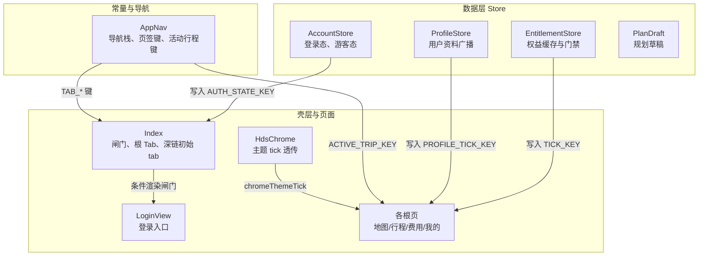
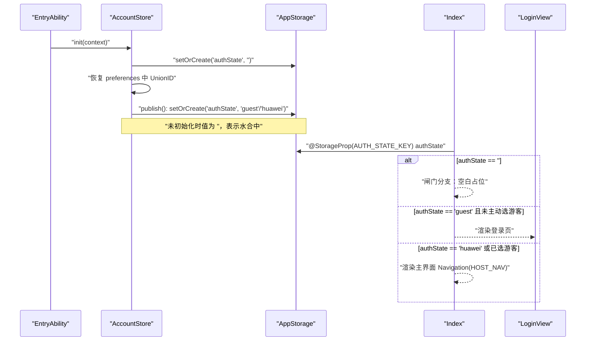
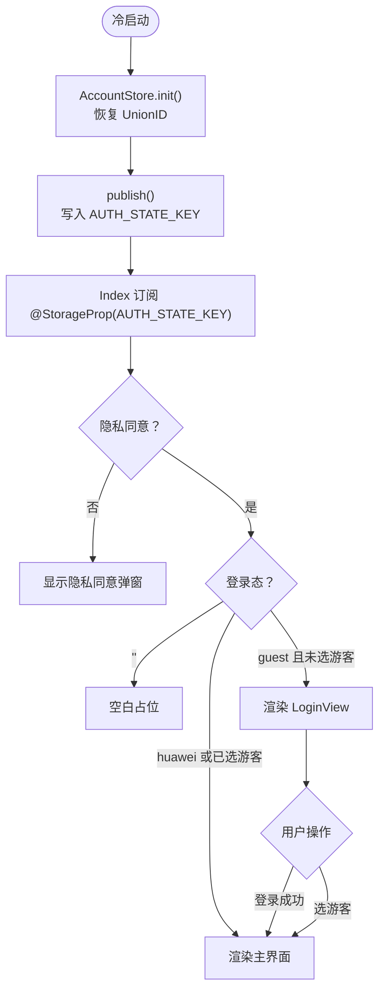
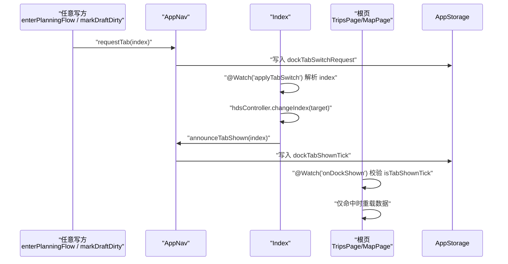
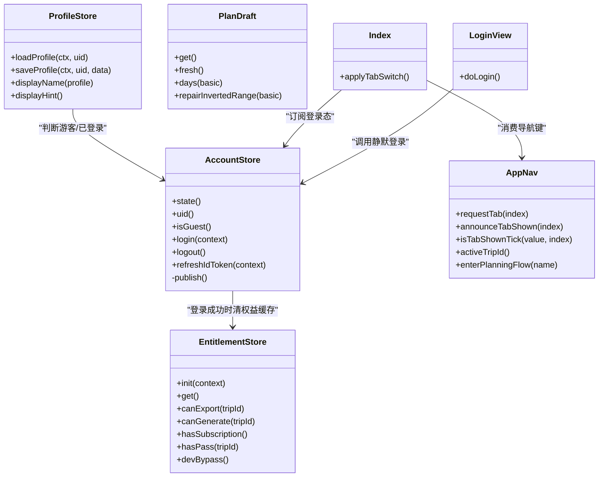

# AppStorage 全局状态

<cite>
**本文引用的文件**   
- [AccountStore.ets](file://entry/src/main/ets/data/AccountStore.ets)
- [EntitlementStore.ets](file://entry/src/main/ets/data/EntitlementStore.ets)
- [ProfileStore.ets](file://entry/src/main/ets/data/ProfileStore.ets)
- [PlanDraft.ets](file://entry/src/main/ets/data/PlanDraft.ets)
- [AppNav.ets](file://entry/src/main/ets/common/constants/AppNav.ets)
- [Index.ets](file://entry/src/main/ets/pages/Index.ets)
- [LoginView.ets](file://entry/src/main/ets/pages/LoginView.ets)
- [HdsChrome.ets](file://entry/src/main/ets/design/HdsChrome.ets)
</cite>

## 目录
1. [引言](#引言)
2. [项目结构](#项目结构)
3. [核心组件](#核心组件)
4. [架构总览](#架构总览)
5. [关键组件详解](#关键组件详解)
6. [依赖关系分析](#依赖关系分析)
7. [性能与渲染优化](#性能与渲染优化)
8. [故障排查指南](#故障排查指南)
9. [结论](#结论)
10. [附录：状态键清单与最佳实践](#附录状态键清单与最佳实践)

## 引言
本文聚焦 HarmonyOS ArkUI 应用中基于 `AppStorage` 的全局状态管理。仓库采用“数据层 Store + 页面订阅”的单向数据流模式：账户、权益、导航、主题等全局状态由 Store 写入 `AppStorage`，页面通过 `@StorageProp` / `@StorageLink` 订阅，并通过 `@Watch` 处理变更；闸门组件（登录态、隐私同意）在状态水合完成前不渲染主界面，避免冷启闪烁和空态 UI。

重点包括：
- 登录态广播键 `AUTH_STATE_KEY` 的工作机制。
- `@StorageProp` 装饰器的只读订阅、状态水合与闸门控制。
- `@Watch` 监听更新策略及避免不必要重新渲染的技巧。
- 跨组件状态同步：账户、导航、资料、主题。
- 命名规范、初始化时机、错误处理与内存管理建议。

## 项目结构
与 AppStorage 全局状态直接相关的代码集中在以下层次：

图表来源
- [AccountStore.ets:1-213](file://entry/src/main/ets/data/AccountStore.ets#L1-L213)
- [EntitlementStore.ets:1-235](file://entry/src/main/ets/data/EntitlementStore.ets#L1-L235)
- [ProfileStore.ets:1-166](file://entry/src/main/ets/data/ProfileStore.ets#L1-L166)
- [PlanDraft.ets:1-77](file://entry/src/main/ets/data/PlanDraft.ets#L1-L77)
- [AppNav.ets:1-221](file://entry/src/main/ets/common/constants/AppNav.ets#L1-L221)
- [Index.ets:700-1018](file://entry/src/main/ets/pages/Index.ets#L700-L1018)
- [LoginView.ets:1-237](file://entry/src/main/ets/pages/LoginView.ets#L1-L237)
- [HdsChrome.ets:1-294](file://entry/src/main/ets/design/HdsChrome.ets#L1-L294)

章节来源
- [AccountStore.ets:1-213](file://entry/src/main/ets/data/AccountStore.ets#L1-L213)
- [AppNav.ets:1-221](file://entry/src/main/ets/common/constants/AppNav.ets#L1-L221)
- [Index.ets:700-1018](file://entry/src/main/ets/pages/Index.ets#L700-L1018)

## 核心组件
本仓全局状态由四个 Store 和一个导航常量模块构成，它们共同决定应用进入哪个闸门分支、显示哪个页签以及是否刷新列表或主题。

| 组件 | 职责 | 主要 AppStorage 键 | 典型消费者 |
|---|---|---|---|
| AccountStore | 静默登录、游客兜底、UID 分区、idToken 刷新 | `AUTH_STATE_KEY` | Index 闸门、MinePage、ProfileStore |
| EntitlementStore | 配额快照合并、生成/导出门禁、TTL 缓存 | `entitlementTick` | MinePage、PricingPage、生成入口 |
| ProfileStore | 用户资料读写、资料区广播 | `profileTick` | MinePage、ProfileEditPage |
| PlanDraft | 向导流程中的草稿状态、日期修复、天数口径 | 无 AppStorage 键，纯内存单例 | YoujingStartPage、TripInputPage、生成页 |
| AppNav | 多栈导航、页签序号、活动行程、草稿脏标记 | `dockTabIndex`、`dockTabSwitchRequest`、`dockTabShownTick`、`activeTripId`、`planDraftDirty` | Index、各根页、路由跳转工具 |

章节来源
- [AccountStore.ets:1-213](file://entry/src/main/ets/data/AccountStore.ets#L1-L213)
- [EntitlementStore.ets:1-235](file://entry/src/main/ets/data/EntitlementStore.ets#L1-L235)
- [ProfileStore.ets:1-166](file://entry/src/main/ets/data/ProfileStore.ets#L1-L166)
- [PlanDraft.ets:1-77](file://entry/src/main/ets/data/PlanDraft.ets#L1-L77)
- [AppNav.ets:1-221](file://entry/src/main/ets/common/constants/AppNav.ets#L1-L221)

## 架构总览
下图展示一次从冷启动到登录门闸完成的调用序列，以及 AppStorage 如何驱动渲染。

图表来源
- [AccountStore.ets:60-170](file://entry/src/main/ets/data/AccountStore.ets#L60-L170)
- [Index.ets:700-1018](file://entry/src/main/ets/pages/Index.ets#L700-L1018)
- [LoginView.ets:1-237](file://entry/src/main/ets/pages/LoginView.ets#L1-L237)

章节来源
- [AccountStore.ets:60-170](file://entry/src/main/ets/data/AccountStore.ets#L60-L170)
- [Index.ets:700-1018](file://entry/src/main/ets/pages/Index.ets#L700-L1018)

## 关键组件详解

### 登录态广播与闸门渲染：AUTH_STATE_KEY
`AccountStore` 是登录态唯一生产者：
- 初始化时先从 `preferences` 恢复 `UnionID`，设置内部当前账号状态。
- 通过私有方法 `publish()` 把当前登录态推入 `AppStorage`。
- 值有三种语义：
  - 空串：尚未完成水合，闸门不应画主界面。
  - `guest`：游客空间。
  - `huawei`：已登录华为账号。

`Index` 使用 `@StorageProp(AUTH_STATE_KEY)` 订阅该值，并在 `build()` 中做三向分支：
- 未同意隐私协议：弹出同意弹窗。
- 水合中：空白占位。
- 非已登录且未主动选择游客：显示 `LoginView`。
- 其他情况：渲染主界面并挂载 `Navigation(HOST_NAV)`。

图表来源
- [AccountStore.ets:60-170](file://entry/src/main/ets/data/AccountStore.ets#L60-L170)
- [Index.ets:700-1018](file://entry/src/main/ets/pages/Index.ets#L700-L1018)
- [LoginView.ets:1-237](file://entry/src/main/ets/pages/LoginView.ets#L1-L237)

要点说明：
- “未知”状态用于防止冷启闪登录页：如果初始化失败或尚未完成，闸门保持空白而不是误判为游客。
- `login()` 失败不会抛错，而是退回游客态，保证没有华为账号或网络异常的用户仍可进入应用。
- 登出时清空偏好、重置游客态并再次 `publish()`，使闸门重新进入登录引导。

章节来源
- [AccountStore.ets:60-170](file://entry/src/main/ets/data/AccountStore.ets#L60-L170)
- [Index.ets:700-1018](file://entry/src/main/ets/pages/Index.ets#L700-L1018)
- [LoginView.ets:1-237](file://entry/src/main/ets/pages/LoginView.ets#L1-L237)

### @StorageProp 的使用与状态水合
`@StorageProp` 是只读订阅装饰器。它适合“读取全局状态但不修改”的场景：
- `Index.authState` 只读 `AUTH_STATE_KEY`，并根据其值切换闸门分支。
- `Index.wantTab` 使用 `@StorageLink(TAB_INDEX_KEY)`，因为外部深链需要写回初始页签，但主逻辑仍由 `@StorageProp(TAB_SWITCH_KEY)` 配合 `@Watch` 触发运行期切页。
- 各根页用 `@StorageProp(TAB_SHOWN_KEY)` 订阅 dock 切回通知，在 `isTabShownTick` 匹配自身页签时才重取数据。

推荐用法总结：
- 只读全局配置、主题、断点、顶部条底色：优先 `@StorageProp`。
- 需要双向绑定或外部可写：才用 `@StorageLink`。
- 对可能不存在的全局键使用默认值，避免首次构建出现空引用。

章节来源
- [Index.ets:700-1018](file://entry/src/main/ets/pages/Index.ets#L700-L1018)
- [AppNav.ets:1-221](file://entry/src/main/ets/common/constants/AppNav.ets#L1-L221)

### @Watch 监听更新与避免不必要渲染
`@Watch` 是响应 `AppStorage` 变化的处理器。仓库中常见模式是：
1. 订阅一个带时间戳或索引前缀的值，例如 `dockTabShownTick`。
2. 在 `@Watch` 回调中先判断是否属于自己。
3. 再执行必要的数据重载或命令式刷新。

以导航状态为例：
- `AppNav.requestTab(index)` 写入 `dockTabSwitchRequest`，携带时间戳。
- `Index.applyTabSwitch()` 解析 index，校验范围，若与当前页签不同则调用控制器切换。
- 切完页签后调用 `announceTabShown(index)`，向各根页广播“这一格重新可见”。
- 根页如 `TripsPage`、`MapPage` 在 `onDockShown` 中判断 `isTabShownTick(dockTick, TAB_*)`，只有命中才重载数据。

图表来源
- [AppNav.ets:80-221](file://entry/src/main/ets/common/constants/AppNav.ets#L80-L221)
- [Index.ets:700-1018](file://entry/src/main/ets/pages/Index.ets#L700-L1018)

性能优化要点：
- 值带时间戳或页签下标，避免同值重复触发。
- 使用 `isTabShownTick` 精确过滤，避免所有根页都无条件重载。
- 命令式导航（`changeIndex`）与声明式状态（`currentTab`）分开，减少状态竞争。
- 对不需要参与渲染的计算结果放在私有字段，不放入 `@State`。

章节来源
- [AppNav.ets:80-221](file://entry/src/main/ets/common/constants/AppNav.ets#L80-L221)
- [Index.ets:700-1018](file://entry/src/main/ets/pages/Index.ets#L700-L1018)

### 跨组件状态同步：账户、导航、主题、资料
仓库通过多个 AppStorage 键实现跨组件同步：

| 状态类别 | 键或通道 | 写入方 | 读取方 | 行为 |
|---|---|---|---|---|
| 账户状态 | `AUTH_STATE_KEY` | `AccountStore.publish()` | `Index` | 闸门决定是否显示登录页或主界面 |
| 导航状态 | `dockTabIndex`、`dockTabSwitchRequest`、`dockTabShownTick` | 外部深链、`AppNav`、`Index` | `Index`、各根页 | 初始页签、运行期切页、切回重载 |
| 活动行程 | `activeTripId` | 行程编辑/删除流程 | 地图、费用根页 | 最近查看的行程作为默认目标 |
| 草稿脏标记 | `planDraftDirty` | 写草稿的一方 | 首页 | 首页只在特定时机刷新，避免按钮消失 |
| 资料广播 | `profileTick` | `ProfileStore.saveProfile()` | `MinePage` | 保存后即时回显昵称、简介 |
| 主题 tick | `chromeThemeTick` | `EntryAbility.seedDarkMode` | `HdsChrome`、页面标题组件 | 强制重建自绘标题内容，解决深浅档冻结 |

其中主题刷新是一个重要案例：官方 HDS 标题栏的自绘内容在浅深模式切换时不会自动重建，因此 `HdsChrome` 文档指出需要通过 `themeTick` 传入新的 `ComponentContent` 实例，让页面因 `@StorageProp` 变化而重建，从而刷新颜色。

章节来源
- [AccountStore.ets:60-170](file://entry/src/main/ets/data/AccountStore.ets#L60-L170)
- [AppNav.ets:80-221](file://entry/src/main/ets/common/constants/AppNav.ets#L80-L221)
- [ProfileStore.ets:1-166](file://entry/src/main/ets/data/ProfileStore.ets#L1-L166)
- [HdsChrome.ets:1-294](file://entry/src/main/ets/design/HdsChrome.ets#L1-L294)

### 页面订阅全局状态的示例路径
虽然本文不直接粘贴源码，但可通过以下路径定位具体实现：

| 场景 | 参考路径 | 说明 |
|---|---|---|
| 在闸门页面订阅登录态 | [Index.ets:705-706](file://entry/src/main/ets/pages/Index.ets#L705-L706) | `@StorageProp(AUTH_STATE_KEY) authState` |
| 在闸门分支中渲染登录页 | [Index.ets:978-990](file://entry/src/main/ets/pages/Index.ets#L978-L990) | 根据 `authState` 和 `consentAgreed` 渲染 |
| 登录成功后激活设备并进入主界面 | [LoginView.ets:110-170](file://entry/src/main/ets/pages/LoginView.ets#L110-L170) | 调用 `AccountStore.login` 和 `DeviceActivator.reactivate` |
| 根页订阅 dock 切回广播 | [TripsPage.ets:83-90](file://entry/src/main/ets/pages/TripsPage.ets#L83-L90)、[MapPage.ets:85-90](file://entry/src/main/ets/pages/MapPage.ets#L85-L90) | `@StorageProp(TAB_SHOWN_KEY) @Watch('onDockShown')` |
| 订阅活动行程 | [AppNav.ets:120-170](file://entry/src/main/ets/common/constants/AppNav.ets#L120-L170) | `activeTripId()` 读取 `activeTripId` |
| 订阅资料广播 | [ProfileStore.ets:40-120](file://entry/src/main/ets/data/ProfileStore.ets#L40-L120) | `PROFILE_TICK_KEY` 在保存后写入 |
| 主题 tick 透传 | [HdsChrome.ets:60-120](file://entry/src/main/ets/design/HdsChrome.ets#L60-L120) | `themeTick` 用于重建自绘标题内容 |

章节来源
- [Index.ets:700-1018](file://entry/src/main/ets/pages/Index.ets#L700-L1018)
- [LoginView.ets:1-237](file://entry/src/main/ets/pages/LoginView.ets#L1-L237)
- [AppNav.ets:80-221](file://entry/src/main/ets/common/constants/AppNav.ets#L80-L221)
- [ProfileStore.ets:1-166](file://entry/src/main/ets/data/ProfileStore.ets#L1-L166)
- [HdsChrome.ets:1-294](file://entry/src/main/ets/design/HdsChrome.ets#L1-L294)

## 依赖关系分析
数据层与表现层的依赖方向明确，遵循“页面 → data → common/config”的单向依赖：

图表来源
- [AccountStore.ets:1-213](file://entry/src/main/ets/data/AccountStore.ets#L1-L213)
- [EntitlementStore.ets:1-235](file://entry/src/main/ets/data/EntitlementStore.ets#L1-L235)
- [ProfileStore.ets:1-166](file://entry/src/main/ets/data/ProfileStore.ets#L1-L166)
- [PlanDraft.ets:1-77](file://entry/src/main/ets/data/PlanDraft.ets#L1-L77)
- [AppNav.ets:1-221](file://entry/src/main/ets/common/constants/AppNav.ets#L1-L221)
- [Index.ets:700-1018](file://entry/src/main/ets/pages/Index.ets#L700-L1018)
- [LoginView.ets:1-237](file://entry/src/main/ets/pages/LoginView.ets#L1-L237)

耦合与内聚评估：
- `AccountStore` 与 `EntitlementStore` 存在轻度耦合：登录成功后清除权益缓存，登出也清除。这是业务一致性的合理代价。
- `ProfileStore` 依赖 `AccountStore.isGuest()` 来决定显示名，但只读状态，不影响账户流程。
- `Index` 是全局状态的主要汇聚点，耦合度较高，但它是闸门和根布局的唯一入口，符合职责集中原则。
- `AppNav` 作为导航常量与工具模块，被多处引用，应保持稳定接口。

潜在风险：
- 若新增全局状态键，需要同步检查闸门、根页、主题、导航等消费点。
- `Index` 的闸门分支较多，新增登录态分支时应避免直接复制条件，可考虑抽取闸门判定函数。

章节来源
- [AccountStore.ets:1-213](file://entry/src/main/ets/data/AccountStore.ets#L1-L213)
- [EntitlementStore.ets:1-235](file://entry/src/main/ets/data/EntitlementStore.ets#L1-L235)
- [ProfileStore.ets:1-166](file://entry/src/main/ets/data/ProfileStore.ets#L1-L166)
- [AppNav.ets:1-221](file://entry/src/main/ets/common/constants/AppNav.ets#L1-L221)
- [Index.ets:700-1018](file://entry/src/main/ets/pages/Index.ets#L700-L1018)

## 性能与渲染优化
针对 AppStorage 全局状态，仓库已有若干性能意识：

1. **水合前不渲染主界面**  
   `AUTH_STATE_KEY` 在水合期间为空串，闸门只画空白，避免已登录用户冷启闪登录页。

2. **按需重载根页数据**  
   根页通过 `TAB_SHOWN_KEY` 和 `isTabShownTick` 判断是否轮到自己，避免每次切页都全量刷新。

3. **时间戳防抖**  
   `dockTabSwitchRequest`、`dockTabShownTick`、`planDraftDirty` 都携带时间戳，确保同一页签连切两次也能触发 `@Watch`，同时避免无意义重复。

4. **主题重建替代样式硬刷**  
   `HdsChrome` 通过 `themeTick` 换掉 `ComponentContent` 实例，解决系统深浅档切换时自绘标题颜色冻结问题。

5. **避免把计算结果放入 @State**  
   拖拽位移、速度、形变等中间量尽量放在私有字段；真正影响渲染的最小集合才放入 `@State`。

6. **命令式导航与声明式状态分离**  
   `Index` 使用 `hdsController.changeIndex` 切页，再用 `currentTab` 记录当前页签，减少状态竞争。

7. **偏好存储与 AppStorage 分层**  
   `AccountStore`、`EntitlementStore`、`ProfileStore` 持久化到 `preferences`，而运行时 UI 状态走 `AppStorage`，降低频繁 IO。

章节来源
- [Index.ets:700-1018](file://entry/src/main/ets/pages/Index.ets#L700-L1018)
- [AppNav.ets:80-221](file://entry/src/main/ets/common/constants/AppNav.ets#L80-L221)
- [HdsChrome.ets:1-294](file://entry/src/main/ets/design/HdsChrome.ets#L1-L294)

## 故障排查指南
常见问题与定位思路：

| 现象 | 可能原因 | 排查位置 |
|---|---|---|
| 冷启闪登录页 | 登录态未水合前渲染了登录界面 | [AccountStore.ets:100-170](file://entry/src/main/ets/data/AccountStore.ets#L100-L170)、[Index.ets:700-760](file://entry/src/main/ets/pages/Index.ets#L700-L760) |
| 登录后仍显示游客权限 | 权益缓存未清除或 TTL 导致误判 | [AccountStore.ets:140-170](file://entry/src/main/ets/data/AccountStore.ets#L140-L170)、[EntitlementStore.ets:120-235](file://entry/src/main/ets/data/EntitlementStore.ets#L120-L235) |
| 切页签后列表不刷新 | 未收到 `TAB_SHOWN_KEY` 或未命中 `isTabShownTick` | [AppNav.ets:100-160](file://entry/src/main/ets/common/constants/AppNav.ets#L100-L160) |
| 编辑资料后不生效 | 未写入 `PROFILE_TICK_KEY` 或 MinePage 未重载 | [ProfileStore.ets:100-166](file://entry/src/main/ets/data/ProfileStore.ets#L100-L166) |
| 深浅模式切换后标题颜色不变 | 未传入新 `themeTick` 或组件未重建 | [HdsChrome.ets:60-120](file://entry/src/main/ets/design/HdsChrome.ets#L60-L120) |
| 深链落到错误页签 | `TAB_INDEX_KEY` 与 `stackOfRoute`、`tabOfRoute` 不一致 | [AppNav.ets:160-221](file://entry/src/main/ets/common/constants/AppNav.ets#L160-L221) |

建议调试步骤：
1. 确认 Store 的 `init()` 是否先于任何页面读取 UID 或权限。
2. 打印 `AUTH_STATE_KEY` 的变化：空串 → guest/huawei。
3. 检查闸门分支是否按 `consentAgreed` 和 `authState` 顺序判断。
4. 对根页的 `onDockShown` 增加日志，确认 `isTabShownTick` 返回值。
5. 对 `activeTripId`、`profileTick`、`chromeThemeTick` 等同类型广播分别验证写入点和读取点。

章节来源
- [AccountStore.ets:100-170](file://entry/src/main/ets/data/AccountStore.ets#L100-L170)
- [EntitlementStore.ets:120-235](file://entry/src/main/ets/data/EntitlementStore.ets#L120-L235)
- [AppNav.ets:100-221](file://entry/src/main/ets/common/constants/AppNav.ets#L100-L221)
- [ProfileStore.ets:100-166](file://entry/src/main/ets/data/ProfileStore.ets#L100-L166)
- [HdsChrome.ets:60-120](file://entry/src/main/ets/design/HdsChrome.ets#L60-L120)
- [Index.ets:700-1018](file://entry/src/main/ets/pages/Index.ets#L700-L1018)

## 结论
仓库的 AppStorage 全局状态设计围绕“单一事实来源 + 闸门 + 广播”展开：
- `AccountStore` 负责登录态，通过 `AUTH_STATE_KEY` 驱动 `Index` 闸门。
- `AppNav` 统一维护导航栈、页签、活动行程和草稿标记。
- `EntitlementStore` 和 `ProfileStore` 通过独立广播键实现商业化门禁和用户资料同步。
- 页面侧使用 `@StorageProp` 订阅、`@Watch` 精准处理，避免全量重渲染。

这套机制在冷启稳定性、跨页同步、主题切换等方面都有明确实现；未来扩展新全局状态时，建议沿用 Store 发布、页面订阅、带时间戳广播、闸门隔离的模式。

## 附录：状态键清单与最佳实践

### 状态键清单
| 键 | 所属模块 | 类型 | 用途 |
|---|---|---|---|
| `AUTH_STATE_KEY` | AccountStore | string | 登录态广播：空串/guest/huawei |
| `entitlementTick` | EntitlementStore | number/string | 权益变更广播 |
| `profileTick` | ProfileStore | number | 用户资料保存后广播 |
| `dockTabIndex` | AppNav | number | 外部深链初始页签 |
| `dockTabSwitchRequest` | AppNav | string | 运行期切页请求 |
| `dockTabShownTick` | AppNav | string | dock 切回广播 |
| `activeTripId` | AppNav | string | 最近打开的行程 ID |
| `planDraftDirty` | AppNav | string | 草稿是否可续 |
| `chromeThemeTick` | HdsChrome / EntryAbility | number | 主题档位变化，触发标题重建 |

章节来源
- [AccountStore.ets:40-80](file://entry/src/main/ets/data/AccountStore.ets#L40-L80)
- [EntitlementStore.ets:1-120](file://entry/src/main/ets/data/EntitlementStore.ets#L1-L120)
- [ProfileStore.ets:30-80](file://entry/src/main/ets/data/ProfileStore.ets#L30-L80)
- [AppNav.ets:80-170](file://entry/src/main/ets/common/constants/AppNav.ets#L80-L170)
- [HdsChrome.ets:60-120](file://entry/src/main/ets/design/HdsChrome.ets#L60-L120)

### 最佳实践
1. **状态键命名规范**  
   - 使用小驼峰或带语义前缀，如 `authState`、`dockTabShownTick`、`activeTripId`。
   - 广播键建议以 `Key` 结尾或在注释中标明“广播键”，避免与本地变量混淆。
   - 与功能域一致的命名，如 `profileTick`、`entitlementTick`。

2. **初始化时机**  
   - 所有依赖 UID 的分片（行程、资料、偏好）应在 Ability 启动阶段先 `AccountStore.init()`。
   - 权益缓存初始化应早于生成入口，避免首次生成就误判付费墙。

3. **错误处理**  
   - 登录失败不抛错，退回游客态，但记录日志。
   - 偏好读取失败应降级到默认值，不让 UI 中断。
   - 权益缓存过期不等于没额度，应允许后续服务端校验。

4. **内存管理**  
   - 全局状态本身不宜过大；大对象放 RDB/本地文件，AppStorage 只存标识或轻量快照。
   - 临时中间状态放组件私有字段，不要全部升为 `@State`。
   - 登出时清理敏感临时数据，如 idToken、会话票据。

5. **单向数据流**  
   - Store 写 AppStorage，页面只读。
   - 页面间通信通过 AppStorage 广播，而不是互相持有对方实例。
   - 导航与业务状态分离：导航栈归 `AppNav`，业务数据归对应 DAO/Store。

6. **避免不必要的重新渲染**  
   - 使用 `@Watch` 做增量处理，而不是在回调里直接设 `@State` 触发整树重建。
   - 对同值广播使用时间戳或页签下标过滤。
   - 主题、标题等复杂组件通过换实例重建，而不是反复强刷样式。

章节来源
- [AccountStore.ets:1-213](file://entry/src/main/ets/data/AccountStore.ets#L1-L213)
- [EntitlementStore.ets:1-235](file://entry/src/main/ets/data/EntitlementStore.ets#L1-L235)
- [ProfileStore.ets:1-166](file://entry/src/main/ets/data/ProfileStore.ets#L1-L166)
- [PlanDraft.ets:1-77](file://entry/src/main/ets/data/PlanDraft.ets#L1-L77)
- [AppNav.ets:1-221](file://entry/src/main/ets/common/constants/AppNav.ets#L1-L221)
- [Index.ets:700-1018](file://entry/src/main/ets/pages/Index.ets#L700-L1018)