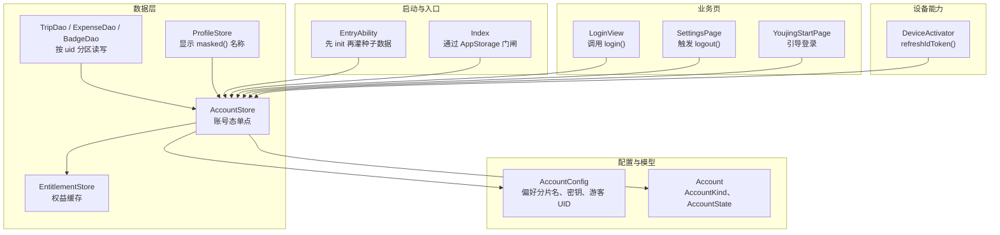
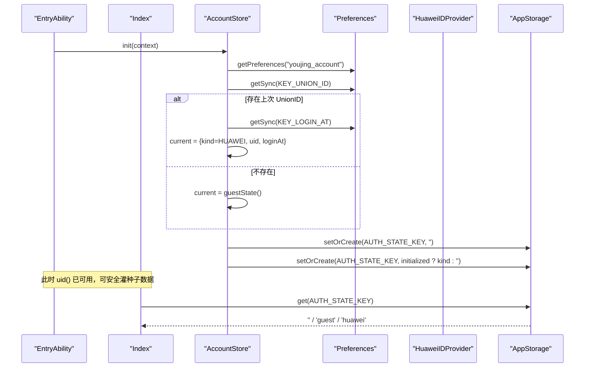
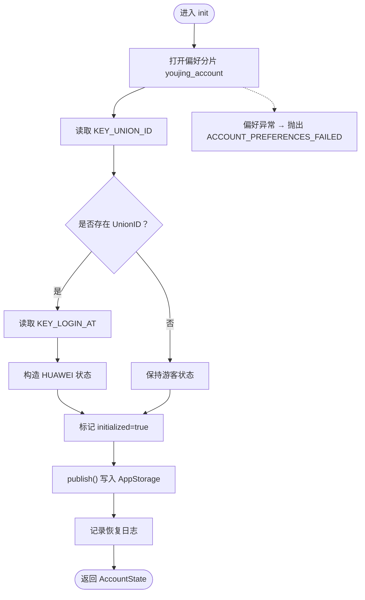
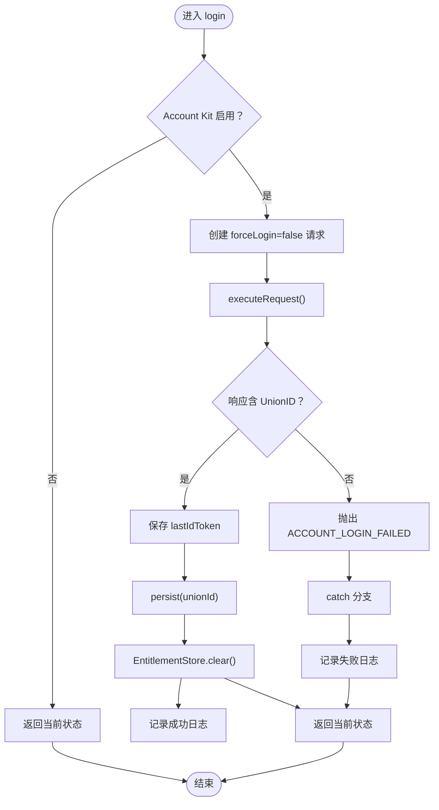
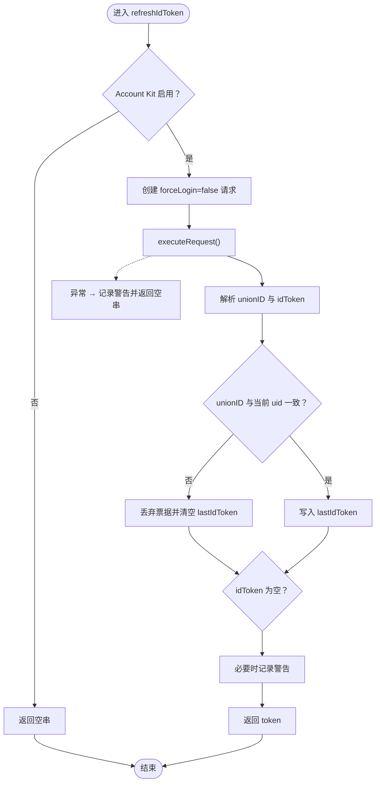
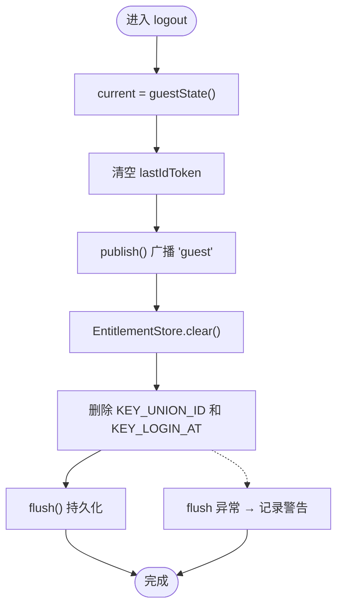
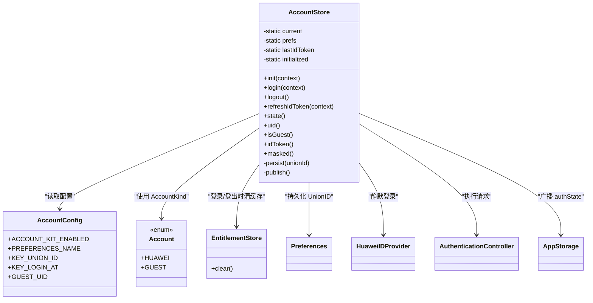

# AccountStore 账号态管理

<cite>
**本文引用的文件**   
- [AccountStore.ets](file://entry/src/main/ets/data/AccountStore.ets)
- [AccountConfig.ets](file://entry/src/main/ets/common/config/AccountConfig.ets)
- [Account.ets](file://entry/src/main/ets/model/Account.ets)
- [EntitlementStore.ets](file://entry/src/main/ets/data/EntitlementStore.ets)
- [EntryAbility.ets](file://entry/src/main/ets/entryability/EntryAbility.ets)
- [Index.ets](file://entry/src/main/ets/pages/Index.ets)
- [LoginView.ets](file://entry/src/main/ets/pages/LoginView.ets)
- [SettingsPage.ets](file://entry/src/main/ets/pages/SettingsPage.ets)
- [YoujingStartPage.ets](file://entry/src/main/ets/pages/YoujingStartPage.ets)
- [DeviceActivator.ets](file://entry/src/main/ets/data/DeviceActivator.ets)
</cite>

## 目录
1. [引言](#引言)
2. [项目结构中的位置](#项目结构中的位置)
3. [核心组件](#核心组件)
4. [架构总览](#架构总览)
5. [关键方法详解](#关键方法详解)
6. [依赖关系分析](#依赖关系分析)
7. [性能与一致性考量](#性能与一致性考量)
8. [故障排查指南](#故障排查指南)
9. [常用操作示例](#常用操作示例)
10. [结论](#结论)

## 引言
AccountStore 是应用内唯一的账号态单点，负责华为账号静默登录、游客模式兜底、UnionID 持久化以及 idToken 的内存管理。它把“当前分区键 uid”和“登录态 kind”暴露给 DAO、页面和门闸逻辑；对外契约强调：

- login() 永不向调用方抛错；取不到 UnionID 时退回本机游客分区。
- uid() 同步可读，供 RDB 打分区键，因此 init() 必须在首次读写行程之前完成。
- 只持久化 UnionID，不写入手机号、邮箱等敏感字段。
- idToken 仅用于设备激活身份校验，不落盘、不打印完整值。

## 项目结构中的位置
AccountStore 位于 `entry/src/main/ets/data`，属于数据层基础设施。它与以下模块协作：



**图表来源**
- [AccountStore.ets:1-213](file://entry/src/main/ets/data/AccountStore.ets#L1-L213)
- [AccountConfig.ets:1-29](file://entry/src/main/ets/common/config/AccountConfig.ets#L1-L29)
- [Account.ets:1-20](file://entry/src/main/ets/model/Account.ets#L1-L20)
- [EntryAbility.ets:811](file://entry/src/main/ets/entryability/EntryAbility.ets#L811)
- [Index.ets:272](file://entry/src/main/ets/pages/Index.ets#L272)
- [LoginView.ets:83](file://entry/src/main/ets/pages/LoginView.ets#L83)
- [SettingsPage.ets:74](file://entry/src/main/ets/pages/SettingsPage.ets#L74)
- [YoujingStartPage.ets:207](file://entry/src/main/ets/pages/YoujingStartPage.ets#L207)
- [DeviceActivator.ets:54](file://entry/src/main/ets/data/DeviceActivator.ets#L54)

**章节来源**
- [AccountStore.ets:1-25](file://entry/src/main/ets/data/AccountStore.ets#L1-L25)
- [AccountConfig.ets:1-29](file://entry/src/main/ets/common/config/AccountConfig.ets#L1-L29)

## 核心组件
AccountStore 以静态类形态提供全局状态，内部维护三个关键静态字段：

| 字段 | 类型 | 职责 | 是否持久化 |
|---|---|---|---|
| `current` | `AccountState` | 当前账号快照，包含分区键 uid、账号种类 kind、登录时间 loginAt | 否，但由 persist()/init() 驱动偏好存储 |
| `prefs` | `preferences.Preferences` | 上次 init() 打开的偏好分片句柄 | 否，仅复用句柄 |
| `lastIdToken` | `string` | 最近一次静默登录返回的 idToken，用于设备激活 | 否，进程内存中持有 |

常量 `AUTH_STATE_KEY = 'authState'` 将登录态广播到 `AppStorage`，供 UI 门闸消费。其语义为三值：

| `authState` 值 | 含义 | 使用场景 |
|---|---|---|
| `''`（空串） | 未知 | init() 尚未完成，根闸门不渲染已登录内容 |
| `'guest'` | 游客 | 未登录或静默登录失败，保留本地数据 |
| `'huawei'` | 已登录 | 成功拿到华为 UnionID |

**章节来源**
- [AccountStore.ets:27-43](file://entry/src/main/ets/data/AccountStore.ets#L27-L43)
- [AccountStore.ets:87-92](file://entry/src/main/ets/data/AccountStore.ets#L87-L92)
- [Account.ets:1-20](file://entry/src/main/ets/model/Account.ets#L1-L20)
- [AccountConfig.ets:15-29](file://entry/src/main/ets/common/config/AccountConfig.ets#L15-L29)

## 架构总览
AccountStore 的职责边界很清晰：它不直接访问数据库，而是提供分区键 uid；实际数据读写由 TripDao、ExpenseDao、BadgeDao、CheckinDao 等 DAO 完成。UI 侧则通过 `AppStorage.get(AUTH_STATE_KEY)` 做门闸判断。



**图表来源**
- [EntryAbility.ets:811](file://entry/src/main/ets/entryability/EntryAbility.ets#L811)
- [Index.ets:272](file://entry/src/main/ets/pages/Index.ets#L272)
- [AccountStore.ets:112-131](file://entry/src/main/ets/data/AccountStore.ets#L112-L131)
- [AccountStore.ets:87-92](file://entry/src/main/ets/data/AccountStore.ets#L87-L92)

## 关键方法详解

### init()：偏好分片初始化、上次登录态恢复、AppStorage 广播
init() 是应用生命周期中最早调用的账号方法。它的执行顺序如下：

1. 打开偏好分片 `youjing_account`，并缓存到静态字段 `prefs`。
2. 读取 `KEY_UNION_ID`。
3. 如果存在 UnionID，再读取 `KEY_LOGIN_AT`，构造 `AccountKind.HUAWEI` 状态的快照。
4. 如果不存在，保持游客状态。
5. 标记 `initialized = true`。
6. 调用 publish() 把三值状态写入 `AppStorage`。
7. 记录恢复日志，返回当前状态。

错误处理方面，init() 会捕获偏好读取异常并抛出 `AppError(ACCOUNT_PREFERENCES_FAILED)`，这是少数允许向上抛错的入口之一，因为偏好初始化失败意味着后续所有分区键都可能不可信。



**图表来源**
- [AccountStore.ets:112-131](file://entry/src/main/ets/data/AccountStore.ets#L112-L131)

**章节来源**
- [AccountStore.ets:112-131](file://entry/src/main/ets/data/AccountStore.ets#L112-L131)

### login()：静默获取 UnionID、持久化、清除权益缓存
login() 的核心目标是“静默登录”——不拉起账号界面，只尝试获取 UnionID。

流程要点：

- 若 `AccountConfig.ACCOUNT_KIT_ENABLED=false`，直接返回当前状态，保持本机游客分区。
- 创建 `HuaweiIDProvider` 和 `LoginWithHuaweiIDRequest`，设置 `forceLogin=false`。
- 通过 `AuthenticationController.executeRequest()` 获取响应。
- 若响应缺少 UnionID，抛出 `AppError(ACCOUNT_LOGIN_FAILED)`。
- 成功后更新 `lastIdToken`，调用 `persist(unionId)`，然后 `EntitlementStore.clear()`。
- catch 分支只记录警告日志，不向上抛错，最终返回当前状态。

这里有一个重要设计：即使静默登录失败，也不会中断首启流程；用户仍能以游客身份继续使用本地数据。



**图表来源**
- [AccountStore.ets:138-167](file://entry/src/main/ets/data/AccountStore.ets#L138-L167)

**章节来源**
- [AccountStore.ets:138-167](file://entry/src/main/ets/data/AccountStore.ets#L138-L167)

### refreshIdToken()：仅刷新票据，不改登录态、不清权益缓存
refreshIdToken() 不是通用登录接口，而是设备激活场景下的票据刷新。它必须满足：

- 不改 `current` 登录态。
- 不清 `EntitlementStore`。
- 只写内存中的 `lastIdToken`。
- 校验返回的 UnionID 与当前分区一致。

实现细节：

1. 若 `ACCOUNT_KIT_ENABLED=false`，直接返回空串。
2. 同样用 `forceLogin=false` 发起静默请求。
3. 解析响应中的 unionID 和 idToken。
4. 若 unionID 非空但与 `AccountStore.uid()` 不一致，说明当前分区身份被替换，主动丢弃本次票据并清空 `lastIdToken`。
5. 否则把 token 写入 `lastIdToken`。
6. 捕获异常后记录警告并返回空串。



**图表来源**
- [AccountStore.ets:50-86](file://entry/src/main/ets/data/AccountStore.ets#L50-L86)

**章节来源**
- [AccountStore.ets:50-86](file://entry/src/main/ets/data/AccountStore.ets#L50-L86)
- [DeviceActivator.ets:54](file://entry/src/main/ets/data/DeviceActivator.ets#L54)

### logout()：回到游客分区、清理持久化键
logout() 的目标是让账号回到游客状态，同时清理偏好中的登录相关键。

步骤：

1. 把 `current` 重置为 `guestState()`。
2. 清空 `lastIdToken`。
3. 调用 `publish()` 广播 `'guest'`。
4. 调用 `EntitlementStore.clear()` 清理权益缓存。
5. 删除 `KEY_UNION_ID` 和 `KEY_LOGIN_AT`。
6. flush 偏好存储。
7. 异常只记录警告，不抛错。

注意：登出不撤销隐私同意。隐私同意状态由其他模块管理，这与 SettingsPage 的登出通路保持一致。



**图表来源**
- [AccountStore.ets:174-200](file://entry/src/main/ets/data/AccountStore.ets#L174-L200)

**章节来源**
- [AccountStore.ets:174-200](file://entry/src/main/ets/data/AccountStore.ets#L174-L200)

### AUTH_STATE_KEY 三值语义与设计动机
`AUTH_STATE_KEY` 的值决定 UI 门闸行为：

| 值 | 含义 | 门闸行为 |
|---|---|---|
| `''` | 未知 | 根闸门不渲染已登录内容，避免冷启闪登录页 |
| `'guest'` | 游客 | 展示游客可见功能，UID 为 `local-guest` |
| `'huawei'` | 已登录 | 展示已登录功能和付费门闸 |

设计动机来自注释：Index 的根闸门要在状态水合完成前什么都不画，否则已登录用户每次冷启都会闪一下登录页。因此 init() 完成后才会从空串切换到真实值。

**章节来源**
- [AccountStore.ets:27-43](file://entry/src/main/ets/data/AccountStore.ets#L27-L43)
- [AccountStore.ets:87-92](file://entry/src/main/ets/data/AccountStore.ets#L87-L92)

### masked()：脱敏日志输出
masked() 用于日志和展示名称：

- 如果 uid 长度不超过 6，直接返回原值。
- 否则返回前 6 位加 `***`。
- ProfileStore 用它显示“登录后行程留在本机，换设备不同步”之类的文案。

这避免了把完整 UnionID 写入 hilog。

**章节来源**
- [AccountStore.ets:202-206](file://entry/src/main/ets/data/AccountStore.ets#L202-L206)
- [ProfileStore.ets:137](file://entry/src/main/ets/data/ProfileStore.ets#L137)
- [ProfileStore.ets:153](file://entry/src/main/ets/data/ProfileStore.ets#L153)

## 依赖关系分析
AccountStore 的依赖方向如下：



**图表来源**
- [AccountStore.ets:1-213](file://entry/src/main/ets/data/AccountStore.ets#L1-L213)
- [AccountConfig.ets:1-29](file://entry/src/main/ets/common/config/AccountConfig.ets#L1-L29)
- [Account.ets:1-20](file://entry/src/main/ets/model/Account.ets#L1-L20)
- [EntitlementStore.ets:172](file://entry/src/main/ets/data/EntitlementStore.ets#L172)

**章节来源**
- [AccountStore.ets:1-213](file://entry/src/main/ets/data/AccountStore.ets#L1-L213)
- [AccountConfig.ets:1-29](file://entry/src/main/ets/common/config/AccountConfig.ets#L1-L29)
- [Account.ets:1-20](file://entry/src/main/ets/model/Account.ets#L1-L20)

## 性能与一致性考量
- **同步读取 uid()**：DAO 层频繁调用 uid()，因此它是同步方法，避免在数据库查询路径引入异步抖动。
- **偏好分片复用**：init() 打开 preferences 后缓存到静态字段，避免每次持久化重复打开。
- **幂等初始化**：init() 多次调用不会覆盖已有状态，只会重新广播。
- **登录失败降级**：login() 失败时不抛错，保证首启链路不断；用户仍可继续本地游玩。
- **票据与登录态分离**：refreshIdToken() 不改变登录态，也不清权益缓存，避免误伤正常会话。
- **AppStorage 门闸**：UI 不轮询登录态，而是监听 `AUTH_STATE_KEY`，减少无效重绘。

[本节为通用性能建议，不直接分析具体代码行]

## 故障排查指南

| 现象 | 可能原因 | 排查建议 |
|---|---|---|
| 冷启闪登录页 | `AUTH_STATE_KEY` 过早变为真实值 | 确认 init() 未完成前 publish() 写入的是空串 |
| 已登录用户每次冷启都闪退 | 门闸逻辑在状态水合前渲染 | 检查 Index 对 `AUTH_STATE_KEY` 的判断 |
| 静默登录失败但仍能使用 | 符合预期 | login() 失败退回游客分区，不抛错 |
| 权限或签名问题导致静默失败 | Account Kit 证书指纹或 Client ID 配置错误 | 核对 AccountConfig 及 AGC 配置 |
| 刷新 idToken 返回空 | 未启用 Account Kit、网络异常、或返回 unionID 与当前分区不一致 | 查看 DeviceActivator 调用点和日志 |
| 登出后仍有旧 UnionID | 偏好 flush 失败或 prefs 句柄未初始化 | 检查 logout() 的 deleteSync 和 flush 日志 |
| 权益未刷新 | 登录或登出后未触发 EntitlementStore.clear() | 确认 AccountStore.login() 和 logout() 均调用了 clear() |

**章节来源**
- [AccountStore.ets:112-206](file://entry/src/main/ets/data/AccountStore.ets#L112-L206)
- [AccountConfig.ets:1-29](file://entry/src/main/ets/common/config/AccountConfig.ets#L1-L29)
- [DeviceActivator.ets:54](file://entry/src/main/ets/data/DeviceActivator.ets#L54)

## 常用操作示例

以下示例描述调用方式，不包含具体代码内容，便于开发者对照源码路径理解。

### 初始化
适用场景：应用启动、卡片进程独立初始化。

```text
const state = await AccountStore.init(context);
// 之后可安全调用 AccountStore.uid()、AccountStore.isGuest()
```

参考位置：

- [AccountStore.ets:112-131](file://entry/src/main/ets/data/AccountStore.ets#L112-L131)
- [EntryAbility.ets:811](file://entry/src/main/ets/entryability/EntryAbility.ets#L811)
- [Index.ets:272](file://entry/src/main/ets/pages/Index.ets#L272)

### 静默登录
适用场景：用户进入主流程前尝试自动登录。

```text
const state = await AccountStore.login(context);
if (AccountStore.isGuest()) {
  // 走游客流程
} else {
  // 已登录，uid 已持久化，权益缓存已清理
}
```

参考位置：

- [AccountStore.ets:138-167](file://entry/src/main/ets/data/AccountStore.ets#L138-L167)
- [LoginView.ets:83](file://entry/src/main/ets/pages/LoginView.ets#L83)
- [YoujingStartPage.ets:207](file://entry/src/main/ets/pages/YoujingStartPage.ets#L207)

### 令牌刷新
适用场景：设备激活需要携带最新 idToken。

```text
const token = await AccountStore.refreshIdToken(uiContext);
if (token.length > 0) {
  // 使用 token 作为设备激活证明
} else {
  // 降级：不使用票据或回退策略
}
```

参考位置：

- [AccountStore.ets:50-86](file://entry/src/main/ets/data/AccountStore.ets#L50-L86)
- [DeviceActivator.ets:54](file://entry/src/main/ets/data/DeviceActivator.ets#L54)

### 登出
适用场景：用户在设置页退出账号。

```text
await AccountStore.logout();
// 当前状态回到游客分区
// lastIdToken 已清空
// KEY_UNION_ID 与 KEY_LOGIN_AT 已从偏好中删除
```

参考位置：

- [AccountStore.ets:174-200](file://entry/src/main/ets/data/AccountStore.ets#L174-L200)
- [SettingsPage.ets:74](file://entry/src/main/ets/pages/SettingsPage.ets#L74)

### 读取当前分区键
适用于 DAO 层：

```text
const userId = AccountStore.uid();
// 写入 trip.user_id、expense.user_id、checkin.user_id 等
```

参考位置：

- [AccountStore.ets:96-110](file://entry/src/main/ets/data/AccountStore.ets#L96-L110)
- [TripDao.ets:61](file://entry/src/main/ets/data/TripDao.ets#L61)
- [ExpenseDao.ets:23](file://entry/src/main/ets/data/ExpenseDao.ets#L23)
- [CheckinDao.ets:35](file://entry/src/main/ets/data/CheckinDao.ets#L35)

## 结论
AccountStore 通过“UnionID 静默登录 + 游客兜底 + AppStorage 门闸”的组合，实现了低侵入、高容错的账号态管理。它把分区键 uid 作为数据隔离基础，把 `AUTH_STATE_KEY` 作为 UI 门闸信号，把 `lastIdToken` 限定在设备激活场景中。对于上层业务来说，最关键的约定是：优先调用 init()，然后通过 isGuest()/uid()/idToken() 判断当前身份，而不是直接依赖 UI 按钮状态。这样既能保证冷启稳定，又能让本地数据在静默登录失败时依然可用。