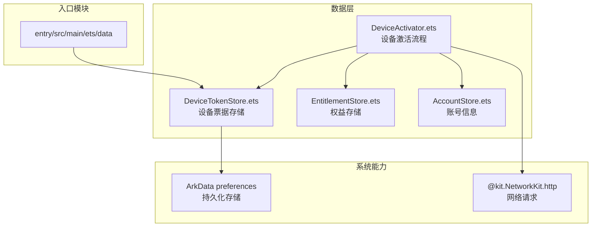
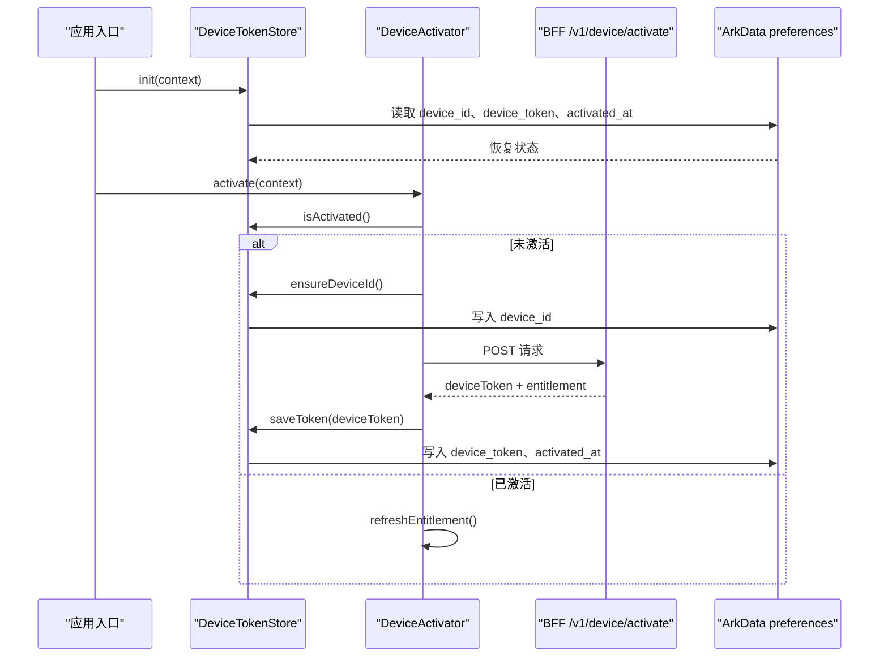
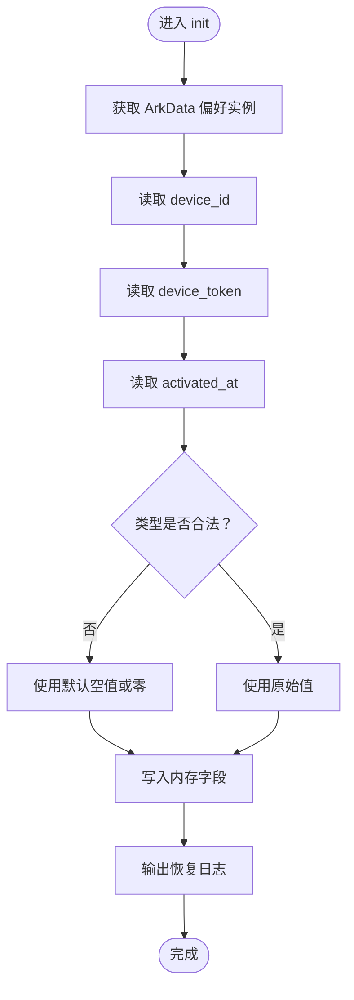
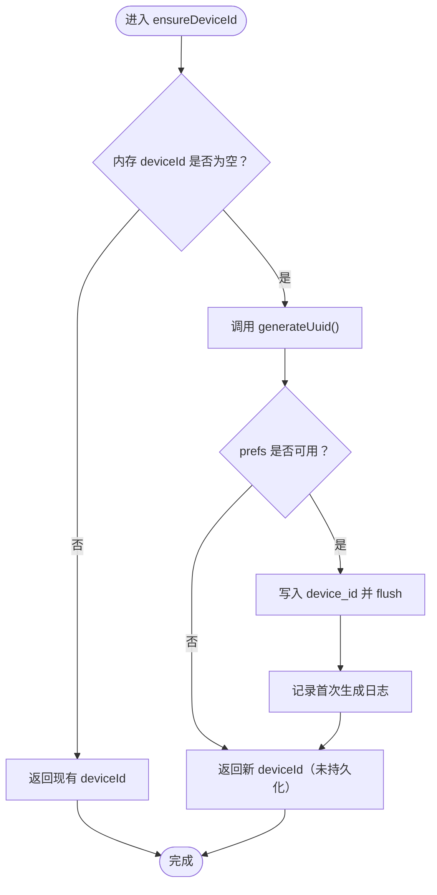
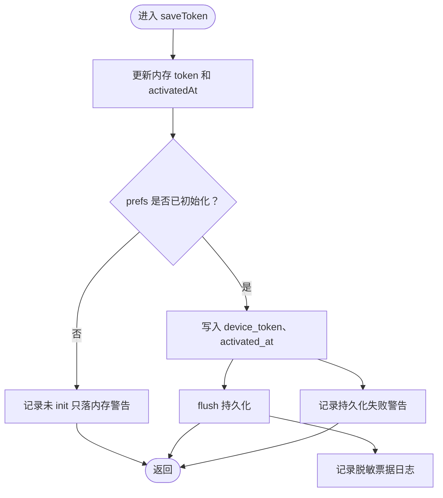
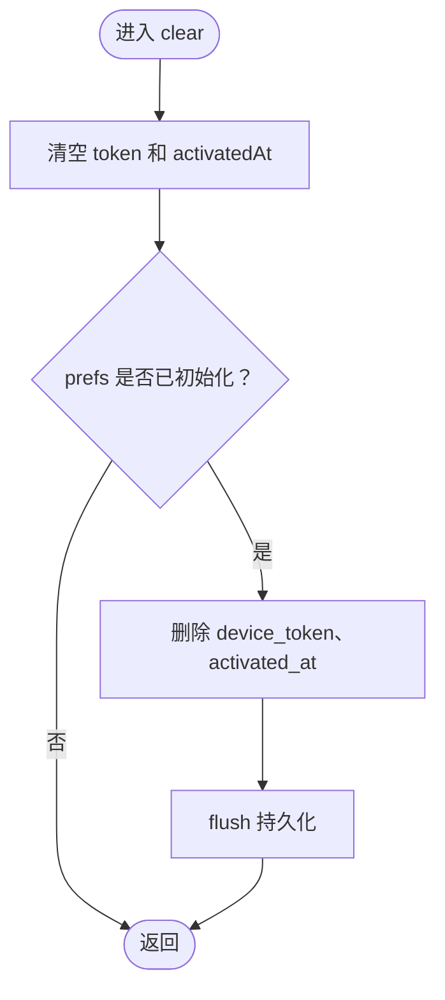
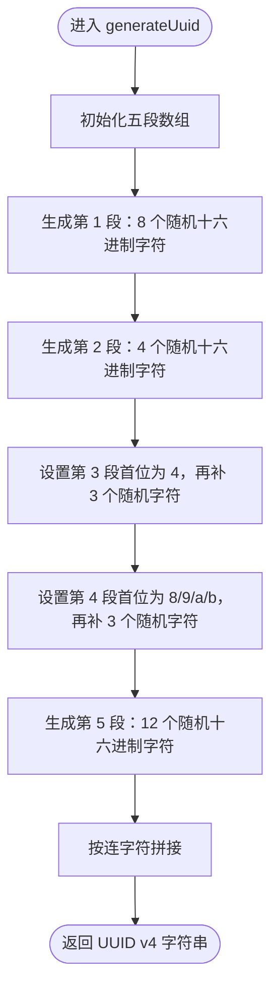
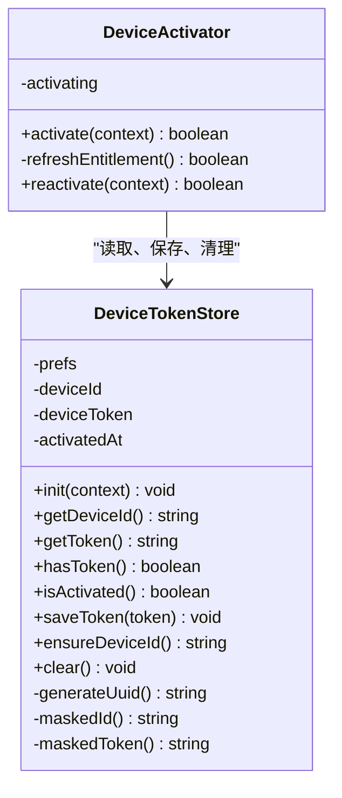

# DeviceTokenStore 设备票据

<cite>
**本文引用的文件**   
- [DeviceTokenStore.ets](file://entry/src/main/ets/data/DeviceTokenStore.ets)
- [DeviceActivator.ets](file://entry/src/main/ets/data/DeviceActivator.ets)
</cite>

## 目录
1. [引言](#引言)
2. [项目结构定位](#项目结构定位)
3. [核心组件总览](#核心组件总览)
4. [架构与调用关系](#架构与调用关系)
5. [详细方法分析](#详细方法分析)
6. [依赖与数据流](#依赖与数据流)
7. [性能与并发特性](#性能与并发特性)
8. [使用示例](#使用示例)
9. [故障排查](#故障排查)
10. [结论](#结论)

## 引言
`DeviceTokenStore` 是应用端商业化激活链路中的设备票据存储层，负责三类关键信息的生命周期管理：

- **设备标识 `deviceId`**：由客户端生成并持久化的 UUID v4，用于唯一标识本设备。
- **设备票据 `deviceToken`**：BFF `/v1/device/activate` 返回的 Bearer 票据，后续请求通过 Authorization 头携带。
- **激活时间戳 `activatedAt`**：记录票据落盘时间，配合 `deviceToken` 共同表达“已激活”状态。

该模块还暴露脱敏日志辅助方法 `maskedId()`、`maskedToken()`，以及清理方法 `clear()`，供票据失效后重新激活流程使用。

**章节来源**
- [DeviceTokenStore.ets:1-142](file://entry/src/main/ets/data/DeviceTokenStore.ets#L1-L142)

## 项目结构定位
`DeviceTokenStore` 位于入口模块的数据层：



**图表来源**
- [DeviceTokenStore.ets:1-142](file://entry/src/main/ets/data/DeviceTokenStore.ets#L1-L142)
- [DeviceActivator.ets:1-159](file://entry/src/main/ets/data/DeviceActivator.ets#L1-L159)

**章节来源**
- [DeviceTokenStore.ets:1-142](file://entry/src/main/ets/data/DeviceTokenStore.ets#L1-L142)
- [DeviceActivator.ets:1-159](file://entry/src/main/ets/data/DeviceActivator.ets#L1-L159)

## 核心组件总览
`DeviceTokenStore` 是一个静态单例风格的类，内部维护以下状态：

| 字段 | 类型 | 说明 |
|---|---|---|
| `prefs` | `preferences.Preferences` 或空 | ArkData 偏好存储实例，冷启动时恢复 |
| `deviceId` | `string` | 当前进程内存中的设备标识；首次为空时由 `ensureDeviceId()` 生成 |
| `deviceToken` | `string` | 当前进程内存中的 Bearer 票据 |
| `activatedAt` | `number` | 票据激活时间戳，毫秒级 |

常量键名：

| 常量 | 值 | 用途 |
|---|---|---|
| `PREFS_NAME` | `youjing_device` | ArkData 偏好集合名称 |
| `KEY_DEVICE_ID` | `device_id` | 持久化设备标识 |
| `KEY_DEVICE_TOKEN` | `device_token` | 持久化设备票据 |
| `KEY_ACTIVATED_AT` | `activated_at` | 持久化激活时间戳 |

该类对外暴露以下方法：

| 方法 | 返回值 | 行为摘要 |
|---|---|---|
| `init(context)` | `Promise<void>` | 从 ArkData 恢复 `deviceId`、`deviceToken`、`activatedAt` |
| `getDeviceId()` | `string` | 返回内存中的设备标识，可能为空 |
| `getToken()` | `string` | 返回内存中的票据，可能为空 |
| `hasToken()` | `boolean` | 检查是否存在非空票据 |
| `isActivated()` | `boolean` | 同时要求有票据和有效激活时间 |
| `saveToken(token)` | `Promise<void>` | 保存票据和激活时间，未初始化时只落内存并警告 |
| `ensureDeviceId()` | `Promise<string>` | 确保存在 `deviceId`，首次生成并持久化 |
| `clear()` | `Promise<void>` | 清除票据和激活时间，用于重新激活 |
| `generateUuid()` | `string` | 手写 UUID v4 生成算法（私有） |
| `maskedId()` | `string` | 脱敏后的设备标识（私有） |
| `maskedToken()` | `string` | 脱敏后的票据长度信息（私有） |

**章节来源**
- [DeviceTokenStore.ets:15-142](file://entry/src/main/ets/data/DeviceTokenStore.ets#L15-L142)

## 架构与调用关系
`DeviceTokenStore` 本身不发起网络请求，也不直接处理 BFF 错误码。它专注于“状态存取”，真正的激活流程由 `DeviceActivator` 驱动：



**图表来源**
- [DeviceTokenStore.ets:25-110](file://entry/src/main/ets/data/DeviceTokenStore.ets#L25-L110)
- [DeviceActivator.ets:29-121](file://entry/src/main/ets/data/DeviceActivator.ets#L29-L121)

**章节来源**
- [DeviceTokenStore.ets:1-142](file://entry/src/main/ets/data/DeviceTokenStore.ets#L1-L142)
- [DeviceActivator.ets:1-159](file://entry/src/main/ets/data/DeviceActivator.ets#L1-L159)

## 详细方法分析

### `init(context)`：从偏好存储恢复状态
`init()` 在应用启动阶段执行，主要职责是把 ArkData 中持久化的三个字段恢复到内存静态字段中：

1. 获取名为 `youjing_device` 的偏好实例。
2. 同步读取 `device_id`、`device_token`、`activated_at`。
3. 对读取结果做类型校验：字符串字段必须是字符串，时间戳必须是数字，否则回退为空字符串或零。
4. 输出恢复日志，其中设备标识和票据存在性均经过脱敏处理。
5. 若 ArkData 读取抛出异常，记录警告日志而不是中断应用启动。



**图表来源**
- [DeviceTokenStore.ets:25-45](file://entry/src/main/ets/data/DeviceTokenStore.ets#L25-L45)

**关键点**
- 恢复失败不会抛错，而是记录警告。
- 恢复的是进程内静态状态；磁盘上的键仍保留，除非显式调用 `clear()`。
- 如果应用之前从未生成过 `deviceId`，此时 `deviceId` 仍为空，直到调用 `ensureDeviceId()`。

**章节来源**
- [DeviceTokenStore.ets:25-45](file://entry/src/main/ets/data/DeviceTokenStore.ets#L25-L45)

### `ensureDeviceId()`：首次启动生成 UUID v4 设备标识
该方法保证进程内始终有一个设备标识：

1. 如果内存中的 `deviceId` 非空，直接返回。
2. 否则调用 `generateUuid()` 生成新的 UUID v4。
3. 如果已经初始化了 ArkData 偏好实例，则把新 ID 写入 `device_id` 并 flush。
4. 写入失败仅记录警告，不阻断返回。
5. 最终返回当前 `deviceId`。

这意味着：

- 首次冷启且尚未初始化 ArkData 时，会先落到内存，但不会持久化。
- 一旦成功初始化 ArkData，后续 `ensureDeviceId()` 会把生成的 ID 持久化。
- 应用重启后，`init()` 会优先恢复磁盘中的 `deviceId`，因此同一设备通常复用同一标识。



**图表来源**
- [DeviceTokenStore.ets:79-100](file://entry/src/main/ets/data/DeviceTokenStore.ets#L79-L100)

**章节来源**
- [DeviceTokenStore.ets:79-100](file://entry/src/main/ets/data/DeviceTokenStore.ets#L79-L100)

### `saveToken()`：保存 Bearer 票据和激活时间
`saveToken()` 的职责是保存 BFF `/v1/device/activate` 返回的票据：

1. 立即更新内存中的 `deviceToken` 和 `activatedAt`。
2. 检查是否已通过 `init()` 初始化 ArkData。
3. 如果未初始化，记录警告并只停留在内存中。
4. 如果已初始化，同步写入 `device_token` 和 `activated_at`，然后异步 flush。
5. 写入成功后记录脱敏后的票据日志。
6. 写入失败记录警告，但不抛出异常。

这个设计允许上层在极端情况下先把票据放在内存里，稍后再持久化；不过正常流程中，`DeviceActivator.activate()` 总是先确保 `DeviceTokenStore.init()` 已完成，因此生产环境通常会落盘。



**图表来源**
- [DeviceTokenStore.ets:53-73](file://entry/src/main/ets/data/DeviceTokenStore.ets#L53-L73)

**章节来源**
- [DeviceTokenStore.ets:53-73](file://entry/src/main/ets/data/DeviceTokenStore.ets#L53-L73)

### `hasToken()` 与 `isActivated()`：票据与激活状态
两个判断方法都基于内存状态：

| 方法 | 判断条件 | 语义 |
|---|---|---|
| `hasToken()` | `deviceToken.length > 0` | 内存中存在非空票据 |
| `isActivated()` | `deviceToken.length > 0` 且 `activatedAt > 0` | 既有票据又有激活时间 |

需要注意：

- `hasToken()` 不等于“已激活”。例如 `saveToken()` 未初始化时，可能有 token 但没有 `activatedAt`。
- `isActivated()` 更严格，适合用来决定是否可以直接用现有票据刷新权益。
- 这两个方法都没有访问 ArkData，所以它们是进程内快照，不是实时磁盘状态。

**章节来源**
- [DeviceTokenStore.ets:47-52](file://entry/src/main/ets/data/DeviceTokenStore.ets#L47-L52)

### `clear()`：清除票据用于重新激活
`clear()` 用于票据失效后的重新激活流程：

1. 清空内存中的 `deviceToken`。
2. 重置 `activatedAt` 为 0。
3. 如果 ArkData 已初始化，删除 `device_token` 和 `activated_at`。
4. 不调用 `deleteSync(KEY_DEVICE_ID)`，因此设备标识不会被清理。
5. 最终 flush 持久化。

这符合重新激活契约：旧票据作废，但设备标识保持不变，以便 BFF 能识别同一设备再次签发新票据。



**图表来源**
- [DeviceTokenStore.ets:102-121](file://entry/src/main/ets/data/DeviceTokenStore.ets#L102-L121)

**章节来源**
- [DeviceTokenStore.ets:102-121](file://entry/src/main/ets/data/DeviceTokenStore.ets#L102-L121)

### `generateUuid()`：手写 UUID v4 生成算法
该方法手动实现 UUID v4 的基本结构，分为五段十六进制部分：

| 段落 | 长度 | 特殊规则 |
|---|---:|---|
| 第 1 段 | 8 | 全随机 |
| 第 2 段 | 4 | 全随机 |
| 第 3 段 | 12 | 固定首位为 `4`，其余随机 |
| 第 4 段 | 12 | 固定首位为 `8`、`9`、`a` 或 `b`，其余随机 |
| 第 5 段 | 12 | 全随机 |

算法要点：

- 使用长度为 16 的十六进制字符表。
- 每段通过循环追加随机字符。
- 第三段强制以 `4` 开头，体现版本位。
- 第四段以 `[8,9,a,b]` 中随机一个字符开头，体现变体位。
- 最终拼接为 `xxxxxxxx-xxxx-xxxx-xxxx-xxxxxxxxxxxx` 形式。

这是轻量实现，没有引入第三方 UUID 库，便于在鸿蒙 ArkTS 环境中直接运行。



**图表来源**
- [DeviceTokenStore.ets:123-142](file://entry/src/main/ets/data/DeviceTokenStore.ets#L123-L142)

**合规性说明**
- 第三段首位为 `4`，对应 UUID v4 的版本位。
- 第四段首位为 `8`、`9`、`a` 或 `b`，对应 UUID v4 的变体位。
- 其他段均为十六进制随机值。
- 因此输出格式符合 UUID v4 的结构约定。

**章节来源**
- [DeviceTokenStore.ets:123-142](file://entry/src/main/ets/data/DeviceTokenStore.ets#L123-L142)

### `maskedId()` 与 `maskedToken()`：脱敏日志输出
这两个方法是私有辅助方法，用于避免在日志中泄露完整敏感信息：

| 方法 | 输入 | 输出规则 |
|---|---|---|
| `maskedId()` | `deviceId` | 长度不超过 8 时原样返回；否则返回前 8 位加 `***` |
| `maskedToken()` | `deviceToken` | 长度不超过 8 时返回“N 字符”；否则返回前 8 位加 `***(N 字符)` |

典型用途：

- `init()` 恢复日志中显示设备标识和设备票据是否存在。
- `ensureDeviceId()` 首次生成日志中显示脱敏设备标识。
- `saveToken()` 持久化日志中显示脱敏票据长度。

这种设计让运维人员可以观察票据是否生成、是否持久化，而不必在日志中打印完整 Bearer 票据。

**章节来源**
- [DeviceTokenStore.ets:39-45](file://entry/src/main/ets/data/DeviceTokenStore.ets#L39-L45)
- [DeviceTokenStore.ets:67-73](file://entry/src/main/ets/data/DeviceTokenStore.ets#L67-L73)
- [DeviceTokenStore.ets:92-99](file://entry/src/main/ets/data/DeviceTokenStore.ets#L92-L99)

## 依赖与数据流

### 外部依赖
| 依赖 | 用途 |
|---|---|
| `@kit.ArkData.preferences` | 持久化设备标识、票据和激活时间 |
| `@kit.AbilityKit.common.Context` | ArkData 初始化所需上下文 |
| `Logger` | 统一日志输出，支持 info 和 warn |

### 与 `DeviceActivator` 的关系
`DeviceActivator` 是主动方，`DeviceTokenStore` 是被动的状态容器：

- `DeviceActivator.activate()` 根据 `DeviceTokenStore.isActivated()` 决定是否需要完整激活。
- `DeviceActivator.activate()` 通过 `DeviceTokenStore.ensureDeviceId()` 获取或生成设备标识。
- `DeviceActivator.activate()` 通过 `DeviceTokenStore.saveToken()` 保存 BFF 返回的票据。
- `DeviceActivator.refreshEntitlement()` 遇到 401 时调用 `DeviceTokenStore.clear()` 清票。
- `DeviceActivator.reactivate()` 先清票再走完整激活。



**图表来源**
- [DeviceTokenStore.ets:15-142](file://entry/src/main/ets/data/DeviceTokenStore.ets#L15-L142)
- [DeviceActivator.ets:1-159](file://entry/src/main/ets/data/DeviceActivator.ets#L1-L159)

**章节来源**
- [DeviceTokenStore.ets:1-142](file://entry/src/main/ets/data/DeviceTokenStore.ets#L1-L142)
- [DeviceActivator.ets:1-159](file://entry/src/main/ets/data/DeviceActivator.ets#L1-L159)

## 性能与并发特性
- **同步 I/O**：`init()`、`ensureDeviceId()`、`saveToken()`、`clear()` 中对 ArkData 的操作使用 `getSync`、`putSync`、`deleteSync`，属于同步写入。这对小键值配置来说开销较低。
- **异步持久化**：所有写操作后都会调用 `await prefs.flush()`，将缓存刷到磁盘。
- **无锁并发模型**：类使用静态字段，没有内部互斥锁。理论上多个并发调用可能在极短时间内读到不一致的中间状态，但在应用主线程或有限异步任务场景下，实际风险较低。
- **幂等性**：`ensureDeviceId()` 已有内存缓存；重复调用不会重复生成 UUID。
- **可恢复性**：大部分错误路径使用 `Logger.warn` 而非抛错，避免单次持久化失败导致整个激活流程崩溃。

**章节来源**
- [DeviceTokenStore.ets:25-142](file://entry/src/main/ets/data/DeviceTokenStore.ets#L25-L142)

## 使用示例

### 示例一：应用启动时恢复设备标识和票据
适用场景：应用冷启动，先恢复 ArkData 中的设备标识、票据和激活时间。

```typescript
import { DeviceTokenStore } from './data/DeviceTokenStore';

// 在 Ability 或应用入口中调用
await DeviceTokenStore.init(context);
```

预期行为：

- 从 `youjing_device` 偏好集合恢复 `device_id`、`device_token`、`activated_at`。
- 若磁盘不存在这些键，对应字段保持空或零。
- 日志中输出恢复结果，其中敏感字段已脱敏。

**章节来源**
- [DeviceTokenStore.ets:25-45](file://entry/src/main/ets/data/DeviceTokenStore.ets#L25-L45)

### 示例二：获取设备标识
适用场景：需要向 BFF 发送 `deviceId`，但又不希望每次都生成新 ID。

```typescript
const deviceId = await DeviceTokenStore.ensureDeviceId();
```

预期行为：

- 如果 `init()` 已恢复 `deviceId`，直接返回。
- 如果是首次启动且 ArkData 可用，生成 UUID v4 并持久化。
- 如果 ArkData 尚未初始化，只保存在内存中，但仍会返回该 ID。

**章节来源**
- [DeviceTokenStore.ets:79-100](file://entry/src/main/ets/data/DeviceTokenStore.ets#L79-L100)

### 示例三：保存 BFF 返回的设备票据
适用场景：BFF `/v1/device/activate` 返回 `deviceToken` 后，将其存入本地。

```typescript
await DeviceTokenStore.saveToken(bffResponse.deviceToken);
```

预期行为：

- 更新内存中的 `deviceToken` 和 `activatedAt`。
- 如果已初始化 ArkData，持久化票据和激活时间。
- 如果未初始化，记录“未 init 就写 token，只落了内存”的警告。
- 日志中输出脱敏票据长度。

**章节来源**
- [DeviceTokenStore.ets:53-73](file://entry/src/main/ets/data/DeviceTokenStore.ets#L53-L73)

### 示例四：检查是否可以使用现有票据
适用场景：决定是否直接刷新权益，还是重新激活。

```typescript
if (DeviceTokenStore.isActivated()) {
  // 可以直接用现有票据刷新权益
} else {
  // 需要走完整激活流程
}
```

注意：

- `hasToken()` 只表示有票据。
- `isActivated()` 表示既有票据又有激活时间，更适合判断“可用票据”。

**章节来源**
- [DeviceTokenStore.ets:47-52](file://entry/src/main/ets/data/DeviceTokenStore.ets#L47-L52)

### 示例五：票据失效后清理并重试
适用场景：BFF 返回 401 或 6001，需要清除旧票据并重新激活。

```typescript
await DeviceTokenStore.clear();
const success = await DeviceActivator.activate(context);
```

预期行为：

- 清空内存中的 `deviceToken` 和 `activatedAt`。
- 删除 ArkData 中的 `device_token` 和 `activated_at`。
- 保留 `device_id`，使 BFF 仍可识别设备。
- 随后由 `DeviceActivator.activate()` 重新生成或复用 `deviceId`，并请求新票据。

**章节来源**
- [DeviceTokenStore.ets:102-121](file://entry/src/main/ets/data/DeviceTokenStore.ets#L102-L121)
- [DeviceActivator.ets:139-159](file://entry/src/main/ets/data/DeviceActivator.ets#L139-L159)

## 故障排查

### 问题一：设备标识每次重启变化
可能原因：

- `init()` 未被调用，ArkData 偏好集合未加载。
- 偏好集合损坏或权限不可读。
- 首次启动时 ArkData 尚未初始化，`ensureDeviceId()` 只落内存而未持久化。

排查建议：

1. 确认应用启动时调用了 `DeviceTokenStore.init(context)`。
2. 查看日志中是否有“设备标识读取失败”或“设备标识持久化失败”。
3. 检查 ArkData 偏好集合 `youjing_device` 中是否存在 `device_id`。

**章节来源**
- [DeviceTokenStore.ets:25-45](file://entry/src/main/ets/data/DeviceTokenStore.ets#L25-L45)
- [DeviceTokenStore.ets:79-100](file://entry/src/main/ets/data/DeviceTokenStore.ets#L79-L100)

### 问题二：票据存在但未激活
可能原因：

- `saveToken()` 在 `init()` 之前被调用，票据只落在内存，`activatedAt` 虽被赋值但后续持久化可能失败。
- ArkData 写入失败，`activated_at` 未落盘。
- 应用重启后只恢复了 `device_token`，但 `activated_at` 缺失或为零。

排查建议：

1. 确认调用顺序：先 `init()`，再 `saveToken()`。
2. 查看日志中是否有“设备票据持久化失败”。
3. 检查 `isActivated()` 返回值，不要仅依赖 `hasToken()`。

**章节来源**
- [DeviceTokenStore.ets:53-73](file://entry/src/main/ets/data/DeviceTokenStore.ets#L53-L73)
- [DeviceTokenStore.ets:47-52](file://entry/src/main/ets/data/DeviceTokenStore.ets#L47-L52)

### 问题三：票据一直失效
可能原因：

- BFF 侧认为票据无效，返回 401 或 6001。
- `DeviceActivator.refreshEntitlement()` 遇到 401，调用 `DeviceTokenStore.clear()` 清票。
- 重新激活过程中 `ensureDeviceId()` 或网络请求失败。

排查建议：

1. 查看 `DeviceActivator` 日志，确认是否触发“票据失效，重新激活”。
2. 确认 BFF 的 `/v1/device/activate` 是否正常返回 `deviceToken`。
3. 检查 `DeviceTokenStore.saveToken()` 是否成功持久化。
4. 确认 `clear()` 没有误删 `device_id`；当前实现只清除票据相关字段。

**章节来源**
- [DeviceActivator.ets:139-159](file://entry/src/main/ets/data/DeviceActivator.ets#L139-L159)
- [DeviceTokenStore.ets:102-121](file://entry/src/main/ets/data/DeviceTokenStore.ets#L102-L121)

### 问题四：日志泄露敏感信息
`DeviceTokenStore` 已内置脱敏逻辑：

- `maskedId()` 最多显示设备标识前 8 位。
- `maskedToken()` 最多显示票据前 8 位，并附带长度。
- 正常日志路径均使用脱敏值。

如果仍有泄露风险，应检查调用方是否在别处直接打印 `getToken()` 或 `getDeviceId()`。

**章节来源**
- [DeviceTokenStore.ets:39-45](file://entry/src/main/ets/data/DeviceTokenStore.ets#L39-L45)
- [DeviceTokenStore.ets:67-73](file://entry/src/main/ets/data/DeviceTokenStore.ets#L67-L73)
- [DeviceTokenStore.ets:92-99](file://entry/src/main/ets/data/DeviceTokenStore.ets#L92-L99)

## 结论
`DeviceTokenStore` 实现了设备票据存储的最小可行实现：以 ArkData 为持久化后端，以静态内存字段为快速访问层，围绕 `deviceId`、`deviceToken`、`activatedAt` 三个字段提供安全的读写接口。其设计重点包括：

- 通过 `init()` 在启动阶段恢复设备标识、票据和激活时间。
- 通过 `ensureDeviceId()` 保证设备标识存在且首次生成 UUID v4。
- 通过 `saveToken()` 保存 BFF 返回的 Bearer 票据和激活时间戳。
- 通过 `hasToken()` 和 `isActivated()` 区分“有票据”和“已激活”。
- 通过 `clear()` 安全清除票据，保留设备标识以支持重新激活。
- 通过手写 UUID v4 算法和脱敏日志，兼顾功能与安全性。

在商业化激活链路中，`DeviceTokenStore` 承担状态容器角色，真正复杂的网络交互、错误码处理和权益刷新则由 `DeviceActivator` 协调完成。两者组合形成了清晰的分层：网络与业务策略在上，票据存取在下。