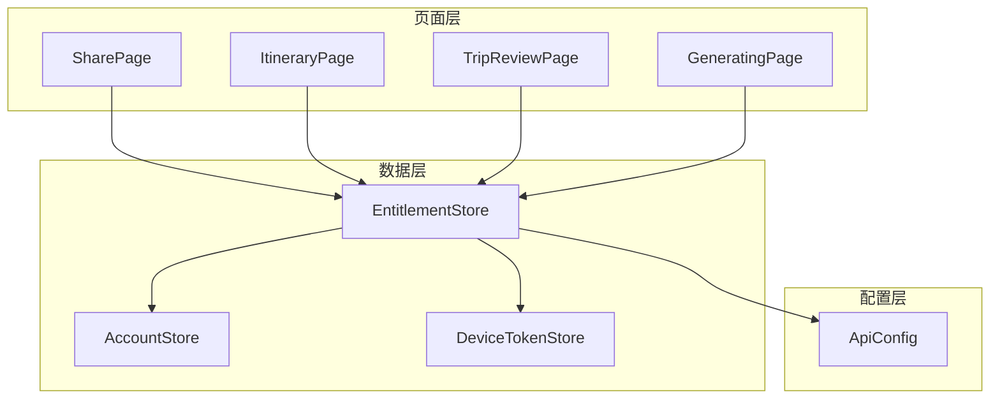
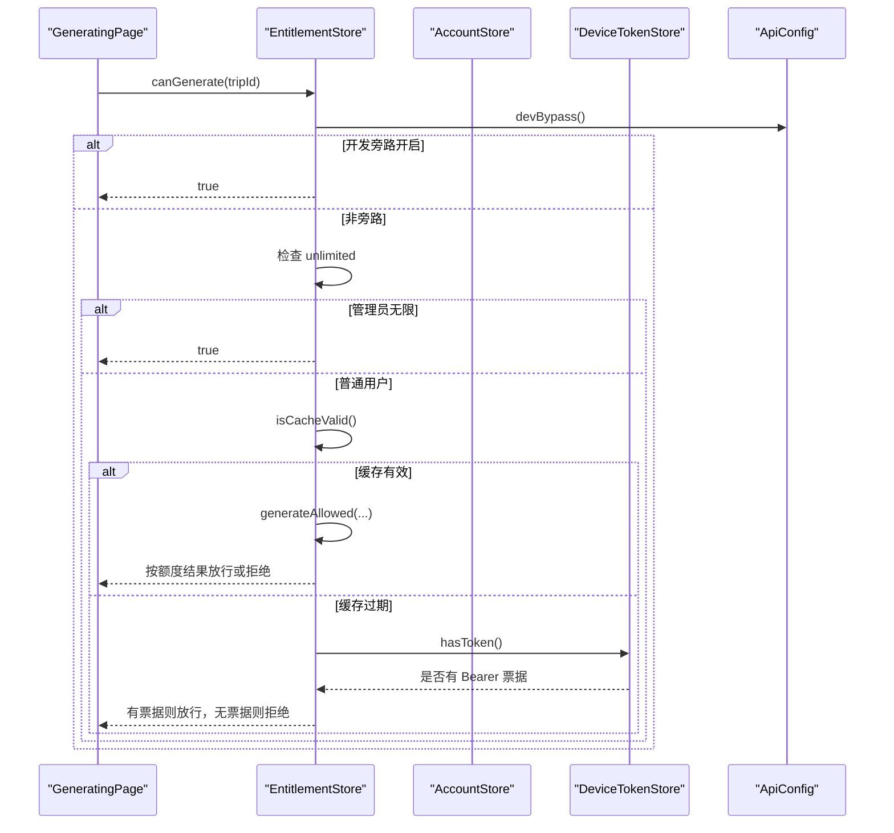
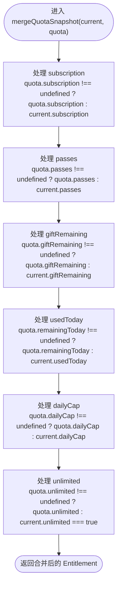
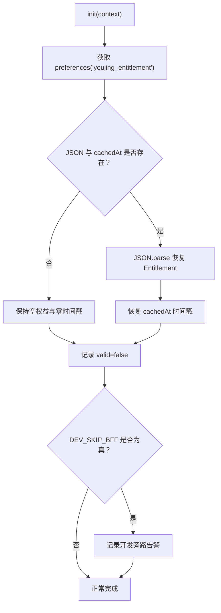
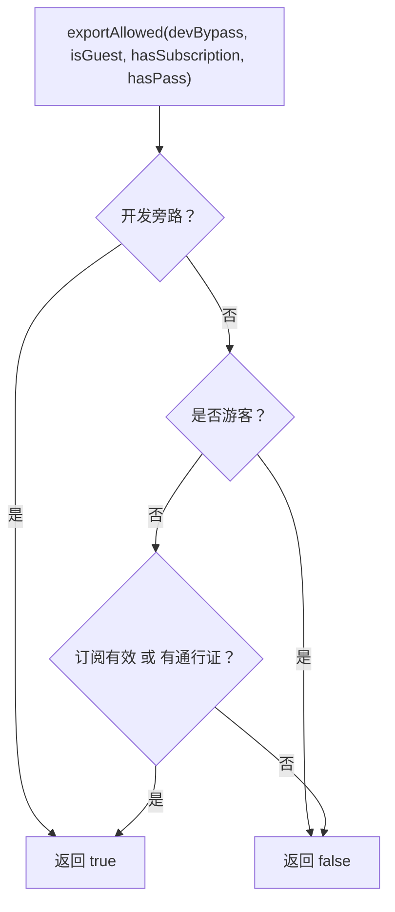
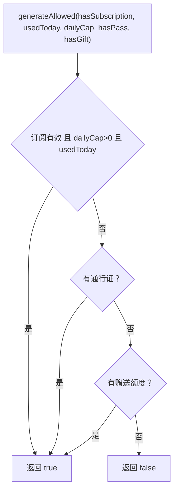
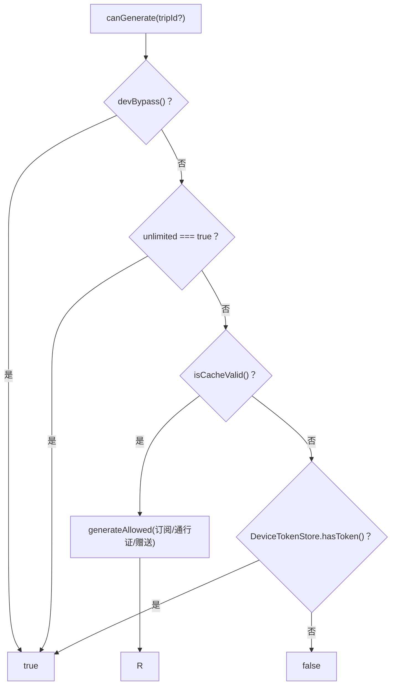
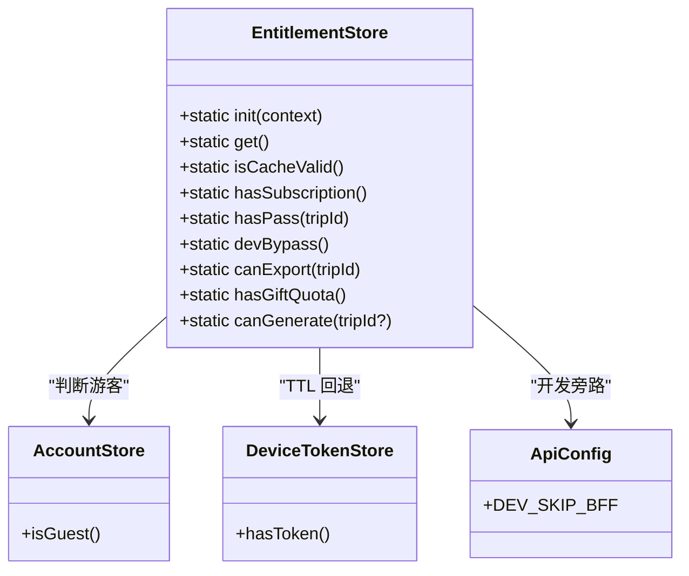

# EntitlementStore 权益缓存

<cite>
**本文引用的文件**   
- [EntitlementStore.ets](file://entry/src/main/ets/data/EntitlementStore.ets)
- [DeviceTokenStore.ets](file://entry/src/main/ets/data/DeviceTokenStore.ets)
- [ApiConfig.ets](file://entry/src/main/ets/common/config/ApiConfig.ets)
- [ItineraryPage.ets](file://entry/src/main/ets/pages/ItineraryPage.ets)
- [TripReviewPage.ets](file://entry/src/main/ets/pages/TripReviewPage.ets)
- [SharePage.ets](file://entry/src/main/ets/pages/SharePage.ets)
- [GeneratingPage.ets](file://entry/src/main/ets/pages/GeneratingPage.ets)
</cite>

## 目录
1. [引言](#引言)
2. [项目结构定位](#项目结构定位)
3. [核心组件](#核心组件)
4. [架构总览](#架构总览)
5. [详细组件分析](#详细组件分析)
6. [依赖关系分析](#依赖关系分析)
7. [性能与一致性考虑](#性能与一致性考虑)
8. [故障排查指南](#故障排查指南)
9. [结论](#结论)

## 引言
本文件面向商业化合约中“权益缓存与导出校验”这一关键子系统，聚焦 `EntitlementStore`：它负责把 BFF 返回的配额快照落盘到 ArkTS `preferences`，以 5 分钟 TTL 控制新鲜度，并提供两类付费墙判定入口——`canExport()` 用于导出分享，`canGenerate()` 用于行程生成。文档还解释开发旁路开关 `DEV_SKIP_BFF`、TTL 过期时的降级策略、以及服务端 quota 快照与本地权益的合并规则，帮助读者理解“为什么缓存过期不等于没额度”。

## 项目结构定位
`EntitlementStore` 位于端侧数据层 `entry/src/main/ets/data/`，属于商业化链路中的权益状态中枢。它与以下模块协作：
- `AccountStore`：判断是否游客账号。
- `DeviceTokenStore`：在权益缓存过期时作为“已激活设备”的回退信号。
- `ApiConfig`：提供 `DEV_SKIP_BFF` 开发旁路开关。
- 页面层 `SharePage`、`ItineraryPage`、`TripReviewPage`、`GeneratingPage`：调用 `canExport()` / `canGenerate()` 实现付费墙 UI 跳转。

**图表来源**
- [EntitlementStore.ets:1-200](file://entry/src/main/ets/data/EntitlementStore.ets#L1-L200)
- [ApiConfig.ets:1-66](file://entry/src/main/ets/common/config/ApiConfig.ets#L1-L66)
- [SharePage.ets:270-295](file://entry/src/main/ets/pages/SharePage.ets#L270-L295)
- [ItineraryPage.ets:430-440](file://entry/src/main/ets/pages/ItineraryPage.ets#L430-L440)
- [TripReviewPage.ets:160-170](file://entry/src/main/ets/pages/TripReviewPage.ets#L160-L170)
- [GeneratingPage.ets:110-120](file://entry/src/main/ets/pages/GeneratingPage.ets#L110-L120)

**章节来源**
- [EntitlementStore.ets:1-200](file://entry/src/main/ets/data/EntitlementStore.ets#L1-L200)
- [ApiConfig.ets:1-66](file://entry/src/main/ets/common/config/ApiConfig.ets#L1-L66)

## 核心组件
- **数据模型**
  - `PassInfo`：通行证信息，包含本地行程 ID、状态、到期时间。
  - `SubscriptionInfo`：订阅信息，包含状态、周期结束时间。
  - `Entitlement`：本地权益快照，包括订阅、通行证列表、赠送剩余次数、当日已用次数、每日上限、管理员无限额度标记。
  - `QuotaSnapshot`：BFF 返回的配额快照字段，端侧只消费其中几个关键字段。
- **纯函数判定**
  - `exportAllowed()`：导出付费墙纯逻辑，不含缓存新鲜度。
  - `generateAllowed()`：生成额度纯逻辑，支持订阅额度、通行证、赠送额度三条放行路径。
- **类接口**
  - `init()`：从 `preferences` 恢复 JSON 和 `cachedAt`，并记录 `DEV_SKIP_BFF`。
  - `get()`：读取内存中当前权益。
  - `isCacheValid()`：TTL 5 分钟检查。
  - `hasSubscription()` / `hasPass()`：查询订阅与通行证。
  - `devBypass()`：暴露开发旁路。
  - `canExport()` / `canGenerate()`：付费墙入口。

**章节来源**
- [EntitlementStore.ets:1-200](file://entry/src/main/ets/data/EntitlementStore.ets#L1-L200)

## 架构总览
下图展示一次“生成行程”过程中，`EntitlementStore.canGenerate()` 如何串联账户状态、设备票据、配额快照和 BFF 旁路开关：

**图表来源**
- [EntitlementStore.ets:120-200](file://entry/src/main/ets/data/EntitlementStore.ets#L120-L200)
- [ApiConfig.ets:35-66](file://entry/src/main/ets/common/config/ApiConfig.ets#L35-L66)
- [DeviceTokenStore.ets:1-142](file://entry/src/main/ets/data/DeviceTokenStore.ets#L1-L142)
- [GeneratingPage.ets:110-120](file://entry/src/main/ets/pages/GeneratingPage.ets#L110-L120)

## 详细组件分析

### 数据模型定义
| 模型 | 关键字段 | 职责说明 |
|---|---|---|
| `PassInfo` | `localTripId`、`status`、`expiresAt` | 描述某条本地行程持有的通行证；`status` 为 `active` 才视为有效。 |
| `SubscriptionInfo` | `status`、`periodEnd` | 描述订阅生命周期；仅 `status === 'active'` 算有效订阅。 |
| `Entitlement` | `subscription`、`passes`、`giftRemaining`、`usedToday`、`dailyCap`、`unlimited` | 端侧持久化的权益快照，供 UI 和付费墙使用。 |
| `QuotaSnapshot` | `subscription?`、`passes?`、`giftRemaining?`、`remainingToday?`、`dailyCap?`、`unlimited?` | BFF `/v1/entitlement` 返回的配额快照中端侧消费的部分字段。 |

这些模型共同构成“本地权益 + 服务端快照”的双源语义：本地保存历史权益，服务端快照决定权威更新。

**章节来源**
- [EntitlementStore.ets:20-65](file://entry/src/main/ets/data/EntitlementStore.ets#L20-L65)

### `mergeQuotaSnapshot()`：配额快照合并规则
该函数是本次商业化改造的核心之一，解决旧版 BFF 缺字段、退款后订阅应撤销、管理员权限只由服务端授予等问题。

**图表来源**
- [EntitlementStore.ets:66-96](file://entry/src/main/ets/data/EntitlementStore.ets#L66-L96)

合并规则要点：
1. **订阅明确为 `null` 时必须清掉本地值**：这是订阅到期或退款后，端上唯一能感知并清除本地订阅状态的通道。
2. **字段缺省沿用旧值**：如果 BFF 未回传某个字段（旧版本兼容），不能因为 `undefined` 就把已有权益抹掉。
3. **`unlimited` 只由服务端授予**：若服务端未回传 `unlimited`，只有本地已经是 `true` 时才保留；否则不凭空授予无限额度。
4. **`dailyCap` 以服务端为准**：避免端侧发版前出现“本地认为每月 20 次、服务端实际每天 20 次”之类的口径分歧。

**章节来源**
- [EntitlementStore.ets:66-96](file://entry/src/main/ets/data/EntitlementStore.ets#L66-L96)

### `init()`：偏好存储恢复与开发旁路
`init(context)` 承担三个职责：
1. 通过 `@kit.ArkData.preferences` 获取名为 `youjing_entitlement` 的偏好区。
2. 读取 `entitlement_json` 和 `cached_at`：若存在合法 JSON，则解析为 `Entitlement` 并恢复 `cachedAt`。
3. 记录日志，并在 `ApiConfig.DEV_SKIP_BFF` 为真时输出开发旁路警告。

初始化失败会走 catch 分支，仅记录警告而不抛异常，保证应用冷启动不因权益缓存损坏而崩溃。

**图表来源**
- [EntitlementStore.ets:98-138](file://entry/src/main/ets/data/EntitlementStore.ets#L98-L138)
- [ApiConfig.ets:35-66](file://entry/src/main/ets/common/config/ApiConfig.ets#L35-L66)

**章节来源**
- [EntitlementStore.ets:98-138](file://entry/src/main/ets/data/EntitlementStore.ets#L98-L138)
- [ApiConfig.ets:1-66](file://entry/src/main/ets/common/config/ApiConfig.ets#L1-L66)

### `exportAllowed()`：导出付费墙纯判定
职责边界非常清晰：**只判断“是否允许导出”，不关心缓存是否新鲜**。这是因为导出的是本机文件，服务端无法感知这次导出动作，因此不能因为“缓存过期”就禁止导出；但也不能让游客直接导出。

判定顺序：
1. 开发旁路开启 → 放行。
2. 游客账号 → 拒绝。
3. 非游客且持有有效订阅或对应行程通行证 → 放行。
4. 其他情况 → 拒绝。

调用方示例（不展示代码内容）：
- 分享页导出：[SharePage.ets:270-295](file://entry/src/main/ets/pages/SharePage.ets#L270-L295)
- 行程详情页导出：[ItineraryPage.ets:430-440](file://entry/src/main/ets/pages/ItineraryPage.ets#L430-L440)
- 行程复核页导出：[TripReviewPage.ets:160-170](file://entry/src/main/ets/pages/TripReviewPage.ets#L160-L170)

**图表来源**
- [EntitlementStore.ets:106-115](file://entry/src/main/ets/data/EntitlementStore.ets#L106-L115)

**章节来源**
- [EntitlementStore.ets:100-115](file://entry/src/main/ets/data/EntitlementStore.ets#L100-L115)
- [SharePage.ets:270-295](file://entry/src/main/ets/pages/SharePage.ets#L270-L295)
- [ItineraryPage.ets:430-440](file://entry/src/main/ets/pages/ItineraryPage.ets#L430-L440)
- [TripReviewPage.ets:160-170](file://entry/src/main/ets/pages/TripReviewPage.ets#L160-L170)

### `generateAllowed()`：生成额度判定
生成流程比导出更复杂，因为它要同时考虑“订阅额度窗口、通行证、赠送额度”。

放行优先级：
1. 订阅有效，且 `dailyCap > 0`，且 `usedToday < dailyCap` → 放行。
2. 即使订阅额度已满，只要当前行程有通行证 → 放行。
3. 以上都不满足，但有赠送额度 → 放行。
4. 否则拒绝。

注意：注释特别指出，旧实现会在订阅分支直接 return false，导致服务端根本没有机会按通行证放行；新实现拆出 `generateAllowed()` 后，通行证和赠送额度成为独立放行路径。

**图表来源**
- [EntitlementStore.ets:117-125](file://entry/src/main/ets/data/EntitlementStore.ets#L117-L125)

**章节来源**
- [EntitlementStore.ets:116-125](file://entry/src/main/ets/data/EntitlementStore.ets#L116-L125)

### `canExport()`：导出付费墙入口
`canExport(tripId)` 把纯判定与运行时上下文解耦：
- 注入 `devBypass()` 的结果。
- 通过 `AccountStore.isGuest()` 判断游客。
- 通过 `hasSubscription()` 和 `hasPass(tripId)` 判断票据。
- 最终委托给 `exportAllowed()`。

这意味着业务层只需传入一个行程 ID，不必重复拼装游客、订阅、通行证条件。

**章节来源**
- [EntitlementStore.ets:140-152](file://entry/src/main/ets/data/EntitlementStore.ets#L140-L152)

### `canGenerate()`：生成额度入口与 TTL 回退
`canGenerate(tripId?)` 是生成入口，也是本次修复“用户被永久锁在付费页”的关键位置。

决策顺序：
1. 开发旁路开启 → 放行。
2. 管理员白名单命中 (`unlimited === true`) → 放行。
3. 缓存无效 → 回退到 `DeviceTokenStore.hasToken()`：
   - 如果有 Bearer 票据，说明设备曾成功激活，不应因 TTL 过期永久拒登付费页。
   - 如果没有票据，说明从未激活或票据丢失，此时拒绝。
4. 缓存有效 → 使用 `generateAllowed()` 结合订阅额度、通行证、赠送额度做最终判断。

**图表来源**
- [EntitlementStore.ets:154-200](file://entry/src/main/ets/data/EntitlementStore.ets#L154-L200)
- [DeviceTokenStore.ets:1-142](file://entry/src/main/ets/data/DeviceTokenStore.ets#L1-L142)

**章节来源**
- [EntitlementStore.ets:154-200](file://entry/src/main/ets/data/EntitlementStore.ets#L154-L200)
- [DeviceTokenStore.ets:1-142](file://entry/src/main/ets/data/DeviceTokenStore.ets#L1-L142)

### TTL 5 分钟设计：过期不等于没额度
常量 `CACHE_TTL_MS = 5 * 60 * 1000` 表示权益缓存有效期为 5 分钟。设计上遵循以下原则：
- 5 分钟内优先使用本地缓存，减少 BFF 调用。
- 5 分钟后 `isCacheValid()` 返回 false，但 `canGenerate()` 不会直接判负。
- 回退到 `DeviceTokenStore.hasToken()`，利用“是否持有 Bearer 票据”判断用户是否已经过激活流程。
- 真正“没额度”的场景交给服务端：例如生成请求返回 402 时，端侧再跳转到付费页。

这种设计解决了 2026-11-03 端到端联调中发现的问题：过去 TTL 过期直接返回 false，叠加设备不再主动刷新权益的逻辑，会导致持有效票据的用户长期停在付费页。

**章节来源**
- [EntitlementStore.ets:14-25](file://entry/src/main/ets/data/EntitlementStore.ets#L14-L25)
- [EntitlementStore.ets:154-200](file://entry/src/main/ets/data/EntitlementStore.ets#L154-L200)

### 开发旁路 `DEV_SKIP_BFF`
`ApiConfig.DEV_SKIP_BFF` 是开发期安全阀：
- 当为真时，`canExport()` 和 `canGenerate()` 都会跳过付费墙。
- 仓库默认值与运行环境可能不同；`ApiConfig` 注释明确指出，仓库版通常为 false，本地开发机可覆盖。
- 它不仅是“放开付费墙”，还与 LLM 传输选择联动：BFF 未部署时，旁路还能让生成流程走到本地 Mock 路径。

**章节来源**
- [ApiConfig.ets:1-66](file://entry/src/main/ets/common/config/ApiConfig.ets#L1-L66)
- [EntitlementStore.ets:14-25](file://entry/src/main/ets/data/EntitlementStore.ets#L14-L25)

## 依赖关系分析

**图表来源**
- [EntitlementStore.ets:1-200](file://entry/src/main/ets/data/EntitlementStore.ets#L1-L200)
- [DeviceTokenStore.ets:1-142](file://entry/src/main/ets/data/DeviceTokenStore.ets#L1-L142)
- [ApiConfig.ets:1-66](file://entry/src/main/ets/common/config/ApiConfig.ets#L1-L66)

耦合性方面：
- `EntitlementStore` 对 `AccountStore` 和 `DeviceTokenStore` 是单向依赖，符合数据层职责。
- 纯判定函数 `exportAllowed()` / `generateAllowed()` 没有外部依赖，便于单元测试覆盖。
- 页面层只依赖 `EntitlementStore` 的稳定方法，不需要知道 TTL、preferences、BFF 等实现细节。

潜在风险：
- 如果 `AccountStore` 的游客判断发生变化，需要重新评估 `exportAllowed()` 的业务语义。
- 如果 `DeviceTokenStore.hasToken()` 的行为变化，会影响 TTL 过期时的回退体验。

**章节来源**
- [EntitlementStore.ets:1-200](file://entry/src/main/ets/data/EntitlementStore.ets#L1-L200)
- [DeviceTokenStore.ets:1-142](file://entry/src/main/ets/data/DeviceTokenStore.ets#L1-L142)
- [ApiConfig.ets:1-66](file://entry/src/main/ets/common/config/ApiConfig.ets#L1-L66)

## 性能与一致性考虑
- **缓存命中率**：5 分钟 TTL 适合高频 UI 读，但导出场景并不要求缓存新鲜，所以 `canExport()` 不依赖 TTL。
- **序列化开销**：每次 `init()` 会对 entitlement JSON 做一次 `JSON.parse`；由于只在应用启动阶段执行，开销可控。
- **I/O 容错**：偏好存储读写失败时只记录日志，不影响主流程；这有利于在弱网或首次安装场景下稳定启动。
- **状态一致性**：`mergeQuotaSnapshot()` 通过“字段缺省才沿用旧值”的规则，避免旧版 BFF 缺失字段导致权益倒退。
- **管理员权限最小化**：`unlimited` 只在服务端显式回传或本地原值为真时才保留，防止客户端伪造无限额度。

## 故障排查指南

### 现象：打开 App 后“生成行程”一直跳付费页
可能原因：
1. `DEV_SKIP_BFF` 为 false 且 BFF 未部署，导致首次无缓存且设备未激活。
2. 权益缓存存在但 TTL 过期，且 `DeviceTokenStore` 中没有 token。
3. 服务端 quota 快照中 `subscription: null`，清掉了本地订阅。

排查步骤：
- 确认 `ApiConfig.DEV_SKIP_BFF` 是否在本地开发环境被启用。
- 检查 `EntitlementStore.isCacheValid()` 返回值。
- 检查 `DeviceTokenStore.hasToken()` 是否返回真。
- 查看 BFF 返回的 quota 快照是否包含 `subscription: null`。

**章节来源**
- [ApiConfig.ets:35-66](file://entry/src/main/ets/common/config/ApiConfig.ets#L35-L66)
- [EntitlementStore.ets:154-200](file://entry/src/main/ets/data/EntitlementStore.ets#L154-L200)
- [DeviceTokenStore.ets:1-142](file://entry/src/main/ets/data/DeviceTokenStore.ets#L1-L142)

### 现象：退款后 UI 仍显示订阅有效
可能原因：
- 旧实现会把本地 `current.subscription` 原样结转，导致退款后直到缓存过期才反映。
- 正确行为依赖 BFF 返回 `subscription: null`，由 `mergeQuotaSnapshot()` 强制清空本地订阅。

排查建议：
- 观察 BFF 返回的 quota 快照中 subscription 字段。
- 验证 `mergeQuotaSnapshot()` 是否被调用并返回空订阅。
- 等待 TTL 过期后再次拉取权益，确认本地缓存被清理。

**章节来源**
- [EntitlementStore.ets:66-96](file://entry/src/main/ets/data/EntitlementStore.ets#L66-L96)

### 现象：游客点击导出仍被允许
可能原因：
- 使用了 `exportAllowed()` 的开发旁路分支。
- 业务层误将游客账号判断省略，直接调用底层判定。

排查建议：
- 确认调用链是否经过 `EntitlementStore.devBypass()`。
- 确认 `AccountStore.isGuest()` 是否正确返回游客状态。

**章节来源**
- [EntitlementStore.ets:100-115](file://entry/src/main/ets/data/EntitlementStore.ets#L100-L115)

### 现象：订阅满额后仍可使用通行证生成
这是预期行为：
- `generateAllowed()` 先检查订阅额度。
- 订阅满额后仍检查通行证。
- 服务端也会根据 `determineQuotaSource` 选择通行证放行。

**章节来源**
- [EntitlementStore.ets:116-125](file://entry/src/main/ets/data/EntitlementStore.ets#L116-L125)

## 结论
`EntitlementStore` 是端侧商业化链路中的权益中枢：它以 `preferences` 为持久层，以 5 分钟 TTL 平衡性能和一致性，以纯函数拆分导出与生成的付费墙判定，并通过 `mergeQuotaSnapshot()` 建立服务端配额快照与本地权益之间的可靠合并契约。其最重要的工程价值体现在两点：
1. 明确“缓存过期 ≠ 没额度”，用 `DeviceTokenStore.hasToken()` 作为回退，避免用户被永久锁在付费页。
2. 将导出与生成两类付费墙判定抽象为 `exportAllowed()` 和 `generateAllowed()`，使业务层可以复用纯逻辑，同时保留 `canExport()` / `canGenerate()` 作为带上下文的入口。

对于后续扩展，建议继续维护这份职责分离：任何新的额度来源（如活动赠送、限时免费）都应先落到 `generateAllowed()` 的判定分支，而不是直接修改页面层跳转逻辑。