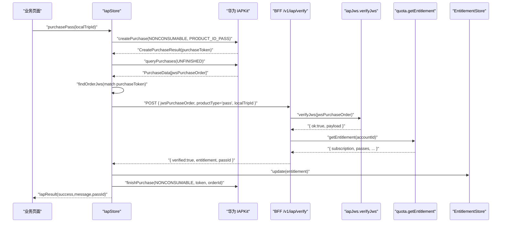
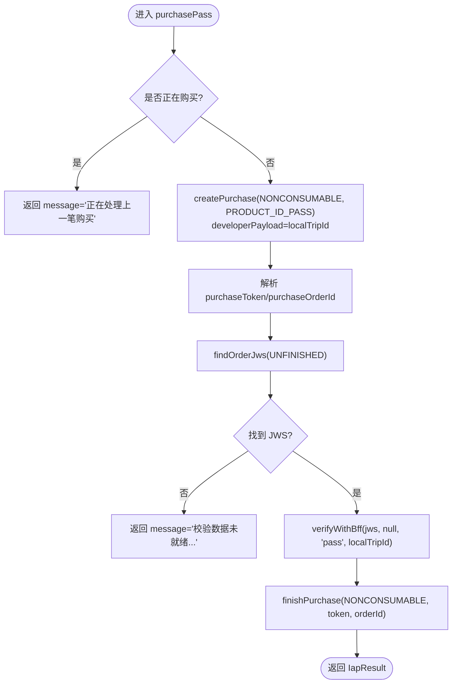
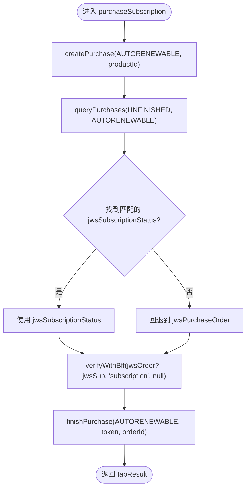
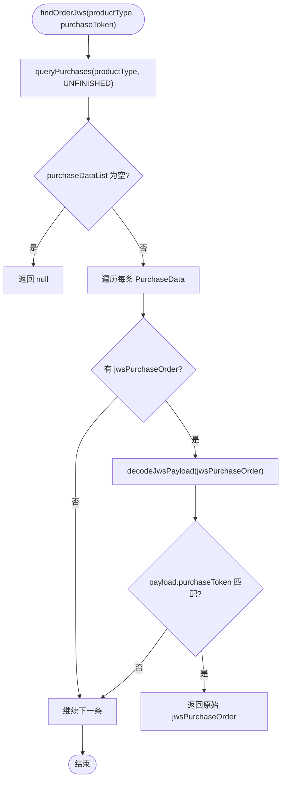
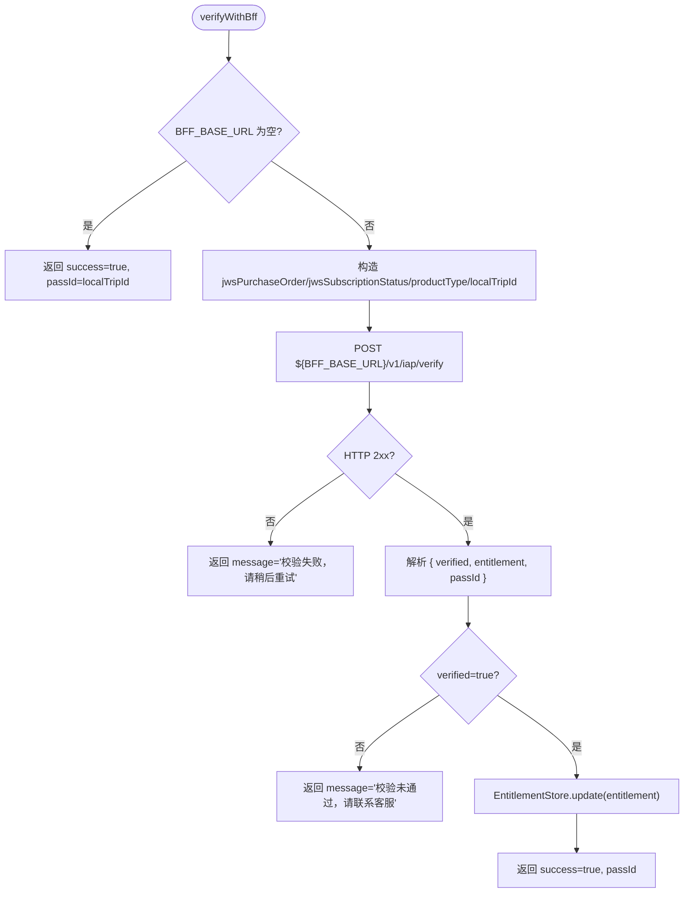
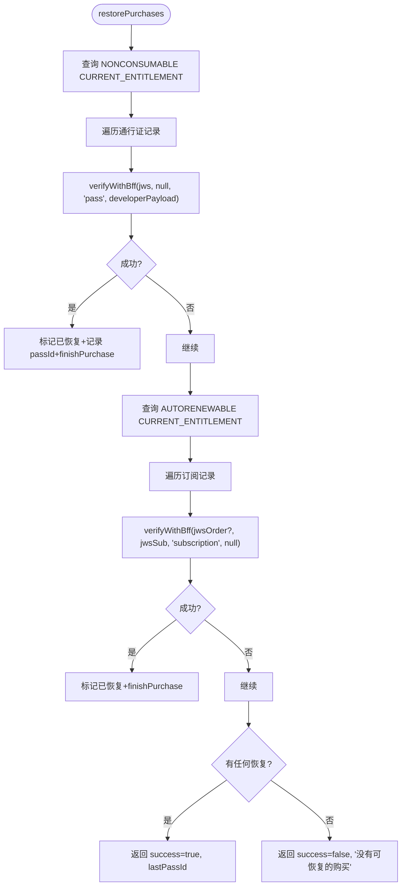
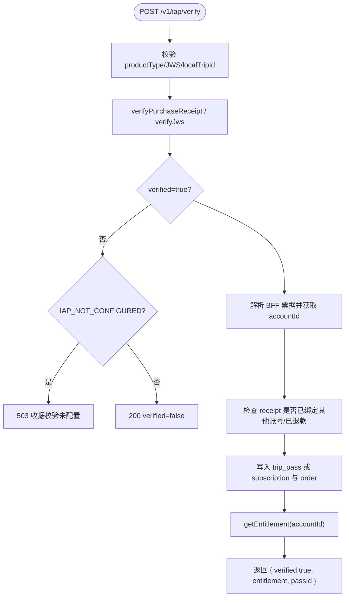
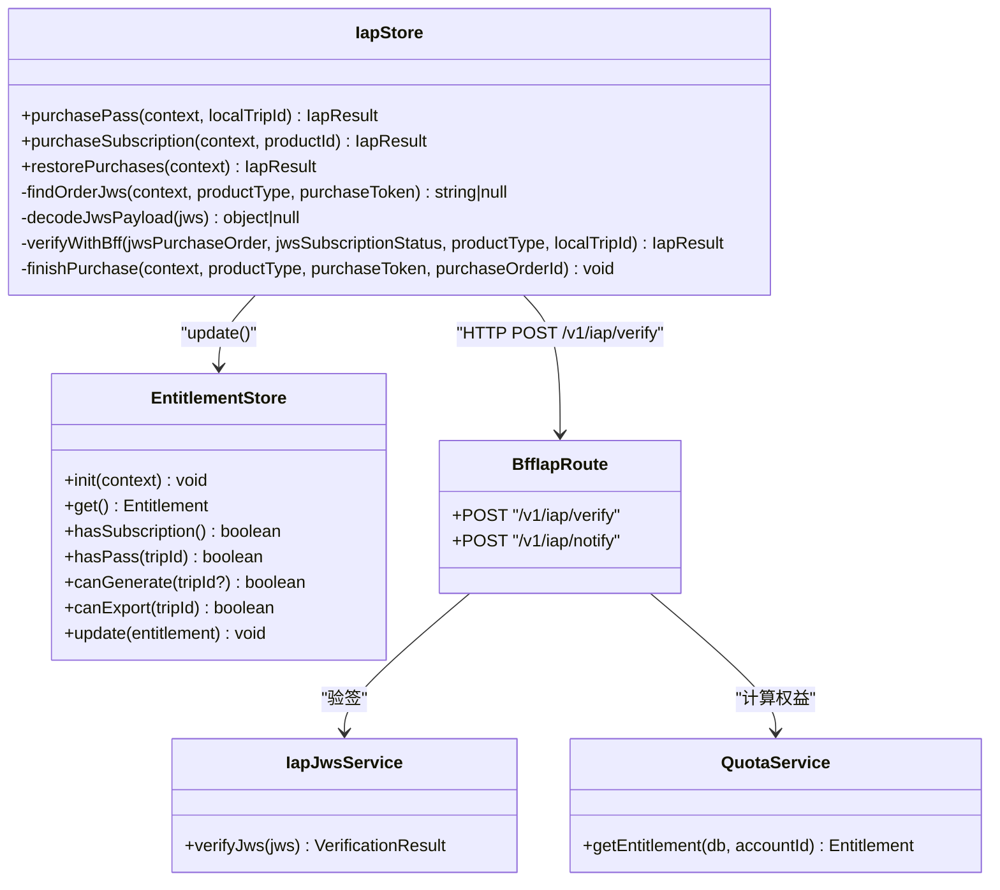

# IapStore 内购流程

<cite>
**本文引用的文件**   
- [IapStore.ets](file://entry/src/main/ets/data/IapStore.ets)
- [EntitlementStore.ets](file://entry/src/main/ets/data/EntitlementStore.ets)
- [iap.js](file://bff/src/routes/iap.js)
- [iapJws.js](file://bff/src/services/iapJws.js)
- [quota.js](file://bff/src/services/quota.js)
</cite>

## 目录
1. [引言](#引言)
2. [项目结构定位](#项目结构定位)
3. [核心组件](#核心组件)
4. [架构总览](#架构总览)
5. [详细组件分析](#详细组件分析)
6. [依赖关系分析](#依赖关系分析)
7. [性能与并发特性](#性能与并发特性)
8. [沙盒环境与错误码处理](#沙盒环境与错误码处理)
9. [常见问题排查](#常见问题排查)
10. [结论](#结论)

## 引言
本文件面向 IAP（华为内购）实现，重点解析 `IapStore` 在 HarmonyOS NEXT 端侧的购买、恢复、验签与确认发货全流程。该实现严格遵循华为官方“客户端将 purchaseData 发送至应用服务器执行解码验签”的契约：端侧不直接信任 `purchaseToken`，而是通过 `queryPurchases` 拿到华为签发的 JWS，再委托 BFF `/v1/iap/verify` 使用 Huawei CBG Root CA G2 证书链完成验签；服务端验签成功后返回最新权益写入 `EntitlementStore`，端侧再调用 `finishPurchase` 确认发货。

## 项目结构定位
IAP 相关代码横跨端侧与服务端两部分：

- 端侧
  - `entry/src/main/ets/data/IapStore.ets`：购买、恢复、查询 JWS、验签委托、发货确认。
  - `entry/src/main/ets/data/EntitlementStore.ets`：权益缓存、订阅/通行证判定、生成与导出门禁。
- 服务端
  - `bff/src/routes/iap.js`：`/v1/iap/verify` 与 `/v1/iap/notify` 路由。
  - `bff/src/services/iapJws.js`：本地 JWS 验签逻辑，基于 Huawei CBG Root CA G2 证书链。
  - `bff/src/services/quota.js`：根据订阅、通行证、赠送额度计算最终 `Entitlement`。

```mermaid
graph TB
  subgraph "端侧"
    A["IapStore<br/>购买/恢复/JWS 提取"]
    B["EntitlementStore<br/>权益缓存与门禁"]
  end

  subgraph "后端 BFF"
    R["/v1/iap/verify<br/>校验并落库"]
    S["iapJws.verifyJws<br/>Huawei CBG Root CA G2 验签"]
    Q["quota.getEntitlement<br/>计算权益快照"]
  end

  A -->|POST /v1/iap/verify| R
  R --> S
  R --> Q
  R -->|返回 Entitlement| A
  A -->|update()| B
```

**图表来源**
- [IapStore.ets:201-413](file://entry/src/main/ets/data/IapStore.ets#L201-L413)
- [iap.js:1-192](file://bff/src/routes/iap.js#L1-L192)
- [iapJws.js:1-148](file://bff/src/services/iapJws.js#L1-L148)
- [quota.js:1-113](file://bff/src/services/quota.js#L1-L113)

**章节来源**
- [IapStore.ets:1-20](file://entry/src/main/ets/data/IapStore.ets#L1-L20)
- [iap.js:1-20](file://bff/src/routes/iap.js#L1-L20)

## 核心组件
- `IapStore`：封装全部内购入口，包括：
  - `PRODUCT_ID_PASS`、`PRODUCT_ID_SUB_MONTHLY`、`PRODUCT_ID_SUB_YEARLY` 三个产品 ID。
  - `purchasePass()`：非消耗型通行证购买。
  - `purchaseSubscription()`：可自动续订订阅购买。
  - `restorePurchases()`：按 CURRENT_ENTITLEMENT 恢复未发货订单。
  - `findOrderJws()`：从 UNFINISHED 列表匹配 `purchaseToken` 提取 `jwsPurchaseOrder`。
  - `decodeJwsPayload()`：对 JWS payload 做 base64url 解码，不执行签名校验。
  - `verifyWithBff()`：把 JWS 原文发给 BFF `/v1/iap/verify`，成功后更新权益。
  - `finishPurchase()`：调用华为 SDK 确认发货。
- `IapResult`：统一返回结构，包含成功标志、用户可见消息和可选 `passId`。
- `EntitlementStore`：持有 `Entitlement`，提供 `hasSubscription()`、`hasPass(localTripId)`、`canGenerate()`、`canExport()` 等权限判断。
- BFF `/v1/iap/verify`：校验 JWS、幂等落库、写入订单/通行证/订阅表，并返回最新 `entitlement`。
- `iapJws.verifyJws()`：Node 端用 Node `crypto` 模块验证 ES256 + x5c 三张证书链。

**章节来源**
- [IapStore.ets:24-42](file://entry/src/main/ets/data/IapStore.ets#L24-L42)
- [IapStore.ets:44-90](file://entry/src/main/ets/data/IapStore.ets#L44-L90)
- [EntitlementStore.ets:27-70](file://entry/src/main/ets/data/EntitlementStore.ets#L27-L70)
- [iap.js:1-30](file://bff/src/routes/iap.js#L1-L30)
- [iapJws.js:1-30](file://bff/src/services/iapJws.js#L1-L30)

## 架构总览
下图展示一次完整购买从页面到服务端落库的关键时序：



**图表来源**
- [IapStore.ets:92-170](file://entry/src/main/ets/data/IapStore.ets#L92-L170)
- [iap.js:3-110](file://bff/src/routes/iap.js#L3-L110)
- [iapJws.js:65-148](file://bff/src/services/iapJws.js#L65-L148)
- [quota.js:10-40](file://bff/src/services/quota.js#L10-L40)

## 详细组件分析

### 常量与返回值模型
- 产品 ID
  - `PRODUCT_ID_PASS = 'youjing_pass'`：非消耗型通行证商品。
  - `PRODUCT_ID_SUB_MONTHLY = 'youjing_sub_monthly'`：月度订阅。
  - `PRODUCT_ID_SUB_YEARLY = 'youjing_sub_yearly'`：年度订阅。
- `IapResult`
  - `success: boolean`：是否成功。
  - `message: string`：面向用户的提示文案。
  - `passId: string | null`：仅通行证路径可能携带 `localTripId`。
- 内部数据结构
  - `OwnedPurchaseData`：`createPurchase` 返回的购买数据，含 92 位 `purchaseToken`。
  - `PurchaseData`：`queryPurchases` 返回的容器，含 `jwsPurchaseOrder` 或 `jwsSubscriptionStatus`。
  - `PurchaseOrderPayload`：`jwsPurchaseOrder` 解码后的字段子集，含 `purchaseToken`、`developerPayload`。
  - `SubGroupStatusPayload`：订阅状态负载子集，含 `lastSubscriptionStatus`。
  - `VerifyResponse`：BFF 验签响应，含 `verified`、`entitlement`、`passId`。

**章节来源**
- [IapStore.ets:24-42](file://entry/src/main/ets/data/IapStore.ets#L24-L42)
- [IapStore.ets:44-90](file://entry/src/main/ets/data/IapStore.ets#L44-L90)

### 购买通行证 `purchasePass()`
- 防重入锁：类级静态字段 `purchasing` 保证同一时刻只处理一笔购买。
- 商品类型：`iap.ProductType.NONCONSUMABLE`。
- 开发者载荷：`developerPayload` 携带 `localTripId`，用于恢复时识别行程。
- 购买后流程：
  1. 解析 `createPurchase` 返回的 `purchaseToken` 与 `purchaseOrderId`。
  2. 调用 `findOrderJws(context, NONCONSUMABLE, purchaseToken)` 从 UNFINISHED 列表匹配 JWS。
  3. 若找不到 JWS，返回“校验数据未就绪，请稍后在「恢复购买」中重试”。
  4. 调用 `verifyWithBff(jws, null, 'pass', localTripId)` 完成服务端验签。
  5. 无论验签结果如何，都尝试 `finishPurchase(NONCONSUMABLE, purchaseToken, purchaseOrderId)` 确认发货。
  6. 返回 `verifyWithBff` 的结果。



**图表来源**
- [IapStore.ets:92-170](file://entry/src/main/ets/data/IapStore.ets#L92-L170)

**章节来源**
- [IapStore.ets:92-170](file://entry/src/main/ets/data/IapStore.ets#L92-L170)

### 购买订阅 `purchaseSubscription()`
- 商品类型：`iap.ProductType.AUTORENEWABLE`。
- 产品区分：由调用方传入 `productId`，服务端限制为 `youjing_sub_monthly` 或 `youjing_sub_yearly`。
- JWS 选择策略：
  1. 先尝试从 AUTORENEWABLE 的 UNFINISHED 列表中查找带 `jwsSubscriptionStatus` 的记录。
  2. 对每个候选记录调用 `decodeJwsPayload`，比较 `lastSubscriptionStatus.purchaseToken` 是否与当前购买一致。
  3. 若找到订阅状态 JWS，则优先提交；否则退回订单 JWS。
  4. 如果两者均不可用，返回“校验数据未就绪，请稍后在「恢复购买」中重试”。
- 验签与发货：
  - 调用 `verifyWithBff(jwsOrder, jwsSub, 'subscription', null)`。
  - 成功后调用 `finishPurchase(AUTORENEWABLE, purchaseToken, purchaseOrderId)`。



**图表来源**
- [IapStore.ets:201-260](file://entry/src/main/ets/data/IapStore.ets#L201-L260)
- [iap.js:30-110](file://bff/src/routes/iap.js#L30-L110)

**章节来源**
- [IapStore.ets:201-260](file://entry/src/main/ets/data/IapStore.ets#L201-L260)
- [iap.js:30-110](file://bff/src/routes/iap.js#L30-L110)

### 查找订单 JWS `findOrderJws()`
- 查询范围：固定使用 `productType` 与 `PurchaseQueryType.UNFINISHED`。
- 匹配逻辑：
  1. 遍历 `purchaseDataList`。
  2. 解析容器字符串为 `PurchaseData`。
  3. 跳过无 `jwsPurchaseOrder` 的记录。
  4. 调用 `decodeJwsPayload<PurchaseOrderPayload>` 解码 payload。
  5. 比较 `payload.purchaseToken === purchaseToken`。
  6. 命中即返回原始 JWS 字符串；否则记录警告并返回 `null`。



**图表来源**
- [IapStore.ets:60-90](file://entry/src/main/ets/data/IapStore.ets#L60-L90)

**章节来源**
- [IapStore.ets:60-90](file://entry/src/main/ets/data/IapStore.ets#L60-L90)

### JWS Payload 解码 `decodeJwsPayload()`
- 输入：JWS 原文。
- 行为：
  - 按 `.` 分割三段，要求三段都存在且第二段非空。
  - 取中间段作为 payload，使用 base64url → std base64 转换后解码 UTF-8。
  - 再用 JSON.parse 得到对象。
  - 捕获异常时记录日志并返回 `null`。
- 重要约束：**不验签**。验签职责完全委托给 BFF。

**章节来源**
- [IapStore.ets:56-78](file://entry/src/main/ets/data/IapStore.ets#L56-L78)

### 委托 BFF 验签 `verifyWithBff()`
- 开发旁路：当 `ApiConfig.BFF_BASE_URL` 为空时，跳过真实验签，直接返回成功并把 `localTripId` 当作 `passId`。
- 请求体构造：
  - 可选字段：`jwsPurchaseOrder`、`jwsSubscriptionStatus`。
  - 必填字段：`productType`，取值 `'pass'` 或 `'subscription'`。
  - 可选字段：`localTripId`，仅在通行证路径存在。
- 鉴权头：从 `DeviceTokenStore.getToken()` 获取 Bearer Token。
- 响应处理：
  - HTTP 非 2xx：视为失败。
  - `verified=false`：视为校验未通过。
  - `verified=true`：调用 `EntitlementStore.update(data.entitlement)`，并返回 `IapResult`。
- 超时与资源释放：使用 `connectTimeout`、`readTimeout`，并在 finally 中销毁 `http.HttpRequestTask`。



**图表来源**
- [IapStore.ets:300-380](file://entry/src/main/ets/data/IapStore.ets#L300-L380)
- [iap.js:3-110](file://bff/src/routes/iap.js#L3-L110)

**章节来源**
- [IapStore.ets:300-380](file://entry/src/main/ets/data/IapStore.ets#L300-L380)
- [iap.js:3-110](file://bff/src/routes/iap.js#L3-L110)

### 恢复购买 `restorePurchases()`
恢复流程分两条独立分支：

1. 通行证恢复
   - 查询 `NONCONSUMABLE` 的 `CURRENT_ENTITLEMENT`。
   - 对每条记录取 `jwsPurchaseOrder`。
   - 解码 payload，读取 `developerPayload` 作为 `localTripId`。
   - 调用 `verifyWithBff(jws, null, 'pass', localTripId)`。
   - 成功后：
     - 记录 `restoredAny=true`。
     - 保留最后一个成功的 `passId`。
     - 调用 `finishPurchase`，token 来自 payload，orderId 可用 `purchaseOrderId`。

2. 订阅恢复
   - 查询 `AUTORENEWABLE` 的 `CURRENT_ENTITLEMENT`。
   - 允许仅有 `jwsSubscriptionStatus` 或仅有 `jwsPurchaseOrder`。
   - 验签成功后，token/orderId 来源优先级：
     - 优先从 `jwsSubscriptionStatus` 解码出的 `lastSubscriptionStatus` 取 `purchaseToken`、`purchaseOrderId`。
     - 回退到 `jwsPurchaseOrder` 解码出的 `PurchaseOrderPayload`。
   - 能取到 token 时才调用 `finishPurchase`。



**图表来源**
- [IapStore.ets:262-335](file://entry/src/main/ets/data/IapStore.ets#L262-L335)

**章节来源**
- [IapStore.ets:262-335](file://entry/src/main/ets/data/IapStore.ets#L262-L335)

### 服务端验签与权益写入
BFF `/v1/iap/verify` 的核心步骤：

1. 参数校验
   - `productType` 必须为 `'pass'` 或 `'subscription'`。
   - 订阅场景下 `productId` 必须是 `youjing_sub_monthly` 或 `youjing_sub_yearly`。
   - JWS 字段需为非空字符串，长度上限 8192。
   - 通行证需提供 `jwsPurchaseOrder` 与合法 `localTripId`。
   - 订阅需提供 `jwsSubscriptionStatus` 或 `jwsPurchaseOrder`。

2. 验签
   - 调用 `verifyPurchaseReceipt`，其底层依赖 `iapJws.verifyJws`。
   - 验签失败时：
     - 若原因是 `IAP_NOT_CONFIGURED`，返回 503。
     - 其他原因返回 200 但 `verified=false`。

3. 安全与幂等
   - 收据只能绑定一个账号；重复绑定不同账号返回 409。
   - 退款收据拒绝再次兑换。
   - 通行证：插入 `trip_pass` 与 `order`，并按 `purchase_token` 幂等。
   - 订阅：按 `purchase_token` 唯一键避免重复入账。

4. 权益返回
   - 调用 `getEntitlement(db, accountId)` 生成最新 `Entitlement`。
   - 通行证返回 `passId = localTripId`，订阅返回 `passId=null`。



**图表来源**
- [iap.js:3-192](file://bff/src/routes/iap.js#L3-L192)
- [iapJws.js:65-148](file://bff/src/services/iapJws.js#L65-L148)
- [quota.js:10-40](file://bff/src/services/quota.js#L10-L40)

**章节来源**
- [iap.js:3-192](file://bff/src/routes/iap.js#L3-L192)
- [iapJws.js:1-148](file://bff/src/services/iapJws.js#L1-L148)
- [quota.js:1-113](file://bff/src/services/quota.js#L1-L113)

## 依赖关系分析



**图表来源**
- [IapStore.ets:56-413](file://entry/src/main/ets/data/IapStore.ets#L56-L413)
- [EntitlementStore.ets:27-235](file://entry/src/main/ets/data/EntitlementStore.ets#L27-L235)
- [iap.js:1-192](file://bff/src/routes/iap.js#L1-L192)
- [iapJws.js:1-148](file://bff/src/services/iapJws.js#L1-L148)
- [quota.js:1-113](file://bff/src/services/quota.js#L1-L113)

**章节来源**
- [IapStore.ets:56-413](file://entry/src/main/ets/data/IapStore.ets#L56-L413)
- [EntitlementStore.ets:27-235](file://entry/src/main/ets/data/EntitlementStore.ets#L27-L235)
- [iap.js:1-192](file://bff/src/routes/iap.js#L1-L192)

## 性能与并发特性
- 单实例串行购买：`IapStore.purchasing` 防止同一进程并发触发购买接口，减少重复创建订单与重复发请求。
- 恢复购买分两阶段：通行证与订阅分别查询 CURRENT_ENTITLEMENT，不会因一条失败阻塞另一条。
- 发货确认失败被吞掉：`finishPurchase` 仅记录警告，不改变主流程结果，符合“验签成功后才发货”的设计——即使 finish 失败，服务端已落库，下次恢复仍可走相同路径。
- 网络超时：`verifyWithBff` 显式设置连接超时与读取超时，避免长时间挂起。
- 服务端验签成本：JWS 验签发生在 BFF 本地，不走外部 IAP 云端 API，避免额外云侧延迟。

[本节为通用性能说明，不直接分析具体代码片段]

## 沙盒环境与错误码处理
- 用户取消：华为返回 `BusinessError.code === 1001860000` 时，`purchasePass()` 与 `purchaseSubscription()` 均返回明确文案“用户取消购买”。
- 授权被拒：`code === 1001860002` 时，`purchasePass()` 主动调用 `iap.isSandboxActivated(context)` 进行沙盒诊断，并记录诊断结果；诊断接口本身失败也会记录。
- 沙盒诊断含义：
  - `isSandboxActivated=false`：可能表示沙盒未生效、账号未授权、签名指纹不符。
  - 注意：该诊断只在通行证购买路径中对 1001860002 触发；订阅购买路径记录日志但不主动诊断。
- 恢复购买错误：
  - 通行证恢复查询失败仅记录警告，不中断订阅恢复。
  - 订阅恢复查询失败同样仅记录警告。
- 服务端返回：
  - 400：参数非法、JWS 非法、缺少 JWS、未知订阅商品。
  - 401：缺少有效 BFF 票据。
  - 409：收据已绑定其他账号。
  - 503：IAP 根证书未配置。
  - 200 `verified=false`：收据无效或退款。

**章节来源**
- [IapStore.ets:120-170](file://entry/src/main/ets/data/IapStore.ets#L120-L170)
- [IapStore.ets:201-260](file://entry/src/main/ets/data/IapStore.ets#L201-L260)
- [IapStore.ets:262-335](file://entry/src/main/ets/data/IapStore.ets#L262-L335)
- [iap.js:3-110](file://bff/src/routes/iap.js#L3-L110)

## 常见问题排查
- “校验数据未就绪，请稍后在「恢复购买」中重试”
  - 典型原因：`createPurchase` 成功后立即查 UNFINISHED 列表，JWS 尚未就绪。
  - 建议：引导用户进入恢复购买流程，或使用短暂重试。
- “购买失败：...”
  - 查看 `BusinessError.code`：1001860000 为用户取消，1001860002 为授权被拒。
  - 在通行证路径中观察 `isSandboxActivated` 诊断日志。
- BFF 校验失败
  - 检查 `ApiConfig.BFF_BASE_URL` 是否为空；为空时会走开发旁路。
  - 检查 BFF 票据是否有效。
  - 检查 BFF 日志中的 `IAP 校验未通过` 或 HTTP 响应码。
- 恢复购买无效果
  - 确认 `CURRENT_ENTITLEMENT` 是否有记录。
  - 确认 JWS 中是否存在 `jwsPurchaseOrder` 或 `jwsSubscriptionStatus`。
  - 确认 `finishPurchase` 是否能在恢复流程中被调用。
- 订阅档位错误
  - 确保传入 `productId` 为 `youjing_sub_monthly` 或 `youjing_sub_yearly`。
  - 服务端会拒绝其他值并返回 `UNKNOWN_PRODUCT_ID`。

**章节来源**
- [IapStore.ets:92-170](file://entry/src/main/ets/data/IapStore.ets#L92-L170)
- [IapStore.ets:201-335](file://entry/src/main/ets/data/IapStore.ets#L201-L335)
- [iap.js:3-110](file://bff/src/routes/iap.js#L3-L110)

## 结论
`IapStore` 将华为 IAP 的购买与恢复流程抽象为清晰的端侧能力，并通过 BFF 承担真正的 JWS 验签责任。其关键设计包括：

- 以华为签发的 JWS 为唯一可信来源，不使用裸 `purchaseToken` 作为凭据。
- 通行证路径通过 `developerPayload` 携带 `localTripId`，恢复时重新取回并关联。
- 订阅路径优先使用 `jwsSubscriptionStatus`，回退到 `jwsPurchaseOrder`，增强兼容性。
- 验签成功后才调用 `finishPurchase`，同时保留容错日志。
- 服务端使用 Huawei CBG Root CA G2 证书链完成本地验签，避免依赖云端 IAP 校验接口。
- 错误码与沙盒诊断覆盖用户取消、授权被拒等常见场景，便于排障。

这套实现既满足华为官方权益发放指南，也贴合项目自身的商业化方案：通行证按行程绑定，订阅按月计费，权益统一由 BFF 返回并由 `EntitlementStore` 管理。