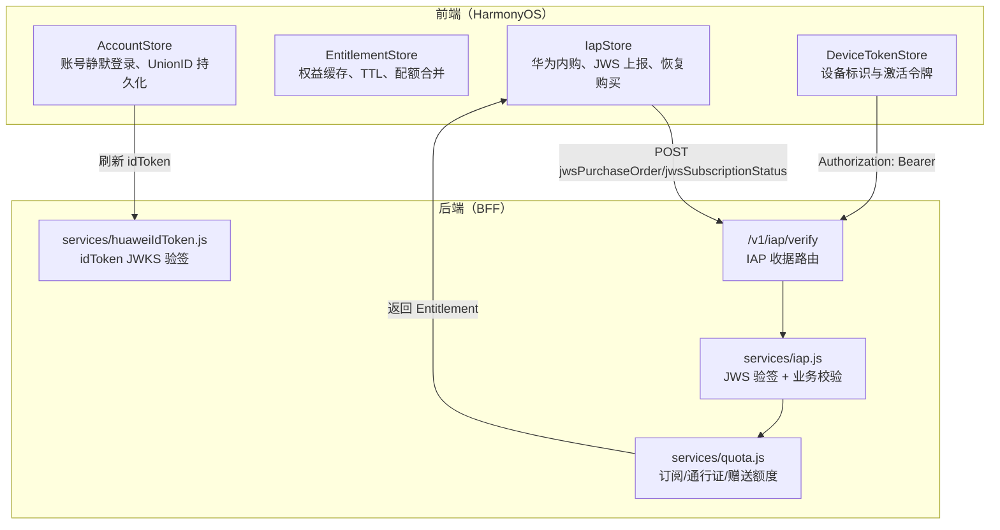
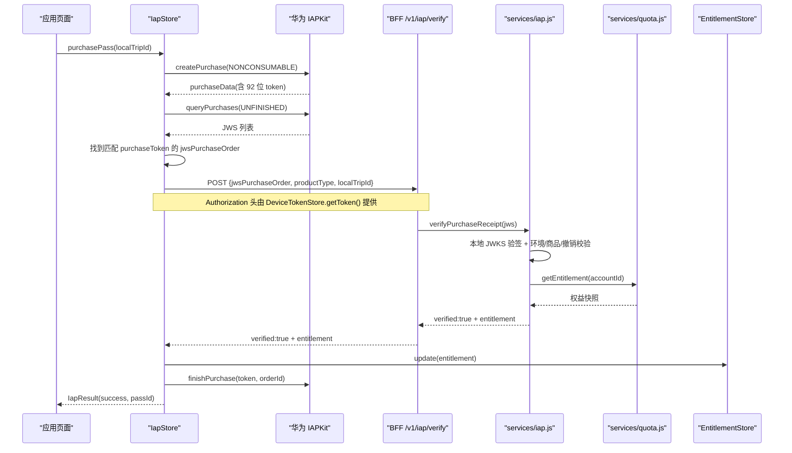
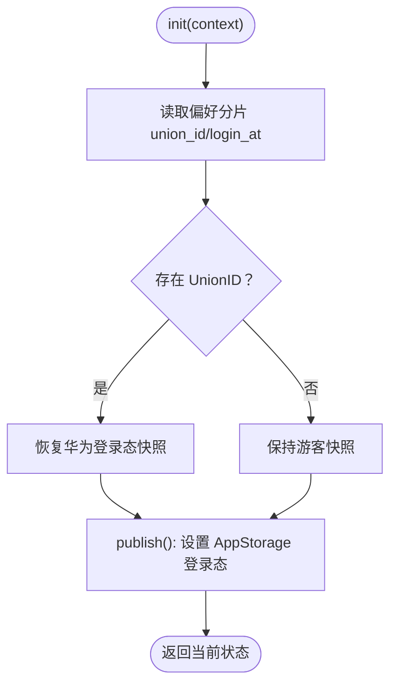
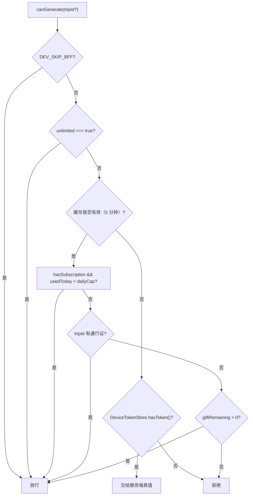
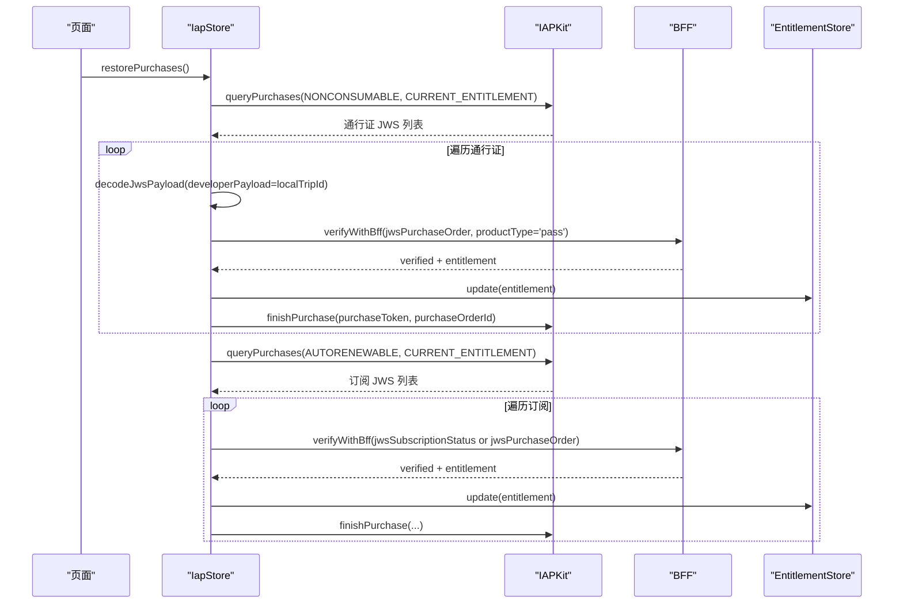
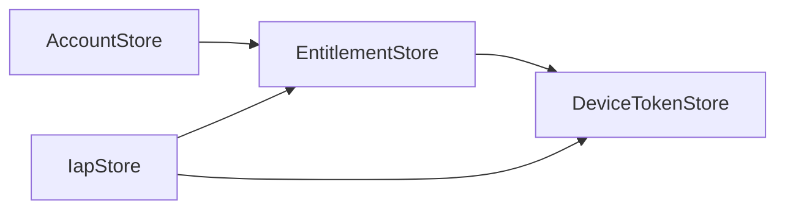

# Store 持久化模式

<cite>
**本文引用的文件**   
- [AccountStore.ets](file://entry/src/main/ets/data/AccountStore.ets)
- [EntitlementStore.ets](file://entry/src/main/ets/data/EntitlementStore.ets)
- [IapStore.ets](file://entry/src/main/ets/data/IapStore.ets)
- [DeviceTokenStore.ets](file://entry/src/main/ets/data/DeviceTokenStore.ets)
- [AccountConfig.ets](file://entry/src/main/ets/common/config/AccountConfig.ets)
- [huaweiIdToken.js](file://bff/src/services/huaweiIdToken.js)
- [iap.js](file://bff/src/routes/iap.js)
- [iap.js](file://bff/src/services/iap.js)
- [quota.js](file://bff/src/services/quota.js)
</cite>

## 目录
1. [引言](#引言)
2. [项目结构](#项目结构)
3. [核心组件](#核心组件)
4. [架构总览](#架构总览)
5. [详细组件分析](#详细组件分析)
6. [依赖关系分析](#依赖关系分析)
7. [性能考量](#性能考量)
8. [故障排查指南](#故障排查指南)
9. [结论](#结论)

## 引言
本文件系统化梳理项目中与“Store 持久化”相关的四个核心类：AccountStore、EntitlementStore、IapStore、DeviceTokenStore，并串联后端 BFF 中对应的华为 idToken 验签、IAP JWS 验签、配额快照生成等逻辑。目标是让读者既能理解每个 Store 的职责边界、数据流和错误处理，又能把握它们在账号体系、权益门禁和内购流程中的协作方式。

## 项目结构
Store 位于前端模块 `entry/src/main/ets/data` 下，采用单例 + 静态方法的组织形式；配置集中在 `common/config`；后端 BFF 负责不可信数据的最终校验与权限下发。

**图表来源**
- [AccountStore.ets:1-213](file://entry/src/main/ets/data/AccountStore.ets#L1-L213)
- [EntitlementStore.ets:1-235](file://entry/src/main/ets/data/EntitlementStore.ets#L1-L235)
- [IapStore.ets:1-413](file://entry/src/main/ets/data/IapStore.ets#L1-L413)
- [DeviceTokenStore.ets:1-142](file://entry/src/main/ets/data/DeviceTokenStore.ets#L1-L142)
- [huaweiIdToken.js:1-161](file://bff/src/services/huaweiIdToken.js#L1-L161)
- [iap.js:1-192](file://bff/src/routes/iap.js#L1-L192)
- [iap.js:1-133](file://bff/src/services/iap.js#L1-L133)
- [quota.js:1-113](file://bff/src/services/quota.js#L1-L113)

**章节来源**
- [AccountStore.ets:1-213](file://entry/src/main/ets/data/AccountStore.ets#L1-L213)
- [EntitlementStore.ets:1-235](file://entry/src/main/ets/data/EntitlementStore.ets#L1-L235)
- [IapStore.ets:1-413](file://entry/src/main/ets/data/IapStore.ets#L1-L413)
- [DeviceTokenStore.ets:1-142](file://entry/src/main/ets/data/DeviceTokenStore.ets#L1-L142)

## 核心组件
- AccountStore：负责华为账号静默登录、游客兜底、UnionID 持久化、idToken 管理、登录态广播。
- EntitlementStore：负责权益缓存、TTL 过期、配额快照合并、付费墙判定。
- IapStore：封装华为内购流程、JWS 提取与上报、购买恢复、沙盒诊断。
- DeviceTokenStore：维护设备标识 UUID 与 BFF 激活令牌的安全存储。

这些 Store 共同构成“身份 → 设备 → 权益 → 支付”的链路入口。

**章节来源**
- [AccountStore.ets:1-213](file://entry/src/main/ets/data/AccountStore.ets#L1-L213)
- [EntitlementStore.ets:1-235](file://entry/src/main/ets/data/EntitlementStore.ets#L1-L235)
- [IapStore.ets:1-413](file://entry/src/main/ets/data/IapStore.ets#L1-L413)
- [DeviceTokenStore.ets:1-142](file://entry/src/main/ets/data/DeviceTokenStore.ets#L1-L142)

## 架构总览
下图展示一次完整内购购买到权益下发的时序，以及设备令牌在鉴权中的作用。

**图表来源**
- [IapStore.ets:100-220](file://entry/src/main/ets/data/IapStore.ets#L100-L220)
- [IapStore.ets:250-413](file://entry/src/main/ets/data/IapStore.ets#L250-L413)
- [iap.js:1-192](file://bff/src/routes/iap.js#L1-L192)
- [iap.js:1-133](file://bff/src/services/iap.js#L1-L133)
- [quota.js:1-113](file://bff/src/services/quota.js#L1-L113)
- [DeviceTokenStore.ets:1-142](file://entry/src/main/ets/data/DeviceTokenStore.ets#L1-L142)

## 详细组件分析

### AccountStore：账号静默登录与游客兜底
AccountStore 是登录态的单点。它只做三件事：
1. 启动时从偏好存储恢复 UnionID；
2. 调用华为 ID Provider 执行静默登录；
3. 将 UnionID 写入偏好分片，并通过 AppStorage 广播登录态。

关键设计点：
- 永不抛错：login 失败会记录日志并退回游客分区，保证首启不被阻断。
- 只持久化 UnionID，不写敏感字段；idToken 仅保存在内存，供设备激活使用。
- uid() 同步可读，作为 DAO 分区键，因此 init() 必须在首次读写行程前完成。
- 登出会清空内存态、清权益缓存，再尝试删除偏好值；即使持久化失败也不影响内存已回到游客态。

**图表来源**
- [AccountStore.ets:60-120](file://entry/src/main/ets/data/AccountStore.ets#L60-L120)
- [AccountConfig.ets:1-29](file://entry/src/main/ets/common/config/AccountConfig.ets#L1-L29)

初始化、登录与登出的行为要点：
- init：打开 preferences 分片，恢复 UnionID 和 loginAt，标记 initialized=true，然后 publish。
- login：当 ACCOUNT_KIT_ENABLED=false 时直接返回当前游客态；否则执行 forceLogin=false 的静默登录。成功则持久化 UnionID、清理权益缓存；失败仅 warn 日志，仍返回当前态。
- logout：先切回游客态、清空 lastIdToken、publish，再删偏好值。
- refreshIdToken：用于设备激活时重新取 idToken，但不改登录态、不清权益缓存；若返回 UnionID 与当前分区不一致则丢弃票据。

典型使用路径（以源码位置代替代码片段）：
- 初始化与恢复：[AccountStore.ets:80-120](file://entry/src/main/ets/data/AccountStore.ets#L80-L120)
- 静默登录：[AccountStore.ets:120-170](file://entry/src/main/ets/data/AccountStore.ets#L120-L170)
- 登出：[AccountStore.ets:170-200](file://entry/src/main/ets/data/AccountStore.ets#L170-L200)
- 刷新 idToken：[AccountStore.ets:30-70](file://entry/src/main/ets/data/AccountStore.ets#L30-L70)
- 配置项：[AccountConfig.ets:1-29](file://entry/src/main/ets/common/config/AccountConfig.ets#L1-L29)

**章节来源**
- [AccountStore.ets:1-213](file://entry/src/main/ets/data/AccountStore.ets#L1-L213)
- [AccountConfig.ets:1-29](file://entry/src/main/ets/common/config/AccountConfig.ets#L1-L29)

### EntitlementStore：权益缓存、TTL 与配额合并
EntitlementStore 是商业化门禁的核心：它缓存服务端返回的权益快照，并提供 canExport、canGenerate 等判定方法。

核心机制：
- 持久化：entitlement_json 与 cached_at 两个键，TTL 为 5 分钟。
- 合并策略：mergeQuotaSnapshot 明确区分“服务端显式返回 null”和“字段缺省”。前者代表撤销或到期，必须覆盖本地；后者才沿用旧值。
- 付费墙：
  - canExport：访客禁止；开发旁路可放行；否则需要有效订阅或该行程有通行证。
  - canGenerate：优先判断 devBypass 和 unlimited；缓存过期时不再硬判 false，而是回退到 DeviceTokenStore.hasToken()，避免持有效票据的用户长期停在付费页。
- 广播：update/clear 都会写 TICK_KEY，配合 UI 层 @StorageProp/@Watch 刷新。

**图表来源**
- [EntitlementStore.ets:1-235](file://entry/src/main/ets/data/EntitlementStore.ets#L1-L235)
- [quota.js:1-113](file://bff/src/services/quota.js#L1-L113)

示例路径：
- 初始化与 TTL 判断：[EntitlementStore.ets:60-110](file://entry/src/main/ets/data/EntitlementStore.ets#L60-L110)
- 合并函数：[EntitlementStore.ets:40-60](file://entry/src/main/ets/data/EntitlementStore.ets#L40-L60)
- 导出与生成判定：[EntitlementStore.ets:110-180](file://entry/src/main/ets/data/EntitlementStore.ets#L110-L180)
- 更新与清除缓存：[EntitlementStore.ets:201-235](file://entry/src/main/ets/data/EntitlementStore.ets#L201-L235)

**章节来源**
- [EntitlementStore.ets:1-235](file://entry/src/main/ets/data/EntitlementStore.ets#L1-L235)
- [quota.js:1-113](file://bff/src/services/quota.js#L1-L113)

### IapStore：华为内购、JWS 验签与恢复购买
IapStore 是端上 IAP 的唯一入口，严格遵循官方建议：客户端把 JWS 发给服务器验签，而不是信任本地购买结果。

主要流程：
- 通行证购买：createPurchase → queryPurchases(UNFINISHED) → 找到匹配的 jwsPurchaseOrder → 调 BFF /v1/iap/verify → finishPurchase。
- 订阅购买：优先取 jwsSubscriptionStatus，找不到再退回 jwsPurchaseOrder → verifyWithBff → finishPurchase。
- 恢复购买：分别查询 CURRENT_ENTITLEMENT 的 NONCONSUMABLE 与 AUTORENEWABLE，逐项 verifyWithBff，成功后 finishPurchase。
- verifyWithBff：构造请求体，带上 DeviceTokenStore.getToken() 作为 Authorization，成功后调用 EntitlementStore.update 刷新缓存。

**图表来源**
- [IapStore.ets:200-413](file://entry/src/main/ets/data/IapStore.ets#L200-L413)
- [iap.js:1-192](file://bff/src/routes/iap.js#L1-L192)

沙盒与错误处理：
- 购买被拒时（特定错误码），调用 iap.isSandboxActivated 做诊断并记录日志。
- 校验失败、网络异常、解析异常均走 Logger.warn，返回 IapResult.success=false，不会向上抛错。
- 未配置 BFF_BASE_URL 时，视为开发期跳过校验，直接认为购买成功。

示例路径：
- 通行证购买：[IapStore.ets:120-200](file://entry/src/main/ets/data/IapStore.ets#L120-L200)
- 订阅购买：[IapStore.ets:200-250](file://entry/src/main/ets/data/IapStore.ets#L200-L250)
- 恢复购买：[IapStore.ets:250-350](file://entry/src/main/ets/data/IapStore.ets#L250-L350)
- 校验与发货确认：[IapStore.ets:350-413](file://entry/src/main/ets/data/IapStore.ets#L350-L413)

**章节来源**
- [IapStore.ets:1-413](file://entry/src/main/ets/data/IapStore.ets#L1-L413)
- [iap.js:1-192](file://bff/src/routes/iap.js#L1-L192)

### DeviceTokenStore：设备激活与令牌管理
DeviceTokenStore 负责设备标识与 BFF 激活令牌的存取：
- deviceId：首次 ensureDeviceId 时生成类 UUID 字符串，并持久化。
- deviceToken：BFF /v1/device/activate 返回的 Bearer 令牌；saveToken 同时写入 activatedAt。
- hasToken/isActivated：供 EntitlementStore.canGenerate 和设备激活器判断是否需要重新激活。
- clear：登出或切换账号时可清除 token 和 activatedAt。

安全注意事项：
- 所有日志都使用 maskedId/maskedToken 进行脱敏。
- 未 init 就保存 token 只会落内存，并发出 warn 日志，避免崩溃。

示例路径：
- 初始化与读取：[DeviceTokenStore.ets:20-50](file://entry/src/main/ets/data/DeviceTokenStore.ets#L20-L50)
- 保存与确保 deviceId：[DeviceTokenStore.ets:50-110](file://entry/src/main/ets/data/DeviceTokenStore.ets#L50-L110)
- 清除与掩码：[DeviceTokenStore.ets:110-142](file://entry/src/main/ets/data/DeviceTokenStore.ets#L110-L142)

**章节来源**
- [DeviceTokenStore.ets:1-142](file://entry/src/main/ets/data/DeviceTokenStore.ets#L1-L142)

### 后端支撑：idToken 验签与 IAP 收据验签
#### 华为 idToken 验签（huaweiIdToken.js）
- 通过 JWKS 拉取公钥，按 kid 选择算法 RS256/PS256 验签。
- 校验 iss、aud（Client ID）、exp、sub（即 unionId）。
- JWKS 缓存 10 分钟，遇到 kid 缺失会强制刷新一次。
- fail-closed：任何配置缺失、签名失败、aud/iss/exp 不符，都返回 ok:false。

示例路径：
- JWKS 加载与 key 查找：[huaweiIdToken.js:20-60](file://bff/src/services/huaweiIdToken.js#L20-L60)
- 主验签流程：[huaweiIdToken.js:60-161](file://bff/src/services/huaweiIdToken.js#L60-L161)

#### IAP 收据验签（bff/src/services/iap.js + routes/iap.js）
- routes/iap.js 对请求参数做前置校验：productType 只能是 pass 或 subscription；JWS 长度上限 8192；subscription 支持 jwsSubscriptionStatus 或 jwsPurchaseOrder。
- services/iap.js 用本地证书链验签，校验 applicationId、environment、productId/productType、撤销状态、token 存在性；订阅额外要求 lastSubscriptionStatus.status='1'。
- 校验通过后调用 quota.js 计算 entitlement，再由数据库幂等写入 order/subscription/trip_pass。
- 收据只能绑定一个账号；退款收据不再发放权益。

示例路径：
- 路由校验与订单写入：[iap.js:1-192](file://bff/src/routes/iap.js#L1-L192)
- JWS 验签与业务规则：[iap.js:1-133](file://bff/src/services/iap.js#L1-L133)
- 配额快照生成：[quota.js:1-113](file://bff/src/services/quota.js#L1-L113)

**章节来源**
- [huaweiIdToken.js:1-161](file://bff/src/services/huaweiIdToken.js#L1-L161)
- [iap.js:1-192](file://bff/src/routes/iap.js#L1-L192)
- [iap.js:1-133](file://bff/src/services/iap.js#L1-L133)
- [quota.js:1-113](file://bff/src/services/quota.js#L1-L113)

## 依赖关系分析
Store 之间的耦合方向清晰：IapStore 依赖 DeviceTokenStore 获取鉴权令牌，并依赖 EntitlementStore 写入新权益；EntitlementStore 依赖 DeviceTokenStore 做缓存过期时的降级判断；AccountStore 在登录成功后触发 EntitlementStore.clear。

**图表来源**
- [AccountStore.ets:120-170](file://entry/src/main/ets/data/AccountStore.ets#L120-L170)
- [IapStore.ets:350-413](file://entry/src/main/ets/data/IapStore.ets#L350-L413)
- [EntitlementStore.ets:140-180](file://entry/src/main/ets/data/EntitlementStore.ets#L140-L180)

外部依赖：
- 前端：@kit.ArkData.preferences、@kit.AccountKit.authentication、@kit.IAPKit.iap、@kit.NetworkKit.http。
- 后端：Node crypto、Express Router、数据库访问、JWKS HTTP 拉取。

潜在风险：
- 循环依赖：无循环，但 AccountStore 与 EntitlementStore 在登录/登出时互相影响，应保持在职责范围内调用。
- 外部服务不可用：BFF 未配置时 IapStore 跳过校验；华为 IAPKit 报错需分类处理。
- 配置驱动开关：ACCOUNT_KIT_ENABLED、ApiConfig.DEV_SKIP_BFF、IAP_ALLOW_SANDBOX 等开关直接影响行为。

**章节来源**
- [AccountStore.ets:1-213](file://entry/src/main/ets/data/AccountStore.ets#L1-L213)
- [EntitlementStore.ets:1-235](file://entry/src/main/ets/data/EntitlementStore.ets#L1-L235)
- [IapStore.ets:1-413](file://entry/src/main/ets/data/IapStore.ets#L1-L413)
- [DeviceTokenStore.ets:1-142](file://entry/src/main/ets/data/DeviceTokenStore.ets#L1-L142)

## 性能考量
- 偏好存储读多写少：Store 初始化时一次性加载，后续多数操作是内存态 + 少量 flush。
- 权益缓存 TTL 5 分钟：减少频繁拉取 BFF 权益接口；过期后优先复用 DeviceTokenStore.hasToken() 作为网关信号。
- IAP 恢复购买是批处理：遍历 CURRENT_ENTITLEMENT 列表逐项校验，适合放在用户主动触发的入口，不适合后台高频调用。
- JWKS 缓存 10 分钟：减少华为公钥拉取频率，同时支持 kid 轮换时强制刷新一次。
- 日志级别：成功路径用 info，异常和降级用 warn，避免阻塞主流程。

## 故障排查指南
常见问题与定位建议：

| 现象 | 可能原因 | 排查步骤 | 对应实现位置 |
|---|---|---|---|
| 冷启闪登录页 | AUTH_STATE_KEY 未水合 | 检查 EntryAbility 是否在 loadContent 回调里 await init | [AccountStore.ets:80-120](file://entry/src/main/ets/data/AccountStore.ets#L80-L120) |
| 静默登录失败但能继续用 | 游客兜底生效 | 查看 warn 日志，确认 ACCOUNT_KIT_ENABLED 与签名指纹 | [AccountStore.ets:120-170](file://entry/src/main/ets/data/AccountStore.ets#L120-L170), [AccountConfig.ets:1-29](file://entry/src/main/ets/common/config/AccountConfig.ets#L1-L29) |
| 持有有效票据却永久停在付费页 | 5 分钟 TTL 与 DeviceActivator 组合导致 | 检查缓存时间戳、DeviceTokenStore.hasToken | [EntitlementStore.ets:140-180](file://entry/src/main/ets/data/EntitlementStore.ets#L140-L180) |
| 购买成功但没收到权益 | JWS 未就绪或 BFF 校验失败 | 查看 queryPurchases 是否有 jwsPurchaseOrder/jwsSubscriptionStatus，以及 BFF 返回 verified | [IapStore.ets:120-200](file://entry/src/main/ets/data/IapStore.ets#L120-L200), [iap.js:1-192](file://bff/src/routes/iap.js#L1-L192) |
| 授权被拒且提示沙盒问题 | 沙盒未激活、签名指纹不符、账号未授权 | 查看 isSandboxActivated 诊断日志 | [IapStore.ets:150-190](file://entry/src/main/ets/data/IapStore.ets#L150-L190) |
| BFF 报 IAP_NOT_CONFIGURED | 根证书或 APP_ID 未部署 | 检查后端环境变量 | [iap.js:1-133](file://bff/src/services/iap.js#L1-L133) |
| 设备 token 失效 | BFF 返回 401/6001 | 由 DeviceActivator 触发重新激活，Store 只负责存取 | [DeviceTokenStore.ets:1-142](file://entry/src/main/ets/data/DeviceTokenStore.ets#L1-L142) |

## 结论
本项目 Store 持久化模式围绕“身份、设备、权益、支付”四条主线展开：AccountStore 保障登录态稳定与游客兜底；DeviceTokenStore 维护设备身份；EntitlementStore 提供带 TTL 的权益缓存与可配置的付费门限；IapStore 严格遵循“客户端上报 JWS、服务端验签”的安全模型。整体遵循单一职责、异常隔离、日志记录和配置驱动的四大原则，既保证了用户体验的连续性，也为商业化能力提供了可扩展的基础设施。