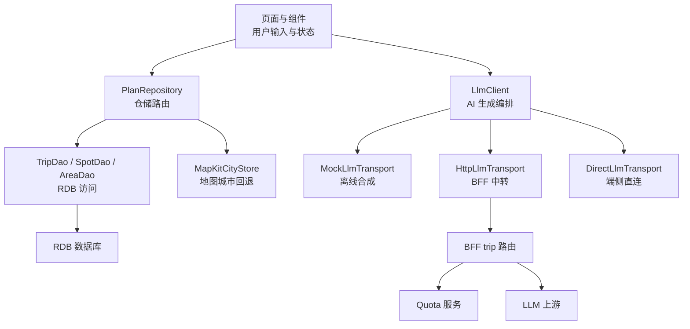
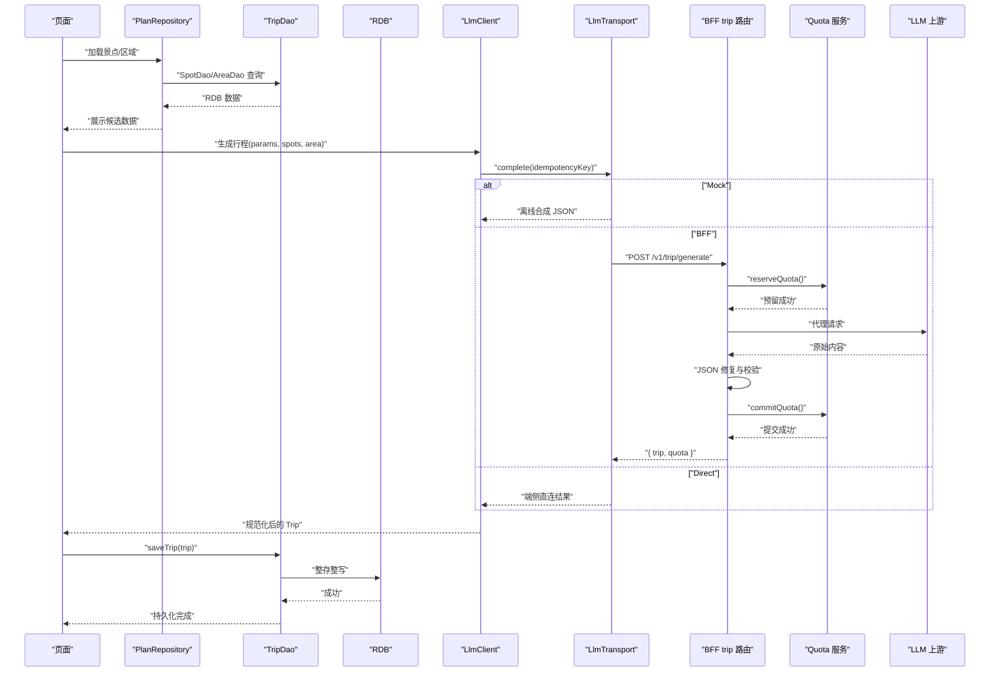
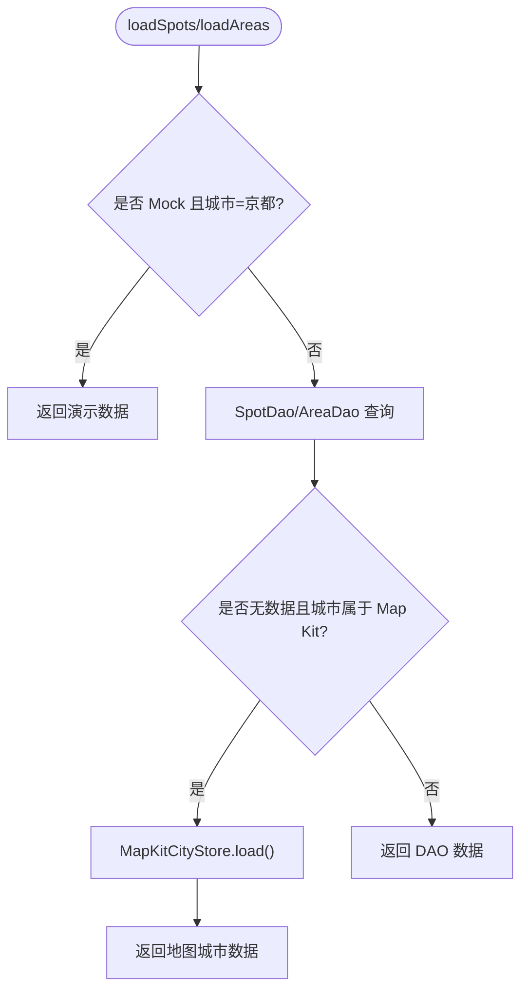
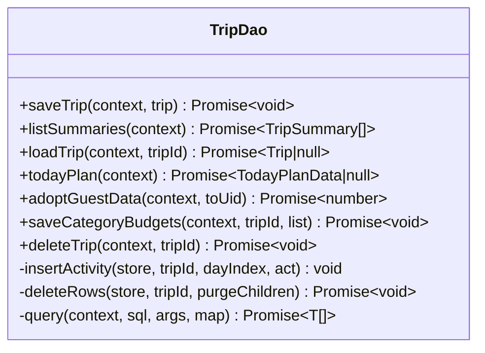
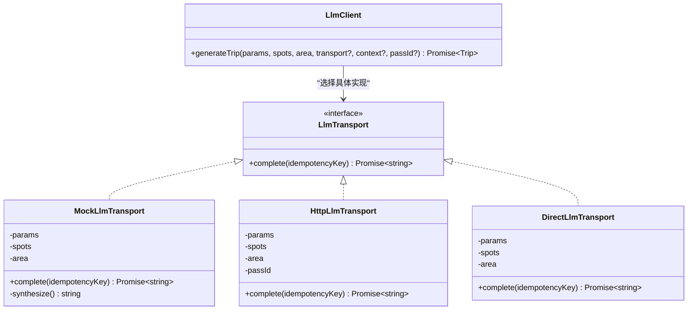
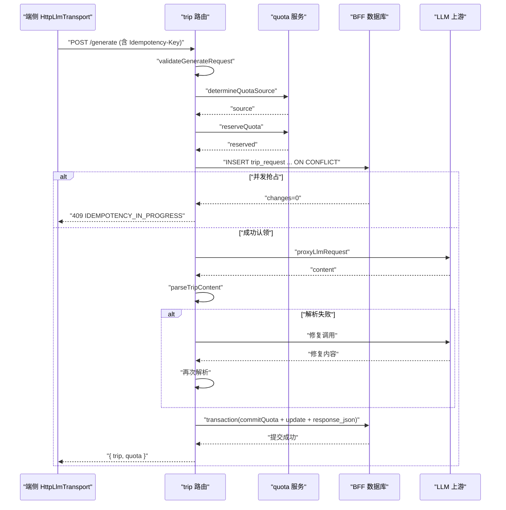
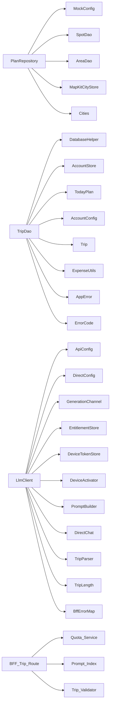

# 数据流向模式

<cite>
**本文引用的文件**   
- [PlanRepository.ets](file://entry/src/main/ets/data/PlanRepository.ets)
- [TripDao.ets](file://entry/src/main/ets/data/TripDao.ets)
- [LlmClient.ets](file://entry/src/main/ets/ai/LlmClient.ets)
- [DirectConfig.ets](file://entry/src/main/ets/common/config/DirectConfig.ets)
- [MockConfig.ets](file://entry/src/main/ets/common/config/MockConfig.ets)
- [ApiConfig.ets](file://entry/src/main/ets/common/config/ApiConfig.ets)
- [trip.js](file://bff/src/routes/trip.js)
- [quota.js](file://bff/src/services/quota.js)
</cite>

## 目录
1. [引言](#引言)
2. [项目结构中的数据层定位](#项目结构中的数据层定位)
3. [核心组件](#核心组件)
4. [架构总览](#架构总览)
5. [详细组件分析](#详细组件分析)
6. [依赖关系分析](#依赖关系分析)
7. [性能与错误边界](#性能与错误边界)
8. [故障排查指南](#故障排查指南)
9. [结论](#结论)

## 引言
本文聚焦应用“用户输入 → 组件状态 → Store 持久化 → AppStorage 广播 → 视图更新”的数据流向，并围绕四个关键基础设施展开：
- PlanRepository 仓储模式：统一数据源路由（Mock / RDB / Map Kit 回退）。
- TripDao 数据访问层：RDB 操作封装、事务处理、数据迁移。
- LlmClient AI 服务：多传输策略（Mock / BFF / Direct）、请求编排、响应解析与修复。
- BFF 行程生成接口：配额管理、幂等、模型输出修复与结算。

目标读者包括需要理解数据流转的开发者与维护者；文档避免直接粘贴代码内容，转而给出精确的文件与行号引用，以便快速定位实现。

## 项目结构中的数据层定位
本仓库采用“页面层 → 业务编排 → 仓储 → DAO/RDB → 外部服务（BFF/LLM）”的分层结构。数据流起点通常是用户在页面中的输入（如目的地、日期、景点选择），经过组件状态变化后写入持久层，再由上层组件订阅 AppStorage 或 Store 变更完成渲染。

图表来源
- [PlanRepository.ets:1-55](file://entry/src/main/ets/data/PlanRepository.ets#L1-L55)
- [TripDao.ets:1-200](file://entry/src/main/ets/data/TripDao.ets#L1-L200)
- [LlmClient.ets:1-200](file://entry/src/main/ets/ai/LlmClient.ets#L1-L200)
- [trip.js:1-200](file://bff/src/routes/trip.js#L1-L200)
- [quota.js:1-113](file://bff/src/services/quota.js#L1-L113)

章节来源
- [PlanRepository.ets:1-55](file://entry/src/main/ets/data/PlanRepository.ets#L1-L55)
- [TripDao.ets:1-200](file://entry/src/main/ets/data/TripDao.ets#L1-L200)
- [LlmClient.ets:1-200](file://entry/src/main/ets/ai/LlmClient.ets#L1-L200)
- [trip.js:1-200](file://bff/src/routes/trip.js#L1-L200)
- [quota.js:1-113](file://bff/src/services/quota.js#L1-L113)

## 核心组件
- PlanRepository：对外暴露 loadSpots / loadAreas，隐藏 Mock/RDB/Map Kit 的选择逻辑，是页面取数的唯一入口。
- TripDao：封装行程主聚合根的整存整写、列表摘要查询、今日卡片优化、游客数据归户、分类预算单行更新、删除级联清理。
- LlmClient：组合多种 LlmTransport，负责重试、票据失效恢复、行程结果规范化、地址/开放时间与预约信息回填、活动 id 重铸与费用合计修正。
- BFF trip 路由：参数校验、额度预占、幂等申请、提示词构建、LLM 调用、JSON 修复、模型输出校验、额度结算与权益快照返回。
- Quota 服务：订阅/通行证/赠送额度判定、月度上限、预留/提交/释放状态机。

章节来源
- [PlanRepository.ets:1-55](file://entry/src/main/ets/data/PlanRepository.ets#L1-L55)
- [TripDao.ets:1-200](file://entry/src/main/ets/data/TripDao.ets#L1-L200)
- [LlmClient.ets:1-200](file://entry/src/main/ets/ai/LlmClient.ets#L1-L200)
- [trip.js:1-200](file://bff/src/routes/trip.js#L1-L200)
- [quota.js:1-113](file://bff/src/services/quota.js#L1-L113)

## 架构总览
数据流向可抽象为两条主线：
1. 行程数据读写线：页面 → PlanRepository → TripDao → RDB。
2. AI 生成线：页面 → LlmClient → LlmTransport → BFF/直连 → 模型 → 解析与规范化 → TripDao 落库。

图表来源
- [LlmClient.ets:200-482](file://entry/src/main/ets/ai/LlmClient.ets#L200-L482)
- [trip.js:1-234](file://bff/src/routes/trip.js#L1-L234)
- [quota.js:1-113](file://bff/src/services/quota.js#L1-L113)
- [TripDao.ets:1-200](file://entry/src/main/ets/data/TripDao.ets#L1-L200)

## 详细组件分析

### PlanRepository 仓储模式
职责与行为
- 数据源路由：当启用 Mock 且城市为“京都”时返回演示数据；否则走真实 SpotDao/AreaDao。
- Map Kit 回退：对 isMapCity 的城市，若种子库为空则通过 MapKitCityStore 拉取地图城市数据。
- 空数据日志：未命中任何数据源时记录“景点库为空/区域库为空”，便于诊断。

图表来源
- [PlanRepository.ets:1-55](file://entry/src/main/ets/data/PlanRepository.ets#L1-L55)

最佳实践
- 页面不直连 DAO：所有取数必须经 PlanRepository，确保 Mock 开关与回退策略集中管理。
- 仅对“京都”走 Mock：避免用演示数据冒充其他城市。
- 对非内置城市先查种子库再回退 Map Kit：避免重复网络开销。

章节来源
- [PlanRepository.ets:1-55](file://entry/src/main/ets/data/PlanRepository.ets#L1-L55)
- [MockConfig.ets:1-15](file://entry/src/main/ets/common/config/MockConfig.ets#L1-L15)

### TripDao 数据访问层
职责与行为
- 整存整写：saveTrip 会按 tripId 删除旧数据并重建 trip_day/activity/meal，使用 DatabaseHelper.write 包裹事务。
- 列表摘要：listSummaries 通过 SQL 子查询统计 spotCount、bookingCount、legCount、checkinCount，减少应用层计算。
- 详情加载：loadTrip 分步读取 trip/trip_day/activity/meal，再拼装 Trip 树。
- 今日卡片优化：todayPlan 先用 start_date/end_date 范围过滤，再只对候选 trip 全量加载，降低 O(行程数×全量) 成本。
- 游客数据归户：adoptGuestData 将 guest 分区下的 trip/expense/checkin 迁移到登录账号，三表同事务保证一致性。
- 分类预算更新：saveCategoryBudgets 只更新 trip.category_budget 一行，避免重建整棵树。
- 删除级联：deleteRows 在 purgeChildren=true 时同时清理 checkin/expense，防止孤儿数据。

图表来源
- [TripDao.ets:1-200](file://entry/src/main/ets/data/TripDao.ets#L1-L200)
- [TripDao.ets:200-384](file://entry/src/main/ets/data/TripDao.ets#L200-L384)

复杂度与性能
- saveTrip：时间复杂度 O(D+A+M)，D 为天段数，A 为活动数，M 为餐次数；空间复杂度取决于 Trip 对象大小。
- loadTrip：多次 SQL 查询并按 dayIndex 分组，拼装 Trip；可通过索引 trip_id、user_id、start_date、end_date 优化。
- todayPlan：先范围扫描再逐条加载，命中越少越快。

错误边界
- query 内部捕获 ResultSet 遍历异常并关闭资源。
- deleteRows 先校验 user_id 归属，再删子表，防止误删他人数据。
- adoptGuestData 将三张带 user_id 的表置于同一事务中，保证迁移原子性。

章节来源
- [TripDao.ets:1-200](file://entry/src/main/ets/data/TripDao.ets#L1-L200)
- [TripDao.ets:200-384](file://entry/src/main/ets/data/TripDao.ets#L200-L384)

### LlmClient AI 服务
职责与行为
- 传输策略：
  - MockLlmTransport：离线合成合法 Trip JSON，完整走守卫→Trip 链路，适合本地闭环验证。
  - HttpLlmTransport：端侧发送业务参数至 BFF，由 BFF 构建 prompt、注入 Key、扣减配额、转发 LLM，返回 { trip, quota }。
  - DirectLlmTransport：开发期直连 OpenAI 兼容 chat/completions，需配置 URL/KEY，上架前必须迁云。
- 请求编排：
  - 根据 GenerationChannel.isLocal() 与 DirectConfig.URL/KEY 决定实际 transport。
  - 失败最多重试一次；401 票据失效时重新激活设备；402 额度耗尽时不再重试，刷新权益缓存。
- 响应解析与规范化：
  - 使用 TripParser.parseTrip 校验结构，期望天数与出发日以用户输入为准。
  - 强制覆盖 trip.id/people/budget/destination/style，避免模型回声导致预算/人数错误。
  - 剔除与餐次重复的 food 活动，避免序列重复。
  - 重铸活动 id 为 d{n}-a{m}，保证跨天唯一，避免 RDB UNIQUE 冲突。
  - 以 dailyCost 合计重写 totalCost，保证费用自洽。
  - 回填地址、开放时间、预约信息，提升展示质量。

图表来源
- [LlmClient.ets:1-200](file://entry/src/main/ets/ai/LlmClient.ets#L1-L200)
- [LlmClient.ets:200-482](file://entry/src/main/ets/ai/LlmClient.ets#L200-L482)

章节来源
- [LlmClient.ets:1-200](file://entry/src/main/ets/ai/LlmClient.ets#L1-L200)
- [LlmClient.ets:200-482](file://entry/src/main/ets/ai/LlmClient.ets#L200-L482)
- [DirectConfig.ets:1-33](file://entry/src/main/ets/common/config/DirectConfig.ets#L1-L33)
- [ApiConfig.ets:1-66](file://entry/src/main/ets/common/config/ApiConfig.ets#L1-L66)

### BFF 行程生成接口与配额管理
职责与行为
- 参数校验：destination/startDate/endDate/people/budget/dayCount 边界检查，坏请求在扣额度前拒绝。
- 幂等与并发保护：idempotencyMiddleware + trip_request 表 ON CONFLICT 更新，claim.changes=0 时返回 409，避免双扣费/双写。
- 额度预占：reserveQuota 插入 reserved 行，失败释放额度。
- 提示词构建与模型调用：buildMessages/buildResponseFormat/proxyLlmRequest。
- JSON 修复：首次解析失败则拼接 assistant 历史并追加修正指令，再次解析仍失败返回 LLM_INVALID_JSON。
- 模型输出校验：validateTrip 对结构合法性进行二次确认。
- 结算与响应体写入：commitQuota 与 trip_request 状态更新、response_json 写入在同一事务中；成功后读取 entitlement 快照返回给客户端。

图表来源
- [trip.js:1-234](file://bff/src/routes/trip.js#L1-L234)
- [quota.js:1-113](file://bff/src/services/quota.js#L1-L113)

章节来源
- [trip.js:1-234](file://bff/src/routes/trip.js#L1-L234)
- [quota.js:1-113](file://bff/src/services/quota.js#L1-L113)

## 依赖关系分析
- PlanRepository 依赖 MockConfig、SpotDao、AreaDao、MapKitCityStore、Cities 常量与 Logger。
- TripDao 依赖 DatabaseHelper、AccountStore、TodayPlan、AccountConfig、Trip 模型、Expense 工具、AppError、ErrorCode、Logger。
- LlmClient 依赖 ApiConfig、DirectConfig、GenerationChannel、EntitlementStore、DeviceTokenStore、DeviceActivator、PromptBuilder、DirectChat、TripParser、TripLength、BffErrorMap、Logger、AppError、ErrorCode。
- BFF trip 路由依赖 Express Router、idempotencyMiddleware、quota 服务、prompt/index、trip-validator、json-extract、http-error。
- quota 服务依赖 admin、数据库查询与状态机。

图表来源
- [PlanRepository.ets:1-55](file://entry/src/main/ets/data/PlanRepository.ets#L1-L55)
- [TripDao.ets:1-200](file://entry/src/main/ets/data/TripDao.ets#L1-L200)
- [LlmClient.ets:1-200](file://entry/src/main/ets/ai/LlmClient.ets#L1-L200)
- [trip.js:1-200](file://bff/src/routes/trip.js#L1-L200)
- [quota.js:1-113](file://bff/src/services/quota.js#L1-L113)

章节来源
- [PlanRepository.ets:1-55](file://entry/src/main/ets/data/PlanRepository.ets#L1-L55)
- [TripDao.ets:1-200](file://entry/src/main/ets/data/TripDao.ets#L1-L200)
- [LlmClient.ets:1-200](file://entry/src/main/ets/ai/LlmClient.ets#L1-L200)
- [trip.js:1-200](file://bff/src/routes/trip.js#L1-L200)
- [quota.js:1-113](file://bff/src/services/quota.js#L1-L113)

## 性能与错误边界
性能要点
- PlanRepository 仅在 Mock 且“京都”时才走演示数据，其他城市优先本地种子库，空库才触发 Map Kit 回退，减少不必要网络。
- TripDao.todayPlan 先按日期范围筛选 tripId，再逐个加载，避免 O(行程数×全量) 的冷路径。
- TripDao.saveCategoryBudgets 单行更新分类预算，避免整树重建。
- LlmClient.generateTrip 最多重试一次，避免无限重试造成 UI 卡顿；402 额度耗尽立即停止重试并刷新权益缓存。
- BFF trip 路由对 JSON 解析失败执行一次修复调用，并将修复后的 token 用量合并，减少无效重试。

错误边界
- LlmClient：
  - 401 票据失效：尝试重新激活设备后重试。
  - 402 额度耗尽：不再重试，刷新权益缓存。
  - 网络超时：区分平台错误码，抛出 NETWORK_TIMEOUT。
  - 其他网络错误：统一为 NETWORK_REQUEST_FAILED。
  - 两次均失败：若非外部原因，包装为 TRIP_GENERATE_RETRY_EXHAUSTED，保留可操作文案。
- BFF trip 路由：
  - 参数非法：400 INVALID_REQUEST。
  - 并发抢占：409 IDEMPOTENCY_IN_PROGRESS。
  - 模型输出非法：502 LLM_INVALID_JSON/LLM_INVALID_TRIP。
  - 结算失败：事务内拒绝返回未持久化的响应。

章节来源
- [LlmClient.ets:200-482](file://entry/src/main/ets/ai/LlmClient.ets#L200-L482)
- [trip.js:1-234](file://bff/src/routes/trip.js#L1-L234)
- [TripDao.ets:200-384](file://entry/src/main/ets/data/TripDao.ets#L200-L384)

## 故障排查指南
常见问题与定位步骤
- 行程生成始终失败：
  - 检查 LlmClient 传输选择：direct URL/KEY 是否为空、GenerationChannel.isLocal() 判断、ApiConfig.BFF_BASE_URL 是否配置。
  - 查看 BFF 日志：/generate 参数校验、idempotency_key 是否冲突、LLM 输出是否被修复。
  - 关注错误码：NETWORK_TIMEOUT、NETWORK_REQUEST_FAILED、LLM_UNAVAILABLE、TRIP_GENERATE_RETRY_EXHAUSTED。
- 行程保存后数据丢失：
  - 确认 TripDao.saveTrip 的事务范围是否包含 trip_day/activity/meal。
  - 检查 deleteRows 是否误删他人数据（应基于 user_id 校验）。
- 行程列表与卡片数据不一致：
  - 核对 listSummaries 的子查询统计字段是否与界面一致。
  - 检查 todayPlan 的日期范围过滤与 Trip.of 判定逻辑。
- 配额显示异常：
  - 查看 BFF quota 服务：subscription period_end、usedThisMonth 月度计数、giftLedger 余额。
  - 确认端侧 mergeQuotaSnapshot 是否正确覆盖 subscription/dailyCap/usedToday。

参考实现路径
- [LlmClient.generateTrip](file://entry/src/main/ets/ai/LlmClient.ets#L200-L482)
- [BFF trip 路由 /generate](file://bff/src/routes/trip.js#L1-L234)
- [BFF quota 服务](file://bff/src/services/quota.js#L1-L113)
- [TripDao.saveTrip/todayPlan/adoptGuestData](file://entry/src/main/ets/data/TripDao.ets#L1-L200)
- [TripDao.deleteRows/query](file://entry/src/main/ets/data/TripDao.ets#L200-L384)

## 结论
本项目通过仓储模式与 DAO 模式清晰分离了数据源路由与数据访问细节，并以 LlmClient 的多传输策略实现了开发期 Mock、生产期 BFF、调试期 Direct 的平滑切换。BFF 侧的幂等、额度管理与 JSON 修复机制进一步提升了端到端稳定性。建议在后续迭代中：
- 继续坚持页面不经 DAO 取数的分层纪律。
- 对高延迟外部调用（LLM/BFF）保持有限重试与明确错误码。
- 在数据写入路径上优先使用事务与归属校验，避免脏数据与孤儿行。
- 对高频读取场景（如 todayPlan）持续优化查询计划与缓存策略。