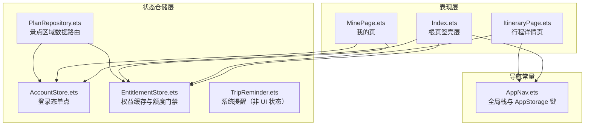
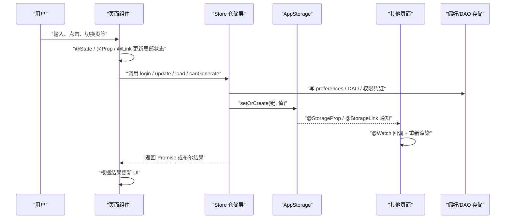
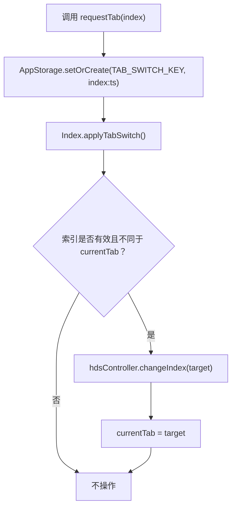
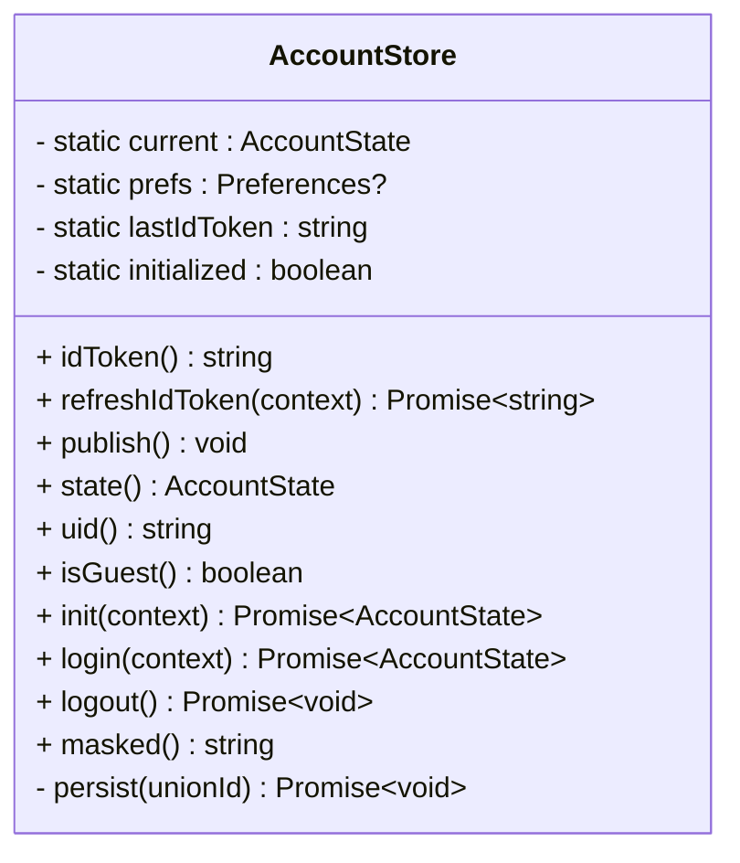
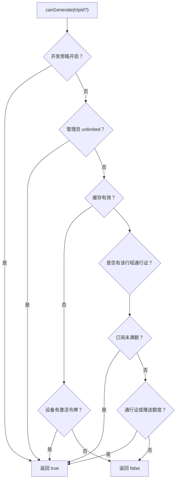
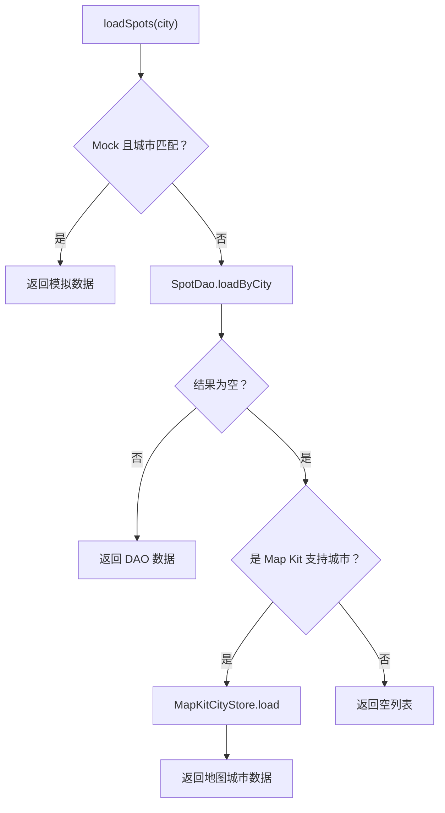
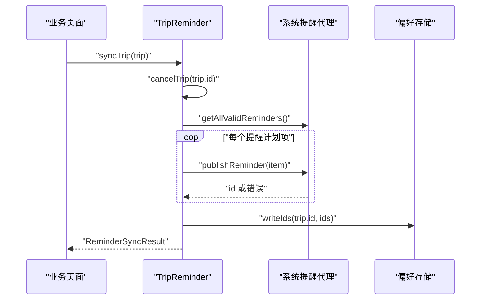
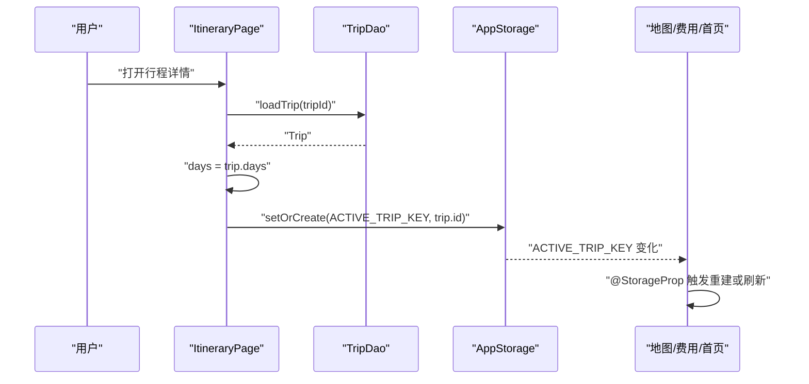
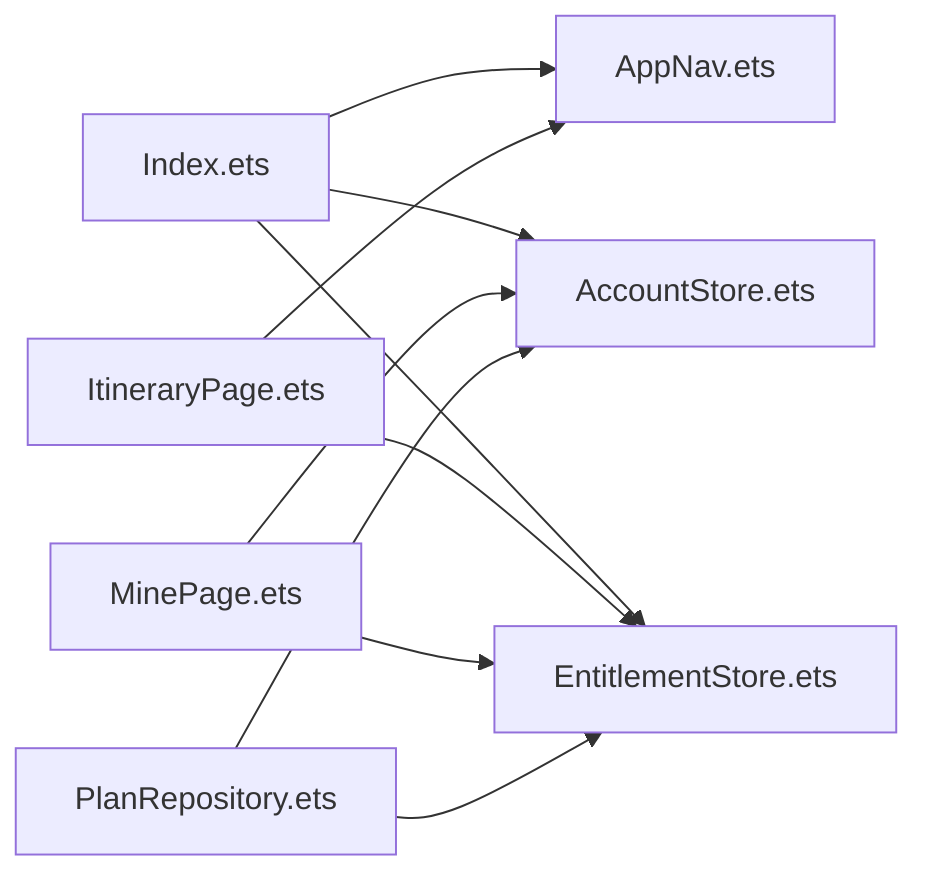

# 状态管理模式

<cite>
**本文引用的文件**
- [AccountStore.ets](file://entry/src/main/ets/data/AccountStore.ets)
- [EntitlementStore.ets](file://entry/src/main/ets/data/EntitlementStore.ets)
- [PlanRepository.ets](file://entry/src/main/ets/data/PlanRepository.ets)
- [TripReminder.ets](file://entry/src/main/ets/data/TripReminder.ets)
- [AppNav.ets](file://entry/src/main/ets/common/constants/AppNav.ets)
- [Index.ets](file://entry/src/main/ets/pages/Index.ets)
- [ItineraryPage.ets](file://entry/src/main/ets/pages/ItineraryPage.ets)
- [MinePage.ets](file://entry/src/main/ets/pages/MinePage.ets)
</cite>

## 目录
1. [引言](#引言)
2. [项目结构中的状态分层](#项目结构中的状态分层)
3. [核心组件与职责](#核心组件与职责)
4. [架构总览](#架构总览)
5. [详细组件分析](#详细组件分析)
6. [数据流向规范](#数据流向规范)
7. [依赖关系分析](#依赖关系分析)
8. [性能优化策略](#性能优化策略)
9. [故障排查指南](#故障排查指南)
10. [结论](#结论)

## 引言
本文聚焦 HarmonyOS 应用中的多层状态管理，围绕三类关键机制展开：

- **全局状态层**：通过 `AppStorage` 键在应用进程内广播登录态、活跃行程、页签切换、权益变更等跨页面信号。
- **组件级状态层**：使用 `@State`、`@Prop`、`@Link`、`@StorageProp`、`@Watch` 控制局部渲染和父子数据流。
- **持久化仓储层**：以 `AccountStore`、`EntitlementStore`、`PlanRepository` 等类封装偏好存储、配额判定、数据路由与 DAO 调用。

目标不是罗列所有装饰器，而是说明一个真实工程如何把“用户输入 → 组件状态 → Store 持久化 → AppStorage 广播 → 视图更新”串起来，并避免过度重渲染、状态不同步和内存泄漏。

## 项目结构中的状态分层
仓库的 ArkTS 前端主要位于 `entry/src/main/ets`，与状态相关的主要目录如下：

**图示来源**
- [Index.ets:120-145](file://entry/src/main/ets/pages/Index.ets#L120-L145)
- [ItineraryPage.ets:130-180](file://entry/src/main/ets/pages/ItineraryPage.ets#L130-L180)
- [MinePage.ets:69-80](file://entry/src/main/ets/pages/MinePage.ets#L69-L80)
- [AccountStore.ets:40-80](file://entry/src/main/ets/data/AccountStore.ets#L40-L80)
- [EntitlementStore.ets:120-180](file://entry/src/main/ets/data/EntitlementStore.ets#L120-L180)
- [PlanRepository.ets:18-55](file://entry/src/main/ets/data/PlanRepository.ets#L18-L55)
- [AppNav.ets:1-80](file://entry/src/main/ets/common/constants/AppNav.ets#L1-L80)

**章节来源**
- [Index.ets:120-145](file://entry/src/main/ets/pages/Index.ets#L120-L145)
- [AppNav.ets:1-80](file://entry/src/main/ets/common/constants/AppNav.ets#L1-L80)

## 核心组件与职责
| 类型 | 组件或键 | 职责 | 典型状态键 |
|---|---|---|---|
| 全局状态 | `AppNav` | 定义全局导航栈、页签序号、`AppStorage` 键及广播函数 | `TAB_INDEX_KEY`、`ACTIVE_TRIP_KEY`、`TAB_SWITCH_KEY`、`TAB_SHOWN_KEY`、`DRAFT_DIRTY_KEY` |
| 登录态 | `AccountStore` | 静默登录、游客兜底、UID 分区、持久化、登录态广播 | `AUTH_STATE_KEY` |
| 权益状态 | `EntitlementStore` | 订阅/通行证/赠送额度缓存、TTL 校验、生成与导出门禁、权益变更广播 | `TICK_KEY` |
| 数据路由 | `PlanRepository` | 区分 Mock、本地种子库、Map Kit 回退的数据加载入口 | 无全局键 |
| 系统提醒 | `TripReminder` | 发布/撤销行程提醒；结果用于诊断与提示，不直接驱动 UI 状态树 | 无全局键 |
| 根页面 | `Index` | 消费全局状态、桥接深链与 HdsTabs、维护当前页签 | 消费多个 `AppStorage` 键 |
| 行程页 | `ItineraryPage` | 加载行程、写入活跃行程、联动地图与时间线 | 消费 `ACTIVE_TRIP_KEY` |
| 我的页 | `MinePage` | 监听登录态、页签显示、权益刷新、个人档案刷新 | 消费 `AUTH_STATE_KEY`、`TAB_SHOWN_KEY`、`TICK_KEY` |

**章节来源**
- [AppNav.ets:1-80](file://entry/src/main/ets/common/constants/AppNav.ets#L1-L80)
- [AccountStore.ets:40-80](file://entry/src/main/ets/data/AccountStore.ets#L40-L80)
- [EntitlementStore.ets:120-180](file://entry/src/main/ets/data/EntitlementStore.ets#L120-L180)
- [PlanRepository.ets:18-55](file://entry/src/main/ets/data/PlanRepository.ets#L18-L55)
- [TripReminder.ets:1-60](file://entry/src/main/ets/data/TripReminder.ets#L1-L60)

## 架构总览
整体状态流可以概括为：

**图示来源**
- [AccountStore.ets:80-120](file://entry/src/main/ets/data/AccountStore.ets#L80-L120)
- [EntitlementStore.ets:180-235](file://entry/src/main/ets/data/EntitlementStore.ets#L180-L235)
- [Index.ets:120-145](file://entry/src/main/ets/pages/Index.ets#L120-L145)
- [ItineraryPage.ets:170-200](file://entry/src/main/ets/pages/ItineraryPage.ets#L170-L200)
- [MinePage.ets:69-80](file://entry/src/main/ets/pages/MinePage.ets#L69-L80)

## 详细组件分析

### 全局状态层：AppStorage 键与导航
`AppNav.ets` 是全局状态的“键中心”。它不只维护 NavPathStack，还集中声明：

- 根页签序号：`TAB_MAP`、`TAB_ITINERARY`、`TAB_PLAN`、`TAB_EXPENSE`、`TAB_MINE`
- 全局键：`TAB_INDEX_KEY`、`ACTIVE_TRIP_KEY`、`TAB_SWITCH_KEY`、`TAB_SHOWN_KEY`、`DRAFT_DIRTY_KEY`
- 广播函数：`requestTab`、`announceTabShown`、`markDraftDirty`
- 路由辅助：`stackOfRoute`、`isTabRoot`、`tabOfRoute`、`enterPlanningFlow`

根页 `Index.ets` 通过 `@StorageLink(TAB_INDEX_KEY)` 绑定外部深链初始页签，并通过 `@StorageProp(TAB_SWITCH_KEY)` 配合 `@Watch('applyTabSwitch')` 处理运行期切页签请求。

**图示来源**
- [AppNav.ets:110-145](file://entry/src/main/ets/common/constants/AppNav.ets#L110-L145)
- [Index.ets:120-145](file://entry/src/main/ets/pages/Index.ets#L120-L145)

**章节来源**
- [AppNav.ets:1-80](file://entry/src/main/ets/common/constants/AppNav.ets#L1-L80)
- [AppNav.ets:110-170](file://entry/src/main/ets/common/constants/AppNav.ets#L110-L170)
- [Index.ets:120-145](file://entry/src/main/ets/pages/Index.ets#L120-L145)

### 全局登录态：AccountStore
`AccountStore` 是应用登录态的单点：

- 初始化时从 `preferences` 恢复 UnionID，设置内部 `current` 快照。
- `publish()` 将当前登录态写入 `AppStorage` 的 `AUTH_STATE_KEY`。
- `login()` 走静默登录，失败时记录日志但不阻断首启，最终仍返回当前游客态。
- `logout()` 清空内部态、刷新 ID Token、清除权益缓存，再删除偏好键。
- `refreshIdToken()` 仅刷新票据，不改登录态，也不清权益缓存。

**图示来源**
- [AccountStore.ets:40-213](file://entry/src/main/ets/data/AccountStore.ets#L40-L213)

关键行为：

1. 冷启动先 `init`，确保 `uid()` 可用于 DAO 分区键。
2. 登录成功后清理 `EntitlementStore`，避免旧权益污染新账户。
3. 登出后也清理权益缓存，保持“游客态 + 空权益”的一致性。
4. `publish()` 在未初始化前输出空字符串，使根闸门不闪动已登录假象。

**章节来源**
- [AccountStore.ets:40-213](file://entry/src/main/ets/data/AccountStore.ets#L40-L213)

### 权益状态：EntitlementStore
`EntitlementStore` 负责商业化权益缓存和额度门禁：

- 本地缓存字段包括订阅、通行证、赠送额度、当日用量、每日上限。
- TTL 为 5 分钟；过期不等于没额度，若设备有激活令牌则允许继续尝试服务端判断。
- `canExport` 与 `canGenerate` 分别控制导出付费墙和生成按钮。
- `update` 和 `clear` 都会写 `TICK_KEY`，让订阅卡等页面即时刷新。

**图示来源**
- [EntitlementStore.ets:120-235](file://entry/src/main/ets/data/EntitlementStore.ets#L120-L235)

需要注意：

- 服务端明确返回 `subscription: null` 会清除本地订阅，这是订阅到期在端上的唯一同步通路。
- `DEV_SKIP_BFF` 只在开发环境放开权限，不能把它当作线上绕过逻辑。
- 权益变更后必须同时更新内存缓存、`AppStorage` 键和 `preferences`，否则会出现“买完回来仍被拦”的问题。

**章节来源**
- [EntitlementStore.ets:1-120](file://entry/src/main/ets/data/EntitlementStore.ets#L1-L120)
- [EntitlementStore.ets:120-235](file://entry/src/main/ets/data/EntitlementStore.ets#L120-L235)

### 数据仓储：PlanRepository
`PlanRepository` 是页面取数据的统一入口，遵循“页面不直连 DAO”的分层纪律：

- 当启用 Mock 且城市为演示城市时返回 Mock 数据。
- 优先从本地种子库读取 Spot 与 Area。
- 对于不支持的城市，若种子库为空则回退到 Map Kit。
- 对空库只打日志，不抛异常，由调用方决定空态展示。

**图示来源**
- [PlanRepository.ets:18-55](file://entry/src/main/ets/data/PlanRepository.ets#L18-L55)

**章节来源**
- [PlanRepository.ets:18-55](file://entry/src/main/ets/data/PlanRepository.ets#L18-L55)

### 系统提醒：TripReminder
`TripReminder` 不属于 UI 状态树，但它体现 Store 层的另一个重要职责：**与系统能力交互并对外暴露结构化结果**。

- 按行程发布出发倒计时、预约提前、晨间播报三类提醒。
- 发布前撤销上次发布的提醒 ID，保证幂等。
- 区分“能力未开通”和“数量超限”两类系统限制。
- 提供探针方法方便真机调试锁屏提醒。

**图示来源**
- [TripReminder.ets:60-140](file://entry/src/main/ets/data/TripReminder.ets#L60-L140)

**章节来源**
- [TripReminder.ets:1-60](file://entry/src/main/ets/data/TripReminder.ets#L1-L60)
- [TripReminder.ets:60-140](file://entry/src/main/ets/data/TripReminder.ets#L60-L140)

### 页面消费全局状态：Index 与 Itinerary
`Index.ets` 作为根容器，消费多组全局状态：

- `@StorageLink(TAB_INDEX_KEY)`：外部深链决定初始页签。
- `@StorageProp(TAB_SWITCH_KEY)` + `@Watch`：运行期切页签。
- `@StorageProp(AUTH_STATE_KEY)`：登录闸门。
- `@StorageProp(CONSENT_AGREED_KEY)`：隐私同意门控。
- `@StorageProp(KEY_CURRENT_BREAKPOINT)`：断点信息。
- `@StorageProp(TOP_STRIP_KEY)`：顶部底色资源名。
- 多处 `AppStorage.setOrCreate(ACTIVE_TRIP_KEY, ...)` 维护最近活动行程。

`ItineraryPage.ets` 则演示“加载异步数据 → 更新组件状态 → 写入活跃行程 → 触发其他页面响应”的典型流程：

**图示来源**
- [ItineraryPage.ets:170-200](file://entry/src/main/ets/pages/ItineraryPage.ets#L170-L200)
- [Index.ets:700-710](file://entry/src/main/ets/pages/Index.ets#L700-L710)

**章节来源**
- [Index.ets:120-145](file://entry/src/main/ets/pages/Index.ets#L120-L145)
- [Index.ets:700-710](file://entry/src/main/ets/pages/Index.ets#L700-L710)
- [ItineraryPage.ets:170-200](file://entry/src/main/ets/pages/ItineraryPage.ets#L170-L200)

## 数据流向规范
仓库中可归纳出以下标准路径：

| 场景 | 输入 | 组件状态 | Store 动作 | AppStorage 广播 | 视图更新 |
|---|---|---|---|---|---|
| 切页签 | 用户点击或深链 | `currentTab` | 无 | `TAB_SWITCH_KEY` | `Index.applyTabSwitch` 切换 HdsTabs |
| 登录成功 | 账号服务 | `AccountStore.current` | 写偏好、清权益 | `AUTH_STATE_KEY` | 登录闸门、我的页刷新 |
| 购买订阅 | BFF 回调 | `EntitlementStore.cached` | 写偏好 | `TICK_KEY` | 我的页订阅卡刷新 |
| 查看行程 | 用户点击 | `days`、`titleText` | 读 TripDao | `ACTIVE_TRIP_KEY` | 地图/费用根页跟随 |
| 草稿修改 | 用户编辑 | 草稿对象 | 写草稿 | `DRAFT_DIRTY_KEY` | 首页按钮状态刷新 |
| 数据加载 | 城市选择 | Spot/Area 列表 | Mock/DAO/MapKit | 无 | 列表渲染 |

最佳实践：

1. **命令式操作进 Store**：登录、登出、权益更新、提醒发布等副作用应集中在 Store。
2. **UI 只读状态**：页面用 `@State` 保存渲染所需的最小数据，不要直接把整个数据库对象塞进状态。
3. **广播键带时序**：如 `index:timestamp`、`dirty:timestamp`，防止同一值重复触发 `@Watch`。
4. **异步结果回填组件状态**：Store 返回 Promise，页面在 `.then` 中更新 `@State`。
5. **错误落日志而非崩溃**：登录失败、偏好读写失败、提醒发布失败都应降级或提示。

**章节来源**
- [AppNav.ets:110-170](file://entry/src/main/ets/common/constants/AppNav.ets#L110-L170)
- [AccountStore.ets:80-160](file://entry/src/main/ets/data/AccountStore.ets#L80-L160)
- [EntitlementStore.ets:180-235](file://entry/src/main/ets/data/EntitlementStore.ets#L180-L235)
- [ItineraryPage.ets:170-200](file://entry/src/main/ets/pages/ItineraryPage.ets#L170-L200)

## 依赖关系分析

**图示来源**
- [Index.ets:120-145](file://entry/src/main/ets/pages/Index.ets#L120-L145)
- [ItineraryPage.ets:130-180](file://entry/src/main/ets/pages/ItineraryPage.ets#L130-L180)
- [MinePage.ets:69-80](file://entry/src/main/ets/pages/MinePage.ets#L69-L80)
- [PlanRepository.ets:18-55](file://entry/src/main/ets/data/PlanRepository.ets#L18-L55)

耦合关系说明：

- `AccountStore` 与 `EntitlementStore` 解耦，但登录/登出需要双方协作，因此登录成功时清理权益缓存。
- `PlanRepository` 不直接持有 UI 状态，适合扩展更多数据源而不影响页面。
- 页面通过 `AppNav` 定义的键和函数通信，而不是互相引用对方的私有状态。
- `TripReminder` 与其他 Store 弱耦合，主要受业务页面调用，不影响状态一致性主链。

**章节来源**
- [AccountStore.ets:80-160](file://entry/src/main/ets/data/AccountStore.ets#L80-L160)
- [EntitlementStore.ets:180-235](file://entry/src/main/ets/data/EntitlementStore.ets#L180-L235)
- [PlanRepository.ets:18-55](file://entry/src/main/ets/data/PlanRepository.ets#L18-L55)

## 性能优化策略

### 状态粒度控制
- 全局状态只放跨组件需要的最小键，例如登录态、活跃行程、页签序号、权益 tick。
- 页面内部复杂对象使用 `@State`，但只把真正参与渲染的部分放入状态树。
- `Index` 中大量 `@State` 用于底部胶囊交互，这些状态属于局部渲染，不应上提到全局。

参考实现位置：

- [Index.ets:120-145](file://entry/src/main/ets/pages/Index.ets#L120-L145)
- [Index.ets:145-220](file://entry/src/main/ets/pages/Index.ets#L145-L220)

### 避免不必要的重新渲染
- 使用 `@StorageProp` 读取只读全局配置，如主题 tick、断点、状态栏高度。
- 使用 `@StorageLink` 绑定需要双向语义的全局几何或布局参数，并确保在 `build` 中直读。
- `@Watch` 只做轻量调度，如切页签、刷新数据，不要在回调里做昂贵计算。
- `Index` 对 dock 胶囊形变使用 GPU scale 而非逐帧修改布局宽高，避免频繁重排。

参考实现位置：

- [Index.ets:129-145](file://entry/src/main/ets/pages/Index.ets#L129-L145)

### 状态一致性优于强一致
- 权益缓存采用 5 分钟 TTL，过期时如果设备已有激活令牌，仍允许继续与服务端交互，而不是永久停在付费页。
- 这比“缓存一过期就拒绝所有后续操作”更贴近真实用户体验。

参考实现位置：

- [EntitlementStore.ets:180-210](file://entry/src/main/ets/data/EntitlementStore.ets#L180-L210)

### 内存与生命周期防护
- Store 使用静态实例和静态偏好对象，适合应用级单例模式，但应避免持有长生命周期 UI 引用。
- 异步操作完成后才更新 UI，失败路径也要走到终态，避免界面卡在加载中。
- 提醒发布失败要分类处理，而不是把所有错误都当成普通失败。

参考实现位置：

- [ItineraryPage.ets:170-200](file://entry/src/main/ets/pages/ItineraryPage.ets#L170-L200)
- [TripReminder.ets:100-140](file://entry/src/main/ets/data/TripReminder.ets#L100-L140)

[本节为通用性能建议，不强制对应具体代码片段]

## 故障排查指南

| 现象 | 可能原因 | 排查位置 | 修复方向 |
|---|---|---|---|
| 登录后仍看到旧权益 | 未清理权益缓存 | `AccountStore.login` | 登录成功后调用 `EntitlementStore.clear` |
| 购买订阅后卡片不刷新 | 权益 tick 未广播 | `EntitlementStore.update` | 更新后写 `TICK_KEY` |
| 切页签无效 | `TAB_SWITCH_KEY` 值未变或被忽略 | `Index.applyTabSwitch` | 使用带时间戳的值 |
| 查看详情后地图/费用仍显示旧行程 | 未写 `ACTIVE_TRIP_KEY` | `ItineraryPage.reload` | 加载成功后写入活跃行程 |
| 权益页面长期显示付费墙 | 缓存过期 + 设备无令牌 | `EntitlementStore.canGenerate` | 检查设备激活状态与 BFF 可达性 |
| 提醒不响 | 系统能力未开通或通知关闭 | `TripReminder.syncTrip` | 检查 AGC 能力、通知开关、权限签名 |
| 首次进入页签数据陈旧 | 只依赖 `aboutToAppear` | `MinePage`、`TripsPage` | 使用 `TAB_SHOWN_KEY` 广播刷新 |

**章节来源**
- [AccountStore.ets:80-160](file://entry/src/main/ets/data/AccountStore.ets#L80-L160)
- [EntitlementStore.ets:180-235](file://entry/src/main/ets/data/EntitlementStore.ets#L180-L235)
- [Index.ets:120-145](file://entry/src/main/ets/pages/Index.ets#L120-L145)
- [ItineraryPage.ets:170-200](file://entry/src/main/ets/pages/ItineraryPage.ets#L170-L200)
- [TripReminder.ets:60-140](file://entry/src/main/ets/data/TripReminder.ets#L60-L140)

## 结论
这个项目的状态管理遵循清晰分层：

- **表现层**使用 `@State`、`@Prop`、`@Link`、`@StorageProp`、`@Watch` 管理局部渲染和父子数据流。
- **全局状态层**通过 `AppStorage` 键在进程内广播登录态、页签、活跃行程、权益变更等信号。
- **仓储层**以 `AccountStore`、`EntitlementStore`、`PlanRepository`、`TripReminder` 封装副作用、持久化和系统能力。

新增 Store 时应遵循相同模式：

1. 定义明确的持久化键和内存缓存。
2. 提供同步查询方法和异步写操作方法。
3. 在状态变化时广播最小化的 `AppStorage` 键。
4. 在页面侧用 `@StorageProp` 或 `@StorageLink` 消费，并用 `@Watch` 触发必要刷新。
5. 对错误进行降级和日志记录，不让 UI 永远卡在中间态。

这套模式既保证了跨组件状态同步，又避免了把全部业务逻辑塞进页面，是当前 HarmonyOS 应用中较为稳健的状态管理实践。