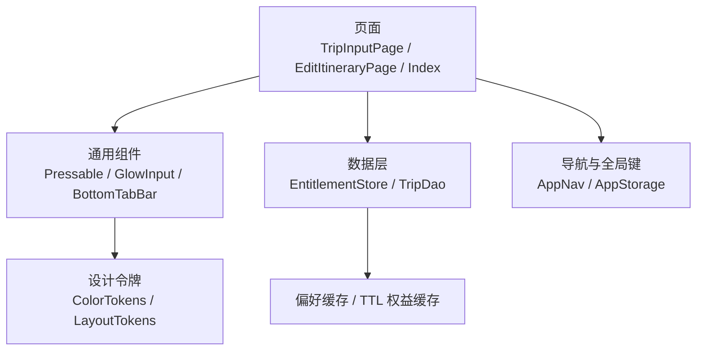
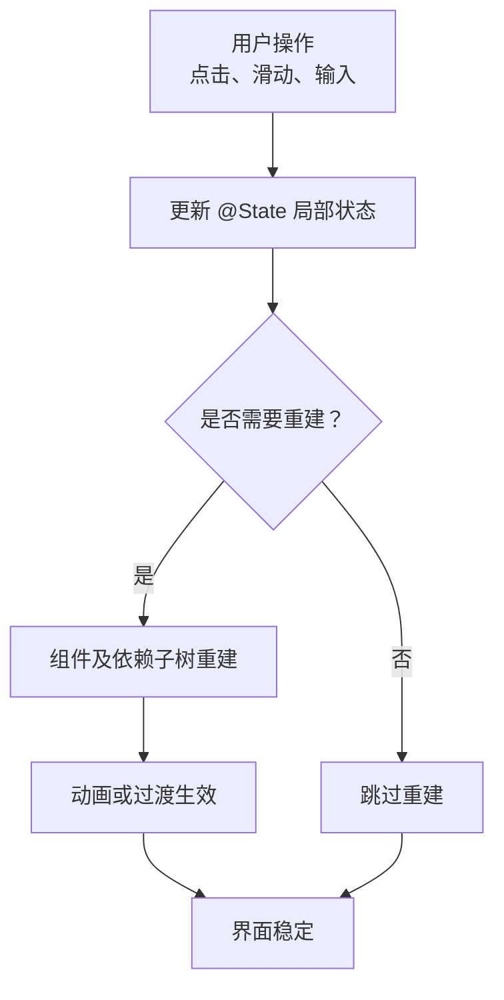
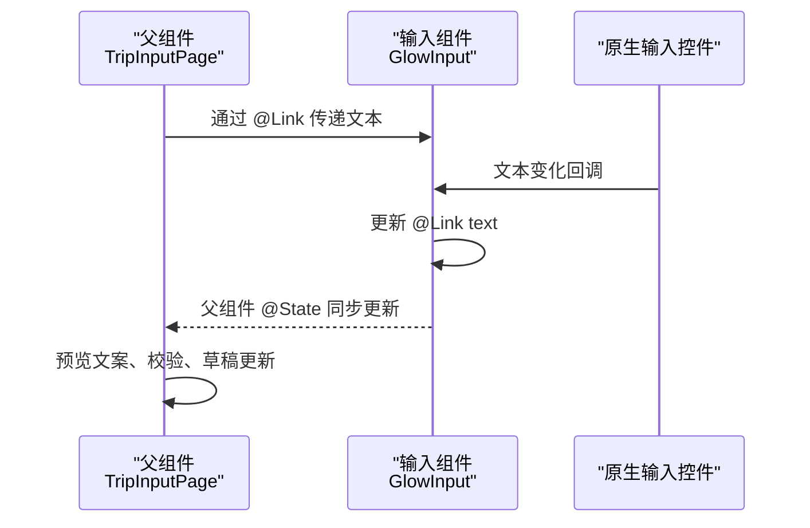
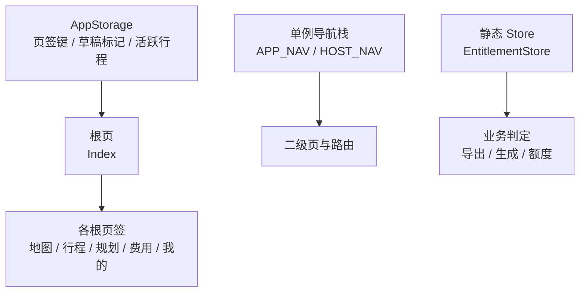
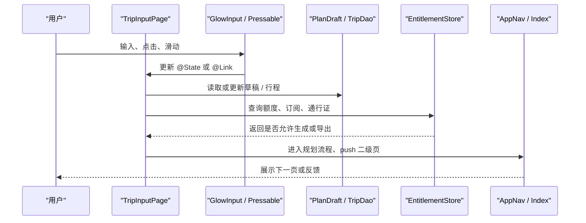
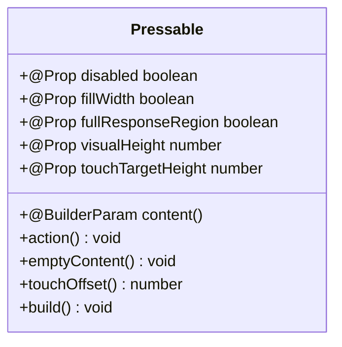
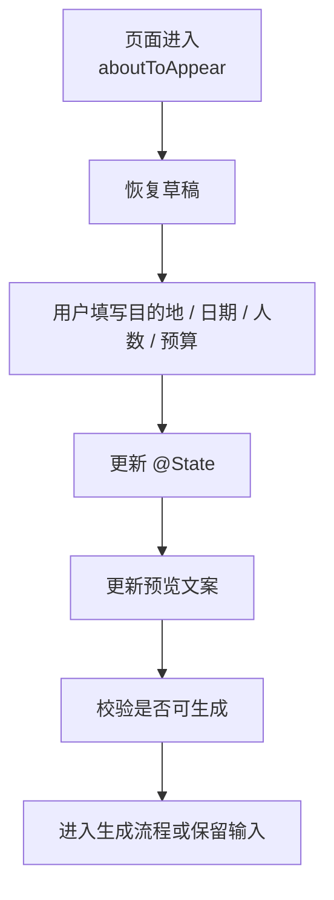
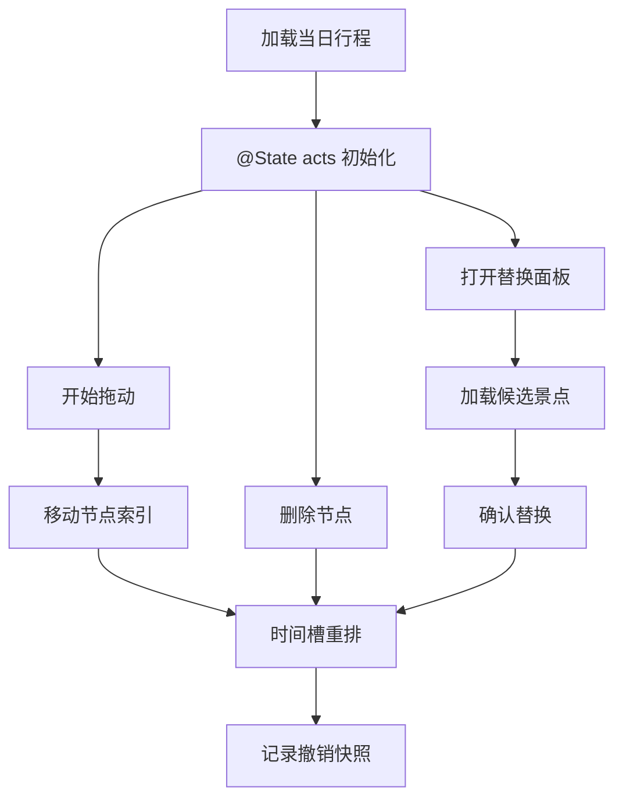
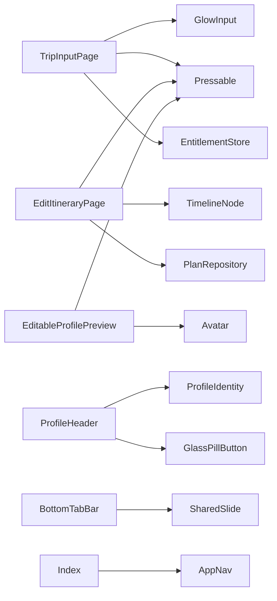

# 组件级状态管理

<cite>
**本文引用的文件**   
- [entry/src/main/ets/components/Pressable.ets](file://entry/src/main/ets/components/Pressable.ets)
- [entry/src/main/ets/components/GlowInput.ets](file://entry/src/main/ets/components/GlowInput.ets)
- [entry/src/main/ets/pages/TripInputPage.ets](file://entry/src/main/ets/pages/TripInputPage.ets)
- [entry/src/main/ets/pages/EditItineraryPage.ets](file://entry/src/main/ets/pages/EditItineraryPage.ets)
- [entry/src/main/ets/components/EditableProfilePreview.ets](file://entry/src/main/ets/components/EditableProfilePreview.ets)
- [entry/src/main/ets/components/ProfileHeader.ets](file://entry/src/main/ets/components/ProfileHeader.ets)
- [entry/src/main/ets/components/ProfileIdentity.ets](file://entry/src/main/ets/components/ProfileIdentity.ets)
- [entry/src/main/ets/components/BottomTabBar.ets](file://entry/src/main/ets/components/BottomTabBar.ets)
- [entry/src/main/ets/pages/Index.ets](file://entry/src/main/ets/pages/Index.ets)
- [entry/src/main/ets/common/constants/AppNav.ets](file://entry/src/main/ets/common/constants/AppNav.ets)
- [entry/src/main/ets/data/EntitlementStore.ets](file://entry/src/main/ets/data/EntitlementStore.ets)
</cite>

## 目录
1. [引言](#引言)
2. [项目结构中的状态边界](#项目结构中的状态边界)
3. [核心状态装饰器总览](#核心状态装饰器总览)
4. [@State：局部状态与自动更新](#state局部状态与自动更新)
5. [@Prop：单向数据流与性能](#prop单向数据流与性能)
6. [@Link：双向绑定与表单场景](#link双向绑定与表单场景)
7. [@Provide/@Consume 的上下文通信定位](#provideconsume-的上下文通信定位)
8. [架构视图：状态在页面、组件与服务之间如何流动](#架构视图状态在页面组件与服务之间如何流动)
9. [关键组件深度分析](#关键组件深度分析)
10. [依赖关系图](#依赖关系图)
11. [性能考虑](#性能考虑)
12. [故障排查](#故障排查)
13. [结论](#结论)

## 引言

本仓库是一个基于 ArkTS 和 ArkUI 的鸿蒙应用，包含前端页面、业务数据层以及后端 BFF。本文聚焦 ArkTS 组件内部的状态管理模式，围绕以下装饰器展开：

- `@State`：组件内部的局部状态，变更时触发 UI 重建。
- `@Prop`：父组件向子组件传递只读数据，强调单向数据流。
- `@Link`：父子间共享引用，常用于输入框、图片对象等需要双向同步的场景。
- `@Provide` / `@Consume`：跨层级上下文通信，但当前工程使用 V1 组件模型，因此实际全局通信主要走 AppStorage、单例栈与静态 Store。

本文不直接粘贴源码，而是通过文件路径和行号定位实现细节，并配合图示解释数据流向、生命周期和性能取舍。

## 项目结构中的状态边界

ArkTS 组件状态通常遵循以下边界：

| 层次 | 职责 | 典型状态位置 |
| --- | --- | --- |
| 页面层 | 组合业务、驱动导航、维护用户交互状态 | `pages/*.ets`，如 `TripInputPage.ets`、`EditItineraryPage.ets`、`Index.ets` |
| 组件层 | 展示、手势、样式、可复用交互 | `components/*.ets`，如 `Pressable.ets`、`GlowInput.ets`、`BottomTabBar.ets` |
| 数据层 | 持久化、缓存、权限判断、网络结果映射 | `data/*.ets`，如 `EntitlementStore.ets` |
| 配置与常量 | 路由键、导航栈、设计令牌 | `common/constants/*.ets`、`design/*.ets` |

**图表来源**
- [entry/src/main/ets/pages/TripInputPage.ets:1-120](file://entry/src/main/ets/pages/TripInputPage.ets#L1-L120)
- [entry/src/main/ets/pages/EditItineraryPage.ets:1-120](file://entry/src/main/ets/pages/EditItineraryPage.ets#L1-L120)
- [entry/src/main/ets/components/Pressable.ets:1-84](file://entry/src/main/ets/components/Pressable.ets#L1-L84)
- [entry/src/main/ets/components/GlowInput.ets:1-83](file://entry/src/main/ets/components/GlowInput.ets#L1-L83)
- [entry/src/main/ets/data/EntitlementStore.ets:1-120](file://entry/src/main/ets/data/EntitlementStore.ets#L1-L120)
- [entry/src/main/ets/common/constants/AppNav.ets:1-120](file://entry/src/main/ets/common/constants/AppNav.ets#L1-L120)

**章节来源**
- [entry/src/main/ets/pages/TripInputPage.ets:1-120](file://entry/src/main/ets/pages/TripInputPage.ets#L1-L120)
- [entry/src/main/ets/pages/EditItineraryPage.ets:1-120](file://entry/src/main/ets/pages/EditItineraryPage.ets#L1-L120)
- [entry/src/main/ets/data/EntitlementStore.ets:1-120](file://entry/src/main/ets/data/EntitlementStore.ets#L1-L120)
- [entry/src/main/ets/common/constants/AppNav.ets:1-120](file://entry/src/main/ets/common/constants/AppNav.ets#L1-L120)

## 核心状态装饰器总览

| 装饰器 | 方向 | 语义 | 典型场景 | 风险点 |
| --- | --- | --- | --- | --- |
| `@State` | 组件内 | 局部可观察状态，变更触发重建 | 按钮按下态、输入草稿、拖拽偏移、加载标志 | 高频更新可能引起频繁重绘；需区分布局值与合成变换值 |
| `@Prop` | 父 → 子 | 只读传入，不可由子组件修改 | 头像、昵称、标签、图标、尺寸 | 复杂对象按引用比较，可能不触发更新；大量字段会增大构建成本 |
| `@Link` | 父子共享 | 双向同步或共享引用 | 输入框文本、图片对象、选中下标 | 误用可能让子组件意外改变父状态；引用类型需理解浅比较 |
| `@Provide` / `@Consume` | 上下文 | V2 组件树的上下文传播 | 主题、语言、全局权限 | 当前工程注释说明仅 V2 可用，V1 走单例栈与 AppStorage |

本仓库中：

- `@State` 广泛用于页面与组件内部状态。
- `@Prop` 是纯展示组件的主要参数形式。
- `@Link` 用于输入框文本、图片预览、底部页签下标等双向场景。
- `@Provide` / `@Consume` 在当前工程中并非主流量化方案，全局通信更多通过 `AppStorage`、`NavPathStack` 单例和静态 Store。

**章节来源**
- [entry/src/main/ets/components/Pressable.ets:1-84](file://entry/src/main/ets/components/Pressable.ets#L1-L84)
- [entry/src/main/ets/components/GlowInput.ets:1-83](file://entry/src/main/ets/components/GlowInput.ets#L1-L83)
- [entry/src/main/ets/components/EditableProfilePreview.ets:1-60](file://entry/src/main/ets/components/EditableProfilePreview.ets#L1-L60)
- [entry/src/main/ets/components/BottomTabBar.ets:1-80](file://entry/src/main/ets/components/BottomTabBar.ets#L1-L80)
- [entry/src/main/ets/common/constants/AppNav.ets:1-10](file://entry/src/main/ets/common/constants/AppNav.ets#L1-L10)

## @State：局部状态与自动更新

### 定义与作用域

`@State` 表示组件内部的可观察状态。当这些属性被赋值时，框架会自动调度该组件及其依赖它的子树重建。它适合表达：

- 用户交互状态，例如是否按下、是否显示弹窗、是否正在识别。
- 本地计算状态，例如拖动索引、候选列表、时间槽重排后的活动数组。
- 临时 UI 状态，例如顶栏磨砂是否因滚动变为透明。

### 自动更新机制

以行程基础输入页为例，页面维护了目的地、人数、预算、日期、一句话解析预览、加载标志等多个 `@State`。这些状态在用户选择城市、调整人数、切换预算、选择日期后更新，从而驱动对应控件重新渲染。

以编辑行程页为例，页面把当日活动数组作为 `@State`，并在移动、删除、替换后重新赋值，使 `List` 和计时线节点刷新。

### 状态粒度最佳实践

从代码可见的合理模式包括：

1. **按语义分组**：例如把“输入表单状态”“预览状态”“导航状态”分开声明，避免一个巨型对象承载所有 UI 信息。
2. **避免把布局几何直接写进高频状态**：底部悬浮页签栏对拖拽形变使用 `scale` 对应的缩放状态，而不是逐帧直写容器宽度，以避免每帧重布局和材质重采样。
3. **区分渲染状态与非渲染中间变量**：例如拖拽过程中的速度、平滑值、停顿检测等可以放在普通成员变量里，只有真正影响渲染的值才放到 `@State`。
4. **清理异步回调的生命周期**：页面销毁标志位用于防止异步请求完成后写入已销毁页面的状态。

**图表来源**
- [entry/src/main/ets/pages/TripInputPage.ets:1-120](file://entry/src/main/ets/pages/TripInputPage.ets#L1-L120)
- [entry/src/main/ets/pages/EditItineraryPage.ets:1-120](file://entry/src/main/ets/pages/EditItineraryPage.ets#L1-L120)
- [entry/src/main/ets/components/BottomTabBar.ets:1-120](file://entry/src/main/ets/components/BottomTabBar.ets#L1-L120)

**章节来源**
- [entry/src/main/ets/pages/TripInputPage.ets:1-120](file://entry/src/main/ets/pages/TripInputPage.ets#L1-L120)
- [entry/src/main/ets/pages/EditItineraryPage.ets:1-120](file://entry/src/main/ets/pages/EditItineraryPage.ets#L1-L120)
- [entry/src/main/ets/components/BottomTabBar.ets:1-120](file://entry/src/main/ets/components/BottomTabBar.ets#L1-L120)

## @Prop：单向数据流与性能

### 父传子的只读数据

`@Prop` 是父组件向子组件传递数据的单向通道。子组件不应修改 `@Prop`，而应通过事件回调把意图上抛给父组件处理。

典型例子：

- `ProfileHeader` 接收头像、昵称、性别、简介、统计标签、登录状态等 `@Prop`，并把编辑、关注、打开草稿箱等操作封装为回调。
- `ProfileIdentity` 接收更细粒度的身份字段，负责呈现头像、性别徽章、ID 等。
- `Pressable` 接收 `disabled`、`fillWidth`、`visualHeight`、`touchTargetHeight` 等表现层参数。

### 不可变数据的优势

1. **数据流向清晰**：子组件不会意外修改父状态。
2. **更容易测试**：只需要传入一组 props，就能验证子组件的渲染行为。
3. **减少状态竞争**：多个子组件不会同时写同一份父状态。
4. **便于性能优化**：框架可以对不可变 props 做增量比较，避免不必要的重建。

### 复杂对象的比较注意事项

在 `EditableProfilePreview` 中，头像预览背景图等图片对象使用了 `@Link`，因为注释明确指出：对于 `image.PixelMap` 这类复杂对象，`@Prop` 按引用比较，父组件更新不一定能驱动子组件重渲染。这提醒我们：

- 简单值优先用 `@Prop`。
- 需要父子共享可变引用、或需要双向更新的值用 `@Link`。
- 对复杂对象，要确认比较策略是否满足预期。

**章节来源**
- [entry/src/main/ets/components/ProfileHeader.ets:1-106](file://entry/src/main/ets/components/ProfileHeader.ets#L1-L106)
- [entry/src/main/ets/components/ProfileIdentity.ets:1-116](file://entry/src/main/ets/components/ProfileIdentity.ets#L1-L116)
- [entry/src/main/ets/components/Pressable.ets:1-84](file://entry/src/main/ets/components/Pressable.ets#L1-L84)
- [entry/src/main/ets/components/EditableProfilePreview.ets:1-60](file://entry/src/main/ets/components/EditableProfilePreview.ets#L1-L60)

## @Link：双向绑定与表单场景

### 输入框的双向文本

`GlowInput` 使用 `@Link text: string` 暴露受控文本。内部 `TextInput` 的 `onChange` 会把新值赋给 `this.text`，并同时调用可选的 `onChange` 回调。这样父组件只需把 `@State` 变量通过 `$` 语法传给 `text`，即可实现双向同步。

`TripInputPage` 正是这种模式的典型使用者：用户在输入框打字、选择日期、调整人数时，状态变化会立即反映到预览文案、预算条、人数选项和生成入口。

### 图片对象的双向共享

`EditableProfilePreview` 将头像预览和背景预览都声明为 `@Link`，原因是：

- 父组件选择图片后得到新的 `PixelMap` 引用。
- 子组件需要在未保存前即时显示最新预览。
- 如果只用 `@Prop`，复杂对象可能不会触发必要的更新。

### 选中态的双向下标

`BottomTabBar` 把当前选中下标声明为 `@Link currentIndex: number`，允许父组件与其保持同步。同时组件内部也有 `@State` 控制长按擦除、悬停下标、按压光斑等临时交互状态。

**图表来源**
- [entry/src/main/ets/components/GlowInput.ets:1-83](file://entry/src/main/ets/components/GlowInput.ets#L1-L83)
- [entry/src/main/ets/pages/TripInputPage.ets:1-120](file://entry/src/main/ets/pages/TripInputPage.ets#L1-L120)

**章节来源**
- [entry/src/main/ets/components/GlowInput.ets:1-83](file://entry/src/main/ets/components/GlowInput.ets#L1-L83)
- [entry/src/main/ets/pages/TripInputPage.ets:1-120](file://entry/src/main/ets/pages/TripInputPage.ets#L1-L120)
- [entry/src/main/ets/components/EditableProfilePreview.ets:1-60](file://entry/src/main/ets/components/EditableProfilePreview.ets#L1-L60)
- [entry/src/main/ets/components/BottomTabBar.ets:1-80](file://entry/src/main/ets/components/BottomTabBar.ets#L1-L80)

## @Provide/@Consume 的上下文通信定位

当前工程中有一个重要约束：`@Provide` / `@Consumer` 仅适用于 `@ComponentV2`，而本工程统一使用 V1 组件模型。因此，全局通信并不是通过这两个装饰器实现的，而是通过：

1. **AppStorage 键**：例如页签序号、活跃行程、页签切换请求、Dock 页签显示通知、草稿脏标记。
2. **单例导航栈**：`APP_NAV`、`MAP_NAV`、`EXPENSE_NAV`、`TRIPS_NAV`、`PROFILE_NAV`、`HOST_NAV`。
3. **静态 Store**：例如 `EntitlementStore` 的静态方法和缓存。

这意味着：虽然文档目标要求解释 `@Provide` / `@Consume`，但在本仓库的实际架构中，深层组件树的数据传递主要通过 AppStorage 和单例完成，而不是上下文装饰器。

**图表来源**
- [entry/src/main/ets/common/constants/AppNav.ets:1-120](file://entry/src/main/ets/common/constants/AppNav.ets#L1-L120)
- [entry/src/main/ets/pages/Index.ets:1-120](file://entry/src/main/ets/pages/Index.ets#L1-L120)
- [entry/src/main/ets/data/EntitlementStore.ets:1-120](file://entry/src/main/ets/data/EntitlementStore.ets#L1-L120)

**章节来源**
- [entry/src/main/ets/common/constants/AppNav.ets:1-20](file://entry/src/main/ets/common/constants/AppNav.ets#L1-L20)
- [entry/src/main/ets/common/constants/AppNav.ets:120-221](file://entry/src/main/ets/common/constants/AppNav.ets#L120-L221)
- [entry/src/main/ets/pages/Index.ets:1-120](file://entry/src/main/ets/pages/Index.ets#L1-L120)
- [entry/src/main/ets/data/EntitlementStore.ets:1-120](file://entry/src/main/ets/data/EntitlementStore.ets#L1-L120)

## 架构视图：状态在页面、组件与服务之间如何流动

整体数据流可以分为四层：

1. **用户输入层**：`TripInputPage`、`EditItineraryPage` 收集目的地、日期、人数、预算、活动顺序。
2. **组件交互层**：`Pressable`、`GlowInput`、`BottomTabBar` 把用户动作转成状态变化。
3. **业务数据层**：`PlanDraft`、`TripDao`、`EntitlementStore` 负责草稿、行程数据和权限判定。
4. **全局协调层**：`AppNav`、`AppStorage`、`Index` 负责切页签、深链落点、宿主导航栈。

**图表来源**
- [entry/src/main/ets/pages/TripInputPage.ets:1-120](file://entry/src/main/ets/pages/TripInputPage.ets#L1-L120)
- [entry/src/main/ets/components/GlowInput.ets:1-83](file://entry/src/main/ets/components/GlowInput.ets#L1-L83)
- [entry/src/main/ets/components/Pressable.ets:1-84](file://entry/src/main/ets/components/Pressable.ets#L1-L84)
- [entry/src/main/ets/data/EntitlementStore.ets:1-120](file://entry/src/main/ets/data/EntitlementStore.ets#L1-L120)
- [entry/src/main/ets/common/constants/AppNav.ets:120-221](file://entry/src/main/ets/common/constants/AppNav.ets#L120-L221)

## 关键组件深度分析

### 可按压组件 Pressable

`Pressable` 是家族统一的“按下反馈”封装件，职责单一：

- 接收 `content` 作为插槽内容。
- 通过 `@Prop disabled` 控制禁用态。
- 通过 `@Prop fillWidth`、`visualHeight`、`touchTargetHeight` 控制命中区域和响应区。
- 内部用 `@State` 相关的样式系统实现正常态和按下态的透明度、缩放。
- 通过 `.animation()` 和 `.stateStyles()` 提供按压动效。
- 通过 `onClick` 调用外部传入的 `action`。

它的状态粒度很干净：没有业务逻辑，只负责交互视觉和命中区域。这也是 `@State` 的最佳实践之一——把“看起来怎样”和“做什么”解耦。

**图表来源**
- [entry/src/main/ets/components/Pressable.ets:1-84](file://entry/src/main/ets/components/Pressable.ets#L1-L84)

**章节来源**
- [entry/src/main/ets/components/Pressable.ets:1-84](file://entry/src/main/ets/components/Pressable.ets#L1-L84)

### 输入组件 GlowInput

`GlowInput` 的职责是把原生 `TextInput` 包装成带占位符、高度、圆角、玻璃风格、最大长度和事件回调的统一输入框。

关键点：

- `@Link text` 让父组件的 `@State` 和输入框文本保持双向同步。
- `@Prop placeholder`、`fillWidth`、`inputHeight`、`radius`、`segmentStyle`、`maxLength` 是单向表现参数。
- `onChange`、`onEnter`、`onFocusChanged` 把输入事件上抛给父组件。
- 内部还根据 `segmentStyle` 切换背景模糊、边框和颜色。

这个组件展示了典型的“双向值 + 单向样式 + 单向事件”的组合。

**章节来源**
- [entry/src/main/ets/components/GlowInput.ets:1-83](file://entry/src/main/ets/components/GlowInput.ets#L1-L83)

### 行程输入页 TripInputPage

`TripInputPage` 是用户旅程的起点之一，集中了大量 `@State`：

- 人数、城市、出发日、返程日、预算。
- 一句话输入、解析中标志、解析错误提示。
- 预览面板开关、各类预览文案。
- 顶栏滚动状态、断点、状态栏高度。

它的状态更新流程大致是：

1. 页面进入时恢复草稿。
2. 用户选择城市、日期、人数、预算。
3. 状态变更后更新预览文案。
4. 最终决定是否允许生成行程，并跳转下一流程。

**图表来源**
- [entry/src/main/ets/pages/TripInputPage.ets:1-120](file://entry/src/main/ets/pages/TripInputPage.ets#L1-L120)

**章节来源**
- [entry/src/main/ets/pages/TripInputPage.ets:1-120](file://entry/src/main/ets/pages/TripInputPage.ets#L1-L120)

### 行程编辑页 EditItineraryPage

`EditItineraryPage` 的核心是“拖动与替换”，其状态包括：

- 当前日的活动数组 `acts`。
- 拖拽索引 `dragIdx`。
- 替换面板开关 `showReplace`。
- 补选或替换的目标索引 `replaceIdx`。
- 候选景点列表 `candidates`。
- 撤销历史 `history`。

它展示了较复杂的 `@State` 组合：既有列表数据，又有交互临时状态，还有用于回退的历史快照。

**图表来源**
- [entry/src/main/ets/pages/EditItineraryPage.ets:1-120](file://entry/src/main/ets/pages/EditItineraryPage.ets#L1-L120)

**章节来源**
- [entry/src/main/ets/pages/EditItineraryPage.ets:1-120](file://entry/src/main/ets/pages/EditItineraryPage.ets#L1-L120)

### 资料预览组件 EditableProfilePreview

这个组件体现了 `@Prop` 与 `@Link` 的选择差异：

- 头像预览和背景预览使用 `@Link`，因为图片对象需要父子共享引用，且父组件可能在保存前多次更新预览。
- 昵称、简介、性别、统计数字等使用 `@Prop`，因为这些是只读展示数据。
- 头像和背景选择动作通过回调上抛给父组件。

注释还特别指出：如果统计列使用对象字面量按值传递，可能出现静态快照问题；按引用传递才能确保父级 `@Prop` 更新驱动重渲染。这是组件状态粒度与引用语义的重要经验。

**章节来源**
- [entry/src/main/ets/components/EditableProfilePreview.ets:1-200](file://entry/src/main/ets/components/EditableProfilePreview.ets#L1-L200)

### 资料头组件 ProfileHeader 与 ProfileIdentity

这两个组件是 `@Prop` 的典型分层：

- `ProfileHeader` 是组合型头部，负责统计列、编辑按钮、工具胶囊。
- `ProfileIdentity` 是更底层的身份卡片，负责头像、性别徽章、ID。
- 两者都使用 `@Prop` 接收展示数据，并通过回调把操作交给页面处理。

它们共同说明了一个原则：**展示组件尽量无状态，状态留在页面或上层组件。**

**章节来源**
- [entry/src/main/ets/components/ProfileHeader.ets:1-106](file://entry/src/main/ets/components/ProfileHeader.ets#L1-L106)
- [entry/src/main/ets/components/ProfileIdentity.ets:1-116](file://entry/src/main/ets/components/ProfileIdentity.ets#L1-L116)

### 底部页签栏 BottomTabBar

`BottomTabBar` 混合了多种状态：

- `@Link currentIndex`：与父组件共享选中下标。
- `@Prop items`、`unreadCount`、`badgeIndex`：父组件传入的菜单数据。
- `@State scrubbing`、`glowX`、`hoverIndex`、`barPressed`、`barWidth`：内部交互状态。
- `aboutToDisappear` 中清理定时器，防止组件卸载后仍写状态。

它展示了高性能交互的关键点：

- 长按进入“擦除”模式，横划实时预览选中格。
- 按压光斑跟随手指。
- 只在松手或明确确认后切换选中项。
- 避免在触摸回调中做昂贵计算。

**章节来源**
- [entry/src/main/ets/components/BottomTabBar.ets:1-200](file://entry/src/main/ets/components/BottomTabBar.ets#L1-L200)

## 依赖关系图

**图表来源**
- [entry/src/main/ets/pages/TripInputPage.ets:1-120](file://entry/src/main/ets/pages/TripInputPage.ets#L1-L120)
- [entry/src/main/ets/pages/EditItineraryPage.ets:1-120](file://entry/src/main/ets/pages/EditItineraryPage.ets#L1-L120)
- [entry/src/main/ets/components/EditableProfilePreview.ets:1-200](file://entry/src/main/ets/components/EditableProfilePreview.ets#L1-L200)
- [entry/src/main/ets/components/ProfileHeader.ets:1-106](file://entry/src/main/ets/components/ProfileHeader.ets#L1-L106)
- [entry/src/main/ets/components/BottomTabBar.ets:1-200](file://entry/src/main/ets/components/BottomTabBar.ets#L1-L200)
- [entry/src/main/ets/pages/Index.ets:1-120](file://entry/src/main/ets/pages/Index.ets#L1-L120)
- [entry/src/main/ets/common/constants/AppNav.ets:1-120](file://entry/src/main/ets/common/constants/AppNav.ets#L1-L120)
- [entry/src/main/ets/data/EntitlementStore.ets:1-120](file://entry/src/main/ets/data/EntitlementStore.ets#L1-L120)

## 性能考虑

### 状态更新频率

- 高频输入场景应尽量使用 `@Link` 与最小化的 `@State`，避免在输入回调中执行重型计算。
- 对于滚动、拖拽等高频事件，只更新真正参与渲染的最小状态。
- `BottomTabBar` 对长按定时器、触摸状态、悬停下标做了精细拆分，避免把所有交互变量混在一起。

### 组件重绘优化

- 纯展示组件多用 `@Prop`，少存内部状态，降低自身重建概率。
- 复杂对象（如图片对象）要注意引用比较语义，必要时用 `@Link` 保证更新。
- 把动画参数与布局参数分离，例如用 `scale` 而非频繁改写宽高，可减少重布局。

### 内存泄漏防护

- 组件卸载时清理定时器、监听器和异步回调，防止在已销毁组件上写状态。
- `BottomTabBar` 在 `aboutToDisappear` 中清理长按定时器。
- `TripInputPage` 使用 `alive` 标志防止异步请求完成后写入已销毁页面。

### 全局状态与缓存

- `EntitlementStore` 使用静态缓存和 TTL 控制权益数据的新鲜度，避免每次都拉取服务端。
- 使用 AppStorage 键广播页签切换、草稿脏标记等事件，比层层传参更高效。
- 注意：TTL 过期不等于没额度，仍需结合设备 token 或服务端返回，避免误判。

**章节来源**
- [entry/src/main/ets/components/BottomTabBar.ets:1-200](file://entry/src/main/ets/components/BottomTabBar.ets#L1-L200)
- [entry/src/main/ets/pages/TripInputPage.ets:1-120](file://entry/src/main/ets/pages/TripInputPage.ets#L1-L120)
- [entry/src/main/ets/data/EntitlementStore.ets:1-120](file://entry/src/main/ets/data/EntitlementStore.ets#L1-L120)

## 故障排查

| 现象 | 可能原因 | 排查建议 |
| --- | --- | --- |
| 输入框输入后预览不更新 | 用了 `@Prop` 而非 `@Link`，或父组件没有正确传 `$` 绑定 | 检查输入组件是否声明 `@Link`，父组件是否传 `@State` 变量 |
| 头像或背景图修改后不刷新 | 复杂对象按引用比较失效，或父组件未触发必要重建 | 确认是否使用 `@Link` 传递图片对象，是否更新父状态 |
| 底部页签切换卡顿 | 频繁重布局或材质重采样 | 检查是否在触摸回调中修改布局尺寸，改用合成变换 |
| 组件卸载后仍报错 | 定时器或异步回调未清理 | 在 `aboutToDisappear` 中清理定时器，使用 `alive` 标志 |
| 切页签后数据不刷新 | 没有监听 AppStorage 广播或 `@Watch` 条件不匹配 | 检查页签显示通知键、索引前缀是否匹配 |
| 权益门禁一直拦截 | 缓存过期、BFF 未部署、管理员白名单未命中 | 检查 `EntitlementStore` 的 TTL、dev bypass、`unlimited` 字段 |

**章节来源**
- [entry/src/main/ets/components/GlowInput.ets:1-83](file://entry/src/main/ets/components/GlowInput.ets#L1-L83)
- [entry/src/main/ets/components/EditableProfilePreview.ets:1-200](file://entry/src/main/ets/components/EditableProfilePreview.ets#L1-L200)
- [entry/src/main/ets/components/BottomTabBar.ets:1-200](file://entry/src/main/ets/components/BottomTabBar.ets#L1-L200)
- [entry/src/main/ets/common/constants/AppNav.ets:120-221](file://entry/src/main/ets/common/constants/AppNav.ets#L120-L221)
- [entry/src/main/ets/data/EntitlementStore.ets:1-120](file://entry/src/main/ets/data/EntitlementStore.ets#L1-L120)

## 结论

在本仓库中，ArkTS 组件级状态管理遵循清晰的层次：

- `@State` 用于组件内部可观察状态，适合交互、预览、临时数据和列表数据。
- `@Prop` 用于单向展示数据，强调父组件拥有状态、子组件专注呈现。
- `@Link` 用于双向同步和共享引用，常见于输入框、图片对象、选中下标。
- `@Provide` / `@Consume` 在当前工程中不是主流量化方案，全局通信主要由 AppStorage、单例导航栈和静态 Store 承担。

最佳实践可以概括为：

1. 先问“谁拥有状态”，再决定用 `@State`、`@Prop` 还是 `@Link`。
2. 保持子组件尽可能无状态，把业务状态留在页面或数据层。
3. 对高频更新场景拆分状态，避免一次改动触发整棵树重建。
4. 对复杂对象谨慎比较语义，必要时用 `@Link`。
5. 在组件生命周期结束时清理定时器和异步回调，防止内存泄漏。
6. 对全局状态使用 AppStorage 和单例，避免 prop drilling 和隐式耦合。