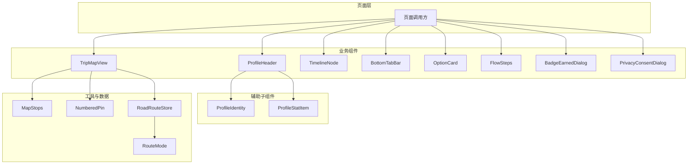
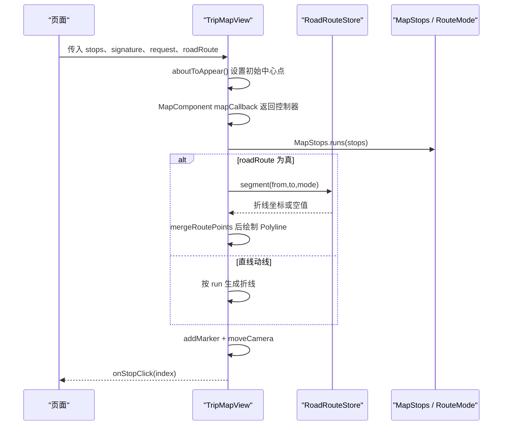
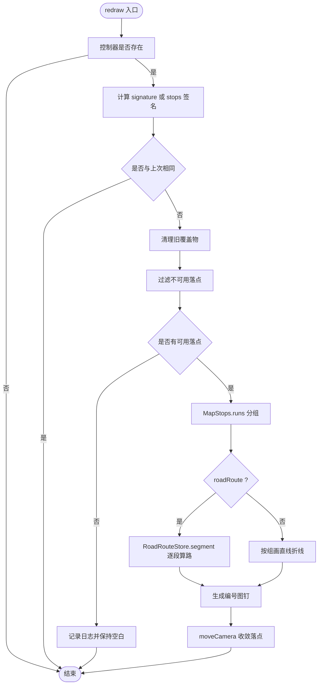
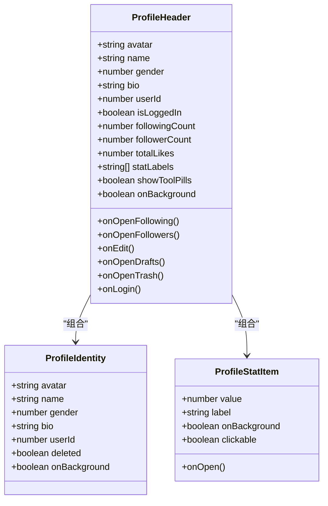
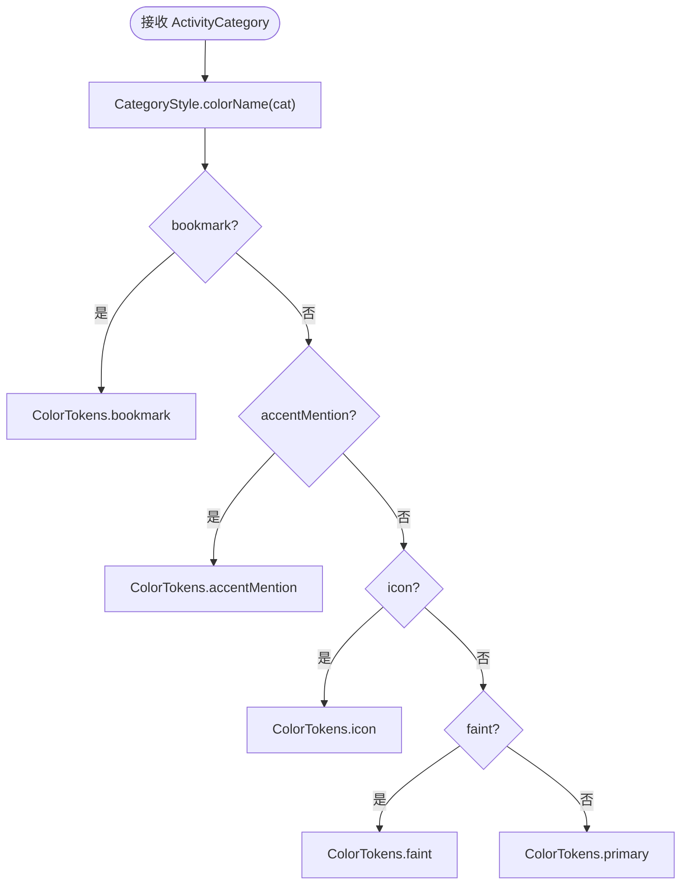
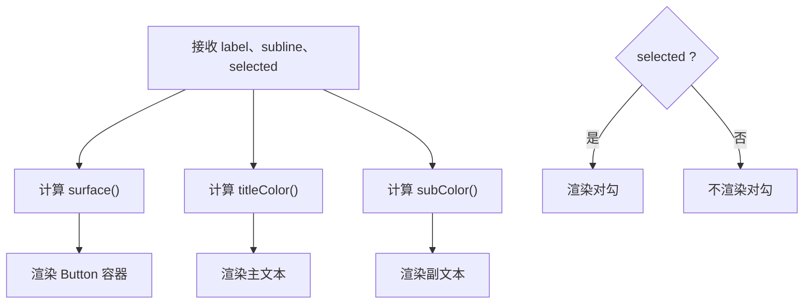
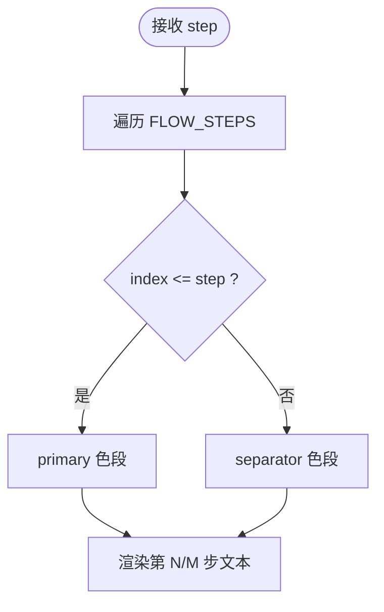
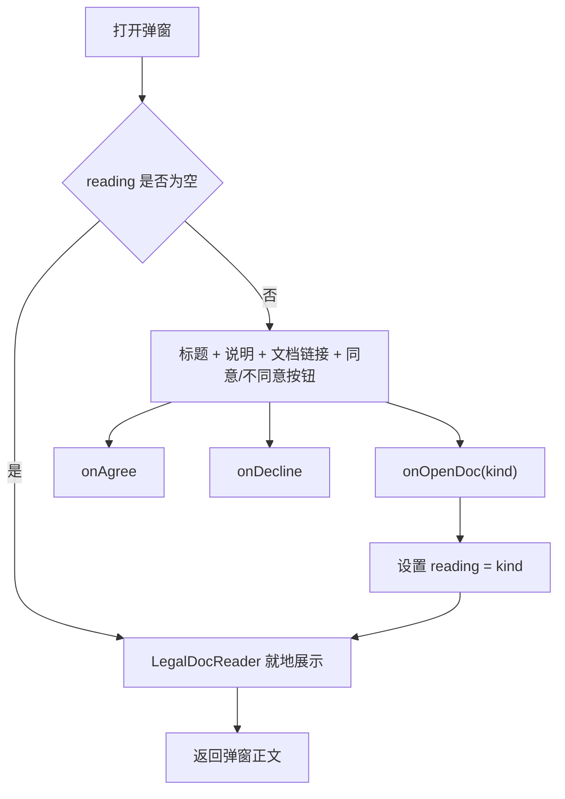
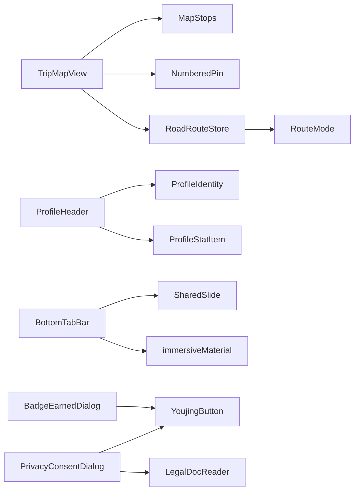

# 业务组件

<cite>
**本文引用的文件**   
- [TripMapView.ets](file://entry/src/main/ets/components/TripMapView.ets)
- [MapStops.ets](file://entry/src/main/ets/utils/MapStops.ets)
- [RoadRouteStore.ets](file://entry/src/main/ets/data/RoadRouteStore.ets)
- [RouteMode.ets](file://entry/src/main/ets/utils/RouteMode.ets)
- [NumberedPin.ets](file://entry/src/main/ets/utils/NumberedPin.ets)
- [ProfileHeader.ets](file://entry/src/main/ets/components/ProfileHeader.ets)
- [ProfileIdentity.ets](file://entry/src/main/ets/components/ProfileIdentity.ets)
- [ProfileStatItem.ets](file://entry/src/main/ets/components/ProfileStatItem.ets)
- [TimelineNode.ets](file://entry/src/main/ets/components/TimelineNode.ets)
- [BottomTabBar.ets](file://entry/src/main/ets/components/BottomTabBar.ets)
- [OptionCard.ets](file://entry/src/main/ets/components/OptionCard.ets)
- [FlowSteps.ets](file://entry/src/main/ets/components/FlowSteps.ets)
- [BadgeEarnedDialog.ets](file://entry/src/main/ets/components/BadgeEarnedDialog.ets)
- [PrivacyConsentDialog.ets](file://entry/src/main/ets/components/PrivacyConsentDialog.ets)
</cite>

## 目录
1. [引言](#引言)
2. [项目结构定位](#项目结构定位)
3. [核心组件总览](#核心组件总览)
4. [架构总览](#架构总览)
5. [详细组件分析](#详细组件分析)
6. [依赖关系分析](#依赖关系分析)
7. [性能与优化](#性能与优化)
8. [故障排查](#故障排查)
9. [结论](#结论)
10. [附录：使用示例与最佳实践](#附录使用示例与最佳实践)

## 引言
本文件聚焦 ArkTS 应用中的八类业务组件，目标是让开发者既能理解每个组件的职责边界，又能掌握其数据绑定、生命周期、交互逻辑和性能策略。重点覆盖以下场景：
- 地图层：行程地图的华为 Map Kit 集成、地点标记、路线展示与镜头控制。
- 个人资料层：用户信息呈现、头像占位与编辑入口。
- 时间轴层：行程节点的颜色与尺寸语义。
- 导航层：底部五页签的手势、擦除模式与选中态。
- 表单与流程层：选项卡片、多步骤进度指示。
- 模态层：徽章弹窗与隐私同意弹窗。

## 项目结构定位
这些组件统一位于 `entry/src/main/ets/components`，并依赖设计 Token、工具类和领域模型：
- 视图组件：`TripMapView`、`ProfileHeader`、`TimelineNode`、`BottomTabBar`、`OptionCard`、`FlowSteps`、`BadgeEarnedDialog`、`PrivacyConsentDialog`。
- 辅助子组件：`ProfileIdentity`、`ProfileStatItem`。
- 纯逻辑工具：`MapStops`、`RouteMode`、`NumberedPin`。
- 数据服务：`RoadRouteStore`（封装 Map Kit 算路）。



**图示来源**
- [TripMapView.ets:1-200](file://entry/src/main/ets/components/TripMapView.ets#L1-L200)
- [RoadRouteStore.ets:1-118](file://entry/src/main/ets/data/RoadRouteStore.ets#L1-L118)
- [MapStops.ets:1-187](file://entry/src/main/ets/utils/MapStops.ets#L1-L187)
- [ProfileHeader.ets:1-106](file://entry/src/main/ets/components/ProfileHeader.ets#L1-L106)

**章节来源**
- [TripMapView.ets:1-200](file://entry/src/main/ets/components/TripMapView.ets#L1-L200)
- [ProfileHeader.ets:1-106](file://entry/src/main/ets/components/ProfileHeader.ets#L1-L106)

## 核心组件总览
| 组件 | 职责 | 关键状态 | 主要外部依赖 | 典型使用场景 |
|---|---|---|---|---|
| TripMapView | 渲染落点、动线、相机镜头与错误兜底 | `ready`、`mapError`、`routeSeq` | MapKit、RoadRouteStore、MapStops、NumberedPin | 行程详情地图、片区候选地图 |
| ProfileHeader | 资料头部信息、统计数、编辑入口、草稿箱/废纸篓 | 全部由 `@Prop` 传入 | ProfileIdentity、ProfileStatItem、GlassPillButton | 个人主页、资料区 |
| TimelineNode | 时间轴圆环节点 | `cat` | CategoryStyle、ColorTokens、LayoutTokens | 行程详情节点、编辑节点 |
| BottomTabBar | 五页签切换、擦除手势、光斑与选中条 | `scrubbing`、`glowX`、`hoverIndex` | SharedSlide、immersiveMaterial、Token | 主界面底部导航 |
| OptionCard | 追问选项卡选择与视觉反馈 | `selected` | ColorTokens、TypeTokens、RadiusTokens | 偏好问答、筛选选项 |
| FlowSteps | 多步骤引导条 | `step` | FLOW_STEPS 常量 | 建行程主链各屏 |
| BadgeEarnedDialog | 勋章获得弹窗 | 由宿主控制显示 | YoujingButton、LayoutTokens | 打卡成功后 |
| PrivacyConsentDialog | 隐私政策与协议同意弹窗 | `reading` | LegalDocReader、YoujingButton | 首次启动或权限前置 |

**章节来源**
- [TimelineNode.ets:1-53](file://entry/src/main/ets/components/TimelineNode.ets#L1-L53)
- [OptionCard.ets:1-74](file://entry/src/main/ets/components/OptionCard.ets#L1-L74)
- [FlowSteps.ets:1-52](file://entry/src/main/ets/components/FlowSteps.ets#L1-L52)
- [BadgeEarnedDialog.ets:1-83](file://entry/src/main/ets/components/BadgeEarnedDialog.ets#L1-L83)
- [PrivacyConsentDialog.ets:1-106](file://entry/src/main/ets/components/PrivacyConsentDialog.ets#L1-L106)

## 架构总览
业务组件整体采用“单向数据流 + 回调驱动”的 ArkUI 组件架构：
- 页面作为宿主持有领域数据，通过 `@Prop` 把数据下发给组件。
- 组件内部用 `@State` 管理 UI 状态，通过 `@Watch` 触发重绘或副作用。
- 复杂副作用（如地图初始化、算路）下沉到工具或服务层，避免在 UI 层直接耦合 SDK。
- 可交互组件通过回调向页面抛出意图，页面再决定路由跳转或数据更新。



**图示来源**
- [TripMapView.ets:1-200](file://entry/src/main/ets/components/TripMapView.ets#L1-L200)
- [TripMapView.ets:201-385](file://entry/src/main/ets/components/TripMapView.ets#L201-L385)
- [RoadRouteStore.ets:1-118](file://entry/src/main/ets/data/RoadRouteStore.ets#L1-L118)
- [MapStops.ets:1-187](file://entry/src/main/ets/utils/MapStops.ets#L1-L187)
- [RouteMode.ets:1-68](file://entry/src/main/ets/utils/RouteMode.ets#L1-L68)

## 详细组件分析

### TripMapView：行程地图
#### 职责与边界
- 负责将一组 `MapStop` 渲染为带编号图钉和动线的地图视图。
- 支持两种动线：直线连线与基于华为 Map Kit 的沿路折线。
- 提供全览镜头与焦点镜头指令，以及落点点击回调。
- 对鉴权失败、离线、无方案等异常做降级，不阻断行程其他内容。

#### 数据绑定与状态
- `stops`：落点数组，配合 `signature` 作为稳定重铺键。
- `request`：父组件下发的镜头指令，支持 `fit` 和 `focus:<index>:<seq>`。
- `route`：是否画直线动线。
- `roadRoute`：是否走 Map Kit 道路算路。
- `isDark`：通过 `StorageProp('isDarkMode')` 同步系统主题。
- 内部状态：`ready`、`mapError`、`controller`、`events`、`markers`、`lines`、`drawn`、`routeSeq`。

#### 生命周期与事件
- `aboutToAppear`：根据首个可用落点设置初始中心，避免首帧空白。
- `aboutToDisappear`：安全注销 marker 事件、清理覆盖物，防止原生侧回收期抛错导致进程崩溃。
- `mapCallback`：创建控制器、注册事件、应用主题、执行首帧收敛。
- `onRequest`：解析父组件指令并调用相机移动。

#### 地图与路线处理
- 落点过滤：通过 `MapStops.usable` 丢弃明显非法坐标，避免整条线被拉到异常区域。
- 分组连线：通过 `MapStops.runs` 按 `group` 分段，跨天不连。
- 直线动线：直接把站坐标转为 `LatLng` 序列绘制。
- 沿路动线：每段调用 `RoadRouteStore.segment`，失败回退为直线；合并相邻段去重重复端点。
- 编号图钉：通过 `NumberedPin.of` 生成白底胶囊徽章，缓存 `PixelMap`，失败退回默认图钉。
- 相机：单点缩放、多点 `LatLngBounds` 加顶部留白适配图钉锚点。



**图示来源**
- [TripMapView.ets:201-385](file://entry/src/main/ets/components/TripMapView.ets#L201-L385)
- [MapStops.ets:1-187](file://entry/src/main/ets/utils/MapStops.ets#L1-L187)
- [RoadRouteStore.ets:1-118](file://entry/src/main/ets/data/RoadRouteStore.ets#L1-L118)

#### 交互与回调
- 点击落点时读取 marker tag，校验索引后调用 `onStopClick(index)`，由页面同步列表高亮。
- 防御性处理：构造器可能收到 `undefined` marker，避免进程崩溃。

#### 使用示例
- 在行程详情页传入全天 `MapStop[]`、开启 `roadRoute`，用于真实地图动线。
- 在片区候选卡片中关闭 `roadRoute`，只保留互斥选项的落点，避免误连成动线。

**章节来源**
- [TripMapView.ets:1-200](file://entry/src/main/ets/components/TripMapView.ets#L1-L200)
- [TripMapView.ets:201-385](file://entry/src/main/ets/components/TripMapView.ets#L201-L385)
- [MapStops.ets:1-187](file://entry/src/main/ets/utils/MapStops.ets#L1-L187)
- [RoadRouteStore.ets:1-118](file://entry/src/main/ets/data/RoadRouteStore.ets#L1-L118)
- [RouteMode.ets:1-68](file://entry/src/main/ets/utils/RouteMode.ets#L1-L68)
- [NumberedPin.ets:1-86](file://entry/src/main/ets/utils/NumberedPin.ets#L1-L86)

### ProfileHeader：资料头部
#### 职责与边界
- 仅负责呈现用户身份、统计数据与操作按钮。
- 不决定跳转、分享和数据加载，这些领域行为由宿主页面实现。
- 登录态变化影响按钮文案与工具胶囊显隐。

#### 数据绑定
- 头像、姓名、性别、简介、用户 ID、登录态、关注/粉丝/获赞数量均由 `@Prop` 传入。
- 统计标签支持自定义，便于不同域复用。
- 工具胶囊支持隐藏，以适配无对应页面的场景。

#### 子组件组合
- `ProfileIdentity`：头像、性别标签、简介和用户 ID。
- `ProfileStatItem`：数值滚动与触控反馈。
- `GlassPillButton`：统一玻璃药丸按钮模板。



**图示来源**
- [ProfileHeader.ets:1-106](file://entry/src/main/ets/components/ProfileHeader.ets#L1-L106)
- [ProfileIdentity.ets:1-116](file://entry/src/main/ets/components/ProfileIdentity.ets#L1-L116)
- [ProfileStatItem.ets:1-43](file://entry/src/main/ets/components/ProfileStatItem.ets#L1-L43)

#### 使用示例
- 在个人主页中传入完整用户数据，并实现 `onEdit`、`onOpenFollowing`、`onOpenFollowers`、`onOpenDrafts`、`onOpenTrash`、`onLogin`。
- 在非登录态下，“编辑资料”按钮文案自动变为“去登录”，点击触发登录流程。

**章节来源**
- [ProfileHeader.ets:1-106](file://entry/src/main/ets/components/ProfileHeader.ets#L1-L106)
- [ProfileIdentity.ets:1-116](file://entry/src/main/ets/components/ProfileIdentity.ets#L1-L116)
- [ProfileStatItem.ets:1-43](file://entry/src/main/ets/components/ProfileStatItem.ets#L1-L43)

### TimelineNode：时间线节点
#### 职责与边界
- 表示行程时间轴上的活动节点圆环。
- 颜色由活动分类映射到设计 Token，不再散落在页面中。
- 尺寸使用布局 Token，保证在不同行程节点容器中的视觉一致性。

#### 颜色映射
- 通过 `CategoryStyle.colorName` 获取分类色名，再映射到具体 Token。
- 特殊分类如收藏、提及、图标、淡色都有明确 fallback。



**图示来源**
- [TimelineNode.ets:1-53](file://entry/src/main/ets/components/TimelineNode.ets#L1-L53)

**章节来源**
- [TimelineNode.ets:1-53](file://entry/src/main/ets/components/TimelineNode.ets#L1-L53)

### BottomTabBar：底部导航栏
#### 职责与边界
- 提供五页签的选中切换、未读红点、长按擦除模式、按压光斑和选中滑条。
- API 23+ 使用官方 `HdsTabs.barFloatingStyle`，低版本兼容分支使用本组件。
- 当前工程最低 SDK 为 26，该组件作为预留兼容分支存在。

#### 交互状态机
- 按下：记录手指位置、点亮光斑、进入长按准备。
- 长按超过阈值：进入擦除模式，拖拽预览目标页签。
- 抬起：擦除模式下选择目标页签，并短暂抑制后续 click。
- 普通点击：直接选择目标页签。

```mermaid
stateDiagram-v2
  [*] --> Idle
  Idle --> PressDown : "按下"
  PressDown --> Armed : "长按计时完成"
  Armed --> Scrubbing : "横向移动超过阈值"
  PressDown --> Click : "短按抬起"
  Scrubbing --> Selected : "抬起且命中目标"
  Click --> Idle
  Selected --> Idle
  Armed --> Idle : "抬起未划动"
  PressDown --> Idle : "抬起未长按"
```

**图示来源**
- [BottomTabBar.ets:1-200](file://entry/src/main/ets/components/BottomTabBar.ets#L1-L200)
- [BottomTabBar.ets:201-307](file://entry/src/main/ets/components/BottomTabBar.ets#L201-L307)

#### 数据绑定
- `items`：页签配置，包含 key、标题和系统符号。
- `currentIndex`：双向绑定当前选中页签。
- `unreadCount`、`badgeIndex`：控制第几格显示未读数。
- `onSelect`：可选回调；未提供时回落到 `@Link` 修改。

#### 使用示例
- 在主页传入五个页签项，并把 `currentIndex` 与路由栈联动。
- 需要消息提示时设置 `badgeIndex` 和 `unreadCount`。

**章节来源**
- [BottomTabBar.ets:1-200](file://entry/src/main/ets/components/BottomTabBar.ets#L1-L200)
- [BottomTabBar.ets:201-307](file://entry/src/main/ets/components/BottomTabBar.ets#L201-L307)

### OptionCard：选项卡片
#### 职责与边界
- 用于偏好问答或筛选选项的选择交互。
- 选中态使用品牌实心底与反色文字，右上角显示对勾。
- 外壳使用官方 Button，继承系统按压、焦点和无障碍能力。

#### 视觉状态
- 标题颜色：选中时为 `onBrand`，否则为 `ink`。
- 副标题颜色：选中时为 `onBrand`，否则为 `muted`。
- 背景：选中时为 `brandSolid`，否则为 `surfaceElevated`。



**图示来源**
- [OptionCard.ets:1-74](file://entry/src/main/ets/components/OptionCard.ets#L1-L74)

**章节来源**
- [OptionCard.ets:1-74](file://entry/src/main/ets/components/OptionCard.ets#L1-L74)

### FlowSteps：流程步骤
#### 职责与边界
- 展示建行程主链的共用步骤进度。
- 固定五步文案，并提供页面对应的步序常量，避免各处硬编码数字。
- 最后一档“看行程”是终点标记，结果页本身不挂 step。

#### 渲染逻辑
- 使用 `ForEach` 渲染五段进度条。
- 已到达步数为 `primary`，未完成步数为 `separator`。
- 底部显示“第 N/M 步 · 当前步骤名”。



**图示来源**
- [FlowSteps.ets:1-52](file://entry/src/main/ets/components/FlowSteps.ets#L1-L52)

**章节来源**
- [FlowSteps.ets:1-52](file://entry/src/main/ets/components/FlowSteps.ets#L1-L52)

### BadgeEarnedDialog：徽章获得弹窗
#### 职责与边界
- 在打卡成功且首次获得某枚徽章时弹出。
- 使用官方 `@CustomDialog`，不自绘遮罩。
- 提供“查看勋章”和“继续行程”两个出口。

#### 数据绑定
- `spotName`、`city`、`sourceLabel`、`total` 由宿主传入。
- `onViewWall`：跳转到勋章墙。
- `onDismiss`：关闭弹窗并让宿主清理控制器引用。

**章节来源**
- [BadgeEarnedDialog.ets:1-83](file://entry/src/main/ets/components/BadgeEarnedDialog.ets#L1-L83)

### PrivacyConsentDialog：隐私同意弹窗
#### 职责与边界
- 强制用户在继续使用前阅读并同意隐私政策和用户协议。
- 三个出口缺一不可：打开隐私政策、打开用户协议、不同意退出。
- 文档阅读就地展开，避免 CustomDialog 内嵌套 NavDestination 产生返回竞态。

#### 交互状态
- `reading`：非空时表示正在阅读哪一份文档。
- 文档链接使用 TEXTUAL 样式按钮，具备系统按压反馈和足够热区。
- 同意则调用宿主回调；不同意则要求宿主终止应用或退出当前会话。



**图示来源**
- [PrivacyConsentDialog.ets:1-106](file://entry/src/main/ets/components/PrivacyConsentDialog.ets#L1-L106)

**章节来源**
- [PrivacyConsentDialog.ets:1-106](file://entry/src/main/ets/components/PrivacyConsentDialog.ets#L1-L106)

## 依赖关系分析


**图示来源**
- [TripMapView.ets:1-200](file://entry/src/main/ets/components/TripMapView.ets#L1-L200)
- [RoadRouteStore.ets:1-118](file://entry/src/main/ets/data/RoadRouteStore.ets#L1-L118)
- [ProfileHeader.ets:1-106](file://entry/src/main/ets/components/ProfileHeader.ets#L1-L106)
- [BottomTabBar.ets:1-200](file://entry/src/main/ets/components/BottomTabBar.ets#L1-L200)
- [BadgeEarnedDialog.ets:1-83](file://entry/src/main/ets/components/BadgeEarnedDialog.ets#L1-L83)
- [PrivacyConsentDialog.ets:1-106](file://entry/src/main/ets/components/PrivacyConsentDialog.ets#L1-L106)

**章节来源**
- [TripMapView.ets:1-200](file://entry/src/main/ets/components/TripMapView.ets#L1-L200)
- [ProfileHeader.ets:1-106](file://entry/src/main/ets/components/ProfileHeader.ets#L1-L106)
- [BottomTabBar.ets:1-200](file://entry/src/main/ets/components/BottomTabBar.ets#L1-L200)

## 性能与优化
- TripMapView
  - 使用 `signature` 避免不必要的覆盖物重建。
  - 用 `routeSeq` 防止异步算路结果覆盖新请求。
  - 落点和动线异步绘制完成后检查控制器是否仍有效，避免组件拆除后写原生对象。
  - 编号图钉缓存 `PixelMap`，同行程反复切天不重绘。
  - 地图初始化失败时只设置人话提示，不中断行程其它功能。
- BottomTabBar
  - 长按定时器在 `aboutToDisappear` 中清理，防止销毁后写状态。
  - 擦除模式使用移动阈值抑制误触。
  - 光斑和选中条动画使用 Token 控制的时长与曲线。
- ProfileHeader
  - 所有可变数据来自 `@Prop`，组件自身无复杂状态，易于测试和复用。
- OptionCard、FlowSteps、BadgeEarnedDialog、PrivacyConsentDialog
  - 以声明式 UI 为主，状态简单，渲染开销小。
  - 模态弹窗依赖宿主管理显示与控制器生命周期，避免重复弹出。

[本节为通用性能建议，不直接分析具体代码片段]

## 故障排查
- 地图空白或偏位
  - 检查坐标是否经过种子层转换为 GCJ02，WGS84 会整体偏移。
  - 检查 `MapStops.usable` 是否把坐标过滤掉。
  - 检查 Map Kit 鉴权码，例如 1002600003 会导致底图空白但不会抛到页面。
- 动线断开
  - 检查 `roadRoute` 与 `route` 的组合：关闭 `roadRoute` 时只画直线，关闭 `route` 时不画任何线。
  - 检查 `MapStops.runs` 分组，跨天不会连线。
  - 检查算路失败是否被降级为直线。
- 落点点击无效
  - 确认 `onStopClick` 是否正确传递索引。
  - 确认落点的 index 从 1 开始且连续。
- 底部导航误触
  - 检查擦除模式阈值和点击抑制窗口。
  - 确认长按后抬起是否命中目标页签。
- 隐私弹窗无法退出
  - 确认宿主实现了 `onDecline`，并调用应用退出或终止当前会话。
  - 确认文档链接打开后会重新弹回弹窗，避免跳过同意流程。

**章节来源**
- [TripMapView.ets:1-200](file://entry/src/main/ets/components/TripMapView.ets#L1-L200)
- [TripMapView.ets:201-385](file://entry/src/main/ets/components/TripMapView.ets#L201-L385)
- [RoadRouteStore.ets:1-118](file://entry/src/main/ets/data/RoadRouteStore.ets#L1-L118)
- [BottomTabBar.ets:1-200](file://entry/src/main/ets/components/BottomTabBar.ets#L1-L200)
- [PrivacyConsentDialog.ets:1-106](file://entry/src/main/ets/components/PrivacyConsentDialog.ets#L1-L106)

## 结论
这组业务组件围绕“行程地图、个人资料、时间轴、底部导航、选项卡片、流程步骤、徽章弹窗、隐私弹窗”八个高频场景，形成清晰的职责分层：
- 视图组件专注表现和基础交互。
- 地图相关逻辑下沉到工具与服务层，避免 UI 层直接耦合 SDK。
- 状态通过 `@Prop` 单向流入，通过回调向上传播用户意图。
- 异常路径统一做降级和日志，保障主业务流程稳定。

在实际开发中，应优先复用这些组件，而不是在页面里复制粘贴地图、弹窗或导航逻辑；同时通过宿主页面承担路由、数据持久化和业务编排职责。

[本节为总结性内容，不直接分析具体文件]

## 附录：使用示例与最佳实践

### TripMapView 使用要点
- 只在父组件拿到首个可用坐标后再挂载组件，避免 MapOptions 初始中心非法。
- 传入稳定的 `signature`，比单纯比较数组变更更可靠。
- 行程详情开启 `roadRoute`，片区候选关闭 `roadRoute`。
- 监听 `onStopClick` 同步列表高亮，并使用 `MapStops.activityIndex` 把地图序号映射回行程活动下标。

**章节来源**
- [TripMapView.ets:1-200](file://entry/src/main/ets/components/TripMapView.ets#L1-L200)
- [MapStops.ets:1-187](file://entry/src/main/ets/utils/MapStops.ets#L1-L187)

### ProfileHeader 使用要点
- 头像、姓名、性别、简介和用户 ID 由宿主维护，组件只做展示。
- 登录态变化时更新 `isLoggedIn`，按钮文案和工具胶囊自动变化。
- 统计标签可替换，但应保持三列顺序一致。

**章节来源**
- [ProfileHeader.ets:1-106](file://entry/src/main/ets/components/ProfileHeader.ets#L1-L106)

### TimelineNode 使用要点
- 不要直接在页面手写圆环颜色，改用 `ActivityCategory` 驱动。
- 保持节点尺寸使用 Layout Token，避免不同页面视觉不一致。

**章节来源**
- [TimelineNode.ets:1-53](file://entry/src/main/ets/components/TimelineNode.ets#L1-L53)

### BottomTabBar 使用要点
- 使用 `@Link currentIndex` 与页面路由状态绑定。
- 需要消息提醒时设置 `badgeIndex` 和 `unreadCount`。
- 长按擦除模式适合 dock 式导航，注意不要与普通点击冲突。

**章节来源**
- [BottomTabBar.ets:1-200](file://entry/src/main/ets/components/BottomTabBar.ets#L1-L200)
- [BottomTabBar.ets:201-307](file://entry/src/main/ets/components/BottomTabBar.ets#L201-L307)

### OptionCard 使用要点
- 选中态改变后由宿主决定是否调用 `onAction`。
- 若需要禁用选项，由宿主传 `selected=false` 且不触发 `onAction`。

**章节来源**
- [OptionCard.ets:1-74](file://entry/src/main/ets/components/OptionCard.ets#L1-L74)

### FlowSteps 使用要点
- 使用导出常量 `FLOW_STEP_*` 传步号，避免手写数字错位。
- 结果页不传 step，由生成流程承接“看行程”语义。

**章节来源**
- [FlowSteps.ets:1-52](file://entry/src/main/ets/components/FlowSteps.ets#L1-L52)

### BadgeEarnedDialog 使用要点
- 仅在首次获得徽章时弹出，避免重复打卡频繁打断用户。
- “继续行程”必须清理弹窗控制器，避免内存泄漏。

**章节来源**
- [BadgeEarnedDialog.ets:1-83](file://entry/src/main/ets/components/BadgeEarnedDialog.ets#L1-L83)

### PrivacyConsentDialog 使用要点
- 同意和不同意都必须有实际业务出口，不能只是关弹窗。
- 文档阅读就地展开，避免弹窗与页面导航产生返回竞态。

**章节来源**
- [PrivacyConsentDialog.ets:1-106](file://entry/src/main/ets/components/PrivacyConsentDialog.ets#L1-L106)