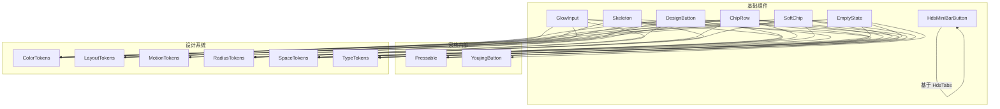
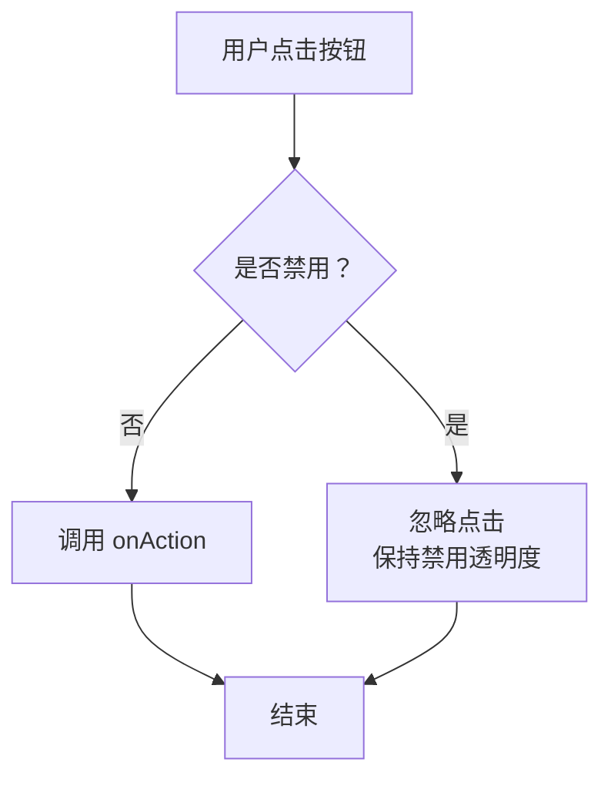
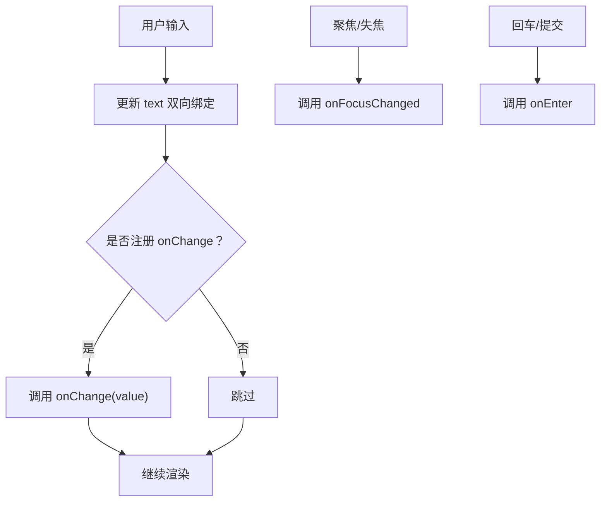
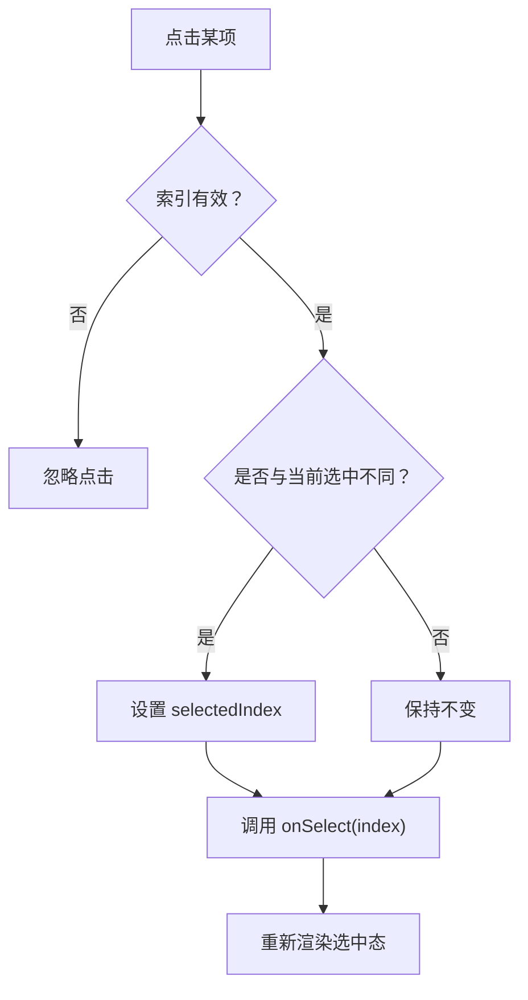
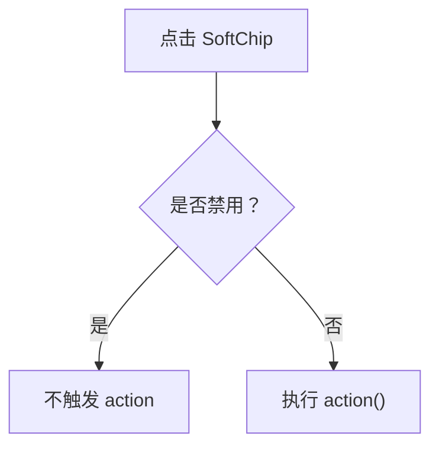
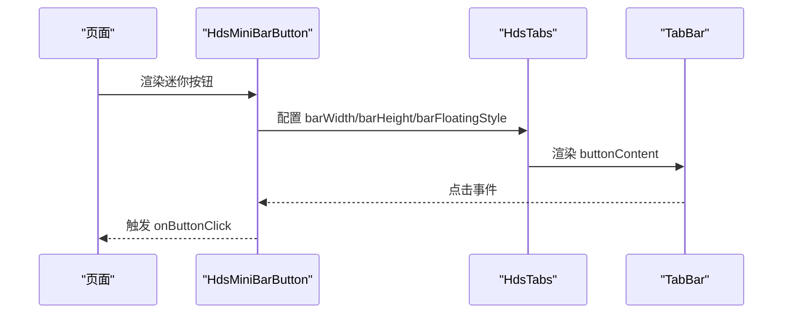
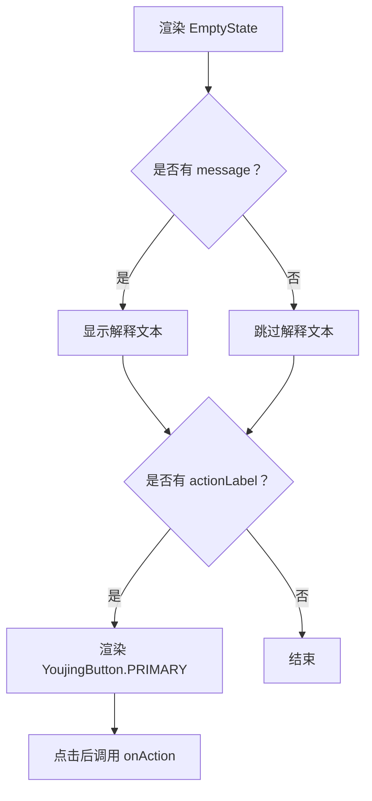
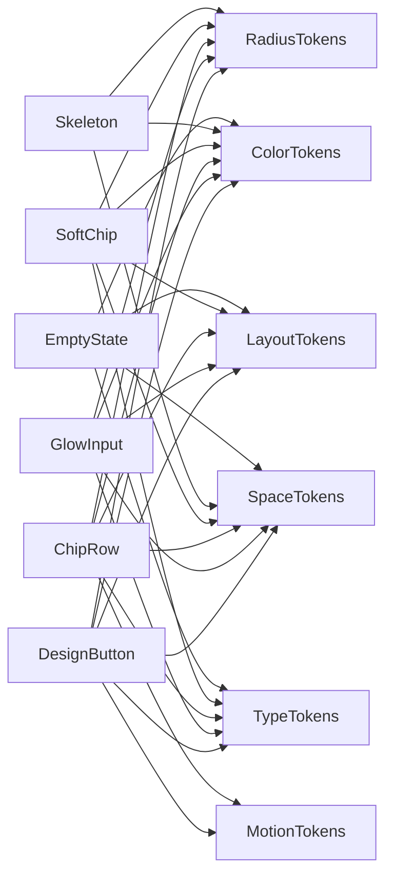

# 基础组件

<cite>
**本文引用的文件**   
- [DesignButton.ets](file://entry/src/main/ets/components/DesignButton.ets)
- [GlowInput.ets](file://entry/src/main/ets/components/GlowInput.ets)
- [ChipRow.ets](file://entry/src/main/ets/components/ChipRow.ets)
- [SoftChip.ets](file://entry/src/main/ets/components/SoftChip.ets)
- [HdsMiniBarButton.ets](file://entry/src/main/ets/components/HdsMiniBarButton.ets)
- [Skeleton.ets](file://entry/src/main/ets/components/Skeleton.ets)
- [EmptyState.ets](file://entry/src/main/ets/components/EmptyState.ets)
- [Pressable.ets](file://entry/src/main/ets/components/Pressable.ets)
- [ColorTokens.ets](file://entry/src/main/ets/design/ColorTokens.ets)
- [LayoutTokens.ets](file://entry/src/main/ets/design/LayoutTokens.ets)
- [MotionTokens.ets](file://entry/src/main/ets/design/MotionTokens.ets)
- [RadiusTokens.ets](file://entry/src/main/ets/design/RadiusTokens.ets)
- [SpaceTokens.ets](file://entry/src/main/ets/design/SpaceTokens.ets)
- [TypeTokens.ets](file://entry/src/main/ets/design/TypeTokens.ets)
</cite>

## 目录
1. [引言](#引言)
2. [项目结构](#项目结构)
3. [核心组件总览](#核心组件总览)
4. [架构总览](#架构总览)
5. [详细组件分析](#详细组件分析)
6. [依赖关系分析](#依赖关系分析)
7. [性能与动画特性](#性能与动画特性)
8. [响应式适配与无障碍访问](#响应式适配与无障碍访问)
9. [使用示例与扩展指南](#使用示例与扩展指南)
10. [故障排查](#故障排查)
11. [结论](#结论)

## 引言
本文件面向“有径”ArkTS/HarmonyOS 工程中的通用 UI 基础组件，围绕以下七个构件展开：品牌按钮 DesignButton、发光输入框 GlowInput、芯片行 ChipRow、软芯片 SoftChip、迷你浮动栏按钮 HdsMiniBarButton、骨架屏 Skeleton、空状态 EmptyState。文档重点说明：
- 每个组件的 Props 接口设计、默认值与可选行为；
- 样式变体、状态管理与点击反馈机制；
- 事件回调（点击、输入、聚焦、选择等）；
- 与颜色、间距、字号、圆角、动效等设计 Token 的关系；
- 在页面中引用这些组件的方式；
- 如何扩展自定义样式和行为；
- 响应式适配和无障碍访问支持。

## 项目结构
基础组件集中在 `entry/src/main/ets/components` 下，样式和尺寸由 `entry/src/main/ets/design` 下的 Token 文件集中管理。多个组件共同复用家族内部的 Pressable 点击反馈封装。



**图示来源**
- [DesignButton.ets:1-139](file://entry/src/main/ets/components/DesignButton.ets#L1-L139)
- [GlowInput.ets:1-83](file://entry/src/main/ets/components/GlowInput.ets#L1-L83)
- [ChipRow.ets:1-109](file://entry/src/main/ets/components/ChipRow.ets#L1-L109)
- [SoftChip.ets:1-95](file://entry/src/main/ets/components/SoftChip.ets#L1-L95)
- [HdsMiniBarButton.ets:1-212](file://entry/src/main/ets/components/HdsMiniBarButton.ets#L1-L212)
- [Skeleton.ets:1-39](file://entry/src/main/ets/components/Skeleton.ets#L1-L39)
- [EmptyState.ets:1-85](file://entry/src/main/ets/components/EmptyState.ets#L1-L85)
- [Pressable.ets:1-84](file://entry/src/main/ets/components/Pressable.ets#L1-L84)
- [ColorTokens.ets:1-200](file://entry/src/main/ets/design/ColorTokens.ets#L1-L200)
- [LayoutTokens.ets:1-200](file://entry/src/main/ets/design/LayoutTokens.ets#L1-L200)
- [MotionTokens.ets:1-99](file://entry/src/main/ets/design/MotionTokens.ets#L1-L99)
- [RadiusTokens.ets:1-43](file://entry/src/main/ets/design/RadiusTokens.ets#L1-L43)
- [SpaceTokens.ets:1-44](file://entry/src/main/ets/design/SpaceTokens.ets#L1-L44)
- [TypeTokens.ets:1-94](file://entry/src/main/ets/design/TypeTokens.ets#L1-L94)

**章节来源**
- [DesignButton.ets:1-139](file://entry/src/main/ets/components/DesignButton.ets#L1-L139)
- [GlowInput.ets:1-83](file://entry/src/main/ets/components/GlowInput.ets#L1-L83)
- [ChipRow.ets:1-109](file://entry/src/main/ets/components/ChipRow.ets#L1-L109)
- [SoftChip.ets:1-95](file://entry/src/main/ets/components/SoftChip.ets#L1-L95)
- [HdsMiniBarButton.ets:1-212](file://entry/src/main/ets/components/HdsMiniBarButton.ets#L1-L212)
- [Skeleton.ets:1-39](file://entry/src/main/ets/components/Skeleton.ets#L1-L39)
- [EmptyState.ets:1-85](file://entry/src/main/ets/components/EmptyState.ets#L1-L85)

## 核心组件总览
| 组件 | 主要职责 | 关键变体或模式 | 典型回调 | 是否复用 Pressable |
|---|---|---|---|---|
| DesignButton | 品牌主按钮，提供四种视觉变体 | PRIMARY / OUTLINED / GHOST / GLASS | onAction | 是 |
| GlowInput | 统一输入框，默认原生样式，可选玻璃分段风格 | segmentStyle | onChange / onEnter / onFocusChanged | 否 |
| ChipRow | 横向滚动胶囊选择条 | 选中/未选中双色 + 可选图标 | onSelect | 是（每项） |
| SoftChip | 小型实色动作胶囊 | NEUTRAL / BRAND / DANGER | action | 是 |
| HdsMiniBarButton | 浮动迷你栏按钮，借 HdsTabs 实现沉浸材质 | 位置、图标、材质类型、材质级别 | onButtonClick | 否 |
| Skeleton | 静态骨架占位块 | 宽度/高度/圆角 | 无 | 否 |
| EmptyState | 空态展示：图标 + 标题 + 说明 + 出口按钮 | 可选消息和出口按钮 | onAction | 否，但组合 YoujingButton |

**章节来源**
- [DesignButton.ets:1-139](file://entry/src/main/ets/components/DesignButton.ets#L1-L139)
- [GlowInput.ets:1-83](file://entry/src/main/ets/components/GlowInput.ets#L1-L83)
- [ChipRow.ets:1-109](file://entry/src/main/ets/components/ChipRow.ets#L1-L109)
- [SoftChip.ets:1-95](file://entry/src/main/ets/components/SoftChip.ets#L1-L95)
- [HdsMiniBarButton.ets:1-212](file://entry/src/main/ets/components/HdsMiniBarButton.ets#L1-L212)
- [Skeleton.ets:1-39](file://entry/src/main/ets/components/Skeleton.ets#L1-L39)
- [EmptyState.ets:1-85](file://entry/src/main/ets/components/EmptyState.ets#L1-L85)

## 架构总览
基础组件遵循“组件 → 家族反馈层 → 设计 Token”的分层：
- 组件层负责业务语义（按钮、输入、标签、骨架、空态）。
- 家族反馈层通过 Pressable 统一按下反馈、命中区域、禁用态处理。
- 设计 Token 层统一颜色、布局、动效、圆角、间距、字号。

```mermaid
classDiagram
  class DesignButton {
    +string label
    +variant
    +boolean disabled
    +boolean fillWidth
    +Length visualWidth
    +Resource leadingSymbol
    +Resource trailingSymbol
    +boolean useSystemMaterial
    +onAction()
  }

  class GlowInput {
    +string text
    +string placeholder
    +boolean fillWidth
    +number inputHeight
    +number radius
    +boolean segmentStyle
    +number maxLength
    +onChange(value)
    +onEnter()
    +onFocusChanged(focused)
  }

  class ChipRow {
    +items
    +selectedIndex
    +boolean showIcon
    +number sidePadding
    +number itemGap
    +number chipHeight
    +onSelect(index)
  }

  class SoftChip {
    +string label
    +tone
    +number visualHeight
    +boolean disabled
    +action()
  }

  class HdsMiniBarButton {
    +barWidth
    +barHeight
    +contentPadding
    +containerSize
    +iconResource
    +iconSize
    +iconColor
    +maskColor
    +barBottomMargin
    +materialType
    +materialLevel
    +barPosition
    +barOverlap
    +onButtonClick()
  }

  class Skeleton {
    +skeletonWidth
    +skeletonHeight
    +radius
  }

  class EmptyState {
    +icon
    +title
    +message
    +actionLabel
    +onAction()
  }

  class Pressable {
    +content
    +disabled
    +fillWidth
    +fullResponseRegion
    +visualHeight
    +touchTargetHeight
    +action()
  }

  DesignButton --> Pressable : "包裹内容"
  ChipRow --> Pressable : "每项一个"
  SoftChip --> Pressable : "外壳"
  EmptyState -->|"组合"| YoujingButton
```

**图示来源**
- [DesignButton.ets:1-139](file://entry/src/main/ets/components/DesignButton.ets#L1-L139)
- [GlowInput.ets:1-83](file://entry/src/main/ets/components/GlowInput.ets#L1-L83)
- [ChipRow.ets:1-109](file://entry/src/main/ets/components/ChipRow.ets#L1-L109)
- [SoftChip.ets:1-95](file://entry/src/main/ets/components/SoftChip.ets#L1-L95)
- [HdsMiniBarButton.ets:1-212](file://entry/src/main/ets/components/HdsMiniBarButton.ets#L1-L212)
- [Skeleton.ets:1-39](file://entry/src/main/ets/components/Skeleton.ets#L1-L39)
- [EmptyState.ets:1-85](file://entry/src/main/ets/components/EmptyState.ets#L1-L85)
- [Pressable.ets:1-84](file://entry/src/main/ets/components/Pressable.ets#L1-L84)

## 详细组件分析

### DesignButton（品牌按钮）
DesignButton 是品牌按钮的主件，提供四套视觉配方：PRIMARY、OUTLINED、GHOST、GLASS。它不重复实现按下反馈，而是把可点击行为交给 Pressable；自身只负责底色、描边、圆角、阴影、禁用透明度、文字样式和系统材质避让。

#### 设计要点
- 变体含义：
  - PRIMARY：品牌实心底 + 品牌反色字；一屏通常只有一个。
  - OUTLINED：透明底 + 细边框 + 胶囊圆角。
  - GHOST：品牌字色 + reason 圆角。
  - GLASS：elevated 底 + separator 描边 + cardAmbient 阴影。
- 文字样式统一来自 TypeTokens.callout 和 headline。
- 禁用态通过 `.opacity(0.45)` 表达。
- 当 useSystemMaterial 为真且系统材质生效时，自绘 border/shadow/blur 归零，表面改为透明并交由 TopButtonMaterialModifier 接管。

#### Props 与回调
- label：按钮文案。
- variant：DesignButtonVariant 枚举，控制视觉配方。
- disabled：是否禁用。
- fillWidth：是否占满父宽。
- visualWidth：非满宽时的固定宽度。
- leadingSymbol / trailingSymbol：左右图标。
- useSystemMaterial：在导航标题栏等场景启用系统材质。
- onAction：点击回调。

#### 点击反馈机制
实际按下效果由 Pressable 提供：正常态不缩放、不降透明度；按下态按 MotionTokens.pressOpacity 和 pressScale 做微缩放与淡出，时长由 MotionTokens.fast 决定。



**图示来源**
- [DesignButton.ets:1-139](file://entry/src/main/ets/components/DesignButton.ets#L1-L139)
- [Pressable.ets:1-84](file://entry/src/main/ets/components/Pressable.ets#L1-L84)

**章节来源**
- [DesignButton.ets:1-139](file://entry/src/main/ets/components/DesignButton.ets#L1-L139)
- [Pressable.ets:1-84](file://entry/src/main/ets/components/Pressable.ets#L1-L84)
- [ColorTokens.ets:1-200](file://entry/src/main/ets/design/ColorTokens.ets#L1-L200)
- [LayoutTokens.ets:1-200](file://entry/src/main/ets/design/LayoutTokens.ets#L1-L200)
- [MotionTokens.ets:1-99](file://entry/src/main/ets/design/MotionTokens.ets#L1-L99)
- [RadiusTokens.ets:1-43](file://entry/src/main/ets/design/RadiusTokens.ets#L1-L43)
- [SpaceTokens.ets:1-44](file://entry/src/main/ets/design/SpaceTokens.ets#L1-L44)
- [TypeTokens.ets:1-94](file://entry/src/main/ets/design/TypeTokens.ets#L1-L94)

### GlowInput（发光输入框）
GlowInput 是统一输入框。默认分支走官方原生样式：实色 subtle 背景、无描边、无模糊、圆角胶囊、最小触控高；只有当 segmentStyle 为 true 时才走“玻璃分段栏同款”半透明底、backdropBlur 和 1vp 高光边框。

#### 光效动画与输入体验
- 光效不是独立动画，而是 segmentStyle 切换时的视觉分支：segmentStyle=true 时使用 GlassTokens.SEGMENT_BG、GlassTokens.SEGMENT_BORDER 和 GlassTokens.SEGMENT_BLUR。
- 输入长度受 maxLength 控制；传正数才限制，否则使用平台最大值。
- 文本方向强制 Ltr，避免多语言混排错位。
- 聚焦/失焦通过 onFocus/onBlur 触发 onFocusChanged。
- 提交通过 onSubmit 触发 onEnter。

#### Props 与回调
- text：双向绑定的受控文本。
- placeholder：占位文案。
- fillWidth：是否在 Stack 中参与 flex 拉伸。
- inputHeight：输入框高度。
- radius：非 segmentStyle 时的圆角。
- segmentStyle：是否采用玻璃分段风格。
- maxLength：最大输入长度。
- onChange：文本变化回调。
- onEnter：回车/提交回调。
- onFocusChanged：聚焦状态回调。



**图示来源**
- [GlowInput.ets:1-83](file://entry/src/main/ets/components/GlowInput.ets#L1-L83)

**章节来源**
- [GlowInput.ets:1-83](file://entry/src/main/ets/components/GlowInput.ets#L1-L83)
- [ColorTokens.ets:1-200](file://entry/src/main/ets/design/ColorTokens.ets#L1-L200)
- [LayoutTokens.ets:1-200](file://entry/src/main/ets/design/LayoutTokens.ets#L1-L200)
- [RadiusTokens.ets:1-43](file://entry/src/main/ets/design/RadiusTokens.ets#L1-L43)
- [SpaceTokens.ets:1-44](file://entry/src/main/ets/design/SpaceTokens.ets#L1-L44)
- [TypeTokens.ets:1-94](file://entry/src/main/ets/design/TypeTokens.ets#L1-L94)

### ChipRow（芯片行）
ChipRow 是横滚胶囊选择条，内部用 Scroll + Row + ForEach 渲染多项，每项都是 Pressable。选中项使用 brandSolid 底 + onBrand 字；未选中项使用 surfaceSunken 底 + primary 字。选中时字体加粗，未选中用 caption weight。

#### 数据模型
- ChipItem：包含 key、label 和可选 symbol。
- selectedIndex：@Link 双向绑定，表示当前选中索引。
- items：供循环渲染的数组。

#### 交互逻辑
- select 方法先校验 index 范围，再决定是否更新 selectedIndex 并触发 onSelect。
- 每项 Pressable 的视觉高度由 chipHeight 控制，命中区由 LayoutTokens.minTouchTarget 保证。
- 水平滚动带弹簧边缘效果，隐藏滚动条。



**图示来源**
- [ChipRow.ets:1-109](file://entry/src/main/ets/components/ChipRow.ets#L1-L109)
- [Pressable.ets:1-84](file://entry/src/main/ets/components/Pressable.ets#L1-L84)

**章节来源**
- [ChipRow.ets:1-109](file://entry/src/main/ets/components/ChipRow.ets#L1-L109)
- [ColorTokens.ets:1-200](file://entry/src/main/ets/design/ColorTokens.ets#L1-L200)
- [LayoutTokens.ets:1-200](file://entry/src/main/ets/design/LayoutTokens.ets#L1-L200)
- [MotionTokens.ets:1-99](file://entry/src/main/ets/design/MotionTokens.ets#L1-L99)
- [RadiusTokens.ets:1-43](file://entry/src/main/ets/design/RadiusTokens.ets#L1-L43)
- [SpaceTokens.ets:1-44](file://entry/src/main/ets/design/SpaceTokens.ets#L1-L44)
- [TypeTokens.ets:1-94](file://entry/src/main/ets/design/TypeTokens.ets#L1-L94)

### SoftChip（软芯片）
SoftChip 是小尺寸动作胶囊，适合“重试”“加一块”等轻量操作。提供 NEUTRAL、BRAND、DANGER 三档 tone；NEUTRAL 有 hairline 边框，其他两档无边框。禁用态统一使用 opacity 0.45。

#### Props 与回调
- label：文案。
- tone：SoftChipTone 枚举。
- visualHeight：视觉高度；命中区仍为 LayoutTokens.minTouchTarget。
- disabled：是否禁用。
- action：点击回调。



**图示来源**
- [SoftChip.ets:1-95](file://entry/src/main/ets/components/SoftChip.ets#L1-L95)
- [Pressable.ets:1-84](file://entry/src/main/ets/components/Pressable.ets#L1-L84)

**章节来源**
- [SoftChip.ets:1-95](file://entry/src/main/ets/components/SoftChip.ets#L1-L95)
- [ColorTokens.ets:1-200](file://entry/src/main/ets/design/ColorTokens.ets#L1-L200)
- [LayoutTokens.ets:1-200](file://entry/src/main/ets/design/LayoutTokens.ets#L1-L200)
- [RadiusTokens.ets:1-43](file://entry/src/main/ets/design/RadiusTokens.ets#L1-L43)
- [SpaceTokens.ets:1-44](file://entry/src/main/ets/design/SpaceTokens.ets#L1-L44)
- [TypeTokens.ets:1-94](file://entry/src/main/ets/design/TypeTokens.ets#L1-L94)

### HdsMiniBarButton（迷你浮动栏按钮）
HdsMiniBarButton 是基于 HdsTabs 的本地化集成组件，用于在任意容器内获得沉浸式光感玻璃效果。源码注释明确列出三处偏离上游 HAR 的实现差异：
1. materialType/materialLevel 参数从枚举改为 number，避免低 API 设备静态导入崩溃。
2. 内部 HdsTabs 设置 scrollable(false)，避免 Tabs 内置滑动手势与宿主 PanGesture 竞争。
3. 作为指示器使用时，内部只有一颗 TabContent，禁滑无副作用。

#### 关键 Props
- barWidth / barHeight：按钮栏宽高。
- contentPadding：容器内边距，防止光效被裁切。
- containerSize：容器尺寸，未设置时自动计算。
- iconResource / iconSize / iconColor：图标资源、大小和颜色。
- maskColor：遮罩颜色。
- barBottomMargin：底部边距。
- materialType / materialLevel：材质类型与级别（数值形式）。
- barPosition / barOverlap：位置和重叠策略。
- onButtonClick：点击回调。
- buttonContent：BuilderParam 自定义按钮内容。



**图示来源**
- [HdsMiniBarButton.ets:1-212](file://entry/src/main/ets/components/HdsMiniBarButton.ets#L1-L212)

**章节来源**
- [HdsMiniBarButton.ets:1-212](file://entry/src/main/ets/components/HdsMiniBarButton.ets#L1-L212)

### Skeleton（骨架屏）
Skeleton 是静态骨架条，不再包含流光渐变或位移动画。它只保留契约要求的三个属性：底色 skeletonBase、圆角 reason、真实行高 SpaceTokens.base，并使用 Stack 承载以避免审计规则判定为空占位 Column/Row。

#### Props
- skeletonWidth：骨架条整体宽度。
- skeletonHeight：骨架条整体高度。
- radius：圆角。

**章节来源**
- [Skeleton.ets:1-39](file://entry/src/main/ets/components/Skeleton.ets#L1-L39)
- [ColorTokens.ets:1-200](file://entry/src/main/ets/design/ColorTokens.ets#L1-L200)
- [RadiusTokens.ets:1-43](file://entry/src/main/ets/design/RadiusTokens.ets#L1-L43)
- [SpaceTokens.ets:1-44](file://entry/src/main/ets/design/SpaceTokens.ets#L1-L44)

### EmptyState（空状态）
EmptyState 提供空态的标准排版：图标、标题、可选解释、可选出口按钮。标题使用 serif 字族，解释句使用 callout 字级；出口按钮组合 YoujingButton.PRIMARY，保证“一屏只许一个实心主按钮”。整组使用 accessibilityGroup(true) 让读屏器把空态视为一组信息。

#### Props 与回调
- icon：图标资源。
- title：主句。
- message：解释句，空串不显示。
- actionLabel：出口按钮文案，空串不显示按钮。
- onAction：出口按钮点击回调。



**图示来源**
- [EmptyState.ets:1-85](file://entry/src/main/ets/components/EmptyState.ets#L1-L85)

**章节来源**
- [EmptyState.ets:1-85](file://entry/src/main/ets/components/EmptyState.ets#L1-L85)
- [ColorTokens.ets:1-200](file://entry/src/main/ets/design/ColorTokens.ets#L1-L200)
- [LayoutTokens.ets:1-200](file://entry/src/main/ets/design/LayoutTokens.ets#L1-L200)
- [SpaceTokens.ets:1-44](file://entry/src/main/ets/design/SpaceTokens.ets#L1-L44)
- [TypeTokens.ets:1-94](file://entry/src/main/ets/design/TypeTokens.ets#L1-L94)

## 依赖关系分析
基础组件对设计 Token 的依赖非常一致：
- ColorTokens 提供品牌色、表面色、玻璃栏面色、危险色等。
- LayoutTokens 提供最小触控区 44vp、分段控件高度、玻璃边框宽度等。
- RadiusTokens 提供胶囊、reason、card、pill 等封闭圆角。
- SpaceTokens 提供 xxs/xs/sm/base/lg/xl/xxl 间距阶梯。
- TypeTokens 提供 body/callout/headline/caption 等字阶和字族。
- MotionTokens 提供 press/fast/control 等动效时长和曲线。



**图示来源**
- [DesignButton.ets:1-139](file://entry/src/main/ets/components/DesignButton.ets#L1-L139)
- [GlowInput.ets:1-83](file://entry/src/main/ets/components/GlowInput.ets#L1-L83)
- [ChipRow.ets:1-109](file://entry/src/main/ets/components/ChipRow.ets#L1-L109)
- [SoftChip.ets:1-95](file://entry/src/main/ets/components/SoftChip.ets#L1-L95)
- [Skeleton.ets:1-39](file://entry/src/main/ets/components/Skeleton.ets#L1-L39)
- [EmptyState.ets:1-85](file://entry/src/main/ets/components/EmptyState.ets#L1-L85)
- [ColorTokens.ets:1-200](file://entry/src/main/ets/design/ColorTokens.ets#L1-L200)
- [LayoutTokens.ets:1-200](file://entry/src/main/ets/design/LayoutTokens.ets#L1-L200)
- [MotionTokens.ets:1-99](file://entry/src/main/ets/design/MotionTokens.ets#L1-L99)
- [RadiusTokens.ets:1-43](file://entry/src/main/ets/design/RadiusTokens.ets#L1-L43)
- [SpaceTokens.ets:1-44](file://entry/src/main/ets/design/SpaceTokens.ets#L1-L44)
- [TypeTokens.ets:1-94](file://entry/src/main/ets/design/TypeTokens.ets#L1-L94)

**章节来源**
- [ColorTokens.ets:1-200](file://entry/src/main/ets/design/ColorTokens.ets#L1-L200)
- [LayoutTokens.ets:1-200](file://entry/src/main/ets/design/LayoutTokens.ets#L1-L200)
- [MotionTokens.ets:1-99](file://entry/src/main/ets/design/MotionTokens.ets#L1-L99)
- [RadiusTokens.ets:1-43](file://entry/src/main/ets/design/RadiusTokens.ets#L1-L43)
- [SpaceTokens.ets:1-44](file://entry/src/main/ets/design/SpaceTokens.ets#L1-L44)
- [TypeTokens.ets:1-94](file://entry/src/main/ets/design/TypeTokens.ets#L1-L94)

## 性能与动画特性
- 按下反馈统一由 Pressable 管理，使用 .stateStyles 和 .animation，正常态 scale(1)、pressed 态 scale(pressScale) 并降低 opacity(pressOpacity)。
- DesignButton 的 animation 使用 MotionTokens.fast 和 MotionCurves.standard，确保按钮切换、勾选等微反馈快速自然。
- ChipRow 选中态切换也使用 fast 标准曲线。
- Skeleton 已移除 shimmer 流光动画，仅保留静态底色和圆角，减少渲染负担。
- HdsMiniBarButton 使用 HdsTabs 的 barFloatingStyle 与 systemMaterialEffect 实现沉浸式材质，属于较重的视觉效果，应仅在需要的浮动场景使用。

**章节来源**
- [Pressable.ets:1-84](file://entry/src/main/ets/components/Pressable.ets#L1-L84)
- [MotionTokens.ets:1-99](file://entry/src/main/ets/design/MotionTokens.ets#L1-L99)
- [DesignButton.ets:1-139](file://entry/src/main/ets/components/DesignButton.ets#L1-L139)
- [ChipRow.ets:1-109](file://entry/src/main/ets/components/ChipRow.ets#L1-L109)
- [Skeleton.ets:1-39](file://entry/src/main/ets/components/Skeleton.ets#L1-L39)
- [HdsMiniBarButton.ets:1-212](file://entry/src/main/ets/components/HdsMiniBarButton.ets#L1-L212)

## 响应式适配与无障碍访问
- 最小触控区：LayoutTokens.minTouchTarget 为 44vp，Pressable 的 touchTargetHeight 默认使用该值，确保手指可点区域足够大。
- 命中区域：Pressable 根据 visualHeight 计算 touchOffset，使矮控件的 44vp 命中带居中；若 fullResponseRegion 为真或 visualHeight 未传，则响应区可覆盖整个内容高度，避免卡片类组件只能点击顶部的问题。
- 填充行为：DesignButton.fillWidth、GlowInput.fillWidth、Pressable.fillWidth 控制通栏或自适应宽度。
- 无障碍：EmptyState 使用 accessibilityGroup(true) 将图标、标题、说明、按钮作为一个空态单元；ChipRow 和 SoftChip 没有显式无障碍属性，建议消费方在需要时补充无障碍描述。

**章节来源**
- [LayoutTokens.ets:1-200](file://entry/src/main/ets/design/LayoutTokens.ets#L1-L200)
- [Pressable.ets:1-84](file://entry/src/main/ets/components/Pressable.ets#L1-L84)
- [DesignButton.ets:1-139](file://entry/src/main/ets/components/DesignButton.ets#L1-L139)
- [GlowInput.ets:1-83](file://entry/src/main/ets/components/GlowInput.ets#L1-L83)
- [EmptyState.ets:1-85](file://entry/src/main/ets/components/EmptyState.ets#L1-L85)

## 使用示例与扩展指南

### 在页面中使用 DesignButton
页面中可以传入 label、variant、disabled、leadingSymbol/trailingSymbol、useSystemMaterial，并在 onAction 中执行业务逻辑。例如：
- 使用 PRIMARY 作为页面主行动按钮。
- 使用 OUTLINED 作为次要操作。
- 使用 GHOST 作为弱化提示。
- 使用 GLASS 配合 elevated 表面。

参考路径：[DesignButton.ets:1-139](file://entry/src/main/ets/components/DesignButton.ets#L1-L139)

### 在页面中使用 GlowInput
页面中用 @State 变量经 $ 双向绑定到 text，并监听 onChange 做表单校验；必要时监听 onEnter 提交表单；通过 onFocusChanged 控制错误提示显示时机。segmentStyle 仅在需要玻璃分段风格时开启。

参考路径：[GlowInput.ets:1-83](file://entry/src/main/ets/components/GlowInput.ets#L1-L83)

### 在页面中使用 ChipRow
页面维护 selectedIndex 和 items 数组，向 ChipRow 传入 showIcon、itemGap、chipHeight 等，并在 onSelect 中同步外部状态。

参考路径：[ChipRow.ets:1-109](file://entry/src/main/ets/components/ChipRow.ets#L1-L109)

### 在页面中使用 SoftChip
SoftChip 适合轻量动作，如“重试”“删除”“添加”。通过 tone 区分中性、品牌、危险操作，并通过 disabled 控制不可用态。

参考路径：[SoftChip.ets:1-95](file://entry/src/main/ets/components/SoftChip.ets#L1-L95)

### 在页面中使用 HdsMiniBarButton
用于悬浮 dock、浮动操作按钮等需要沉浸材质的场景。可通过 buttonContent 自定义图标或图标+文案，并通过 onButtonClick 处理点击。

参考路径：[HdsMiniBarButton.ets:1-212](file://entry/src/main/ets/components/HdsMiniBarButton.ets#L1-L212)

### 在页面中使用 Skeleton
用于列表项、卡片加载占位。通过 skeletonWidth/skeletonHeight/radius 匹配真实内容尺寸。

参考路径：[Skeleton.ets:1-39](file://entry/src/main/ets/components/Skeleton.ets#L1-L39)

### 在页面中使用 EmptyState
用于地图无结果、行程未完成等空态。设置 icon、title、message、actionLabel，并在 onAction 中引导用户下一步。

参考路径：[EmptyState.ets:1-85](file://entry/src/main/ets/components/EmptyState.ets#L1-L85)

### 扩展自定义样式和行为
- 颜色：优先从 ColorTokens 取值，新增语义色应在 resources/base 和 resources/dark 的 color.json 成对登记。
- 尺寸：优先使用 LayoutTokens、SpaceTokens、RadiusTokens，不要随意写死像素。
- 字号：优先使用 TypeTokens 的 body/callout/headline/caption 等档位，数字文本加上 tnum。
- 动画：统一使用 MotionTokens 和 MotionCurves，不要在组件内自行编写复杂动画。
- 点击反馈：尽量复用 Pressable，避免每个按钮重复实现 pressed/disabled 状态。

**章节来源**
- [DesignButton.ets:1-139](file://entry/src/main/ets/components/DesignButton.ets#L1-L139)
- [GlowInput.ets:1-83](file://entry/src/main/ets/components/GlowInput.ets#L1-L83)
- [ChipRow.ets:1-109](file://entry/src/main/ets/components/ChipRow.ets#L1-L109)
- [SoftChip.ets:1-95](file://entry/src/main/ets/components/SoftChip.ets#L1-L95)
- [HdsMiniBarButton.ets:1-212](file://entry/src/main/ets/components/HdsMiniBarButton.ets#L1-L212)
- [Skeleton.ets:1-39](file://entry/src/main/ets/components/Skeleton.ets#L1-L39)
- [EmptyState.ets:1-85](file://entry/src/main/ets/components/EmptyState.ets#L1-L85)
- [Pressable.ets:1-84](file://entry/src/main/ets/components/Pressable.ets#L1-L84)
- [ColorTokens.ets:1-200](file://entry/src/main/ets/design/ColorTokens.ets#L1-L200)
- [LayoutTokens.ets:1-200](file://entry/src/main/ets/design/LayoutTokens.ets#L1-L200)
- [MotionTokens.ets:1-99](file://entry/src/main/ets/design/MotionTokens.ets#L1-L99)
- [RadiusTokens.ets:1-43](file://entry/src/main/ets/design/RadiusTokens.ets#L1-L43)
- [SpaceTokens.ets:1-44](file://entry/src/main/ets/design/SpaceTokens.ets#L1-L44)
- [TypeTokens.ets:1-94](file://entry/src/main/ets/design/TypeTokens.ets#L1-L94)

## 故障排查
- DesignButton 点击无效：检查 disabled 是否为真；确认 onAction 是否定义；确认 Pressable.enabled(!disabled) 未被外层覆盖。
- GlowInput 输入不触发 onChange：确认 text 是否正确双向绑定；确认 onChange 回调存在；maxLength 是否限制了输入。
- ChipRow 点击没反应：确认 index 越界保护；确认 items.key 唯一；确认 onSelect 是否更新 selectedIndex。
- SoftChip 禁用后仍可点击：确认 disabled 传递正确，且 Pressable.enabled(!disabled) 生效。
- HdsMiniBarButton 手势冲突：确认内部 HdsTabs.scrollable(false) 没有被覆盖；确认宿主的 PanGesture 层级合理。
- Skeleton 看起来像空白：确认 Stack 而不是 Column/Row；确认 backgroundColor 和 radius 使用 Token。
- EmptyState 读屏器朗读分散：确认 accessibilityGroup(true) 生效；确认图标、标题、说明顺序正确。

**章节来源**
- [DesignButton.ets:1-139](file://entry/src/main/ets/components/DesignButton.ets#L1-L139)
- [GlowInput.ets:1-83](file://entry/src/main/ets/components/GlowInput.ets#L1-L83)
- [ChipRow.ets:1-109](file://entry/src/main/ets/components/ChipRow.ets#L1-L109)
- [SoftChip.ets:1-95](file://entry/src/main/ets/components/SoftChip.ets#L1-L95)
- [HdsMiniBarButton.ets:1-212](file://entry/src/main/ets/components/HdsMiniBarButton.ets#L1-L212)
- [Skeleton.ets:1-39](file://entry/src/main/ets/components/Skeleton.ets#L1-L39)
- [EmptyState.ets:1-85](file://entry/src/main/ets/components/EmptyState.ets#L1-L85)
- [Pressable.ets:1-84](file://entry/src/main/ets/components/Pressable.ets#L1-L84)

## 结论
这七个基础组件共同构成“有径”表现层的基础积木：DesignButton 提供品牌按钮变体和点击反馈；GlowInput 提供统一输入体验；ChipRow 和 SoftChip 提供标签与轻量动作；HdsMiniBarButton 提供沉浸式浮动材质；Skeleton 提供轻量加载占位；EmptyState 提供空态引导。它们都严格依赖 ColorTokens、LayoutTokens、RadiusTokens、SpaceTokens、TypeTokens、MotionTokens，并尽量复用 Pressable 来统一状态和动画。扩展时应优先修改 Token 和组件 Props，而不是在页面里散落硬编码值。