# 组件体系设计

<cite>
**本文引用的文件**   
- [DesignButton.ets](file://entry/src/main/ets/components/DesignButton.ets)
- [GlowInput.ets](file://entry/src/main/ets/components/GlowInput.ets)
- [ChipRow.ets](file://entry/src/main/ets/components/ChipRow.ets)
- [Pressable.ets](file://entry/src/main/ets/components/Pressable.ets)
- [TripMapView.ets](file://entry/src/main/ets/components/TripMapView.ets)
- [ProfileHeader.ets](file://entry/src/main/ets/components/ProfileHeader.ets)
- [TimelineNode.ets](file://entry/src/main/ets/components/TimelineNode.ets)
- [HdsChrome.ets](file://entry/src/main/ets/design/HdsChrome.ets)
- [Index.ets](file://entry/src/main/ets/pages/Index.ets)
- [MinePage.ets](file://entry/src/main/ets/pages/MinePage.ets)
- [ItineraryPage.ets](file://entry/src/main/ets/pages/ItineraryPage.ets)
- [EditItineraryPage.ets](file://entry/src/main/ets/pages/EditItineraryPage.ets)
- [responsive.ets](file://entry/src/main/ets/utils/responsive.ets)
</cite>

## 目录
1. [引言](#引言)
2. [项目结构](#项目结构)
3. [核心组件](#核心组件)
4. [架构总览](#架构总览)
5. [详细组件分析](#详细组件分析)
6. [依赖关系分析](#依赖关系分析)
7. [性能与渲染特性](#性能与渲染特性)
8. [响应式设计与横竖屏适配](#响应式设计与横竖屏适配)
9. [无障碍访问支持](#无障碍访问支持)
10. [故障排查指南](#故障排查指南)
11. [结论](#结论)

## 引言
本文件聚焦 ArkTS 组件体系的分层组织与复用策略，围绕三类构件展开：基础 UI 组件、业务封装组件以及组合型页面组件。仓库采用“设计令牌 → 家族基础件 → 业务组件 → 页面”的层级：颜色、字号、间距等统一在 design 层暴露；Pressable、DesignButton、GlowInput、ChipRow 等基础组件负责通用交互与视觉；TripMapView、ProfileHeader、TimelineNode 等业务组件把地图落点、资料头部、时间线节点等高频领域逻辑收敛；页面如 Index、MinePage、ItineraryPage、EditItineraryPage 则通过 @Prop、@Link、@State、@Watch 把数据与用户动作装配起来。

## 项目结构
ArkTS 端主要目录按职责划分：
- entry/src/main/ets/components：可复用组件，包括基础组件（DesignButton、GlowInput、ChipRow、Pressable）和业务组件（TripMapView、ProfileHeader、TimelineNode）。
- entry/src/main/ets/design：设计令牌与 HDS 标题栏封装，提供 ColorTokens、TypeTokens、LayoutTokens、SpaceTokens、RadiusTokens 以及 HdsChrome。
- entry/src/main/ets/pages：应用根页与业务页面，承担路由、状态聚合和复杂布局。
- entry/src/main/ets/utils：纯函数工具，包含 responsive.ets 断点映射、地图辅助、日期格式化等。
- entry/src/main/ets/data：持久化与网络数据存取。
- entry/src/main/ets/model：领域模型，如 Trip、Activity、Spot 等。

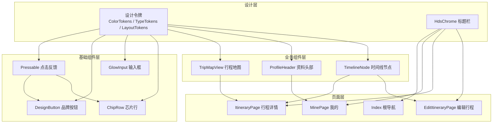

**图示来源**
- [HdsChrome.ets:1-200](file://entry/src/main/ets/design/HdsChrome.ets#L1-L200)
- [Pressable.ets:1-84](file://entry/src/main/ets/components/Pressable.ets#L1-L84)
- [DesignButton.ets:1-139](file://entry/src/main/ets/components/DesignButton.ets#L1-L139)
- [GlowInput.ets:1-83](file://entry/src/main/ets/components/GlowInput.ets#L1-L83)
- [ChipRow.ets:1-109](file://entry/src/main/ets/components/ChipRow.ets#L1-L109)
- [TripMapView.ets:1-200](file://entry/src/main/ets/components/TripMapView.ets#L1-L200)
- [ProfileHeader.ets:1-106](file://entry/src/main/ets/components/ProfileHeader.ets#L1-L106)
- [TimelineNode.ets:1-53](file://entry/src/main/ets/components/TimelineNode.ets#L1-L53)
- [Index.ets:1-200](file://entry/src/main/ets/pages/Index.ets#L1-L200)
- [MinePage.ets:1-200](file://entry/src/main/ets/pages/MinePage.ets#L1-L200)
- [ItineraryPage.ets:1-200](file://entry/src/main/ets/pages/ItineraryPage.ets#L1-L200)
- [EditItineraryPage.ets:1-200](file://entry/src/main/ets/pages/EditItineraryPage.ets#L1-L200)

**章节来源**
- [HdsChrome.ets:1-200](file://entry/src/main/ets/design/HdsChrome.ets#L1-L200)
- [Pressable.ets:1-84](file://entry/src/main/ets/components/Pressable.ets#L1-L84)
- [DesignButton.ets:1-139](file://entry/src/main/ets/components/DesignButton.ets#L1-L139)
- [GlowInput.ets:1-83](file://entry/src/main/ets/components/GlowInput.ets#L1-L83)
- [ChipRow.ets:1-109](file://entry/src/main/ets/components/ChipRow.ets#L1-L109)
- [TripMapView.ets:1-200](file://entry/src/main/ets/components/TripMapView.ets#L1-L200)
- [ProfileHeader.ets:1-106](file://entry/src/main/ets/components/ProfileHeader.ets#L1-L106)
- [TimelineNode.ets:1-53](file://entry/src/main/ets/components/TimelineNode.ets#L1-L53)
- [Index.ets:1-200](file://entry/src/main/ets/pages/Index.ets#L1-L200)
- [MinePage.ets:1-200](file://entry/src/main/ets/pages/MinePage.ets#L1-L200)
- [ItineraryPage.ets:1-200](file://entry/src/main/ets/pages/ItineraryPage.ets#L1-L200)
- [EditItineraryPage.ets:1-200](file://entry/src/main/ets/pages/EditItineraryPage.ets#L1-L200)

## 核心组件
本节从基础组件到业务组件，说明每个构件的职责、对外接口、内部状态与样式定制方式。

### 基础组件层

#### Pressable：统一的按下反馈容器
- 作用：为所有可点击控件提供一致的按压动画、命中区域与禁用态处理。
- 关键行为：
  - 使用 stateStyles 定义 normal 与 pressed 的透明度与缩放变化。
  - 用 responseRegion 控制点击热区：当传入 visualHeight 时，以 touchTargetHeight 居中包住矮控件；未传 visualHeight 时，整卡或整行作为响应区。
  - disabled 时不触发 action，但保持 enabled(!disabled)。
- 典型用法：被 DesignButton、ChipRow 包裹，用于实现“看着 36vp、点着 44vp”的触控体验。

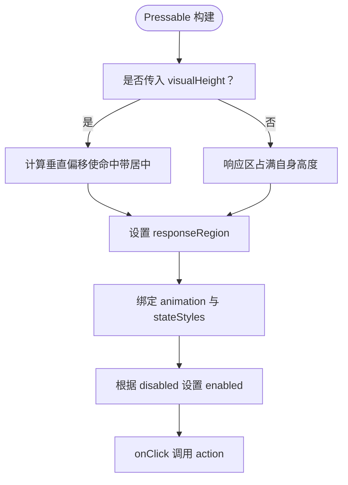

**图示来源**
- [Pressable.ets:1-84](file://entry/src/main/ets/components/Pressable.ets#L1-L84)

**章节来源**
- [Pressable.ets:1-84](file://entry/src/main/ets/components/Pressable.ets#L1-L84)

#### DesignButton：品牌按钮
- 变体：primary、outlined、ghost、glass，分别对应品牌实心、描边、幽灵字与玻璃浮层。
- 关键属性：
  - label、variant、disabled、fillWidth、visualWidth。
  - leadingSymbol、trailingSymbol 用于左右图标。
  - useSystemMaterial 控制是否由系统材质接管表面。
- 样式定制：
  - 主色文本 vs 普通文本颜色由 isPrimary 决定。
  - surface 返回 brandSolid、surfaceElevated 或透明。
  - edgeWidth/edgeColor 控制边框宽度与颜色，glass 走 separator，outlined 走 glassBarBorder。
  - cornerRadius 区分 pill 与 reason 圆角。
- 交互：委托 Pressable 处理按压效果；禁用态 opacity 降低；systemMaterial 生效时关闭自绘阴影。

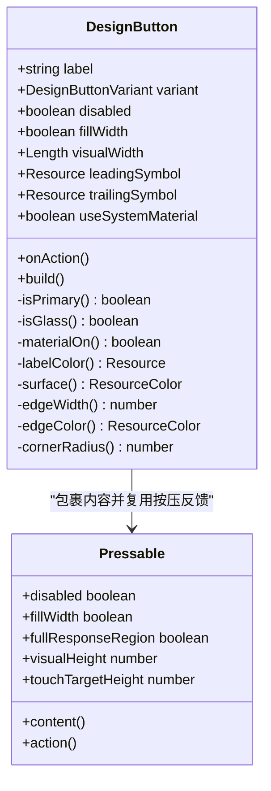

**图示来源**
- [DesignButton.ets:1-139](file://entry/src/main/ets/components/DesignButton.ets#L1-L139)
- [Pressable.ets:1-84](file://entry/src/main/ets/components/Pressable.ets#L1-L84)

**章节来源**
- [DesignButton.ets:1-139](file://entry/src/main/ets/components/DesignButton.ets#L1-L139)
- [Pressable.ets:1-84](file://entry/src/main/ets/components/Pressable.ets#L1-L84)

#### GlowInput：发光输入框
- 作用：统一 TextInput 的字体、占位符、双向绑定、回车回调与焦点回调。
- 关键属性：
  - text：通过 @Link 与父组件双向绑定。
  - placeholder、fillWidth、inputHeight、radius、segmentStyle、maxLength。
  - onChange、onEnter、onFocusChanged。
- 样式定制：
  - 默认使用 subtle 底色、无描边、胶囊圆角。
  - segmentStyle=true 时启用半透明背景、backdropBlur 与高光边框，形成“分段栏同款”玻璃风格。
- 响应式：fillWidth=false 时配合 Stack layoutWeight 让其在 Row 中自适应宽度。

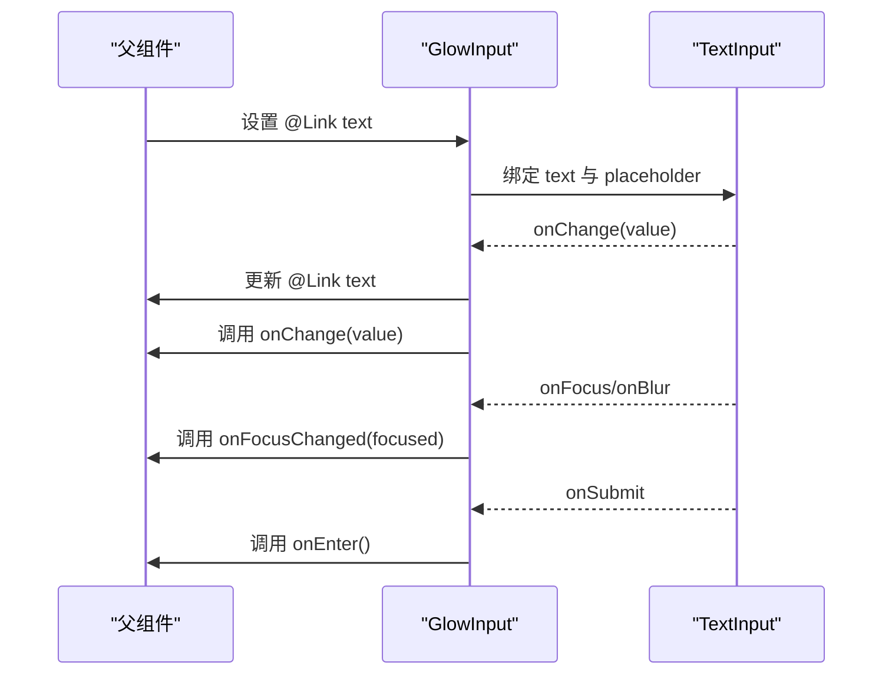

**图示来源**
- [GlowInput.ets:1-83](file://entry/src/main/ets/components/GlowInput.ets#L1-L83)

**章节来源**
- [GlowInput.ets:1-83](file://entry/src/main/ets/components/GlowInput.ets#L1-L83)

#### ChipRow：横向滚动芯片选择条
- 作用：展示一组可选 chip，选中项使用 brandSolid 底 + onBrand 字，未选中项使用 sunken 底 + primary 字。
- 关键属性：
  - items：ChipItem[]，每项含 key、label 与可选 symbol。
  - selectedIndex：@Link 双向绑定当前选中索引。
  - showIcon、sidePadding、itemGap、chipHeight。
  - onSelect：选中变更回调。
- 交互：外层 Scroll + ForEach，每项用 Pressable 包裹，保证最小 44vp 命中区。
- 视觉：capsule 圆角表示“待选择”，pill 用于已选标签语义；选中态加 headline.weight，未选中用 caption.weight。

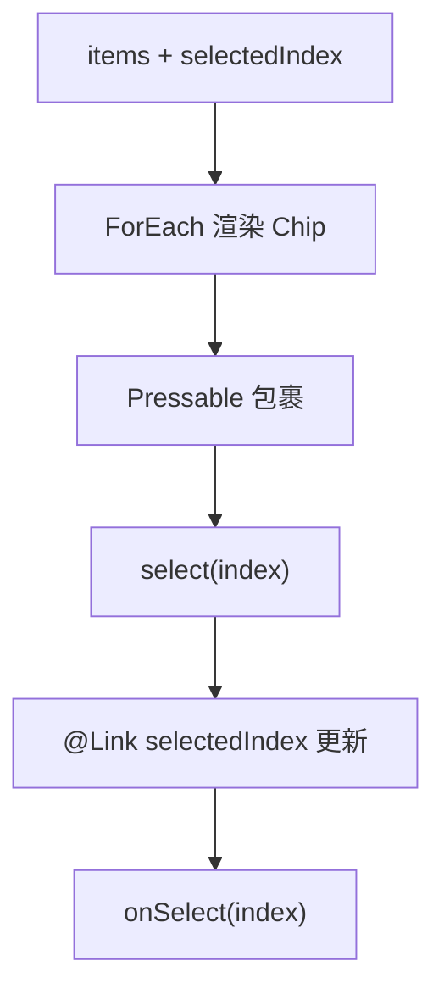

**图示来源**
- [ChipRow.ets:1-109](file://entry/src/main/ets/components/ChipRow.ets#L1-L109)
- [Pressable.ets:1-84](file://entry/src/main/ets/components/Pressable.ets#L1-L84)

**章节来源**
- [ChipRow.ets:1-109](file://entry/src/main/ets/components/ChipRow.ets#L1-L109)
- [Pressable.ets:1-84](file://entry/src/main/ets/components/Pressable.ets#L1-L84)

### 业务组件层

#### TripMapView：行程地图
- 作用：将 MapStop 集合渲染为地图上的编号图钉与动线折线，支持全览、聚焦某点、直线或沿路路线。
- 关键属性：
  - stops、signature：stops 重铺以 signature 为准，避免数组引用抖动。
  - request：'fit' 或 'focus:<index>:<seq>' 镜头指令。
  - route：是否连线。
  - roadRoute：是否调用 RoadRouteStore 生成道路折线。
  - fitTopPx、fitBottomPx：适配不同宿主面板的留白。
  - onStopClick：点击图钉回调。
- 内部状态：
  - ready、mapError、controller、events、markers、lines、drawn、routeSeq。
  - isDark 通过 @StorageProp('isDarkMode') 同步主题。
- 生命周期：
  - aboutToAppear：若首个 stop 可用，更新初始相机位置。
  - aboutToDisappear：注销事件、清理覆盖物、释放 controller。
- 绘制流程：redraw 去重 → 过滤可用坐标 → 分组 runs → 直线或 RoadRouteStore → addPolyline → Promise.all 添加 marker → moveCamera。

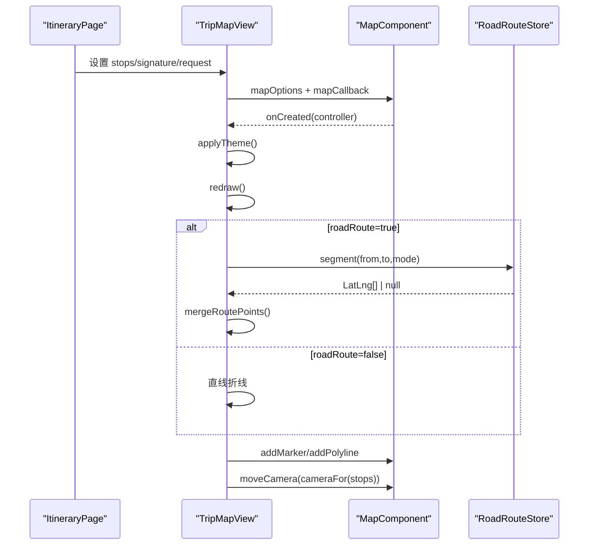

**图示来源**
- [TripMapView.ets:1-200](file://entry/src/main/ets/components/TripMapView.ets#L1-L200)
- [TripMapView.ets:201-385](file://entry/src/main/ets/components/TripMapView.ets#L201-L385)

**章节来源**
- [TripMapView.ets:1-200](file://entry/src/main/ets/components/TripMapView.ets#L1-L200)
- [TripMapView.ets:201-385](file://entry/src/main/ets/components/TripMapView.ets#L201-L385)

#### ProfileHeader：资料头部
- 作用：呈现头像、昵称、性别、简介、统计三列与操作按钮，并根据登录态切换文案。
- 关键属性：avatar、name、gender、bio、userId、isLoggedIn、followingCount、followerCount、totalLikes、statLabels、showToolPills、onBackground。
- 子组件：ProfileIdentity、ProfileStatItem、GlassPillButton。
- 交互：编辑资料、草稿箱、废纸篓、关注/粉丝入口；游客态显示“去登录”。

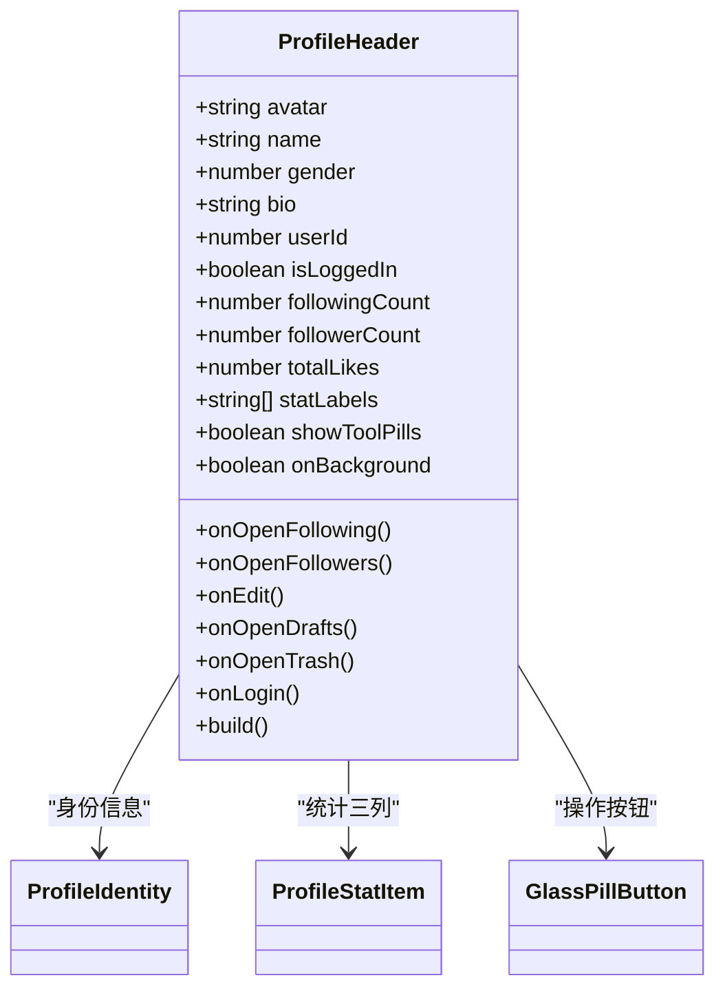

**图示来源**
- [ProfileHeader.ets:1-106](file://entry/src/main/ets/components/ProfileHeader.ets#L1-L106)

**章节来源**
- [ProfileHeader.ets:1-106](file://entry/src/main/ets/components/ProfileHeader.ets#L1-L106)

#### TimelineNode：时间线节点
- 作用：为行程时间线的活动项提供分类圆点。
- 关键属性：cat：ActivityCategory。
- 颜色映射：根据 CategoryStyle.colorName 映射到 bookmark、accentMention、icon、faint 或 primary。
- 结构：外层 Circle 描边 + 内层 Circle 填充，尺寸来自 LayoutTokens.itineraryNodeDot 与 itineraryNodeSize。

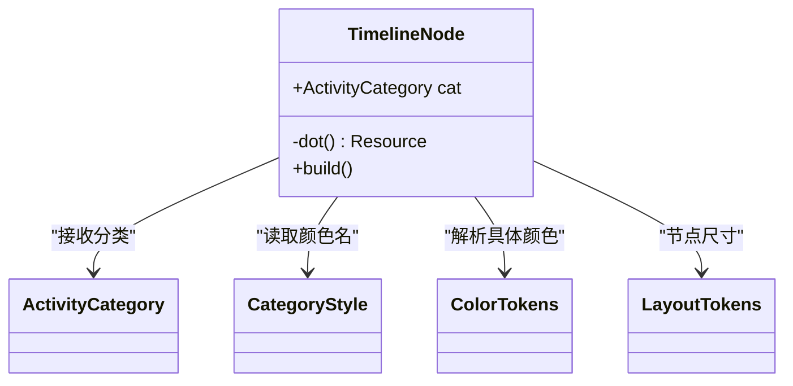

**图示来源**
- [TimelineNode.ets:1-53](file://entry/src/main/ets/components/TimelineNode.ets#L1-L53)

**章节来源**
- [TimelineNode.ets:1-53](file://entry/src/main/ets/components/TimelineNode.ets#L1-L53)

### 组合组件模式与页面级封装
- 复杂页面拆解：ItineraryPage 将时间线、地图、分段栏、分享、日历同步等能力拆成多个 utils 与 components；EditItineraryPage 将拖动、替换、撤销历史与候选景点加载拆分到独立方法。
- Props 接口设计：业务组件普遍采用 @Prop 单向传递配置（如 TripMapView.stops、request），对需要双向绑定的值使用 @Link（如 GlowInput.text、ChipRow.selectedIndex）。
- 插槽与 Builder：HdsChrome.bar 接受 bottomBuilder 作为底部行插槽；Index 使用 HdsTabs 承载多 Tab 内容；MinePage 通过 profileHeader Builder 组合背景图与 ProfileHeader。
- 事件回调：组件通过 onAction、onStopClick、onSelect、onEdit、onOpenDrafts 等回调把用户意图交给页面层处理。

**章节来源**
- [ItineraryPage.ets:1-200](file://entry/src/main/ets/pages/ItineraryPage.ets#L1-L200)
- [EditItineraryPage.ets:1-200](file://entry/src/main/ets/pages/EditItineraryPage.ets#L1-L200)
- [HdsChrome.ets:201-294](file://entry/src/main/ets/design/HdsChrome.ets#L201-L294)
- [Index.ets:1-200](file://entry/src/main/ets/pages/Index.ets#L1-L200)
- [MinePage.ets:1-200](file://entry/src/main/ets/pages/MinePage.ets#L1-L200)

## 架构总览
组件体系遵循“令牌 → 家族基础件 → 业务组件 → 页面”的分层原则：
- design 层暴露 Token 与 HdsChrome，统一色彩、字号、间距、圆角、阴影与标题栏行为。
- components 层基于 Token 与 Pressable 构建基础组件，再组合出 TripMapView、ProfileHeader、TimelineNode。
- pages 层持有页面级 @State，并通过 @StorageProp/@StorageLink 与全局状态联动，同时消费组件回调完成路由与数据刷新。

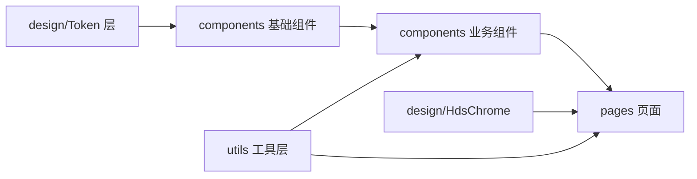

**图示来源**
- [HdsChrome.ets:1-200](file://entry/src/main/ets/design/HdsChrome.ets#L1-L200)
- [Pressable.ets:1-84](file://entry/src/main/ets/components/Pressable.ets#L1-L84)
- [DesignButton.ets:1-139](file://entry/src/main/ets/components/DesignButton.ets#L1-L139)
- [TripMapView.ets:1-200](file://entry/src/main/ets/components/TripMapView.ets#L1-L200)
- [ProfileHeader.ets:1-106](file://entry/src/main/ets/components/ProfileHeader.ets#L1-L106)
- [TimelineNode.ets:1-53](file://entry/src/main/ets/components/TimelineNode.ets#L1-L53)
- [responsive.ets:1-78](file://entry/src/main/ets/utils/responsive.ets#L1-L78)

## 详细组件分析

### 组件复用策略
- 单一按压反馈源：Pressable 集中实现 opacity/scale 动画与 responseRegion，避免各按钮重复实现。
- 设计令牌驱动：所有组件通过 ColorTokens、TypeTokens、LayoutTokens、SpaceTokens、RadiusTokens 获取样式，避免硬编码数值。
- 可配置外观：DesignButton.variant、GlowInput.segmentStyle、ChipRow.showIcon 等布尔开关控制分支样式。
- 受控与双向绑定：GlowInput.text 使用 @Link，ChipRow.selectedIndex 使用 @Link；TripMapView.stops 使用 @Prop + @Watch(signature) 控制重绘。
- 回调解耦：组件只暴露 onAction、onStopClick、onSelect、onEdit 等回调，具体路由与数据刷新放在页面层。

**章节来源**
- [Pressable.ets:1-84](file://entry/src/main/ets/components/Pressable.ets#L1-L84)
- [DesignButton.ets:1-139](file://entry/src/main/ets/components/DesignButton.ets#L1-L139)
- [GlowInput.ets:1-83](file://entry/src/main/ets/components/GlowInput.ets#L1-L83)
- [ChipRow.ets:1-109](file://entry/src/main/ets/components/ChipRow.ets#L1-L109)
- [TripMapView.ets:1-200](file://entry/src/main/ets/components/TripMapView.ets#L1-L200)

### 用户交互事件处理
- 按钮点击：DesignButton.onAction 由 Pressable.onClick 触发，disabled 时不执行。
- 输入提交：GlowInput.onSubmit 转发 onEnter；onChange 同步 @Link 与外部回调。
- 芯片选择：ChipRow.select 校验索引范围后更新 selectedIndex 并调用 onSelect。
- 地图交互：TripMapView 通过 Marker click 事件回调 onStopClick，页面据此高亮时间线行。

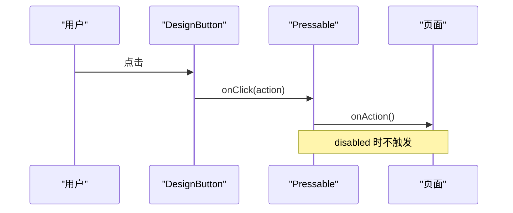

**图示来源**
- [DesignButton.ets:1-139](file://entry/src/main/ets/components/DesignButton.ets#L1-L139)
- [Pressable.ets:1-84](file://entry/src/main/ets/components/Pressable.ets#L1-L84)

**章节来源**
- [DesignButton.ets:1-139](file://entry/src/main/ets/components/DesignButton.ets#L1-L139)
- [Pressable.ets:1-84](file://entry/src/main/ets/components/Pressable.ets#L1-L84)

### 可复用组件创建示例指引
- 创建一个基础按钮组件：
  - 定义 enum 表示变体。
  - 使用 @Prop 声明 label、variant、disabled、leadingSymbol、trailingSymbol。
  - 在 build 中用 Pressable 包裹 Row，并根据 isPrimary/glass 选择 surface、edgeColor、cornerRadius。
  - 通过 onAction 回调将点击交给上层。
- 定义一个受控输入框：
  - 使用 @Link text 实现双向绑定。
  - 在 TextInput.onChange 中写入 this.text 并调用 onChange。
  - 使用 segmentStyle 开关玻璃风格。
- 定义一个可选项列表：
  - 使用 @Prop items 与 @Link selectedIndex。
  - ForEach 渲染每项，并用 Pressable 包裹。
  - select 时更新 selectedIndex 并调用 onSelect。

这些步骤直接对应仓库中的 DesignButton、GlowInput、ChipRow 实现路径。

**章节来源**
- [DesignButton.ets:1-139](file://entry/src/main/ets/components/DesignButton.ets#L1-L139)
- [GlowInput.ets:1-83](file://entry/src/main/ets/components/GlowInput.ets#L1-L83)
- [ChipRow.ets:1-109](file://entry/src/main/ets/components/ChipRow.ets#L1-L109)

## 依赖关系分析
- 基础组件依赖：
  - DesignButton 依赖 ColorTokens、LayoutTokens、MotionTokens、RadiusTokens、SpaceTokens、TypeTokens、Pressable 与沉浸式材质工具。
  - GlowInput 依赖 ColorTokens、LayoutTokens、RadiusTokens、SpaceTokens、TypeTokens、GlassTokens。
  - ChipRow 依赖 ColorTokens、LayoutTokens、MotionTokens、RadiusTokens、SpaceTokens、TypeTokens、Pressable。
- 业务组件依赖：
  - TripMapView 依赖 MapKit、RoadRouteStore、MapStops、NumberedPin、Logger、ColorTokens、TypeTokens、SpaceTokens、RadiusTokens。
  - ProfileHeader 依赖 ProfileIdentity、ProfileStatItem、GlassPillButton、ColorTokens、SpaceTokens。
  - TimelineNode 依赖 ActivityCategory、CategoryStyle、ColorTokens、LayoutTokens。
- 页面依赖：
  - Index 依赖 AppNav、HdsTabs、routerMap、longTakeTransitionHook、HdsMiniBarButton、BottomTabBar、TopStrip。
  - MinePage 依赖 ProfileHeader、Pressable、HdsChrome、EntitlementStore、BadgeDao、TripDao、ProfileStore。
  - ItineraryPage 依赖 TimelineNode、TripMapView、ImmersiveSegmentBar、YoujingButton、HdsChrome、DayLoad、TripSpan。
  - EditItineraryPage 依赖 TimelineNode、Pressable、YoujingButton、HdsChrome、PlanRepository。

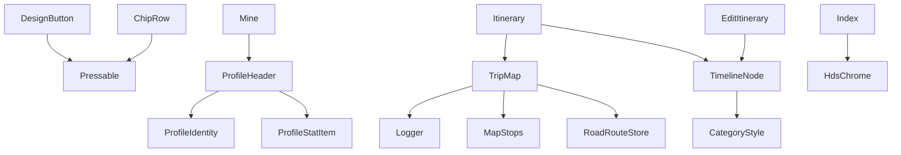

**图示来源**
- [DesignButton.ets:1-139](file://entry/src/main/ets/components/DesignButton.ets#L1-L139)
- [ChipRow.ets:1-109](file://entry/src/main/ets/components/ChipRow.ets#L1-L109)
- [TripMapView.ets:1-200](file://entry/src/main/ets/components/TripMapView.ets#L1-L200)
- [ProfileHeader.ets:1-106](file://entry/src/main/ets/components/ProfileHeader.ets#L1-L106)
- [TimelineNode.ets:1-53](file://entry/src/main/ets/components/TimelineNode.ets#L1-L53)
- [Index.ets:1-200](file://entry/src/main/ets/pages/Index.ets#L1-L200)
- [MinePage.ets:1-200](file://entry/src/main/ets/pages/MinePage.ets#L1-L200)
- [ItineraryPage.ets:1-200](file://entry/src/main/ets/pages/ItineraryPage.ets#L1-L200)
- [EditItineraryPage.ets:1-200](file://entry/src/main/ets/pages/EditItineraryPage.ets#L1-L200)

**章节来源**
- [DesignButton.ets:1-139](file://entry/src/main/ets/components/DesignButton.ets#L1-L139)
- [ChipRow.ets:1-109](file://entry/src/main/ets/components/ChipRow.ets#L1-L109)
- [TripMapView.ets:1-200](file://entry/src/main/ets/components/TripMapView.ets#L1-L200)
- [ProfileHeader.ets:1-106](file://entry/src/main/ets/components/ProfileHeader.ets#L1-L106)
- [TimelineNode.ets:1-53](file://entry/src/main/ets/components/TimelineNode.ets#L1-L53)
- [Index.ets:1-200](file://entry/src/main/ets/pages/Index.ets#L1-L200)
- [MinePage.ets:1-200](file://entry/src/main/ets/pages/MinePage.ets#L1-L200)
- [ItineraryPage.ets:1-200](file://entry/src/main/ets/pages/ItineraryPage.ets#L1-L200)
- [EditItineraryPage.ets:1-200](file://entry/src/main/ets/pages/EditItineraryPage.ets#L1-L200)

## 性能与渲染特性
- 地图绘制去重：TripMapView.redraw 通过 drawn 指纹与 signature 判断是否需要重新绘制，避免频繁重建覆盖物。
- 异步竞态保护：roadRoute 请求使用递增 routeSeq，旧结果回来时丢弃，防止新行程被旧数据覆盖。
- 资源清理：aboutToDisappear 中 try/catch 注销事件并清理 markers/lines，避免组件销毁期异常导致进程崩溃。
- 主题切换优化：HdsChrome.titleContentOf 使用 ComponentContent 缓存键带 themeTick，深浅档切换时重建标题内容，解决官方 HdsTitleBar 自绘内容不随配置重渲染的问题。
- 按压动画约束：Pressable 要求 .animation 必须紧贴 .stateStyles 之前，否则状态样式不会生效。

**章节来源**
- [TripMapView.ets:201-385](file://entry/src/main/ets/components/TripMapView.ets#L201-L385)
- [HdsChrome.ets:201-294](file://entry/src/main/ets/design/HdsChrome.ets#L201-L294)
- [Pressable.ets:1-84](file://entry/src/main/ets/components/Pressable.ets#L1-L84)

## 响应式设计与横竖屏适配
- 断点唯一来源：breakpointCenter.ets 提供 KEY_CURRENT_BREAKPOINT，页面通过 @StorageProp 读取。
- List 列数映射：responsive.listLanesForBreakpoint 将 sm→1、md→2、lg→3 映射为 List.lanes，避免宽屏卡片行长失控。
- 长文最大宽度：responsive.longFormMaxWidth 在 md 档强制 600vp，lg 档使用传入 capVp，sm 档返回 100%。
- 对称内缩：symmetricInsetForCap 根据窗口宽与目标栏宽计算两侧 padding，使内容居中对齐。
- 页面断点接入：ItineraryPage 通过 KEY_CURRENT_BREAKPOINT 与 longFormMaxWidth 控制时间轴在宽屏下的最大宽度。

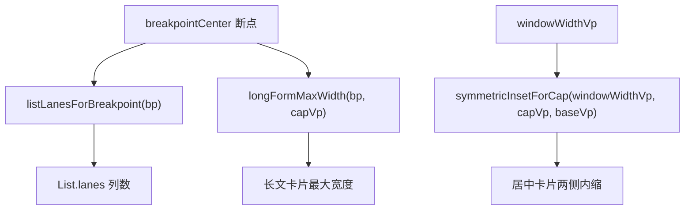

**图示来源**
- [responsive.ets:1-78](file://entry/src/main/ets/utils/responsive.ets#L1-L78)
- [ItineraryPage.ets:1-200](file://entry/src/main/ets/pages/ItineraryPage.ets#L1-L200)

**章节来源**
- [responsive.ets:1-78](file://entry/src/main/ets/utils/responsive.ets#L1-L78)
- [ItineraryPage.ets:1-200](file://entry/src/main/ets/pages/ItineraryPage.ets#L1-L200)

## 无障碍访问支持
- HdsChrome 菜单项：HdsChrome.item 接受 icon、label、action，其中 label 作为无障碍标签传递给系统。
- 其他组件：Pressable、DesignButton、GlowInput、ChipRow、TripMapView、ProfileHeader、TimelineNode 在当前源码中未显式设置无障碍描述；如需增强，可在可点击元素上增加 ariaLabel 或 equivalentText。
- 建议实践：
  - 为重要按钮与可选项补充语义化 label。
  - 对地图图钉标题与副标题保留 title/snippet，便于读屏软件播报站点名称与备注。
  - 对动态变化的文本（如计数、状态）确保文本更新后能通知无障碍服务。

**章节来源**
- [HdsChrome.ets:1-200](file://entry/src/main/ets/design/HdsChrome.ets#L1-L200)
- [TripMapView.ets:1-200](file://entry/src/main/ets/components/TripMapView.ets#L1-L200)

## 故障排查指南
- 地图空白或报错：
  - 检查鉴权失败错误码（例如 1002600003），组件会记录日志并显示“地图加载失败”，但不中断业务。
  - 确认 stops 中经纬度可用，不可用坐标会被过滤。
  - 确认首次挂载时已有合法中心点，避免 MapComponent 建图失败。
- 地图顶部落点被裁：
  - TripMapView 顶部留白 FIT_PAD_TOP 需足够大以容纳图钉；小面板场景下不要随意减小该值。
- 标题栏磨砂异常：
  - HdsChrome.maskExtraHeight 压到 0，避免模糊区盖住首屏内容。
  - blurRadius 仅在 IMMERSIVE_GRADIENT_BLUR 生效，COMMON_BLUR 会画成平色。
  - originalStyle 与 scrollEffectStyle 都要配置，否则滚动到位后无法切换到终态。
- 标题颜色深浅档冻结：
  - 通过 chromeThemeTick 与 HdsChrome.titleContentOf 缓存键切换，确保标题内容随深浅档重建。
- 点击无反应：
  - Pressable.responseRegion 必须正确：矮控件传 visualHeight，整卡不传 visualHeight。
  - .animation 必须紧贴 .stateStyles 之前。
- 二级页全屏化：
  - 二级页 push 到 HOST_NAV，不能抢 Inner Navigation 栈，否则会渲染不出来。

**章节来源**
- [TripMapView.ets:1-200](file://entry/src/main/ets/components/TripMapView.ets#L1-L200)
- [TripMapView.ets:201-385](file://entry/src/main/ets/components/TripMapView.ets#L201-L385)
- [HdsChrome.ets:1-200](file://entry/src/main/ets/design/HdsChrome.ets#L1-L200)
- [HdsChrome.ets:201-294](file://entry/src/main/ets/design/HdsChrome.ets#L201-L294)
- [Pressable.ets:1-84](file://entry/src/main/ets/components/Pressable.ets#L1-L84)
- [Index.ets:1-200](file://entry/src/main/ets/pages/Index.ets#L1-L200)

## 结论
本项目的 ArkTS 组件体系以设计令牌为基础，通过 Pressable、DesignButton、GlowInput、ChipRow 等基础组件统一交互与视觉，再以 TripMapView、ProfileHeader、TimelineNode 等业务组件封装领域逻辑，最终由 Index、MinePage、ItineraryPage、EditItineraryPage 等页面组合数据与行为。组件间通过 @Prop、@Link、@State、@Watch 明确数据流与状态边界，结合 HdsChrome 与 responsive.ets 实现标题栏与横竖屏适配。该分层使得基础 UI 可复用、业务逻辑可组合、页面行为可演进，适合继续扩展更多行程规划与旅行管理场景。