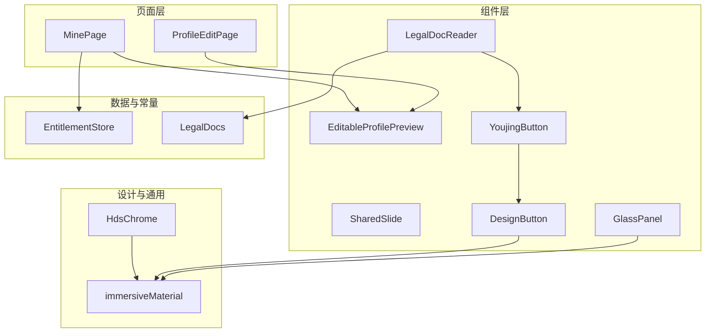
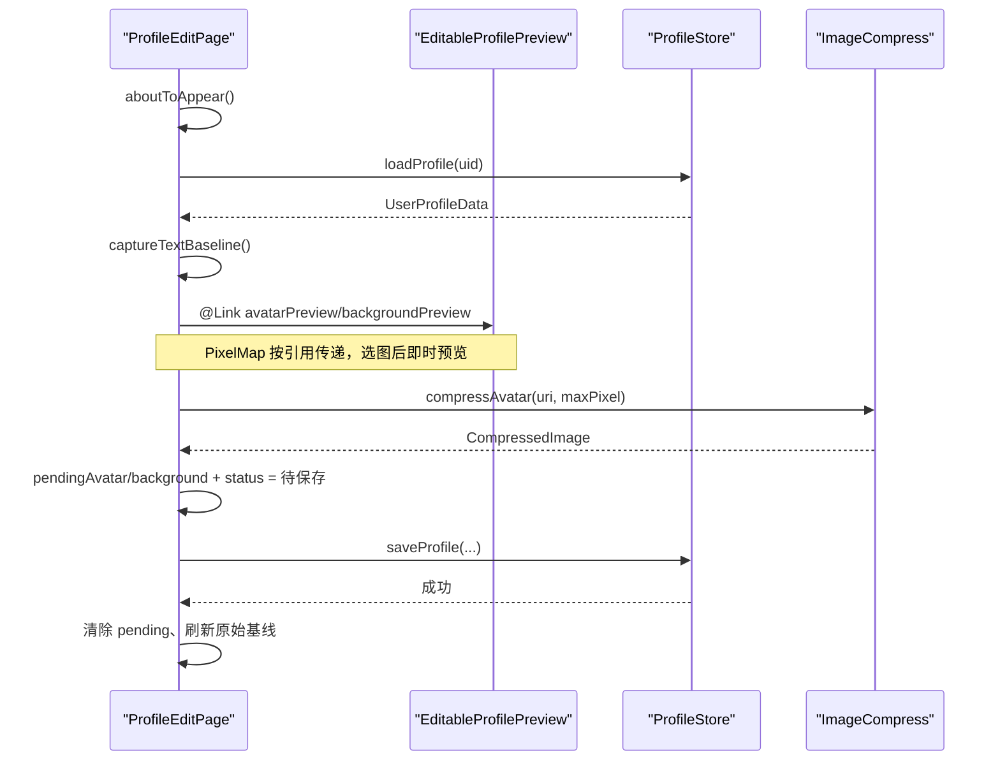
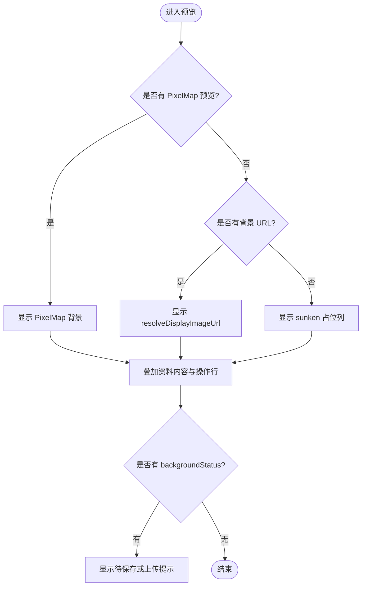
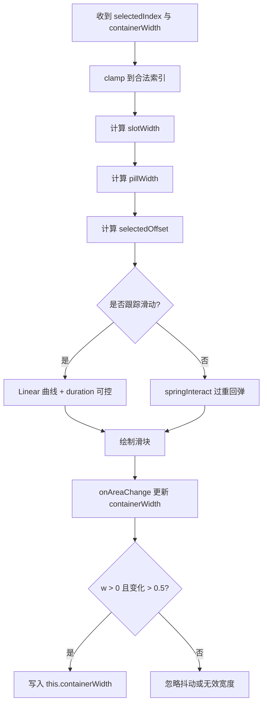
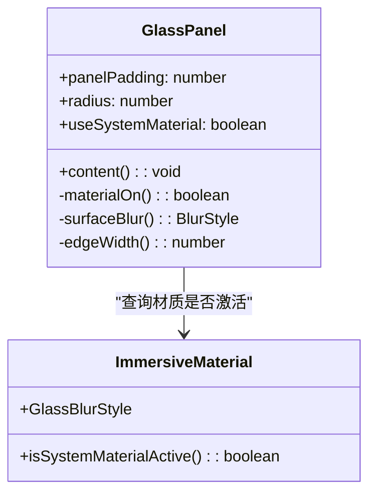
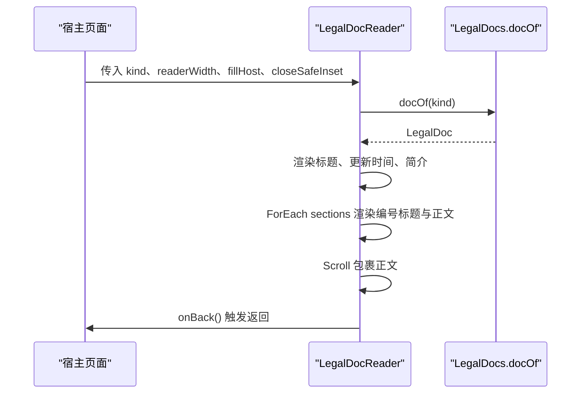
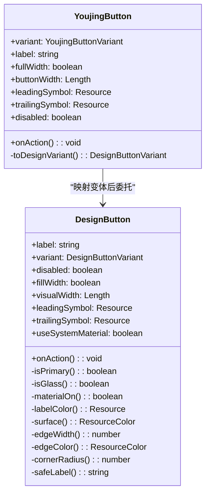
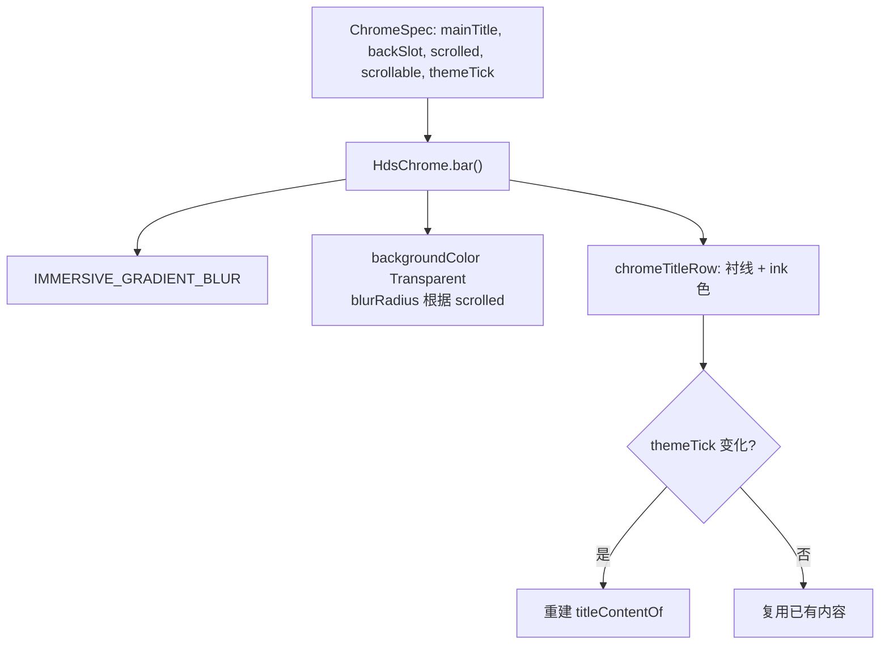
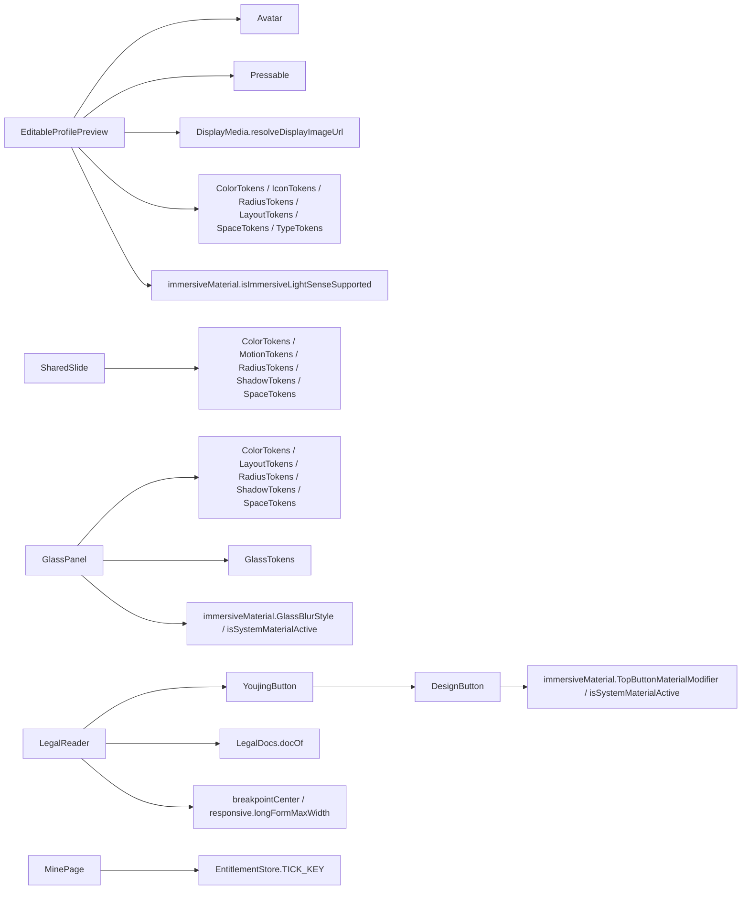

# 组件设计模式

<cite>
**本文引用的文件**   
- [EditableProfilePreview.ets](file://entry/src/main/ets/components/EditableProfilePreview.ets)
- [SharedSlide.ets](file://entry/src/main/ets/components/SharedSlide.ets)
- [GlassPanel.ets](file://entry/src/main/ets/components/GlassPanel.ets)
- [LegalDocReader.ets](file://entry/src/main/ets/components/LegalDocReader.ets)
- [YoujingButton.ets](file://entry/src/main/ets/components/YoujingButton.ets)
- [DesignButton.ets](file://entry/src/main/ets/components/DesignButton.ets)
- [HdsChrome.ets](file://entry/src/main/ets/design/HdsChrome.ets)
- [immersiveMaterial.ets](file://entry/src/main/ets/utils/immersiveMaterial.ets)
- [LegalDocs.ets](file://entry/src/main/ets/common/constants/LegalDocs.ets)
- [EntitlementStore.ets](file://entry/src/main/ets/data/EntitlementStore.ets)
- [ProfileEditPage.ets](file://entry/src/main/ets/pages/ProfileEditPage.ets)
- [MinePage.ets](file://entry/src/main/ets/pages/MinePage.ets)
</cite>

## 目录
1. [引言](#引言)
2. [项目结构](#项目结构)
3. [核心组件](#核心组件)
4. [架构总览](#架构总览)
5. [详细组件分析](#详细组件分析)
6. [依赖关系分析](#依赖关系分析)
7. [性能与优化](#性能与优化)
8. [故障排查](#故障排查)
9. [结论](#结论)
10. [附录：组件通信与状态模式对照表](#附录组件通信与状态模式对照表)

## 引言
本文面向 HarmonyOS / ArkTS 前端工程中的高级组件组合模式，围绕五个关键组件展开：可编辑预览、共享滑动指示器、玻璃面板、法律文档阅读器以及品牌按钮封装。文档重点说明以下主题：

- 编辑态管理与数据同步：以 `EditableProfilePreview` 为例，解释 `@Link` 像素图双向引用、父页面脏态校验、保存时统一转换 base64 的时机。
- 滑动交互与手势：以 `SharedSlide` 为例，解析浮点索引“跟手”分支与整数点击“弹性回弹”分支，并说明动画顺序陷阱。
- 玻璃效果与系统材质：以 `GlassPanel`、`DesignButton`、`HdsChrome` 为例，说明自绘模糊、系统材质接管、API 版本门禁。
- 长文档展示与滚动控制：以 `LegalDocReader` 为例，解释就地展开、`Scroll().layoutWeight(1)`、整页宿主填充、关闭安全边距。
- 品牌按钮复用：以 `YoujingButton` 为对外门面，`DesignButton` 为实际实现，说明变体映射与禁用透明度。
- 组件通信模式：Props、事件回调、`@Link`、`@Watch`、`@StorageProp`、全局 tick。
- 状态管理模式：局部 `@State`、父级状态提升、`AppStorage` / `@StorageProp` 全局广播。
- 测试与调试：断言输入边界、手势动画分支、系统材质开关、长文布局溢出场景。

## 项目结构
本项目的 ArkTS 代码集中在 `entry/src/main/ets` 下，相关组件位于 `components`，设计 Token 与 Chrome 位于 `design`，常量与工具位于 `common/constants` 与 `utils`，页面位于 `pages`，持久化与权限逻辑位于 `data`。

**图表来源**
- [ProfileEditPage.ets:1-200](file://entry/src/main/ets/pages/ProfileEditPage.ets#L1-L200)
- [MinePage.ets:1-200](file://entry/src/main/ets/pages/MinePage.ets#L1-L200)
- [EditableProfilePreview.ets:1-207](file://entry/src/main/ets/components/EditableProfilePreview.ets#L1-L207)
- [SharedSlide.ets:1-96](file://entry/src/main/ets/components/SharedSlide.ets#L1-L96)
- [GlassPanel.ets:1-54](file://entry/src/main/ets/components/GlassPanel.ets#L1-L54)
- [LegalDocReader.ets:1-122](file://entry/src/main/ets/components/LegalDocReader.ets#L1-L122)
- [YoujingButton.ets:1-60](file://entry/src/main/ets/components/YoujingButton.ets#L1-L60)
- [DesignButton.ets:1-139](file://entry/src/main/ets/components/DesignButton.ets#L1-L139)
- [HdsChrome.ets:1-200](file://entry/src/main/ets/design/HdsChrome.ets#L1-L200)
- [immersiveMaterial.ets:1-200](file://entry/src/main/ets/utils/immersiveMaterial.ets#L1-L200)
- [LegalDocs.ets:1-121](file://entry/src/main/ets/common/constants/LegalDocs.ets#L1-L121)
- [EntitlementStore.ets:1-200](file://entry/src/main/ets/data/EntitlementStore.ets#L1-L200)

**章节来源**
- [EditableProfilePreview.ets:1-207](file://entry/src/main/ets/components/EditableProfilePreview.ets#L1-L207)
- [SharedSlide.ets:1-96](file://entry/src/main/ets/components/SharedSlide.ets#L1-L96)
- [GlassPanel.ets:1-54](file://entry/src/main/ets/components/GlassPanel.ets#L1-L54)
- [LegalDocReader.ets:1-122](file://entry/src/main/ets/components/LegalDocReader.ets#L1-L122)
- [YoujingButton.ets:1-60](file://entry/src/main/ets/components/YoujingButton.ets#L1-L60)
- [DesignButton.ets:1-139](file://entry/src/main/ets/components/DesignButton.ets#L1-L139)
- [HdsChrome.ets:1-200](file://entry/src/main/ets/design/HdsChrome.ets#L1-L200)
- [immersiveMaterial.ets:1-200](file://entry/src/main/ets/utils/immersiveMaterial.ets#L1-L200)
- [LegalDocs.ets:1-121](file://entry/src/main/ets/common/constants/LegalDocs.ets#L1-L121)
- [EntitlementStore.ets:1-200](file://entry/src/main/ets/data/EntitlementStore.ets#L1-L200)

## 核心组件
本节概述五个组件的职责边界与公共契约：

| 组件 | 主要职责 | 对外 Props | 对外事件 | 内部状态 | 关键外部依赖 |
|---|---|---|---|---|---|
| `EditableProfilePreview` | 资料区预览与编辑入口；头像、背景、昵称、性别、简介、统计列展示 | 头像 URL、像素图预览、昵称、简介、性别、ID、关注粉丝获赞、背景图、上传状态、统计标签 | 修改背景、修改头像回调 | 无自身 `@State` | `Avatar`、`Pressable`、`DisplayMedia`、`ColorTokens`、`immersiveMaterial` |
| `SharedSlide` | 分段栏底部滑块指示器，支持跟手滑动与点击回弹 | 选中索引、项数、控件高、内边距、固定宽度、圆角、填充色、阴影、按压态 | 无 | `containerWidth` | `ColorTokens`、`MotionTokens`、`RadiusTokens`、`ShadowTokens`、`SpaceTokens` |
| `GlassPanel` | 内容卡片玻璃面容器，支持系统材质接管 | 子构建器、内边距、圆角、是否使用系统材质 | 无 | 无 | `ColorTokens`、`LayoutTokens`、`RadiusTokens`、`ShadowTokens`、`SpaceTokens`、`GlassTokens`、`immersiveMaterial` |
| `LegalDocReader` | 隐私政策/用户协议/关于页面的就地阅读器 | 文档类型、宽度、是否填充宿主、关闭安全边距 | 返回回调 | 无 | `YoujingButton`、`LegalDocs`、`breakpointCenter`、`responsive`、`TypeTokens`、`SpaceTokens`、`LayoutTokens`、`RadiusTokens` |
| `YoujingButton` | 业务语义按钮门面，映射到 `DesignButton` | 变体、文案、满宽、视觉宽度、前后图标、禁用、动作回调 | 点击动作 | 无 | `DesignButton` |

**章节来源**
- [EditableProfilePreview.ets:1-207](file://entry/src/main/ets/components/EditableProfilePreview.ets#L1-L207)
- [SharedSlide.ets:1-96](file://entry/src/main/ets/components/SharedSlide.ets#L1-L96)
- [GlassPanel.ets:1-54](file://entry/src/main/ets/components/GlassPanel.ets#L1-L54)
- [LegalDocReader.ets:1-122](file://entry/src/main/ets/components/LegalDocReader.ets#L1-L122)
- [YoujingButton.ets:1-60](file://entry/src/main/ets/components/YoujingButton.ets#L1-L60)
- [DesignButton.ets:1-139](file://entry/src/main/ets/components/DesignButton.ets#L1-L139)

## 架构总览
组件协作分为三层：

1. **页面层**：`ProfileEditPage` 管理编辑表单、图片压缩、脏态校验和保存；`MinePage` 负责资料区概览、会员权益与全局 tick 监听。
2. **组件层**：`EditableProfilePreview` 作为编辑预览复用层；`LegalDocReader` 消费 `YoujingButton` 与 `LegalDocs`；`GlassPanel` 与 `DesignButton` 消费系统材质能力。
3. **通用层**：`immersiveMaterial` 提供 HDS 沉浸光感、系统材质、玻璃模糊档位；`LegalDocs` 提供纯常量法律文本；`EntitlementStore` 提供权益缓存与生成/导出门禁。

**图表来源**
- [ProfileEditPage.ets:1-200](file://entry/src/main/ets/pages/ProfileEditPage.ets#L1-L200)
- [EditableProfilePreview.ets:1-207](file://entry/src/main/ets/components/EditableProfilePreview.ets#L1-L207)

## 详细组件分析

### 可编辑预览组件 `EditableProfilePreview`
该组件是“编辑即预览”的核心：它不持有本地编辑状态，而是通过 `@Prop` 接收静态字段，通过 `@Link` 共享 `image.PixelMap` 像素图预览，并通过 `onPickBackground`、`onPickAvatar` 回调让父页面完成选图、压缩与保存。

关键设计点：

- **像素图预览用 `@Link`**：复杂对象 `image.PixelMap` 若仅用 `@Prop` 单向拷贝，可能因引用比较导致父组件更新后子组件不重渲染。注释明确指出“修改背景不即时显示、点保存才渲染”，因此改用 `@Link` 父子共享引用。
- **统计列按引用传参**：`previewStat` 使用 `$$` 模式传入对象字面量，避免旧实现中静态快照导致的计数永远为 0。
- **性别徽章双态颜色**：男/女/保密三种状态分别映射不同文字与底色，且注释提醒需与 `ProfileIdentity` 保持配色一致。
- **背景图优先级**：优先显示 `profileBackgroundPreview`，其次 `profileBackground` URL，最后降级为带主题色的占位列。
- **上传与状态提示**：`backgroundStatus` 显示“待保存”，`uploadingBackground` 显示进度条；两者都叠加在预览卡上。

**图表来源**
- [EditableProfilePreview.ets:1-207](file://entry/src/main/ets/components/EditableProfilePreview.ets#L1-L207)

**章节来源**
- [EditableProfilePreview.ets:1-207](file://entry/src/main/ets/components/EditableProfilePreview.ets#L1-L207)
- [ProfileEditPage.ets:1-200](file://entry/src/main/ets/pages/ProfileEditPage.ets#L1-L200)

### 共享滑动组件 `SharedSlide`
`SharedSlide` 是一个低 SDK 降级路径下的分段栏滑块指示器，常用于 `BottomTabBar` 的玻璃药丸选中指示块。其核心算法由三个私有方法组成：

| 方法 | 作用 | 复杂度 |
|---|---|---|
| `safeCount` | 保证至少 1 项，防止除以 0 | O(1) |
| `slotWidth` | 计算每个槽位宽度 | O(1) |
| `pillWidth` | 根据固定 `itemWidth` 与槽宽取较小值 | O(1) |
| `selectedOffset` | 将浮点索引映射到像素偏移 | O(1) |
| `isTracking` | 判断当前是否为“跟手”浮点滑动 | O(1) |

时间复杂度均为 O(1)，空间复杂度 O(1)。唯一可变状态是父组件传入的 `selectedIndex` 和本地 `containerWidth`。

关键实现约束：

1. **跟手分支必须用线性曲线**：浮点索引不做补间，直接逐帧跟随手指；整数点击切换才走 spring 回弹。
2. **尺寸声明必须在 `.animation()` 之后**：显式动画会吃掉它之前声明的可动画属性，否则首帧会把滑块弹成小圆块。
3. **容器宽度只接受有效且确有变化**：过滤 0 与抖动值，避免滑块宽度被算成 0。

**图表来源**
- [SharedSlide.ets:1-96](file://entry/src/main/ets/components/SharedSlide.ets#L1-L96)

**章节来源**
- [SharedSlide.ets:1-96](file://entry/src/main/ets/components/SharedSlide.ets#L1-L96)

### 玻璃面板 `GlassPanel`
`GlassPanel` 是普通内容卡的玻璃容器，只在登记点位走系统背景模糊，不加 HDS 双边流光。它通过 `useSystemMaterial` 与 `isSystemMaterialActive()` 控制自绘层是否归零：

- 当系统材质生效时：背景模糊为 `NONE`、边框宽度为 `0`、阴影为 `none`、背景透明。
- 当系统材质未生效时：背景模糊为 `GlassBlurStyle.Card`、边框为 `glassBorderWidth`、阴影为 `cardAmbient`、背景为 `GlassTokens.CARD_BG`。

这体现了“系统材质接管表面”的设计原则：避免自绘描边、阴影与系统材质叠加形成双圈描边或灰缝。

**图表来源**
- [GlassPanel.ets:1-54](file://entry/src/main/ets/components/GlassPanel.ets#L1-L54)
- [immersiveMaterial.ets:1-200](file://entry/src/main/ets/utils/immersiveMaterial.ets#L1-L200)

**章节来源**
- [GlassPanel.ets:1-54](file://entry/src/main/ets/components/GlassPanel.ets#L1-L54)
- [immersiveMaterial.ets:1-200](file://entry/src/main/ets/utils/immersiveMaterial.ets#L1-L200)

### 法律文档阅读器 `LegalDocReader`
`LegalDocReader` 用于隐私政策、用户协议、关于页面的就地展开阅读。它不自行导航，而是把“标题、更新时间、介绍、分节正文、返回按钮”作为纯展示单元交给宿主管理。

关键行为：

- **文档来源**：`docOf(kind)` 从 `LegalDocs.ets` 返回 `privacy`、`agreement`、`terms`、`about` 四套常量数据。
- **滚动区域**：正文放在 `Scroll()` 中，启用弹簧边缘效果，隐藏滚动条，`layoutWeight(1)` 参与剩余高度分配。
- **整页宿主填充**：当 `fillHost=true` 时，根节点 `layoutWeight=1`，使内部 `Scroll` 获得明确边界；默认 `false`，用于弹窗或 sheet。
- **关闭安全边距**：当宿主右上角有浮动关闭按钮时，通过 `closeSafeInset` 给日期等元素留出右侧空间。
- **断点适配**：最大宽度来自 `longFormMaxWidth(bp, LayoutTokens.contentMaxWidth)`。

**图表来源**
- [LegalDocReader.ets:1-122](file://entry/src/main/ets/components/LegalDocReader.ets#L1-L122)
- [LegalDocs.ets:1-121](file://entry/src/main/ets/common/constants/LegalDocs.ets#L1-L121)

**章节来源**
- [LegalDocReader.ets:1-122](file://entry/src/main/ets/components/LegalDocReader.ets#L1-L122)
- [LegalDocs.ets:1-121](file://entry/src/main/ets/common/constants/LegalDocs.ets#L1-L121)

### 有径按钮 `YoujingButton` 与设计按钮 `DesignButton`
`YoujingButton` 是业务语义门面，保留既有调用点的 props 名；`DesignButton` 才是真正实现四变体的主件。

变体映射：

| `YoujingButtonVariant` | `DesignButtonVariant` | 视觉语义 |
|---|---|---|
| `PRIMARY` | `PRIMARY` | 品牌实心，一屏只许一颗 |
| `SECONDARY` | `OUTLINED` | 透明底 + 描边 + pill |
| `TEXT` | `GHOST` | 品牌文字 + reason 圆角 |
| `GLASS` | `GLASS` | elevated 底 + separator 描边 + cardAmbient 影 |

`DesignButton` 还处理：

- 禁用透明度：`opacity(0.45)`。
- 按下反馈：由 `Pressable` 统一实现，不在按钮重复写 stateStyles。
- 系统材质：`useSystemMaterial=true` 且系统材质激活时，自绘 border/shadow 归零，改用 `TopButtonMaterialModifier`。

**图表来源**
- [YoujingButton.ets:1-60](file://entry/src/main/ets/components/YoujingButton.ets#L1-L60)
- [DesignButton.ets:1-139](file://entry/src/main/ets/components/DesignButton.ets#L1-L139)

**章节来源**
- [YoujingButton.ets:1-60](file://entry/src/main/ets/components/YoujingButton.ets#L1-L60)
- [DesignButton.ets:1-139](file://entry/src/main/ets/components/DesignButton.ets#L1-L139)

### 顶栏 Chrome 与系统材质
`HdsChrome` 是 HDS 官方顶栏的单点配置，负责沉浸式渐变模糊、标题自绘、菜单项、底部 builder 与主题 tick。它与 `immersiveMaterial` 的关系是：

- `HdsChrome` 负责声明栏样式、滚动模糊半径、maskExtraHeight、标题字体与颜色。
- `immersiveMaterial` 负责探测 API 版本、syscap、systemMaterial 是否可用，并提供玻璃模糊档位与 AttributeModifier。

特别要点：

- 标题文字与图标必须用 token 色，否则浅色画布上白色图标不可见。
- `maskExtraHeight` 必须压到 0，否则磨砂区会覆盖首屏内容。
- 标题内容需要随 `themeTick` 重建 `ComponentContent`，解决系统浅深档切换后标题不重渲染的问题。

**图表来源**
- [HdsChrome.ets:1-200](file://entry/src/main/ets/design/HdsChrome.ets#L1-L200)
- [immersiveMaterial.ets:1-200](file://entry/src/main/ets/utils/immersiveMaterial.ets#L1-L200)

**章节来源**
- [HdsChrome.ets:1-200](file://entry/src/main/ets/design/HdsChrome.ets#L1-L200)
- [immersiveMaterial.ets:1-200](file://entry/src/main/ets/utils/immersiveMaterial.ets#L1-L200)

## 依赖关系分析

**图表来源**
- [EditableProfilePreview.ets:1-207](file://entry/src/main/ets/components/EditableProfilePreview.ets#L1-L207)
- [SharedSlide.ets:1-96](file://entry/src/main/ets/components/SharedSlide.ets#L1-L96)
- [GlassPanel.ets:1-54](file://entry/src/main/ets/components/GlassPanel.ets#L1-L54)
- [LegalDocReader.ets:1-122](file://entry/src/main/ets/components/LegalDocReader.ets#L1-L122)
- [YoujingButton.ets:1-60](file://entry/src/main/ets/components/YoujingButton.ets#L1-L60)
- [DesignButton.ets:1-139](file://entry/src/main/ets/components/DesignButton.ets#L1-L139)
- [MinePage.ets:1-200](file://entry/src/main/ets/pages/MinePage.ets#L1-L200)
- [EntitlementStore.ets:1-200](file://entry/src/main/ets/data/EntitlementStore.ets#L1-L200)

**章节来源**
- [EditableProfilePreview.ets:1-207](file://entry/src/main/ets/components/EditableProfilePreview.ets#L1-L207)
- [SharedSlide.ets:1-96](file://entry/src/main/ets/components/SharedSlide.ets#L1-L96)
- [GlassPanel.ets:1-54](file://entry/src/main/ets/components/GlassPanel.ets#L1-L54)
- [LegalDocReader.ets:1-122](file://entry/src/main/ets/components/LegalDocReader.ets#L1-L122)
- [YoujingButton.ets:1-60](file://entry/src/main/ets/components/YoujingButton.ets#L1-L60)
- [DesignButton.ets:1-139](file://entry/src/main/ets/components/DesignButton.ets#L1-L139)
- [MinePage.ets:1-200](file://entry/src/main/ets/pages/MinePage.ets#L1-L200)
- [EntitlementStore.ets:1-200](file://entry/src/main/ets/data/EntitlementStore.ets#L1-L200)

## 性能与优化
本节汇总各组件的性能注意事项与优化策略。

| 组件 | 性能风险 | 优化手段 |
|---|---|---|
| `EditableProfilePreview` | `image.PixelMap` 用 `@Prop` 单向拷贝导致不重渲染 | 改用 `@Link` 共享引用；统计列按引用传参避免静态快照 |
| `SharedSlide` | 容器宽度抖动或 0 导致滑块宽度计算为 0 | `onAreaChange` 过滤 `w>0` 且变化大于 0.5；`safeCount` 保底为 1 |
| `SharedSlide` | 动画吞掉 width/height/borderRadius | 尺寸与圆角声明放在 `.animation()` 之后 |
| `SharedSlide` | 滑动滞后于手指 | 跟手分支使用线性曲线，不套用 springMotion |
| `GlassPanel` | 自绘模糊与系统材质叠加形成双圈描边或灰缝 | `useSystemMaterial=true` 时关闭自绘 blur、border、shadow |
| `DesignButton` | 系统材质缺失时 UI 不一致 | 通过 `isSystemMaterialActive()` 与 `TopButtonMaterialModifier` 安全降级 |
| `LegalDocReader` | 长文档撑开整个页面，标题与返回按钮被挤出屏幕 | `fillHost=false` 时不参与剩余分配；`Scroll().layoutWeight(1)` 仅在宿主有高度时生效 |
| `HdsChrome` | 标题颜色与图标颜色不匹配浅色画布 | 显式设置 `menuStyle/backIconStyle/titleStyle` 的 token 色 |
| `HdsChrome` | 模糊区覆盖首屏内容 | `maskExtraHeight=0` |
| `HdsChrome` | 深浅档切换后标题不重渲染 | 通过 `themeTick` 重建 `ComponentContent` |

**章节来源**
- [EditableProfilePreview.ets:1-207](file://entry/src/main/ets/components/EditableProfilePreview.ets#L1-L207)
- [SharedSlide.ets:1-96](file://entry/src/main/ets/components/SharedSlide.ets#L1-L96)
- [GlassPanel.ets:1-54](file://entry/src/main/ets/components/GlassPanel.ets#L1-L54)
- [LegalDocReader.ets:1-122](file://entry/src/main/ets/components/LegalDocReader.ets#L1-L122)
- [DesignButton.ets:1-139](file://entry/src/main/ets/components/DesignButton.ets#L1-L139)
- [HdsChrome.ets:1-200](file://entry/src/main/ets/design/HdsChrome.ets#L1-L200)
- [immersiveMaterial.ets:1-200](file://entry/src/main/ets/utils/immersiveMaterial.ets#L1-L200)

## 故障排查
本节给出常见问题的定位思路与修复建议。

### 头像或背景图选择后预览不刷新
- 现象：选择新图片后，预览仍显示旧图，直到保存后才刷新。
- 原因：`image.PixelMap` 使用了 `@Prop` 而非 `@Link`，父组件更新后子组件未感知引用变化。
- 修复：确保 `avatarPreview`、`profileBackgroundPreview` 使用 `@Link`。
- 参考路径：[EditableProfilePreview.ets:1-207](file://entry/src/main/ets/components/EditableProfilePreview.ets#L1-L207)

### 统计列数值始终为 0
- 现象：真机行程计数已非 0，但预览卡统计列显示 0。
- 原因：旧实现按值传递静态快照，异步回填后 `@Builder` 不重执行。
- 修复：使用 `$$` 模式按引用传参。
- 参考路径：[EditableProfilePreview.ets:1-207](file://entry/src/main/ets/components/EditableProfilePreview.ets#L1-L207)

### 滑块在滑动时滞后于手指
- 现象：拖动分段栏时，滑块跟不上手指。
- 原因：误用 springMotion；物理弹簧时长由响应与初速度决定，会逐帧追赶。
- 修复：跟手分支使用线性曲线；整数点击才使用 springInteract。
- 参考路径：[SharedSlide.ets:1-96](file://entry/src/main/ets/components/SharedSlide.ets#L1-L96)

### 滑块首帧缩成小圆块
- 现象：首次渲染时滑块宽度异常缩小。
- 原因：width、height、borderRadius 写在 `.animation()` 之前，被显式动画吞掉。
- 修复：把尺寸与圆角声明移到 `.animation()` 之后。
- 参考路径：[SharedSlide.ets:1-96](file://entry/src/main/ets/components/SharedSlide.ets#L1-L96)

### 玻璃面板出现双圈描边或灰缝
- 现象：开启系统材质后，面板边缘出现多余描边或灰缝。
- 原因：自绘 border/shadow/blur 与系统材质同时生效。
- 修复：`useSystemMaterial=true` 且 `isSystemMaterialActive()` 为真时，将边框宽度、阴影、模糊归零。
- 参考路径：[GlassPanel.ets:1-54](file://entry/src/main/ets/components/GlassPanel.ets#L1-L54)、[immersiveMaterial.ets:1-200](file://entry/src/main/ets/utils/immersiveMaterial.ets#L1-L200)

### 顶栏模糊覆盖首屏内容
- 现象：顶栏磨砂区域向下延伸，遮挡页面顶部。
- 原因：`maskExtraHeight` 默认 32vp。
- 修复：设置为 0。
- 参考路径：[HdsChrome.ets:1-200](file://entry/src/main/ets/design/HdsChrome.ets#L1-L200)

### 法律文档阅读器正文被挤出屏幕
- 现象：在整页宿主中打开长文档，标题与返回按钮被滚出可视区。
- 原因：根节点没有确定高度，`Scroll().layoutWeight(1)` 在无界父容器中按内容撑开。
- 修复：宿主传入 `fillHost=true`，让组件根节点 `layoutWeight=1`；不要把高度链式传给自定义组件。
- 参考路径：[LegalDocReader.ets:1-122](file://entry/src/main/ets/components/LegalDocReader.ets#L1-L122)

### 深浅档切换后标题颜色冻结
- 现象：系统浅→深实时切换后，标题仍按浅色档墨色渲染。
- 原因：官方 `HdsTitleBar` 自绘标题内容不随配置切换重渲染。
- 修复：通过 `themeTick` 换新的 `ComponentContent`，并让页面因 `@StorageProp` 变化重跑 build。
- 参考路径：[HdsChrome.ets:1-200](file://entry/src/main/ets/design/HdsChrome.ets#L1-L200)

### 生成行程或导出行权判定异常
- 现象：BFF 未部署或缓存过期时，用户一直停留在付费页。
- 原因：旧实现缓存过期直接拒绝；设备激活后不再刷新权益，导致永久失败。
- 修复：`canGenerate` 在缓存过期时转交服务端；管理员白名单直接放行；开发态可通过 `DEV_SKIP_BFF` 旁路。
- 参考路径：[EntitlementStore.ets:1-200](file://entry/src/main/ets/data/EntitlementStore.ets#L1-L200)

**章节来源**
- [EditableProfilePreview.ets:1-207](file://entry/src/main/ets/components/EditableProfilePreview.ets#L1-L207)
- [SharedSlide.ets:1-96](file://entry/src/main/ets/components/SharedSlide.ets#L1-L96)
- [GlassPanel.ets:1-54](file://entry/src/main/ets/components/GlassPanel.ets#L1-L54)
- [LegalDocReader.ets:1-122](file://entry/src/main/ets/components/LegalDocReader.ets#L1-L122)
- [HdsChrome.ets:1-200](file://entry/src/main/ets/design/HdsChrome.ets#L1-L200)
- [EntitlementStore.ets:1-200](file://entry/src/main/ets/data/EntitlementStore.ets#L1-L200)

## 结论
本项目的高级组件设计体现出清晰的分层与复用原则：

- 组件职责单一：`EditableProfilePreview` 专注预览与编辑入口，`SharedSlide` 专注滑动指示，`GlassPanel` 专注玻璃容器，`LegalDocReader` 专注文档阅读，`YoujingButton` 专注业务语义门面。
- 系统能力统一抽象：玻璃材质、沉浸光感、HDS 顶栏均通过 `immersiveMaterial` 与 `HdsChrome` 集中管理，避免散落硬编码。
- 状态管理分层清晰：局部 `@State` 管编辑草稿，父组件状态提升管页面级数据，`@StorageProp` 与 tick 机制管跨组件全局同步。
- 兼容性意识强：API 版本检测、syscap 探测、低版本降级、系统材质降级均有明确边界。
- 可维护性体现在大量注释中的“有据真机踩坑记录”，这些经验可以直接转化为未来组件的防御式实现。

在实际扩展中，建议继续遵循以下原则：

1. 对复杂对象使用 `@Link`，避免单向拷贝带来的渲染遗漏。
2. 对动画敏感的属性，严格区分“跟手分支”和“点击回弹分支”。
3. 对系统材质相关 UI，统一通过 `isSystemMaterialActive()` 与对应 Modifier 做降级。
4. 对长文档与滚动容器，明确宿主高度来源，避免无界撑开。
5. 对全局状态，使用 tick 广播驱动界面刷新，而不是手动到处 rebind。

## 附录：组件通信与状态模式对照表

### 组件通信模式

| 模式 | 适用场景 | 示例 |
|---|---|---|
| Props 单向传递 | 静态展示数据 | `LegalDocReader.kind`、`GlassPanel.radius` |
| 事件冒泡回调 | 子组件通知父组件动作 | `EditableProfilePreview.onPickBackground`、`LegalDocReader.onBack` |
| `@Link` 双向绑定 | 共享复杂对象引用 | `EditableProfilePreview.avatarPreview`、`profileBackgroundPreview` |
| `@Watch` 监听器 | 监听 `@StorageProp` 变化 | `MinePage.onDockShown`、`onEntitlementTick`、`onProfileTick` |
| `@StorageProp` 全局状态 | 跨页面同步主题、登录态、权益、资料变更 | `chromeThemeTick`、`AUTH_STATE_KEY`、`EntitlementStore.TICK_KEY`、`PROFILE_TICK_KEY` |

**章节来源**
- [EditableProfilePreview.ets:1-207](file://entry/src/main/ets/components/EditableProfilePreview.ets#L1-L207)
- [LegalDocReader.ets:1-122](file://entry/src/main/ets/components/LegalDocReader.ets#L1-L122)
- [GlassPanel.ets:1-54](file://entry/src/main/ets/components/GlassPanel.ets#L1-L54)
- [MinePage.ets:1-200](file://entry/src/main/ets/pages/MinePage.ets#L1-L200)
- [EntitlementStore.ets:1-200](file://entry/src/main/ets/data/EntitlementStore.ets#L1-L200)

### 组件状态管理模式

| 层级 | 管理方式 | 典型数据 |
|---|---|---|
| 组件局部状态 | `@State` | `SharedSlide.containerWidth`、`ProfileEditPage.nickname/bio/avatarPreview/backgroundPreview/saving/tripCount` |
| 父组件状态提升 | 页面持有表单与预览数据，子组件通过 Props 和 `@Link` 消费 | `ProfileEditPage` 持有所有编辑态，`EditableProfilePreview` 只做展示与回调 |
| 全局状态 | `@StorageProp` + tick | 主题 tick、登录态、权益 tick、资料 tick、Tab 显示 tick |
| 持久化状态 | `preferences` + TTL | `EntitlementStore.cached`、`cachedAt` |
| 常量数据 | 纯函数或常量对象 | `LegalDocs.docOf`、`docOf(kind)` |

**章节来源**
- [SharedSlide.ets:1-96](file://entry/src/main/ets/components/SharedSlide.ets#L1-L96)
- [ProfileEditPage.ets:1-200](file://entry/src/main/ets/pages/ProfileEditPage.ets#L1-L200)
- [MinePage.ets:1-200](file://entry/src/main/ets/pages/MinePage.ets#L1-L200)
- [EntitlementStore.ets:1-200](file://entry/src/main/ets/data/EntitlementStore.ets#L1-L200)
- [LegalDocs.ets:1-121](file://entry/src/main/ets/common/constants/LegalDocs.ets#L1-L121)