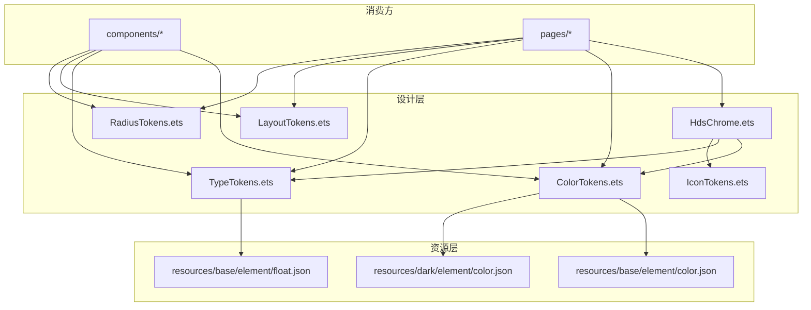
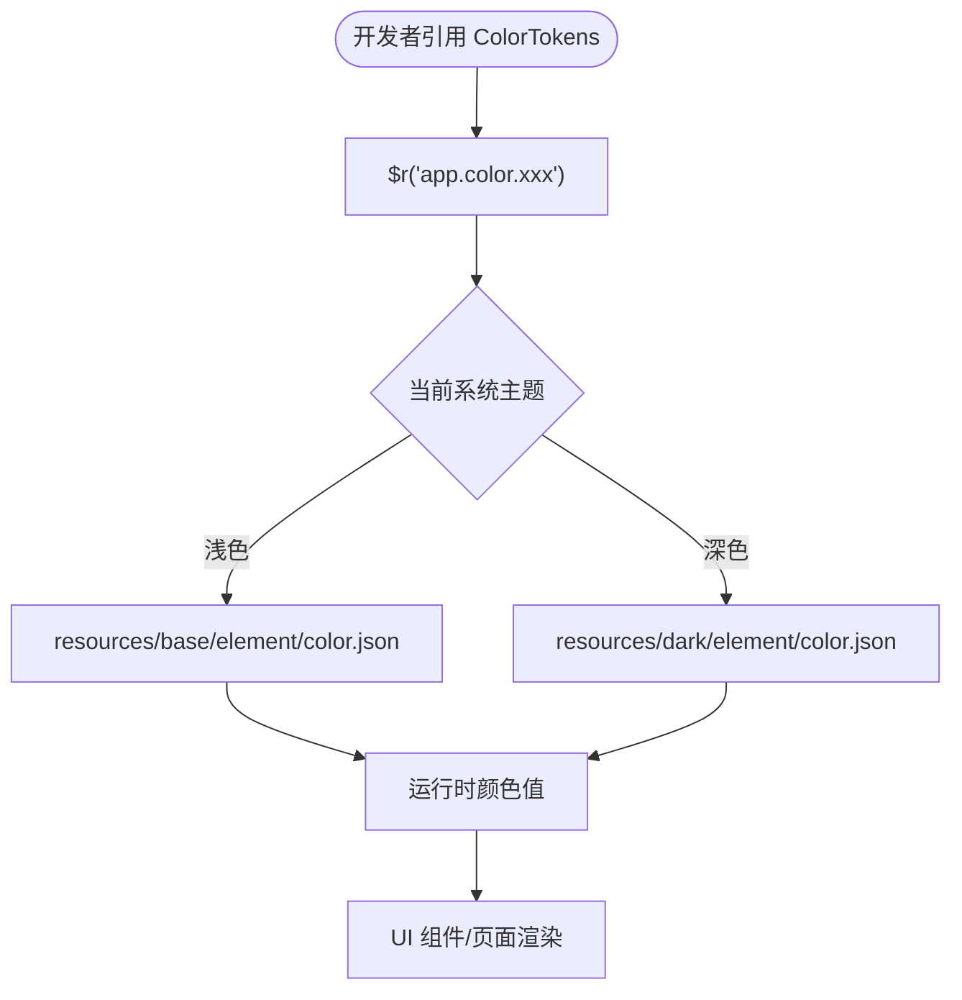
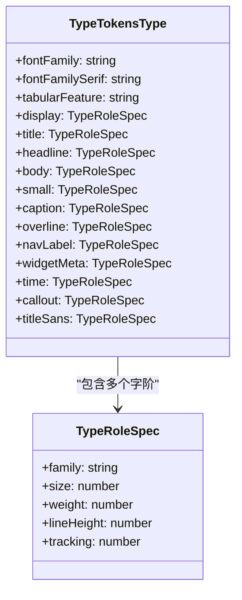
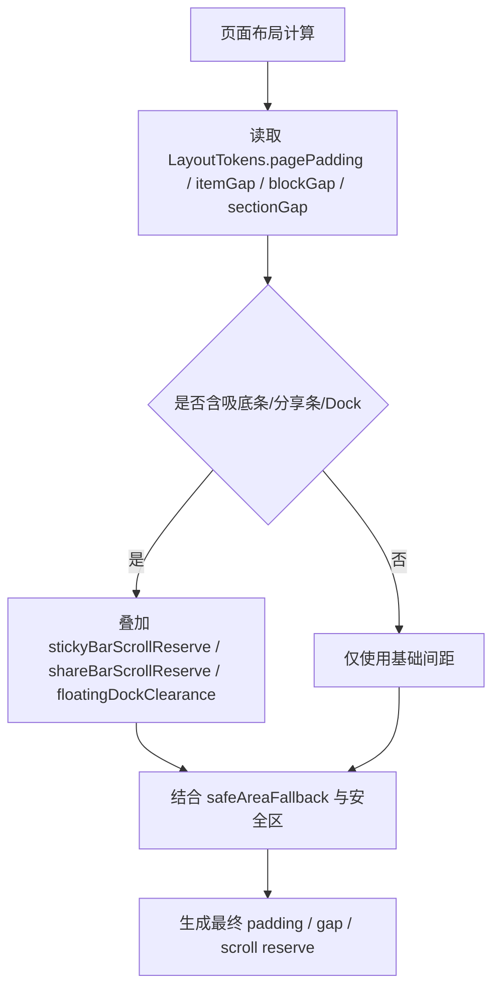
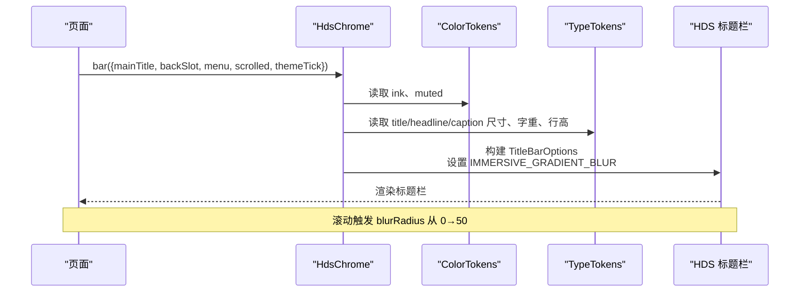
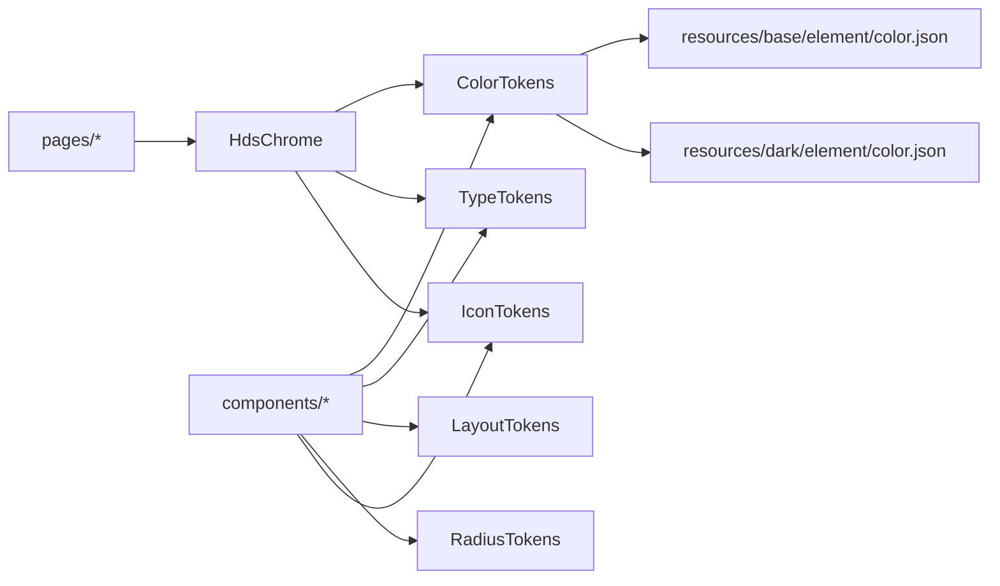

# 设计系统与 Token

<cite>
**本文引用的文件**   
- [ColorTokens.ets](file://entry/src/main/ets/design/ColorTokens.ets)
- [TypeTokens.ets](file://entry/src/main/ets/design/TypeTokens.ets)
- [LayoutTokens.ets](file://entry/src/main/ets/design/LayoutTokens.ets)
- [RadiusTokens.ets](file://entry/src/main/ets/design/RadiusTokens.ets)
- [IconTokens.ets](file://entry/src/main/ets/design/IconTokens.ets)
- [HdsChrome.ets](file://entry/src/main/ets/design/HdsChrome.ets)
- [color.json（浅色）](file://entry/src/main/resources/base/element/color.json)
- [color.json（深色）](file://entry/src/main/resources/dark/element/color.json)
- [float.json](file://entry/src/main/resources/base/element/float.json)
</cite>

## 目录
1. [引言](#引言)
2. [项目结构](#项目结构)
3. [核心组件](#核心组件)
4. [架构总览](#架构总览)
5. [详细组件分析](#详细组件分析)
6. [依赖关系分析](#依赖关系分析)
7. [性能与可维护性](#性能与可维护性)
8. [故障排查指南](#故障排查指南)
9. [结论](#结论)
10. [附录：Token 使用示例](#附录token-使用示例)

## 引言
本项目在 ArkUI / HarmonyOS 工程中建立了一套基于 DesignTokens 的设计系统，将颜色、字体、间距、圆角、图标尺寸等视觉契约收敛到 `entry/src/main/ets/design` 下的 Token 模块中，并通过 `resources/{base,dark}/element/color.json` 实现浅色与深色的自动切换。应用页面和通用组件统一通过 Token 引用，而不是散落的色值、字号或间距字面量，从而保证视觉一致性、支持深色模式、并降低“自创样式”带来的回归风险。

本档面向设计与前端工程师，目标是回答以下问题：
- 颜色系统如何定义品牌色、中性色、语义色？
- 字体系统有哪些层级、字号、行高和排版约束？
- 间距与栅格、滚动预留、浮动 Dock 等布局规范是什么？
- 圆角值有哪些固定档位？适用场景如何划分？
- HdsChrome 如何接入官方 HDS 顶栏、处理主题切换、沉浸式模糊与内容让位？
- 如何正确使用 Token、创建自定义样式、做响应式适配？
- 从设计稿到代码的转换流程和维护版本策略是什么？

## 项目结构
设计系统的核心位于 `entry/src/main/ets/design`，资源层位于 `entry/src/main/resources`，消费方分布在 `components` 与 `pages` 下：



**图示来源**
- [ColorTokens.ets:1-202](file://entry/src/main/ets/design/ColorTokens.ets#L1-L202)
- [TypeTokens.ets:1-94](file://entry/src/main/ets/design/TypeTokens.ets#L1-L94)
- [LayoutTokens.ets:1-257](file://entry/src/main/ets/design/LayoutTokens.ets#L1-L257)
- [RadiusTokens.ets:1-43](file://entry/src/main/ets/design/RadiusTokens.ets#L1-L43)
- [IconTokens.ets:1-12](file://entry/src/main/ets/design/IconTokens.ets#L1-L12)
- [HdsChrome.ets:1-294](file://entry/src/main/ets/design/HdsChrome.ets#L1-L294)
- [color.json（浅色）:1-284](file://entry/src/main/resources/base/element/color.json#L1-L284)
- [color.json（深色）:1-284](file://entry/src/main/resources/dark/element/color.json#L1-L284)
- [float.json:1-8](file://entry/src/main/resources/base/element/float.json#L1-L8)

**章节来源**
- [ColorTokens.ets:1-202](file://entry/src/main/ets/design/ColorTokens.ets#L1-L202)
- [TypeTokens.ets:1-94](file://entry/src/main/ets/design/TypeTokens.ets#L1-L94)
- [LayoutTokens.ets:1-257](file://entry/src/main/ets/design/LayoutTokens.ets#L1-L257)
- [RadiusTokens.ets:1-43](file://entry/src/main/ets/design/RadiusTokens.ets#L1-L43)
- [IconTokens.ets:1-12](file://entry/src/main/ets/design/IconTokens.ets#L1-L12)
- [HdsChrome.ets:1-294](file://entry/src/main/ets/design/HdsChrome.ets#L1-L294)

## 核心组件
本设计系统由以下 Token 模块组成：

| 模块 | 职责 | 关键输出 | 主要消费者 |
|---|---|---|---|
| `ColorTokens` | 颜色契约源，导出 $r 资源引用；浅色/深色由系统自动切换 | `canvas`、`surface*`、`ink/body/muted/faint/icon`、`primary/onPrimary`、语义色、玻璃栏面色、地图路线色、星图色等 | 组件、页面、HdsChrome |
| `TypeTokens` | 字阶、字族、字号、字重、行高、字距契约 | `display/title/headline/body/small/caption/overline/navLabel/widgetMeta/time/titleSans` | HdsChrome、各文本组件 |
| `LayoutTokens` | 间距、网格、控件尺寸、Dock、滚动预留、安全区兜底 | `pagePadding`、`sectionGap`、`floatingDockWidth`、`bottomScrollReserve`、`safeAreaFallback` 等 | 页面布局、卡片、吸顶条、Dock |
| `RadiusTokens` | 统一圆角集合 | `none/media/capsule/reason/card/hero/dock/pill/floatingBar/lg` | 卡片、按钮、头像、弹层 |
| `IconTokens` | 图标尺寸与画布、描边基线 | `compact/standard/tabBar/avatarCompact/avatarProfile/empty/shortcutTile` | 搬运组件、原生组件 |
| `HdsChrome` | 官方 HDS 标题栏配置、沉浸式模糊、内容让位、主题 tick | `bar()`、`contentTopInset()`、`item()` | 所有带顶部导航的页面 |

**章节来源**
- [ColorTokens.ets:1-202](file://entry/src/main/ets/design/ColorTokens.ets#L1-L202)
- [TypeTokens.ets:1-94](file://entry/src/main/ets/design/TypeTokens.ets#L1-L94)
- [LayoutTokens.ets:1-257](file://entry/src/main/ets/design/LayoutTokens.ets#L1-L257)
- [RadiusTokens.ets:1-43](file://entry/src/main/ets/design/RadiusTokens.ets#L1-L43)
- [IconTokens.ets:1-12](file://entry/src/main/ets/design/IconTokens.ets#L1-L12)
- [HdsChrome.ets:1-294](file://entry/src/main/ets/design/HdsChrome.ets#L1-L294)

## 架构总览
颜色系统以资源文件为真值源，TypeScript/ETS 侧只做类型声明与资源引用映射；字体、间距、圆角、图标则直接作为 ETS 常量暴露给 UI 层。HdsChrome 是设计系统与 HDS 官方组件之间的桥接点，把 ColorTokens、TypeTokens、SpaceTokens、系统材质能力与页面滚动状态组合成统一的顶栏配置。

```mermaid
classDiagram
  class ColorTokens {
    +canvas
    +surfaceElevated
    +surfaceSubtle
    +surfacePanel
    +surfaceSunken
    +ink
    +body
    +muted
    +faint
    +icon
    +onDark
    +onDarkDegraded
    +primary
    +primaryPress
    +primaryTint
    +onPrimary
    +brandSolid
    +onBrand
    +chipSolid
    +dangerTint
    +success
    +warning
    +danger
    +like
    +bookmark
    +hairline
    +borderSubtle
    +separator
    +modalScrim
    +barShadow
    +glassBarSurface
    +glassBarBorder
    +routePath
    +starInk
  }

  class TypeTokens {
    +fontFamily
    +fontFamilySerif
    +tabularFeature
    +display
    +title
    +headline
    +body
    +small
    +caption
    +overline
    +navLabel
    +widgetMeta
    +time
    +callout
    +titleSans
  }

  class LayoutTokens {
    +gridBaseline
    +pagePadding
    +pagePaddingWide
    +itemGap
    +blockGap
    +sectionGap
    +contentMaxWidth
    +minTouchTarget
    +titleBarHeight
    +segmentedControlHeight
    +tabBarHeight
    +floatingDockWidth
    +floatingDockMediumWidth
    +floatingDockWideWidth
    +floatingDockBottomMargin
    +floatingDockBarHeight
    +floatingDockClearance
    +bottomScrollReserve
    +safeAreaFallback
  }

  class RadiusTokens {
    +none
    +media
    +capsule
    +reason
    +card
    +hero
    +dock
    +pill
    +floatingBar
    +lg
  }

  class IconTokens {
    +canvas
    +stroke
    +compact
    +small
    +standard
    +tabBar
    +avatarCompact
    +avatarProfile
    +empty
    +shortcutTile
  }

  class HdsChrome {
    +bar(spec)
    +item(icon, label, action)
    +contentTopInset(statusBarHeightVp, bottomRowVp)
  }

  HdsChrome --> ColorTokens : "标题与图标颜色"
  HdsChrome --> TypeTokens : "标题字号、字重、行高"
  HdsChrome --> IconTokens : "菜单图标尺寸"
  ColorTokens --> "resources/base/element/color.json"
  ColorTokens --> "resources/dark/element/color.json"
```

**图示来源**
- [ColorTokens.ets:1-202](file://entry/src/main/ets/design/ColorTokens.ets#L1-L202)
- [TypeTokens.ets:1-94](file://entry/src/main/ets/design/TypeTokens.ets#L1-L94)
- [LayoutTokens.ets:1-257](file://entry/src/main/ets/design/LayoutTokens.ets#L1-L257)
- [RadiusTokens.ets:1-43](file://entry/src/main/ets/design/RadiusTokens.ets#L1-L43)
- [IconTokens.ets:1-12](file://entry/src/main/ets/design/IconTokens.ets#L1-L12)
- [HdsChrome.ets:1-294](file://entry/src/main/ets/design/HdsChrome.ets#L1-L294)
- [color.json（浅色）:1-284](file://entry/src/main/resources/base/element/color.json#L1-L284)
- [color.json（深色）:1-284](file://entry/src/main/resources/dark/element/color.json#L1-L284)

## 详细组件分析

### 颜色系统：ColorTokens
`ColorTokens` 是颜色系统的唯一入口。其设计原则是：
- 真实色值落在 `resources/base/element/color.json` 与 `resources/dark/element/color.json` 中；
- ETS 侧只导出 `$r('app.color.xxx')` 引用，不硬编码十六进制色值；
- 浅色/深色由系统根据设备主题自动切换，页面无需写分支逻辑；
- 新增颜色必须同时在浅、深两套 color.json 中成对登记，并在 `ColorTokens` 中补齐字段。

#### 颜色分组与语义
| 分组 | Token 示例 | 语义与规则 |
|---|---|---|
| 画布与表面 | `canvas`、`surfaceElevated`、`surfaceSubtle`、`surfacePanel`、`surfaceSunken` | 背景层级，用于页面底色、卡片底、面板底、下沉区域 |
| 骨架屏 | `skeletonBase`、`skeletonHighlight` | 加载占位的明暗两档 |
| 文字与图标 | `ink`、`body`、`muted`、`faint`、`icon`、`onDark`、`onDarkDegraded` | 主文、正文、次要、极弱、图标、深色画布上的前景色 |
| 品牌色 | `primary`、`primaryPress`、`primaryTint`、`onPrimary`、`brandSolid`、`onBrand`、`primaryGlowEdge` | 主色、按下态、半透明 tint、白字反色、实心品牌底、光晕边缘 |
| 业务扩展色 | `chipSolid`、`dangerTint`、`accentMention`、`like`、`bookmark` | 地图选中 Chip、危险提示 tint、提及强调、收藏、书签 |
| 语义色 | `success`、`warning`、`danger` | 成功、警告、危险，供状态类组件复用 |
| 线与遮罩 | `hairline`、`borderSubtle`、`hairlineStrong`、`separator`、`modalScrim`、`barShadow` | 分割线、次级边框、模态遮罩、栏面投影 |
| 玻璃栏面族 | `glassBarSurface`、`glassBarBorder`、`glassBarBg`、`glassCardBg`、`glassSegmentBg`、`glassPillFill`、`glassPillRim` | 自绘玻璃件在内容区或低版本设备的兜底材质 |
| 性别徽章 | `genderMaleSurface`、`genderMaleText`、`genderFemaleSurface`、`genderFemaleText` | 资料卡性别标识，与有据共享视觉 |
| 地图路线 | `routePath`、`routePathSoft`、`routeNodeFill`、`routeNodeStroke`、`routeContour`、`routeWater`、`routeLand`、`routeGold`、`routeBgTop`、`routeBgBottom` | 行程路线图深浅双值自动切换 |
| 星图 | `starInk`、`starRing`、`starIcon`、`starGold`、`starBadge`、`starBgTop`、`starBgBottom` | 空状态与桌面卡片星图 |

#### 颜色系统的数据流


**图示来源**
- [ColorTokens.ets:1-202](file://entry/src/main/ets/design/ColorTokens.ets#L1-L202)
- [color.json（浅色）:1-284](file://entry/src/main/resources/base/element/color.json#L1-L284)
- [color.json（深色）:1-284](file://entry/src/main/resources/dark/element/color.json#L1-L284)

#### 使用规则
- 禁止在组件里写死十六进制颜色；必须通过 `ColorTokens.xxx` 引用。
- 新增颜色时，先在差异表或设计契约中登记，再同时修改浅色与深色 color.json，最后在 `ColorTokens` 中补字段。
- 语义色保持封闭五档（成功、警告、危险、点赞、书签），业务特殊色应走 `brandSolid`、`onBrand`、`dangerTint`、`accentMention` 等已有命名。
- 玻璃材质相关颜色需配合 `isSystemMaterialActive()` 判断，避免在系统材质生效时叠加自绘阴影或描边。

**章节来源**
- [ColorTokens.ets:1-202](file://entry/src/main/ets/design/ColorTokens.ets#L1-L202)
- [color.json（浅色）:1-284](file://entry/src/main/resources/base/element/color.json#L1-L284)
- [color.json（深色）:1-284](file://entry/src/main/resources/dark/element/color.json#L1-L284)

### 字体系统：TypeTokens
TypeTokens 定义了封闭的九档字阶，并明确字族、字号、字重、行高、字距的契约边界。

#### 字阶层次
| Token | 字号 | 字重 | 行高 | 字族 | 典型用途 |
|---|---:|---:|---:|---|---|
| `display` | 32 | 700 | 44 | serif | 页面大标题、金额 hero（hero 用 sans） |
| `title` | 21 | 700 | 32 | serif | 日标题、卡片目的地名 |
| `titleSans` | 21 | 650 | 28 | sans | 控件上的标题字档 |
| `headline` | 18 | 600 | 24 | sans | 站点名、子页标题 |
| `body` | 16 | 400 | 24 | sans | 正文 |
| `small` | 14 | 400 | 20 | sans | 次级说明 |
| `caption` | 12 | 450 | 16 | sans | 辅助信息 |
| `overline` | 11 | 600 | 0 | sans | 标签；行高 0 表示走系统默认 |
| `navLabel` | 10 | 400 | 14 | sans | Dock 项标签 |
| `widgetMeta` | 11 | 400 | 14 | sans | 桌面卡片辅助行 |
| `time` | 12 | 600 | 0 | sans | 行程时间；行高 0 表示走系统默认 |

#### 排版规范
- 字距全局为 0；所有数字启用 tabular 数字特性 `'tnum' on`。
- 正文字族为 `HarmonyOS Sans`，衬线字族为 `NotoSerifSC`。
- serif 字族不得用于控件、站点名、数字；唯一例外是金额 hero 用 display 档但走 sans。
- 允许字号只有 10、11、12、14、16、18、21、32；其余字号不存在。
- `overline` 与 `time` 的行高值为 0，表示“不设行高、走系统默认”，不能直接当作数值传给 `.lineHeight()`。

#### 字体系统数据模型


**图示来源**
- [TypeTokens.ets:1-94](file://entry/src/main/ets/design/TypeTokens.ets#L1-L94)

**章节来源**
- [TypeTokens.ets:1-94](file://entry/src/main/ets/design/TypeTokens.ets#L1-L94)

### 间距系统：LayoutTokens
LayoutTokens 是页面布局、组件间距、滚动预留、浮动 Dock 与栅格的单一来源。

#### 基础间距
| Token | 值 | 含义 |
|---|---:|---|
| `gridBaseline` | 4 | 基线网格 |
| `pagePadding` | 16 | 页面左右内缩 |
| `pagePaddingWide` | 20 | 宽屏页面左右内缩 |
| `itemGap` | 12 | 条目间隙 |
| `blockGap` | 16 | 区块间隙 |
| `sectionGap` | 24 | 分区间隙 |
| `contentMaxWidth` | 720 | 宽屏内容最大宽度 |
| `minTouchTarget` | 44 | 最小命中区 |

#### 控件与导航尺寸
| Token | 值 | 含义 |
|---|---:|---|
| `titleBarHeight` | 60 | 沉浸顶栏高 |
| `segmentedControlHeight` | 36 | 分段控件轨道高 |
| `segmentedHeight` | 36 | 有据同名别名 |
| `tabBarHeight` | 64 | 底部 Tab 栏高 |
| `stickyHeaderHeight` | 36 | 单行吸顶组头高 |
| `questionOptionMinHeight` | 56 | 追问选项卡最小高 |

#### 浮动 Dock 与滚动预留
| Token | 值 | 含义 |
|---|---:|---|
| `floatingDockWidth` | 300 | Dock 板输入宽度 |
| `floatingDockMediumWidth` | 420 | 中等窗口 Dock 宽度 |
| `floatingDockWideWidth` | 560 | 宽窗口 Dock 宽度 |
| `floatingDockBottomMargin` | 28 | Dock 距底基线 |
| `floatingDockBarHeight` | 56 | Dock 栏体高 |
| `floatingDockClearance` | 112 | 钉底按钮条必须给 Dock 让出的净空 |
| `floatingDockSideMargin` | 16 | Dock 侧边距 |
| `bottomScrollReserve` | 94 | 通用底部滚动预留 |
| `stickyBarScrollReserve` | 110 | 屏 4/5 吸底 CTA 条滚动预留 |
| `shareBarScrollReserve` | 150 | 屏 16 分享吸底动作条滚动预留 |

#### 其他布局尺寸
| Token | 值 | 含义 |
|---|---:|---|
| `itineraryTimeGutter` | 52 | 行程时间槽宽 |
| `itineraryNodeSize` | 24 | 主轴节点占位 |
| `itineraryNodeDot` | 10 | 节点活动色点 |
| `mediaThumbWidth` | 96 | 节点详情缩略位宽 |
| `mediaThumbHeight` | 128 | 节点详情缩略位高 |
| `routeLineWidth` | 2 | 动线宽 |
| `mapOverlayInset` | 16 | 地图浮层内缩 |
| `mapHeightCompact` | 200 | 紧凑地图高 |
| `safeAreaFallback` | 12 | 安全区兜底值 |

#### 间距系统流程图


**图示来源**
- [LayoutTokens.ets:1-257](file://entry/src/main/ets/design/LayoutTokens.ets#L1-L257)

**章节来源**
- [LayoutTokens.ets:1-257](file://entry/src/main/ets/design/LayoutTokens.ets#L1-L257)

### 圆角系统：RadiusTokens
RadiusTokens 提供八个封闭圆角值，不允许收紧或加宽。

| Token | 值 | 适用场景 |
|---|---:|---|
| `none` | 0 | 直角 |
| `media` | 6 | 媒体与卡内嵌套 |
| `capsule` | 10 | 胶囊与输入框 |
| `reason` | 14 | 理由件 |
| `card` | 20 | 卡片与弹层 |
| `hero` | 28 | Hero 面板 |
| `dock` | 30 | Dock 与分段控件 |
| `pill` | 999 | 所有按钮、徽标、头像 |
| `floatingBar` | 30 | 玻璃胶囊按钮（有据同名） |
| `lg` | 20 | 资料卡/预览卡（有据同名） |

允许的圆角集合为 `[0, 6, 10, 14, 20, 28, 30, 999]`，审计工具可据此检测越界使用。

**章节来源**
- [RadiusTokens.ets:1-43](file://entry/src/main/ets/design/RadiusTokens.ets#L1-L43)

### 图标系统：IconTokens
项目存在两套图标尺寸：
- `IconTokens`：自有据搬运而来，供搬运组件原样引用。
- `IconSizes`：本地控制档与展示档，其中 `control=24`、`display=44`，且 44 也是命中盒下限。

| Token | 值 | 含义 |
|---|---:|---|
| `canvas` | 24 | 图标画布基准 |
| `stroke` | 2 | 描边基线 |
| `compact` | 16 | 玻璃胶囊内联图标 |
| `small` | 20 | 小号图标 |
| `standard` | 24 | 标准图标 |
| `tabBar` | 24 | 底部 Tab 图标 |
| `avatarCompact` | 24 | 头像紧凑尺寸 |
| `avatarProfile` | 68 | 个人资料头像尺寸 |
| `empty` | 44 | 空状态图标命中尺寸 |
| `shortcutTile` | 56 | 快捷磁贴图标尺寸 |

**章节来源**
- [IconTokens.ets:1-12](file://entry/src/main/ets/design/IconTokens.ets#L1-L12)
- [LayoutTokens.ets:201-257](file://entry/src/main/ets/design/LayoutTokens.ets#L201-L257)

### HdsChrome：官方设计系统集成
`HdsChrome` 是应用接入 HDS 官方标题栏的单点配置器，承担以下职责：
- 封装 `HdsNavigationTitleBarOptions`；
- 设置沉浸式渐变模糊、背景透明度、模糊半径；
- 自绘标题行，对齐有据的衬线标题、正文字色与副标题 muted 色；
- 处理返回键占位、标题居左/居中、菜单项上限；
- 管理深浅档主题切换时的标题重建；
- 提供 `contentTopInset` 计算穿底内容让位。

#### HdsChrome 关键行为
- **标题颜色**：标题与图标均使用 `ColorTokens.ink`，避免浅色背景下白色图标不可见。
- **模糊行为**：静止态不模糊，滚动到位后按契约 blur 50vp 生效；`maskExtraHeight` 压到 0，避免首屏被糊掉。
- **标题字体**：根页用 `title` 档，子页用 `headline` 档并显式使用 serif 字族，与有据一致。
- **主题切换**：通过 `themeTick` 强制重建 `ComponentContent`，解决 HDS 自绘标题不随主题刷新问题。
- **内容让位**：`contentTopInset = statusBarHeight + 56 + bottomRow`，确保滚动容器原点正确。

#### HdsChrome 调用序列


**图示来源**
- [HdsChrome.ets:1-294](file://entry/src/main/ets/design/HdsChrome.ets#L1-L294)
- [ColorTokens.ets:1-202](file://entry/src/main/ets/design/ColorTokens.ets#L1-L202)
- [TypeTokens.ets:1-94](file://entry/src/main/ets/design/TypeTokens.ets#L1-L94)

**章节来源**
- [HdsChrome.ets:1-294](file://entry/src/main/ets/design/HdsChrome.ets#L1-L294)

## 依赖关系分析
设计系统的依赖方向是单向的：页面与组件消费 Token，Token 不反向依赖页面；颜色 Token 依赖资源文件，其他 Token 不依赖运行时 UI。



**图示来源**
- [HdsChrome.ets:1-294](file://entry/src/main/ets/design/HdsChrome.ets#L1-L294)
- [ColorTokens.ets:1-202](file://entry/src/main/ets/design/ColorTokens.ets#L1-L202)
- [TypeTokens.ets:1-94](file://entry/src/main/ets/design/TypeTokens.ets#L1-L94)
- [LayoutTokens.ets:1-257](file://entry/src/main/ets/design/LayoutTokens.ets#L1-L257)
- [RadiusTokens.ets:1-43](file://entry/src/main/ets/design/RadiusTokens.ets#L1-L43)
- [IconTokens.ets:1-12](file://entry/src/main/ets/design/IconTokens.ets#L1-L12)
- [color.json（浅色）:1-284](file://entry/src/main/resources/base/element/color.json#L1-L284)
- [color.json（深色）:1-284](file://entry/src/main/resources/dark/element/color.json#L1-L284)

**章节来源**
- [HdsChrome.ets:1-294](file://entry/src/main/ets/design/HdsChrome.ets#L1-L294)
- [ColorTokens.ets:1-202](file://entry/src/main/ets/design/ColorTokens.ets#L1-L202)
- [TypeTokens.ets:1-94](file://entry/src/main/ets/design/TypeTokens.ets#L1-L94)
- [LayoutTokens.ets:1-257](file://entry/src/main/ets/design/LayoutTokens.ets#L1-L257)
- [RadiusTokens.ets:1-43](file://entry/src/main/ets/design/RadiusTokens.ets#L1-L43)
- [IconTokens.ets:1-12](file://entry/src/main/ets/design/IconTokens.ets#L1-L12)

## 性能与可维护性
- **颜色性能**：颜色值放在资源文件中，由系统按需加载；Token 只持有资源引用，不会增加额外内存对象。
- **主题切换性能**：HdsChrome 通过 `themeTick` 与 `ComponentContent` 缓存键避免标题冻结；标题缓存 Map 按标题串、副标题、是否返回键、是否居中、主题 tick 区分，避免无意义重建。
- **字体性能**：字体族与字号集中在 TypeTokens，避免多处重复声明；auditing 脚本可校验允许字号集合。
- **布局稳定性**：LayoutTokens 集中定义 Dock、滚动预留、安全区，减少页面散落硬编码导致的“钉底按钮被 Dock 压住”之类问题。
- **可维护性**：新增 Token 时必须同步浅色/深色资源与 Token 定义；有径现有别名字段保留，避免大规模调用点破坏。

**章节来源**
- [HdsChrome.ets:1-294](file://entry/src/main/ets/design/HdsChrome.ets#L1-L294)
- [TypeTokens.ets:1-94](file://entry/src/main/ets/design/TypeTokens.ets#L1-L94)
- [LayoutTokens.ets:1-257](file://entry/src/main/ets/design/LayoutTokens.ets#L1-L257)
- [ColorTokens.ets:1-202](file://entry/src/main/ets/design/ColorTokens.ets#L1-L202)

## 故障排查指南
| 现象 | 可能原因 | 排查建议 |
|---|---|---|
| 浅色模式下标题或图标看不见 | 使用了 HDS 默认的白图标/白标题，但栏体透明压在浅色画布上 | 检查 HdsChrome 的 `iconColor`、`mainTitleColor`、`subTitleColor` 是否使用 `ColorTokens.ink`、`ColorTokens.muted` |
| 顶栏始终模糊 | 未正确设置 `maskExtraHeight` 或误用 COMMON_BLUR | 确认 `maskExtraHeight=0`，并使用 `IMMERSIVE_GRADIENT_BLUR`，只在 `scrolled=true` 时设置 blurRadius |
| 深浅模式切换后标题颜色不变 | 标题内容未因主题变化重建 | 传入变化的 `themeTick`，使 `ComponentContent` 缓存失效 |
| 钉底按钮被 Dock 遮挡 | 底部滚动预留不足 | 使用 `floatingDockClearance` 或 `bottomScrollReserve + dockNavInset`，不要手写小值 |
| 正文或数字排版不一致 | 没有使用 TypeTokens 的字族、字号或 tnum | 改用 `TypeTokens.body`、`TypeTokens.time` 及 `tabularFeature` |
| 圆角看起来过圆或过方 | 直接使用字面量而非 Token | 使用 `RadiusTokens.media/capsule/card/pill` 等 |
| 新增颜色浅色正常、深色异常 | 只改了 base color.json | 同步修改 dark color.json |
| 自绘玻璃效果异常 | 系统材质已生效，仍叠加了自绘 shadow/border | 先判断 `isSystemMaterialActive()`，再决定是否关闭自绘装饰 |

**章节来源**
- [HdsChrome.ets:1-294](file://entry/src/main/ets/design/HdsChrome.ets#L1-L294)
- [ColorTokens.ets:1-202](file://entry/src/main/ets/design/ColorTokens.ets#L1-L202)
- [TypeTokens.ets:1-94](file://entry/src/main/ets/design/TypeTokens.ets#L1-L94)
- [LayoutTokens.ets:1-257](file://entry/src/main/ets/design/LayoutTokens.ets#L1-L257)
- [RadiusTokens.ets:1-43](file://entry/src/main/ets/design/RadiusTokens.ets#L1-L43)

## 结论
该工程的设计系统以 Token 为契约中心：颜色落资源、字体/间距/圆角/图标落 ETS 常量，页面与组件只消费这些稳定接口。HdsChrome 作为 HDS 官方组件的适配层，把主题、字体、颜色、模糊、内容让位统一到一套配置对象中。这样既保证了视觉一致性，也降低了主题切换、深色模式、Dock 布局和滚动让位带来的回归风险。

## 附录：Token 使用示例
以下为概念性示例，用于说明如何使用 Token，不直接粘贴源码：

### 使用颜色 Token
- 背景：使用 `ColorTokens.canvas` 作为页面背景。
- 卡片：使用 `ColorTokens.surfaceElevated` 或 `ColorTokens.surfaceSubtle`。
- 主按钮：使用 `ColorTokens.primary` 或 `ColorTokens.brandSolid`。
- 禁用态/按下态：使用 `ColorTokens.primaryPress` 或语义色中的 `dangerTint`。
- 文字：主文用 `ColorTokens.ink`，次要文字用 `ColorTokens.muted`，图标用 `ColorTokens.icon`。

### 使用字体 Token
- 页面大标题：使用 `TypeTokens.display`。
- 目的地标题：使用 `TypeTokens.title`。
- 站点名：使用 `TypeTokens.headline`。
- 正文：使用 `TypeTokens.body`。
- 辅助文案：使用 `TypeTokens.small` 或 `TypeTokens.caption`。
- 数字时间：使用 `TypeTokens.time` 并加上 tabular 特性。

### 使用间距与布局 Token
- 页面内边距：使用 `LayoutTokens.pagePadding`。
- 列表项间距：使用 `LayoutTokens.itemGap`。
- 区块间距：使用 `LayoutTokens.blockGap`。
- 分区间距：使用 `LayoutTokens.sectionGap`。
- 宽屏限制：使用 `LayoutTokens.contentMaxWidth`。
- 钉底按钮预留：使用 `LayoutTokens.floatingDockClearance` 或 `LayoutTokens.bottomScrollReserve`。

### 使用圆角 Token
- 图片/媒体：使用 `RadiusTokens.media`。
- 胶囊按钮：使用 `RadiusTokens.capsule` 或 `RadiusTokens.pill`。
- 卡片：使用 `RadiusTokens.card`。
- Hero 面板：使用 `RadiusTokens.hero`。
- Dock 与分段控件：使用 `RadiusTokens.dock`。

### 使用 HdsChrome
- 普通页面：传入 `mainTitle`、`backSlot=true`、`menu`。
- 根页：传入 `backSlot=false`，标题居左；如需居中则开启 `centerTitle`。
- 滚动模糊：传入 `scrollable=true`、`scrolled` 由滚动状态驱动。
- 主题切换：传入 `themeTick`，由页面 `@StorageProp('chromeThemeTick')` 提供。
- 内容让位：使用 `HdsChrome.contentTopInset(statusBarHeight, bottomRow)`。

**章节来源**
- [ColorTokens.ets:1-202](file://entry/src/main/ets/design/ColorTokens.ets#L1-L202)
- [TypeTokens.ets:1-94](file://entry/src/main/ets/design/TypeTokens.ets#L1-L94)
- [LayoutTokens.ets:1-257](file://entry/src/main/ets/design/LayoutTokens.ets#L1-L257)
- [RadiusTokens.ets:1-43](file://entry/src/main/ets/design/RadiusTokens.ets#L1-L43)
- [HdsChrome.ets:1-294](file://entry/src/main/ets/design/HdsChrome.ets#L1-L294)