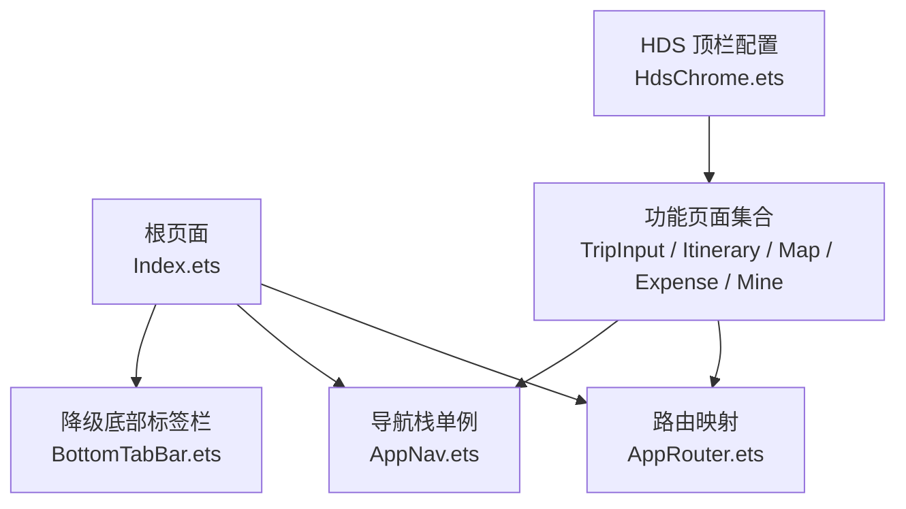
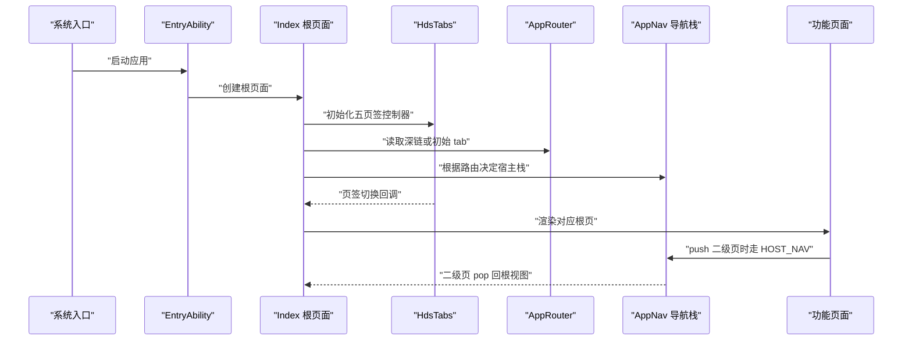
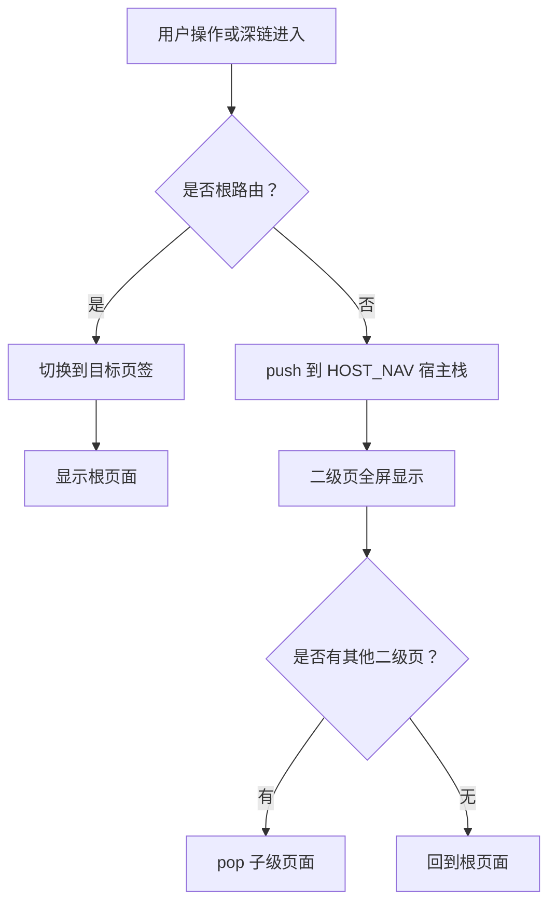
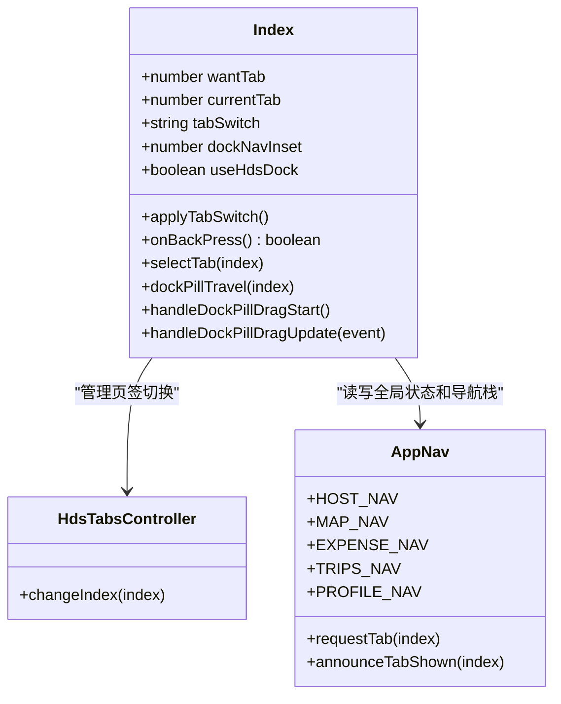
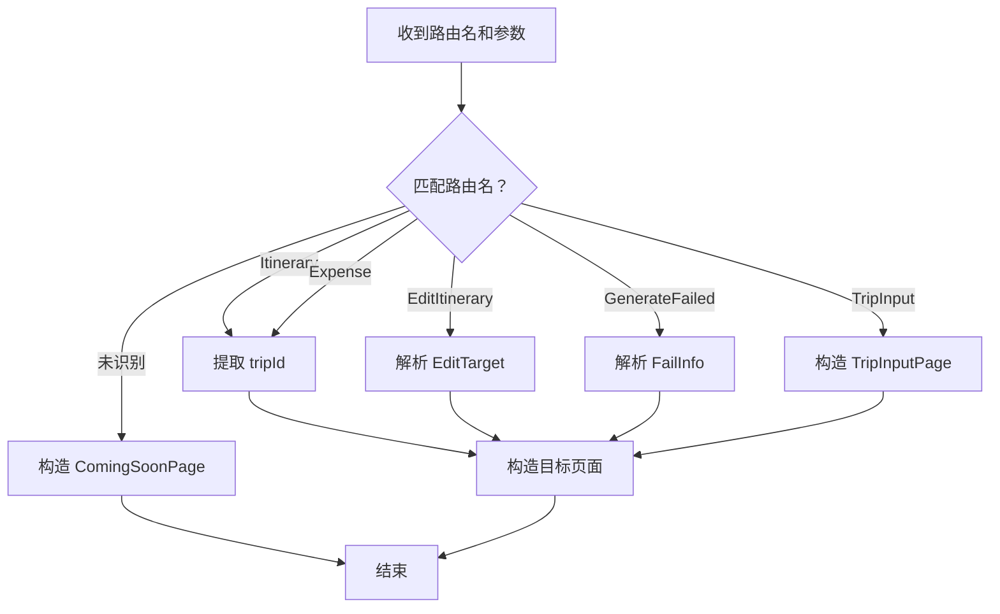
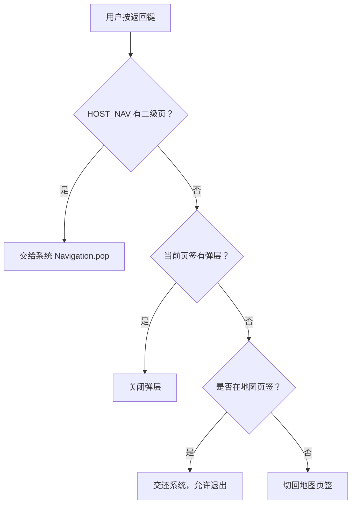
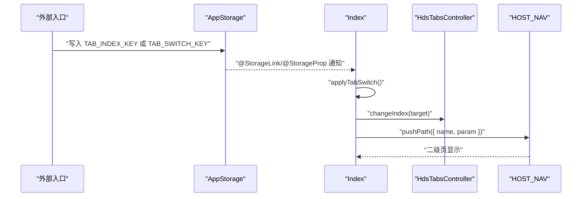
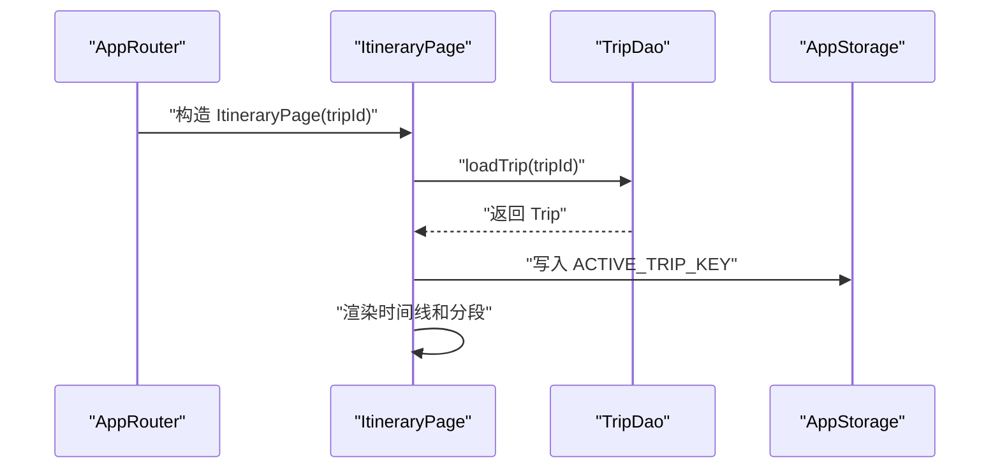
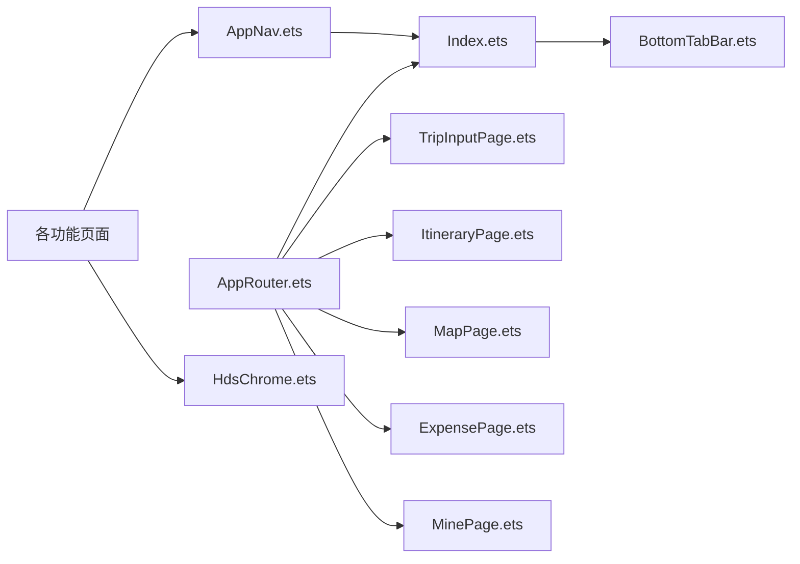

# 页面架构与路由管理

<cite>
**本文引用的文件**   
- [Index.ets](file://entry/src/main/ets/pages/Index.ets)
- [AppRouter.ets](file://entry/src/main/ets/pages/AppRouter.ets)
- [AppNav.ets](file://entry/src/main/ets/common/constants/AppNav.ets)
- [BottomTabBar.ets](file://entry/src/main/ets/components/BottomTabBar.ets)
- [HdsChrome.ets](file://entry/src/main/ets/design/HdsChrome.ets)
- [TripInputPage.ets](file://entry/src/main/ets/pages/TripInputPage.ets)
- [ItineraryPage.ets](file://entry/src/main/ets/pages/ItineraryPage.ets)
- [MapPage.ets](file://entry/src/main/ets/pages/MapPage.ets)
- [ExpensePage.ets](file://entry/src/main/ets/pages/ExpensePage.ets)
- [MinePage.ets](file://entry/src/main/ets/pages/MinePage.ets)
</cite>

## 目录

1. [引言](#引言)
2. [项目结构定位](#项目结构定位)
3. [核心组件总览](#核心组件总览)
4. [架构总览](#架构总览)
5. [根页面与五页签导航](#根页面与五页签导航)
6. [路由注册机制](#路由注册机制)
7. [导航栈单例与返回键处理](#导航栈单例与返回键处理)
8. [功能页面组织原则](#功能页面组织原则)
9. [页面间通信机制](#页面间通信机制)
10. [依赖关系分析](#依赖关系分析)
11. [性能与可维护性要点](#性能与可维护性要点)
12. [常见问题排查](#常见问题排查)
13. [结论](#结论)

## 引言

本项目基于 ArkTS / ArkUI，采用“底部悬浮页签 + 全屏二级页”的 HDS 形态：五个根页签分别承载地图、行程、规划、费用、我的等主能力；所有二级页面（向导链、行程详情、编辑页、分享、设置、勋章等）统一推入外层宿主导航栈，全屏覆盖 dock 页签栏。

本文聚焦页面架构与路由管理，围绕以下目标展开：

- 说明 `Index` 根页面如何使用 `HdsTabs` 构建五页签骨架。
- 解释 `AppRouter` 的路由表、路径映射、参数传递和深链入口。
- 解析 `AppNav` 中多个 `NavPathStack` 单例的职责分工。
- 梳理各功能页面的职责边界与数据加载时机。
- 总结 `@State/@Link`、`EventEmitter`、`AppStorage` 三种跨组件通信方式在本工程中的使用策略。

## 项目结构定位

本项目的页面相关代码集中在 `entry/src/main/ets` 下：

| 目录 | 职责 |
|---|---|
| `pages/` | 页面级组件，包括根页、功能页、子页、过渡页 |
| `common/constants/AppNav.ets` | 全局导航栈单例、页签序号、路由归属工具 |
| `components/` | 可复用 UI 组件，如底部标签栏、玻璃按钮、时间线节点等 |
| `design/HdsChrome.ets` | HDS 顶部标题栏配置封装 |
| `utils/` | 导航辅助、转场、系统栏、断点等工具 |

**图示来源**   
- [Index.ets:1-120](file://entry/src/main/ets/pages/Index.ets#L1-L120)
- [AppRouter.ets:1-100](file://entry/src/main/ets/pages/AppRouter.ets#L1-L100)
- [AppNav.ets:1-120](file://entry/src/main/ets/common/constants/AppNav.ets#L1-L120)
- [HdsChrome.ets:1-120](file://entry/src/main/ets/design/HdsChrome.ets#L1-L120)

**章节来源**   
- [Index.ets:1-120](file://entry/src/main/ets/pages/Index.ets#L1-L120)
- [AppRouter.ets:1-100](file://entry/src/main/ets/pages/AppRouter.ets#L1-L100)
- [AppNav.ets:1-120](file://entry/src/main/ets/common/constants/AppNav.ets#L1-L120)

## 核心组件总览

| 组件 | 关键职责 | 主要行为 |
|---|---|---|
| `Index` | 应用根容器、五页签切换、返回键拦截、顶部条带配色、胶囊 dock 交互 | 持有 `HdsTabsController`，管理当前页签下标，广播切页事件 |
| `AppRouter` | 路由名到页面构造器的集中映射 | 把字符串路由名转为具体页面组件并注入参数 |
| `AppNav` | 全局导航栈单例、页签常量、深链路由归属工具 | 提供 `HOST_NAV`、`MAP_NAV`、`EXPENSE_NAV`、`TRIPS_NAV`、`PROFILE_NAV` |
| `BottomTabBar` | 低 SDK 降级底部标签栏 | 支持长按擦除模式、按压光斑、选中标记 |
| `HdsChrome` | HDS 标题栏样式封装 | 控制磨砂、返回键占位、菜单项、主题 tick |

**章节来源**   
- [Index.ets:1-120](file://entry/src/main/ets/pages/Index.ets#L1-L120)
- [AppRouter.ets:1-100](file://entry/src/main/ets/pages/AppRouter.ets#L1-L100)
- [AppNav.ets:1-120](file://entry/src/main/ets/common/constants/AppNav.ets#L1-L120)
- [BottomTabBar.ets:1-120](file://entry/src/main/ets/components/BottomTabBar.ets#L1-L120)
- [HdsChrome.ets:1-120](file://entry/src/main/ets/design/HdsChrome.ets#L1-L120)

## 架构总览

从用户进入应用到页面展示，整体流程如下：

**图示来源**   
- [Index.ets:201-330](file://entry/src/main/ets/pages/Index.ets#L201-L330)
- [AppRouter.ets:40-100](file://entry/src/main/ets/pages/AppRouter.ets#L40-L100)
- [AppNav.ets:120-200](file://entry/src/main/ets/common/constants/AppNav.ets#L120-L200)

### 两级导航模型

系统使用两层导航：

1. **一级页签层**：由 `Index` 通过 `HdsTabs` 管理，每个 tab 是一个根页面。
2. **二级页面层**：所有非根路由统一 push 到 `HOST_NAV`，全屏盖住 dock。

这个设计避免了一个常见陷阱：如果二级页也 push 到各自 tab 的内嵌栈，会出现“push 到看不见的栈”的问题——用户点击跳转后没有可见反馈。

**图示来源**   
- [AppNav.ets:120-200](file://entry/src/main/ets/common/constants/AppNav.ets#L120-L200)
- [Index.ets:201-260](file://entry/src/main/ets/pages/Index.ets#L201-L260)

**章节来源**   
- [AppNav.ets:120-200](file://entry/src/main/ets/common/constants/AppNav.ets#L120-L200)
- [Index.ets:201-330](file://entry/src/main/ets/pages/Index.ets#L201-L330)

## 根页面与五页签导航

### 五页签定义

五页签的顺序、名称和图标集中在 `DOCK_TABS` 中，它是页签配置的“单一真实来源”。新增或调整页签时，需要同步更新：

- 页签数组顺序。
- 页签下标常量 `TAB_MAP`、`TAB_ITINERARY`、`TAB_PLAN`、`TAB_EXPENSE`、`TAB_MINE`。
- `stackOfTab` 中各下标对应的 `NavPathStack`。
- `tabOfRoute` 中根路由到页签号的映射。
- `Index` 中 `TabContent` 的渲染顺序。

| 下标 | 含义 | 根页面 | 内嵌导航栈 |
|---|---|---|---|
| `TAB_MAP = 0` | 地图 | `MapPage` | `MAP_NAV` |
| `TAB_ITINERARY = 1` | 行程 | `TripsPage` | `TRIPS_NAV` |
| `TAB_PLAN = 2` | 规划 | `YoujingStartPage` | `APP_NAV` |
| `TAB_EXPENSE = 3` | 费用 | `ExpensePage` | `EXPENSE_NAV` |
| `TAB_MINE = 4` | 我的 | `MinePage` | `PROFILE_NAV` |

### Index 根页面职责

`Index` 不是普通业务页面，而是应用的壳层容器，主要职责包括：

1. 持有 `HdsTabsController`，负责切换页签。
2. 接收外部深链写入的初始页签下标。
3. 监听运行期切页请求，调用控制器执行切换。
4. 管理底部液态胶囊 dock 的几何测量、拖拽形变和落定动画。
5. 拦截系统返回键，按优先级处理二级页弹层、根页弹层、切回地图格、退出应用。
6. 订阅 `HOST_NAV` 的拦截事件，动态切换顶部条带背景。
7. 在冷启阶段完成账号、设备令牌、权限、默认活动行程等初始化。

**图示来源**   
- [Index.ets:1-120](file://entry/src/main/ets/pages/Index.ets#L1-L120)
- [Index.ets:201-521](file://entry/src/main/ets/pages/Index.ets#L201-L521)
- [AppNav.ets:1-120](file://entry/src/main/ets/common/constants/AppNav.ets#L1-L120)

### 底部标签栏

官方 `HdsTabs` 在 API 23+ 提供原生浮动底栏。项目中使用 `isImmersiveLightSenseSupported()` 做分支：

- 高版本：使用官方 `HdsTabs`。
- 低版本：使用自绘 `BottomTabBar`，支持长按擦除、按压光斑、选中缩放。

虽然当前工程的兼容 SDK 为 26，因此低版本分支暂不可达，但它保留了未来降 SDK 时的视觉一致性。

**章节来源**   
- [Index.ets:1-120](file://entry/src/main/ets/pages/Index.ets#L1-L120)
- [Index.ets:201-521](file://entry/src/main/ets/pages/Index.ets#L201-L521)
- [BottomTabBar.ets:1-120](file://entry/src/main/ets/components/BottomTabBar.ets#L1-L120)

## 路由注册机制

### 路由表位置

路由注册集中在 `AppRouter.ets` 的 `routerMap` 构造器中。它接收两个参数：

- `name`：路由名字符串。
- `param`：路由参数对象。

该构造器会在页面被 push 时由导航系统调用，把路由名转换为具体组件实例。

### 已注册路由清单

| 路由名 | 页面 | 主要参数 | 用途 |
|---|---|---|---|
| `TripInput` | `TripInputPage` | 无 | 行程基础输入 |
| `PreferenceQA` | `PreferenceQAPage` | 无 | 偏好问答 |
| `SpotPick` | `SpotPickPage` | 无 | 地点选择 |
| `StayPick` | `StayPickPage` | 无 | 住宿选择 |
| `Generating` | `GeneratingPage` | 无 | 生成中页面 |
| `Itinerary` | `ItineraryPage` | `tripId` | 查看行程 |
| `GenerateFailed` | `GenerateFailedPage` | `code`、`detail` | 生成失败 |
| `EditItinerary` | `EditItineraryPage` | `tripId`、`dayIndex` | 编辑行程某日 |
| `Expense` | `ExpensePage` | `tripId` | 费用管理 |
| `Trips` | `TripsPage` | 无 | 行程列表 |
| `OnTrip` | `OnTripPage` | `tripId` | 行中状态 |
| `Share` | `SharePage` | `tripId` | 分享行程 |
| `AreaMore` | `AreaMorePage` | `city` | 更多城市 |
| `Map` | `MapPage` | `tripId` | 地图导航 |
| `Badges` | `BadgePage` | 无 | 勋章墙 |
| `Review` | `TripReviewPage` | `tripId` | 行程回顾 |
| `Pricing` | `PricingPage` | `tripId` | 定价说明 |
| `Settings` | `SettingsPage` | 无 | 设置 |
| `ProfileEdit` | `ProfileEditPage` | 无 | 编辑资料 |
| 未识别 | `ComingSoonPage` | `title` | 调试提示 |

### 参数处理模式

`AppRouter` 对参数做了三类处理：

1. **直接透传**：例如 `TripInput`、`PreferenceQA`、`SpotPick` 等不需要参数的页面。
2. **行程 ID 提取**：通过 `tripIdOf(param)` 兼容旧式纯字符串和新式对象参数。
3. **结构化参数转换**：例如 `asFailInfo` 和 `asEditTarget`，把泛型 `object` 转换为明确接口。

**图示来源**   
- [AppRouter.ets:1-100](file://entry/src/main/ets/pages/AppRouter.ets#L1-L100)

### 如何注册新路由

要新增一个页面路由，需要完成以下动作：

1. 在 `AppRouter.ets` 的 `routerMap` 中添加路由名分支。
2. 导入目标页面组件。
3. 在分支中构造页面组件并传入参数。
4. 如果是根路由，在 `AppNav.ets` 的 `isTabRoot` 和 `tabOfRoute` 中登记。
5. 如果需要从深链进入，确保 `EntryAbility.routeTo` 能解析该路由名。

示例思路（不粘贴源码）：

- 新增路由名：`'MyNewPage'`。
- 参数形式：`{ tripId: string }`。
- 构造逻辑：当 `name === 'MyNewPage'` 时，调用 `MyNewPage({ tripId: tripIdOf(param) })`。

**章节来源**   
- [AppRouter.ets:1-100](file://entry/src/main/ets/pages/AppRouter.ets#L1-L100)
- [AppNav.ets:120-200](file://entry/src/main/ets/common/constants/AppNav.ets#L120-L200)

## 导航栈单例与返回键处理

### 导航栈分工

`AppNav.ets` 定义了多个 `NavPathStack` 单例，每个栈只绑定到一个 `Navigation` 容器：

| 栈 | 所属层级 | 说明 |
|---|---|---|
| `APP_NAV` | 规划页签 | “规划”根页自身的导航栈 |
| `MAP_NAV` | 地图页签 | “地图”根页自身导航栈 |
| `EXPENSE_NAV` | 费用页签 | “费用”根页自身导航栈 |
| `TRIPS_NAV` | 行程页签 | “行程”历史与最近列表导航栈 |
| `PROFILE_NAV` | 我的页签 | “我的”个人信息、勋章、设置导航栈 |
| `HOST_NAV` | 宿主栈 | 所有二级页全屏共享栈 |

关键约束：

- `HOST_NAV` 不能等于任何 tab 根栈，因为一个 `NavPathStack` 只能被一个 `Navigation` 持有。
- 所有非根路由一律落 `HOST_NAV`，实现“一级页签 + 二级页全屏”的标准 HDS 形态。
- `stackOfRoute` 统一返回 `HOST_NAV`，即使误调也不会把子页推到隐藏栈。

### 返回键处理

`Index.onBackPress` 的处理优先级非常明确：

1. 如果 `HOST_NAV` 中有二级页，交给系统 Navigation 自己 pop。
2. 如果当前页签存在根页弹层，交给 overlay back guard 关闭。
3. 如果已在“地图”页签，交还系统（允许退后台）。
4. 否则切回“地图”页签并吃掉这次返回。

**图示来源**   
- [Index.ets:201-260](file://entry/src/main/ets/pages/Index.ets#L201-L260)

### 深链支持

深链入口通常由外部能力（小艺、卡片、系统 `start` 等）触发，最终落到 `Index`：

- 冷启：通过 `@StorageLink(TAB_INDEX_KEY)` 作为 `HdsTabs` 的初始页签。
- 运行期：通过 `@StorageProp(TAB_SWITCH_KEY)` 触发 `applyTabSwitch`，调用 `hdsController.changeIndex`。
- 子页：通过 `HOST_NAV.pushPath({ name, param })` 推入宿主栈。

**图示来源**   
- [Index.ets:1-120](file://entry/src/main/ets/pages/Index.ets#L1-L120)
- [Index.ets:201-330](file://entry/src/main/ets/pages/Index.ets#L201-L330)
- [AppNav.ets:80-120](file://entry/src/main/ets/common/constants/AppNav.ets#L80-L120)

**章节来源**   
- [AppNav.ets:1-120](file://entry/src/main/ets/common/constants/AppNav.ets#L1-L120)
- [Index.ets:201-330](file://entry/src/main/ets/pages/Index.ets#L201-L330)

## 功能页面组织原则

### TripInputPage：行程输入

`TripInputPage` 是“规划”流程的起点之一，承担行程基础信息输入，包括目的地、日期、人数、预算和一句话意图。

关键点：

- 使用 `HOST_NAV` 作为自身页面栈，把向导链后续页面推入宿主栈。
- 从 `PlanDraft` 恢复草稿，并校验日期区间有效性。
- 通过 `markDraftDirty` 广播草稿变更，让首页知道是否需要显示续写入口。
- 使用 `HdsChrome` 配置标题栏，并随滚动切换磨砂状态。

**章节来源**   
- [TripInputPage.ets:1-120](file://entry/src/main/ets/pages/TripInputPage.ets#L1-L120)

### ItineraryPage：行程查看

`ItineraryPage` 是行程时间线主视图，负责加载行程、展示天段、地图站点、日历同步、分享导出等。

关键点：

- 页面可能被 push 到任意 tab 栈上，因此优先通过 `navDestinationId` 获取所属栈。
- 支持一镜到底转场：以页面根作为对应节点，配合 `CustomTransition` 完成卡片到详情页的衔接。
- 加载成功后更新 `ACTIVE_TRIP_KEY`，让地图和费用页跟随最新行程上下文。
- 使用 `ListScroller` 把地图落点滚动到对应时间线行。

**图示来源**   
- [ItineraryPage.ets:1-120](file://entry/src/main/ets/pages/ItineraryPage.ets#L1-L120)
- [ItineraryPage.ets:120-220](file://entry/src/main/ets/pages/ItineraryPage.ets#L120-L220)

**章节来源**   
- [ItineraryPage.ets:1-220](file://entry/src/main/ets/pages/ItineraryPage.ets#L1-L220)

### MapPage：地图导航

`MapPage` 是“地图”根页，展示全程地图、按天切换、站点条和行中入口。

关键点：

- 根模式下自动判断“今天是否在途行程”，如果没有则兜底最近一条历史行程。
- 通过 `TAB_SHOWN_KEY` 在切回地图页签时重新加载数据。
- 内嵌 `MAP_NAV` 仅承载根页标题栏，不再承载二级页。
- 二级页如 `OnTripPage` 统一 push 到 `HOST_NAV`。

**章节来源**   
- [MapPage.ets:1-120](file://entry/src/main/ets/pages/MapPage.ets#L1-L120)

### ExpensePage：费用管理

`ExpensePage` 是“费用”根页，负责预算、实际支出、分类统计和记账弹窗。

关键点：

- 根模式下优先使用 `activeTripId()`，再回退到最近一条行程。
- 使用 overlay back guard 拦截返回键，优先关闭“记一笔”或“预算编辑”弹窗。
- 切回页签时根据 `TAB_SHOWN_KEY` 刷新账目数据。
- 不直接绑定 `HOST_NAV`，避免抢走宿主栈。

**章节来源**   
- [ExpensePage.ets:1-120](file://entry/src/main/ets/pages/ExpensePage.ets#L1-L120)

### MinePage：个人中心

`MinePage` 是“我的”根页，聚合个人资料、会员概览、勋章信息和设置入口。

关键点：

- 内嵌 `PROFILE_NAV` 承载根页标题栏。
- 二级页如 `ProfileEditPage`、`BadgePage`、`SettingsPage` 统一 push 到 `HOST_NAV`。
- 通过 `AUTH_STATE_KEY`、`EntitlementStore.TICK_KEY`、`PROFILE_TICK_KEY` 响应登录态、权益和用户资料变化。
- 切回页签时重新计算勋章计数和行程数。

**章节来源**   
- [MinePage.ets:1-120](file://entry/src/main/ets/pages/MinePage.ets#L1-L120)

## 页面间通信机制

本项目主要使用三种跨组件通信方式：

| 机制 | 适用场景 | 优点 | 注意事项 |
|---|---|---|---|
| `@State/@Link` | 父子组件状态共享 | 声明式、自动刷新 | 不适合跨多级或全局状态 |
| `AppStorage` | 应用级状态、深链参数、页签切换 | 跨页面、跨 Ability 生命周期有效 | 必须保证键名唯一、值语义稳定 |
| `EventEmitter` | 异步事件、网络回调、硬件事件 | 解耦发布者和订阅者 | 需要自行管理订阅释放 |

### AppStorage 在本项目中的典型用法

| 键 | 作用方 | 语义 |
|---|---|---|
| `TAB_INDEX_KEY` | `Index` | 外部深链指定的初始页签 |
| `TAB_SWITCH_KEY` | `Index` | 运行期切页签请求 |
| `TAB_SHOWN_KEY` | 各根页 | 通知根页重取数据 |
| `ACTIVE_TRIP_KEY` | 地图、费用、行程页 | 当前活动行程 ID |
| `DRAFT_DIRTY_KEY` | 规划流程 | 草稿是否可续写 |
| `chromeThemeTick` | 各页面 | 深浅档切换时重建标题内容 |

### @State/@Link 的典型用法

- `Index` 内部用 `@State` 管理 `currentTab`、`dockPillX/Y/W/H`、`dockPillDragOffsetX` 等局部 UI 状态。
- `BottomTabBar` 用 `@Link currentIndex` 与父级双向绑定当前选中页签。
- 各页面用 `@Prop` 接收父级传入的 `tripId` 等业务参数。

### EventEmitter 的使用范围

项目中大量使用 `EventEmitter`，但主要用于：

- 系统事件回调。
- 网络或数据库异步结果通知。
- 组件内部轻量事件总线。

对于页面级全局状态，项目更倾向 `AppStorage`，因为它天然与 ArkUI 的状态管理机制集成，更适合深链、根页广播、多 tab 同步等场景。

**章节来源**   
- [Index.ets:1-120](file://entry/src/main/ets/pages/Index.ets#L1-L120)
- [BottomTabBar.ets:1-120](file://entry/src/main/ets/components/BottomTabBar.ets#L1-L120)
- [AppNav.ets:80-120](file://entry/src/main/ets/common/constants/AppNav.ets#L80-L120)

## 依赖关系分析

**图示来源**   
- [AppRouter.ets:1-100](file://entry/src/main/ets/pages/AppRouter.ets#L1-L100)
- [Index.ets:1-120](file://entry/src/main/ets/pages/Index.ets#L1-L120)
- [AppNav.ets:1-120](file://entry/src/main/ets/common/constants/AppNav.ets#L1-L120)

### 耦合关系说明

- `Index` 强依赖 `AppNav`，因为返回键、页签切换、顶部条带颜色都围绕 `HOST_NAV` 和各 tab 栈展开。
- `AppRouter` 弱依赖各页面，只负责“名字 → 组件”的映射，不关心页面内部状态。
- 各功能页面依赖 `AppNav` 的栈和广播键，但不反向依赖 `Index`，从而避免循环 import。
- `HdsChrome` 被多个页面复用，是 UI 样式层面的横切关注点。

**章节来源**   
- [Index.ets:1-120](file://entry/src/main/ets/pages/Index.ets#L1-L120)
- [AppRouter.ets:1-100](file://entry/src/main/ets/pages/AppRouter.ets#L1-L100)
- [AppNav.ets:1-120](file://entry/src/main/ets/common/constants/AppNav.ets#L1-L120)

## 性能与可维护性要点

### 性能要点

1. **避免重复布局**：dock 胶囊拖拽时使用 GPU 合成变换 `scale`，而不是逐帧修改宽高，减少重布局。
2. **延迟测量重试**：dock 槽位坐标不确定时最多重试若干次，而不是无限递归。
3. **避免空糊**：`HdsChrome` 在静止状态下关闭模糊半径，只在滚动时启用磨砂。
4. **避免重复数据加载**：根页通过 `TAB_SHOWN_KEY` 只在切回页签时刷新，而不是每次 `aboutToAppear` 无条件重载。
5. **避免无效状态写入**：页面销毁后标记 `alive = false`，防止异步回调写入已卸载组件。

### 可维护性要点

1. **单一真实来源**：`DOCK_TABS`、`TAB_*` 常量、`stackOfTab`、`tabOfRoute` 必须同步修改。
2. **路由集中管理**：新增页面必须进入 `routerMap`，未识别路由会走到 `ComingSoonPage`，便于 debug。
3. **栈职责清晰**：根页内嵌栈只承载根页标题栏，二级页全部走 `HOST_NAV`。
4. **参数窄化**：`asFailInfo`、`asEditTarget`、`tripIdOf` 把泛型参数转换为明确类型，降低页面侧解析成本。

**章节来源**   
- [Index.ets:1-120](file://entry/src/main/ets/pages/Index.ets#L1-L120)
- [Index.ets:201-521](file://entry/src/main/ets/pages/Index.ets#L201-L521)
- [AppRouter.ets:1-100](file://entry/src/main/ets/pages/AppRouter.ets#L1-L100)
- [HdsChrome.ets:1-120](file://entry/src/main/ets/design/HdsChrome.ets#L1-L120)

## 常见问题排查

### 问题一：深链进入后停在第一个页签

可能原因：

- 使用了 `changeIndex` 而不是把初始页签作为 `HdsTabs` 构造参数。
- 冷启时没有在首帧前设置 `TAB_INDEX_KEY`。

排查建议：

- 检查 `Index.wantTab` 是否正确读取 `TAB_INDEX_KEY`。
- 确认外部深链写入的是数字索引，且在 `0..=4` 范围内。

**章节来源**   
- [Index.ets:1-120](file://entry/src/main/ets/pages/Index.ets#L1-L120)

### 问题二：push 页面后点击没反应

可能原因：

- 把子页 push 到了某个 tab 的内嵌栈，而该栈不在当前可见页签中。
- 根路由错误地被当作子页再次 push，造成多余层级。

排查建议：

- 确认是否调用 `isTabRoot(name)`。
- 确认子页是否 push 到 `HOST_NAV`。
- 确认根路由是否只执行切页签，不额外 push。

**章节来源**   
- [AppNav.ets:120-200](file://entry/src/main/ets/common/constants/AppNav.ets#L120-L200)

### 问题三：切回页签看到旧数据

可能原因：

- 根页只在 `aboutToAppear` 加载数据，但没有订阅 `TAB_SHOWN_KEY`。
- 广播的页签序号与当前页签不一致。

排查建议：

- 确认根页是否监听 `TAB_SHOWN_KEY`。
- 确认 `announceTabShown(index)` 和 `isTabShownTick(value, index)` 使用的下标一致。

**章节来源**   
- [AppNav.ets:80-120](file://entry/src/main/ets/common/constants/AppNav.ets#L80-L120)
- [MapPage.ets:1-120](file://entry/src/main/ets/pages/MapPage.ets#L1-L120)
- [ExpensePage.ets:1-120](file://entry/src/main/ets/pages/ExpensePage.ets#L1-L120)
- [MinePage.ets:1-120](file://entry/src/main/ets/pages/MinePage.ets#L1-L120)

### 问题四：返回键直接退出应用

可能原因：

- 根页不在栈上，系统把它当作入口页处理。
- 返回键拦截逻辑被提前消费，没有交给 `HOST_NAV` 先 pop。

排查建议：

- 检查 `Index.onBackPress` 是否优先判断 `HOST_NAV.size()`。
- 检查当前页签是否为“地图”，因为只有地图页签允许最终退出。

**章节来源**   
- [Index.ets:201-260](file://entry/src/main/ets/pages/Index.ets#L201-L260)

## 结论

本项目的页面架构以 `Index` 为根容器，以 `HdsTabs` 构建五页签导航，以 `AppNav` 统一管理多个 `NavPathStack`，以 `AppRouter` 集中注册路由，以 `HOST_NAV` 承载所有二级全屏页。

这套设计的核心思想是：

- **根页职责清晰**：每个 tab 根页只负责自己的主视图和内嵌标题栏。
- **二级页统一托管**：所有子页走宿主栈，避免“push 到看不见的栈”。
- **路由集中管理**：新增页面只需改 `AppRouter` 和相关归属工具。
- **状态传播显式化**：通过 `AppStorage` 键和广播函数传递页签、行程、草稿等全局信号。
- **UI 与导航分离**：`HdsChrome` 管标题栏表现，`AppNav` 管导航归属，`Index` 管根容器行为。

按照本文的规范扩展页面时，应优先遵循已有模式：在 `AppRouter` 注册路由，在 `AppNav` 声明根路由归属，使用 `HOST_NAV` 承载二级页，并通过 `AppStorage` 广播跨页面状态。