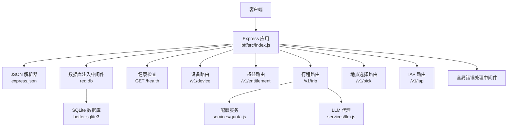
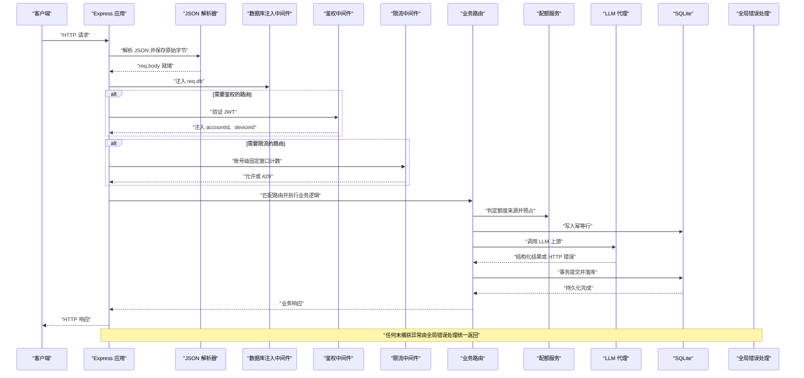
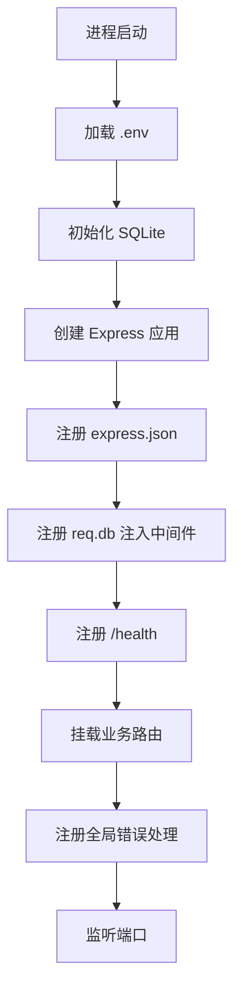
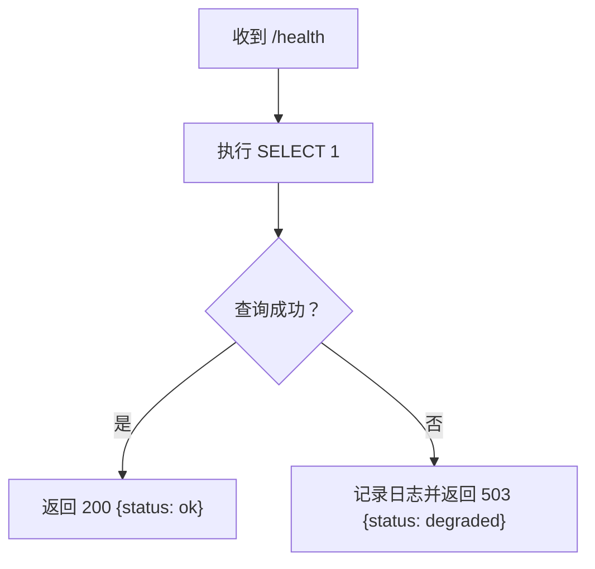
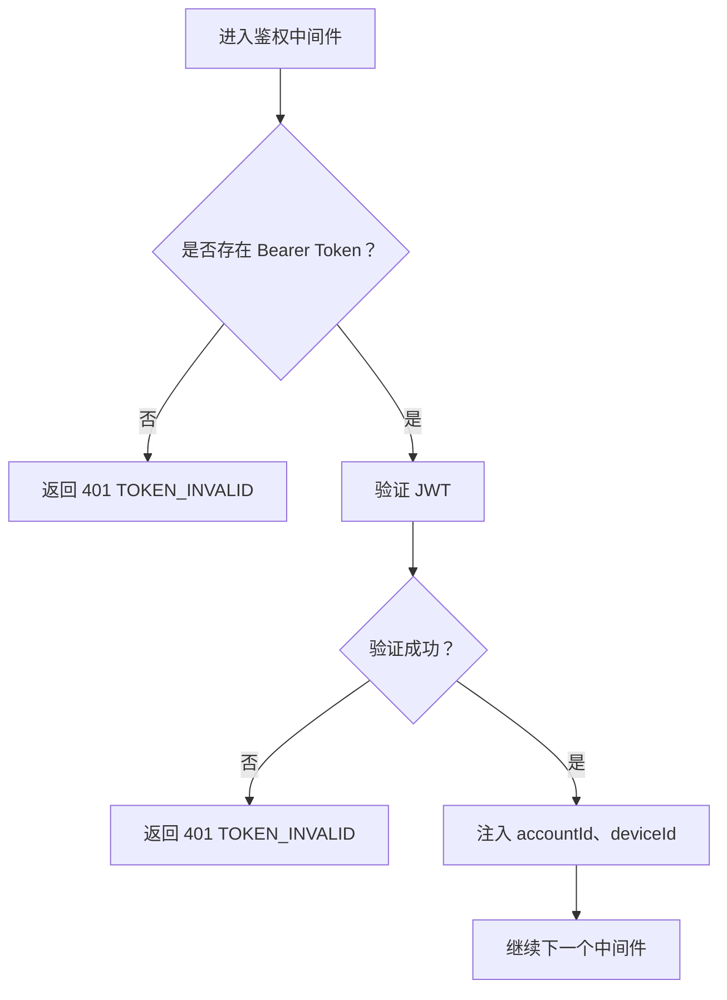
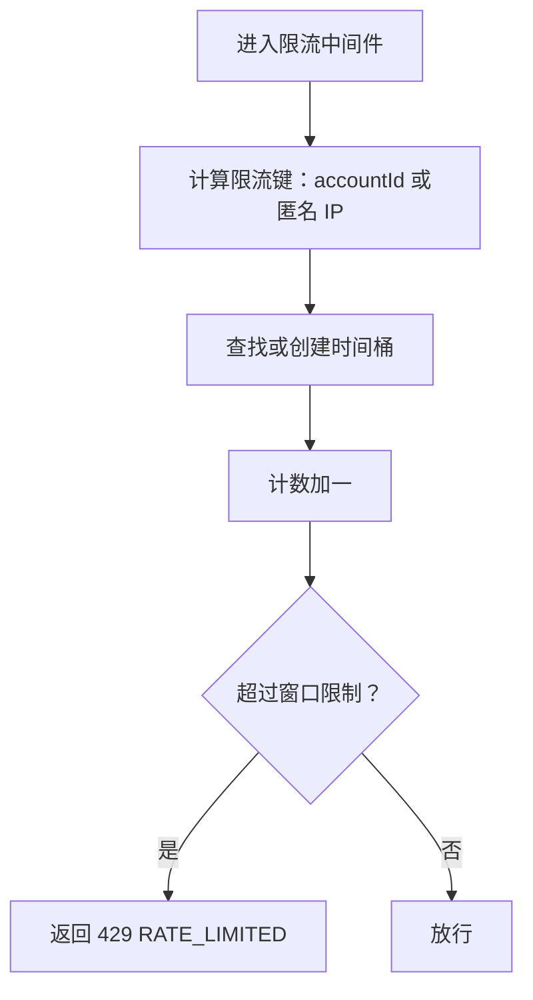
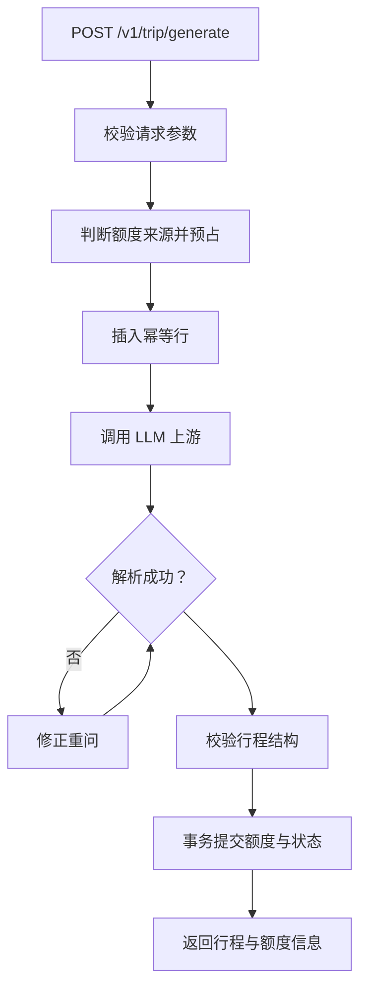
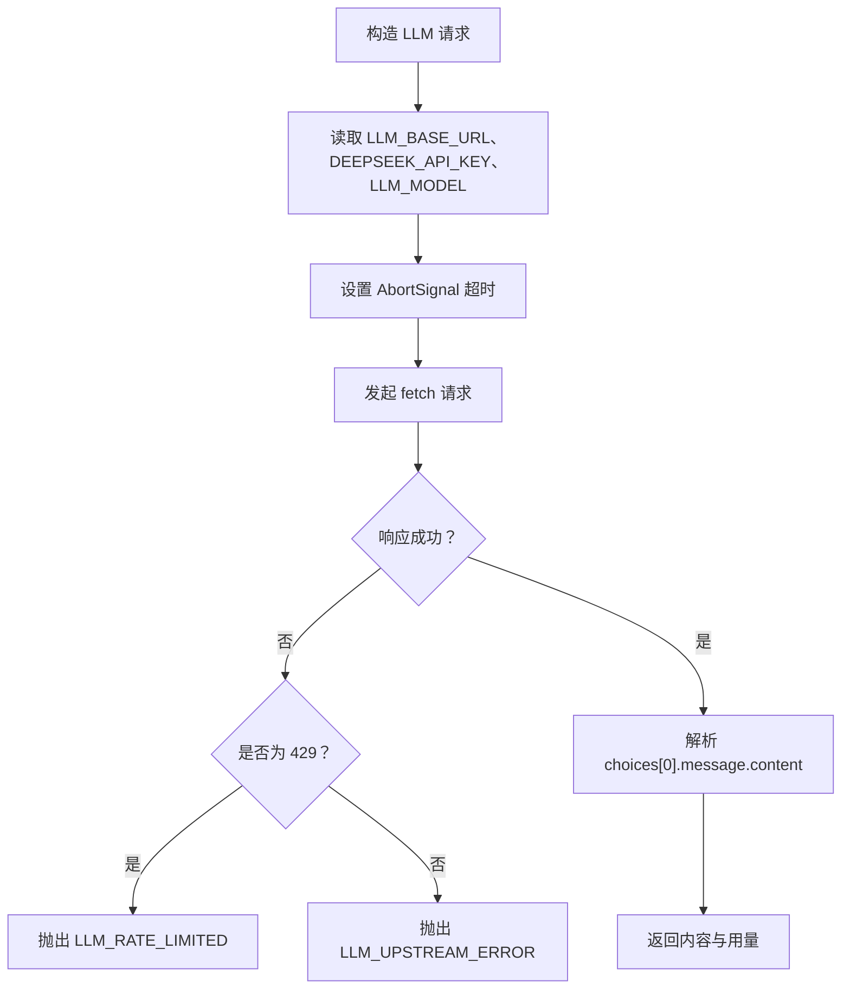
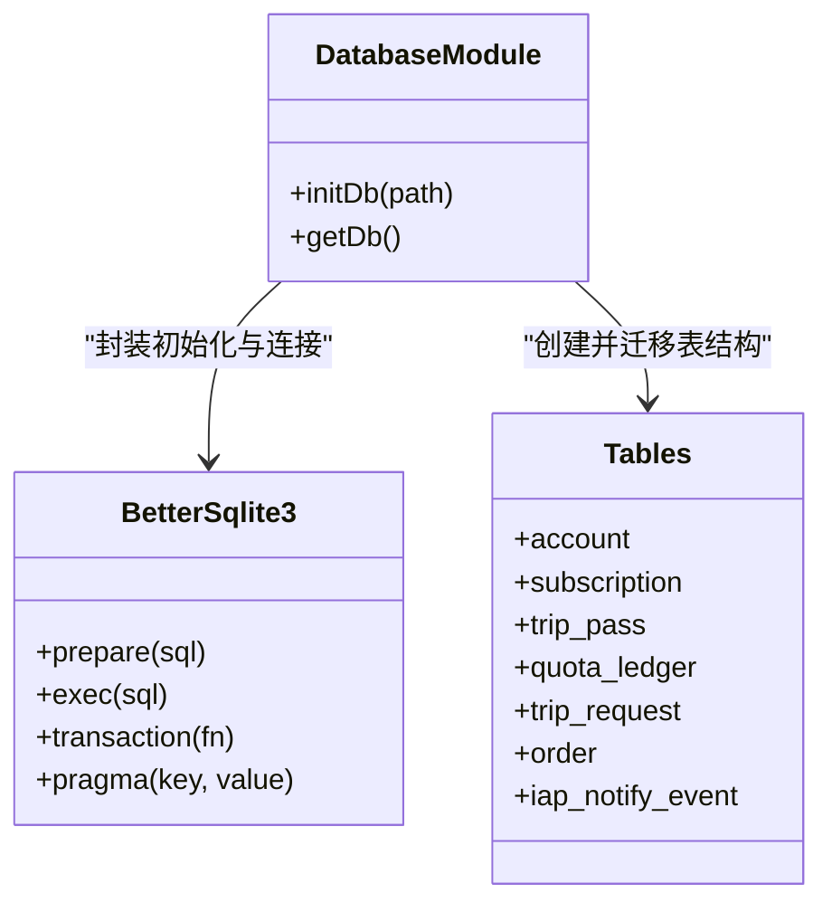
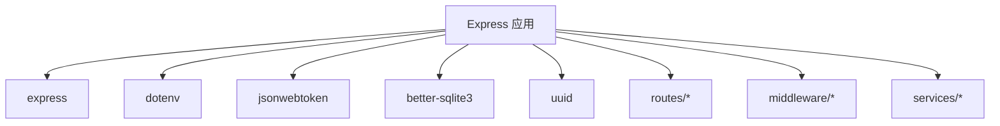

# Express 应用架构

<cite>
**本文引用的文件**   
- [bff/src/index.js](file://bff/src/index.js)
- [bff/src/db.js](file://bff/src/db.js)
- [bff/package.json](file://bff/package.json)
- [bff/.env.example](file://bff/.env.example)
- [bff/src/middleware/auth.js](file://bff/src/middleware/auth.js)
- [bff/src/middleware/rateLimit.js](file://bff/src/middleware/rateLimit.js)
- [bff/src/routes/trip.js](file://bff/src/routes/trip.js)
- [bff/src/services/llm.js](file://bff/src/services/llm.js)
- [bff/scripts/preflight.mjs](file://bff/scripts/preflight.mjs)
</cite>

## 目录
1. [引言](#引言)
2. [项目结构](#项目结构)
3. [核心组件](#核心组件)
4. [架构总览](#架构总览)
5. [详细组件分析](#详细组件分析)
6. [依赖关系分析](#依赖关系分析)
7. [性能与扩展性](#性能与扩展性)
8. [部署与环境配置](#部署与环境配置)
9. [故障排查指南](#故障排查指南)
10. [结论](#结论)

## 引言
本文面向 BFF（Backend For Frontend）服务，围绕 Express 应用的启动流程、中间件注册顺序、请求生命周期、SQLite 数据库初始化、环境变量、健康检查端点与全局错误处理进行系统化说明。文档同时给出架构图、时序图、流程图和排障建议，帮助开发者快速理解并安全地部署该服务。

## 项目结构
BFF 服务位于 `bff` 子目录，采用按职责划分的目录组织：入口启动、数据库、中间件、路由和服务层相互解耦。关键目录与文件如下：

| 路径 | 职责 |
| --- | --- |
| `bff/src/index.js` | Express 应用创建、中间件挂载、路由注册、全局错误处理、端口监听 |
| `bff/src/db.js` | SQLite 数据库初始化、DDL、列升级、WAL 模式与外键开关 |
| `bff/src/middleware/auth.js` | JWT 鉴权中间件，解析设备身份 |
| `bff/src/middleware/rateLimit.js` | 基于进程内存的账号级固定窗口限流中间件 |
| `bff/src/routes/trip.js` | 行程生成主业务路由，含幂等、配额校验、LLM 调用、事务落库 |
| `bff/src/services/llm.js` | LLM 上游代理，统一超时、429、异常映射为 HTTP 错误 |
| `bff/.env.example` | 环境变量模板，覆盖密钥、LLM、限流、IAP、数据库路径等 |
| `bff/scripts/preflight.mjs` | 上线前自检脚本，强制检查密钥、JWS 验签、证书、DB 路径等 |

**图示来源**
- [bff/src/index.js:1-55](file://bff/src/index.js#L1-L55)
- [bff/src/db.js:1-136](file://bff/src/db.js#L1-L136)
- [bff/src/routes/trip.js:1-200](file://bff/src/routes/trip.js#L1-L200)
- [bff/src/services/llm.js:1-98](file://bff/src/services/llm.js#L1-L98)

**章节来源**
- [bff/src/index.js:1-55](file://bff/src/index.js#L1-L55)
- [bff/package.json:1-22](file://bff/package.json#L1-L22)

## 核心组件
- **应用入口**：加载环境变量、初始化数据库、创建 Express 实例、注册中间件与路由、挂载全局错误处理器、监听端口。
- **数据库模块**：使用 `better-sqlite3`，默认 WAL 模式与外键约束开启；支持通过 `DB_PATH` 将数据文件放到可写卷上；包含 DDL 与列自动升级逻辑。
- **鉴权中间件**：从 `Authorization: Bearer <token>` 中解析 JWT，填充 `req.accountId` 与 `req.deviceId`，失败返回 401。
- **限流中间件**：基于进程内 `Map` 实现账号级固定窗口计数，默认 10 次/分钟，超限返回 429。
- **LLM 代理**：统一构造请求体、设置超时、处理上游 429/非 2xx 响应，抛出结构化 HTTP 错误。
- **健康检查**：真实执行一次 SQLite 查询，成功返回 200，失败返回 503 降级状态。
- **全局错误处理**：统一输出错误码与消息，默认 500。

**章节来源**
- [bff/src/index.js:1-55](file://bff/src/index.js#L1-L55)
- [bff/src/db.js:1-136](file://bff/src/db.js#L1-L136)
- [bff/src/middleware/auth.js:1-25](file://bff/src/middleware/auth.js#L1-L25)
- [bff/src/middleware/rateLimit.js:1-47](file://bff/src/middleware/rateLimit.js#L1-L47)
- [bff/src/services/llm.js:1-98](file://bff/src/services/llm.js#L1-L98)

## 架构总览
下图展示一个典型请求从进入 Express 到返回响应的完整生命周期，以及各阶段涉及的中间件与服务。

**图示来源**
- [bff/src/index.js:1-55](file://bff/src/index.js#L1-L55)
- [bff/src/middleware/auth.js:1-25](file://bff/src/middleware/auth.js#L1-L25)
- [bff/src/middleware/rateLimit.js:1-47](file://bff/src/middleware/rateLimit.js#L1-L47)
- [bff/src/routes/trip.js:1-200](file://bff/src/routes/trip.js#L1-L200)
- [bff/src/services/llm.js:1-98](file://bff/src/services/llm.js#L1-L98)

## 详细组件分析

### 应用启动与中间件注册顺序
应用启动过程遵循严格顺序：

1. 加载 `.env` 环境变量。
2. 初始化 SQLite 数据库实例。
3. 创建 Express 应用。
4. 注册 `express.json`，限制请求体大小并保留原始字节。
5. 注册数据库注入中间件，把数据库实例挂载到 `req.db`。
6. 定义 `/health` 健康检查路由。
7. 挂载业务路由组，部分路由附加鉴权与限流中间件。
8. 注册全局错误处理中间件。
9. 调用 `app.listen` 监听端口。

这个顺序保证：
- 所有请求都能访问 `req.db`。
- 健康检查在数据库可用时返回真实健康状态。
- 业务路由在鉴权和限流之后执行。
- 任何未捕获异常都会被全局错误处理器统一处理。

**图示来源**
- [bff/src/index.js:1-55](file://bff/src/index.js#L1-L55)

**章节来源**
- [bff/src/index.js:1-55](file://bff/src/index.js#L1-L55)

### 健康检查端点
`/health` 不是静态返回，而是真正执行一次 SQLite 查询：

- 成功时返回 200，状态为 `ok`，数据库状态为 `ok`。
- 失败时捕获异常，记录日志，返回 503，状态为 `degraded`，数据库状态为 `error`。

这种设计避免负载均衡把“只返回静态 ok”但数据库损坏的实例视为健康节点。

**图示来源**
- [bff/src/index.js:1-55](file://bff/src/index.js#L1-L55)

**章节来源**
- [bff/src/index.js:1-55](file://bff/src/index.js#L1-L55)

### 鉴权中间件
`authMiddleware` 负责：

- 要求 `Authorization` 头以 `Bearer ` 开头。
- 使用 `JWT_SECRET` 解密 JWT。
- 成功时将 `accountId` 和 `deviceId` 注入请求对象。
- 失败时返回 401，错误码为 `TOKEN_INVALID`。

该中间件挂载在 `/v1/entitlement`、`/v1/trip`、`/v1/pick` 等业务路由之前。

**图示来源**
- [bff/src/middleware/auth.js:1-25](file://bff/src/middleware/auth.js#L1-L25)

**章节来源**
- [bff/src/middleware/auth.js:1-25](file://bff/src/middleware/auth.js#L1-L25)

### 限流中间件
`rateLimitMiddleware` 是基于进程内存的账号级固定窗口限流：

- 默认限制为每分钟 10 次。
- 窗口时长可通过环境变量调整。
- 超出限制返回 429，错误码为 `RATE_LIMITED`。
- 多实例部署时每个实例独立计数，不能替代 Redis 等共享存储。

**图示来源**
- [bff/src/middleware/rateLimit.js:1-47](file://bff/src/middleware/rateLimit.js#L1-L47)

**章节来源**
- [bff/src/middleware/rateLimit.js:1-47](file://bff/src/middleware/rateLimit.js#L1-L47)

### 行程生成路由与事务落库
`/v1/trip/generate` 是核心业务入口，主要流程包括：

1. 校验请求参数，如目的地、日期范围、人数、预算。
2. 判断额度来源并预占额度。
3. 插入幂等行，防止并发重复扣费。
4. 构建提示词并调用 LLM 上游。
5. 解析模型输出，必要时发起修正调用。
6. 校验行程结构是否符合预期。
7. 在事务中提交额度、更新幂等行状态、读取权益快照并返回响应。

**图示来源**
- [bff/src/routes/trip.js:1-200](file://bff/src/routes/trip.js#L1-L200)

**章节来源**
- [bff/src/routes/trip.js:1-200](file://bff/src/routes/trip.js#L1-L200)

### LLM 代理
`proxyLlmRequest` 统一处理 LLM 上游调用：

- 默认基础地址为 DeepSeek。
- 默认模型为 `deepseek-flash`。
- 默认超时为 45 秒，留给可能的修正重问。
- 429 直接映射为 `LLM_RATE_LIMITED`，让客户端走限流文案分支。
- 其他非 2xx 响应映射为 `LLM_UPSTREAM_ERROR`。
- 缺失响应内容会抛出错误，由上层转为 HTTP 错误。

**图示来源**
- [bff/src/services/llm.js:1-98](file://bff/src/services/llm.js#L1-L98)

**章节来源**
- [bff/src/services/llm.js:1-98](file://bff/src/services/llm.js#L1-L98)

### 数据库连接与事务支持
数据库模块基于 `better-sqlite3`，提供两类能力：

- **进程内单例数据库**：由 `initDb` 创建，供 Express 中间件通过 `req.db` 使用。
- **按需新建连接**：`getDb` 用于特定场景打开新的连接，仍启用 WAL 和外键。

关键特性：

| 特性 | 行为 |
| --- | --- |
| 数据库路径 | 优先 `DB_PATH`，否则回退到 `data/youjing.db` |
| 文件系统兼容性 | 容器或云函数根文件系统可能只读，需通过 `DB_PATH` 指向挂载卷 |
| 写入模式 | 默认 WAL，提升并发读性能 |
| 外键约束 | 显式开启 |
| 表结构 | 启动时执行 DDL |
| 列升级 | 对旧库新增列做兼容 |
| 事务 | 使用 `db.transaction` 包裹落库操作，保证一致性 |

**图示来源**
- [bff/src/db.js:1-136](file://bff/src/db.js#L1-L136)

**章节来源**
- [bff/src/db.js:1-136](file://bff/src/db.js#L1-L136)

### 全局错误处理
全局错误处理中间件位于所有路由之后，负责：

- 打印错误消息。
- 取 `err.status` 作为 HTTP 状态，默认 500。
- 取 `err.code` 作为业务错误码，默认 `INTERNAL_ERROR`。
- 返回统一的 JSON 错误格式。

这使下游服务和业务层可以通过抛出结构化错误对象，避免暴露内部堆栈。

**章节来源**
- [bff/src/index.js:1-55](file://bff/src/index.js#L1-L55)

## 依赖关系分析
BFF 的核心外部依赖包括 Express、SQLite、JWT、UUID 和 dotenv。启动时通过 `dotenv` 加载环境变量，通过 `better-sqlite3` 管理本地数据库，通过 `jsonwebtoken` 处理设备票据。

**图示来源**
- [bff/package.json:1-22](file://bff/package.json#L1-L22)
- [bff/src/index.js:1-55](file://bff/src/index.js#L1-L55)

**章节来源**
- [bff/package.json:1-22](file://bff/package.json#L1-L22)
- [bff/src/index.js:1-55](file://bff/src/index.js#L1-L55)

## 性能与扩展性
- **SQLite WAL 模式**：适合读写混合负载，能减少锁竞争。
- **进程内限流**：简单有效，但多实例不可共享；如需跨实例限流应替换为 Redis。
- **LLM 超时保护**：避免上游挂起导致幂等行长期处于 pending 状态。
- **幂等设计**：通过 `idempotency_key` 控制并发与重试，防止重复扣费。
- **事务落库**：额度提交、状态更新与权益快照读取在同一事务中，保证一致性。

优化建议：
- 在高并发场景下评估 SQLite 是否成为瓶颈，必要时迁移到 PostgreSQL 或 MySQL。
- 将限流升级为分布式限流，结合网关或缓存层实现跨实例一致策略。
- 对热点查询增加索引或缓存，例如权益快照、配额余额。
- 对 LLM 调用增加重试上限、熔断和指标上报。

## 部署与环境配置

### 环境变量清单
| 变量 | 含义 | 默认值或说明 |
| --- | --- | --- |
| `PORT` | 服务监听端口 | `3000` |
| `JWT_SECRET` | JWT 签名密钥 | 必须替换为生产环境随机值 |
| `DEEPSEEK_API_KEY` | LLM 上游 API Key | 未配置时 LLM 调用会失败 |
| `LLM_BASE_URL` | LLM 上游基础地址 | 默认 DeepSeek |
| `LLM_MODEL` | LLM 模型名称 | 默认 `deepseek-flash` |
| `LLM_RESPONSE_FORMAT` | 结构化输出模式 | 默认 `json_schema` |
| `DB_PATH` | SQLite 数据文件路径 | 默认 `data/youjing.db` |
| `RATE_LIMIT_PER_MINUTE` | 账号级每分钟限额 | 默认 `10` |
| `RATE_LIMIT_WINDOW_MS` | 限流窗口毫秒数 | 默认 `60000` |
| `IAP_APP_ID` | 华为 IAP 应用 ID | 未配置时收据校验关闭 |
| `IAP_ROOT_CERT_PATH` | IAP 根证书路径 | 默认仓库内置证书 |
| `IAP_ALLOW_SANDBOX` | 是否放行沙盒收据 | 生产不应开启 |
| `HUAWEI_CLIENT_ID` | 华为设备激活 Client ID | 未配置时带身份激活会 401 |
| `ADMIN_ACCOUNT_IDS` | 管理员账户 ID 列表 | 仅本机联调使用 |

这些变量来自 `.env.example`，生产部署时应复制为 `.env` 并替换敏感值。

**章节来源**
- [bff/.env.example:1-41](file://bff/.env.example#L1-L41)

### 启动命令
- 启动服务：`node src/index.js`
- 开发热重载：`node --watch src/index.js`
- 执行数据库迁移：`node src/db.js`
- 运行测试：`node --test test/*.test.js`
- 上线前自检：`node scripts/preflight.mjs`

**章节来源**
- [bff/package.json:1-22](file://bff/package.json#L1-L22)

### 部署配置示例
以下是一个通用部署清单，可根据云平台调整：

| 项目 | 推荐配置 |
| --- | --- |
| Node.js 版本 | 支持 ES Module 与 `AbortSignal.timeout` 的版本 |
| 工作目录 | `bff` |
| 启动命令 | `node src/index.js` |
| 数据卷 | 将 `DB_PATH` 指向持久卷，如 `/data/youjing.db` |
| 端口 | 暴露 `PORT`，默认 `3000` |
| 反向代理 | Nginx 或云厂商网关，转发 `/v1/*` |
| 健康检查 | 探测 `/health`，期望 200 |
| 密钥管理 | 从密钥管理服务注入 `JWT_SECRET`、`DEEPSEEK_API_KEY` |
| 证书管理 | 将华为根证书放入可挂载目录，并通过 `IAP_ROOT_CERT_PATH` 引用 |
| 限流策略 | 网关层做 IP 限流，应用层做账号级限流 |
| 监控告警 | 记录 429、502、504、503 及 LLM 超时比例 |

**章节来源**
- [bff/src/index.js:1-55](file://bff/src/index.js#L1-L55)
- [bff/scripts/preflight.mjs:1-158](file://bff/scripts/preflight.mjs#L1-L158)

## 故障排查指南

### 常见问题与定位方法

| 现象 | 可能原因 | 排查步骤 |
| --- | --- | --- |
| 启动后无法访问端口 | `PORT` 未配置或被占用 | 检查环境变量和进程监听日志 |
| `/health` 返回 503 | SQLite 损坏、路径不可写或权限不足 | 检查 `DB_PATH`、目录权限、WAL 文件 |
| 携带令牌接口返回 401 | `JWT_SECRET` 不一致或令牌过期 | 检查服务端密钥、客户端签发逻辑 |
| 行程生成返回 429 | 账号级限流触发 | 检查 `RATE_LIMIT_PER_MINUTE` 和调用频率 |
| 行程生成返回 502 | LLM 上游返回非法 JSON 或结构不合法 | 查看 LLM 日志与修正重问日志 |
| 行程生成返回 504 | LLM 上游超时 | 检查 `LLM_TIMEOUT_MS` 和网络延迟 |
| 收益下发或通行证状态异常 | 幂等行或额度账本不一致 | 检查 `trip_request` 和 `quota_ledger` |
| IAP 收据校验失败 | 根证书缺失、`IAP_APP_ID` 未配置或沙盒放行关闭 | 运行 `npm run preflight` 检查 |
| 容器部署后数据库丢失 | 数据库路径写入了只读根文件系统 | 设置 `DB_PATH` 到挂载卷 |

### 推荐诊断流程
1. 先运行 `npm run preflight`，确认密钥、证书、JWS 验签、DB 路径等前置条件。
2. 访问 `/health`，确认数据库可用。
3. 检查鉴权链路，确认 JWT 是否正确签发和验证。
4. 检查限流配置，确认业务调用频率是否超过窗口限制。
5. 查看 LLM 调用日志，区分 429、502、504。
6. 检查事务落库状态，确认幂等行最终状态为成功或失败。

**章节来源**
- [bff/scripts/preflight.mjs:1-158](file://bff/scripts/preflight.mjs#L1-L158)
- [bff/src/index.js:1-55](file://bff/src/index.js#L1-L55)
- [bff/src/middleware/auth.js:1-25](file://bff/src/middleware/auth.js#L1-L25)
- [bff/src/middleware/rateLimit.js:1-47](file://bff/src/middleware/rateLimit.js#L1-L47)
- [bff/src/services/llm.js:1-98](file://bff/src/services/llm.js#L1-L98)
- [bff/src/db.js:1-136](file://bff/src/db.js#L1-L136)

## 结论
该 BFF 服务以 Express 为核心，通过明确的中间件注册顺序和分层职责，实现了设备鉴权、账号限流、行程生成、LLM 代理、SQLite 持久化和健康检查。其关键优势在于：

- 启动流程清晰，中间件顺序可预测。
- 健康检查真实探测数据库可用性。
- 幂等和事务保障额度与状态一致性。
- LLM 调用具备超时、限流透出和错误映射。
- 上线前自检脚本强制检查安全与合规项。

在生产环境中，应重点确保 `JWT_SECRET`、`DEEPSEEK_API_KEY`、`DB_PATH`、IAP 证书和限流策略正确配置，并结合网关层与监控系统完善可观测性与容错能力。