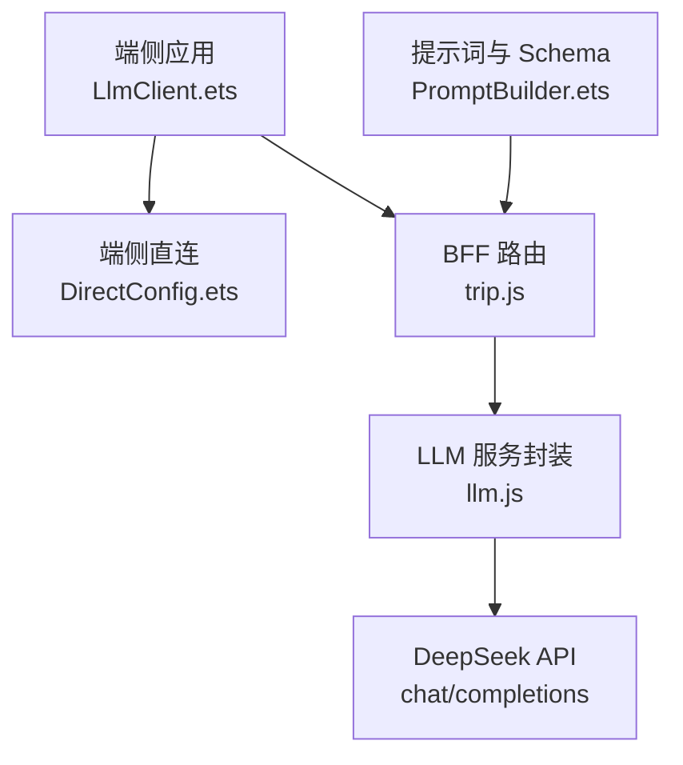
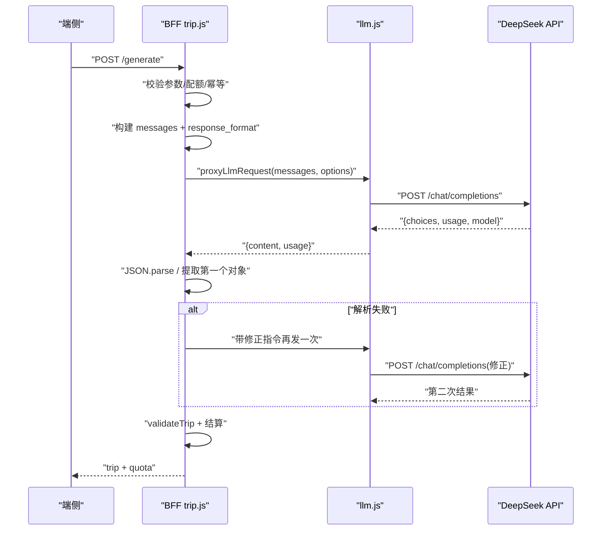
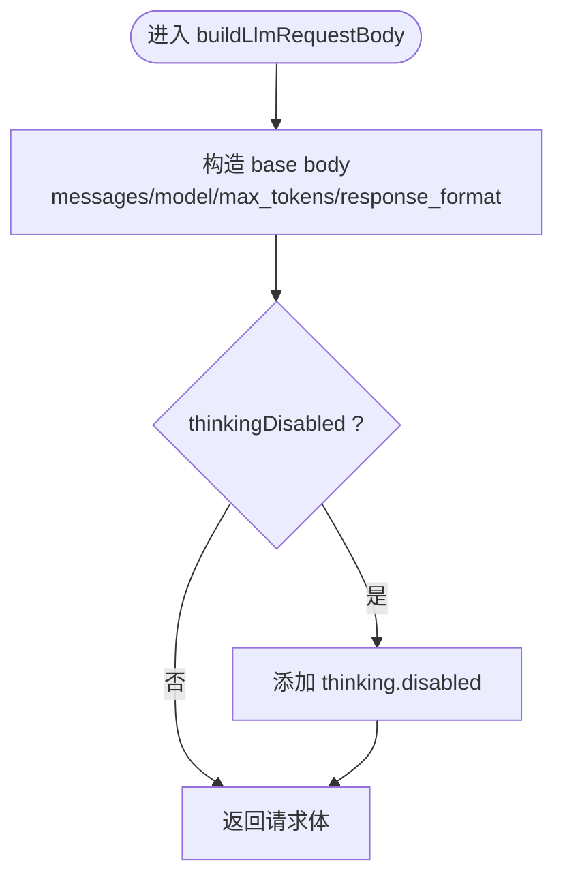
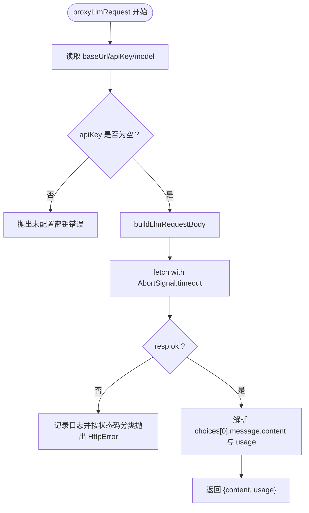
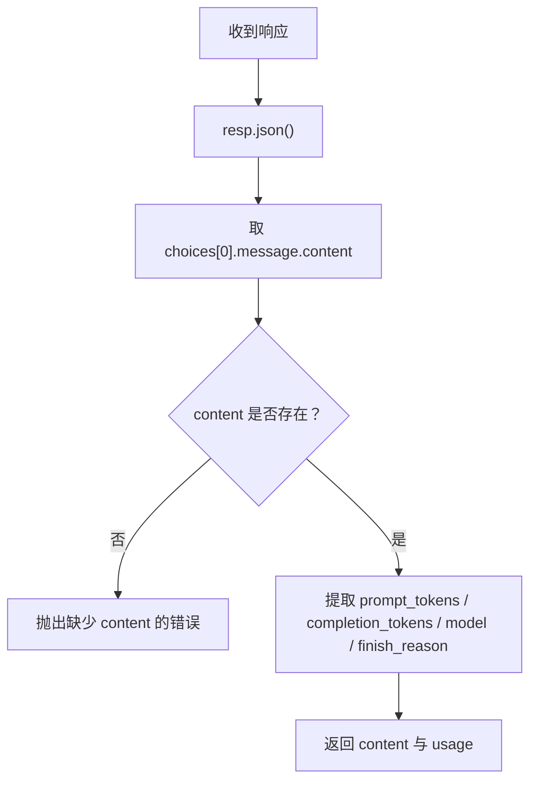
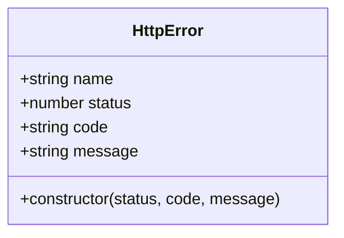
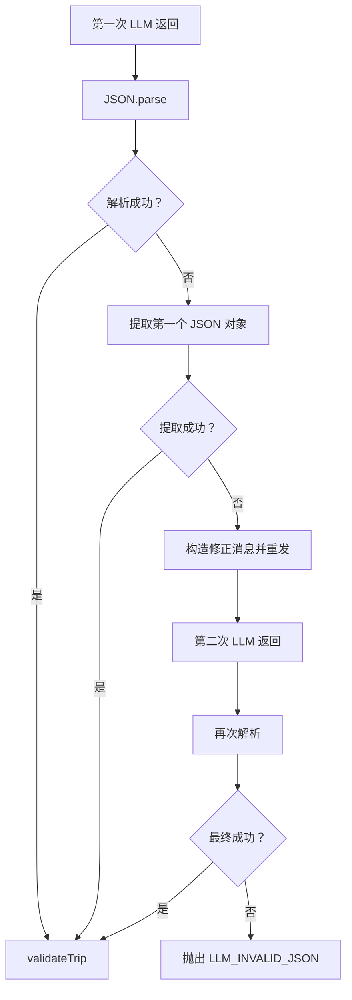
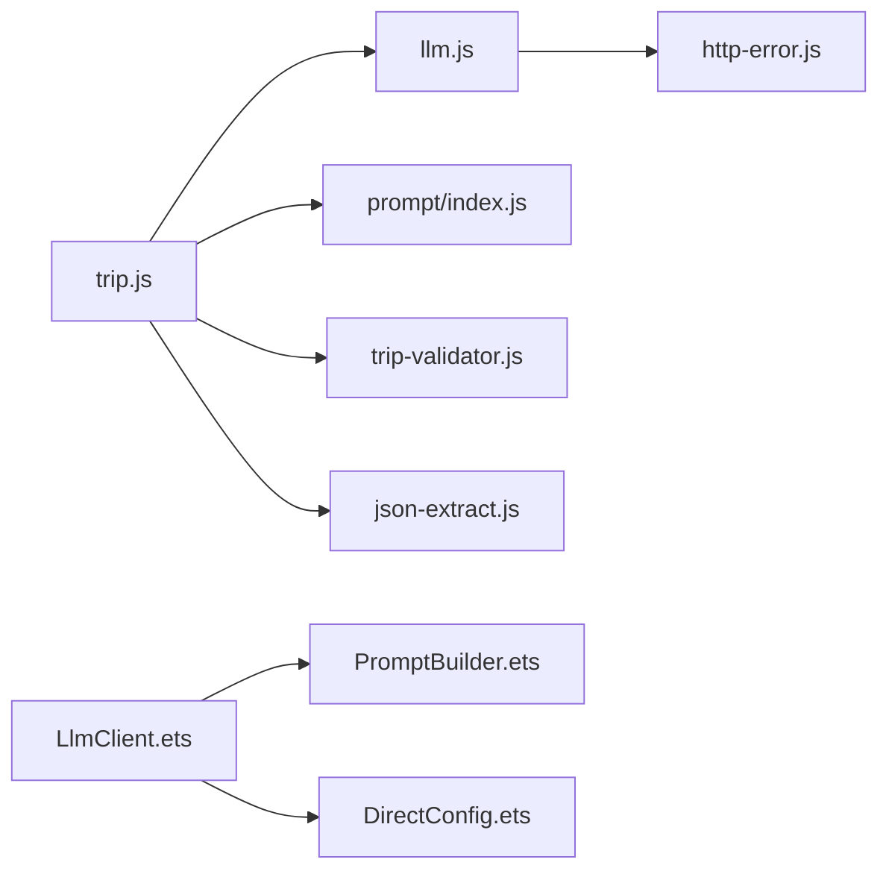

# LLM 服务集成

<cite>
**本文引用的文件**   
- [bff/src/services/llm.js](file://bff/src/services/llm.js)
- [bff/src/lib/http-error.js](file://bff/src/lib/http-error.js)
- [bff/src/routes/trip.js](file://bff/src/routes/trip.js)
- [entry/src/main/ets/common/config/DirectConfig.ets](file://entry/src/main/ets/common/config/DirectConfig.ets)
- [entry/src/main/ets/ai/LlmClient.ets](file://entry/src/main/ets/ai/LlmClient.ets)
- [entry/src/main/ets/ai/PromptBuilder.ets](file://entry/src/main/ets/ai/PromptBuilder.ets)
- [Docs/LLM接入方案-2026-10-26.md](file://Docs/LLM接入方案-2026-10-26.md)
</cite>

## 目录
1. [引言](#引言)
2. [项目结构](#项目结构)
3. [核心组件](#核心组件)
4. [架构总览](#架构总览)
5. [详细组件分析](#详细组件分析)
6. [依赖关系分析](#依赖关系分析)
7. [性能与优化建议](#性能与优化建议)
8. [故障排查指南](#故障排查指南)
9. [结论](#结论)
10. [附录：API 调用示例与错误码对照](#附录api-调用示例与错误码对照)

## 引言
本文面向“有径”行程规划项目中 LLM 服务集成的设计与实现，重点围绕后端 BFF 对 DeepSeek OpenAI 兼容接口的封装、超时控制、响应解析、错误处理策略，以及端侧直连与云函数迁移背景。读者可据此理解 `buildLlmRequestBody` 请求构建流程、`proxyLlmRequest` 调用链路、`DEFAULT_LLM_BASE_URL` / `DEEPSEEK_API_KEY` / `LLM_MODEL` / `DEFAULT_TIMEOUT_MS` 等配置项的作用，并获取重试、限流、截断检测与性能优化实践建议。

## 项目结构
LLM 集成横跨三层：
- 端侧（HarmonyOS ArkTS）：`LlmClient.ets` 暴露传输抽象，`PromptBuilder.ets` 提供系统提示词与 JSON Schema；开发期可通过 `DirectConfig.ets` 直连 DeepSeek。
- 后端（Node/BFF）：`services/llm.js` 统一封装 DeepSeek 请求、超时与错误；`routes/trip.js` 负责幂等、配额、提示词组装、修正重问与结算。
- 文档与历史决策：`Docs/LLM接入方案-2026-10-26.md` 记录路线选择、Key 管理、超时预算与接入清单。

**图示来源**
- [entry/src/main/ets/ai/LlmClient.ets:1-60](file://entry/src/main/ets/ai/LlmClient.ets#L1-L60)
- [entry/src/main/ets/common/config/DirectConfig.ets:1-33](file://entry/src/main/ets/common/config/DirectConfig.ets#L1-L33)
- [bff/src/routes/trip.js:1-40](file://bff/src/routes/trip.js#L1-L40)
- [bff/src/services/llm.js:1-30](file://bff/src/services/llm.js#L1-L30)
- [entry/src/main/ets/ai/PromptBuilder.ets:1-30](file://entry/src/main/ets/ai/PromptBuilder.ets#L1-L30)

**章节来源**
- [entry/src/main/ets/ai/LlmClient.ets:1-60](file://entry/src/main/ets/ai/LlmClient.ets#L1-L60)
- [entry/src/main/ets/common/config/DirectConfig.ets:1-33](file://entry/src/main/ets/common/config/DirectConfig.ets#L1-L33)
- [bff/src/routes/trip.js:1-40](file://bff/src/routes/trip.js#L1-L40)
- [bff/src/services/llm.js:1-30](file://bff/src/services/llm.js#L1-L30)
- [entry/src/main/ets/ai/PromptBuilder.ets:1-30](file://entry/src/main/ets/ai/PromptBuilder.ets#L1-L30)
- [Docs/LLM接入方案-2026-10-26.md:1-40](file://Docs/LLM接入方案-2026-10-26.md#L1-L40)

## 核心组件
- `bff/src/services/llm.js`：集中承载 DeepSeek 调用、环境变量配置、请求体构造、超时、状态码映射与响应解析。
- `bff/src/lib/http-error.js`：自定义 `HttpError`，携带 HTTP 状态码与业务错误码，便于上层按语义处理。
- `bff/src/routes/trip.js`：将业务参数转为 messages，构造 response_format，调用 `proxyLlmRequest`，并在 JSON 解析失败时发起一次“修正重问”。
- `entry/src/main/ets/common/config/DirectConfig.ets`：开发期端侧直连 DeepSeek 的 URL、KEY、MODEL、MAX_TOKENS 配置。
- `entry/src/main/ets/ai/LlmClient.ets`：端侧 LLM 编排入口，定义 Mock/HTTP/Direct 三种传输方式。
- `entry/src/main/ets/ai/PromptBuilder.ets`：系统提示词与 JSON Schema 的单源实现，约束输出结构与行为。

**章节来源**
- [bff/src/services/llm.js:1-98](file://bff/src/services/llm.js#L1-L98)
- [bff/src/lib/http-error.js:1-8](file://bff/src/lib/http-error.js#L1-L8)
- [bff/src/routes/trip.js:1-40](file://bff/src/routes/trip.js#L1-L40)
- [entry/src/main/ets/common/config/DirectConfig.ets:1-33](file://entry/src/main/ets/common/config/DirectConfig.ets#L1-L33)
- [entry/src/main/ets/ai/LlmClient.ets:1-60](file://entry/src/main/ets/ai/LlmClient.ets#L1-L60)
- [entry/src/main/ets/ai/PromptBuilder.ets:1-30](file://entry/src/main/ets/ai/PromptBuilder.ets#L1-L30)

## 架构总览
下图展示一次由端侧触发的“生成行程”完整调用链：端侧发送业务参数 → BFF 校验与扣额度 → 构建 messages 与 response_format → 调用 DeepSeek → 解析 content 与 usage → 二次修正（可选）→ 写入结算。

**图示来源**
- [bff/src/routes/trip.js:100-200](file://bff/src/routes/trip.js#L100-L200)
- [bff/src/services/llm.js:35-98](file://bff/src/services/llm.js#L35-L98)

**章节来源**
- [bff/src/routes/trip.js:100-200](file://bff/src/routes/trip.js#L100-L200)
- [bff/src/services/llm.js:35-98](file://bff/src/services/llm.js#L35-L98)

## 详细组件分析

### 环境变量与默认值
| 变量 | 作用 | 默认值或行为 | 说明 |
|---|---|---|---|
| `LLM_BASE_URL` | DeepSeek OpenAI 兼容基础地址 | `https://api.deepseek.com/v1` | 通过 `DEFAULT_LLM_BASE_URL` 提供默认值 |
| `DEEPSEEK_API_KEY` | 上游鉴权令牌 | 空字符串 | 未配置时直接抛出“未配置密钥”错误 |
| `LLM_MODEL` | 模型名称 | `deepseek-flash` | 通过 `DEFAULT_LLM_MODEL` 提供默认值 |
| `LLM_TIMEOUT_MS` | 上游请求超时毫秒数 | `45000` | 用于 `AbortSignal.timeout` |

这些值在 `llmConfig()` 中集中读取，供请求构建与转发使用。

**章节来源**
- [bff/src/services/llm.js:1-20](file://bff/src/services/llm.js#L1-L20)
- [Docs/LLM接入方案-2026-10-26.md:100-154](file://Docs/LLM接入方案-2026-10-26.md#L100-L154)

### 请求构建：`buildLlmRequestBody`
该纯函数负责把业务消息与选项转换为 DeepSeek `chat/completions` 请求体：
- 必填字段：`messages`、`model`、`max_tokens`、`response_format`。
- `thinking disabled`：当 `options.thinkingDisabled` 为真时，追加 `thinking: { type: 'disabled' }`，关闭思考模式以降低延迟与输出不稳定风险。
- `response_format`：支持传入 `json_object` 或更严格的 `json_schema`；BFF 的 trip 路由会注入 schema 格式以强化第二层防线。

**图示来源**
- [bff/src/services/llm.js:22-33](file://bff/src/services/llm.js#L22-L33)

**章节来源**
- [bff/src/services/llm.js:22-33](file://bff/src/services/llm.js#L22-L33)

### 超时控制机制
- 默认超时：`DEFAULT_TIMEOUT_MS = 45000`，注释说明为“修正重问留余量”，即一次失败最多两次顺序调用，总预算低于端侧读超时。
- 实现方式：`AbortSignal.timeout(timeoutMs)` 作为 fetch signal；若捕获到 `TimeoutError` 或 `AbortError`，统一包装为 `HttpError(504, 'LLM_TIMEOUT', ...)`。
- 设计动机：避免上游挂起导致 BFF 连接长期占用，同时让路由层能基于 504 释放额度并标记失败。

**图示来源**
- [bff/src/services/llm.js:35-98](file://bff/src/services/llm.js#L35-L98)

**章节来源**
- [bff/src/services/llm.js:1-34](file://bff/src/services/llm.js#L1-L34)
- [bff/src/services/llm.js:35-98](file://bff/src/services/llm.js#L35-L98)

### 响应解析逻辑
- 成功路径：从 `data.choices[0].message.content` 提取内容；若缺失则抛错。
- token 统计：读取 `usage.prompt_tokens` 与 `usage.completion_tokens`，缺失时回退 0。
- finish_reason：透传 `choices[0].finish_reason`，用于判断是否被 `max_tokens` 截断（常见值为 `length`）。
- usage.model：优先使用上游返回的 model，否则回退到配置中的 model。

**图示来源**
- [bff/src/services/llm.js:70-98](file://bff/src/services/llm.js#L70-L98)

**章节来源**
- [bff/src/services/llm.js:70-98](file://bff/src/services/llm.js#L70-L98)

### 错误处理策略
- 自定义异常：`HttpError(status, code, message)` 携带 HTTP 状态码与业务代码，便于上层区分网络、上游、业务三类错误。
- 429 限流：原样透出 429，并携带上游文本前 200 字符；端侧对应 `CLOUD_RATE_LIMITED(6003)` 文案，提示等待并重试而不重复扣额度。
- 其他非 2xx：统一包装为 502 `LLM_UPSTREAM_ERROR`，并记录状态码与上游文本。
- 超时：捕获 `TimeoutError`/`AbortError` 后包装为 504 `LLM_TIMEOUT`。
- 未配置密钥：直接抛出普通错误，不继续发请求。

**图示来源**
- [bff/src/lib/http-error.js:1-8](file://bff/src/lib/http-error.js#L1-L8)

**章节来源**
- [bff/src/lib/http-error.js:1-8](file://bff/src/lib/http-error.js#L1-L8)
- [bff/src/services/llm.js:35-98](file://bff/src/services/llm.js#L35-L98)

### 修正重问与截断检测
BFF trip 路由在首次 LLM 返回后执行 JSON 解析：
- 先尝试严格 `JSON.parse`；失败则尝试提取第一个完整 JSON 对象。
- 若仍失败，构造“修正重问”：追加 assistant 的历史内容与 user 修正指令，再次调用 `proxyLlmRequest`，并把两次调用的 prompt/completion tokens 合并。
- 修正重问时会提高 `maxTokens`（至少 16384），以缓解因 `length` 截断导致的短输出。
- 最终仍无法解析时抛出 502 `LLM_INVALID_JSON`。

**图示来源**
- [bff/src/routes/trip.js:100-200](file://bff/src/routes/trip.js#L100-L200)

**章节来源**
- [bff/src/routes/trip.js:100-200](file://bff/src/routes/trip.js#L100-L200)

### 端侧直连与 Prompt 单源
- 端侧直连：`DirectConfig.ets` 提供 `URL`/`KEY`/`MODEL`/`MAX_TOKENS`，默认 KEY 为空；启用时需 `skip-worktree` 防止误提交，上架前必须迁云。
- Prompt 单源：`PromptBuilder.ets` 维护系统提示词与 JSON Schema，限制模型输出结构、禁止英文双引号与反斜杠、规范餐次与活动数量、住宿区域等；端侧与 BFF 共用同一份规则。

**章节来源**
- [entry/src/main/ets/common/config/DirectConfig.ets:1-33](file://entry/src/main/ets/common/config/DirectConfig.ets#L1-L33)
- [entry/src/main/ets/ai/PromptBuilder.ets:1-187](file://entry/src/main/ets/ai/PromptBuilder.ets#L1-L187)

## 依赖关系分析
- `bff/src/routes/trip.js` 依赖：
  - `../services/llm.js`：`proxyLlmRequest`
  - `../prompt/index.js`：`buildMessages`、`buildResponseFormat`
  - `../prompt/trip-validator.js`：`validateTrip`
  - `../lib/json-extract.js`：`parseFirstJsonObject`
  - `../lib/http-error.js`：`HttpError`
- `bff/src/services/llm.js` 依赖：
  - `../lib/http-error.js`：`HttpError`
- `entry/src/main/ets/ai/LlmClient.ets` 依赖：
  - `PromptBuilder`、`TripParser`、`ApiConfig`、`DirectConfig`、`GenerationChannel`、`EntitlementStore`、`DeviceTokenStore` 等。

**图示来源**
- [bff/src/routes/trip.js:1-20](file://bff/src/routes/trip.js#L1-L20)
- [bff/src/services/llm.js:1-5](file://bff/src/services/llm.js#L1-L5)
- [entry/src/main/ets/ai/LlmClient.ets:1-60](file://entry/src/main/ets/ai/LlmClient.ets#L1-L60)

**章节来源**
- [bff/src/routes/trip.js:1-20](file://bff/src/routes/trip.js#L1-L20)
- [bff/src/services/llm.js:1-5](file://bff/src/services/llm.js#L1-L5)
- [entry/src/main/ets/ai/LlmClient.ets:1-60](file://entry/src/main/ets/ai/LlmClient.ets#L1-L60)

## 性能与优化建议
- 连接池配置
  - Node 端 `fetch` 默认复用 Agent 连接；在高并发场景可考虑显式配置 Agent 的 `keepAlive`、`maxSockets`，减少 TCP 握手与 TLS 握手开销。
  - 端侧直连使用 NetworkKit，应复用 `http.createHttp()` 实例并合理设置连接池上限。
- 重试机制设计
  - 当前 BFF 仅对 JSON 解析失败做一次“修正重问”，并对 429 透出给端侧做等待重试；建议在上层增加指数退避与抖动，避免雪崩。
  - 对于瞬态 5xx（非 502/504），可在网关或 BFF 外层增加有限次重试，但需确保幂等键一致。
- 缓存策略考虑
  - 对相同 `PlanParams`+`SelectedSpot` 的生成结果可做短期缓存，结合版本化 key（如 PromptBuilder 输出 hash），降低重复计算成本。
  - 热点城市/季节可预置模板化行程，命中后再走 LLM 微调。
- Token 成本控制
  - 利用 `usage.prompt_tokens`/`completion_tokens` 建立配额监控与告警，结合免费档与付费档差异化 `maxTokens`。
  - 精简用户消息中的景点信息，只保留必要字段；对长行程分天拆分调用，降低单次输出压力。
- 超时与用户体验
  - 保持 `DEFAULT_TIMEOUT_MS=45000` 与端侧读超时分层；对超长行程可拆分为多段生成，提升首字延迟体验。

[本节为通用性能建议，不直接分析具体代码文件]

## 故障排查指南
- 现象：端侧显示“LLM 端点未配置”或“网络不通或超时”
  - 检查 `LLM_BASE_URL`、`DEEPSEEK_API_KEY`、`LLM_MODEL` 是否正确加载。
  - 检查 BFF 是否已启动且可访问 `/v1/chat/completions`。
- 现象：频繁 429 限流
  - 确认上游限流策略与账号配额；端侧应按 `CLOUD_RATE_LIMITED(6003)` 文案引导等待，不要立即重试。
- 现象：返回内容不是合法 JSON
  - 检查 PromptBuilder 的系统提示词是否包含禁止英文双引号与反斜杠的规则；查看是否触发修正重问；关注 `finish_reason` 是否为 `length`。
- 现象：长时间卡住
  - 检查 `AbortSignal.timeout` 是否生效；观察日志中的 `[llm] http=...` 输出，确认是否发生超时。
- 现象：额度未正确扣减或重复扣费
  - 核对幂等键、`reserveQuota`/`commitQuota`/`releaseQuota` 调用路径；确认并发请求不会重复 claim。

**章节来源**
- [Docs/LLM接入方案-2026-10-26.md:40-120](file://Docs/LLM接入方案-2026-10-26.md#L40-L120)
- [bff/src/services/llm.js:35-98](file://bff/src/services/llm.js#L35-L98)
- [bff/src/routes/trip.js:100-200](file://bff/src/routes/trip.js#L100-L200)

## 结论
本项目通过 `bff/src/services/llm.js` 将 DeepSeek OpenAI 兼容接口封装为统一的 LLM 调用能力，配合 `HttpError`、超时控制、429 原样透出与 502 包装，形成清晰的上游错误边界；BFF 侧通过“修正重问”与 `finish_reason` 截断检测提升鲁棒性；端侧通过 `PromptBuilder` 与 `DirectConfig` 维持提示词单源与开发期直连能力。后续建议在连接池、重试、缓存与配额监控方面持续优化，并在上架前完成 Key 迁云与端侧直连下线。

[本节为总结性内容，不直接分析具体代码文件]

## 附录：API 调用示例与错误码对照

### 典型调用序列
- 端侧调用 BFF：
  - 方法：`POST /generate`
  - 请求体字段：`destination`、`startDate`、`endDate`、`people`、`budget`
  - 响应体：`{ trip, quota }`
- BFF 调用 DeepSeek：
  - 方法：`POST {baseUrl}/chat/completions`
  - Header：`Content-Type: application/json`、`Authorization: Bearer {apiKey}`
  - Body：`{ messages, model, max_tokens, response_format, thinking?: {type:'disabled'} }`

**章节来源**
- [bff/src/routes/trip.js:100-200](file://bff/src/routes/trip.js#L100-L200)
- [bff/src/services/llm.js:35-98](file://bff/src/services/llm.js#L35-L98)

### 错误码对照表
| 错误码/状态 | 含义 | 产生位置 | 处理建议 |
|---|---|---|---|
| `LLM_TIMEOUT` (504) | 上游请求超时 | `proxyLlmRequest` 捕获 `TimeoutError`/`AbortError` | 提示网络异常或稍后重试，避免长时间等待 |
| `LLM_RATE_LIMITED` (429) | 上游限流 | `proxyLlmRequest` 识别 429 | 端侧展示等待文案，不重复扣额度 |
| `LLM_UPSTREAM_ERROR` (502) | 上游非 2xx 错误 | `proxyLlmRequest` 默认分支 | 记录上游状态与文本，提示服务不可用 |
| `LLM_INVALID_JSON` (502) | 模型输出无法解析为 JSON | `trip.js` 修正重问后仍失败 | 检查提示词与 Schema，必要时调整 `max_tokens` |
| `LLM_INVALID_TRIP` (502) | 生成的 trip 不满足校验规则 | `trip.js` validateTrip | 检查业务约束与提示词规则 |
| 未配置密钥 | `DEEPSEEK_API_KEY` 为空 | `proxyLlmRequest` 前置检查 | 部署环境补齐密钥 |

**章节来源**
- [bff/src/services/llm.js:35-98](file://bff/src/services/llm.js#L35-L98)
- [bff/src/routes/trip.js:100-200](file://bff/src/routes/trip.js#L100-L200)
- [bff/src/lib/http-error.js:1-8](file://bff/src/lib/http-error.js#L1-L8)