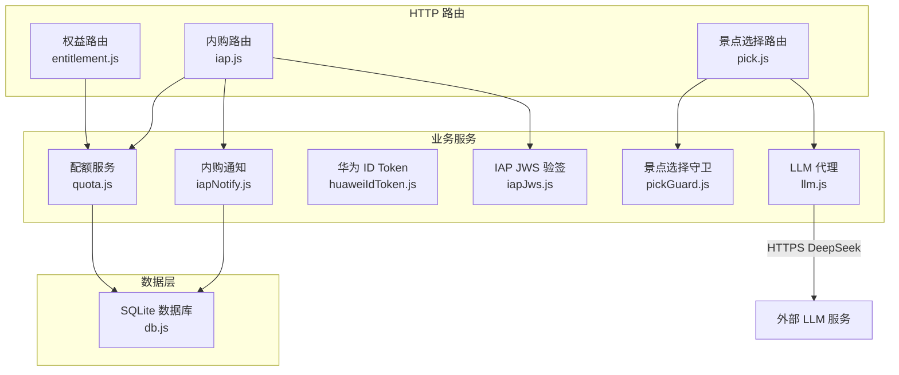
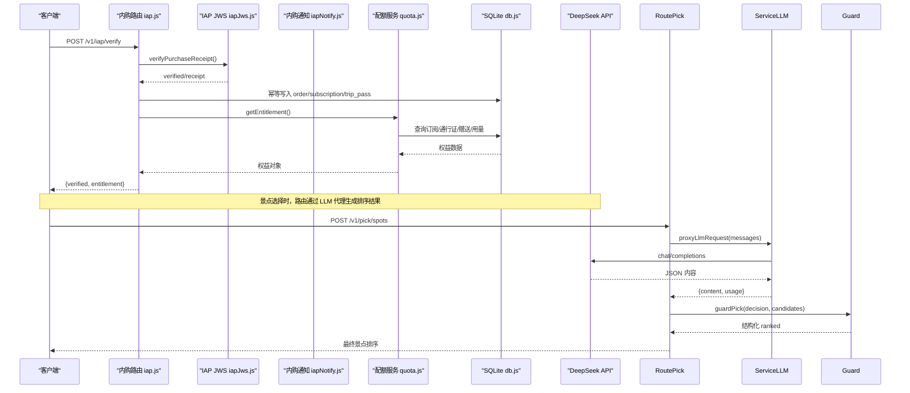
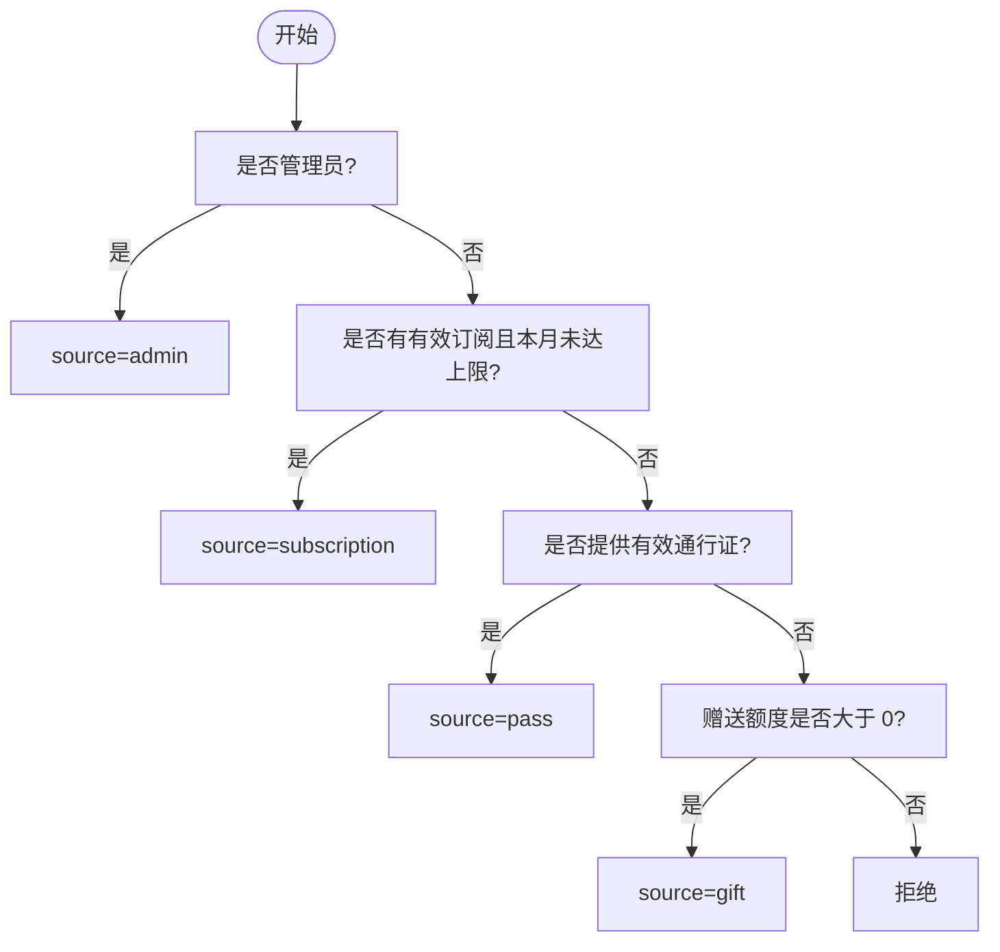
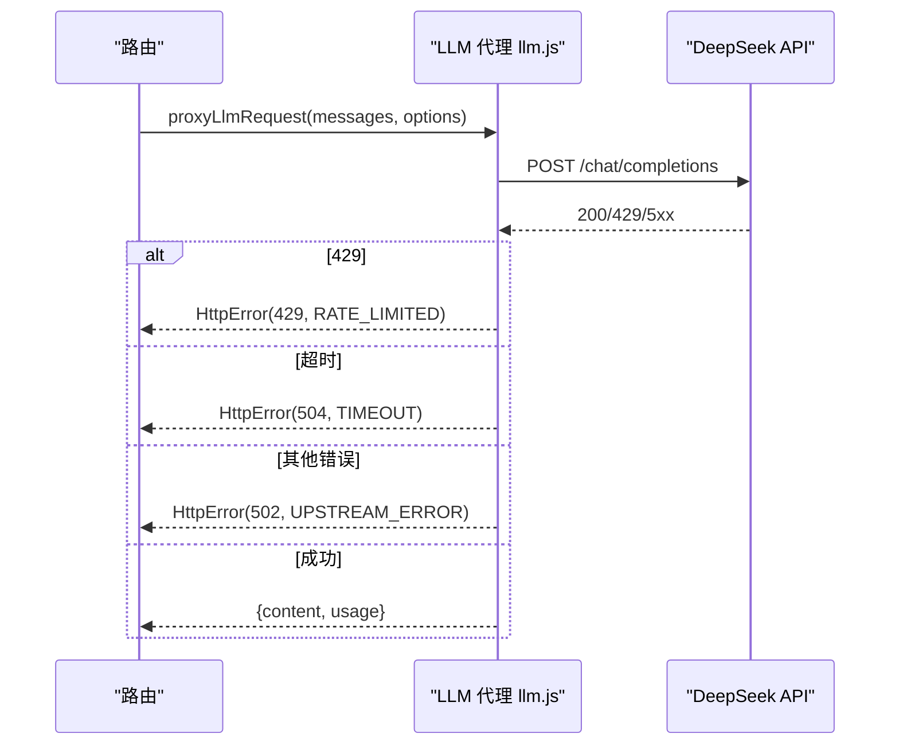
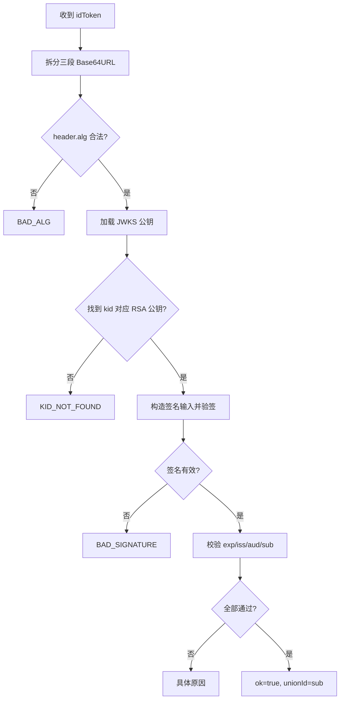
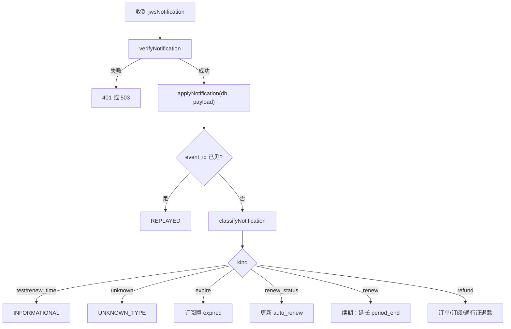
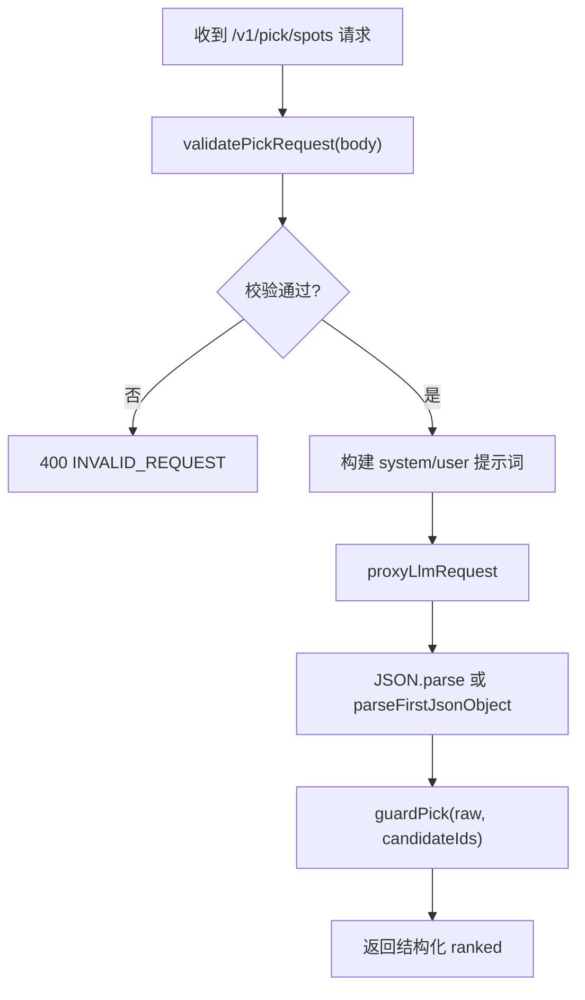
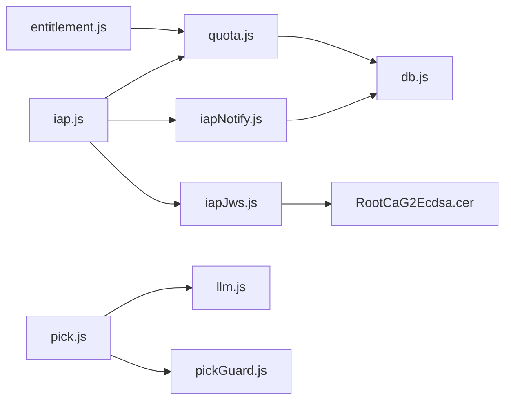

# 业务服务层

<cite>
**本文引用的文件**   
- [配额服务 quota.js](file://bff/src/services/quota.js)
- [LLM 代理 llm.js](file://bff/src/services/llm.js)
- [华为 ID Token 验签 huaweiIdToken.js](file://bff/src/services/huaweiIdToken.js)
- [内购通知 iapNotify.js](file://bff/src/services/iapNotify.js)
- [IAP JWS 验签 iapJws.js](file://bff/src/services/iapJws.js)
- [景点选择守卫 pickGuard.js](file://bff/src/services/pickGuard.js)
- [权益路由 entitlement.js](file://bff/src/routes/entitlement.js)
- [内购路由 iap.js](file://bff/src/routes/iap.js)
- [景点选择路由 pick.js](file://bff/src/routes/pick.js)
- [数据库与表结构 db.js](file://bff/src/db.js)
</cite>

## 目录
1. [引言](#引言)
2. [项目结构](#项目结构)
3. [核心组件总览](#核心组件总览)
4. [架构总览](#架构总览)
5. [详细组件分析](#详细组件分析)
6. [依赖关系分析](#依赖关系分析)
7. [性能与可靠性](#性能与可靠性)
8. [故障排查指南](#故障排查指南)
9. [结论](#结论)

## 引言
本文面向后端 BFF（Business Frontend Factory）服务，聚焦业务服务层的实现细节。文档围绕以下关键能力展开：
- 配额管理系统：月度额度计算、赠送额度处理、订阅状态检查、数据持久化与幂等控制。
- LLM 服务集成：DeepSeek API 调用、消息体构建、响应解析、超时与限流错误映射。
- 华为身份认证：idToken 本地验签、OIDC 字段校验、unionId 提取。
- 内购通知处理：RSA/JWS 签名验证、事件分类、订单与订阅状态同步。
- 景点选择守卫：候选池校验、模型输出守卫、库存与并发安全。
- 服务间调用模式、错误处理策略和性能优化建议。

## 项目结构
BFF 采用 Express 路由 + services 分层：
- routes：HTTP 接口入口，负责参数校验、鉴权、编排服务调用。
- services：纯业务逻辑，包含配额、LLM 代理、华为 ID Token、IAP JWS、内购通知、景点选择守卫。
- db：SQLite DDL、WAL 模式、表迁移辅助。

**图示来源**
- [权益路由 entitlement.js:1-15](file://bff/src/routes/entitlement.js#L1-L15)
- [内购路由 iap.js:1-192](file://bff/src/routes/iap.js#L1-L192)
- [景点选择路由 pick.js:1-45](file://bff/src/routes/pick.js#L1-L45)
- [配额服务 quota.js:1-113](file://bff/src/services/quota.js#L1-L113)
- [LLM 代理 llm.js:1-98](file://bff/src/services/llm.js#L1-L98)
- [华为 ID Token 验签 huaweiIdToken.js:1-161](file://bff/src/services/huaweiIdToken.js#L1-L161)
- [内购通知 iapNotify.js:1-167](file://bff/src/services/iapNotify.js#L1-L167)
- [IAP JWS 验签 iapJws.js:1-148](file://bff/src/services/iapJws.js#L1-L148)
- [数据库与表结构 db.js:1-136](file://bff/src/db.js#L1-L136)

**章节来源**
- [权益路由 entitlement.js:1-15](file://bff/src/routes/entitlement.js#L1-L15)
- [内购路由 iap.js:1-192](file://bff/src/routes/iap.js#L1-L192)
- [景点选择路由 pick.js:1-45](file://bff/src/routes/pick.js#L1-L45)
- [配额服务 quota.js:1-113](file://bff/src/services/quota.js#L1-L113)
- [LLM 代理 llm.js:1-98](file://bff/src/services/llm.js#L1-L98)
- [华为 ID Token 验签 huaweiIdToken.js:1-161](file://bff/src/services/huaweiIdToken.js#L1-L161)
- [内购通知 iapNotify.js:1-167](file://bff/src/services/iapNotify.js#L1-L167)
- [IAP JWS 验签 iapJws.js:1-148](file://bff/src/services/iapJws.js#L1-L148)
- [数据库与表结构 db.js:1-136](file://bff/src/db.js#L1-L136)

## 核心组件总览
| 组件 | 职责 | 关键输入 | 关键输出 | 主要副作用 |
| --- | --- | --- | --- | --- |
| 配额服务 | 查询订阅/通行证/赠送额度、预占/提交/释放额度、决定额度来源 | account_id、idempotency_key、source、pass_id | 权益对象、额度记录 | 写入 quota_ledger、trip_request |
| LLM 代理 | 构造 DeepSeek 请求、透传响应、错误映射 | messages、options | content、usage | 调用外部 HTTPS 接口 |
| 华为 ID Token | 本地验签 idToken、提取 unionId | idToken 字符串 | {ok, unionId, reason} | 缓存 JWKS 公钥集合 |
| IAP JWS | 本地验签 purchase/subscription/notification JWS | JWS 字符串 | {ok, payload, header} | 读取根证书 |
| 内购通知 | 事件分类、幂等落库、更新订阅/通行证/订单 | jwsNotification | {applied, kind, subtype, reason} | 更新 subscription/order/trip_pass |
| 景点选择守卫 | 校验入参、约束模型输出仅在候选集内 | 请求体、候选 id 列表 | 结构化决策 | 无副作用 |

**章节来源**
- [配额服务 quota.js:1-113](file://bff/src/services/quota.js#L1-L113)
- [LLM 代理 llm.js:1-98](file://bff/src/services/llm.js#L1-L98)
- [华为 ID Token 验签 huaweiIdToken.js:1-161](file://bff/src/services/huaweiIdToken.js#L1-L161)
- [IAP JWS 验签 iapJws.js:1-148](file://bff/src/services/iapJws.js#L1-L148)
- [内购通知 iapNotify.js:1-167](file://bff/src/services/iapNotify.js#L1-L167)
- [景点选择守卫 pickGuard.js:1-97](file://bff/src/services/pickGuard.js#L1-L97)

## 架构总览
端到端业务流程由“路由 → 服务 → 数据库/外部服务”构成：
- 权益查询：客户端调用 /entitlement，服务直接读订阅、通行证、赠送账本和当月用量。
- 内购兑换：客户端提交 JWS，服务端验签、幂等记账、写订单与权益，并返回最新权益。
- 内购通知：华为推送关键事件，服务端验签、分类、幂等应用，更新订阅或退款。
- 景点选择：客户端传入候选景点，服务端用 PromptBuilder 生成提示词后调用 LLM，并对模型输出做严格守卫。

**图示来源**
- [内购路由 iap.js:1-192](file://bff/src/routes/iap.js#L1-L192)
- [IAP JWS 验签 iapJws.js:1-148](file://bff/src/services/iapJws.js#L1-L148)
- [内购通知 iapNotify.js:1-167](file://bff/src/services/iapNotify.js#L1-L167)
- [配额服务 quota.js:1-113](file://bff/src/services/quota.js#L1-L113)
- [数据库与表结构 db.js:1-136](file://bff/src/db.js#L1-L136)
- [景点选择路由 pick.js:1-45](file://bff/src/routes/pick.js#L1-L45)
- [LLM 代理 llm.js:1-98](file://bff/src/services/llm.js#L1-L98)

## 详细组件分析

### 配额管理系统
配额系统负责把“是否可生成行程”的决策从订阅、通行证、赠送额度三者统一起来，并用幂等账本保证扣费准确。

#### 月度额度与赠送额度
- 月度上限固定为 20 次；字段名 usedToday/dailyCap 保留历史兼容，但实际语义是“本月已用次数/月限额”。
- 赠送额度初始值为 3，按 source='gift' 且 state='committed' 的 delta 累计，剩余值取 max(0, 3 + sum(delta))。
- 订阅状态必须同时满足 status='active' 且 period_end 未过期；仅看 status 会导致过期订阅继续送额度。

#### 额度来源判定优先级
管理员 > 订阅 > 通行证 > 赠送额度 > 拒绝。
- 管理员账户可直接放行，但仍会记录一条 source='admin' 的账本行，便于观察真实调用量。
- 通行证需要匹配 local_trip_id 且处于 active。
- 赠送额度只在剩余大于 0 时生效。

#### 预占、提交与释放
- reserveQuota：根据 idempotency_key 防重放；若上次失败并已 released，则重新预占，避免 commit 无行可更新。
- commitQuota：将 reserved 改为 committed，写入 settled_at。
- releaseQuota：将 reserved 改为 released，写入 settled_at。

**图示来源**
- [配额服务 quota.js:1-113](file://bff/src/services/quota.js#L1-L113)

#### 数据模型与复杂度
- subscription：存储订阅产品、状态、周期起止、自动续费、purchase_token。
- trip_pass：存储通行证绑定 local_trip_id、有效期、order_id。
- quota_ledger：记录每次额度使用的 delta、source、state、idempotency_key。
- trip_request：记录成功生成的行程请求，用于按月统计 usedThisMonth。

时间复杂度：
- getEntitlement：SQL 聚合与扫描均为 O(n)，n 为当前用户相关行数。
- determineQuotaSource：O(1) 到 O(p)（p 为通行证数量），整体常量级。
- reserve/commit/release：单行 UPDATE/INSERT，O(1)。

空间复杂度：
- 内存中不持有大对象；所有状态在 SQLite WAL 文件中。

**章节来源**
- [配额服务 quota.js:1-113](file://bff/src/services/quota.js#L1-L113)
- [数据库与表结构 db.js:1-136](file://bff/src/db.js#L1-L136)

### LLM 服务集成
LLM 代理封装了 DeepSeek 的 chat/completions 调用，并将上游错误映射为业务可读的错误码。

#### 配置与消息构建
- baseUrl 默认 https://api.deepseek.com/v1，model 默认 deepseek-flash。
- buildLlmRequestBody 固定 response_format 为 json_object，支持关闭 thinking、调整 max_tokens。

#### 调用流程与重试边界
- 使用 AbortSignal.timeout 控制上游超时，默认 45s，留给“修正重问”最多两次顺序调用的余量。
- 429 原样抛出 HttpError(429, 'LLM_RATE_LIMITED')，供端侧识别为“等待一分钟再试”，不再误报 5xx。
- 非 429 的非成功响应转为 HttpError(502, 'LLM_UPSTREAM_ERROR')。
- 响应体必须存在 choices[0].message.content，否则抛错。

**图示来源**
- [LLM 代理 llm.js:1-98](file://bff/src/services/llm.js#L1-L98)

#### 错误处理策略
- 配置缺失：直接抛错，阻止空密钥发送请求。
- 网络超时：明确区分 TimeoutError/AbortError，返回 504。
- 上游限流：保持 429，让端侧展示等待文案。
- 上游异常：统一 502，附带截断后的错误文本用于日志。

**章节来源**
- [LLM 代理 llm.js:1-98](file://bff/src/services/llm.js#L1-L98)

### 华为 ID Token 验证
该模块实现 OIDC idToken 本地验签，替代调试接口，符合华为商用要求。

#### OAuth2 流程与身份认证
- 客户端通过华为 Account Kit 获取 idToken，携带 issuer、jwks_uri、alg RS256/PS256。
- 服务端从环境变量 HUAWEI_CLIENT_ID、HUAWEI_JWKS_URL、HUAWEI_ISSUER 加载配置。
- 验签成功后，payload.sub 即 unionId，作为用户唯一标识。

#### 验签与安全边界
- fail-closed：未配置 Client ID、JWKS 不可用、kid 找不到、算法非法、签名无效、aud/iss/exp 不符，一律 ok=false。
- JWKS 缓存 TTL 10 分钟，带强制刷新逻辑以应对公钥轮换。
- 只接受 RS256/PS256，拒绝 none/HS* 防止算法混淆。

**图示来源**
- [华为 ID Token 验签 huaweiIdToken.js:1-161](file://bff/src/services/huaweiIdToken.js#L1-L161)

**章节来源**
- [华为 ID Token 验签 huaweiIdToken.js:1-161](file://bff/src/services/huaweiIdToken.js#L1-L161)

### 内购通知处理
华为 IAP v3 通知通过 jwsNotification 下发，服务端必须先验签再幂等应用。

#### JWS 解析与签名验证
- 验签路径复用 iapJws.verifyJws：ES256、x5c 三张证书链、根证书信任锚、叶子证书 OID 校验。
- 未配置根证书时返回 NOT_CONFIGURED，路由层按 503 处理，表示部署问题而非单次请求无效。

#### 事件分类与状态同步
- classifyNotification 将通知归为 renew/expire/refund/renew_status/renew_time/test/unknown。
- applyNotification：
  - 先查 iap_notify_event.event_id 去重，REPLAYED 不再改权益。
  - test/renew_time 仅落库信息，不改权益。
  - unknown 类型只记录不动作，避免无限重推。
  - expire：将 active 订阅置 expired 并关闭 auto_renew。
  - renew_status：仅更新 auto_renew。
  - renew：从 MAX(period_end, now) 起延长订阅周期，防止迟到重推吞掉一个周期。
  - refund：订单置 refunded；订阅置 refunded；通行证按 order_id 撤销。

**图示来源**
- [内购通知 iapNotify.js:1-167](file://bff/src/services/iapNotify.js#L1-L167)
- [IAP JWS 验签 iapJws.js:1-148](file://bff/src/services/iapJws.js#L1-L148)

**章节来源**
- [内购通知 iapNotify.js:1-167](file://bff/src/services/iapNotify.js#L1-L167)
- [IAP JWS 验签 iapJws.js:1-148](file://bff/src/services/iapJws.js#L1-L148)
- [内购路由 iap.js:1-192](file://bff/src/routes/iap.js#L1-L192)

### 景点选择守卫
P1 精选场景下，模型只能对已有候选排序，不能新增景点 id。

#### 选点规则校验
- validatePickRequest 校验 city、days、pace、interests、candidates 数组长度与字段类型，限制最多 40 个候选，且 candidate.id 不能重复。
- candidateIdsOf 提取候选 id 列表供守卫使用。

#### 模型输出守卫与并发控制
- guardPick 确保：
  - ranked 是数组且长度等于候选数。
  - 每个 ranked.id 必须在候选集合内且唯一。
  - reason/note 长度受限。
- 并发控制：
  - 景点选择本身不扣生成额度，因此不进入配额预占流程。
  - 真正涉及额度消耗的核心生成链路由配额服务通过 idempotency_key 与 quota_ledger.state 控制并发与重试。

**图示来源**
- [景点选择路由 pick.js:1-45](file://bff/src/routes/pick.js#L1-L45)
- [景点选择守卫 pickGuard.js:1-97](file://bff/src/services/pickGuard.js#L1-L97)
- [LLM 代理 llm.js:1-98](file://bff/src/services/llm.js#L1-L98)

**章节来源**
- [景点选择路由 pick.js:1-45](file://bff/src/routes/pick.js#L1-L45)
- [景点选择守卫 pickGuard.js:1-97](file://bff/src/services/pickGuard.js#L1-L97)

## 依赖关系分析

**图示来源**
- [权益路由 entitlement.js:1-15](file://bff/src/routes/entitlement.js#L1-L15)
- [内购路由 iap.js:1-192](file://bff/src/routes/iap.js#L1-L192)
- [景点选择路由 pick.js:1-45](file://bff/src/routes/pick.js#L1-L45)
- [配额服务 quota.js:1-113](file://bff/src/services/quota.js#L1-L113)
- [IAP JWS 验签 iapJws.js:1-148](file://bff/src/services/iapJws.js#L1-L148)
- [内购通知 iapNotify.js:1-167](file://bff/src/services/iapNotify.js#L1-L167)
- [数据库与表结构 db.js:1-136](file://bff/src/db.js#L1-L136)

### 耦合与内聚
- 路由层薄封装，依赖 services 完成主逻辑，内聚度高。
- quota.js 与 admin.js 解耦，通过 isAdminAccount 判断管理员，避免硬编码。
- iap.js 对 iapJws 与 iapNotify 组合使用，职责清晰。
- llm.js 独立于业务领域，只关心协议、错误映射与配置。

### 循环依赖
- 当前依赖方向为路由→服务→数据/外部服务，未发现循环导入。

**章节来源**
- [权益路由 entitlement.js:1-15](file://bff/src/routes/entitlement.js#L1-L15)
- [内购路由 iap.js:1-192](file://bff/src/routes/iap.js#L1-L192)
- [景点选择路由 pick.js:1-45](file://bff/src/routes/pick.js#L1-L45)
- [配额服务 quota.js:1-113](file://bff/src/services/quota.js#L1-L113)
- [IAP JWS 验签 iapJws.js:1-148](file://bff/src/services/iapJws.js#L1-L148)
- [内购通知 iapNotify.js:1-167](file://bff/src/services/iapNotify.js#L1-L167)
- [数据库与表结构 db.js:1-136](file://bff/src/db.js#L1-L136)

## 性能与可靠性

### 性能特性
- SQLite 使用 WAL 模式，提升并发读写性能；外键开启保证数据一致性。
- 配额查询使用索引 idx_sub_account、idx_req_account、idx_ledger_account 加速用户维度统计。
- JWKS 与根证书均有进程内缓存，避免每次请求都进行磁盘或网络开销。
- LLM 调用设置 45s 超时，避免连接长期占用导致额度记录卡死。

### 可靠性设计
- 配额操作通过 idempotency_key + state 控制预占/提交/释放，防止重试造成重复扣减。
- 内购收据与通知均幂等：purchase_token、notificationRequestId 分别作为唯一凭据。
- 订阅续期从 MAX(period_end, now) 起算，容忍迟到重推。
- 退款不会因迟到的续费通知复活已退款订阅。
- 华为 idToken 验签 fail-closed，任何一步失败都不放行。

### 优化建议
- 配额统计可考虑按月分区或物化视图，降低 COUNT 扫描成本。
- LLM 请求可增加指数退避重试，并在重试前检查是否为 429。
- JWKS 与 Root CA 证书加载可引入更细粒度的失效策略，例如基于 kid 变化触发刷新。
- 热点账号的权益查询可加短期缓存，注意订阅过期时间作为失效键。

[本节为通用指导，不直接分析具体代码文件]

## 故障排查指南

### 配额相关问题
- 现象：用户每月可用次数异常偏高或偏低。
- 排查要点：
  - 确认使用的是 monthly cap 而非 daily cap；usedToday 字段名仅为历史兼容。
  - 检查 subscription.period_end 是否早于当前时间。
  - 检查 giftLedger 中 source='gift' 且 state='committed' 的 delta 累计是否正确。
  - 检查 quota_ledger 的 idempotency_key 是否重复、state 是否在 reserved/committed/released 之间正确流转。

**章节来源**
- [配额服务 quota.js:1-113](file://bff/src/services/quota.js#L1-L113)
- [数据库与表结构 db.js:1-136](file://bff/src/db.js#L1-L136)

### LLM 超时与限流
- 现象：端侧看到“连不上行程服务”或“等一分钟再试”。
- 排查要点：
  - 504 来自 AbortSignal.timeout，检查 LLM_TIMEOUT_MS 与端侧读超时关系。
  - 429 应透出 LLM_RATE_LIMITED，端侧应有专门文案；若仍显示 5xx，检查上游响应状态是否被改写。
  - 检查 response_format 是否为 json_object，以及 choices[0].message.content 是否存在。

**章节来源**
- [LLM 代理 llm.js:1-98](file://bff/src/services/llm.js#L1-L98)

### 华为 ID Token 验签失败
- 现象：登录成功但服务端始终返回未配置或验签失败。
- 排查要点：
  - 确认 HUAWEI_CLIENT_ID 已配置。
  - 检查 HUAWEI_JWKS_URL/HUAWEI_ISSUER 是否与生产环境一致。
  - 关注 KID_NOT_FOUND、BAD_SIGNATURE、EXPIRED、BAD_AUDIENCE、BAD_ISSUER。
  - 公钥轮换时可能短暂找不到 kid，服务已内置一次强制刷新。

**章节来源**
- [华为 ID Token 验签 huaweiIdToken.js:1-161](file://bff/src/services/huaweiIdToken.js#L1-L161)

### 内购收据与通知
- 现象：购买成功但权益未到账，或退款后仍显示订阅。
- 排查要点：
  - /verify：检查 productType、productId、JWS 长度、receiptOwner 是否已被其他账号绑定。
  - /notify：检查 jwsNotification 验签结果，NOT_CONFIGURED 对应 503。
  - 查看 iap_notify_event 是否 REPLAYED 或 UNKNOWN_TYPE。
  - 订阅续期是否从 MAX(period_end, now) 起算，避免吞掉周期。
  - 退款是否同时更新 order、subscription、trip_pass。

**章节来源**
- [内购路由 iap.js:1-192](file://bff/src/routes/iap.js#L1-L192)
- [内购通知 iapNotify.js:1-167](file://bff/src/services/iapNotify.js#L1-L167)
- [IAP JWS 验签 iapJws.js:1-148](file://bff/src/services/iapJws.js#L1-L148)

### 景点选择输出异常
- 现象：模型输出缺少 ranked、包含不在候选集中的 id，或重复 id。
- 排查要点：
  - 检查 validatePickRequest 是否通过。
  - 检查 guardPick 抛出的候选集校验错误。
  - 若模型输出不是 JSON，确认 parseFirstJsonObject 是否能兜底解析。

**章节来源**
- [景点选择路由 pick.js:1-45](file://bff/src/routes/pick.js#L1-L45)
- [景点选择守卫 pickGuard.js:1-97](file://bff/src/services/pickGuard.js#L1-L97)

## 结论
本业务服务层以清晰的“路由—服务—数据/外部服务”分层组织核心能力：
- 配额系统以月度限额为核心，结合订阅、通行证与赠送额度，并通过幂等账本保障并发与重试安全。
- LLM 代理标准化 DeepSeek 调用，明确超时与限流错误，避免端侧误判。
- 华为身份认证采用本地 JWKS 验签，fail-closed 设计确保商用安全。
- 内购体系以 JWS 验签为基础，通知分类与幂等应用保证订阅、订单与通行证的最终一致性。
- 景点选择守卫严格约束模型输出，杜绝编造景点。

在生产环境中，建议进一步强化缓存策略、重试策略与监控指标，以便在流量增长时保持稳定的用户体验与可观测性。