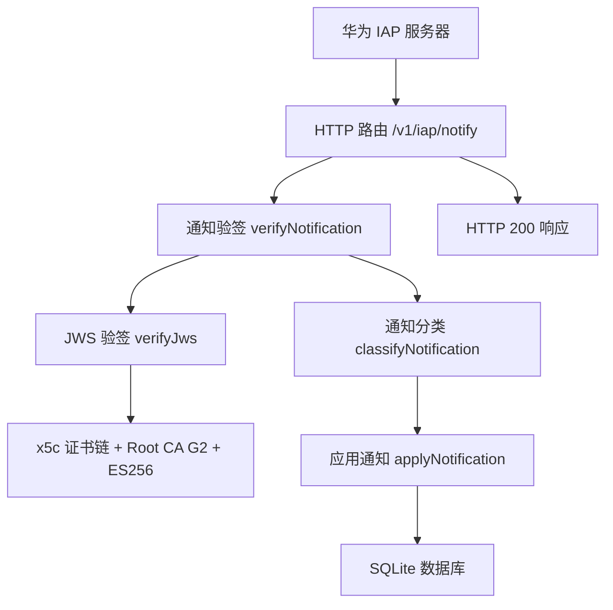
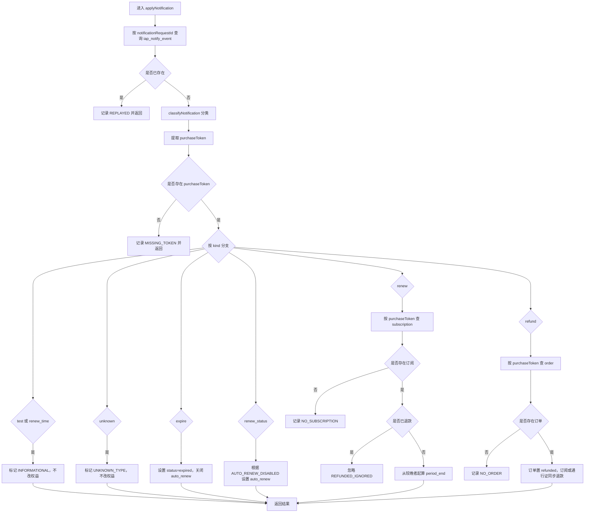
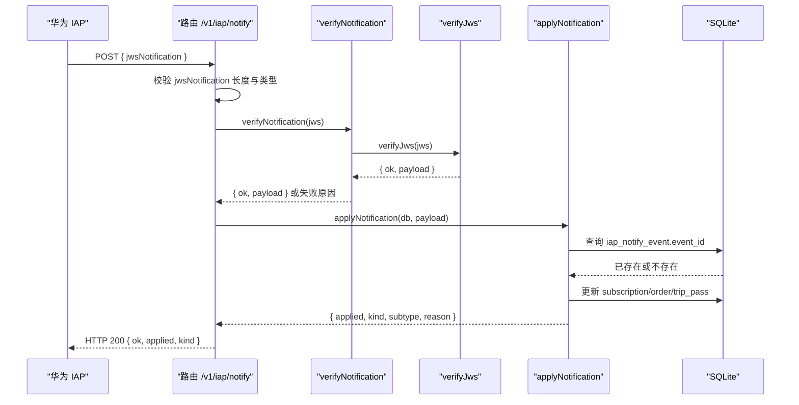
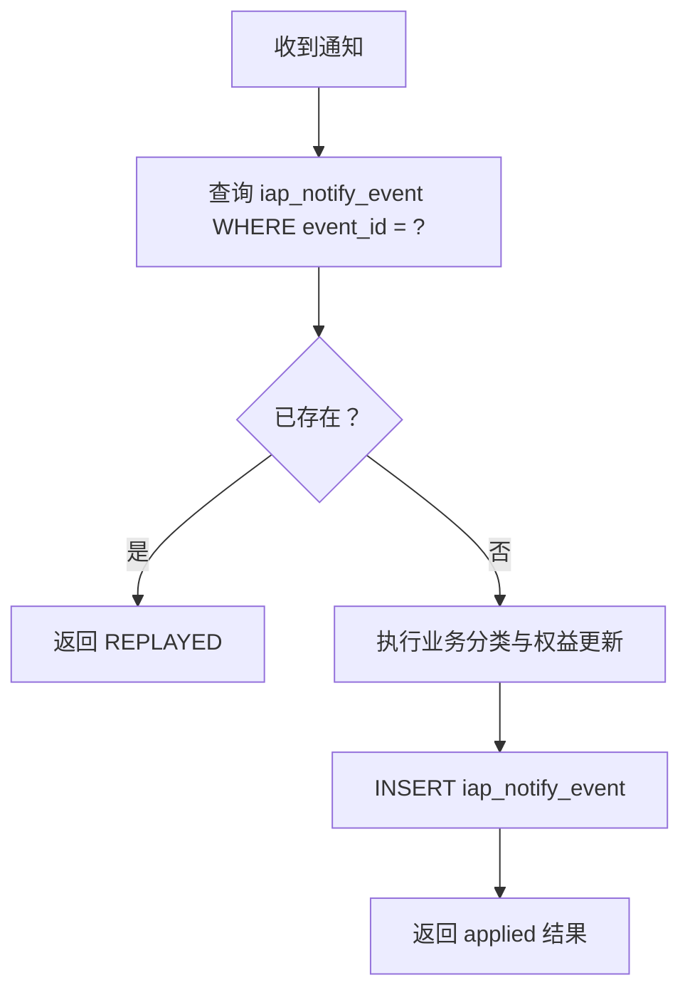
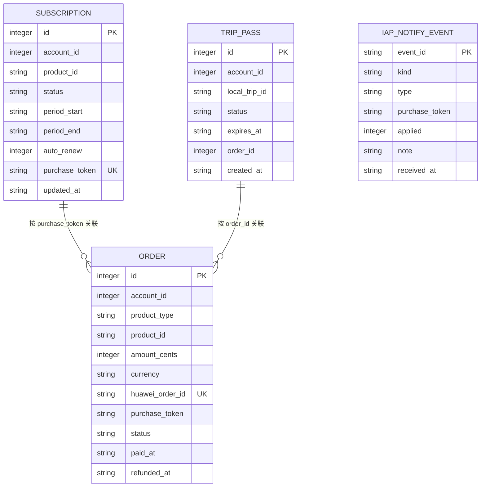
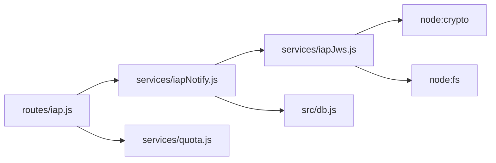

# 内购通知处理

<cite>
**本文引用的文件**   
- [iapNotify.js](file://bff/src/services/iapNotify.js)
- [iapJws.js](file://bff/src/services/iapJws.js)
- [iap.js](file://bff/src/routes/iap.js)
- [db.js](file://bff/src/db.js)
- [iap-notify.test.js](file://bff/test/iap-notify.test.js)
- [jws.js](file://bff/test/fixtures/jws.js)
</cite>

## 目录

1. [引言](#引言)
2. [项目结构与职责边界](#项目结构与职责边界)
3. [核心组件](#核心组件)
4. [架构总览](#架构总览)
5. [详细组件分析](#详细组件分析)
6. [依赖关系分析](#依赖关系分析)
7. [性能与可靠性特性](#性能与可靠性特性)
8. [故障排查指南](#故障排查指南)
9. [结论](#结论)

## 引言

本文件聚焦 BFF 层对华为 IAP v3 服务端关键事件通知的处理实现，覆盖以下目标：

- 解释 `jwsNotification` 的 JWS 结构、字段来源及官方契约约定。
- 梳理 `notificationType` 与 `notificationSubtype` 的分类语义。
- 说明本地 JWS 验签流程：ES256、x5c 证书链、Huawei CBG Root CA G2 信任锚、叶子证书 OID 扩展校验。
- 描述 `classifyNotification` 的七种分类结果：`renew`、`expire`、`refund`、`renew_status`、`renew_time`、`test`、`unknown`。
- 说明订阅权益更新规则：状态变更、`auto_renew` 开关、`period_end` 延期计算、基于 `purchaseToken` 的关联查找。
- 给出幂等性设计：`iap_notify_event` 事件表、`notificationRequestId` 去重、重复通知返回 `REPLAYED`。
- 提供完整流程图、数据库表结构和错误处理策略。

该能力是商业化链路中的“回调落地”环节：华为 IAP 服务器将订阅续费、到期、退款、续订开关变化等关键事件以 JWS 形式推送至应用服务器，BFF 负责安全解码、归类并持久化权益变更。

**章节来源**
- [iapNotify.js:1-20](file://bff/src/services/iapNotify.js#L1-L20)
- [iap.js:151-192](file://bff/src/routes/iap.js#L151-L192)

## 项目结构与职责边界

内购通知处理涉及三个层次：

| 层次 | 文件 | 职责 |
|---|---|---|
| HTTP 路由层 | `bff/src/routes/iap.js` | 接收 `/v1/iap/notify`，做请求格式校验、调用验签与应用逻辑，返回 200 确认。 |
| 业务服务层 | `bff/src/services/iapNotify.js` | 分类通知、鉴权式验签、幂等检查、权益更新与事件落库。 |
| 安全验签层 | `bff/src/services/iapJws.js` | 解析 JWS、验证 x5c 证书链、根证书匹配、证书有效期、OID 扩展、ES256 签名。 |
| 数据持久层 | `bff/src/db.js` | 定义 SQLite 表结构，包括订阅、订单、通行证、IAP 通知事件等。 |
| 测试夹具 | `bff/test/fixtures/jws.js` | 生成带合法证书链和 ES256 签名的测试 JWS，以及最小化的 `notificationPayload`。 |

**图表来源**
- [iap.js:151-192](file://bff/src/routes/iap.js#L151-L192)
- [iapNotify.js:22-167](file://bff/src/services/iapNotify.js#L22-L167)
- [iapJws.js:23-148](file://bff/src/services/iapJws.js#L23-L148)

**章节来源**
- [iap.js:151-192](file://bff/src/routes/iap.js#L151-L192)
- [iapNotify.js:1-20](file://bff/src/services/iapNotify.js#L1-L20)
- [iapJws.js:1-22](file://bff/src/services/iapJws.js#L1-L22)
- [db.js:7-108](file://bff/src/db.js#L7-L108)

## 核心组件

### 通知验签入口：`verifyNotification`

`verifyNotification` 是通知处理的第二道安全门。它首先检查是否已配置 IAP JWS 根证书；未配置时直接返回失败，路由层将其视为部署态问题。随后委托 `iapJws.js` 中的 `verifyJws` 完成真正的 JWS 解码、证书链校验与签名验证。最后对 payload 做基础完整性检查：必须包含字符串类型的 `notificationRequestId`，且 `notificationMetaData` 必须是对象。

关键行为：

- 根证书缺失：返回 `NOT_CONFIGURED`。
- JWS 格式或签名失败：返回具体失败原因。
- payload 缺少关键字段：返回 `BAD_PAYLOAD`。
- 通过：返回 `{ ok: true, payload }`。

**章节来源**
- [iapNotify.js:28-47](file://bff/src/services/iapNotify.js#L28-L47)
- [iapJws.js:59-148](file://bff/src/services/iapJws.js#L59-L148)

### 通知分类器：`classifyNotification`

`classifyNotification` 把华为官方 `notificationType` 映射为内部 `kind`，并保留原始 `notificationSubtype`。分类结果限定为七类：

| 内部 kind | 对应 notificationType | 含义 |
|---|---|---|
| `renew` | `DID_NEW_TRANSACTION` | 新交易、续费、恢复、计费恢复、升级等均视为订阅或订单生效/续期。 |
| `expire` | `EXPIRE` | 订阅到期。 |
| `refund` | `REVOKE` | 撤销，通常对应退款场景。 |
| `renew_status` | `DID_CHANGE_RENEWAL_STATUS` | 自动续订开关变化。 |
| `renew_time` | `RENEWAL_TIME_MODIFIED` | 续费时间修改。 |
| `test` | `TEST` | 测试通知。 |
| `unknown` | 其他值 | 未知类型，不改变权益。 |

分类只读取 `notificationType` 和 `notificationSubtype`，并对两者做空值和 trim 处理，避免大小写差异导致分支不可达。

**章节来源**
- [iapNotify.js:22-41](file://bff/src/services/iapNotify.js#L22-L41)

### 通知应用器：`applyNotification`

`applyNotification` 是权益落盘的核心函数。其整体流程如下：

**图表来源**
- [iapNotify.js:50-167](file://bff/src/services/iapNotify.js#L50-L167)

**章节来源**
- [iapNotify.js:50-167](file://bff/src/services/iapNotify.js#L50-L167)

## 架构总览

下图展示一次华为 IAP 通知从到达路由到权益落盘的完整顺序：

**图表来源**
- [iap.js:151-192](file://bff/src/routes/iap.js#L151-L192)
- [iapNotify.js:28-167](file://bff/src/services/iapNotify.js#L28-L167)
- [iapJws.js:59-148](file://bff/src/services/iapJws.js#L59-L148)

**章节来源**
- [iap.js:151-192](file://bff/src/routes/iap.js#L151-L192)

## 详细组件分析

### JWS 结构与验签流程

#### jwsNotification 的 JWS 结构

华为 IAP v3 通知体是 `{ jwsNotification }`，其中 `jwsNotification` 是对 `NotificationPayload` 签名的 JWS。JWS 由三段 Base64URL 编码组成：

| 部分 | 内容 |
|---|---|
| header | `{ alg: 'ES256', typ: 'JWT', x5c: [叶子, 中间, 根] }` |
| payload | `NotificationPayload`，包含 `notificationType`、`notificationSubtype`、`notificationRequestId`、`notificationMetaData` 等字段。 |
| signature | ES256 原始拼接签名（r||s，64 字节），使用 Node 的 `dsaEncoding: 'ieee-p1363'` 解析。 |

#### 证书链与信任锚

验签过程要求：

1. x5c 数组长度为 3，顺序为叶子证书、中间证书、根证书。
2. 根证书必须与本地配置的 Huawei CBG Root CA G2 一致。
3. 中间证书必须由根证书签发。
4. 叶子证书必须由中间证书签发。
5. 叶子证书和中间证书必须在当前时间有效。
6. 叶子证书必须包含 OID `1.3.6.1.4.1.2011.2.415.1.1`，用于区分华为 IAP 专用证书与其他用途证书。
7. 使用叶子公钥对 `header.payload` 进行 ES256 验签。

如果任何一步失败，验签返回结构化失败原因，而不是抛出异常，保证 fail-closed。

#### 主要失败原因

| 原因 | 含义 |
|---|---|
| `MISSING_JWS` | 未提供或为空字符串。 |
| `BAD_FORMAT` | 非三段 Base64URL 或头部无法解析。 |
| `BAD_ALG` | alg 不是 ES256 或 typ 不是 JWT。 |
| `BAD_CHAIN` | x5c 长度不对、证书解析失败、链签名验证失败。 |
| `ROOT_MISMATCH` | 证书链中的根证书与本地 Root CA G2 不一致。 |
| `CERT_EXPIRED` | 叶子或中间证书过期。 |
| `MISSING_OID` | 叶子证书缺少华为 IAP 专属 OID。 |
| `BAD_SIGNATURE` | ES256 签名验证失败。 |
| `BAD_PAYLOAD` | payload 无法解析或不是对象。 |

**章节来源**
- [iapJws.js:1-22](file://bff/src/services/iapJws.js#L1-L22)
- [iapJws.js:23-148](file://bff/src/services/iapJws.js#L23-L148)

### 通知分类逻辑

`classifyNotification` 将官方枚举映射为内部语义，从而让后续权益更新逻辑不必关心华为端字段命名细节。

| notificationType | 内部 kind | 典型 notificationSubtype | 权益影响 |
|---|---|---|---|
| `DID_NEW_TRANSACTION` | `renew` | `INITIAL_BUY`、`DID_RENEW`、`RESTORE`、`BILLING_RECOVERY`、`UPGRADE` | 续费或购买生效，延长订阅周期。 |
| `EXPIRE` | `expire` | 例如 `VOLUNTARY` | 订阅失效，关闭自动续费。 |
| `REVOKE` | `refund` | 例如 `REFUND_TRANSACTION` | 订单退款，订阅或通行证撤销。 |
| `DID_CHANGE_RENEWAL_STATUS` | `renew_status` | `AUTO_RENEW_ENABLED`、`AUTO_RENEW_DISABLED` | 仅调整自动续费开关。 |
| `RENEWAL_TIME_MODIFIED` | `renew_time` | 续费时间变化 | 信息性通知，不改权益。 |
| `TEST` | `test` | 测试类型 | 信息性通知，不改权益。 |
| 其他 | `unknown` | 任意 | 记录日志但不改权益。 |

需要注意：`DID_NEW_TRANSACTION` 是一个“宽口径”分类。只要属于新交易范畴，都走续费/生效逻辑，而不是逐个判断 subtype。这样能兼容华为可能扩展的细分类型。

**章节来源**
- [iapNotify.js:22-41](file://bff/src/services/iapNotify.js#L22-L41)

### 权益更新规则

#### 续费：`renew`

续费通知对应 `DID_NEW_TRANSACTION`。处理逻辑如下：

1. 用 `purchaseToken` 查找 `subscription`。
2. 如果找不到订阅，返回 `NO_SUBSCRIPTION`。
3. 如果订阅状态已是 `refunded`，忽略本次续费，返回 `REFUNDED_IGNORED`，防止迟到或伪造通知复活退款订单。
4. 取 `meta.currentProductId`，若为空则回退到数据库中已有的 `product_id`。
5. 根据产品 ID 决定续期月数：年订阅为 12 个月，其他订阅为 1 个月。
6. 将 `period_end` 设置为 `MAX(period_end, 当前时间)` 加上续期月数，避免延迟送达吞掉一个周期。
7. 设置 `status = active`，`auto_renew = 1`。

#### 到期：`expire`

到期通知对应 `EXPIRE`。处理逻辑：

1. 用 `purchaseToken` 查找 `active` 状态的订阅。
2. 将 `status` 设为 `expired`。
3. 将 `auto_renew` 设为 0。
4. 如果找不到活跃订阅，返回 `NO_ACTIVE_SUBSCRIPTION`。

#### 续订状态：`renew_status`

`DID_CHANGE_RENEWAL_STATUS` 只影响自动续费开关，不影响当前权益有效期：

- `AUTO_RENEW_DISABLED`：关闭 `auto_renew`。
- `AUTO_RENEW_ENABLED`：开启 `auto_renew`。
- 仅作用于 `status = active` 的订阅。

#### 退款：`refund`

`REVOKE` 对应退款撤销。处理逻辑：

1. 用 `purchaseToken` 查找 `order`。
2. 将订单状态设为 `refunded`，写入 `refunded_at`。
3. 如果订单商品类型为 `subscription`，将对应订阅状态设为 `refunded`，关闭自动续费。
4. 如果订单商品类型为 `pass`，根据购买时绑定的 `order_id` 将 `trip_pass.status` 设为 `refunded`。
5. 如果找不到订单，返回 `NO_ORDER`。

#### 产品信息优先级

续费场景中，优先使用 `notificationMetaData.currentProductId`，只有当其为空字符串时才回退到数据库中已有 `product_id`。这符合“权威值优先，但允许降级”的设计。

**章节来源**
- [iapNotify.js:60-167](file://bff/src/services/iapNotify.js#L60-L167)

### 幂等性设计

幂等性由两部分组成：

1. **事件去重表**：`iap_notify_event` 以 `event_id` 为主键。`event_id` 来自 `notificationRequestId`。
2. **处理前检查**：`applyNotification` 在修改任何权益前先查询该事件是否已存在。若存在，直接返回 `REPLAYED`，不再执行后续权益更新。

这意味着：

- 同一 `notificationRequestId` 第二次到达会记录一条已处理事件，但不会再次延长订阅周期。
- 即使重试发生在权益已经变更后，也不会造成双续费或重复退款。
- 所有通知都会落库，包括 `test`、`renew_time`、`unknown`、`MISSING_TOKEN` 等“不改权益”的情况，便于审计和排障。

**图表来源**
- [iapNotify.js:50-74](file://bff/src/services/iapNotify.js#L50-L74)
- [db.js:96-108](file://bff/src/db.js#L96-L108)

**章节来源**
- [iapNotify.js:50-74](file://bff/src/services/iapNotify.js#L50-L74)

### 数据库表结构

与内购通知处理直接相关的表如下：

| 表名 | 字段 | 用途 |
|---|---|---|
| `subscription` | `id`、`account_id`、`product_id`、`status`、`period_start`、`period_end`、`auto_renew`、`purchase_token`、`updated_at` | 存储用户订阅权益，含状态、有效期和自动续费开关。 |
| `order` | `id`、`account_id`、`product_type`、`product_id`、`amount_cents`、`currency`、`huawei_order_id`、`purchase_token`、`status`、`paid_at`、`refunded_at` | 记账订单，关联购买凭证和退款状态。 |
| `trip_pass` | `id`、`account_id`、`local_trip_id`、`status`、`expires_at`、`order_id`、`created_at` | 存储行程通行证，退款时需按 `order_id` 撤销。 |
| `iap_notify_event` | `event_id`、`kind`、`type`、`purchase_token`、`applied`、`note`、`received_at` | 通知幂等与审计表。 |

关键字段说明：

| 字段 | 约束/索引 | 说明 |
|---|---|---|
| `subscription.purchase_token` | UNIQUE | 同一购买令牌只能对应一条订阅。 |
| `subscription.account_id` | 索引 | 快速按账号查询订阅。 |
| `trip_pass.local_trip_id` | 唯一索引 `(account_id, local_trip_id)` | 同一账号的通行证唯一。 |
| `order.purchase_token` | 无全局唯一约束，但有业务幂等逻辑 | 收据作为幂等凭据，路由层也做了重复提交保护。 |
| `iap_notify_event.event_id` | PRIMARY KEY | 通知幂等主键。 |

**图表来源**
- [db.js:7-108](file://bff/src/db.js#L7-L108)

**章节来源**
- [db.js:7-108](file://bff/src/db.js#L7-L108)

## 依赖关系分析

**图表来源**
- [iap.js:1-10](file://bff/src/routes/iap.js#L1-L10)
- [iapNotify.js:22-26](file://bff/src/services/iapNotify.js#L22-L26)
- [iapJws.js:23-27](file://bff/src/services/iapJws.js#L23-L27)

### 耦合关系

- 路由层只依赖 `verifyNotification` 和 `applyNotification`，不直接操作数据库表结构。
- 通知服务依赖 JWS 验签模块，但通过 `iapJwsConfigured` 解耦根证书部署状态。
- JWS 验签模块依赖 Node 原生加密模块和文件系统加载根证书，不依赖外部网络 API。
- 通知服务依赖 SQLite 连接对象，由路由层注入 `req.db`。
- 测试夹具独立于生产代码，通过自签三级证书链模拟华为证书体系。

### 潜在风险点

1. **根证书路径依赖**：JWS 验签依赖 `IAP_ROOT_CERT_PATH` 或默认证书文件。路径不存在时会返回 `NOT_CONFIGURED`。
2. **SQLite 单进程模型**：当前实现使用 `better-sqlite3`，并发高时应评估连接复用和锁竞争。
3. **硬编码产品 ID**：续费月数逻辑对 `youjing_sub_yearly` 特殊处理，新增商品需同步扩展。
4. **证书吊销未实现**：注释明确未实现 CRL 吊销检查，依赖链签名、有效期和 OID 防护。

**章节来源**
- [iapJws.js:23-58](file://bff/src/services/iapJws.js#L23-L58)
- [iapNotify.js:22-41](file://bff/src/services/iapNotify.js#L22-L41)
- [iap.js:151-192](file://bff/src/routes/iap.js#L151-L192)

## 性能与可靠性特性

### 性能特征

- JWS 验签是 CPU 密集操作，但单次开销较小；Node 原生 `crypto.verify` 与 `X509Certificate` 底层由 OpenSSL 提供。
- 数据库操作均为单条 SQL，没有长事务；幂等检查先读后写，避免重复权益变更。
- 证书缓存：根证书通过 `loadRootCert` 缓存，避免每次验签都重新读取文件。
- 通知路由返回 200 即确认，符合华为 IAP 服务器“非 200 才重推”的语义。

### 可靠性保障

| 机制 | 作用 |
|---|---|
| fail-closed | 根证书未配置或验签失败一律拒绝，不发放权益。 |
| 白名单分类 | 未知 `notificationType` 不落权益，只记录，避免无限重推被误判为成功。 |
| 幂等事件表 | 同 `notificationRequestId` 只处理一次。 |
| 迟到续费保护 | `period_end` 从 `MAX(period_end, now)` 起算，避免延迟通知吞掉周期。 |
| 退款不可逆 | 已退款订阅不会被迟到的续费通知复活。 |
| 测试与时间通知不生效 | `test` 和 `renew_time` 仅记录，不改变用户权益。 |

**章节来源**
- [iapJws.js:1-22](file://bff/src/services/iapJws.js#L1-L22)
- [iapNotify.js:1-20](file://bff/src/services/iapNotify.js#L1-L20)
- [iapNotify.js:50-167](file://bff/src/services/iapNotify.js#L50-L167)

## 故障排查指南

### 常见错误与处理建议

| 现象 | 可能原因 | 排查步骤 | 预期修复 |
|---|---|---|---|
| `/v1/iap/notify` 返回 503 | 根证书路径未配置或证书文件不可读 | 检查 `IAP_ROOT_CERT_PATH` 环境变量及证书文件是否存在 | 部署正确的 Huawei CBG Root CA G2 证书 |
| `/v1/iap/notify` 返回 401 | JWS 格式错误、签名不匹配、证书链无效、OID 缺失 | 查看 `NOTIFY_BAD_FORMAT`、`NOTIFY_BAD_SIGNATURE`、`NOTIFY_MISSING_OID` 等错误 | 修正客户端签名或使用华为官方 SDK 生成 JWS |
| 通知重复但权益未二次延长 | 正常幂等行为 | 检查 `iap_notify_event` 中是否有相同 `event_id` | 无需修复，这是预期行为 |
| 续费未延长周期 | `purchaseToken` 缺失、订阅不存在、订阅已退款 | 检查 `notificationMetaData.purchaseToken`、`subscription`、`order` | 补全通知字段或排查客户端上报 |
| 退款未撤销通行证 | 订单未绑定 `order_id` | 检查 `trip_pass.order_id` | 修复购买流程中通行证与订单的绑定逻辑 |
| 自动续费关闭但仍显示订阅有效 | `renew_status` 只关开关，不断供 | 观察 `subscription.auto_renew` 与 `period_end` | 等待到期或手动清理 |

### 调试建议

1. **先确认验签**：使用测试夹具 `makeJws` 构造合法 JWS，验证本地验签通路。
2. **再确认分类**：打印 `notificationType` 和 `notificationSubtype`，确认落入预期 `kind`。
3. **再确认幂等**：检查 `iap_notify_event` 是否已有相同 `event_id`。
4. **最后确认表状态**：核对 `subscription`、`order`、`trip_pass` 的 `status`、`auto_renew`、`period_end`。
5. **测试用例参考**：`bff/test/iap-notify.test.js` 覆盖了根证书缺失、坏签名、到期、续费幂等、迟到续费、退款、自动续费关闭等场景。

**章节来源**
- [iap-notify.test.js:1-200](file://bff/test/iap-notify.test.js#L1-L200)
- [jws.js:1-143](file://bff/test/fixtures/jws.js#L1-L143)

## 结论

本项目实现了华为 IAP v3 服务端关键事件通知的本地化、可审计、幂等的权益处理闭环：

- 安全面通过 ES256、x5c 证书链、Huawei CBG Root CA G2 信任锚和叶子证书 OID 校验，确保通知确实来自华为 IAP。
- 业务面通过 `classifyNotification` 将官方枚举收敛为七类内部语义，使续费、到期、退款、续订开关变化有统一处理入口。
- 数据面通过 `iap_notify_event` 实现基于 `notificationRequestId` 的幂等，避免重复通知造成双续费或重复退款。
- 可靠性面通过迟到续费保护、退款不可逆、未知类型不生效等边界条件，降低乱序、重发、伪造通知的影响。

后续可考虑的方向包括：接入华为真实回调进行端到端验收、补充 CRL 吊销检查、为更多 `notificationSubtype` 增加细粒度审计字段，以及在高频场景下评估 SQLite 并发与连接池策略。