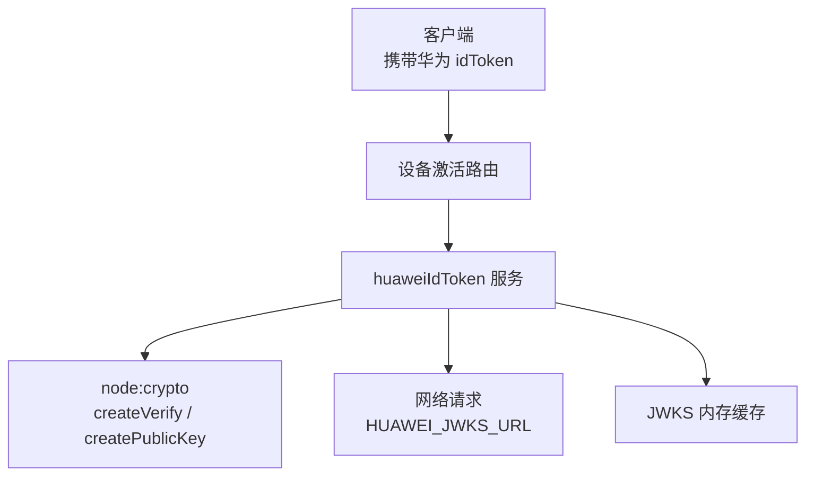
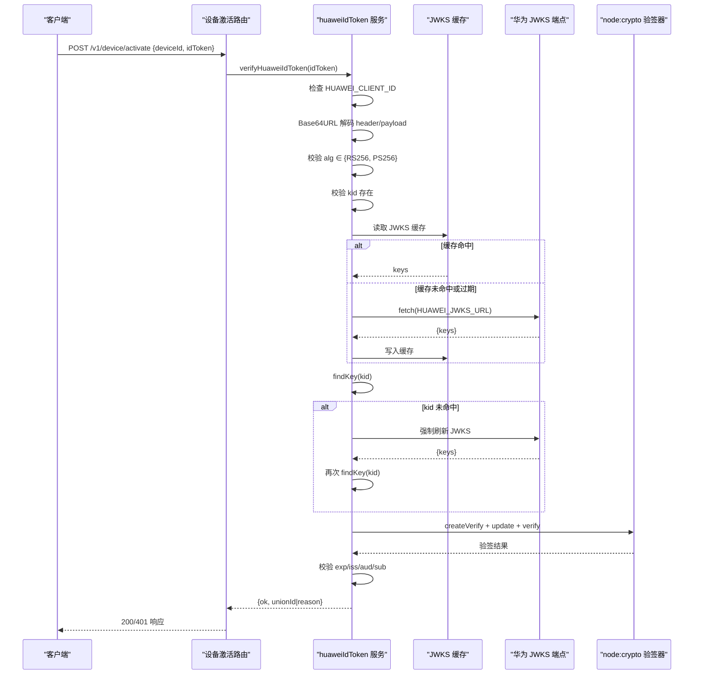
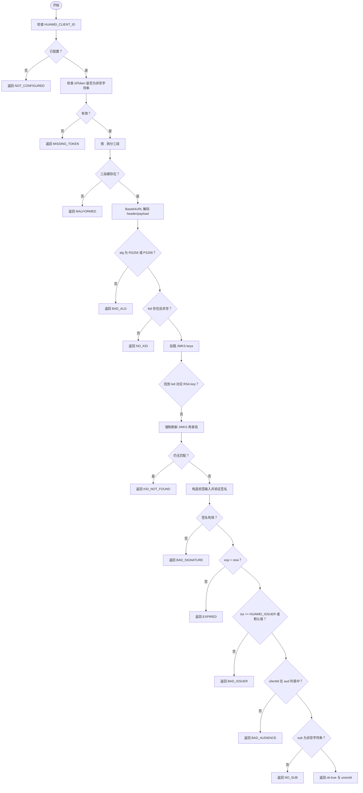
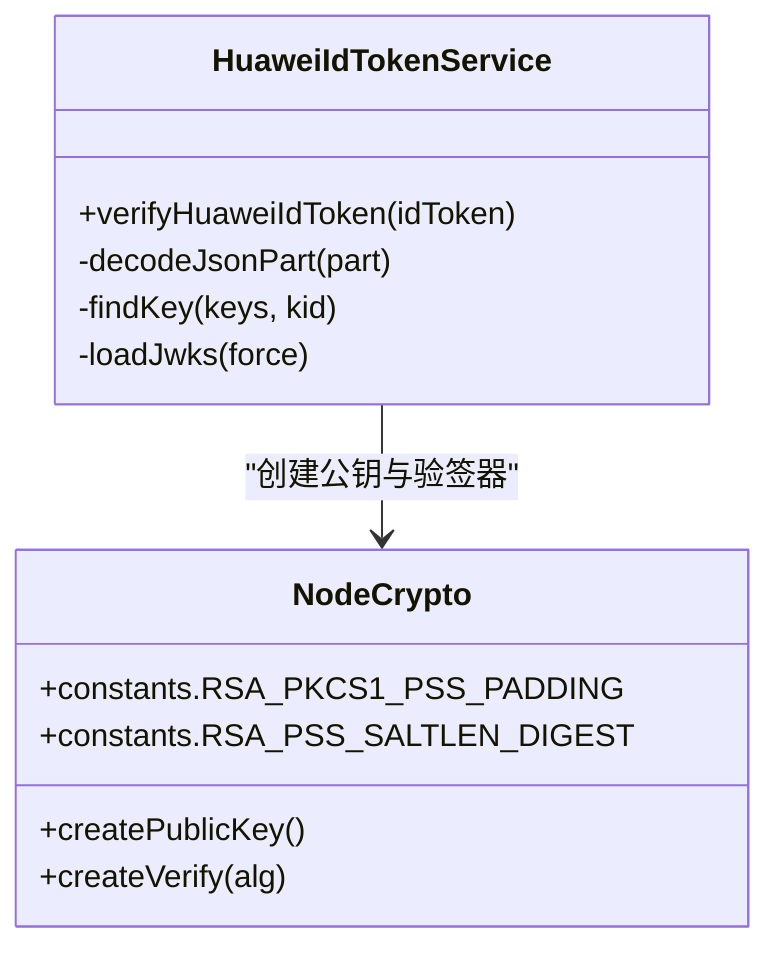
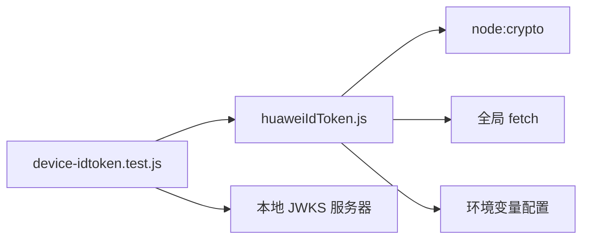
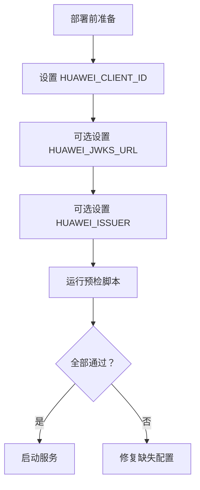

# 华为 ID Token 验证

<cite>
**本文引用的文件**
- [bff/src/services/huaweiIdToken.js](file://bff/src/services/huaweiIdToken.js)
- [bff/test/device-idtoken.test.js](file://bff/test/device-idtoken.test.js)
- [bff/.env.example](file://bff/.env.example)
- [bff/README.md](file://bff/README.md)
- [bff/scripts/preflight.mjs](file://bff/scripts/preflight.mjs)
</cite>

## 目录
1. [简介](#简介)
2. [项目结构定位](#项目结构定位)
3. [核心组件](#核心组件)
4. [架构总览](#架构总览)
5. [详细组件分析](#详细组件分析)
6. [依赖关系分析](#依赖关系分析)
7. [性能与缓存策略](#性能与缓存策略)
8. [错误原因枚举](#错误原因枚举)
9. [部署与配置指南](#部署与配置指南)
10. [故障排查](#故障排查)
11. [结论](#结论)

## 简介
本服务实现华为 Account Kit idToken 的本地验签，用于设备激活流程中识别并绑定华为账号。它不依赖在线 tokeninfo 接口，而是通过 JWKS 获取公钥、使用 Node.js 内置 crypto 模块完成 RS256 与 PS256 签名校验，并校验签发者、受众和过期时间，最终从 payload.sub 提取 unionId。

安全设计遵循 fail-closed：未配置 Client ID、JWKS 不可用、kid 缺失或无法匹配、签名无效、issuer/aud/exp 任一校验失败，均返回 `ok:false`，不会降级放行。

## 项目结构定位
该功能位于 BFF（后端）服务的 `bff/src/services/huaweiIdToken.js`，作为可复用服务被设备激活路由调用；测试用例位于 `bff/test/device-idtoken.test.js`，模拟本地 JWKS 端点和私钥签名 JWT，覆盖 RS256、PS256、算法拒绝、篡改、过期、KID 轮换等场景。

**图示来源**
- [bff/src/services/huaweiIdToken.js:1-161](file://bff/src/services/huaweiIdToken.js#L1-L161)

**章节来源**
- [bff/src/services/huaweiIdToken.js:1-161](file://bff/src/services/huaweiIdToken.js#L1-L161)
- [bff/test/device-idtoken.test.js:1-184](file://bff/test/device-idtoken.test.js#L1-L184)

## 核心组件
- **配置检查**：通过 `HUAWEI_CLIENT_ID` 判断服务是否启用；未配置时返回 `NOT_CONFIGURED`。
- **JWT 解析**：按 `.` 三段切分，Base64URL 解码 header 与 payload。
- **算法白名单**：仅接受 `RS256` 与 `PS256`，拒绝 `none` 及 HS* 等对称算法。
- **kid 匹配**：从 JWKS keys 中查找 `kid` 且 `kty === 'RSA'` 的条目。
- **公钥加载**：从 `HUAWEI_JWKS_URL` 拉取 JWKS，支持自定义 URL 与默认官方地址。
- **签名验证**：使用 `node:crypto.createVerify('RSA-SHA256')`；PS256 使用 RSA-PSS 填充模式，盐长等于摘要长度；RS256 使用默认 PKCS#1 v1.5 路径。
- **声明校验**：iss、aud、exp、sub 依次校验，sub 即为 unionId。
- **缓存刷新**：首次找不到 kid 时强制重新拉取 JWKS，避免公钥轮换期间的 10 分钟“假性失效”。

**章节来源**
- [bff/src/services/huaweiIdToken.js:1-161](file://bff/src/services/huaweiIdToken.js#L1-L161)

## 架构总览
以下序列图展示一次带 idToken 的设备激活请求在 BFF 中的完整处理链路：

**图示来源**
- [bff/src/services/huaweiIdToken.js:1-161](file://bff/src/services/huaweiIdToken.js#L1-L161)
- [bff/test/device-idtoken.test.js:1-184](file://bff/test/device-idtoken.test.js#L1-L184)

## 详细组件分析

### 令牌字段校验流程
令牌进入后按顺序执行以下校验：

**图示来源**
- [bff/src/services/huaweiIdToken.js:62-157](file://bff/src/services/huaweiIdToken.js#L62-L157)

**章节来源**
- [bff/src/services/huaweiIdToken.js:62-157](file://bff/src/services/huaweiIdToken.js#L62-L157)

### JWKS 公钥获取与 kid 匹配
- **JWKS URL 来源**：优先使用环境变量 `HUAWEI_JWKS_URL`，否则回退到官方默认地址。
- **HTTP 健壮性**：使用 AbortSignal 设置超时；非 2xx 响应抛出错误；响应体必须包含非空 `keys` 数组。
- **缓存结构**：记录 url、keys、at 三个字段，只有当缓存 url 与当前一致且未超过 TTL 且 keys 非空时才直接返回。
- **kid 查找**：遍历 keys，要求 `kid` 相等且 `kty === 'RSA'`；若首次未命中，则强制重新拉取一次 JWKS 再做一次查找，最后仍未命中才返回 `KID_NOT_FOUND`。

**章节来源**
- [bff/src/services/huaweiIdToken.js:23-49](file://bff/src/services/huaweiIdToken.js#L23-L49)
- [bff/src/services/huaweiIdToken.js:51-61](file://bff/src/services/huaweiIdToken.js#L51-L61)
- [bff/src/services/huaweiIdToken.js:96-111](file://bff/src/services/huaweiIdToken.js#L96-L111)

### 签名验证实现
- **验签入口**：使用 `node:crypto.createVerify('RSA-SHA256')`。
- **签名输入**：由原始 header 与 payload 的 Base64URL 文本拼接 `header.payload`。
- **RS256 路径**：直接传入 signature 进行 PKCS#1 v1.5 验签。
- **PS256 路径**：显式指定 `padding = RSA_PKCS1_PSS_PADDING` 且 `saltLength = RSA_PSS_SALTLEN_DIGEST`。
- **异常收敛**：任何底层 crypto 异常都会落入签名失败分支，返回 `BAD_SIGNATURE`。

**图示来源**
- [bff/src/services/huaweiIdToken.js:12-16](file://bff/src/services/huaweiIdToken.js#L12-L16)
- [bff/src/services/huaweiIdToken.js:112-141](file://bff/src/services/huaweiIdToken.js#L112-L141)

**章节来源**
- [bff/src/services/huaweiIdToken.js:112-141](file://bff/src/services/huaweiIdToken.js#L112-L141)

### 安全边界与失败关闭原则
- **fail-closed**：所有前置条件失败都返回 `ok:false`，包括未配置、缺少 token、格式错误、算法非法、kid 缺失、JWKS 不可用、kid 找不到、JWK 非法、签名失败、过期、签发者错误、受众错误、缺少 sub。
- **算法混淆防护**：只允许 RS256 与 PS256，明确拒绝 none 与对称算法。
- **audience 严格绑定**：payload.aud 必须包含 `HUAWEI_CLIENT_ID`。
- **unionId 来源可信**：仅在签名有效并通过 iss/aud/exp 校验后，才信任 sub 作为 unionId。
- **KID_NOT_FOUND 降级刷新**：首次找不到 kid 时强制刷新一次 JWKS，避免公钥轮换窗口导致大规模误拒。

**章节来源**
- [bff/src/services/huaweiIdToken.js:1-16](file://bff/src/services/huaweiIdToken.js#L1-L16)
- [bff/src/services/huaweiIdToken.js:62-157](file://bff/src/services/huaweiIdToken.js#L62-L157)

## 依赖关系分析
- **运行时依赖**：Node.js 内置模块 `node:crypto` 提供密钥与签名能力；无需第三方 JWT 库。
- **网络依赖**：依赖全局 `fetch` 访问 JWKS 端点，并通过 AbortSignal 控制超时。
- **环境变量依赖**：`HUAWEI_CLIENT_ID`、可选的 `HUAWEI_JWKS_URL`、可选的 `HUAWEI_ISSUER`。
- **测试依赖**：测试文件使用 `node:test`、Express、`node:http` 与 `node:crypto` 生成测试公钥对、启动本地 JWKS 服务器，并构造 RS256/PS256 签名 JWT。

**图示来源**
- [bff/src/services/huaweiIdToken.js:12-16](file://bff/src/services/huaweiIdToken.js#L12-L16)
- [bff/test/device-idtoken.test.js:1-40](file://bff/test/device-idtoken.test.js#L1-L40)

**章节来源**
- [bff/src/services/huaweiIdToken.js:12-16](file://bff/src/services/huaweiIdToken.js#L12-L16)
- [bff/test/device-idtoken.test.js:1-40](file://bff/test/device-idtoken.test.js#L1-L40)

## 性能与缓存策略
- **JWKS TTL**：默认缓存 10 分钟，减少重复网络请求。
- **JWKS 超时**：单次 JWKS 请求最多等待 5 秒，避免阻塞验签主流程。
- **URL 一致性**：缓存同时比较 url，防止不同环境或代理 URL 混用。
- **冷启动优化**：首次请求会触发网络 I/O，后续请求在 TTL 内走内存缓存。
- **轮换容错**：kid 未命中时强制刷新一次，降低公钥轮换导致的瞬时失败面。

**章节来源**
- [bff/src/services/huaweiIdToken.js:20-24](file://bff/src/services/huaweiIdToken.js#L20-L24)
- [bff/src/services/huaweiIdToken.js:41-50](file://bff/src/services/huaweiIdToken.js#L41-L50)
- [bff/src/services/huaweiIdToken.js:96-111](file://bff/src/services/huaweiIdToken.js#L96-L111)

## 错误原因枚举
| 错误原因 | 含义 | 典型触发条件 | 建议处理 |
|---|---|---|---|
| `NOT_CONFIGURED` | 服务未启用 | 未设置 `HUAWEI_CLIENT_ID` | 检查部署配置，确认 Client ID 已注入 |
| `MISSING_TOKEN` | 缺少令牌 | idToken 为空或非字符串 | 检查客户端是否正确携带 idToken |
| `MALFORMED` | 令牌格式错误 | 不是三段结构或 Base64URL 解码失败 | 检查 JWT 生成方与传输编码 |
| `NO_KID` | 缺少密钥标识符 | header.kid 不存在或为空 | 检查签发方是否包含 kid |
| `BAD_ALG` | 不支持的算法 | alg 不是 RS256 或 PS256 | 禁止使用 none 或对称算法 |
| `JWKS_UNAVAILABLE` | JWKS 不可用 | 网络超时、非 2xx、keys 为空 | 检查网络、代理与 JWKS 端点可用性 |
| `KID_NOT_FOUND` | 未找到匹配的 kid | JWKS 中无对应 RSA 公钥 | 等待公钥轮换完成或检查缓存刷新逻辑 |
| `BAD_JWK` | JWK 非法 | 公钥格式不符合 JWK 规范 | 检查 JWKS 数据完整性 |
| `BAD_SIGNATURE` | 签名无效 | 签名不匹配或解密失败 | 检查私钥、算法、盐长与载荷是否被篡改 |
| `EXPIRED` | 令牌已过期 | exp ≤ 当前时间 | 检查客户端时间同步与令牌生命周期 |
| `BAD_ISSUER` | 签发者不匹配 | iss 不等于预期 issuer | 检查 `HUAWEI_ISSUER` 或默认签发者 |
| `BAD_AUDIENCE` | 受众不匹配 | aud 不包含 Client ID | 检查 AGC 应用 Client ID 配置 |
| `NO_SUB` | 缺少用户标识 | sub 为空或非字符串 | 检查华为侧 token 生成 |

**章节来源**
- [bff/src/services/huaweiIdToken.js:62-157](file://bff/src/services/huaweiIdToken.js#L62-L157)

## 部署与配置指南

### 必需环境变量
- `HUAWEI_CLIENT_ID`：AGC 应用的 Client ID，用于校验 `payload.aud`。未配置时所有带身份激活都会被拒绝。

### 可选环境变量
- `HUAWEI_JWKS_URL`：自定义 JWKS 端点地址；未配置时使用官方默认地址。
- `HUAWEI_ISSUER`：自定义签发者地址；未配置时使用默认签发者。

### 预检与文档说明
- 预检脚本会检查 `HUAWEI_CLIENT_ID` 是否存在，未配置时会报告 idToken audience 校验不可用。
- README 文档明确说明：未配置 `HUAWEI_CLIENT_ID` 时，带身份的激活一律 401。

**图示来源**
- [bff/.env.example:23-27](file://bff/.env.example#L23-L27)
- [bff/README.md:135-135](file://bff/README.md#L135-L135)
- [bff/scripts/preflight.mjs:118-121](file://bff/scripts/preflight.mjs#L118-L121)

**章节来源**
- [bff/.env.example:23-27](file://bff/.env.example#L23-L27)
- [bff/README.md:135-135](file://bff/README.md#L135-L135)
- [bff/scripts/preflight.mjs:118-121](file://bff/scripts/preflight.mjs#L118-L121)

## 故障排查
- **返回 NOT_CONFIGURED**：检查容器或进程环境中是否注入 `HUAWEI_CLIENT_ID`。
- **返回 MISSING_TOKEN**：检查请求体是否包含 idToken 字段，且值为字符串。
- **返回 MALFORMED**：确认 JWT 确实是三段 Base64URL 结构，且 header/payload 可正常解码。
- **返回 BAD_ALG**：确认华为侧签发的是 RS256 或 PS256；不要接受 none 或 HS*。
- **返回 KID_NOT_FOUND**：可能处于公钥轮换期，服务已自动强制刷新一次；若持续出现，检查 JWKS 端点是否返回正确 kid。
- **返回 BAD_SIGNATURE**：常见于载荷被篡改、算法参数不一致、PS256 盐长配置错误；测试用例覆盖了 PS256 与 RS256 两种签名路径。
- **返回 EXPIRED**：检查系统时钟与华为侧令牌有效期；必要时调整业务容忍度或缩短令牌生命周期。
- **返回 BAD_ISSUER**：检查 `HUAWEI_ISSUER` 是否与华为实际签发者一致；通常保持默认即可。
- **返回 BAD_AUDIENCE**：确认 `HUAWEI_CLIENT_ID` 与 AGC 应用配置一致。

测试用例还覆盖了以下关键行为：
- PS256 与 RS256 均可成功验签。
- 篡改 payload、错误 audience、过期、alg=none 均被拒绝。
- JWKS 轮换后，新 kid 能通过强制刷新后验签。
- 同一设备不会被游客激活冒领已有华为账号。
- 并发激活同一个华为账号只会创建一个账号。

**章节来源**
- [bff/test/device-idtoken.test.js:41-184](file://bff/test/device-idtoken.test.js#L41-L184)

## 结论
华为 ID Token 验证服务以最小外部依赖实现了完整的本地验签链路：通过 JWKS 获取公钥、支持 RS256 与 PS256、严格校验 kid、iss、aud、exp 与 sub，并以 fail-closed 原则保障安全性。部署时只需确保 `HUAWEI_CLIENT_ID` 正确配置，并根据需要自定义 JWKS URL 与 issuer；在生产环境中应监控 JWKS 可用性、kid 轮换情况以及验签失败率，以便快速发现证书链与网络问题。